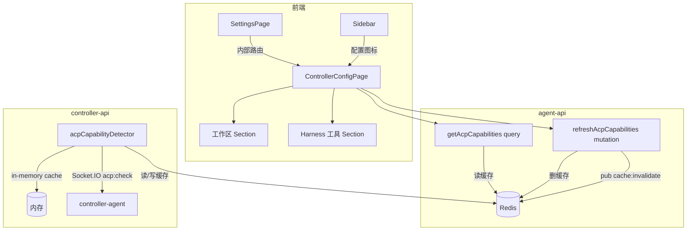
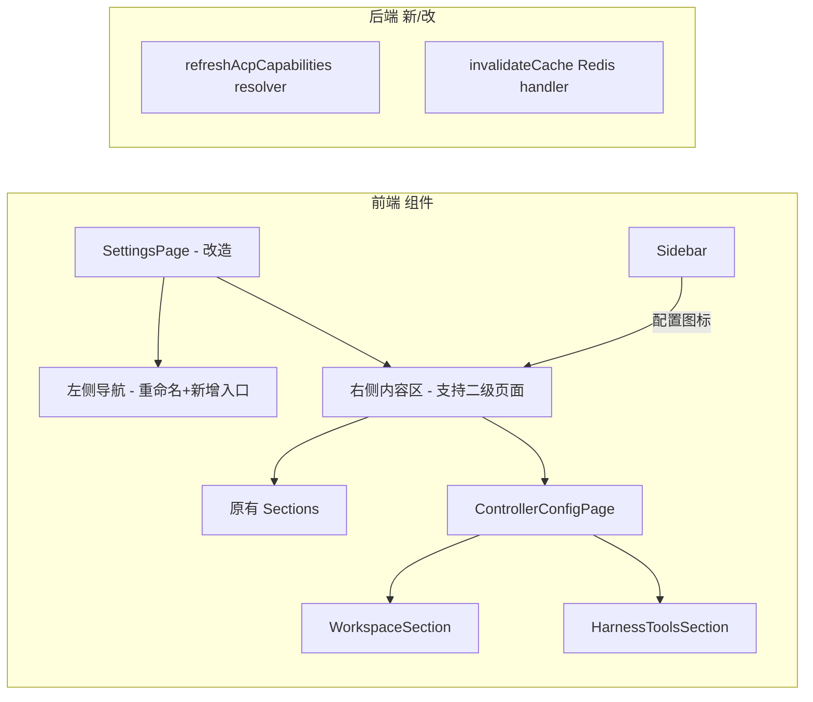
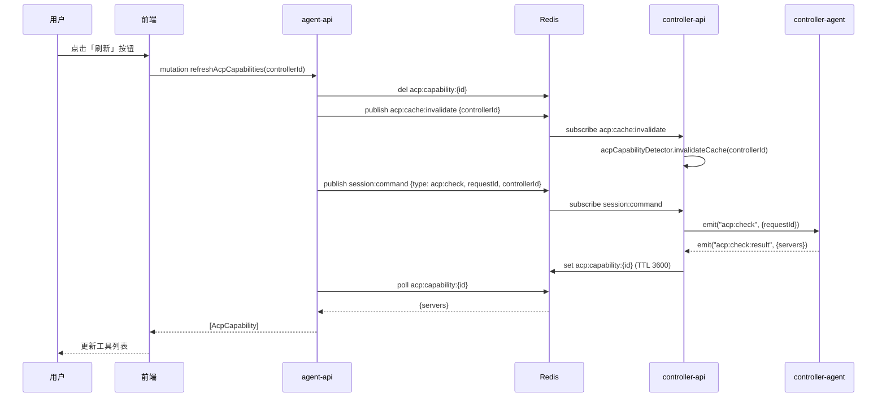
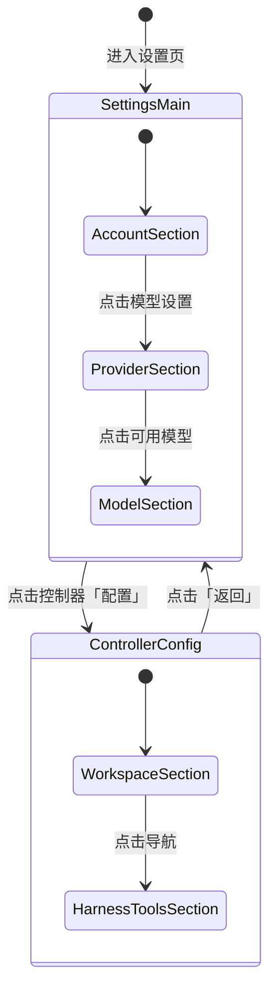

# 本地控制器配置页 - 技术提案

**功能名称**: 本地控制器配置页
**关联 PRD**: local-controller-config-page.md
**技术提案版本**: v1.0
**创建日期**: 2026-05-22
**作者**: ZeroAsh
**feat-branch**: `feat/local-controller-config-page`

## 1. 概述

### 1.1 背景

当前设置页的「控制器」板块将所有功能集中在一个长页面中，工作区管理以 Dialog 形式弹出，操作路径长、信息密度低。此外，用户无法在 Web 界面中直观查看控制器可用的 ACP Harness 工具列表，只能在创建 Session 时临时发现。需要将控制器配置拆分为独立的二级页面，承载工作区管理和 Harness 工具展示。

### 1.2 目标

- 将设置页「控制器」更名为「本地控制器」
- 在设置页内实现控制器配置二级页面，采用与设置页一致的双栏布局
- 将工作区管理从 Dialog 迁移为页面内 Section
- 新增可用 Harness 工具（ACP Server）列表 Section，支持缓存读取和手动刷新
- 在侧边栏控制器节点上增加配置入口

### 1.3 范围

**做**:
- 设置页左侧导航重命名及结构调整
- 控制器配置二级页面（ControllerConfigPage），包含工作区和 Harness 工具两个 Section
- 工作区管理从 Dialog 迁移到页面内 Section（保留所有现有功能）
- Harness 工具列表展示及刷新机制
- 侧边栏控制器节点增加配置图标入口
- 新增 GraphQL mutation `refreshAcpCapabilities`
- 新增 Redis 命令 `acp:cache:invalidate` 通知 controller-api 清内存缓存

**不做**:
- 不修改工作区 CRUD 后端逻辑
- 不修改 ACP 能力检测核心逻辑
- 不影响 Session 创建流程

## 2. 技术架构

### 2.1 系统架构图



### 2.2 技术栈

| 层级 | 技术选型 | 说明 |
|------|---------|------|
| 前端 | React 19 + TypeScript + Tailwind CSS | 与现有设置页一致 |
| 前端路由 | React Router v7 + 内部状态路由 | 设置页内二级页面通过状态控制 |
| 后端 | Express v5 + GraphQL-Yoga | 新增 refreshAcpCapabilities mutation |
| 缓存 | Redis | ACP capabilities 缓存 (TTL 1h) |
| 通信 | Redis Pub/Sub + Socket.IO | cache:invalidate 通知 |

### 2.3 模块划分



| 模块 | 职责 | 关键技术点 |
|------|------|-----------|
| ControllerConfigPage | 单个控制器的配置二级页面 | 双栏布局、状态路由 |
| WorkspaceSection | 工作区 CRUD 页面内 Section | 迁移自 WorkspaceManagerDialog |
| HarnessToolsSection | 展示 ACP Server 列表及刷新 | 缓存读取、手动失效 |
| refreshAcpCapabilities | 刷新能力的 GraphQL mutation | 删 Redis 缓存 + 通知 controller-api 清内存缓存 |
| invalidateCache handler | controller-api 接收缓存失效通知 | 新增 Redis 订阅命令 |

## 3. API 设计

### 3.1 GraphQL 契约变更

#### 新增 Mutation

```graphql
extend type Mutation {
  refreshAcpCapabilities(controllerId: ID!): [AcpCapability!]!
}
```

#### 现有 AcpCapability 类型不变

```graphql
type AcpCapability {
  type: AcpServerType!
  available: Boolean!
  version: String
}
```

### 3.2 内部接口

#### Redis Pub/Sub 新增命令

| 命令类型 | Payload | 生产者 | 消费者 | 说明 |
|---------|---------|--------|--------|------|
| `acp:cache:invalidate` | `{ controllerId: string }` | agent-api | controller-api | 通知清内存缓存 |

#### GraphQL Resolver 逻辑

`refreshAcpCapabilities`:
1. 验证控制器归属
2. 删除 Redis key: `acp:capability:${controllerId}`
3. Publish Redis `acp:cache:invalidate` 通知 controller-api 清内存缓存
4. 调用 `getAcpCapabilities`（此时缓存已空，将重新探测）
5. 返回探测结果

### 3.3 刷新流程



## 4. 数据模型

### 4.1 数据库设计

无变更。工作区和 ACP capabilities 数据模型与现有保持一致。

### 4.2 缓存设计

| Key | 类型 | TTL | 说明 |
|-----|------|-----|------|
| `acp:capability:${controllerId}` | String (JSON) | 3600s | ACP Server 探测结果，含 servers 数组和 checkedAt |

刷新时主动删除此 key，强使下一次读取重新探测。

## 5. 技术实现方案

### 5.1 核心流程

#### 前端页面路由



SettingsPage 内部维护 `selectedControllerId` 状态：
- `null` = 显示原有设置内容（帐号/供应商/模型/控制器列表）
- 非 `null` = 显示对应控制器的配置页

#### 侧边栏入口

Sidebar 中每个控制器项增加齿轮图标，点击后：
1. 导航到 `/settings` 页面
2. 通过 URL query parameter `?controllerId=xxx` 传递控制器 ID
3. SettingsPage 初始化时读取 query parameter，设置 `selectedControllerId`

### 5.2 关键实现点

#### 实现点 1: SettingsPage 改造 - 支持二级页面

- **文件**: `apps/agent-web/src/pages/SettingsPage.tsx`
- **改动**:
  - 左侧导航「控制器」→「本地控制器」
  - 新增内部状态 `selectedControllerId: string | null`
  - `selectedControllerId` 非空时，右侧内容区渲染 `<ControllerConfigPage controllerId={...} onBack={() => setSelectedControllerId(null)} />`
  - 从 URL query parameter `?controllerId=xxx` 读取初始值
  - 控制器管理列表中「管理工作区」按钮改为跳转到控制器配置页（设置 `selectedControllerId` + 定位到工作区 Section）
- **风险点**: 需要处理好页面状态与 URL 的同步

#### 实现点 2: ControllerConfigPage 组件（新建）

- **文件**: `apps/agent-web/src/pages/ControllerConfigPage.tsx`
- **布局**: 与 SettingsPage 相同的 `grid grid-cols-[200px_1fr]` 双栏布局
  - 左侧导航：工作区 | 可用 Harness 工具
  - 右侧内容：对应 Section 内容
  - 顶部：控制器名称/状态 + 「返回」按钮
- **Props**: `controllerId`, `controllerName`, `onBack`, `initialSection?`

#### 实现点 3: WorkspaceSection 组件（新建，从 WorkspaceManagerDialog 迁移）

- **文件**: `apps/agent-web/src/components/settings/WorkspaceSection.tsx`
- **逻辑**: 从 `WorkspaceManagerDialog.tsx` 迁移所有功能
  - 保持所有 CRUD 逻辑不变（createWorkspace, deleteWorkspace, clearWorkspaces, toggleWorkspace）
  - 移除 Dialog 包裹层，改为直接渲染在页面中
  - 保持目录选择器（DirectoryPicker）的集成方式
  - 保持「历史会话」按钮及 HistorySessionDialog 的弹出
- **原有文件**: `WorkspaceManagerDialog.tsx` 保留但改为内部调用 WorkspaceSection（或直接移除不再使用的 Dialog）

#### 实现点 4: HarnessToolsSection 组件（新建）

- **文件**: `apps/agent-web/src/components/settings/HarnessToolsSection.tsx`
- **功能**:
  - 使用 `GET_ACP_CAPABILITIES` query 获取数据
  - 展示工具列表：名称（type）、状态（available 显示「可用」/「不可用」）、版本号
  - 「刷新」按钮，调用 `REFRESH_ACP_CAPABILITIES` mutation
  - 刷新时按钮显示 loading 状态
  - 显示上次刷新/检测时间（从 `checkedAt` 字段获取）
  - 空状态处理：无可用工具时显示提示
- **新增 GraphQL query 字段**: `acpCapabilities` 返回数据中需包含 `checkedAt` 字段（当前类型中没有，需要在 `AcpCapability` 中增加，或单独查询）

#### 实现点 5: 新增 refreshAcpCapabilities mutation

- **文件**: `servers/agent-api/src/graphql/schemas/session.ts`
- **新增 typeDef**: 
  ```graphql
  extend type Mutation {
    refreshAcpCapabilities(controllerId: ID!): [AcpCapability!]!
  }
  ```
- **文件**: `servers/agent-api/src/graphql/resolvers/session.ts`
- **新增 resolver**: 调用 `sessionService.refreshAcpCapabilities`

#### 实现点 6: sessionService.refreshAcpCapabilities

- **文件**: `servers/agent-api/src/services/session.ts`
- **新增方法**:
  1. 验证控制器归属
  2. Redis `del('acp:capability:' + controllerId)`
  3. Redis `publish('session:command', { type: 'acp:cache:invalidate', controllerId })`
  4. 调用 `this.getAcpCapabilities(controllerId, userId)` 触发重新探测
  5. 返回结果
- **风险点**:  `getAcpCapabilities` 有 10s 超时，需确保刷新操作在合理时间内返回

#### 实现点 7: controller-api 处理 acp:cache:invalidate

- **文件**: `servers/controller-api/src/services/session-command.ts`
- **改动**: 在 `subscribe` 的 command 分支中新增：
  ```typescript
  } else if (command.type === 'acp:cache:invalidate' && command.controllerId) {
    acpCapabilityDetector.invalidateCache(command.controllerId);
  }
  ```
- **说明**: `acpCapabilityDetector.invalidateCache()` 已存在，会同时清内存缓存和 Redis 缓存

#### 实现点 8: Sidebar 控制器节点增加配置图标

- **文件**: `apps/agent-web/src/components/Sidebar.tsx`
- **改动**: 在控制器节点行（`<button>` 内），显示名称后增加齿轮 SVG 图标
  - 点击图标：`navigate('/settings?controllerId=' + controller.id)`
  - 图标需与展开/折叠箭头区分，放在名称右侧、箭头左侧
  - 防止点击图标时触发展开/折叠

#### 实现点 9: 设置页控制器列表保留快捷入口

- **文件**: `apps/agent-web/src/components/settings/ControllerListSection.tsx`
- **改动**: 
  - 「管理工作区」按钮改为跳转到控制器配置页
  - 使用回调 `onNavigateToConfig(controllerId: string)` 通知 SettingsPage 切换状态

#### 实现点 10: AcpCapability 增加 checkedAt 字段

- **文件**: `contracts/agent-session.graphql`
- **改动**: 
  ```graphql
  type AcpCapability {
    type: AcpServerType!
    available: Boolean!
    version: String
    checkedAt: String
  }
  ```
- **后端**: `session.ts` 的 `getAcpCapabilities` 返回数据时从缓存 JSON 中提取 `checkedAt` 字段

### 5.3 文件变更清单

```
# 前端 - 新增
apps/agent-web/src/
├── pages/
│   └── ControllerConfigPage.tsx          # 控制器配置二级页面
└── components/
    └── settings/
        ├── WorkspaceSection.tsx          # 工作区 Section（从 Dialog 迁移）
        └── HarnessToolsSection.tsx       # Harness 工具列表 Section

# 前端 - 修改
apps/agent-web/src/
├── pages/
│   └── SettingsPage.tsx                  # 支持二级页面 + 导航重命名
├── components/
│   ├── Sidebar.tsx                       # 控制器节点增加配置图标
│   └── settings/
│       ├── ControllerListSection.tsx     # 管理工作区→跳转配置页
│       └── WorkspaceManagerDialog.tsx    # 可选：保留或移除
├── graphql/
│   ├── queries.ts                        # 新增 GET_ACP_CAPABILITIES_WITH_TIME
│   ├── mutations.ts                      # 新增 REFRESH_ACP_CAPABILITIES
│   └── types.ts                          # 新增类型

# 后端 agent-api - 修改
servers/agent-api/src/
├── graphql/
│   ├── schemas/
│   │   └── session.ts                    # 新增 refreshAcpCapabilities mutation
│   └── resolvers/
│       └── session.ts                    # 新增 resolver
└── services/
    └── session.ts                        # 新增 refreshAcpCapabilities 方法

# 后端 controller-api - 修改
servers/controller-api/src/
└── services/
    └── session-command.ts                # 新增 acp:cache:invalidate 处理

# Contract
contracts/
└── agent-session.graphql                 # AcpCapability 增加 checkedAt
```

## 6. 技术决策

### 6.1 决策列表

| 决策 | 选项 A | 选项 B | 最终选择 | 原因 |
|------|--------|--------|---------|------|
| 二级页面实现方式 | 内部状态驱动 | React Router 嵌套路由 | 内部状态驱动 | 设置页本身已是独立路由，二级页面不改变 URL 更简单；使用 query parameter 传参即可 |
| 工作区 Section 复用 | 从 Dialog 提取公共组件 | 完全重写 | 提取公共组件 | 功能完全一致，避免重复代码 |
| 刷新时缓存失效策略 | agent-api 直接删 Redis key + notify | controller-api 提供单独 API | agent-api 直接删 Redis key + notify | 不需要新增 HTTP 端点，复用 Redis Pub/Sub 即可 |
| AcpCapability 增加 checkedAt | 在后端组装 | 前端从缓存 JSON 解析 | 在后端组装 | 保持 GraphQL 层封装，前端无需了解缓存结构 |

### 6.2 依赖与约束

| 类型 | 内容 | 说明 |
|------|------|------|
| 依赖 | 现有控制器管理 v1 | 控制器列表、状态、工作区 CRUD |
| 依赖 | 现有 ACP 能力检测 | acpCapabilities query + acp:check 流程 |
| 依赖 | `getAcpCapabilities` 已有轮询机制 | 刷新时复用该机制 |
| 约束 | 每个控制器最多 10 个工作区 | 与现有约束一致 |
| 约束 | ACP 能力检测超时 10s | 刷新操作最多等待 10s |

## 7. 项目结构

```
# 新增文件
apps/agent-web/src/pages/
├── SettingsPage.tsx                     # 修改：支持二级页面
└── ControllerConfigPage.tsx             # 新增：控制器配置二级页面

apps/agent-web/src/components/settings/
├── WorkspaceSection.tsx                 # 新增：工作区 Section
└── HarnessToolsSection.tsx             # 新增：Harness 工具 Section

servers/agent-api/src/
├── graphql/
│   ├── schemas/session.ts               # 修改：新增 refreshAcpCapabilities
│   └── resolvers/session.ts             # 修改：新增 resolver
└── services/session.ts                  # 修改：新增方法

servers/controller-api/src/
└── services/session-command.ts          # 修改：新增 acp:cache:invalidate

contracts/agent-session.graphql          # 修改：AcpCapability + checkedAt

# 修改文件
apps/agent-web/src/
├── components/
│   ├── Sidebar.tsx                      # 修改：配置图标
│   ├── settings/ControllerListSection.tsx # 修改：快捷入口跳转
└── graphql/
    ├── queries.ts                       # 修改：新查询
    ├── mutations.ts                     # 修改：新 mutation
    └── types.ts                         # 修改：新类型
```

## 8. 测试策略

### 8.1 测试覆盖要求

- 单元测试覆盖率: >= 80%
- API 测试覆盖: `refreshAcpCapabilities` mutation, 缓存失效逻辑
- 前端组件测试覆盖: ControllerConfigPage, WorkspaceSection, HarnessToolsSection

### 8.2 测试类型

| 类型 | 工具 | 覆盖范围 |
|------|------|---------|
| 单元测试 | Vitest | `sessionService.refreshAcpCapabilities` |
| API 测试 | Vitest | `refreshAcpCapabilities` GraphQL resolver |
| 前端组件测试 | Vitest + React Testing Library | 页面渲染、section 切换、刷新交互 |
| E2E 测试 | Vitest | 完整流程：侧边栏入口→配置页→工作区管理→刷新工具列表 |

## 9. 验收标准

- [ ] 技术方案评审通过
- [ ] Contract 评审通过
- [ ] 设置页「控制器」更名为「本地控制器」
- [ ] 点击控制器配置入口进入二级页面，双栏布局正确
- [ ] 工作区管理从 Dialog 迁移到页面 Section，功能完整
- [ ] Harness 工具列表正确展示，刷新按钮可用
- [ ] 侧边栏控制器节点配置图标可点击跳转
- [ ] API 测试通过
- [ ] E2E 测试通过

## 10. 相关文档

- [关联 PRD](../../product/shipping/20260522-local-controller-config-page.md)
- [现有控制器管理提案](../proposals/20260517-feat-agent-controller-v1.md)
- [工作区管理提案](../proposals/20260519-feat-local-controller-workspace-management.md)
- [设置页提案](../proposals/20260517-feat-user-auth-and-settings.md)
- [开发规范](../common-rules.md)
- [前端规范](../frontend-rules.md)
- [后端规范](../backend-rules.md)
