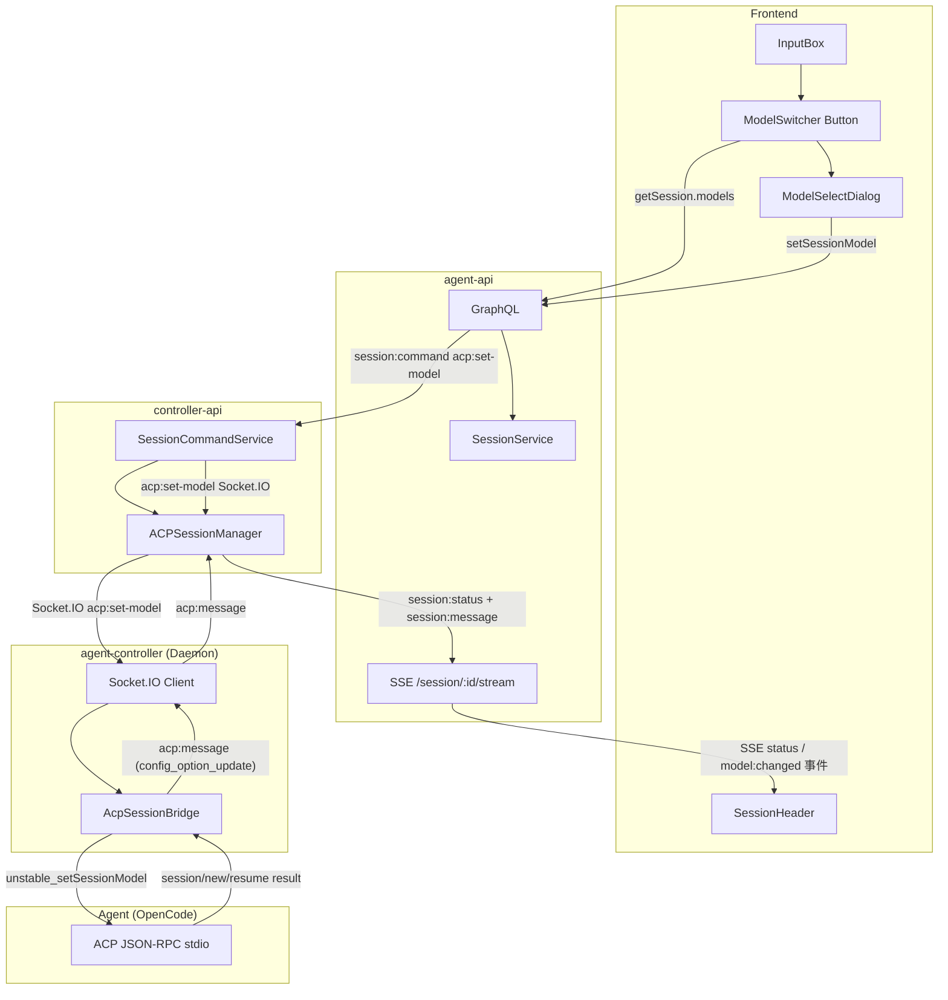
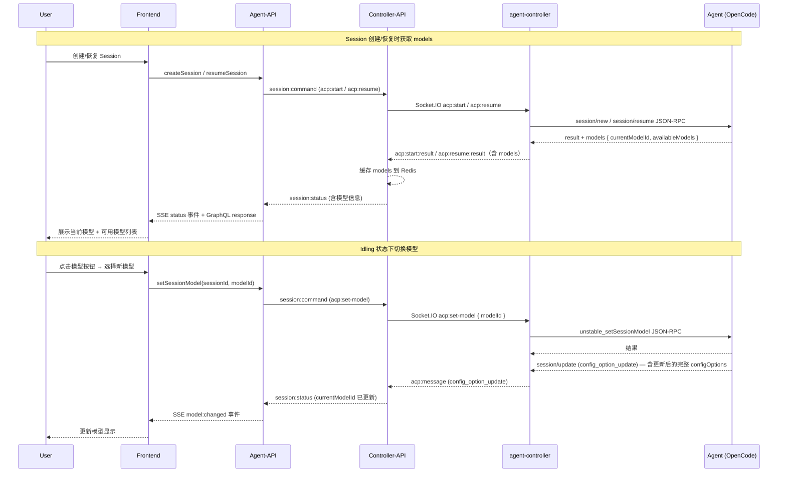
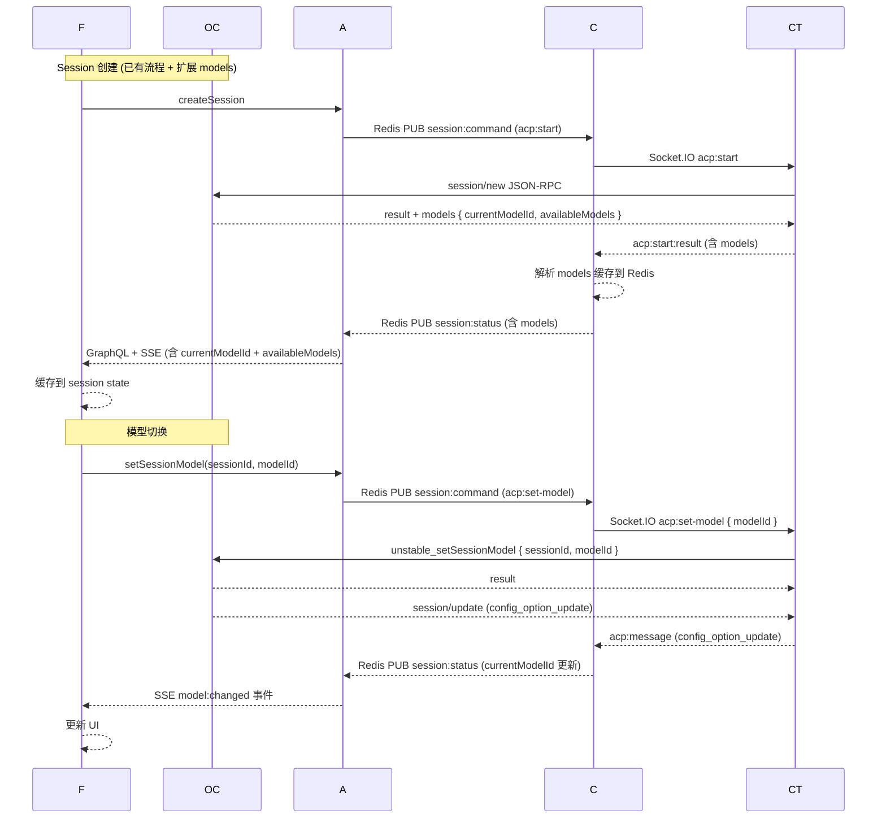

# 模型切换功能支持 - 技术提案

**功能名称**: 模型切换功能支持
**关联 PRD**: `20260522-model-switch-support.md`
**技术提案版本**: v1.0
**创建日期**: 2026-05-22
**作者**: ZeroAsh
**feat-branch**: `feat/model-switch-support`

## 1. 概述

### 1.1 背景

上一期功能「可用模型展示与 Agent 模式切换」实现了模式切换和模型只读展示。本期在此基础上增加模型切换能力，交互方式与模式切换保持一致。

ACP 协议调研结论：
- ACP 协议无专用的 `session/set_model` 方法
- OpenCode (Agent) 支持两种方式切换模型：
  - **`unstable_setSessionModel`** — SDK ClientSideConnection 方法，模型专用切换，与 `setSessionMode` 对应
  - **`session/set_config_option`** — ACP 协议标准的 config options 机制，`configId: "model"`
- 本期采用 `unstable_setSessionModel` 方式，与现有 `setSessionMode` 模式切换的编码风格一致
- 模型信息在 `session/new` / `session/resume` 的 `models` 字段中返回（`currentModelId` + `availableModels`），同时也存在于 `configOptions`（`category: "model"`）

### 1.2 目标

- 前端：输入框左侧新增模型切换按钮，与模式切换按钮并列；点击弹出模型选择 Dialog；SessionHeader 模型展示从只读变为与切换入口同步
- agent-api：扩展 Session GraphQL 类型（`currentModelId` / `availableModels`），新增 `setSessionModel` mutation
- controller-api：新增 `acp:set-model` 命令处理，转发到 Agent；透传 Agent 返回的 `models` 数据
- agent-controller：bridge 新增 `setModel` 方法，调用 SDK `connection.unstable_setSessionModel()`
- 仅 idling 状态允许切换

### 1.3 范围

- **包含**：GraphQL schema 扩展（`currentModelId`、`availableModels`、`setSessionModel`）、SSE 事件扩展（`model:changed`）、Controller-API ACP 协议扩展、agent-controller bridge 扩展、前端 ModelSwitcher 组件（类比 ModeSwitcher）、InputBox 改造、SessionHeader 模型展示更新
- **不包含**：Agent 端模型切换的具体实现（仅转发 ACP 请求）、`session/set_config_option` 方式的实现（如 Agent 支持将来切换）

## 2. 技术架构

### 2.1 系统架构图



### 2.2 数据流



### 2.3 模块划分

| 模块 | 职责 | 关键技术点 |
|------|------|-----------|
| Contract (GraphQL) | 定义 `AgentModel` 类型（含可用模型），扩展 `Session`，新增 `setSessionModel` | GraphQL schema 扩展 |
| Contract (WebSocket) | 扩展 ACP 模型事件和 `session:status` Payload | `unstable_setSessionModel` RPC |
| agent-api (model) | Session 模型增加 `currentModelId` 字段 | Mongoose schema |
| agent-api (resolver) | `setSessionModel` resolver | Redis Pub/Command |
| agent-api (SSE) | `session:status` 事件携带模型信息，`model:changed` SSE 事件 | SSE 协议扩展 |
| controller-api (ACM) | 处理 `acp:set-model`，调用 `unstable_setSessionModel` | ACP JSON-RPC |
| frontend (ModelSwitcher) | 模型切换按钮 + Dialog | React + Tailwind |

## 3. API 设计

### 3.1 GraphQL 契约

扩展 `contracts/agent-session.graphql`：

```graphql
type AgentModel {
  id: String!
  name: String!
  provider: String
}

type Session {
  # ... existing fields, including modes/currentModeId/currentModel
  currentModelId: String
  availableModels: [AgentModel!]
}

type Mutation {
  # ... existing mutations, including setSessionMode
  setSessionModel(sessionId: ID!, modelId: String!): Boolean!
}
```

### 3.2 SSE 协议扩展

`session:status` 事件 payload 扩展（增加 `availableModels`、`currentModelId`）：

```json
{
  "sessionId": "sess_xxx",
  "status": "idling",
  "modes": [...],
  "currentModeId": "code",
  "currentModel": { "id": "claude-sonnet-4", "name": "Claude Sonnet 4" },
  "availableModels": [
    { "id": "claude-sonnet-4-20250514", "name": "Claude Sonnet 4", "provider": "anthropic" },
    { "id": "gpt-4o", "name": "GPT-4o", "provider": "openai" }
  ],
  "currentModelId": "claude-sonnet-4-20250514"
}
```

新增 SSE 事件类型 `model:changed`：

```json
{
  "type": "model:changed",
  "data": {
    "sessionId": "sess_xxx",
    "modelId": "gpt-4o"
  }
}
```

### 3.3 ACP 协议扩展

Agent-controller 调用 SDK `connection.unstable_setSessionModel()`：

```json
{
  "jsonrpc": "2.0",
  "id": 6,
  "method": "unstable_setSessionModel",
  "params": {
    "sessionId": "sess_abc123",
    "modelId": "anthropic/claude-sonnet-4-20250514"
  }
}
```

Agent 切换后发送 `config_option_update` 通知：

```json
{
  "jsonrpc": "2.0",
  "method": "session/update",
  "params": {
    "sessionId": "sess_abc123",
    "update": {
      "sessionUpdate": "config_option_update",
      "configOptions": [
        { "id": "mode", ... },
        { "id": "model", "currentValue": "anthropic/claude-sonnet-4-20250514", ... }
      ]
    }
  }
}
```

### 3.4 Redis Pub/Sub 扩展

`session:command` 新增命令类型 `acp:set-model`：

```json
{
  "type": "acp:set-model",
  "sessionId": "sess_xxx",
  "modelId": "anthropic/claude-sonnet-4-20250514"
}
```

## 4. 数据模型

### 4.1 MongoDB Session 模型扩展

```typescript
// Session 新增/修改字段（agent-api + controller-api）
currentModelId: String,           // 新增：当前模型 ID（如 "anthropic/claude-sonnet-4-20250514"）
availableModels: [{               // 新增：可用模型列表
  id: String,
  name: String,
  provider: String
}],
currentModel: {                   // 已有：当前模型对象（保留向后兼容）
  id: String,
  name: String,
  provider: String
}
```

### 4.2 Redis 缓存扩展

| Key | Value | TTL | 说明 |
|-----|-------|-----|------|
| `session:{id}:modes` | JSON array | Session 活跃期 | 可用模式列表（已有） |
| `session:{id}:currentModeId` | string | Session 活跃期 | 当前模式 ID（已有） |
| `session:{id}:currentModel` | JSON object | Session 活跃期 | 当前模型对象（已有） |
| `session:{id}:currentModelId` | string | Session 活跃期 | 当前模型 ID（新增） |
| `session:{id}:availableModels` | JSON array | Session 活跃期 | 可用模型列表（新增） |

### 4.3 前端状态扩展

```typescript
// SessionPage 新增状态
const [availableModels, setAvailableModels] = useState<AgentModelData[]>([]);
const [currentModelId, setCurrentModelId] = useState<string | null>(null);
```

SSE `status` 事件处理 — 当收到 status 事件时，如果 payload 包含 `availableModels`/`currentModelId`，同步更新 state。SSE `model:changed` 事件更新 `currentModelId`。

## 5. 技术实现方案

### 5.1 核心流程



### 5.2 关键实现点

#### 实现点 1: `availableModels` / `currentModelId` 缓存（agent-controller → controller-api → agent-api）

**描述**: 在 Session 创建和恢复时，从 ACP SDK 的 `session/new` / `session/resume` 结果中提取 `models.availableModels` 和 `models.currentModelId`，逐层上传并缓存。

**步骤**:
1. `AcpSessionBridge`（bridge.ts）调用 `connection.newSession()` / `connection.resumeSession()` 后，从 result 中获取 `models` 对象
2. agent-controller `socketio-client.ts` 通过 `acp:start:result` / `acp:resume:result` 将 `availableModels` + `currentModelId` 带回 controller-api
3. controller-api `acp-session-manager.ts` 解析 payload，缓存到 Redis `session:{id}:availableModels` / `session:{id}:currentModelId`
4. 通过 `session:status` PUB 携带模型信息到 agent-api
5. agent-api 收到后更新 MongoDB Session 文档 + 推送到 SSE
6. 前端通过 GraphQL `getSession` 查询或 SSE `status` 事件获取

**风险点**:
- Agent 可能不返回 `models` 字段（旧版本 OpenCode），需要优雅降级（返回空列表，前端隐藏模型切换入口）
- `models.currentModelId` 格式为 `providerID/modelID`（如 `"anthropic/claude-sonnet-4-20250514"`），需完整透传

#### 实现点 2: `setSessionModel` GraphQL Mutation（agent-api）

**描述**: 前端调用此 mutation 发起模型切换。

**步骤**:
1. 验证 session 属于当前用户且 `status === 'idling'`
2. 发布 `acp:set-model` 到 Redis `session:command` channel
3. 返回 `true`（异步通知，结果通过 SSE 推送）

**技术细节**:
- Redis 命令 payload: `{ type: 'acp:set-model', sessionId, modelId }`
- 切换结果通过 `session:status` 事件（含 `currentModelId`）或 `model:changed` 事件通知前端
- `modelId` 格式为 `providerID/modelID`，与 Agent 返回的 `currentModelId` 格式一致

#### 实现点 3: `acp:set-model` 命令处理（controller-api → agent-controller）

**描述**: controller-api 订阅到 `acp:set-model` 命令后，经 agent-controller 转发 SDK 调用到 Agent。

**步骤**:
1. `session-command.ts` 添加 `acp:set-model` case，查找 controller socket
2. 发送 `acp:set-model { sessionId, modelId }` Socket.IO 事件到 agent-controller
3. agent-controller `socketio-client.ts` 添加 `acp:set-model` 事件处理，找到对应 `AcpSessionBridge`
4. bridge 调用 `connection.unstable_setSessionModel({ sessionId, modelId })`
5. Agent 切换模型后发送 `config_option_update` 通知
6. bridge 将 `config_option_update` 作为 `acp:message` 转发回 controller-api
7. controller-api 收到后更新 Redis `currentModelId` / `availableModels`，发布 `session:status`

**技术细节**:
- SDK v0.22.1 的 `ClientSideConnection` 已声明 `unstable_setSessionModel` 方法
- 切换结果通过 `config_option_update` session update 异步返回

#### 实现点 4: 模型切换 UI（前端）

**描述**: 在 InputBox 左侧添加模型切换按钮 + 弹出 Dialog，与模式切换按钮并列。

**组件结构**:

```
InputBox (改造)
├── ModeSwitcher (已有)
│   ├── 当前模式按钮 [Code ▾]
│   └── ModeSelectDialog (已有)
├── ModelSwitcher (新组件)  ← 新增
│   ├── 当前模型按钮 [Claude Sonnet ▾]
│   └── ModelSelectDialog (新组件)
│       ├── Dialog 标题: "切换模型"
│       ├── 模型列表 (名称 + 供应商 + 选中态 ✓)
│       ├── 加载状态
│       └── 确认/取消按钮
├── textarea
└── Send/Stop 按钮
```

**实现细节**:
- 模型按钮内容: `<当前模型名称> ▾`
- 按钮 disabled 条件: `status !== 'idling' || availableModels.length === 0`
- Dialog 中当前模型高亮标记，显示供应商信息
- 切换时显示加载状态（"Switching..."）
- 切换成功更新按钮文本，失败 Toast 提示
- ModeSwitcher 与 ModelSwitcher 独立运作

**状态管理**:

```typescript
// SessionPage 新增
const [availableModels, setAvailableModels] = useState<AgentModelData[]>([]);
const [currentModelId, setCurrentModelId] = useState<string | null>(null);

// SSE status 事件处理
if (data.data.availableModels) setAvailableModels(data.data.availableModels);
if (data.data.currentModelId) setCurrentModelId(data.data.currentModelId);

// SSE model:changed 事件处理
if (data.data.modelId) setCurrentModelId(data.data.modelId);

// setSessionModel mutation
const handleSetModel = async (modelId: string) => {
  if (!id) return;
  await setSessionModel({ variables: { sessionId: id, modelId } });
};

// 传递到 ModelSwitcher
<InputBox
  availableModels={availableModels}
  currentModelId={currentModelId}
  onSetModel={handleSetModel}
  status={status}
/>
```

#### 实现点 5: SessionHeader 模型展示同步

**描述**: SessionHeader 中已有的模型 badge 展示来源于 `currentModel` 对象。模型切换后需同步更新。

**步骤**:
1. `currentModelId` 变更时，从 `availableModels` 中查找匹配的模型
2. 将匹配的模型对象设为 `currentModel` 供 SessionHeader 展示
3. 若 `availableModels` 中查找不到（如切换后 Agent 返回了新列表），则直接使用切换的 `modelId` 展示模型 ID

### 5.3 与现有模式切换的对比

| 方面 | 模式切换（Mode） | 模型切换（Model） |
|------|-----------------|-------------------|
| SDK 方法 | `connection.setSessionMode()` | `connection.unstable_setSessionModel()` |
| 切换入口 | ModeSwitcher 按钮 | ModelSwitcher 按钮（并列） |
| Dialog | ModeSelectDialog | ModelSelectDialog |
| SSE 事件 | `mode:changed` | `model:changed` |
| Agent 通知 | `current_mode_update` | `config_option_update` |
| 切换限制 | 仅 idling | 仅 idling |
| ACP 稳定性 | 稳定 | unstable（SDK 标记） |

## 6. 技术决策

### 6.1 决策列表

| 决策 | 选项 A | 选项 B | 最终选择 | 原因 |
|------|--------|--------|---------|------|
| 模型切换 ACP 方法 | `unstable_setSessionModel` | `setSessionConfigOption({ configId: "model" })` | 选项 A | 与模式切换 `setSessionMode` 编码风格一致，语义更清晰 |
| 模型 ID 格式 | `providerID/modelID` 完整格式 | 仅 modelID | `providerID/modelID` | ACP 协议和 OpenCode 均使用此格式，唯一标识 |
| `currentModel` 兼容 | 保留 `currentModel` 对象 + 新增 `currentModelId` 字段 | 废除 `currentModel`，只留 `currentModelId` | 保留 `currentModel` | 向后兼容，避免破坏现有 SessionHeader 展示 |
| 模型切换入口位置 | InputBox 左侧，模式按钮后 | SessionHeader 下拉 | InputBox 左侧 | 与模式切换一致，统一交互体验 |

### 6.2 依赖与约束

| 类型 | 内容 | 说明 |
|------|------|------|
| 依赖 | Agent (OpenCode) 需在 `session/new` / `session/resume` 返回 `models` 字段 | 若缺失则显示空/隐藏 |
| 依赖 | Agent 需支持 `unstable_setSessionModel` 方法 | 若缺失则按钮置灰 |
| 约束 | 仅 idling 状态允许切换 | 前端和后端双重校验 |
| 约束 | 模型 ID 格式为 `providerID/modelID` | 需完整透传，不做格式转换 |

## 7. 项目结构变更

```
servers/agent-api/src/
├── models/session.ts                  # +currentModelId, +availableModels (Mongoose)
├── services/session.ts                # +setModel(), mapSession 扩展
├── graphql/
│   ├── schemas/session.ts             # +AgentModel type, +setSessionModel mutation
│   └── resolvers/session.ts           # +setSessionModel resolver
└── services/session-sse.ts            # +model:changed 事件, status 事件扩展

servers/controller-api/src/
├── models/session.ts                  # +currentModelId, +availableModels (Mongoose)
├── services/acp-session-manager.ts    # +setModel(), start/result 解析 models
└── services/session-command.ts        # +acp:set-model handler

packages/agent-controller/src/
├── acp/bridge.ts                     # +setModel(), models 回调
└── socketio-client.ts                # +acp:set-model 事件处理

apps/agent-web/src/
├── components/session/
│   ├── InputBox.tsx                   # 左侧增加 ModelSwitcher
│   ├── ModelSwitcher.tsx             # [NEW] 模型切换按钮
│   ├── ModelSelectDialog.tsx         # [NEW] 模型选择 Dialog
│   └── SessionHeader.tsx             # 模型 badge 同步更新
├── pages/SessionPage.tsx             # +availableModels/currentModelId 状态管理
├── graphql/
│   ├── mutations.ts                  # +SET_SESSION_MODEL
│   ├── queries.ts                    # GET_SESSION 扩展 availableModels/currentModelId
│   └── types.ts                      # +AgentModelData 扩展（currentModelId）

contracts/
├── agent-session.graphql             # 扩展 Session type + AgentModel
└── agent-session-websocket.md        # 更新 session:status payload + model:changed + set_model

docs/engineering/
└── proposals/
    └── 20260522-feat-model-switch-support.md   # 本文件
```

## 8. 测试策略

### 8.1 单元测试

| 模块 | 测试项 |
|------|--------|
| agent-api session.service | setModel 权限校验、Redis PUB、session 状态校验 |
| controller-api session.command | acp:set-model 命令路由 |
| controller-api acp-session-manager | setModel Socket.IO 事件发送、models 缓存 |
| agent-controller socketio-client | acp:set-model 事件分发 |
| agent-controller bridge | setModel SDK 调用（unstable_setSessionModel） |
| frontend ModelSwitcher | 按钮 disabled 状态、Dialog 打开/关闭、模型选择 |
| frontend SessionPage | SSE status/model:changed 事件中 models 解析 |

### 8.2 集成测试

- `setSessionModel` GraphQL mutation 端到端测试（agent-api → Redis → controller-api 路由）
- SSE `status` 事件携带 `availableModels` / `currentModelId` 测试
- SSE `model:changed` 事件触发测试
- 模型切换后 UI 更新验证

### 8.3 E2E 测试

- 模型切换流程：idling 状态下切换模型、按钮状态更新、Dialog 选择
- 模型切换 disabled 状态：running/connecting/ended 下按钮置灰
- 模型与模式切换独立运作验证

## 9. 验收标准

- [x] 技术方案评审通过
- [ ] Contract 评审通过
- [ ] Session 创建/恢复后，前端展示当前模型 ID 和可用模型列表
- [ ] 输入框左侧模型切换按钮在 idling 时可点击
- [ ] 模型选择 Dialog 正确列出可用模型（含供应商信息）
- [ ] 选择新模型后按钮更新，SSE 推送模型变更
- [ ] running/connecting/ended 状态下按钮置灰
- [ ] Agent 不支持 models 时优雅降级（隐藏切换入口）
- [ ] 模型切换与模式切换独立运作

## 10. 相关文档

- [PRD: 模型切换功能支持 (draft)](../../product/draft/20260522-model-switch-support.md)
- [Contract: agent-session.graphql](../../../contracts/agent-session.graphql)
- [Contract: agent-session-websocket.md](../../../contracts/agent-session-websocket.md)
- [可用模型展示与 Agent 模式切换 Proposal](./20260522-feat-available-models-and-mode-switch.md)
- [AACP 协议: Session Config Options](https://agentclientprotocol.com/protocol/session-config-options)
