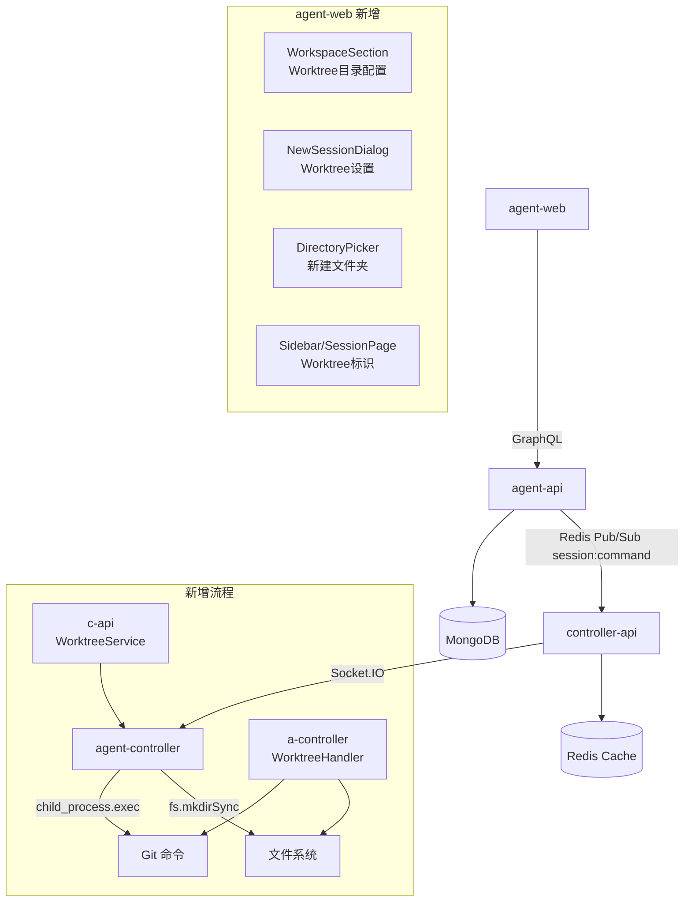
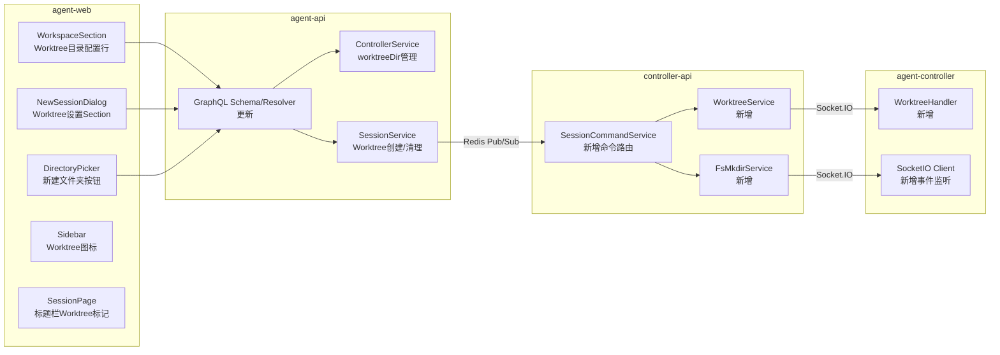
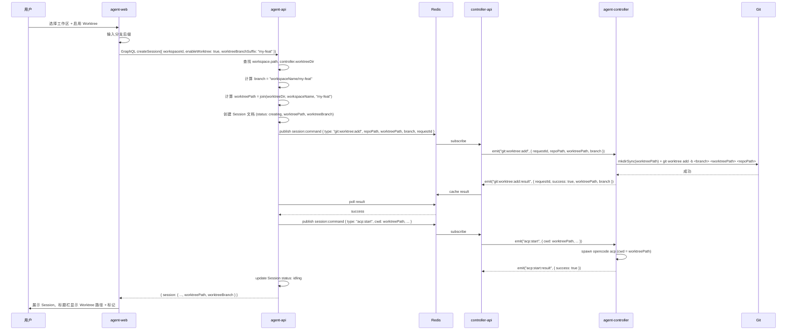
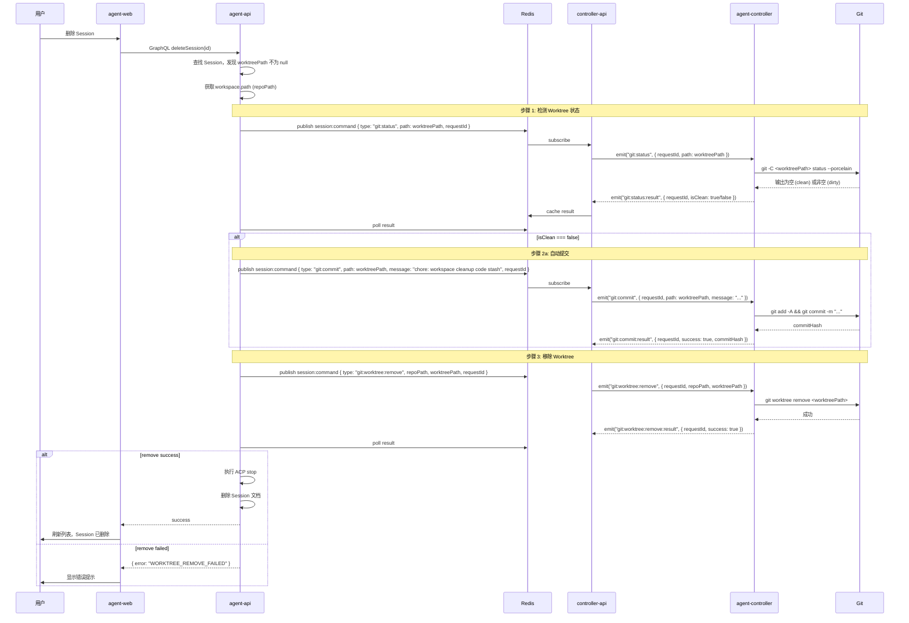
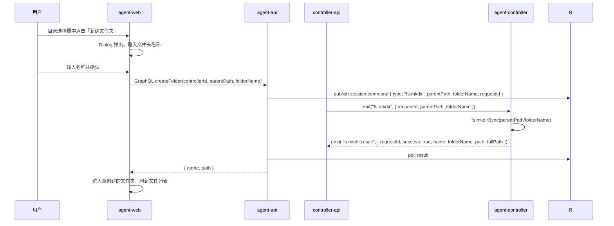

# Git Worktree 集成支持 - 技术提案

**功能名称**: Git Worktree 集成支持
**关联 PRD**: `docs/product/reviewed/20260523-git-worktree-support-prd.md`
**技术提案版本**: v1.0
**创建日期**: 2026-05-23
**作者**: AI
**feat-branch**: `feat/git-worktree-support`

## 1. 概述

### 1.1 背景

当前系统支持工作区（Workspace）管理，用户可以为控制器添加本地目录作为工作区，并在这些目录中开启 Session 进行编码。但所有 Session 共享同一个工作目录，存在分支污染和无法并行的问题。PRD 要求集成 Git Worktree 能力，让每个 Session 拥有独立的隔离工作目录。

已有基础：工作区管理、Git 仓库检测（`git:check`/`git:init`）、Session 创建/销毁流程、目录选择器（`fs:browse`/`fs:home`）。需要在现有架构上新增 Worktree 相关事件、数据模型和 UI。

### 1.2 目标

- 新增控制器级 Worktree 目录配置（默认 `~/.zag/worktrees`）
- Session 创建时检测 Git 仓库，支持启用 Worktree 模式（自动 `git worktree add`）
- Worktree 信息持久化（路径、分支），Session 列表特殊图标标识
- Session 销毁时自动清理：检测 dirty → 自动 commit → `git worktree remove`
- 目录选择器新增「新建文件夹」功能

### 1.3 范围

**做**:
- Controller 模型新增 `worktreeDir` 字段 + GraphQL mutation `setControllerWorktreeDir`
- Session 模型新增 `worktreePath`、`worktreeBranch` 字段
- CreateSessionInput 新增 `enableWorktree`、`worktreeBranchSuffix`
- 新增 WebSocket 事件：`git:worktree:add` / `:remove` / `:result`、`git:status` / `:result`、`git:commit` / `:result`、`fs:mkdir` / `:result`
- agent-controller 侧新增 Git 命令封装（worktree add/remove, status, commit, mkdir）
- controller-api 侧新增请求-响应协调服务
- agent-api 侧新增 Worktree 相关服务逻辑
- 前端工作区设置页顶部新增「Git Worktree 工作目录」配置项
- 前端目录选择器新增「新建文件夹」按钮
- 前端 NewSessionDialog 新增 Worktree 设置 Section
- 前端 Sidebar 中 Worktree Session 使用 Git 分叉图标
- 前端 Session 标题栏显示 Worktree 路径 + 「Worktree」标记

**不做**:
- 多 Worktree 并发管理（每个 Session 独立处理）
- Worktree 的远程分支同步（`git fetch`/`git push`）
- Worktree 自动删除分支（仅移除 worktree，不删除分支引用）
- Worktree 目录的手动管理页面（仅通过 Session 生命周期管理）

## 2. 技术架构

### 2.1 系统架构图



### 2.2 技术栈

| 层级 | 技术选型 | 说明 |
|------|---------|------|
| 前端 | React 19 + TypeScript + Tailwind CSS + Apollo Client | Dialog, Input, Badge 组件 |
| 后端 | Express v5 + GraphQL-Yoga + Mongoose | Node.js 24+ |
| 数据库 | MongoDB | Controller.worktreeDir, Session.worktreePath/Branch |
| 缓存 | Redis | 请求-响应结果缓存 |
| 通信 | Redis Pub/Sub + Socket.IO | 命令下发 + 结果回传 |
| Git | child_process.exec | 通过 agent-controller 执行 git worktree/status/commit |

### 2.3 模块划分



| 模块 | 职责 | 关键技术点 |
|------|------|-----------|
| `WorktreeHandler` | agent-controller 执行 git worktree add/remove, status, commit | `child_process.exec` |
| `FsMkdirHandler` | agent-controller 执行 mkdir | `fs.mkdirSync` |
| `WorktreeService` | controller-api 协调 worktree 请求 | requestId 匹配 + Redis 缓存 |
| `FsMkdirService` | controller-api 协调 mkdir 请求 | requestId 匹配 + Redis 缓存 |
| `ControllerService` | 管理控制器级 worktreeDir 配置 | 模型字段扩展 |
| `SessionService` | Session 创建/清理时处理 Worktree 逻辑 | 完整生命周期管理 |

## 3. API 设计

### 3.1 Socket.IO 事件

#### `fs:mkdir`（Server → Controller）

请求在指定父目录下创建文件夹。

**Payload:**

| 字段 | 类型 | 必填 | 说明 |
|------|------|------|------|
| `requestId` | `string` | 是 | 请求 ID，用于匹配响应 |
| `parentPath` | `string` | 是 | 父目录绝对路径 |
| `folderName` | `string` | 是 | 待创建的文件夹名称 |

**客户端行为:**

1. `fs.mkdirSync(parentPath/folderName, { recursive: true })`
2. 回复 `fs:mkdir:result`

#### `fs:mkdir:result`（Controller → Server）

| 字段 | 类型 | 必填 | 说明 |
|------|------|------|------|
| `requestId` | `string` | 是 | 对应的请求 ID |
| `success` | `boolean` | 是 | 是否成功 |
| `name` | `string` | 否 | 创建的文件夹名称（成功时） |
| `path` | `string` | 否 | 创建的文件夹完整路径（成功时） |
| `error` | `string` | 否 | 失败原因 |

#### `git:worktree:add`（Server → Controller）

请求为指定 Git 仓库创建 Worktree。

**Payload:**

| 字段 | 类型 | 必填 | 说明 |
|------|------|------|------|
| `requestId` | `string` | 是 | 请求 ID |
| `repoPath` | `string` | 是 | 原始 Git 仓库绝对路径 |
| `worktreePath` | `string` | 是 | Worktree 目标目录绝对路径 |
| `branch` | `string` | 是 | 完整分支名称（如 `example-repo/test-branch`） |

**客户端行为:**

1. `mkdirSync(worktreePath, { recursive: true })` — 确保父目录存在
2. `git worktree add -b <branch> <worktreePath> <repoPath>`
3. 回复 `git:worktree:add:result`

#### `git:worktree:add:result`（Controller → Server）

| 字段 | 类型 | 必填 | 说明 |
|------|------|------|------|
| `requestId` | `string` | 是 | 对应的请求 ID |
| `success` | `boolean` | 是 | 是否成功 |
| `worktreePath` | `string` | 否 | Worktree 路径（成功时） |
| `branch` | `string` | 否 | 实际创建的分支名（成功时） |
| `error` | `string` | 否 | 失败原因 |

#### `git:worktree:remove`（Server → Controller）

**Payload:**

| 字段 | 类型 | 必填 | 说明 |
|------|------|------|------|
| `requestId` | `string` | 是 | 请求 ID |
| `repoPath` | `string` | 是 | 原始 Git 仓库绝对路径 |
| `worktreePath` | `string` | 是 | Worktree 目录绝对路径 |

**客户端行为:**

1. `git worktree remove <worktreePath>` — 安全模式下拒绝 dirty worktree
2. 若移除成功但目录残留, `rmSync(worktreePath, { recursive: true })`
3. 回复 `git:worktree:remove:result`

#### `git:worktree:remove:result`（Controller → Server）

| 字段 | 类型 | 必填 | 说明 |
|------|------|------|------|
| `requestId` | `string` | 是 | 对应的请求 ID |
| `success` | `boolean` | 是 | 是否成功 |
| `error` | `string` | 否 | 失败原因（如 `worktree-not-clean` 表示需要先提交） |

#### `git:status`（Server → Controller）

**Payload:**

| 字段 | 类型 | 必填 | 说明 |
|------|------|------|------|
| `requestId` | `string` | 是 | 请求 ID |
| `path` | `string` | 是 | 待检测的目录绝对路径 |

**客户端行为:**

1. `git -C <path> status --porcelain`
2. 输出为空 → clean, 否则 → dirty
3. 回复 `git:status:result`

#### `git:status:result`（Controller → Server）

| 字段 | 类型 | 必填 | 说明 |
|------|------|------|------|
| `requestId` | `string` | 是 | 对应的请求 ID |
| `success` | `boolean` | 是 | 是否成功 |
| `isClean` | `boolean` | 是 | 工作区是否为 clean 状态 |
| `error` | `string` | 否 | 失败原因 |

#### `git:commit`（Server → Controller）

**Payload:**

| 字段 | 类型 | 必填 | 说明 |
|------|------|------|------|
| `requestId` | `string` | 是 | 请求 ID |
| `path` | `string` | 是 | Git 仓库目录绝对路径 |
| `message` | `string` | 是 | 提交信息 |

**客户端行为:**

1. `git -C <path> add -A`
2. `git -C <path> commit -m "<message>"` — 若无变更可提交视为成功
3. 回复 `git:commit:result`

#### `git:commit:result`（Controller → Server）

| 字段 | 类型 | 必填 | 说明 |
|------|------|------|------|
| `requestId` | `string` | 是 | 对应的请求 ID |
| `success` | `boolean` | 是 | 是否成功 |
| `commitHash` | `string` | 否 | 提交的 SHA（有实际提交时） |
| `error` | `string` | 否 | 失败原因 |

### 3.2 Redis Pub/Sub 命令

#### `session:command` 新增命令类型

| 命令类型 | Payload | 说明 |
|---------|---------|------|
| `git:worktree:add` | `{ controllerId, repoPath, worktreePath, branch, requestId }` | 创建 Worktree |
| `git:worktree:remove` | `{ controllerId, repoPath, worktreePath, requestId }` | 移除 Worktree |
| `git:status` | `{ controllerId, path, requestId }` | 检测工作区状态 |
| `git:commit` | `{ controllerId, path, message, requestId }` | 执行 Git 提交 |
| `fs:mkdir` | `{ controllerId, parentPath, folderName, requestId }` | 创建文件夹 |

#### Redis 结果缓存 Key

| Key | TTL | 说明 |
|-----|-----|------|
| `git:worktree:add:{requestId}` | 60s | Worktree 创建结果 |
| `git:worktree:remove:{requestId}` | 60s | Worktree 移除结果 |
| `git:status:{requestId}` | 60s | 状态检测结果 |
| `git:commit:{requestId}` | 60s | 提交结果 |
| `fs:mkdir:{requestId}` | 30s | 文件夹创建结果 |

### 3.3 GraphQL 更新

#### Controller 类型新增字段

```graphql
extend type Controller {
  worktreeDir: String    # 控制器的 Git Worktree 工作目录
}

extend type Mutation {
  setControllerWorktreeDir(controllerId: ID!, worktreeDir: String!): Controller!
}
```

#### Session 类型新增字段

```graphql
extend type Session {
  worktreePath: String    # Worktree 目录路径
  worktreeBranch: String  # Worktree 分支名
}
```

#### CreateSessionInput 新增字段

```graphql
input CreateSessionInput {
  controllerId: ID!
  acpServerType: AcpServerType! = opencode
  workspaceId: ID!
  enableWorktree: Boolean = false    # 新增
  worktreeBranchSuffix: String       # 新增
}
```

#### FolderEntry 新建文件夹

```graphql
extend type Mutation {
  createFolder(controllerId: ID!, parentPath: String!, folderName: String!): FolderEntry!
}
```

### 3.4 内部服务接口

#### SessionService 新增 Worktree 创建逻辑

```typescript
// Session 创建时，若 enableWorktree === true:
interface WorktreeCreateResult {
  worktreePath: string;
  worktreeBranch: string;
}

async function createWorktree(
  controllerId: string,
  workspacePath: string,
  workspaceName: string,
  branchSuffix: string,
  controllerWorktreeDir: string
): Promise<WorktreeCreateResult> {
  const branch = `${workspaceName}/${branchSuffix}`;
  const worktreePath = path.join(controllerWorktreeDir, workspaceName, branchSuffix);
  // 通过 Redis → controller-api → agent-controller
  // git worktree add -b <branch> <worktreePath> <workspacePath>
}
```

#### SessionService 新增 Worktree 清理逻辑

```typescript
async function cleanupWorktree(
  controllerId: string,
  repoPath: string,
  worktreePath: string
): Promise<void> {
  // 1. git:status → 检测是否为 clean
  const status = await checkGitStatus(controllerId, worktreePath);
  // 2. 非 clean → git:commit("chore: workspace cleanup code stash")
  if (!status.isClean) {
    await gitCommit(controllerId, worktreePath, "chore: workspace cleanup code stash");
  }
  // 3. git:worktree:remove
  await removeWorktree(controllerId, repoPath, worktreePath);
}
```

## 4. 数据模型

### 4.1 数据库设计

#### 集合: controllers（修改）

| 字段 | 类型 | 说明 |
|------|------|------|
| worktreeDir | String | 控制器的 Git Worktree 工作目录，可选，默认 `~/.zag/worktrees` |

#### 集合: sessions（修改）

| 字段 | 类型 | 说明 |
|------|------|------|
| worktreePath | String | Worktree 目录绝对路径，非 Worktree Session 为 null |
| worktreeBranch | String | Worktree 使用的分支名，非 Worktree Session 为 null |

### 4.2 缓存设计

| Key 模式 | TTL | 说明 |
|---------|-----|------|
| `git:worktree:add:{requestId}` | 60s | Worktree 创建结果缓存 |
| `git:worktree:remove:{requestId}` | 60s | Worktree 移除结果缓存 |
| `git:status:{requestId}` | 60s | 状态检测结果缓存 |
| `git:commit:{requestId}` | 60s | 提交结果缓存 |
| `fs:mkdir:{requestId}` | 30s | 文件夹创建结果缓存 |

## 5. 技术实现方案

### 5.1 核心流程

#### 流程一：创建 Worktree Session



#### 流程二：销毁 Worktree Session



#### 流程三：目录选择器中新建文件夹



### 5.2 关键实现点

#### 实现点 1: agent-controller WorktreeHandler

**文件**: `packages/agent-controller/src/worktree-handler.ts`（新建）

封装所有 Git Worktree 相关命令，通过 `child_process.exec` 执行：

```typescript
export class WorktreeHandler {
  async add(repoPath: string, worktreePath: string, branch: string): Promise<{ success: boolean; error?: string }> {
    mkdirSync(dirname(worktreePath), { recursive: true });
    const { stderr } = await exec(`git worktree add -b "${branch}" "${worktreePath}" "${repoPath}"`);
    if (stderr && !stderr.includes('already exists')) return { success: false, error: stderr };
    return { success: true };
  }

  async remove(worktreePath: string): Promise<{ success: boolean; error?: string }> {
    const { stderr } = await exec(`git worktree remove "${worktreePath}"`);
    if (stderr) return { success: false, error: stderr };
    try { rmSync(worktreePath, { recursive: true }); } catch {}
    return { success: true };
  }

  async status(path: string): Promise<{ isClean: boolean }> {
    const { stdout } = await exec(`git -C "${path}" status --porcelain`);
    return { isClean: stdout.trim().length === 0 };
  }

  async commit(path: string, message: string): Promise<{ success: boolean; commitHash?: string; error?: string }> {
    await exec(`git -C "${path}" add -A`);
    const { stdout, stderr } = await exec(`git -C "${path}" commit -m "${message}"`);
    if (stderr && !stdout) return { success: false, error: stderr };
    const hash = stdout.match(/\[[\w\/]+ ([a-f0-9]+)\]/)?.[1];
    return { success: true, commitHash: hash };
  }
}
```

#### 实现点 2: agent-controller FsMkdirHandler

**文件**: `packages/agent-controller/src/fs-handler.ts`（修改/新增）

```typescript
export class FsHandler {
  async mkdir(parentPath: string, folderName: string): Promise<FsMkdirResult> {
    const fullPath = join(parentPath, folderName);
    mkdirSync(fullPath, { recursive: true });
    return { success: true, name: folderName, path: fullPath };
  }
}
```

#### 实现点 3: agent-controller socketio-client 新增事件监听

**文件**: `packages/agent-controller/src/socketio-client.ts`（修改）

新增事件监听：

```typescript
import { worktreeHandler } from './worktree-handler.js';
import { fsHandler } from './fs-handler.js';

// 在 connectToServer 函数中
socket.on('fs:mkdir', async (data) => {
  const result = await fsHandler.mkdir(data.parentPath, data.folderName);
  socket.emit('fs:mkdir:result', { requestId: data.requestId, ...result });
});

socket.on('git:worktree:add', async (data) => {
  const result = await worktreeHandler.add(data.repoPath, data.worktreePath, data.branch);
  socket.emit('git:worktree:add:result', { requestId: data.requestId, ...result });
});

socket.on('git:worktree:remove', async (data) => {
  const result = await worktreeHandler.remove(data.worktreePath);
  socket.emit('git:worktree:remove:result', { requestId: data.requestId, ...result });
});

socket.on('git:status', async (data) => {
  const result = await worktreeHandler.status(data.path);
  socket.emit('git:status:result', { requestId: data.requestId, ...result });
});

socket.on('git:commit', async (data) => {
  const result = await worktreeHandler.commit(data.path, data.message);
  socket.emit('git:commit:result', { requestId: data.requestId, ...result });
});
```

#### 实现点 4: controller-api 新增 WorktreeService + FsMkdirService

**文件**: `servers/controller-api/src/services/worktree-service.ts`（新建）
**文件**: `servers/controller-api/src/services/fs-mkdir-service.ts`（新建）

遵循与 `FolderBrowserService` / `GitBrowserService` 相同的模式：

```typescript
// worktree-service.ts
export class WorktreeService {
  async handleAdd(requestId: string, controllerId: string, repoPath: string, worktreePath: string, branch: string) {
    const socket = findControllerSocket(controllerId);
    socket?.emit('git:worktree:add', { requestId, repoPath, worktreePath, branch });
  }

  async handleAddResult(requestId: string, result: any) {
    await redisSet(`git:worktree:add:${requestId}`, result, 60);
  }
  // ... 类似模式 for remove/status/commit
}
```

```typescript
// fs-mkdir-service.ts
export class FsMkdirService {
  async handleMkdir(requestId: string, controllerId: string, parentPath: string, folderName: string) {
    const socket = findControllerSocket(controllerId);
    socket?.emit('fs:mkdir', { requestId, parentPath, folderName });
  }

  async handleMkdirResult(requestId: string, result: any) {
    await redisSet(`fs:mkdir:${requestId}`, result, 30);
  }
}
```

#### 实现点 5: controller-api session-command 新增路由

**文件**: `servers/controller-api/src/services/session-command.ts`（修改）

```typescript
} else if (command.type === 'git:worktree:add') {
  await worktreeService.handleAdd(command.requestId, command.controllerId, command.repoPath, command.worktreePath, command.branch);
} else if (command.type === 'git:worktree:remove') {
  await worktreeService.handleRemove(command.requestId, command.controllerId, command.repoPath, command.worktreePath);
} else if (command.type === 'git:status') {
  await worktreeService.handleStatus(command.requestId, command.controllerId, command.path);
} else if (command.type === 'git:commit') {
  await worktreeService.handleCommit(command.requestId, command.controllerId, command.path, command.message);
} else if (command.type === 'fs:mkdir') {
  await fsMkdirService.handleMkdir(command.requestId, command.controllerId, command.parentPath, command.folderName);
}
```

#### 实现点 6: agent-api SessionService 新增 Worktree 逻辑

**文件**: `servers/agent-api/src/services/session.ts`（修改）

`create()` 方法增强：

```typescript
async create(input: CreateSessionInput, userId: string): Promise<Session> {
  const workspace = await ControllerWorkspace.findById(input.workspaceId);
  const controller = await Controller.findById(input.controllerId);

  let cwd = workspace.path;
  let worktreePath: string | undefined;
  let worktreeBranch: string | undefined;

  if (input.enableWorktree && input.worktreeBranchSuffix) {
    const worktreeDir = controller.worktreeDir || DEFAULT_WORKTREE_DIR;
    const branch = `${workspace.name}/${input.worktreeBranchSuffix}`;
    const wtPath = path.join(worktreeDir, workspace.name, input.worktreeBranchSuffix);

    // 通过 Redis 下发 git:worktree:add
    await this.executeWorktreeAdd(controller.id, workspace.path, wtPath, branch);
    cwd = wtPath;
    worktreePath = wtPath;
    worktreeBranch = branch;
  }

  // 创建 Session 文档 (含 worktreePath, worktreeBranch)
  const session = await SessionModel.create({ ...input, userId, cwd, worktreePath, worktreeBranch, status: 'creating' });

  // 后续：发布 acp:start，cwd 使用 worktreePath
  await publishAcpStart(session);
}
```

`delete()` 方法增强：

```typescript
async delete(id: string): Promise<void> {
  const session = await SessionModel.findById(id);
  if (!session) throw new Error('Session not found');

  // 如果是 Worktree Session，执行清理
  if (session.worktreePath && session.cwd) {
    const workspace = await ControllerWorkspace.findOne({ path: session.cwd });
    const repoPath = workspace?.path || session.cwd; // 原始仓库路径
    await this.cleanupWorktree(session.controllerId, repoPath, session.worktreePath);
  }

  // 原有逻辑：停止 ACP + 删除文档 + 删除消息
  await this.stop(session);
  await AcpMessage.deleteMany({ sessionId: id });
  await SessionModel.findByIdAndDelete(id);
}

private async cleanupWorktree(controllerId: string, repoPath: string, worktreePath: string): Promise<void> {
  // 1. git:status
  const status = await this.executeGitStatus(controllerId, worktreePath);
  // 2. 非 clean → git:commit
  if (status && !status.isClean) {
    await this.executeGitCommit(controllerId, worktreePath, 'chore: workspace cleanup code stash');
  }
  // 3. git:worktree:remove
  await this.executeWorktreeRemove(controllerId, repoPath, worktreePath);
}
```

#### 实现点 7: agent-api ControllerService 新增 worktreeDir 管理

**文件**: `servers/agent-api/src/services/controller.ts`（修改）

```typescript
async setWorktreeDir(controllerId: string, worktreeDir: string): Promise<Controller> {
  const controller = await ControllerModel.findByIdAndUpdate(
    controllerId,
    { worktreeDir },
    { new: true }
  );
  if (!controller) throw new Error('Controller not found');
  return controller;
}
```

#### 实现点 8: 前端 WorkspaceSection — Worktree 目录配置行

**文件**: `apps/agent-web/src/components/settings/WorkspaceSection.tsx`（修改）

在 Section 顶部新增配置行：

```
┌─ 工作区设置 ───────────────────────────┐
│ Git Worktree 工作目录:                  │
│ /home/user/.zag/worktrees     [修改]   │
│ ─ ─ ─ ─ ─ ─ ─ ─ ─ ─ ─ ─ ─ ─ ─ ─ ─ │
│ 工作区列表...                           │
└────────────────────────────────────────┘
```

- 读取 `controller.worktreeDir`，若为 null 显示默认路径 `~/.zag/worktrees`
- 点击「修改」弹出 `DirectoryPicker` Dialog
- 确认后调用 `setControllerWorktreeDir` mutation

#### 实现点 9: 前端 DirectoryPicker — 新建文件夹

**文件**: `apps/agent-web/src/components/ui/DirectoryPicker.tsx`（修改）

- 新增「新建文件夹」按钮（固定在底部或顶部）
- 点击弹出 Dialog，包含输入框 + 确认/取消按钮
- 确认后调用 `createFolder` mutation
- 成功后自动刷新目录列表并进入新建文件夹

```typescript
interface NewFolderDialogProps {
  parentPath: string;
  controllerId: string;
  onCreated: (path: string) => void;
}
```

#### 实现点 10: 前端 NewSessionDialog — Worktree 设置 Section

**文件**: `apps/agent-web/src/components/session/NewSessionDialog.tsx`（修改）

在第 3 步（选择工作区）完成后，自动检测 Git 仓库状态：

```typescript
// 选择 workspace 后
const { data } = await detectGitRepo({ variables: { controllerId, workspaceId } });
if (data?.detectGitRepo.isGitRepo) {
  // 展示 Worktree 设置 Section
  setShowWorktreeSection(true);
}
```

Worktree Section UI：

```
┌─ Worktree 设置 ──────────────────────┐
│ [✓] 启用 Git Worktree 隔离工作目录      │
│                                        │
│  分支名称:                             │
│  [workspace-name/ ][my-feature    ]    │
│  左段禁止编辑     右段可编辑/随机生成    │
└────────────────────────────────────────┘
```

创建 session 时传递 `enableWorktree` 和 `worktreeBranchSuffix`。

#### 实现点 11: 前端 Sidebar — Worktree Session 图标

**文件**: `apps/agent-web/src/components/Sidebar.tsx`（修改）

在渲染 Session 节点时检查 `session.worktreePath`：

```tsx
{/* session.worktreePath 时使用 Git 分叉图标 */}
{session.worktreePath ? (
  <GitForkIcon className="w-4 h-4" />
) : (
  <TerminalIcon className="w-4 h-4" />
)}
```

#### 实现点 12: 前端 SessionPage — 标题栏 Worktree 标记

**文件**: `apps/agent-web/src/pages/SessionPage.tsx`（修改）

在标题栏显示工作地址时，若 session 有 `worktreePath`：

```tsx
<div className="flex items-center gap-2">
  <span className="text-sm text-gray-500">
    {session.worktreePath || session.cwd}
  </span>
  {session.worktreePath && (
    <Badge variant="outline" className="text-xs">
      <GitForkIcon className="w-3 h-3 mr-1" />
      Worktree
    </Badge>
  )}
</div>
```

## 6. 技术决策

### 6.1 决策列表

| 决策 | 选项 A | 选项 B | 最终选择 | 原因 |
|------|--------|--------|---------|------|
| Worktree 目录配置存储 | Controller 模型新增字段 | 单独 Setting 集合 | Controller 模型 | 与控制器生命周期绑定，查询简单 |
| 默认 Worktree 目录 | `~/.zag/worktrees` | 应用目录下 `worktrees/` | `~/.zag/worktrees` | 与配置文件夹同级，用户容易找到 |
| 分支名编码 | `<workspace>/<suffix>` | `<workspace>-<suffix>` | `<workspace>/<suffix>` | 层次化命名，Git 分支命名规范 |
| Worktree 脏检测命令 | `git status --porcelain` | `git diff --stat` + `git diff --cached` | `git status --porcelain` | 一次性输出，解析简单 |
| 自动提交方式 | `git add -A && git commit` | `git stash` | `git add -A && git commit` | commit 保留历史，stash 容易丢失 |
| 前端检测 Git 仓库时机 | 选择 workspace 后调用 detectGitRepo | 预先在 workspace 列表查询时带上 isGitRepo | 选择后调用 | 避免一次性加载过多数据，按需查询 |
| 新建文件夹实现方式 | `fs:mkdir` Socket.IO 事件 | GraphQL 直接调用后端 API | `fs:mkdir` Socket.IO | 与其他文件操作一致，通过 controller 执行 |

### 6.2 依赖与约束

| 类型 | 内容 | 说明 |
|------|------|------|
| 依赖 | 控制器在线 | 所有 Worktree 操作依赖 agent-controller 在本地执行 |
| 依赖 | 宿主机安装 Git >= 2.5 | `git worktree` 命令从 Git 2.5 开始支持 |
| 依赖 | 原始仓库必须是 Git 仓库 | 非 Git 仓库不显示 Worktree 选项 |
| 约束 | 一个分支只能被一个 Worktree 检出 | 系统需确保分支名唯一（由随机 suffix 保证） |
| 约束 | Session 删除时执行同步清理 | 清理失败则 Session 保留，不自动删除 |
| 约束 | 自动提交使用系统 Git 用户配置 | 无 user.name/email 时提交可能失败 |

## 7. 项目结构

```
contracts/
├── agent-controller.graphql           # 修改：Controller.worktreeDir + mutation
├── agent-session.graphql              # 修改：Session.worktreePath/Branch + CreateSessionInput
└── agent-session-websocket.md         # 修改：新增 8 个事件定义

packages/agent-controller/src/
├── worktree-handler.ts                # 新建：git worktree add/remove + status + commit
├── fs-handler.ts                      # 修改：新增 mkdir
└── socketio-client.ts                 # 修改：新增 6 个事件监听

servers/controller-api/src/
├── services/
│   ├── worktree-service.ts            # 新建：协调 worktree 请求-响应
│   ├── fs-mkdir-service.ts            # 新建：协调 mkdir 请求-响应
│   ├── session-command.ts             # 修改：新增 5 个命令路由
│   └── socketio.ts                    # 修改：注册 :result 事件处理

servers/agent-api/src/
├── models/
│   ├── controller.ts                  # 修改：新增 worktreeDir 字段
│   └── session.ts                     # 修改：新增 worktreePath, worktreeBranch 字段
├── services/
│   ├── session.ts                     # 修改：create/delete 增加 Worktree 逻辑
│   └── controller.ts                  # 修改：新增 setWorktreeDir 方法
├── graphql/
│   ├── schemas/
│   │   ├── controller.ts             # 修改：新增 worktreeDir + mutation
│   │   └── session.ts                 # 修改：新增字段 + CreateSessionInput 更新
│   └── resolvers/
│       ├── controller.ts              # 修改：新增 setControllerWorktreeDir
│       └── session.ts                 # 修改：新增字段解析

apps/agent-web/src/
├── components/
│   ├── settings/
│   │   └── WorkspaceSection.tsx       # 修改：新增 Worktree 目录配置行
│   ├── session/
│   │   └── NewSessionDialog.tsx       # 修改：新增 Worktree 设置 Section
│   ├── ui/
│   │   └── DirectoryPicker.tsx        # 修改：新增「新建文件夹」按钮 + Dialog
│   └── Sidebar.tsx                    # 修改：Worktree Session Git 分叉图标
├── pages/
│   └── SessionPage.tsx                # 修改：标题栏 Worktree 路径 + Badge
├── graphql/
│   ├── queries.ts                     # 修改：新增相关查询
│   └── mutations.ts                   # 修改：新增相关变更
```

## 8. 测试策略

### 8.1 测试覆盖要求

- 单元测试覆盖率: >= 80%（新增代码）
- API 测试覆盖: `createSession`（worktree 路径）、`deleteSession`（worktree 清理）、`setControllerWorktreeDir`、`createFolder`

### 8.2 测试类型

| 类型 | 工具 | 覆盖范围 |
|------|------|---------|
| 单元测试 | Vitest | `WorktreeHandler`（mock child_process）、`FsHandler`、`WorktreeService` |
| 协议测试 | Vitest | 新增 5 个事件的收发 |
| GraphQL API 测试 | Vitest | resolver 逻辑（worktree 创建/清理调度） |
| 前端组件测试 | Vitest | `NewSessionDialog` Worktree Section、`DirectoryPicker` 新建文件夹、`WorkspaceSection` 配置行 |
| E2E 测试 | Vitest | 完整流程：配置 Worktree 目录 → 创建 Worktree Session → 删除自动清理 |

### 8.3 测试重点

1. `WorktreeHandler.add` 正常路径（分支不冲突）和异常路径（分支已存在、仓库不存在）
2. `WorktreeHandler.remove` 正常路径和异常路径（非 clean 拒绝移除）
3. `WorktreeHandler.status` 对 clean/dirty 的准确判断
4. `WorktreeHandler.commit` 正常提交和无变更无需提交的边界
5. SessionService.create 中 Worktree 路径计算和结果处理
6. SessionService.delete 中三步清理流程（status → commit → remove）的错误处理
7. 默认 Worktree 目录（`~/.zag/worktrees`）的回退逻辑
8. 前端 WorkspaceSection 的 worktreeDir 配置行渲染和修改流程
9. 前端 DirectoryPicker 新建文件夹的交互流程
10. 前端 NewSessionDialog 在 Git/非 Git 仓库下的不同渲染

## 9. 验收标准

- [ ] 技术方案评审通过
- [ ] Contract 评审通过（GraphQL + WebSocket）
- [ ] 工作区设置页顶部显示 Worktree 目录配置行，可修改
- [ ] 目录选择器支持新建文件夹
- [ ] 新建 Session 时，Git 仓库展示 Worktree 设置 Section
- [ ] Worktree 分支名为 `<workspace>/<suffix>`，suffix 可编辑/随机生成
- [ ] Worktree Session 创建时自动执行 `git worktree add`
- [ ] Session 运行在 Worktree 目标目录而非原始工作区
- [ ] Worktree Session 在列表中显示 Git 分叉图标
- [ ] Session 标题栏显示 Worktree 路径 + 「Worktree」Badge
- [ ] 删除 Worktree Session 时自动检测状态 → 提交 → 移除 Worktree
- [ ] 清理失败时 Session 保留，显示错误提示
- [ ] 非 Worktree Session 不受影响
- [ ] 单元测试覆盖达标
- [ ] E2E 测试通过

## 10. 相关文档

- [关联 PRD](../../product/reviewed/20260523-git-worktree-support-prd.md)
- [Controller 契约](../../contracts/agent-controller.graphql)
- [Session 契约](../../contracts/agent-session.graphql)
- [工作区契约](../../contracts/controller-workspace.graphql)
- [WebSocket 契约](../../contracts/agent-session-websocket.md)
- [工作区 Git 支持提案](./20260523-feat-workspace-git-support.md)
- [工作区管理提案](./20260519-feat-local-controller-workspace-management.md)
- [开发规范](../common-rules.md)
- [前端规范](../frontend-rules.md)
- [后端规范](../backend-rules.md)
