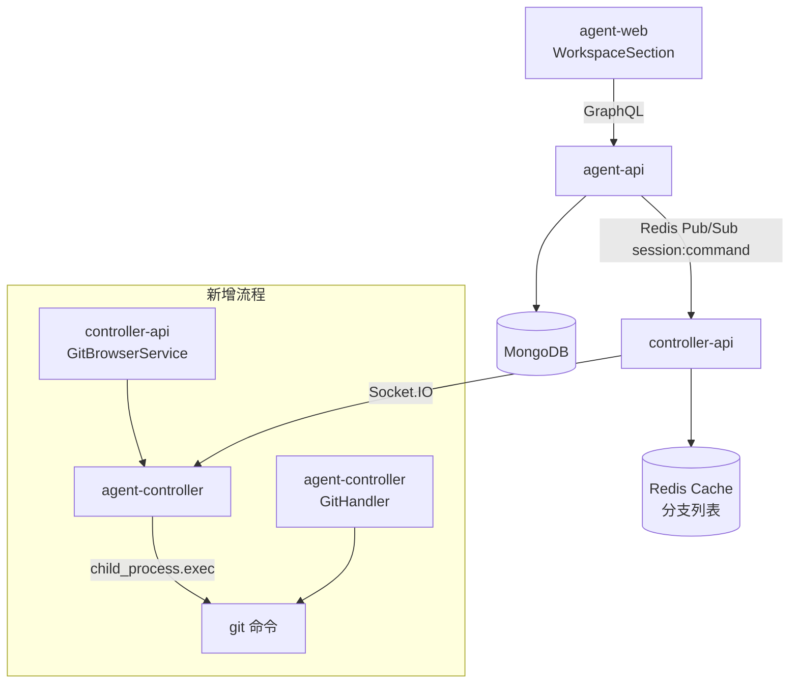
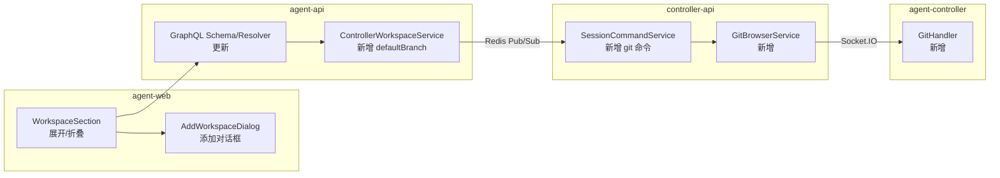
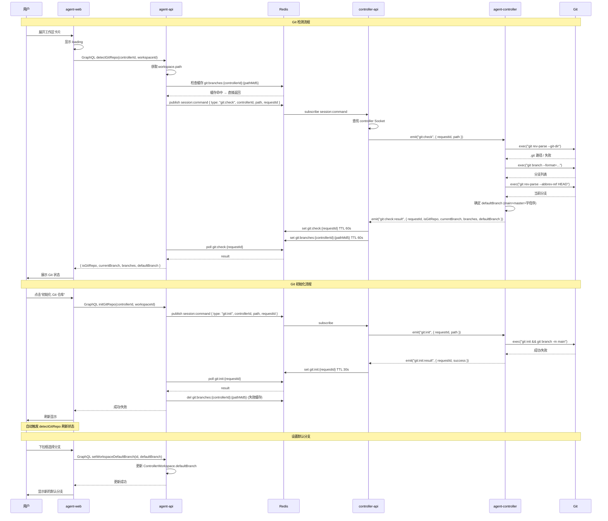

# 工作区设置页与 Git 能力支持 - 技术提案

**功能名称**: 工作区设置页与 Git 能力支持
**关联 PRD**: `docs/product/shipping/20260523-workspace-git-support-prd.md`
**技术提案版本**: v1.0
**创建日期**: 2026-05-23
**作者**: AI
**feat-branch**: `feat/workspace-git-support`

## 1. 概述

### 1.1 背景

当前工作区（Workspace）管理功能以行内目录选择器（DirectoryPicker）形式嵌入工作区列表，交互不够沉浸。工作区卡片仅展示名称和路径信息，无法承载更多细节（如 Git 状态）。此外，用户在工作区中操作代码仓库时需要切换到终端完成 Git 初始化、分支查看等操作，工作区与代码仓库管理之间存在割裂。

PRD 要求将工作区添加改为 Dialog 模式、工作区卡片支持展开折叠，并引入 Git 仓库检测、初始化与默认分支设置能力。

### 1.2 目标

- 将工作区添加操作从行内目录选择器改为 Dialog 对话框模式
- 工作区卡片支持展开/折叠，展开区域承载 Git 状态信息
- 新增 Git 仓库检测、初始化、分支列表获取 + 默认分支设置能力
- controller-api 缓存分支列表到 Redis，减少重复扫描

### 1.3 范围

**做**:
- 工作区添加 Dialog（将 DirectoryPicker 嵌入 Dialog 而非行内）
- 工作区卡片展开/折叠（Accordion/Collapse 模式）
- 展开区域显示 Git 状态（合法仓库或非仓库提示）
- `git:check` WebSocket 事件：检测路径是否为合法 Git 仓库 + 获取分支列表
- `git:init` WebSocket 事件：初始化 Git 仓库并添加 `main` 分支
- agent-controller 侧新增 `git-handler.ts`，封装 git 命令执行
- controller-api 侧新增 `GitBrowserService`（类似 `FolderBrowserService`）
- agent-api 侧 `controller-workspace` 模型新增 `defaultBranch` 字段
- ControllerWorkspace GraphQL schema 更新
- 分支列表 Redis 缓存（TTL 60s）
- GraphQL 查询/变更更新

**不做**:
- 多仓库并行操作（一次只处理一个工作区）
- 远程分支查看（仅本地分支）
- `git pull/push/commit` 等写操作
- 分支切换（仅记录默认分支，不执行 checkout）
- 工作区 Git 状态变更监听（展开时触发检测，非实时 watch）

## 2. 技术架构

### 2.1 系统架构图



### 2.2 技术栈

| 层级 | 技术选型 | 说明 |
|------|---------|------|
| 前端 | React 19 + TypeScript + Tailwind CSS | base-ui Dialog, Collapse |
| 后端 | Express v5 + GraphQL-Yoga + Mongoose | Node.js 24+ |
| 数据库 | MongoDB | 新增 ControllerWorkspace.defaultBranch 字段 |
| 缓存 | Redis | 分支列表缓存，请求-响应结果缓存 |
| 通信 | Redis Pub/Sub + Socket.IO | 命令下发 + 结果回传 |
| Git | child_process.exec | 通过 agent-controller 在本地执行 git 命令 |

### 2.3 模块划分



| 模块 | 职责 | 关键技术点 |
|------|------|-----------|
| `GitHandler` | agent-controller 侧执行 git 命令 | `child_process.exec`，封装 `check`/`init`/`branch` |
| `GitBrowserService` | controller-api 侧协调 git 请求 | 类似 `FolderBrowserService`，requestId 匹配 |
| `ControllerWorkspaceService` | 工作区 CRUD + defaultBranch 存储 | 模型字段扩展，数据验证 |
| `AddWorkspaceDialog` | 对话框式目录选择 | 复用 DirectoryPicker，包裹 Dialog |
| `WorkspaceSection` | 工作区列表展开/折叠 | 卡片式 Accordion，展开区域承载 Git 信息 |

## 3. API 设计

### 3.1 Socket.IO 事件

#### `git:check`（Server → Controller）

请求检测路径是否为合法 Git 仓库并获取分支列表。

**Payload:**

| 字段 | 类型 | 必填 | 说明 |
|------|------|------|------|
| `requestId` | `string` | 是 | 请求 ID，用于匹配结果 |
| `path` | `string` | 是 | 待检测的目录绝对路径 |

**客户端行为:**

1. 执行 `git rev-parse --git-dir` 检测是否为合法仓库
2. 若是合法仓库，执行 `git rev-parse --abbrev-ref HEAD` 获取当前分支
3. 执行 `git branch --format="%(refname:short)"` 获取所有本地分支
4. 根据规则确定默认分支（`main` > `master` > 按字母排序第一个）
5. 回复 `git:check:result`

#### `git:check:result`（Controller → Server）

返回仓库检测结果。

**Payload:**

| 字段 | 类型 | 必填 | 说明 |
|------|------|------|------|
| `requestId` | `string` | 是 | 对应的请求 ID |
| `success` | `boolean` | 是 | 是否成功 |
| `isGitRepo` | `boolean` | 是 | 是否为合法 Git 仓库 |
| `currentBranch` | `string` | 否 | 当前分支名（合法仓库时） |
| `branches` | `string[]` | 否 | 所有本地分支列表（合法仓库时） |
| `defaultBranch` | `string` | 否 | 默认分支（`main` > `master` > 字母序第一个） |
| `error` | `string` | 否 | 失败原因 |

#### `git:init`（Server → Controller）

请求在指定目录初始化 Git 仓库并重命名默认分支为 `main`。

**Payload:**

| 字段 | 类型 | 必填 | 说明 |
|------|------|------|------|
| `requestId` | `string` | 是 | 请求 ID |
| `path` | `string` | 是 | 待初始化目录绝对路径 |

**客户端行为:**

1. 执行 `git init`
2. 执行 `git branch -m main`
3. 回复 `git:init:result`

#### `git:init:result`（Controller → Server）

返回初始化结果。

**Payload:**

| 字段 | 类型 | 必填 | 说明 |
|------|------|------|------|
| `requestId` | `string` | 是 | 对应的请求 ID |
| `success` | `boolean` | 是 | 是否成功 |
| `error` | `string` | 否 | 失败原因 |

### 3.2 Redis Pub/Sub 命令

#### `session:command` 新增命令类型

| 命令类型 | Payload | 说明 |
|---------|---------|------|
| `git:check` | `{ controllerId, path, requestId }` | 检测 Git 仓库并获取分支 |
| `git:init` | `{ controllerId, path, requestId }` | 初始化 Git 仓库 |

#### 新增 Redis 结果缓存 Key

| Key | TTL | 说明 |
|-----|-----|------|
| `git:check:{requestId}` | 60s | Git 检测结果 |
| `git:init:{requestId}` | 30s | Git 初始化结果 |

### 3.3 GraphQL 更新

#### ControllerWorkspace 类型增加字段

```graphql
type ControllerWorkspace {
  id: ID!
  userId: ID!
  controllerId: ID!
  name: String!
  path: String!
  isEnabled: Boolean!
  defaultBranch: String           # 新增：用户记录的默认分支
  createdAt: String!
  updatedAt: String!
}
```

#### 新增变更

```graphql
extend type Mutation {
  """
  设置工作区的默认分支（仅记录，不执行 checkout）
  """
  setWorkspaceDefaultBranch(id: ID!, defaultBranch: String!): ControllerWorkspace!
}
```

### 3.4 GraphQL 内部接口（agent-api → controller-api）

#### `detectGitRepo` 内部接口

通过 Redis Pub/Sub 请求 controller-api 执行 Git 检测。

```typescript
interface GitCheckParams {
  controllerId: string;
  path: string;
}

interface GitCheckResult {
  isGitRepo: boolean;
  currentBranch?: string;
  branches?: string[];
  defaultBranch?: string;
  error?: string;
}
```

#### `initGitRepo` 内部接口

通过 Redis Pub/Sub 请求 controller-api 执行 Git 初始化。

```typescript
interface GitInitParams {
  controllerId: string;
  path: string;
}

interface GitInitResult {
  success: boolean;
  error?: string;
}
```

## 4. 数据模型

### 4.1 数据库设计

#### 集合: controllerworkspaces（修改）

新增字段：

| 字段 | 类型 | 说明 |
|------|------|------|
| defaultBranch | String | 用户设置的工作区默认分支名，可选 |

无其他新集合创建。

### 4.2 缓存设计

#### 分支列表缓存

| Key 模式 | TTL | 说明 |
|---------|-----|------|
| `git:branches:{controllerId}:{pathMd5}` | 60s | 分支列表缓存，路径 MD5 作为 key 的一部分 |

刷新策略：
- 工作区展开时触发检测，写入缓存
- TTL 60s 自动过期
- `git:init` 成功后使缓存失效

## 5. 技术实现方案

### 5.1 核心流程



### 5.2 关键实现点

#### 实现点 1: agent-controller GitHandler

**文件**: `packages/agent-controller/src/git-handler.ts`（新建）

封装 git 命令执行，通过 `child_process.exec` 在本地执行：

```typescript
interface GitCheckResult {
  isGitRepo: boolean;
  currentBranch?: string;
  branches?: string[];
  defaultBranch?: string;
  error?: string;
}

interface GitInitResult {
  success: boolean;
  error?: string;
}

export class GitHandler {
  async check(path: string): Promise<GitCheckResult> {
    // 1. git rev-parse --git-dir 检测是否合法仓库
    // 2. git rev-parse --abbrev-ref HEAD 获取当前分支
    // 3. git branch --format="%(refname:short)" 获取本地分支列表
    // 4. 规则: main > master > 字母序第一个 → defaultBranch
  }

  async init(path: string): Promise<GitInitResult> {
    // git init && git branch -m main
  }
}

export const gitHandler = new GitHandler();
```

#### 实现点 2: agent-controller socketio-client 新增事件处理

**文件**: `packages/agent-controller/src/socketio-client.ts`（修改）

在 `connectToServer` 函数中新增两个事件监听：

```typescript
// Git events
interface GitCheckPayload {
  requestId: string;
  path: string;
}

interface GitInitPayload {
  requestId: string;
  path: string;
}

socket.on('git:check', async (data: GitCheckPayload) => {
  const result = await gitHandler.check(data.path);
  socket.emit('git:check:result', { requestId: data.requestId, ...result });
});

socket.on('git:init', async (data: GitInitPayload) => {
  const result = await gitHandler.init(data.path);
  socket.emit('git:init:result', { requestId: data.requestId, ...result });
});
```

#### 实现点 3: controller-api GitBrowserService

**文件**: `servers/controller-api/src/services/git-browser.ts`（新建）

类似 `FolderBrowserService`，处理 request-response 模式：

```typescript
export class GitBrowserService {
  private io: SocketIOServer | null = null;

  start(io: SocketIOServer): void { this.io = io; }

  async check(requestId: string, controllerId: string, path: string): Promise<void> {
    // 查找 controller Socket
    // socket.emit('git:check', { requestId, path })
  }

  async init(requestId: string, controllerId: string, path: string): Promise<void> {
    // 查找 controller Socket
    // socket.emit('git:init', { requestId, path })
  }

  async handleCheckResult(requestId: string, result: GitCheckResult): Promise<void> {
    // 缓存到 Redis git:check:{requestId} TTL 60s
    // 同时缓存分支列表 git:branches:{controllerId}:{pathMd5} TTL 60s
  }

  async handleInitResult(requestId: string, result: GitInitResult): Promise<void> {
    // 缓存到 Redis git:init:{requestId} TTL 30s
  }
}

export const gitBrowserService = new GitBrowserService();
```

#### 实现点 4: controller-api session-command 新增 git 命令处理

**文件**: `servers/controller-api/src/services/session-command.ts`（修改）

在 `subscribe` 方法中的 `on('message')` 处理分支新增：

```typescript
} else if (command.type === 'git:check' && command.requestId && command.controllerId && command.path) {
  await this.handleGitCheck(command.requestId, command.controllerId, command.path);
} else if (command.type === 'git:init' && command.requestId && command.controllerId && command.path) {
  await this.handleGitInit(command.requestId, command.controllerId, command.path);
}
```

#### 实现点 5: controller-api socket.io index 注册新服务

**文件**: `servers/controller-api/src/services/socketio.ts`（修改）

在 `start()` 中注册 `git:check:result` 和 `git:init:result` 事件处理：

```typescript
// 在 socket.on('registered', ...) 之后
socket.on('git:check:result', async (data) => {
  await gitBrowserService.handleCheckResult(data.requestId, data);
});

socket.on('git:init:result', async (data) => {
  await gitBrowserService.handleInitResult(data.requestId, data);
});
```

#### 实现点 6: agent-api GraphQL 新增 detectGitRepo / initGitRepo 查询

**文件**: `servers/agent-api/src/graphql/schemas/controller-workspace.ts`（修改）
**文件**: `servers/agent-api/src/graphql/resolvers/controller-workspace.ts`（修改）

新增 Schema:

```graphql
extend type Query {
  detectGitRepo(controllerId: ID!, workspaceId: ID!): GitRepoInfo!
  initGitRepo(controllerId: ID!, workspaceId: ID!): GitInitResult!
}

type GitRepoInfo {
  isGitRepo: Boolean!
  currentBranch: String
  branches: [String!]
  defaultBranch: String
}

type GitInitResult {
  success: Boolean!
}
```

Resolver 实现：

- `detectGitRepo`: 获取 workspace.path → 通过 Redis Pub/Sub 下发 `git:check` → 轮询结果 → 返回
- `initGitRepo`: 获取 workspace.path → 通过 Redis Pub/Sub 下发 `git:init` → 轮询结果 → 清理分支缓存 → 返回

#### 实现点 7: ControllerWorkspaceService 新增 defaultBranch

**文件**: `servers/agent-api/src/services/controller-workspace.ts`（修改）

新增 `setDefaultBranch(id, defaultBranch)` 方法。

#### 实现点 8: 前端 WorkspaceSection 改为展开/折叠

**文件**: `apps/agent-web/src/components/settings/WorkspaceSection.tsx`（修改）

- 每个工作区卡片新增展开/折叠按钮（箭头图标）
- 使用 CSS transition 或 Collapse 组件实现展开/折叠动画
- 展开区域加载 Git 状态
- 调用 `detectGitRepo` 查询 → 根据 `isGitRepo` 展示不同内容

展开区域结构:
```
┌─ 工作区卡片 ─────────────────────────┐
│ [▼] 名称       路径                   │
│      ○ 开关    [历史会话]  [删除]     │
│ ─ ─ ─ ─ ─ ─ ─ ─ ─ ─ ─ ─ ─ ─ ─ ─ ─ │
│  当前分支: main                       │
│  默认分支: [main ▼]  ← 下拉框+搜索   │
│       分支列表 (搜索过滤)              │
│  或                                   │
│  [初始化 Git 仓库]                    │
└──────────────────────────────────────┘
```

#### 实现点 9: 前端 AddWorkspaceDialog

**文件**: `apps/agent-web/src/components/settings/AddWorkspaceDialog.tsx`（新建）

- Dialog 包裹 DirectoryPicker
- 与现有 `WorkspaceManagerDialog` 复用相同模式
- 选择目录后确认创建工作区

#### 实现点 10: 前端 GraphQL 更新

**文件**: `apps/agent-web/src/graphql/queries.ts`（修改）
**文件**: `apps/agent-web/src/graphql/mutations.ts`（修改）
**文件**: `apps/agent-web/src/graphql/types.ts`（修改）

新增：
- `DETECT_GIT_REPO` 查询
- `INIT_GIT_REPO` 变更
- `SET_WORKSPACE_DEFAULT_BRANCH` 变更
- `GitRepoInfoData`, `GitInitResultData` 类型

## 6. 技术决策

### 6.1 决策列表

| 决策 | 选项 A | 选项 B | 最终选择 | 原因 |
|------|--------|--------|---------|------|
| Git 命令执行方式 | `child_process.exec` | `child_process.spawn` | `exec` | 命令简单，输出量小，无需流式处理 |
| 分支列表缓存 key | `git:branches:{controllerId}:{path}` | `git:branches:{controllerId}:{pathMd5}` | `{pathMd5}` | 路径可能包含特殊字符，MD5 更安全 |
| 缓存 TTL | 30s | 60s | 60s | Git 分支变更不频繁，60s 足够 |
| 检测触发时机 | 展开时 + 轮询 | 仅展开时 | 仅展开时 | 展开时触发一次，缓存 60s 内不重复请求 |
| 展开/折叠实现 | base-ui Collapse | CSS animation | CSS transition | 轻量，无需引入额外组件库 |
| Git 命令合并执行 | 分别 exec 三次 | 一次 exec 多条命令 | 一次 exec 多条命令 | 减少进程开销 |

### 6.2 依赖与约束

| 类型 | 内容 | 说明 |
|------|------|------|
| 依赖 | 控制器在线 | Git 操作依赖 agent-controller 在本地执行命令 |
| 依赖 | 宿主机安装 Git >= 2.0 | git init / branch / rev-parse 基础命令 |
| 约束 | 每次展开时触发检测 | 不支持实时 watch Git 状态变化 |
| 约束 | 仅查看本地分支 | 不拉取远程分支列表 |
| 约束 | 默认分支仅记录 | 不执行 `git checkout` 切换 |

## 7. 项目结构

```
packages/agent-controller/src/
├── git-handler.ts                  # 新建：Git 命令封装

servers/controller-api/src/
├── services/
│   ├── git-browser.ts              # 新建：Git 请求-响应协调
│   └── session-command.ts          # 修改：新增 git:check / git:init 命令处理
├── services/
│   └── socketio.ts                 # 修改：注册 git:check:result / git:init:result

servers/agent-api/src/
├── models/
│   └── controller-workspace.ts     # 修改：新增 defaultBranch 字段
├── services/
│   └── controller-workspace.ts     # 修改：新增 setDefaultBranch 方法
├── graphql/
│   ├── schemas/
│   │   └── controller-workspace.ts # 修改：新增 detectGitRepo / initGitRepo / setWorkspaceDefaultBranch
│   └── resolvers/
│       └── controller-workspace.ts # 修改：新增 resolver

contracts/
├── controller-workspace.graphql    # 修改：更新类型 + 新增查询/变更
└── agent-session-websocket.md      # 修改：新增 git:check / git:init 事件定义

apps/agent-web/src/
├── components/
│   ├── settings/
│   │   ├── WorkspaceSection.tsx        # 修改：卡片展开/折叠 + Git 状态区域
│   │   ├── AddWorkspaceDialog.tsx      # 新建：Dialog 包裹 DirectoryPicker
│   │   └── WorkspaceManagerDialog.tsx  # 修改：移除行内 DirectoryPicker
├── graphql/
│   ├── queries.ts                 # 修改：新增 DETECT_GIT_REPO
│   ├── mutations.ts               # 修改：新增 INIT_GIT_REPO / SET_WORKSPACE_DEFAULT_BRANCH
│   └── types.ts                   # 修改：新增 Git 相关类型
```

## 8. 测试策略

### 8.1 测试覆盖要求

- 单元测试覆盖率: >= 80%（新增代码）
- API 测试覆盖: `detectGitRepo`, `initGitRepo`, `setWorkspaceDefaultBranch`

### 8.2 测试类型

| 类型 | 工具 | 覆盖范围 |
|------|------|---------|
| 单元测试 | Vitest | `GitHandler`（mock child_process）、`GitBrowserService`、ControllerWorkspaceService |
| 协议测试 | Vitest | `git:check` / `git:init` 事件收发 |
| GraphQL API 测试 | Vitest | `detectGitRepo` / `initGitRepo` / `setWorkspaceDefaultBranch` resolver |
| 前端组件测试 | Vitest | `WorkspaceSection` 展开/折叠、`AddWorkspaceDialog` 渲染与交互 |
| E2E 测试 | Vitest | 完整流程：展开工作区 → 检测 Git → 设置默认分支 |

### 8.3 测试重点

1. GitHandler 正常/异常路径覆盖（非 git 目录、权限不足、git 未安装）
2. Git 检测分支列表排序规则（`main` > `master` > 字母序第一个）
3. Redis 缓存命中/未命中逻辑
4. Controller 离线时按钮置灰
5. 展开区域在 Git/非 Git 状态下的不同 UI 展示
6. 默认分支下拉框搜索过滤功能

## 9. 验收标准

- [ ] 技术方案评审通过
- [ ] Contract 评审通过（WebSocket + GraphQL）
- [ ] 工作区添加从行内改为 Dialog 对话框
- [ ] 工作区卡片展开后显示 Git 状态
- [ ] 合法仓库展示当前分支 + 默认分支下拉框（可搜索）
- [ ] 默认分支规则：`main` > `master` > 字母序第一个
- [ ] 选择分支后记录到 ControllerWorkspace.defaultBranch
- [ ] 非仓库目录显示"初始化 Git 仓库"按钮
- [ ] 初始化成功后触发检测刷新
- [ ] Controller 离线时 Git 操作禁用
- [ ] 分支列表 Redis 缓存启用
- [ ] 单元测试覆盖达标
- [ ] E2E 测试通过

## 10. 相关文档

- [关联 PRD](../../product/shipping/20260523-workspace-git-support-prd.md)
- [现有工作区契约](../../contracts/controller-workspace.graphql)
- [现有 WebSocket 契约](../../contracts/agent-session-websocket.md)
- [控制器 WebSocket 基础协议](../../contracts/agent-controller-websocket.md)
- [现有工作区管理提案](./20260519-feat-local-controller-workspace-management.md)
- [历史会话同步提案](./20260521-feat-acp-session-sync.md)
- [开发规范](../common-rules.md)
- [前端规范](../frontend-rules.md)
- [后端规范](../backend-rules.md)
