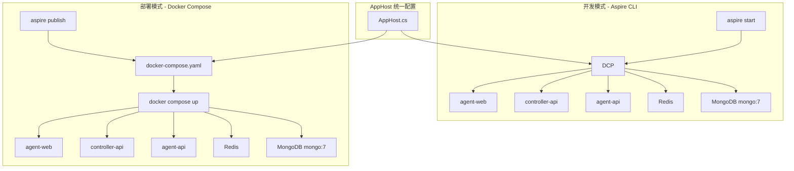
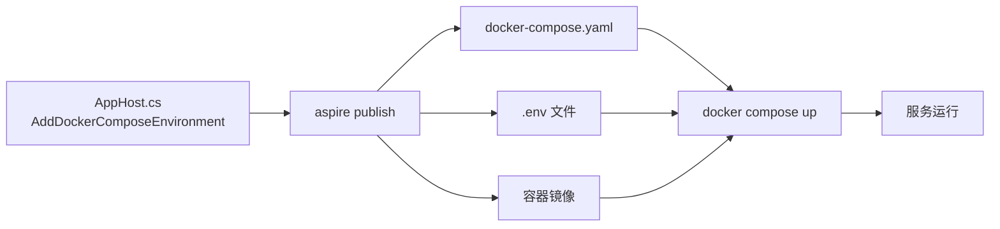

# Aspire 集成 Docker Compose 支持 - 技术提案

**功能名称**: Aspire Docker Compose 集成
**关联 PRD**: 无（工程需求）
**技术提案版本**: v1.0
**创建日期**: 2026-05-24
**作者**: ZeroAsh Agent
**feat-branch**: `feat/docker-compose-support`

## 1. 概述

### 1.1 背景

当前项目使用 .NET Aspire (`Aspire.AppHost.Sdk/13.3.5`) 进行服务编排，通过 DCP (Distributed Container Platform) 管理 MongoDB、Redis 等容器。存在的问题：

- 容器管理不透明，开发者无法直接使用 `docker ps` / `docker logs` 排查问题
- CI/CD 环境依赖 Aspire CLI，增加额外依赖
- 无法与 Docker Compose 生态（Portainer、Docker Desktop）集成
- 团队部分成员更熟悉 `docker-compose.yml` 工作方式

Aspire 13.x 已原生支持 Docker Compose 部署——通过 `Aspire.Hosting.Docker` 包和 `AddDockerComposeEnvironment` API，可在 AppHost 中声明 Docker Compose 环境，并通过 `aspire publish` 自动生成 docker-compose.yaml。

### 1.2 目标

1. 在 AppHost 中添加 Docker Compose 环境，使 `aspire publish` 能生成 docker-compose.yaml
2. Aspire 为主（`aspire start`）、Docker Compose 为辅（`docker compose up`）的双模式编排
3. 两种模式下的服务行为一致（端口、环境变量、依赖顺序）
4. CI/CD 可直接使用生成的 docker-compose.yaml，无需 Aspire CLI

### 1.3 范围

**做：**
- 安装 `Aspire.Hosting.Docker` NuGet 包
- `AppHost.cs` 中增加 `AddDockerComposeEnvironment`
- 使用 `PublishAsDockerComposeService` 配置各服务的 Compose 元数据
- `aspire publish` 生成 docker-compose.yaml 到 `aspire/manifest/` 目录
- 根 `package.json` 添加 compose 相关快捷脚本
- `aspire/manifest/` 纳入版本管理，CI/CD 直接使用

**不做：**
- 不替换 Aspire 作为本地开发首选
- 不迁移现有 Aspire 配置到 Compose
- 不支持 docker-compose v1
- 不手动维护 docker-compose.yml

## 2. 技术架构

### 2.1 双模式编排架构



### 2.2 核心集成方式

Aspire 的 Docker Compose 集成采用**声明式**方式——在 AppHost 中添加 `AddDockerComposeEnvironment` 后，所有资源自动成为 Compose 服务的候选。通过 `PublishAsDockerComposeService` 可自定义每个服务在 Compose 中的表现（服务名、标签、重启策略等）。

工作流程：



### 2.3 方案选型对比

| 方案 | 描述 | 优势 | 劣势 |
|------|------|------|------|
| **A: Aspire.Hosting.Docker（官方）** | 安装 NuGet 包，用 `AddDockerComposeEnvironment` + `aspire publish` | 官方支持，自动同步，零手动映射 | 需额外 NuGet 包 |
| B: 自定义脚本生成 | 读取 Manifest 后自行生成 yml | 灵活可控 | 需自行维护映射逻辑，版本迭代成本高 |
| C: 手动维护 yml | 在 `infra/` 下手动编写 | 完全可控 | 双源维护，容易不一致 |

**选择方案 A**：Aspire 官方提供的 Docker Compose 集成方案。

## 3. 技术实现方案

### 3.1 AppHost 改造

**安装依赖**：
```bash
aspire add docker
# 或手动添加 PackageReference：
# <PackageReference Include="Aspire.Hosting.Docker" Version="13.3.5" />
```

**AppHost.cs 改造**：

```csharp
var builder = DistributedApplication.CreateBuilder(args);

// 添加 Docker Compose 环境（用于 aspire publish / aspire deploy）
var compose = builder.AddDockerComposeEnvironment("compose")
    .WithProperties(env =>
    {
        env.DashboardEnabled = false; // Compose 模式下不启动 Aspire Dashboard
    });

// MongoDB
var mongodb = builder.AddMongoDB("mongodb")
    .WithImage("mongo", "7")
    .PublishAsDockerComposeService((resource, service) =>
    {
        service.Name = "mongodb";
    });

// Redis
var redis = builder.AddRedis("redis")
    .PublishAsDockerComposeService((resource, service) =>
    {
        service.Name = "redis";
    });

// agent-api
var agentApi = builder.AddNodeApp("agent-api", "../../servers/agent-api", "src/index.ts")
    .WithEnvironment("NODE_OPTIONS", "--import tsx")
    .WithHttpEndpoint(env: "PORT")
    .WithReference(mongodb)
    .WithReference(redis)
    .PublishAsDockerComposeService((resource, service) =>
    {
        service.Name = "agent-api";
        service.Restart = "unless-stopped";
    });

// controller-api
var controllerApi = builder.AddNodeApp("controller-api", "../../servers/controller-api", "src/index.ts")
    .WithEnvironment("NODE_OPTIONS", "--import tsx")
    .WithHttpEndpoint(env: "PORT")
    .WithReference(mongodb)
    .WithReference(redis)
    .PublishAsDockerComposeService((resource, service) =>
    {
        service.Name = "controller-api";
        service.Restart = "unless-stopped";
    });

// agent-web (Vite)
var agentWeb = builder.AddViteApp("agent-web", "../../apps/agent-web")
    .WithReference(agentApi)
    .WithEnvironment("VITE_API_URL", agentApi.GetEndpoint("http"))
    .PublishAsDockerComposeService((resource, service) =>
    {
        service.Name = "agent-web";
    });

// agent-controller (CLI, 显式启动)
var agentController = builder.AddNodeApp("agent-controller", "../../packages/agent-controller", "src/index.ts")
    .WithEnvironment("NODE_OPTIONS", "--import tsx")
    .WithEnvironment("ZAG_SERVER_ENDPOINT", controllerApi.GetEndpoint("http"))
    .WithExplicitStart()
    .WaitFor(controllerApi)
    .PublishAsDockerComposeService((resource, service) =>
    {
        service.Name = "agent-controller";
    });

builder.Build().Run();
```

**关键变更点**：

| 变更 | 说明 |
|------|------|
| 新增 `Aspire.Hosting.Docker` 包 | 提供 Docker Compose 环境支持 |
| 新增 `AddDockerComposeEnvironment("compose")` | 声明 Docker Compose 部署环境 |
| 新增 `PublishAsDockerComposeService` | 为每个资源配置 Compose 服务名和元数据 |
| `DashboardEnabled = false` | Compose 部署时禁用 Dashboard 以减少资源开销 |

### 3.2 生成 Docker Compose 文件

```bash
# 生成 docker-compose.yaml + .env 文件到 aspire/manifest/
aspire publish

# 输出目录结构
# aspire/manifest/
# ├── docker-compose.yaml
# ├── .env
# └── ... (容器镜像构建产物)
```

ASPire 自动完成：
- 解析 AppHost 中的所有资源
- 为每个资源生成对应的 Compose service 定义
- 生成 `.env` 文件（含预期参数占位符）
- 处理服务间依赖关系（`depends_on`）
- 处理端口映射和环境变量注入

### 3.3 使用 Docker Compose 启动

```bash
# 方式一：aspire deploy（一键部署）
aspire deploy

# 方式二：手动 docker compose
cd aspire/manifest/
docker compose up -d
docker compose ps
docker compose logs -f
docker compose down
```

## 4. 项目结构

```diff
 z-agent-gear/
 ├── aspire/
 │   └── AgentGear.AppHost/
 │       ├── AgentGear.AppHost.csproj
+│       │   # + PackageReference: Aspire.Hosting.Docker
 │       ├── AppHost.cs
+│       │   # + AddDockerComposeEnvironment
+│       │   # + PublishAsDockerComposeService (各资源)
 │       └── ...
+├── aspire/manifest/              # aspire publish 生成产物
+│   ├── docker-compose.yaml
+│   ├── .env
+│   └── ...
 ├── contracts/
 └── docs/
     └── engineering/
         └── proposals/
             └── 20260524-feat-docker-compose-support.md
```

## 5. 技术决策

### 5.1 决策列表

| 决策 | 选项 A | 选项 B | 最终选择 | 原因 |
|------|--------|--------|---------|------|
| 集成方案 | Aspire.Hosting.Docker 官方包 | 自定义脚本生成 | 官方包 | 零维护成本，自动同步 AppHost 配置 |
| Dashboard | 启用 | 禁用 | 禁用 | Compose 部署场景减少资源开销 |
| 生成命令 | `aspire publish` | `aspire deploy` | `aspire publish` | 仅生成不部署，更灵活 |
| 输出目录 | `aspire/manifest/` | `infra/local-dev/` | `aspire/manifest/` | Aspire CLI 默认目录 |
| 版本管理 | 纳入 Git | .gitignore | 纳入 Git | CI/CD 可直接使用 |

### 5.2 依赖与约束

| 类型 | 内容 | 说明 |
|------|------|------|
| 依赖 | Aspire.Hosting.Docker 13.3.5+ | 与当前 Aspire SDK 版本匹配 |
| 依赖 | Docker Engine 24+ | 支持 `docker compose` v2 |
| 约束 | `AddNodeApp` / `AddViteApp` 在 Compose 下 | 这些资源会生成 Dockerfile 并构建镜像 |
| 约束 | `WithExplicitStart()` | 在 Compose 中通过 `depends_on` + `profiles` 处理 |
| 约束 | Node.js 应用的 tsx 运行时 | 生成的 Dockerfile 需包含 tsx 依赖 |

## 6. 测试策略

| 类型 | 工具 | 覆盖范围 |
|------|------|---------|
| 编译验证 | `dotnet build` | AppHost 改造后编译通过 |
| 发布验证 | `aspire publish` | 成功生成 docker-compose.yaml |
| 启动验证 | `docker compose up -d` | 6 服务全部正常启动 |
| 健康检查 | `curl` / `docker compose ps` | 各 API 端点可访问 |
| 清理验证 | `docker compose down` | 正确清理容器和网络 |

### 验证步骤

```bash
# 1. 编译
dotnet build aspire/AgentGear.AppHost/

# 2. 生成 Compose 文件
aspire publish

# 3. 校验语法
docker compose -f aspire/manifest/docker-compose.yaml config

# 4. 启动
docker compose -f aspire/manifest/docker-compose.yaml up -d

# 5. 验证服务
docker compose -f aspire/manifest/docker-compose.yaml ps
curl http://localhost:<agent-api-port>/health

# 6. 清理
docker compose -f aspire/manifest/docker-compose.yaml down
```

## 7. 验收标准

- [ ] `Aspire.Hosting.Docker` 包安装成功，`dotnet build` 通过
- [ ] `AddDockerComposeEnvironment` 配置完成，所有资源均关联 `PublishAsDockerComposeService`
- [ ] `aspire publish` 能生成完整的 docker-compose.yaml
- [ ] `docker compose up -d` 能成功启动全部 6 个服务
- [ ] Aspire 模式和 Docker Compose 模式下服务行为一致
- [ ] `docker compose down` 正确清理
- [ ] AGENTS.md 补充 Docker Compose 使用说明
- [ ] `aspire/manifest/` 纳入版本管理，CI/CD 直接使用生成的 docker-compose.yaml

## 8. 相关文档

- [[../../.agents/skills/z-aspire-orchestrator/SKILL.md|z-aspire-orchestrator]]
- [[./20260517-feat-agent-controller-v1.md|Agent 控制器 v1]]
- [Aspire Docker 集成文档](https://aspire.dev/integrations/compute/docker/)
- [Aspire Deploy to Docker Compose](https://aspire.dev/deployment/docker-compose/)
- [Aspire.Hosting.Docker API](https://learn.microsoft.com/dotnet/api/aspire.hosting.docker)
