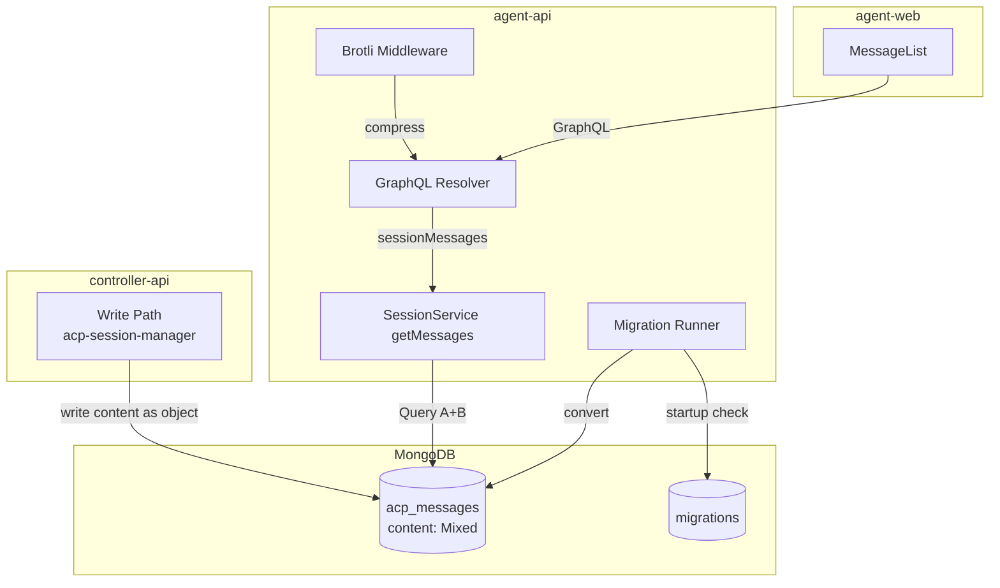
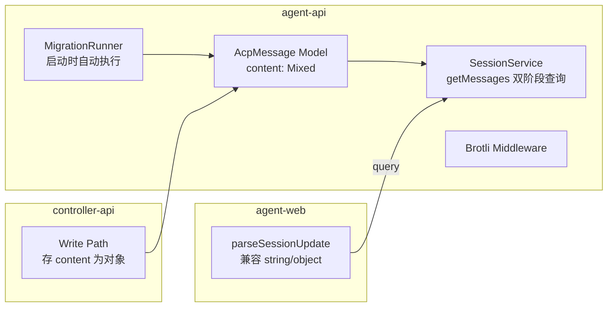
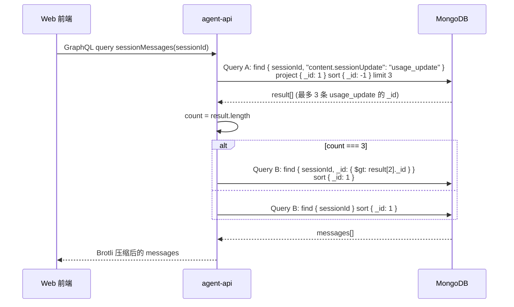
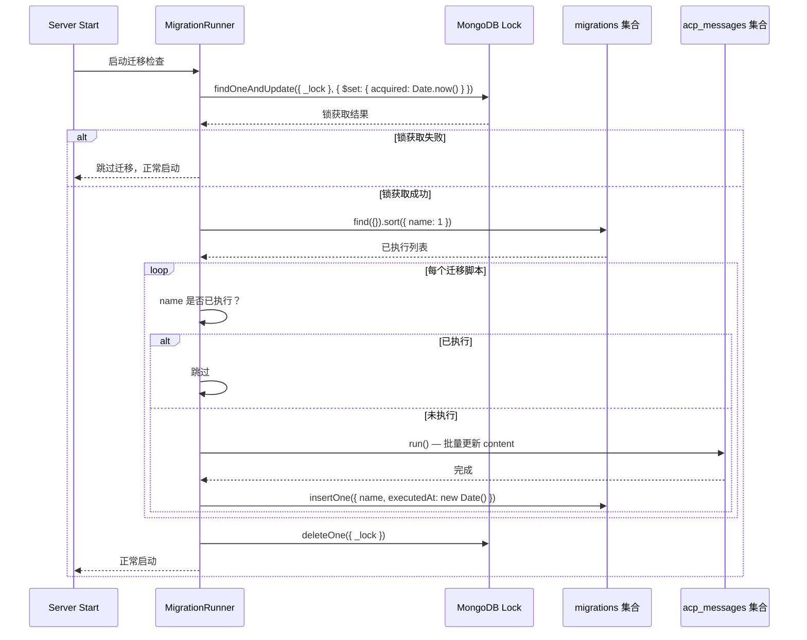

# 会话消息历史优化 & 响应压缩 - 技术提案

**功能名称**: 会话消息历史优化 & 响应压缩
**关联 PRD**: `draft/session-message-history-optimization.md`
**技术提案版本**: v1.0
**创建日期**: 2026-05-24
**作者**: ZeroAsh
**feat-branch**: `feat/session-message-history-optimization`

## 1. 概述

### 1.1 背景

当前系统中 usage_update 消息（type: text）与普通对话消息混在一起全部返回给前端，长会话场景下传输数据量大、前端渲染卡顿。同时所有 API 响应均为明文 JSON 未压缩，进一步加剧了网络传输延迟。

### 1.2 目标

- 消息历史查询时对 usage_update 进行后端截断，保留 ≤ 3 条（从最新开始）
- 老数据 content 字段从 JSON 字符串迁移为 JSON 对象，使 `"content.sessionUpdate": "usage_update"` 查询在各版本数据上一致
- agent-api 所有 API 响应开启 Brotli 压缩

### 1.3 范围

**做**:
- 修改 AcpMessage 模型中 content 字段类型（String → Mixed）
- 修改 controller-api 的写入端（将 JSON 对象直接存入库，不再 JSON.stringify）
- 修改 agent-api 的写入端（sendSessionMessage 和导入流程）
- 实现 sessionMessages 查询的双阶段过滤逻辑（Query A + Query B）
- 实现 agent-api 的迁移框架（分布式锁 + 幂等性）
- 实现 content 格式统一迁移脚本
- 在 agent-api 中增加 Brotli 压缩中间件，SSE 流使用流式压缩
- 修改 GraphQL schema 中 AcpMessage.content 类型（String → JSON）
- 修改前端的消息解析逻辑以兼容混合类型 content

**不做**:
- 修改 agent-controller（package 已更名 agent-gear）的代码
- 修改 controller-api 的迁移框架（迁移仅在 agent-api 中执行）
- 增加新的 AcpMessageType 枚举值
- 实现分页查询（limit/offset 逻辑不作变动）

## 2. 技术架构

### 2.1 系统架构图



### 2.2 技术栈

| 层级 | 技术选型 | 说明 |
|------|---------|------|
| 后端 | Express v5 + GraphQL-Yoga + Mongoose | Node.js 24+ ESM |
| 数据库 | MongoDB | AcpMessage + migrations 集合 |
| 压缩 | Node.js 原生 zlib | createBrotliCompress + createGzip 回退 |
| 前端 | React 19 + TypeScript | content 字段兼容解析 |

### 2.3 模块划分



| 模块 | 职责 | 关键技术点 |
|------|------|-----------|
| AcpMessage Model | content 类型改为 Mixed | 兼容 string（旧）+ object（新） |
| SessionService.getMessages | 双阶段查询：先查最近 3 条 usage_update _id，再按结果截断 | Query A 仅返回 _id + limit 3 |
| MigrationRunner | 启动时检查未执行迁移脚本，分布式锁防并发 | `migrations` 集合 + findOneAndUpdate |
| Brotli Middleware | Express 响应压缩，优先 Brotli 回退 gzip | Node.js zlib 原生支持 |
| Write Path | controller-api 和 agent-api 的写入端改为存 JSON 对象 | 移除 JSON.stringify |

## 3. API 设计

### 3.1 API 变更

#### GraphQL: AcpMessage.content 类型变更

```graphql
# 修改前
type AcpMessage {
  id: ID!
  sessionId: ID!
  direction: AcpMessageDirection!
  type: AcpMessageType!
  content: String!          # JSON 字符串
  metadata: String
  createdAt: String!
}

# 修改后
type AcpMessage {
  id: ID!
  sessionId: ID!
  direction: AcpMessageDirection!
  type: AcpMessageType!
  content: Mixed!           # JSON 对象（GraphQL JSON scalar）
  metadata: String
  createdAt: String!
}
```

sessionMessages 查询签名不变：

```graphql
sessionMessages(sessionId: ID!, limit: Int, offset: Int): [AcpMessage!]!
```

过滤行为在后端内部实现，对前端透明。

#### 新增 REST: 健康检查

health 端点无需变更，Brotli 压缩在 Express 中间件层自动生效。

### 3.2 内部接口

无新增内部接口。sessionMessages 查询内部新增 getMessagesWithUsageFilter 方法，签名兼容原有 getMessages。

## 4. 数据模型

### 4.1 数据库设计

#### AcpMessage 集合变更

| 字段 | 旧类型 | 新类型 | 说明 |
|------|--------|--------|------|
| content | String | Mixed | 迁移前为字符串，迁移及新写入均为对象 |
| metadata（不变） | Mixed | Mixed | 无变化 |
| 其余字段（不变） | - | - | sessionId, direction, type, timestamps |

迁移后 content 对象结构示例（output usage_update）：

```json
{
  "sessionUpdate": "usage_update",
  "usage": {
    "modelId": "...",
    "inputTokens": 123,
    "outputTokens": 456,
    ...
  }
}
```

迁移后 content 对象结构示例（input 消息）：

```json
{
  "sessionUpdate": "user_message_chunk",
  "content": {
    "type": "text",
    "text": "Hello"
  }
}
```

#### 新增 migrations 集合

| 字段 | 类型 | 说明 |
|------|------|------|
| name | String (unique) | 迁移脚本名称 |
| executedAt | Date | 执行时间 |

#### 索引

- AcpMessage: 已有 `{ sessionId: 1, createdAt: 1 }`（无需新增）
- AcpMessage: 新增 `{ sessionId: 1, "content.sessionUpdate": 1 }`（可选，优化 Query A）
- migrations: 新增 `{ name: 1 }` unique index

### 4.2 缓存设计

无新增缓存。

## 5. 技术实现方案

### 5.1 核心流程

#### 消息查询流程（双阶段过滤）



#### 迁移执行流程



### 5.2 关键实现点

#### 实现点 1: AcpMessage 模型变更

**文件**: `servers/agent-api/src/models/acp-message.ts`、`servers/controller-api/src/models/acp-message.ts`

```typescript
// 修改前
content: { type: String, required: true }

// 修改后
content: { type: mongoose.Schema.Types.Mixed, required: true }
```

agent-api 的 GraphQL schema 中 AcpMessage.content 类型对应改为 GraphQL JSON scalar（使用 `graphql-type-json` 包或内置的 GraphQLJSON）。

#### 实现点 2: controller-api 写入端

**文件**: `servers/controller-api/src/services/acp-session-manager.ts`

`sendMessage` 方法（第 161 行）：
```typescript
// 修改前
const rawContent = JSON.stringify({
  sessionUpdate: 'user_message_chunk',
  content: { type: 'text', text: message.content },
});

// 修改后
const rawContent = {
  sessionUpdate: 'user_message_chunk',
  content: { type: 'text', text: message.content },
};
```

`handleControllerMessage` 方法（第 229 行）：
```typescript
// 修改前
const rawContent = JSON.stringify(message);

// 修改后
const rawContent = message;
```

Redis 发布消息时 content 字段值也需要同步改为对象：

```typescript
// 修改前
content: rawContent,

// 修改后
content: typeof rawContent === 'string' ? rawContent : JSON.stringify(rawContent),
```

（Redis 消息需要序列化为字符串，但 MongoDB 存储为对象）

#### 实现点 3: agent-api 写入端

**文件**: `servers/agent-api/src/services/session.ts`

`addMessage` 方法当前将 content 直接存为字符串。需要确保前端通过 GraphQL `sendSessionMessage` 传入的 content JSON 字符串被解析为对象存储。

对于 `sendSessionMessage` mutation，入参 content 为前端传入的 JSON 字符串，在写入前做 JSON.parse：

```typescript
// addMessage 中
content: typeof message.content === 'string'
  ? JSON.parse(message.content)
  : message.content,
```

`session-import.ts` 的导入流程：ACP 返回的 content 已经是对象（来自 ACP SDK 的类型），直接存储即可：

```typescript
// 修改前
content: msg.content,

// 修改后（msg.content 已是对象，直接存储）
content: msg.content,
```

#### 实现点 4: sessionMessages 双阶段过滤

**文件**: `servers/agent-api/src/services/session.ts`

新增方法 `getMessagesWithUsageFilter`：

```typescript
async getMessages(
  sessionId: string,
  userId: string,
  limit = 100,
  offset = 0,
): Promise<Record<string, unknown>[]> {
  // Verify session ownership (existing logic)
  const session = await Session.findOne({ _id: sessionId, userId }).lean();
  if (!session) {
    throw new Error('Session not found');
  }

  // Query A: find last 3 usage_update _ids
  const usageIds = await AcpMessage.find(
    { sessionId, 'content.sessionUpdate': 'usage_update' },
    { _id: 1 },
  )
    .sort({ _id: -1 })
    .limit(3)
    .lean();

  let cutoff: string | undefined;
  if (usageIds.length === 3) {
    cutoff = (usageIds[2]._id as mongoose.Types.ObjectId).toString();
  }

  // Query B: build base filter
  const filter: Record<string, unknown> = { sessionId };
  if (cutoff) {
    filter._id = { $gt: cutoff };
  }

  const messages = await AcpMessage.find(filter)
    .sort({ _id: 1 })
    .skip(offset)
    .limit(limit)
    .lean();

  return messages.map(this.mapMessage.bind(this));
}
```

注意：`mapMessage` 中 content 字段直接透传（不再做 JSON.parse，因为可能已经是对象）。

#### 实现点 5: 迁移框架

**目录**: `servers/agent-api/src/migrations/`

**迁移脚本结构**、**migrations 集合**、**分布式锁** 实现如下：

```typescript
// servers/agent-api/src/migrations/runner.ts

import mongoose from 'mongoose';
import { Migrations } from './models.js'; // migrations 集合模型

interface Migration {
  name: string;
  run: () => Promise<void>;
}

const LOCK_TIMEOUT = 300_000; // 5 min TTL

async function acquireLock(): Promise<boolean> {
  const result = await Migrations.findOneAndUpdate(
    { _lock: 'migration_lock' },
    { $set: { acquired: new Date(), expiresAt: new Date(Date.now() + LOCK_TIMEOUT) } },
    { upsert: false, new: true },
  );
  // 如果文档不存在则创建（首次获取）
  if (!result) {
    try {
      await Migrations.create({
        _lock: 'migration_lock',
        acquired: new Date(),
        expiresAt: new Date(Date.now() + LOCK_TIMEOUT),
      });
      return true;
    } catch {
      return false; // 并发冲突
    }
  }
  return true;
}

async function releaseLock(): Promise<void> {
  await Migrations.deleteOne({ _lock: 'migration_lock' });
}

export async function runMigrations(migrations: Migration[]): Promise<void> {
  const hasLock = await acquireLock();
  if (!hasLock) {
    console.log('[Migration] Lock not acquired, skipping');
    return;
  }

  try {
    const executed = await Migrations.find({ name: { $exists: true } }).lean();
    const executedNames = new Set(executed.map((m: Record<string, unknown>) => m.name as string));

    for (const migration of migrations) {
      if (executedNames.has(migration.name)) {
        console.log(`[Migration] ${migration.name} already executed, skipping`);
        continue;
      }

      console.log(`[Migration] Running ${migration.name}...`);
      try {
        await migration.run();
        await Migrations.create({ name: migration.name, executedAt: new Date() });
        console.log(`[Migration] ${migration.name} completed`);
      } catch (err) {
        console.error(`[Migration] ${migration.name} failed:`, err);
        // 不阻赛启动
      }
    }
  } finally {
    await releaseLock();
  }
}
```

**迁移脚本**（content 格式统一）：

```typescript
// servers/agent-api/src/migrations/001-unify-content-format.ts

import { AcpMessage } from '../models/acp-message.js';

export const name = '001-unify-content-format';

export async function run(): Promise<void> {
  const batchSize = 100;
  let processed = 0;

  while (true) {
    const batch = await AcpMessage.find({
      type: 'text',
      content: { $type: 'string' },
    })
      .limit(batchSize)
      .lean();

    if (batch.length === 0) break;

    const operations = batch.map((msg) => {
      const parsed = JSON.parse(msg.content as string);
      return {
        updateOne: {
          filter: { _id: msg._id },
          update: { $set: { content: parsed } },
        },
      };
    });

    await AcpMessage.bulkWrite(operations);
    processed += batch.length;
    console.log(`[Migration 001] Processed ${processed} messages`);
  }
}
```

**在 index.ts 中调用**：

```typescript
// index.ts 中，MongoDB 连接成功后
import { runMigrations } from './migrations/runner.js';
import * as migration001 from './migrations/001-unify-content-format.js';

// 在 mongoose.connect 后
try {
  await runMigrations([migration001]);
} catch (err) {
  console.warn('[Migration] Runner failed:', (err as Error).message);
}
```

#### 实现点 6: Brotli 压缩中间件

**文件**: `servers/agent-api/src/middleware/compression.ts`（新增）

使用 Node.js 原生 zlib 实现两种压缩模式：

- **非 SSE 响应**（GraphQL / REST）：缓冲整个响应体，体积 > 1KB 时压缩
- **SSE 流**（`text/event-stream`）：流式压缩，每个数据块实时压缩输出

```typescript
import type express from 'express';
import { createBrotliCompress, createGzip } from 'node:zlib';
import { PassThrough } from 'node:stream';
import { pipeline } from 'node:stream/promises';

export function compressionMiddleware(): express.RequestHandler {
  return (req, res, next) => {
    const acceptEncoding = req.headers['accept-encoding'] || '';
    const useBrotli = acceptEncoding.includes('br');
    const useGzip = acceptEncoding.includes('gzip');

    if (!useBrotli && !useGzip) {
      next();
      return;
    }

    const contentEncoding = useBrotli ? 'br' : 'gzip';
    const createCompressor = () => useBrotli ? createBrotliCompress() : createGzip();

    const isSSE = (req.headers.accept ?? '').includes('text/event-stream')
      || res.getHeader('Content-Type') === 'text/event-stream';

    if (isSSE) {
      // ---- 流式压缩（SSE） ----
      const compressor = createCompressor();
      const passThrough = new PassThrough();

      res.setHeader('Content-Encoding', contentEncoding);
      res.setHeader('Vary', 'Accept-Encoding');

      // 接管 write：数据块经过压缩流再输出
      const originalWrite = res.write.bind(res);
      const originalEnd = res.end.bind(res);

      compressor.on('data', (chunk: Buffer) => originalWrite(chunk));
      compressor.on('end', () => originalEnd());

      res.write = function (chunk: unknown, ...args: unknown[]) {
        passThrough.write(
          Buffer.isBuffer(chunk) ? chunk : Buffer.from(chunk as string),
        );
        return true;
      };

      res.end = function (chunk?: unknown, ...args: unknown[]) {
        if (chunk) {
          passThrough.write(
            Buffer.isBuffer(chunk) ? chunk : Buffer.from(chunk as string),
          );
        }
        passThrough.end();
        // compressor 会在 drain 后自动触发 end
      };

      // 将 passThrough 的数据喂给 compressor（自动 backpressure）
      pipeline(passThrough, compressor).catch((err) => {
        console.error('[Compression] SSE pipeline error:', err);
      });

      next();
    } else {
      // ---- 缓冲压缩（GraphQL / REST） ----
      const compressor = createCompressor();
      res.setHeader('Content-Encoding', contentEncoding);
      res.setHeader('Vary', 'Accept-Encoding');

      const originalEnd = res.end.bind(res);
      const originalWrite = res.write.bind(res);
      const chunks: Buffer[] = [];

      res.write = (chunk: unknown, ...args: unknown[]) => {
        chunks.push(Buffer.isBuffer(chunk) ? chunk : Buffer.from(chunk as string));
        return true;
      };

      res.end = (chunk?: unknown, ...args: unknown[]) => {
        if (chunk) {
          chunks.push(Buffer.isBuffer(chunk) ? chunk : Buffer.from(chunk as string));
        }

        const body = Buffer.concat(chunks);

        if (body.length < 1024) {
          res.removeHeader('Content-Encoding');
          originalEnd(body);
          return;
        }

        const compressed: Buffer[] = [];
        compressor.on('data', (data: Buffer) => compressed.push(data));
        compressor.on('end', () => originalEnd(Buffer.concat(compressed)));
        compressor.end(body);
      };

      next();
    }
  };
}
```

**SSE 流压缩要点**：
- 使用 `PassThrough` 作为桥接流，`res.write` 写入 PassThrough，PassThrough pipeline 到压缩流，压缩流输出到原始 `res.write`
- 自动处理 backpressure（`pipeline` 内置）
- 客户端（浏览器 EventSource）原生支持 `Content-Encoding: br` 的 SSE
- 即使单个 `data:` 行仅几个字节，压缩流也会积累缓冲区批量压缩，不会为每帧独立压缩

**限制**：
- GraphQL-Yoga 的 SSE（如 `stream: true` 的订阅）同样走流式路径
- 当前 agent-api 的 SSE 仅用于 `/api/sessions/:id/stream`（session-stream router），该路由已纳入

在 index.ts 中应用：

```typescript
app.use(compressionMiddleware());
```

#### 实现点 7: 前端兼容

**文件**: `apps/agent-web/src/components/session/MessageList.tsx`

`parseSessionUpdate` 函数需要兼容 content 为对象或字符串的情况：

```typescript
function parseSessionUpdate(content: string | Record<string, unknown>): SessionUpdate | null {
  if (typeof content === 'string') {
    try {
      return JSON.parse(content) as SessionUpdate;
    } catch {
      return null;
    }
  }
  return content as unknown as SessionUpdate;
}
```

`AcpMessage` 接口的 content 类型改为 `string | Record<string, unknown>`：

```typescript
interface AcpMessage {
  id: string;
  sessionId: string;
  messageId?: string | null;
  direction: string;
  type: string;
  content: string | Record<string, unknown>;
  metadata: string | null;
  createdAt: string;
}
```

`mergeMessageChunks` 同理，对 `msg.content` 的类型做分支处理。

## 6. 技术决策

### 6.1 决策列表

| 决策 | 选项 A | 选项 B | 最终选择 | 原因 |
|------|--------|--------|---------|------|
| content 存储格式 | JSON 对象（Mixed） | JSON 字符串（String） | JSON 对象 | 直接支持 `content.sessionUpdate` 查询，无需 `$where` 或 aggregate |
| 压缩库 | Node.js 原生 zlib | express-compression / brotli npm 包 | 原生 zlib | 零依赖，Node 24 原生 Brotli 支持完善 |
| 迁移锁实现 | MongoDB findOneAndUpdate | Redis SET NX | MongoDB | 迁移框架依赖 MongoDB，避免对 Redis 的循环依赖 |
| 迁移失败处理 | 记录日志继续启动 | 阻止服务启动 | 记录日志继续启动 | 保证服务可用性，迁移可在下次重启重试 |
| 前端 content 类型 | 在 GraphQL 层转为字符串 | 前端支持混合类型 | 前端支持混合类型 | 减少后端序列化开销，类型判断成本极低 |
| SSE 压缩 | 启用 Brotli | 不压缩 | 不压缩（初步）、后续评估 | SSE 流式传输，压缩可能延迟第一帧到达 |

### 6.2 依赖与约束

| 类型 | 内容 | 说明 |
|------|------|------|
| 依赖 | `graphql-type-json` | GraphQL JSON scalar 类型，用于 AcpMessage.content |
| 约束 | Node.js ≥ v11.7 | Node 原生 Brotli 支持（当前项目使用 Node 24） |
| 约束 | 迁移脚本幂等 | 同名脚本不会重执行，`migrations.name` unique 索引保障 |
| 约束 | content 字段兼容 | 迁移执行前已存在的消息 content 仍为字符串，运行迁移后统一为对象 |

## 7. 项目结构

```
servers/agent-api/src/
├── migrations/
│   ├── runner.ts               # 新增：迁移框架（锁 + 执行）
│   ├── models.ts                # 新增：migrations 集合模型
│   └── 001-unify-content-format.ts  # 新增：content 格式统一迁移
├── models/
│   └── acp-message.ts           # 修改：content: String → Mixed
├── services/
│   └── session.ts               # 修改：getMessages 双阶段过滤
├── middleware/
│   └── compression.ts           # 新增：Brotli 压缩中间件
├── graphql/
│   ├── schemas/
│   │   └── session.ts           # 修改：AcpMessage.content 类型
│   └── resolvers/
│       └── session.ts           # 修改：透传 content 对象
└── index.ts                     # 修改：启动时调用迁移 + 注册压缩中间件

servers/controller-api/src/
├── models/
│   └── acp-message.ts           # 修改：content: String → Mixed
└── services/
    └── acp-session-manager.ts   # 修改：写入端存对象而非字符串

contracts/
└── agent-session.graphql        # 修改：AcpMessage.content 类型

apps/agent-web/src/
└── components/
    └── session/
        └── MessageList.tsx      # 修改：parseSessionUpdate 兼容对象
```

## 8. 测试策略

### 8.1 测试覆盖要求

- 单元测试覆盖率: >= 80%（新增/修改代码）
- API 测试覆盖: `sessionMessages` 过滤逻辑

### 8.2 测试类型

| 类型 | 工具 | 覆盖范围 |
|------|------|---------|
| 单元测试 | Vitest | MigrationRunner（锁获取/释放、幂等执行）、SessionService（双阶段过滤逻辑、边界条件） |
| 集成测试 | Vitest | sessionMessages 查询：<3 条 usage_update、=3 条、>3 条、空消息、全是 usage_update |
| 模型测试 | Vitest | AcpMessage 内容写入对象/字符串兼容 |
| 迁移测试 | Vitest | 迁移脚本对 content 字符串→对象的批量转换 |
| E2E 测试 | Vitest | 完整流程：发送消息 → 查看历史 → 确认 usage_update 被过滤 |

### 8.3 测试重点

1. sessionMessages 过滤：0/1/2/3/4+ 条 usage_update 时返回结果正确
2. migration 幂等性：同名迁移不会重复执行
3. 分布式锁：并发的两个启动实例只有一个执行迁移
4. content 兼容性：迁移前后的消息都能被正确查询和解析
5. Brotli 压缩：响应头 `Content-Encoding: br`，压缩率 ≥ 70%

## 9. 验收标准

- [ ] 技术方案评审通过
- [ ] Contract 评审通过（GraphQL schema 变更）
- [ ] usage_update > 3 条时查询结果 ≤ 3 条
- [ ] usage_update ≤ 3 条时全量返回
- [ ] 过滤后消息时间线连续无断层
- [ ] 非 usage_update 消息不受影响
- [ ] 迁移框架在启动时自动执行，失败不影响启动
- [ ] 同名迁移仅执行一次
- [ ] 多实例并发迁移场景下只有一个执行
- [ ] 写路径存储 content 为 JSON 对象（非字符串）
- [ ] Brotli 压缩生效，优先级高于 gzip
- [ ] 前端正常渲染新旧格式混排的消息

## 10. 相关文档

- [关联 PRD](../../product/draft/session-message-history-optimization.md)
- [GraphQL Contract](../../contracts/agent-session.graphql)
- [Backend Rules](../backend-rules.md)
- [Frontend Rules](../frontend-rules.md)
- [Common Rules](../common-rules.md)
