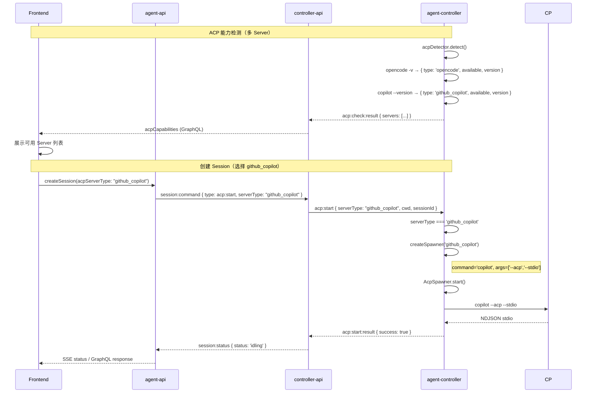

# 多 ACP Server 支持 - 技术提案

**功能名称**: 多 ACP Server 支持
**关联 PRD**: `20260526-multi-acp-server-support.md`
**技术提案版本**: v1.0
**创建日期**: 2026-05-26
**作者**: opencode
**feat-branch**: `feat/multi-acp-server-support`

## 1. 概述

### 1.1 背景

当前系统仅支持 OpenCode 作为 ACP Server，所有模块（检测、启动、持久化、展示）都硬编码为 `'opencode'`。PRD 要求增加 GitHub Copilot CLI 作为第二可选 ACP Server。

ACP 协议层面，GitHub Copilot CLI 通过 `copilot --acp --stdio` 启动 ACP 模式，通信协议与 OpenCode 一致（NDJSON over stdio）。因此与 OpenCode 的核心差异仅在于：启动命令不同、检测方式不同。

### 1.2 目标

- `enum AcpServerType` 增加 `github_copilot` 值
- `AcpDetector` 支持多 Server 检测（opencode + github_copilot）
- `socketio-client.ts` 根据 `serverType` 选择对应 spawner 命令
- 前端 ACP Server 标签展示可读名称
- 所有测试覆盖新 Server 类型

### 1.3 范围

- **包含**：Contract（GraphQL enum）、Mongoose models（enum 扩展）、agent-controller（detector + spawner selection）、controller-api（透传 serverType）、agent-api（透传）、前端（标签展示）
- **不包含**：GitHub Copilot CLI 的安装和认证流程、Copilot 特有的 ACP 能力适配（如 config options 差异）、Session 创建后切换 ACP Server 类型

## 2. 技术架构

### 2.1 系统架构图

```mermaid
graph TD
    subgraph "agent-controller (Daemon)"
        DET[AcpDetector]
        SIO[Socket.IO Client]
        BR[AcpSessionBridge]
        SYNC[AcpSyncBridge]
        SPAWN[AcpSpawner]

        DET -->|detect| OC1[opencode -v]
        DET -->|detect| GC[copilot --version]

        SIO -->|acp:start serverType=github_copilot| BR
        SIO -->|acp:start serverType=opencode| BR
        BR --> SPAWN
        SYNC --> SPAWN

        SPAWN -->|command=opencode args=['acp']| OCPROC[opencode acp]
        SPAWN -->|command=copilot args=['--acp','--stdio']| CPROC[copilot --acp --stdio]
    end

    subgraph "Contracts / Models"
        ENUM[enum AcpServerType { opencode, github_copilot }]
    end

    ENUM -.->|type check| SPAWN
    ENUM -.->|type check| DET
```

### 2.2 架构决策

| 决策 | 选项 A | 选项 B | 最终选择 | 原因 |
|------|--------|--------|---------|------|
| Server 类型到命令的映射方式 | agent-controller 本地映射表 | controller-api 下发完整启动参数 | 本地映射表 | 启动命令是与 Agent 绑定的静态知识，不应由服务端控制；服务端只需传递 `serverType` 字符串 |
| GitHub Copilot 检测命令 | `copilot --version` | `gh copilot --version` | `copilot --version` | GitHub Copilot CLI 安装后 `copilot` 命令在 PATH 中可用，`gh copilot` 命令在旧版本中可能不存在 |
| Session 列表展示 acpServerType | 前端根据 type 显示可读名称 | 后端返回 displayName | 前端映射 | type 数量少且固定，前端维护 `{ opencode: 'OpenCode', github_copilot: 'GitHub Copilot' }` 映射即可 |

### 2.3 模块划分

| 模块 | 职责 | 关键技术点 |
|------|------|-----------|
| Contract | 扩展 `enum AcpServerType` | 增加 `github_copilot` |
| agent-controller (detector) | 多 ACP Server 检测 | 新增 `detectGitHubCopilot()` 方法 |
| agent-controller (socketio-client) | 根据 serverType 选择 spawner | `createSpawner(serverType)` 工厂函数 |
| agent-controller (bridge) | 无改动（已支持自定义 spawner） | 构造函数已接受可选 spawner 参数 |
| agent-controller (sync-bridge) | 无改动（已支持自定义 spawner） | 同上 |
| agent-api (model) | enum 扩展 | `enum: ['opencode', 'github_copilot']` |
| agent-api (GraphQL) | enum 扩展 | `enum AcpServerType { opencode, github_copilot }` |
| controller-api (model) | enum 扩展 | `enum: ['opencode', 'github_copilot']` |
| controller-api (ACM) | 无改动（已使用 `serverType: string`） | 仅透传字符串 |
| frontend (SessionHeader) | 标签可读展示 | `acpServerTypeLabel` 映射 |
| frontend (Sidebar) | 列表 acpServerType 展示 | 同 SessionHeader |

## 3. API 设计

### 3.1 Contract 变更

`contracts/agent-session.graphql`:

```graphql
enum AcpServerType {
  opencode
  github_copilot
}
```

其他接口无需变更，`AcpServerType` 现有的使用位置（`Session.acpServerType`、`AcpCapability.type`、`CreateSessionInput.acpServerType`）均使用该 enum 类型，新增值自然生效。

### 3.2 Socket.IO 协议

无变更。`acp:start` payload 中的 `serverType: string` 字段已存在，仅传递字符串 `'github_copilot'`。

`acp:check` 响应中的 `servers` 数组也会自然包含 `{ type: 'github_copilot', available: true/false, version: '...' }`。

### 3.3 Redis Pub/Sub

无变更。`session:command` 中的 `acpServerType` 字段已存在于 `CreateSessionInput`，透传到 controller-api 后再透传到 `acp:start`。

## 4. 数据模型

### 4.1 MongoDB enum 扩展

```typescript
// agent-api/src/models/session.ts
acpServerType: { type: String, enum: ['opencode', 'github_copilot'], required: true },

// controller-api/src/models/session.ts
acpServerType: { type: String, enum: ['opencode', 'github_copilot'], required: true },
```

已有数据的 `acpServerType` 为 `'opencode'`，向后兼容，无需数据迁移。

## 5. 技术实现方案

### 5.1 核心流程



### 5.2 关键实现点

#### 实现点 1: AcpDetector 扩展多 Server 检测

**文件**: `packages/agent-controller/src/acp/detector.ts`

```typescript
export class AcpDetector {
  async detect(): Promise<AcpServerInfo[]> {
    const servers: AcpServerInfo[] = [];

    // Detect OpenCode
    const opencode = await this.detectOpenCode();
    servers.push(opencode);

    // Detect GitHub Copilot
    const copilot = await this.detectGitHubCopilot();
    servers.push(copilot);

    return servers;
  }

  private async detectOpenCode(): Promise<AcpServerInfo> {
    try {
      const { stdout } = await execAsync('opencode -v');
      const version = this.parseVersion(stdout);
      return { type: 'opencode', available: true, version };
    } catch {
      return { type: 'opencode', available: false };
    }
  }

  private async detectGitHubCopilot(): Promise<AcpServerInfo> {
    try {
      const { stdout } = await execAsync('copilot --version');
      const version = this.parseVersion(stdout);
      return { type: 'github_copilot', available: true, version };
    } catch {
      return { type: 'github_copilot', available: false };
    }
  }

  // 新增：根据 serverType 获取启动命令和参数
  getSpawnerConfig(serverType: string): { command: string; args: string[] } {
    switch (serverType) {
      case 'github_copilot':
        return { command: 'copilot', args: ['--acp', '--stdio'] };
      case 'opencode':
      default:
        return { command: 'opencode', args: ['acp'] };
    }
  }
}
```

#### 实现点 2: socketio-client.ts 根据 serverType 选择 spawner

**文件**: `packages/agent-controller/src/socketio-client.ts`

`acp:start` handler 和 `acp:resume` handler 中创建 Bridge 时，根据 `data.serverType` 传入自定义 spawner：

```typescript
// 新增工厂函数
import { acpDetector } from './acp/detector.js';

function createSpawner(serverType: string, sessionId: string, cwd: string): AcpSpawner {
  const config = getSpawnerConfig(serverType);  // 或 acpDetector.getSpawnerConfig(serverType)
  return new AcpSpawner({
    sessionId,
    cwd,
    command: config.command,
    args: config.args,
  });
}

// acp:start handler
socket.on('acp:start', async (data: AcpStartPayload) => {
  const spawner = createSpawner(data.serverType, data.sessionId, data.cwd);
  const bridge = new AcpSessionBridge(socket, {
    sessionId: data.sessionId,
    cwd: data.cwd,
    mcpServers: data.mcpServers,
  }, spawner);
  // ... rest unchanged
});

// acp:resume handler (same pattern)
socket.on('acp:resume', async (data: AcpResumePayload) => {
  const spawner = createSpawner(data.serverType, data.sessionId, data.cwd);
  const bridge = new AcpSessionBridge(socket, {
    sessionId: data.sessionId,
    cwd: data.cwd,
  }, spawner);
  // ... rest unchanged
});
```

注意：`acp:resume` payload 当前接口定义未包含 `serverType`。由于 `resume` 的目标 ExternalSession 在 `acp:start` 时已记录 serverType，但 controller-api 在 `resumeSession` 时未传递 serverType。

因此需要**补充 controller-api 的 resumeSession 流程**：从 DB 中读取 Session 记录的 `acpServerType`，在 `acp:resume` 事件中下发。

#### 实现点 3: controller-api resumeSession 补充 serverType

**文件**: `servers/controller-api/src/services/acp-session-manager.ts`

`resumeSession` 方法中，从 Session 文档读取 `acpServerType` 传给 socket emit：

```typescript
async resumeSession(...): Promise<...> {
  const session = await Session.findById(sessionId).lean();
  const acpServerType = session?.acpServerType ?? 'opencode';

  controllerSocket.emit('acp:resume', {
    requestId,
    sessionId,
    externalSessionId,
    serverType: acpServerType,  // 新增
    cwd,
  });
}
```

`AcpResumePayload` 接口同步增加 `serverType` 字段：

```typescript
interface AcpResumePayload {
  requestId: string;
  sessionId: string;
  externalSessionId: string;
  serverType: string;  // 新增
  cwd: string;
}
```

#### 实现点 4: acp:list-sessions 和 acp:load-session 处理

这些 sync 操作使用 `AcpSyncBridge`，目前默认使用 opencode。从语义上讲，list-sessions 和 load-session 应使用 OpenCode（因为只有 OpenCode 支持 session 持久化和列表查询），GitHub Copilot 的 ACP 模式可能不支持 `session/list` 和 `session/load` 方法。

**决策**：acp:list-sessions 和 acp:load-session 始终使用 OpenCode（默认 spawner），不做 serverType 区分。

#### 实现点 5: 前端 ACP Server 标签可读展示

**文件**: `apps/agent-web/src/components/session/SessionHeader.tsx`

```typescript
const acpServerTypeLabels: Record<string, string> = {
  opencode: 'OpenCode',
  github_copilot: 'GitHub Copilot',
};

// 展示位置
{session?.acpServerType && (
  <span className="rounded bg-gray-100 px-1.5 py-0.5 text-xs text-gray-600">
    {acpServerTypeLabels[session.acpServerType] || session.acpServerType}
  </span>
)}
```

### 5.3 代码改动清单

| 文件 | 改动类型 | 说明 |
|------|---------|------|
| `contracts/agent-session.graphql` | 修改 | AcpServerType enum 增加 `github_copilot` |
| `servers/agent-api/src/graphql/schemas/session.ts` | 修改 | 同步 GraphQL enum |
| `servers/agent-api/src/models/session.ts` | 修改 | enum 数组增加 `'github_copilot'` |
| `servers/controller-api/src/models/session.ts` | 修改 | enum 数组增加 `'github_copilot'` |
| `servers/controller-api/src/services/acp-session-manager.ts` | 修改 | resumeSession 补充 serverType |
| `packages/agent-controller/src/acp/detector.ts` | 修改 | 新增 `detectGitHubCopilot()` 和 `getSpawnerConfig()` |
| `packages/agent-controller/src/socketio-client.ts` | 修改 | 根据 serverType 创建 spawner；AcpResumePayload 增加 serverType |
| `apps/agent-web/src/components/session/SessionHeader.tsx` | 修改 | 标签使用可读映射 |

**无需改动的文件**：

- `packages/agent-controller/src/acp/bridge.ts` — 已支持外部 spawner
- `packages/agent-controller/src/acp/sync-bridge.ts` — 始终使用 OpenCode
- `packages/agent-controller/src/acp/spawner.ts` — 支持自定义 command/args
- `servers/controller-api/src/services/acp-session-manager.ts` — `startSession` 已使用 `serverType: string`，无需改动 start 流程
- `apps/agent-web/src/components/session/NewSessionDialog.tsx` — 已自动渲染可用 Server 列表，无需改动
- `apps/agent-web/src/components/Sidebar.tsx` — 已透传 acpServerType

## 6. 技术决策

### 6.1 决策列表

| 决策 | 选项 A | 选项 B | 最终选择 | 原因 |
|------|--------|--------|---------|------|
| 启动命令映射放在哪 | AcpDetector 新增 `getSpawnerConfig()` | 新增独立 `server-registry.ts` | AcpDetector | 启动命令与检测是一对一的关系，放在同一个类中更内聚 |
| Resume 时如何获取 serverType | 从 DB 读取 Session 记录 | 前端传 serverType | 从 DB 读取 | 避免前端必须记忆 serverType，保证服务端为唯一数据源 |
| list-sessions / load-session 对 Copilot 的支持 | 尝试使用 Copilot ACP | 始终使用 OpenCode | 始终使用 OpenCode | Copilot ACP 模式下不支持 session list/load |
| 前端展示 serverType 方式 | 后端返回 displayName | 前端硬编码映射 | 前端硬编码映射 | 类型少且基本不变，避免后端多返回一个字段 |

### 6.2 依赖与约束

| 类型 | 内容 | 说明 |
|------|------|------|
| 依赖 | GitHub Copilot CLI 已安装并登录 | 非本项目责任，用户自行安装 |
| 约束 | `copilot --acp --stdio` 为公开预览 | ACP 协议行为可能变化，需保持关注 |
| 约束 | NewSessionDialog 无需改造 | 组件已通用化，只要有可用 Server 就能展示 |

## 7. 项目结构

```
packages/agent-controller/src/acp/
├── detector.ts      # 修改：新增 github_copilot 检测 + getSpawnerConfig()
├── spawner.ts       # 无改动（已支持自定义 command/args）
├── bridge.ts        # 无改动（已支持自定义 spawner）
├── sync-bridge.ts   # 无改动

packages/agent-controller/src/
├── socketio-client.ts  # 修改：acp:start/acp:resume 使用 getSpawnerConfig()

servers/controller-api/src/services/
├── acp-session-manager.ts  # 修改：resumeSession 补充 serverType

servers/agent-api/src/
├── graphql/schemas/session.ts  # 修改：enum 增加 github_copilot
├── models/session.ts           # 修改：enum 增加 github_copilot

apps/agent-web/src/components/session/
├── SessionHeader.tsx  # 修改：可读标签映射
```

## 8. 测试策略

### 8.1 测试覆盖要求

- 单元测试覆盖所有新增代码路径
- API 测试覆盖创建 github_copilot 类型 Session
- 不影响现有 opencode 测试

### 8.2 测试类型

| 类型 | 工具 | 覆盖范围 |
|------|------|---------|
| 单元测试 | Vitest | `detector.ts` 新增的 `detectGitHubCopilot()` 和 `getSpawnerConfig()` |
| 单元测试 | Vitest | `socketio-client.ts` spawner 工厂函数 |
| 单元测试 | Vitest | SessionHeader 组件显示 GitHub Copilot 标签 |
| 单元测试 | Vitest | ACPSessionManager resume 传递 serverType |
| API 测试 | Vitest | 创建 `acpServerType: 'github_copilot'` 的 Session |
| API 测试 | Vitest | Controller 检测返回多个 ACP Server |

### 8.3 测试文件变更

| 文件 | 改动类型 | 说明 |
|------|---------|------|
| `packages/agent-controller/tests/acp-detector.test.ts` | 修改 | 新增 github_copilot 检测测试 |
| `servers/controller-api/src/services/acp-session-manager.test.ts` | 修改 | resume 测试验证 serverType 传递 |
| `apps/agent-web/src/components/session/SessionHeader.test.tsx` | 修改 | 新增 github_copilot 标签测试 |
| `tests/api/src/controller-api/acp-websocket.test.ts` | 修改 | 验证多种 serverType |
| `tests/api/src/agent-api/session.test.ts` | 修改 | 验证多种 serverType |

## 9. 验收标准

- [ ] 技术方案评审通过
- [ ] Contract 中 `AcpServerType` enum 包含 `github_copilot`
- [ ] agent-controller `AcpDetector.detect()` 返回 opencode + github_copilot 两个结果
- [ ] `acp:start` 携带 `serverType: 'github_copilot'` 时，启动命令为 `copilot --acp --stdio`
- [ ] `acp:resume` 透传 serverType，agent-controller 用正确命令启动
- [ ] GitHub Copilot Session 的消息收发正常
- [ ] 前端 SessionHeader 显示 "GitHub Copilot" 标签
- [ ] 前端 Session 列表显示 ACP Server 类型
- [ ] 现有 opencode Session 完全不受影响
- [ ] 所有测试通过

## 10. 相关文档

- [多 ACP Server 支持 PRD](../../product/draft/20260526-multi-acp-server-support.md)
- [GitHub Copilot CLI ACP Server 文档](https://docs.github.com/en/copilot/reference/copilot-cli-reference/acp-server)
- [Agent Session GraphQL Contract](../../../contracts/agent-session.graphql)
- [Agent 拉起与交互技术方案](./20260518-feat-agent-session.md)
