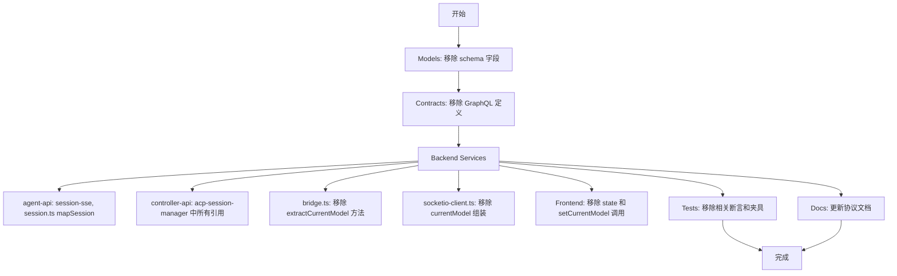
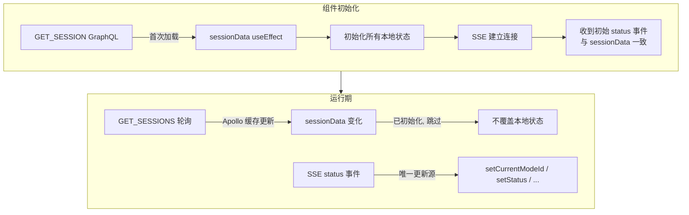
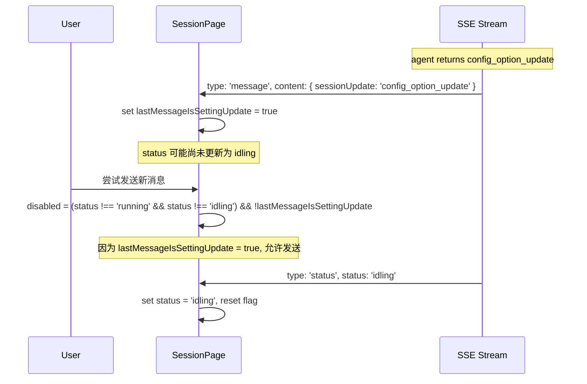

# Session 状态验收问题修复

**功能名称**: Session 状态验收问题修复
**技术提案版本**: v1.4
**创建日期**: 2026-05-26
**作者**: opencode

## 1. 概述

### 1.1 背景

当前代码中存在 5 个 Session 状态相关的验收问题：

1. **`currentModel` 与 `currentModelId` 两套字段并存**，`currentModel` 是冗余的（可从 `currentModelId` + `availableModels` 推导），增加维护成本和数据传输开销
2. **SubAgent 子任务卡片未正确路由** - `subagent_type` 的检测代码在 `MessageList.tsx` 的 `else` 分支中（第 86 行），但由于 SubAgent 消息的 `sessionUpdate` 为 `tool_call_update`，被第 64 行提前拦截并归类为 `tool_call`
3. **`sessionData` useEffect 被 `GET_SESSIONS` 轮询覆盖** - Sidebar 每 15s 轮询会通过 Apollo 归一化缓存更新 `Session` 实体，触发 `useEffect([sessionData])`，覆盖 SSE 更新的状态
4. **Setting update 后可能无法发送消息** - 当最后一条消息是 setting update 且状态未及时切换时，输入框可能被禁用
5. **Session 路由切换时无 loading 状态** - 从 sessionA 直接导航到 sessionB 时，组件复用导致旧数据残留

### 1.2 目标

- 移除 `currentModel` 字段，全链路只使用 `currentModelId`
- SubAgent 卡片正确渲染（检测 `subagent_type` 并路由到 `SubAgentCard`）
- 修复 `sessionData` useEffect 被轮询覆盖的问题
- Setting update 消息后允许用户继续发送消息
- Session 路由切换时正确显示 loading 状态

### 1.3 范围

涉及 `servers/agent-api`、`servers/controller-api`、`packages/agent-controller`、`apps/agent-web`、`contracts`、`tests` 六个模块。

## 2. 问题分析与方案

### 2.1 问题一：移除 `currentModel`

#### 现状

`currentModel: { id: String, name: String, provider: String }` 是一个对象字段，存储完整的模型信息。而 `currentModelId: String` 仅存储模型 ID。两者同时写入 MongoDB、Redis，同时在 SSE、GraphQL 中传输。

关系图：

```mermaid
flowchart LR
    subgraph DB[MongoDB / Redis]
        CM[currentModel: {id, name, provider}]
        CMI[currentModelId: string]
        AM[availableModels: [{id, name, provider}]]
    end
    subgraph Frontend[Frontend]
        MS[ModelSwitcher]
    end
    CMI --> MS
    AM --> MS
    MS -->|本地查找| Derived[推导出 currentModel]
    CM -.->|从未使用| Dead[死代码]

    style Dead fill:#ff9999
    style CM fill:#ffcc99
```

`currentModel` 在前端是死代码：
- `SessionPage.tsx` 中 `_currentModel` 以下划线开头（未使用变量），仅通过 `setCurrentModel` 被动接收值
- `ModelSwitcher.tsx` 直接从 `currentModelId` + `availableModels` 本地推导 `currentModel`
- `InputBox.tsx` 不接收 `currentModel` prop，只接收 `currentModelId`

#### 方案

全链路删除 `currentModel`，按层执行：



### 2.2 问题二：SubAgent 子任务卡片未正确路由

#### 现状

`MessageList.tsx` 的 `groupMessages` 函数中，消息分组类型检测逻辑如下（第 58-94 行）：

```typescript
if (sessionUpdateType === 'user_message_chunk') {
  groupType = 'user_message';
} else if (sessionUpdateType === 'agent_message_chunk') {
  groupType = 'agent_message';
} else if (sessionUpdateType === 'agent_thought_chunk') {
  groupType = 'thought';
} else if (sessionUpdateType === 'tool_call' || sessionUpdateType === 'tool_call_update') {  // ← 第64行
  groupType = 'tool_call';
  // ...
} else {
  // ← 第76行：subagent 检测在这里，但永远不会被 tool_call 消息到达
  if (kind === 'other' && rawInput?.subagent_type) {
    groupType = 'sub_agent';
  }
}
```

用户反馈的 SubAgent 消息数据结构：

```json
{
  "id": "6a15643ae7227d801c6dacf2",
  "direction": "output",
  "type": "tool_call",
  "content": {
    "kind": "other",
    "title": "task",
    "status": "in_progress",
    "subagent_type": "explore",
    "sessionUpdate": "tool_call_update",
    "toolCallId": "call_00_FmrB6QVXt3w0WWnpm9IH5651",
    "rawInput": {
      "description": "Find currentModel usage",
      "prompt": "...",
      "subagent_type": "explore"
    }
  },
  "createdAt": "2026-05-26T09:13:30.228Z"
}
```

#### 根因分析

`content.sessionUpdate` 为 `"tool_call_update"`，在第 64 行被 `sessionUpdateType === 'tool_call' || sessionUpdateType === 'tool_call_update'` 匹配，`groupType` 被设为 `'tool_call'`。

第 76-93 行的 `else` 分支中虽然有 `sub_agent` 检测（第 86 行：`kind === 'other' && rawInput?.subagent_type`），但该分支**永远不会被 `tool_call`/`tool_call_update` 消息到达**，是死代码。

结果：
- SubAgent 消息被渲染为 `ToolCallCard`
- `ToolCallCard` 不处理 `subagent_type`、`rawInput.description`、`rawInput.prompt`、`rawOutput` 等字段
- 用户看到的是普通的 "Tool Call — in_progress" 卡片，而非 SubAgent 信息

#### 方案

在 `tool_call`/`tool_call_update` 分支中增加 `subagent_type` 检测，如果检测到则路由到 `sub_agent` 类型：

```typescript
} else if (sessionUpdateType === 'tool_call' || sessionUpdateType === 'tool_call_update') {
  // 检查是否为 SubAgent 消息
  if (parsed) {
    const p = parsed as Record<string, unknown>;
    const kind = p.kind as string | undefined;
    const rawInput = p.rawInput;
    const subagentType = p.subagent_type as string | undefined;
    const rawInputSubagentType = rawInput && typeof rawInput === 'object'
      ? (rawInput as Record<string, unknown>).subagent_type
      : undefined;
    if (kind === 'other' && (subagentType || rawInputSubagentType)) {
      groupType = 'sub_agent';
    } else {
      groupType = 'tool_call';
    }
  } else {
    groupType = 'tool_call';
  }
```

检测逻辑：
1. 检查 `kind === 'other'`（SubAgent 消息的约定标识）
2. 检查 `content` 级别或 `rawInput` 中是否存在 `subagent_type`
3. 两者任一满足即归类为 `sub_agent`

SubAgent 消息的分组策略（第 98-106 行）：
- 对于 `sub_agent` 类型，应使用 `toolCallId` 分组（与 `tool_call` 相同），确保同一 SubAgent 的初始调用和后续更新合并到同一组

`SubAgentCard.tsx` 无需修改——它已正确处理 `rawInput.description`、`rawInput.prompt`、`rawOutput` 等字段。

### 2.3 问题三：`sessionData` useEffect 被轮询覆盖

#### 现状

SessionPage.tsx 中 SSE 事件处理已覆盖 SSE status 事件中的各个字段：

```typescript
} else if (data.type === 'status') {
  setStatus(data.data.status);
  if (data.data.status === 'ended' && data.data.error) { ... }
  if (data.data.status === 'idling') { ... }
  if (data.data.modes) setModes(data.data.modes);
  if (data.data.currentModeId) setCurrentModeId(data.data.currentModeId);
  if (data.data.currentModel) setCurrentModel(data.data.currentModel);
  if (data.data.availableModels) setAvailableModels(data.data.availableModels);
  if (data.data.currentModelId) setCurrentModelId(data.data.currentModelId);
}
```

但存在一个**严重的覆盖问题**——`sessionData` 的 `useEffect` 会被后台轮询触发，将 SSE 更新的状态覆盖掉：

```typescript
// SessionPage.tsx L88-97 — 问题根源
useEffect(() => {
  if (sessionData?.session) {
    setStatus(sessionData.session.status);
    if (sessionData.session.modes) setModes(sessionData.session.modes as AgentModeData[]);
    if (sessionData.session.currentModeId) setCurrentModeId(sessionData.session.currentModeId);
    // ... 覆盖所有状态
  }
}, [sessionData]); // ← 每次 sessionData 变化都触发
```

#### 根因分析

`Sidebar.tsx` 每 15 秒轮询 `GET_SESSIONS`：

```typescript
const { data: sessionsData } = useQuery<GetSessionsQuery>(GET_SESSIONS, {
  pollInterval: 15000,
});
```

该查询返回的 Session 列表包含 `currentModeId`、`currentModelId`、`modes`、`status`、`availableModels` 等字段。Apollo 的归一化缓存（normalized cache）会更新 `Session` 类型的缓存实体。由于 `SessionPage.tsx` 的 `GET_SESSION` 也读取同一个 `Session` 实体，Apollo 缓存更新会触发 `sessionData` 变化，进而触发 `useEffect([sessionData])`，将 React 本地状态覆盖为轮询返回的（可能已过时的）值。

典型场景复现步骤：

1. 用户在 SessionPage 中通过 `ModelSwitcher` 或 `SetSessionMode` mutation 切换 mode
2. 后端 `acpSessionManager.setMode()` 乐观更新 DB 并发布 `publishStatus('idling', { currentModeId: 'plan' })`
3. SSE `type: 'status'` 事件到达前端 → `setCurrentModeId('plan')` ✓
4. 15 秒后 `Sidebar` 的 `GET_SESSIONS` 轮询返回旧数据（`currentModeId: 'code'`）
5. Apollo 归一化缓存更新 → `sessionData` 变化 → `useEffect` 触发 → `setCurrentModeId('code')` ← **BUG：覆盖为旧值**
6. 用户看到 mode 被"弹回"修改前的值

#### 方案

**核心原则：`sessionData` 仅用于首次初始化，后续状态更新完全依赖 SSE `type: 'status'` 事件。**



改动：

1. **`SessionPage.tsx`**：`sessionData` 的 `useEffect` 增加首次加载保护，仅在组件挂载时初始化一次，后续忽略

```typescript
const initializedRef = useRef(false);

useEffect(() => {
  if (sessionData?.session && !initializedRef.current) {
    initializedRef.current = true;
    setStatus(sessionData.session.status);
    if (sessionData.session.modes) setModes(sessionData.session.modes as AgentModeData[]);
    if (sessionData.session.currentModeId) setCurrentModeId(sessionData.session.currentModeId);
    if (sessionData.session.availableModels) setAvailableModels(sessionData.session.availableModels as AgentModelInfoData[]);
    if (sessionData.session.currentModelId) setCurrentModelId(sessionData.session.currentModelId);
  }
  // 使用 [id] 而非 [sessionData] 作为依赖
  // eslint-disable-next-line react-hooks/exhaustive-deps
}, [id]);
```

2. SSE `type: 'status'` 处理保持不变——它已经是状态更新的正确来源
3. `currentModel` 引用随问题一删除

### 2.4 问题四：最后一条消息是 setting update 时允许发送

#### 现状

```typescript
// SessionPage.tsx
disabled={status !== 'running' && status !== 'idling'}
```

输入框仅当 `status` 为 `running` 或 `idling` 时启用。而当 agent 返回 setting update 时，`handleControllerMessage`（`acp-session-manager.ts`）会同时：
1. 将消息写入 DB 并发送 SSE `type: 'message'` 事件
2. 发布 `publishStatus(sessionId, 'idling', ...)` 发送 SSE `type: 'status'` 事件

但由于 SSE 事件的到达存在时序差，`message` 事件先到（用户看到 setting update），`status` 事件后到（状态更新为 `idling`）。在间隙中：
- 如果状态恰好处于非 `running`/`idling` 的组合（如场景导致中继状态），用户无法发送

#### 方案

在 SessionPage 中跟踪最近一条 SSE 消息是否为 setting update，放宽 `disabled` 条件：



关键行为：
- SSE 收到 `config_option_update` / `current_mode_update` 时，设置 `lastMessageIsSettingUpdateRef.current = true`
- SSE 收到 `status` 事件时，如果 status 不是 `idling` 或 `running`，不清除该标记（让后续消息可用）
- 用户实际发送消息时，清除该标记
- 使用 `useRef` 而非 `useState` 避免额外渲染

### 2.5 问题五：路由切换 Session 时无 loading 状态

#### 现状

`App.tsx` 的 `SessionPage` 路由没有 `key` prop：

```tsx
<Route path="sessions/:id" element={<SessionPage />} />
```

当用户在 `/sessions/sessionA` 时直接导航到 `/sessions/sessionB`，React Router v7 复用 `SessionPage` 组件实例，导致：
1. `messages` 状态保留旧 session 的数据
2. 无 loading spinner 显示
3. 用户看到上一个 session 的消息列表

#### 方案

在 `App.tsx` 中创建包装组件，使用 `location.pathname` 作为 key 强制组件重载：

```tsx
function SessionPageRoute() {
  const location = useLocation();
  return <SessionPage key={location.pathname} />;
}

// 路由中使用
<Route path="sessions/:id" element={<SessionPageRoute />} />
```

---

## 3. 各层具体改动

### 3.1 数据模型层

| 文件 | 改动 |
|------|------|
| `servers/agent-api/src/models/session.ts:17` | 删除 `currentModel` 字段 |
| `servers/controller-api/src/models/session.ts:15` | 删除 `currentModel` 字段 |

### 3.2 GraphQL / 契约层

| 文件 | 改动 |
|------|------|
| `contracts/agent-session.graphql:62` | 删除 `currentModel: AgentModelInfo` |
| `servers/agent-api/src/graphql/schemas/session.ts:56` | 删除 `currentModel` 字段 |
| `apps/agent-web/src/graphql/types.ts:115` | 删除 `currentModel?: AgentModelInfoData \| null` |
| `apps/agent-web/src/graphql/queries.ts:102-106` | 删除 `currentModel { id name provider }` |
| `contracts/agent-session-websocket.md:972-976` | 删除 `currentModel` 字段定义 |

### 3.3 后端服务层

| 文件 | 改动 |
|------|------|
| `servers/agent-api/src/services/session-sse.ts:40` | `addConnection` 中移除 `currentModel` |
| `servers/agent-api/src/services/session-sse.ts:102` | `ensureGlobalStatusSubscriber` 中移除 |
| `servers/agent-api/src/services/session-sse.ts:138` | `broadcastStatus` 中移除 |
| `servers/agent-api/src/services/session.ts:464` | `mapSession` 中移除 |
| `servers/controller-api/src/services/acp-session-manager.ts:58,92,96,100` | start 路径移除 |
| `servers/controller-api/src/services/acp-session-manager.ts:369,391,395,399` | resume 路径移除 |
| `servers/controller-api/src/services/acp-session-manager.ts:504-506` | `refreshSessionCache` 移除 |
| `servers/controller-api/src/services/acp-session-manager.ts:519,530-531` | `cacheModes` 移除 |
| `servers/controller-api/src/services/acp-session-manager.ts:556` | `publishStatus` 移除 |

### 3.4 Agent 控制器层

| 文件 | 改动 |
|------|------|
| `packages/agent-controller/src/acp/bridge.ts:225-229` | 删除 `extractCurrentModel` 方法 |
| `packages/agent-controller/src/acp/bridge.ts:70,101,121` | 删除 `currentModel` 调用 |
| `packages/agent-controller/src/socketio-client.ts:222,280` | 删除 `currentModel` 组装 |

### 3.5 前端层

| 文件 | 改动 |
|------|------|
| `apps/agent-web/src/pages/SessionPage.tsx:70` | 删除 `_currentModel` state |
| `apps/agent-web/src/pages/SessionPage.tsx:88-97` | `sessionData` useEffect 改为仅首次初始化，依赖从 `[sessionData]` 改为 `[id]` |
| `apps/agent-web/src/pages/SessionPage.tsx:93,143` | 删除 `setCurrentModel` 调用 |
| `apps/agent-web/src/pages/SessionPage.tsx` | 新增 `initializedRef` 保护 Effect 重复执行 |
| `apps/agent-web/src/pages/SessionPage.tsx` | 新增 `lastMessageIsSettingUpdateRef` 和相关逻辑 |
| `apps/agent-web/src/pages/SessionPage.tsx:355` | 修改 `disabled` 条件 |
| `apps/agent-web/src/components/session/MessageList.tsx:64-65` | `tool_call`/`tool_call_update` 分支中增加 `subagent_type` 检测，路由到 `sub_agent` 类型 |
| `apps/agent-web/src/components/session/MessageList.tsx:98-106` | `sub_agent` 类型也使用 `toolCallId` 分组 |
| `apps/agent-web/src/App.tsx` | 新增 `SessionPageRoute` 包装组件，使用 `key={location.pathname}` |

### 3.6 测试层

| 文件 | 改动 |
|------|------|
| `tests/api/src/agent-api/session.test.ts:132,696,728-729,893,905` | 删除 `currentModel` 相关断言 |
| `servers/agent-api/src/services/session-sse.test.ts:240,250,254` | 删除 `currentModel` 相关用例 |
| `packages/agent-controller/tests/acp-bridge.test.ts:121,137` | 删除 `currentModel` 相关断言 |

## 4. 关键实现细节

### 4.1 新增：SubAgent 检测逻辑

```typescript
// MessageList.tsx — groupMessages 函数，第 64-65 行替换
} else if (sessionUpdateType === 'tool_call' || sessionUpdateType === 'tool_call_update') {
  // 检查是否为 SubAgent 消息
  if (parsed) {
    const p = parsed as Record<string, unknown>;
    const kind = p.kind as string | undefined;
    const rawInput = p.rawInput;
    const hasSubagentType = !!(p.subagent_type as string | undefined) ||
      (rawInput && typeof rawInput === 'object' && !!(rawInput as Record<string, unknown>).subagent_type);
    if (kind === 'other' && hasSubagentType) {
      groupType = 'sub_agent';
    } else {
      groupType = 'tool_call';
    }
  } else {
    groupType = 'tool_call';
  }
```

### 4.2 新增：SubAgent 分组策略

在分组逻辑中，为 `sub_agent` 类型增加 `toolCallId` 分组：

```typescript
if ((groupType === 'tool_call' || groupType === 'sub_agent') && toolCallId) {
  // Tool calls and sub-agents: group by toolCallId across the entire message list
  if (toolCallGroupMap.has(toolCallId)) {
    groupIndex = toolCallGroupMap.get(toolCallId)!;
  } else {
    groupIndex = groups.length;
    toolCallGroupMap.set(toolCallId, groupIndex);
    groups.push({ type: groupType, messages: [], parsed, messageId: null });
  }
}
```

### 4.3 `lastMessageIsSettingUpdate` 逻辑

```typescript
// SessionPage.tsx
const lastMessageIsSettingUpdateRef = useRef(false);

// SSE onmessage handler:
if (data.type === 'message') {
  setMessages((prev) => [...prev, data.data]);
  // ...
  try {
    const content = JSON.parse(data.data.content);
    if (content.sessionUpdate === 'config_option_update' || content.sessionUpdate === 'current_mode_update') {
      lastMessageIsSettingUpdateRef.current = true;
    }
  } catch { }
}

// handleSendMessage:
const handleSendMessage = async (content: string) => {
  if (!id) return;
  lastMessageIsSettingUpdateRef.current = false; // reset on send
  // ...
};

// disabled:
disabled={(status !== 'running' && status !== 'idling') && !lastMessageIsSettingUpdateRef.current}
```

---

## 5. 验收标准

1. `currentModel` 字段在全代码库中无引用（除 DB migration 保留数据外）
2. 前端 `SessionData` 类型不再包含 `currentModel`
3. GraphQL `GET_SESSION` 查询不再请求 `currentModel`
4. SSE status 事件 payload 不再包含 `currentModel`
5. SubAgent 类型消息正确渲染为 `SubAgentCard`，显示 description、prompt、output 等内容
6. 每条 SSE `type: 'status'` 事件都能正确更新 `status`、`currentModelId`、`currentModeId`、`modes`、`availableModels`
7. `sessionData` 的 `useEffect` 不会因 `GET_SESSIONS` 轮询而覆盖本地状态
8. setting update 作为最后一条消息时，输入框可点击发送
9. 路由切换 Session 时显示 loading spinner 并清空旧状态
10. 所有现有测试通过

## 6. 执行顺序

```
Step 1 (移除 currentModel) → Step 2 (SubAgent 卡片渲染) → Step 3 (sessionData 覆盖修复) → Step 4 (setting update) → Step 5 (路由切换)
```

- Step 1 最复杂，涉及多模块
- Step 2-5 都是前端改动，可以独立进行
- 建议按序执行，每个 Step 完成后验证无回归

## 7. 相关文档

- [[contracts/agent-session.graphql]] — Session GraphQL 契约
- [[contracts/agent-session-websocket.md]] — SSE 协议文档
- [[20260522-feat-available-models-and-mode-switch.md]] — 可用模型与模式切换方案
- [[20260522-feat-model-switch-support.md]] — 模型切换支持方案
- [[20260519-fix-frontend-acp-response.md]] — 前端 ACP 响应修复（ToolCall 渲染基础）
