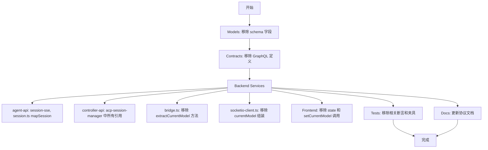
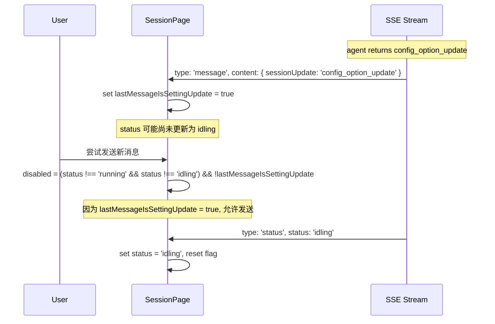

# Session 状态验收问题修复

**功能名称**: Session 状态验收问题修复
**技术提案版本**: v1.0
**创建日期**: 2026-05-26
**作者**: opencode

## 1. 概述

### 1.1 背景

当前代码中存在三个 Session 状态相关的验收问题：

1. `currentModel` 与 `currentModelId` 两套字段并存，但 `currentModel` 完全是冗余的（可从 `currentModelId` + `availableModels` 推导），增加维护成本和数据传输开销
2. 当 agent 返回 `config_option_update` 或 `current_mode_update` 这类 setting update 消息后，用户可能因状态未及时切换而无法发送下一条消息
3. SSE `type: 'status'` 事件的处理不完整，前端未充分利用事件中的 `$.data.status` 字段更新会话状态

### 1.2 目标

- 移除 `currentModel` 字段，全链路只使用 `currentModelId`
- setting update 消息后允许用户继续发送消息
- 确保每个 SSE `type: 'status'` 事件正确更新前端状态

### 1.3 范围

涉及 `servers/agent-api`、`servers/controller-api`、`packages/agent-controller`、`apps/agent-web`、`contracts`、`tests` 六个模块。

## 2. 问题分析与方案

### 2.1 问题一：移除 `currentModel`

#### 现状

`currentModel: { id: String, name: String, provider: String }` 是一个对象字段，存储完整的模型信息。而 `currentModelId: String` 仅存储模型 ID。两者同时写入 MongoDB、Redis，同时在 SSE、GraphQL 中传输。

关系图：

```mermaid
flowchart LR
    subgraph DB[MongoDB / Redis]
        CM[currentModel: {id, name, provider}]
        CMI[currentModelId: string]
        AM[availableModels: [{id, name, provider}]]
    end
    subgraph Frontend[Frontend]
        MS[ModelSwitcher]
    end
    CMI --> MS
    AM --> MS
    MS -->|本地查找| Derived[推导出 currentModel]
    CM -.->|从未使用| Dead[死代码]

    style Dead fill:#ff9999
    style CM fill:#ffcc99
```

`currentModel` 在前端是死代码：
- `SessionPage.tsx` 中 `_currentModel` 以下划线开头（未使用变量），仅通过 `setCurrentModel` 被动接收值
- `ModelSwitcher.tsx` 直接从 `currentModelId` + `availableModels` 本地推导 `currentModel`
- `InputBox.tsx` 不接收 `currentModel` prop，只接收 `currentModelId`

#### 方案

全链路删除 `currentModel`，按层执行：



详情见下方【各层具体改动】表格。

### 2.2 问题二：最后一条消息是 setting update 时允许发送

#### 现状

```tsx
// SessionPage.tsx L355
disabled={status !== 'running' && status !== 'idling'}
```

输入框仅当 `status` 为 `running` 或 `idling` 时启用。而当 agent 返回 setting update 时，`handleControllerMessage`（`acp-session-manager.ts`）会同时：
1. 将消息写入 DB 并发送 SSE `type: 'message'` 事件
2. 发布 `publishStatus(sessionId, 'idling', ...)` 发送 SSE `type: 'status'` 事件

但由于 SSE 事件的到达存在时序差，`message` 事件先到（用户看到 setting update），`status` 事件后到（状态更新为 `idling`）。在间隙中：
- 如果状态恰好处于非 `running`/`idling` 的组合（如场景导致中继状态），用户无法发送

#### 方案

在 SessionPage 中跟踪最近一条 SSE 消息是否为 setting update，放宽 `disabled` 条件：



关键行为：
- SSE 收到 `config_option_update` / `current_mode_update` 时，`lastMessageIsSettingUpdateRef.current = true`
- SSE 收到 `status` 事件时，如果 status 不是 `idling` 或 `running`，不清除该标记（让后续消息可用）
- 用户实际发送消息时，清除该标记
- 使用 `useRef` 而非 `useState` 避免额外渲染

### 2.3 问题三：SSE `type: 'status'` 事件更新状态

#### 现状

SessionPage.tsx 中 SSE 事件处理已覆盖所有事件类型：

```tsx
} else if (data.type === 'status') {
  setStatus(data.data.status);
  if (data.data.modes) setModes(data.data.modes);
  if (data.data.currentModeId) setCurrentModeId(data.data.currentModeId);
  if (data.data.availableModels) setAvailableModels(data.data.availableModels);
  if (data.data.currentModelId) setCurrentModelId(data.data.currentModelId);
}
```

但存在两个问题：
1. `currentModel` 字段仍在此处被读取（配合问题一删除）
2. `useSessionStream` hook 中的 `onStatus` 回调仅传递 `status` 字符串，丢失了 `currentModelId`、`availableModels` 等完整状态

#### 方案

```mermaid
flowchart LR
    subgraph SSE[SSE Event Source]
        StatusEvent[type: 'status']
    end
    subgraph SessionPage[SessionPage.tsx]
        Handler[onmessage handler]
        SetStatus[setStatus]
        SetModelId[setCurrentModelId]
        SetModels[setAvailableModels]
        SetModes[setModes]
    end
    subgraph useSessionStream[useSessionStream.ts]
        Callback[onStatus callback]
    end

    StatusEvent --> Handler
    Handler --> SetStatus
    Handler --> SetModelId
    Handler --> SetModels
    Handler --> SetModes

    StatusEvent -.-> Callback
    Note over Callback: 当前仅传递 status 字符串<br/>需要改为传递完整 data 对象
```

改动：
1. **`SessionPage.tsx`**：验证当前实现正确，移除 `currentModel` 引用
2. **`useSessionStream.ts`**：将 `onStatus` 回调签名从 `(status: string) => void` 改为 `(data: { status: string; currentModelId?: string; availableModels?: ... }) => void`，传递完整的 status event data

## 3. 各层具体改动

### 3.1 数据模型层

| 文件 | 改动 |
|------|------|
| `servers/agent-api/src/models/session.ts:17` | 删除 `currentModel` 字段 |
| `servers/controller-api/src/models/session.ts:15` | 删除 `currentModel` 字段 |

### 3.2 GraphQL / 契约层

| 文件 | 改动 |
|------|------|
| `contracts/agent-session.graphql:62` | 删除 `currentModel: AgentModelInfo` |
| `servers/agent-api/src/graphql/schemas/session.ts:56` | 删除 `currentModel` 字段 |
| `apps/agent-web/src/graphql/types.ts:115` | 删除 `currentModel?: AgentModelInfoData \| null` |
| `apps/agent-web/src/graphql/queries.ts:102-106` | 删除 `currentModel { id name provider }` |
| `contracts/agent-session-websocket.md:972-976` | 删除 `currentModel` 字段定义 |

### 3.3 后端服务层

| 文件 | 改动 |
|------|------|
| `servers/agent-api/src/services/session-sse.ts:40` | `addConnection` 中移除 `currentModel` |
| `servers/agent-api/src/services/session-sse.ts:102` | `ensureGlobalStatusSubscriber` 中移除 |
| `servers/agent-api/src/services/session-sse.ts:138` | `broadcastStatus` 中移除 |
| `servers/agent-api/src/services/session.ts:464` | `mapSession` 中移除 |
| `servers/controller-api/src/services/acp-session-manager.ts:58,92,96,100` | start 路径移除 |
| `servers/controller-api/src/services/acp-session-manager.ts:369,391,395,399` | resume 路径移除 |
| `servers/controller-api/src/services/acp-session-manager.ts:504-506` | `refreshSessionCache` 移除 |
| `servers/controller-api/src/services/acp-session-manager.ts:519,530-531` | `cacheModes` 移除 |
| `servers/controller-api/src/services/acp-session-manager.ts:556` | `publishStatus` 移除 |

### 3.4 Agent 控制器层

| 文件 | 改动 |
|------|------|
| `packages/agent-controller/src/acp/bridge.ts:225-229` | 删除 `extractCurrentModel` 方法 |
| `packages/agent-controller/src/acp/bridge.ts:70,101,121` | 删除 `currentModel` 调用 |
| `packages/agent-controller/src/socketio-client.ts:222,280` | 删除 `currentModel` 组装 |

### 3.5 前端层

| 文件 | 改动 |
|------|------|
| `apps/agent-web/src/pages/SessionPage.tsx:70` | 删除 `_currentModel` state |
| `apps/agent-web/src/pages/SessionPage.tsx:93,143` | 删除 `setCurrentModel` 调用 |
| `apps/agent-web/src/pages/SessionPage.tsx` | 新增 `lastMessageIsSettingUpdateRef` 和相关逻辑 |
| `apps/agent-web/src/pages/SessionPage.tsx:355` | 修改 `disabled` 条件 |
| `apps/agent-web/src/hooks/useSessionStream.ts:12,51-52` | 扩展 `onStatus` 回调签名 |

### 3.6 测试层

| 文件 | 改动 |
|------|------|
| `tests/api/src/agent-api/session.test.ts:132,696,728-729,893,905` | 删除 `currentModel` 相关断言 |
| `servers/agent-api/src/services/session-sse.test.ts:240,250,254` | 删除 `currentModel` 相关用例 |
| `packages/agent-controller/tests/acp-bridge.test.ts:121,137` | 删除 `currentModel` 相关断言 |

## 4. 关键实现细节

### 4.1 `lastMessageIsSettingUpdate` 逻辑

```typescript
// SessionPage.tsx
const lastMessageIsSettingUpdateRef = useRef(false);

// SSE onmessage handler:
if (data.type === 'message') {
  setMessages((prev) => [...prev, data.data]);
  // ...
  try {
    const content = JSON.parse(data.data.content);
    if (content.sessionUpdate === 'config_option_update' || content.sessionUpdate === 'current_mode_update') {
      lastMessageIsSettingUpdateRef.current = true;
    }
  } catch { }
}

// handleSendMessage:
const handleSendMessage = async (content: string) => {
  if (!id) return;
  lastMessageIsSettingUpdateRef.current = false; // reset on send
  // ...
};

// disabled:
disabled={(status !== 'running' && status !== 'idling') && !lastMessageIsSettingUpdateRef.current}
```

### 4.2 `useSessionStream` 回调改造

```typescript
// 当前：
onStatus?: (status: string) => void;

// 改后：
interface SessionStatusData {
  status: string;
  currentModelId?: string | null;
  availableModels?: Array<{ id: string; name: string; provider?: string }> | null;
  currentModeId?: string | null;
  modes?: Array<{ id: string; name: string; description?: string }> | null;
  error?: string | null;
}
onStatus?: (data: SessionStatusData) => void;
```

## 5. 验收标准

1. `currentModel` 字段在全代码库中无引用（除 DB migration 保留数据外）
2. 前端 `SessionData` 类型不再包含 `currentModel`
3. GraphQL `GET_SESSION` 查询不再请求 `currentModel`
4. SSE status 事件 payload 不再包含 `currentModel`
5. setting update 作为最后一条消息时，输入框可点击发送
6. 每条 SSE `type: 'status'` 事件都能正确更新 `status`、`currentModelId`、`availableModels` 等状态
7. 所有现有测试通过

## 6. 相关文档

- [[contracts/agent-session.graphql]] — Session GraphQL 契约
- [[contracts/agent-session-websocket.md]] — SSE 协议文档
- [[20260522-feat-available-models-and-mode-switch.md]] — 可用模型与模式切换方案
- [[20260522-feat-model-switch-support.md]] — 模型切换支持方案
