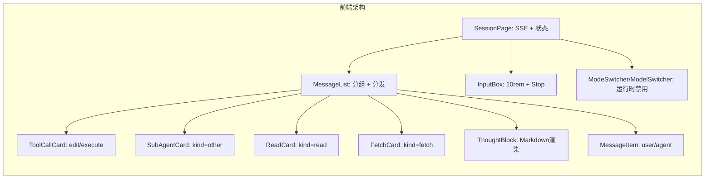
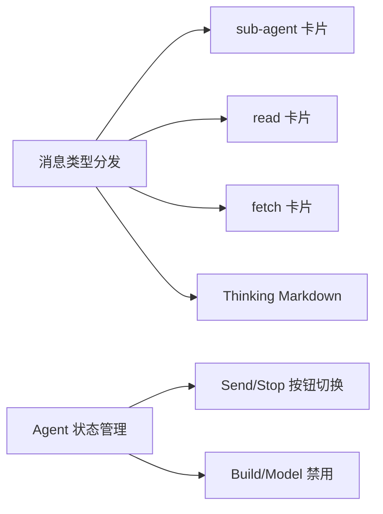
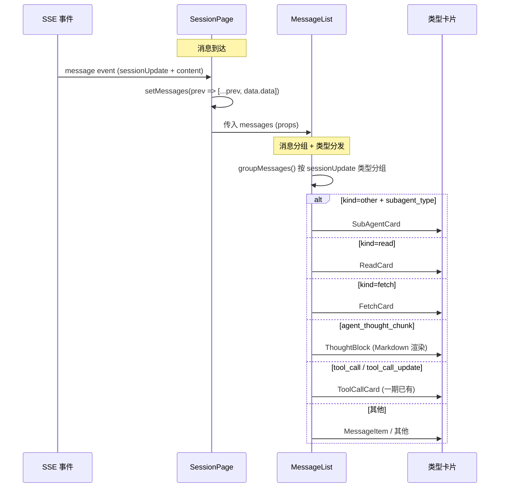
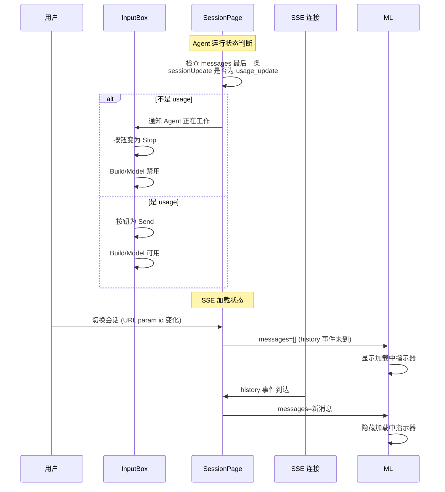

# 用户界面优化二期 - 技术提案

**功能名称**: 用户界面优化二期
**关联 PRD**: docs/product/draft/20260526-ui-optimization-phase2.md
**技术提案版本**: v1.0
**创建日期**: 2026-05-26
**作者**: opencode
**feat-branch**: `feat/ui-optimization-phase2`

## 1. 概述

### 1.1 背景

一期 UI 优化已实现工具调用（edit/execute）的差异化展示、最后一条消息自动展开、操作加载状态反馈等功能。二期在此基础上继续完善消息展示类型覆盖、提升思考内容可读性、优化加载和输入体验、增加 Agent 运行状态指示。

一期完成后，仍有以下能力未覆盖：
- `kind=other`（sub-agent）、`kind=read`、`kind=fetch` 三类消息以统一格式展示，缺乏类型特征
- Thinking 块仅渲染纯文本，不支持 Markdown
- 切换会话时消息列表短暂空白，无加载反馈
- 输入框 5rem 高度在长代码输入时仍不够
- Agent 运行中无直观状态指示，build/model 可误操作

### 1.2 目标

- 3 类新消息（sub-agent / read / fetch）使用卡片样式差异化展示，与工具调用卡片视觉统一
- Thinking 块支持 Markdown 渲染
- 切换会话时消息列表显示 loading 状态
- 输入框最高高度提升至 10rem
- Agent 运行时发送按钮变为 Stop 按钮，build/model 不可操作

### 1.3 范围

- 本次优化限定在前端 `apps/agent-web`，不涉及后端或 API 变更
- 不修改 SDK 类型定义
- 不修改消息数据流（SSE -> state -> render）
- 现有 121 个单元测试和 77 个 e2e 测试必须保持通过
- 不引入新的 npm 依赖

## 2. 技术架构

### 2.1 系统架构图



### 2.2 技术栈

| 层级 | 技术选型 | 说明 |
|------|---------|------|
| 框架 | React 19 + TypeScript | 不变 |
| 构建 | Vite 8 | 不变 |
| 样式 | Tailwind CSS v4 | 不变 |
| Markdown | react-markdown + remark-gfm | 复用现有，Thinking 块新增 |
| 语法高亮 | react-syntax-highlighter | 复用现有 |
| 测试 | Vitest + Testing Library + Playwright | 不变 |

### 2.3 模块划分



| 模块 | 职责 | 关键技术点 |
|------|------|-----------|
| SubAgentCard | 渲染 `kind=other` + `subagent_type` 消息 | 复用 AcpCard 卡片容器，三种内容区域：title(description) + body(prompt) + footer(output) |
| ReadCard | 渲染 `kind=read` 消息 | 上部文件路径列表 + 下部文件内容（与 MessageItem 共用渲染逻辑） |
| FetchCard | 渲染 `kind=fetch` 消息 | URL 展示 + 结果展示 |
| ThoughtBlock Markdown | 渲染 Markdown 格式的思考内容 | 复用 MessageItem 中现有的 react-markdown + react-syntax-highlighter |
| SSE Loading | 消息列表空时显示 loading | 新增条件渲染分支，复用 InlineSpin 等已有加载组件 |
| InputBox 10rem | 调整 textarea maxHeight | 修改 CSS 常量 |
| Agent 状态指示 | 检测最后一条消息非 Usage 时切换 UI | 新增 `isWorking` 派生状态，影响 Send/Stop 按钮和 build/model 可用性 |

## 3. API 设计

本次不涉及新增或修改 API。

## 4. 数据模型

无需变更数据模型。

## 5. 技术实现方案

### 5.1 核心流程





### 5.2 关键实现点

#### 实现点 1: SubAgentCard 组件（新增）

- **描述**: 新建 `SubAgentCard.tsx`，渲染 `kind=other` 且 `rawInput.subagent_type` 存在的消息。
- **技术细节**:
  - 复用 `AcpCard` 作为可折叠卡片容器，color 主题与 ToolCallCard 一致
  - 从最后一条消息的 `SessionUpdate` 中解析 `rawInput`：
    - `rawInput.description` → 卡片标题（如"代码审查"）
    - `rawInput.prompt` → 主体区域（markdown 渲染，复用 MessageItem 中的 Markdown 逻辑）
    - `rawOutput?.output` → 底部结果区域（与 user/agent 消息展示方式一致）
  - 卡片折叠态摘要：显示 `kind + type` 简要信息
  - 卡片展开态：三段式布局（标题/提示词/结果）
  - 无 `rawOutput` 时只显示标题和提示词，无结果区域
- **风险点**: SDK 类型定义可能不包含 subagent_type 等字段，需要从 `rawInput` 的 `Record<string, unknown>` 中安全访问

#### 实现点 2: ReadCard 组件（新增）

- **描述**: 新建 `ReadCard.tsx`，渲染 `kind=read` 消息。
- **技术细节**:
  - 复用 `AcpCard`
  - `locations` 数组 → 文件路径列表（多行展示，每行一个路径）
  - 文件内容取自 `$.content` 中的文本，与 MessageItem 共用渲染逻辑
  - `locations` 为空时只显示文件内容区域
- **风险点**: 无

#### 实现点 3: FetchCard 组件（新增）

- **描述**: 新建 `FetchCard.tsx`，渲染 `kind=fetch` 消息。
- **技术细节**:
  - 复用 `AcpCard`
  - `rawInput.url` → URL 展示（可点击链接）
  - `rawOutput.output` → 结果内容（与 MessageItem 共用渲染逻辑）
  - 无 `rawOutput` 时只显示 URL
- **风险点**: 无

#### 实现点 4: MessageList 类型分发扩展

- **描述**: 在 `MessageList.tsx` 的 `groupMessages()` 和渲染逻辑中新增 3 种类型判断。
- **技术细节**:
  - 新增 `MessageGroup['type']` 值：`'sub_agent'`、`'read'`、`'fetch'`
  - 在渲染分支中增加对应的卡片组件引用
  - 对 `kind=other` 消息的 `rawInput` 做 safe 检查，避免类型断言风险
- **风险点**: 无

#### 实现点 5: ThoughtBlock Markdown 渲染

- **描述**: 修改 `ThoughtBlock.tsx`，将纯文本渲染改为 Markdown 渲染。
- **技术细节**:
  - 将 `whitespace-pre-wrap` 的纯文本 `<div>` 替换为 `react-markdown` + `remark-gfm`
  - 复用 MessageItem 中的 Markdown 组件配置（代码块语法高亮使用 `react-syntax-highlighter` + `Prism` + `oneDark` 主题）
  - 保持 AcpCard 的灰底 (`color="gray"`) 和折叠交互不变
  - 折叠态摘要：保留前 60 字符 + "..." 逻辑
- **风险点**: Markdown 渲染可能引入 XSS 风险——需要使用现有安全配置（`rehype-sanitize` 或已配置的组件），确保与 MessageItem 行为一致

#### 实现点 6: SSE 加载状态

- **描述**: 在消息列表为空时显示加载指示器。
- **技术细节**:
  - 在 `MessageList.tsx` 中检测：如果 `messages` 长度为 0 且会话已切换到新 ID，显示加载中提示
  - 加载状态显示在消息列表区域中央，使用现有加载组件
  - 当 SSE 推送 `history` 事件（或第一个 `message` 事件）到达后，加载状态自动消失
  - 判定依据：`MessageList` 接收到的 `messages` prop 第一次从 0 变为非 0
  - 注意：首次打开页面时不会触发"从 0 到非 0"的过渡（因为 `history` 事件会带一批消息来），而是在 `history` 事件到达前显示 loading
  - SSE 连接失败时显示错误提示而非无限加载
- **风险点**: 需要区分"真的没有消息"和"正在加载中"——通过监听传入 messages 长度判断

#### 实现点 7: InputBox 最高高度 10rem

- **描述**: 将 InputBox 中固定的 `maxHeight: '5rem'` 改为 `10rem`。
- **技术细节**:
  - 修改 `apps/agent-web/src/components/session/InputBox.tsx` 中的样式常量
  - Tailwind 无 10rem 对应尺寸，使用内联 `style={{ maxHeight: '10rem' }}` 或 Tailwind 的 `max-h-[10rem]`
  - 其他行为（自动增长、内部滚动、发送后重置）不变
- **风险点**: 无

#### 实现点 8: Agent 运行状态指示

- **描述**: 在 `SessionPage` 层面新增 `isWorking` 派生状态，影响 InputBox 和 Mode/Model 选择器。
- **技术细节**:
  - 新增派生值 `isWorking`：当 `messages` 数组不为空时，检查最后一条消息的 `sessionUpdate` 字段，如果其值不是 `usage_update`，则 `isWorking = true`
  - 传递 `isWorking` 给 InputBox：
    - `isWorking=true` 时：按钮显示为 Stop（沿用 `sending` 状态的 Stop 按钮样式），点击调用 `handleCancelGeneration`
    - `isWorking=true` 时：`build` 和 `model` 选择器 disabled
    - `isWorking=true` 时：输入框保持可输入
  - `isWorking` 与现有 `sending` 状态的关系：
    - `sending` 用于发送过程中的短暂状态（按钮→Stop，textarea→禁用）
    - `isWorking` 用于 Agent 执行期间的长状态（按钮→Stop，build/model→禁用，textarea→可输入）
    - 当 `sending=true` 时，`isWorking` 也应该为 true（覆盖逻辑一致）
  - 当收到 `usage_update` 消息时，`isWorking` 自动恢复为 false
- **风险点**: `sessionUpdate` 的字段名可能不一致，需要确认 SSE 事件的 `data.type` 字段或其他标识方式。当前代码中 UsageCard 匹配的 `sessionUpdate` 值为 `usage_update`。如果实际值为其他（如 `usage`），需要调整判定条件。

### 5.3 组件变更清单

| 文件 | 操作 | 说明 |
|------|------|------|
| `src/components/session/SubAgentCard.tsx` | 新增 | sub-agent 消息卡片 |
| `src/components/session/ReadCard.tsx` | 新增 | 文件读取消息卡片 |
| `src/components/session/FetchCard.tsx` | 新增 | URL 抓取消息卡片 |
| `src/components/session/ThoughtBlock.tsx` | 修改 | 纯文本 → Markdown 渲染 |
| `src/components/session/MessageList.tsx` | 修改 | 新增 3 种类型分发 + SSE loading |
| `src/components/session/InputBox.tsx` | 修改 | 10rem 高度 + Stop 按钮逻辑增强 |
| `src/components/session/MessageItem.tsx` | 不变或微调 | 可能提取 Markdown 渲染逻辑为共用函数 |
| `src/pages/SessionPage.tsx` | 修改 | 新增 `isWorking` 状态 + build/model 禁用控制 |

## 6. 技术决策

### 6.1 决策列表

| 决策 | 选项 A | 选项 B | 最终选择 | 原因 |
|------|--------|--------|---------|------|
| 新增卡片是否新建组件 | 每个类型一个独立组件 | 一个通用组件加类型参数 | 独立组件 | 每种卡片内容差异大，独立组件代码更清晰，便于维护 |
| Thinking Markdown 渲染方式 | 复用 MessageItem 的 Markdown 组件 | 引入新 Markdown 库 | 复用现有 react-markdown | 一致性优先，不引入新依赖 |
| 加载状态判断方式 | messages 长度从 0→非 0 | SSE 连接状态标志 | messages 长度 | 复用现有 props，无需新增状态 |

### 6.2 依赖与约束

| 类型 | 内容 | 说明 |
|------|------|------|
| 约束 | 不引入新 npm 依赖 | 现有 react-markdown/remark-gfm/react-syntax-highlighter 已满足 Markdown 需求 |
| 约束 | 现有 121 + 77 测试必须通过 | 组件修改需同步更新测试 |
| 依赖 | 一期 ToolCallCard 的卡片架构 | 新增 3 个卡片需复用 AcpCard 和现有视觉风格 |

## 7. 项目结构

```
apps/agent-web/src/components/session/
├── SubAgentCard.tsx          # [新增] sub-agent 消息卡片
├── ReadCard.tsx              # [新增] 文件读取消息卡片
├── FetchCard.tsx             # [新增] URL 抓取消息卡片
├── ThoughtBlock.tsx          # [修改] Markdown 渲染
├── MessageList.tsx           # [修改] 类型分发 + loading
├── InputBox.tsx              # [修改] 10rem + Stop 按钮
├── MessageItem.tsx           # [可能微调] Markdown 逻辑提取
├── ToolCallCard.tsx          # 不变
├── AcpCard.tsx               # 不变
├── ...                       # 其他不变
```

## 8. 测试策略

### 8.1 测试覆盖要求

- 单元测试：新增子组件的基础渲染测试 + 状态逻辑测试
- E2E 测试：覆盖新增消息类型的渲染验证

### 8.2 测试类型

| 类型 | 工具 | 覆盖范围 |
|------|------|---------|
| 单元测试 | Vitest + Testing Library | SubAgentCard/ReadCard/FetchCard 渲染测试、MessageList 类型分发测试、ThoughtBlock Markdown 渲染测试 |
| E2E 测试 | Playwright | 验证 sub-agent/read/fetch 消息在界面中正确展示、Agent 运行时 Stop 按钮交互 |

## 9. 部署方案

前端无独立部署变更，随下次 agent-web GitHub Pages 部署一起发布。

## 10. 验收标准

- [ ] 技术方案评审通过
- [ ] SubAgentCard / ReadCard / FetchCard 三类卡片正确渲染对应消息内容
- [ ] ThoughtBlock 支持 Markdown 渲染，代码块语法高亮正常
- [ ] 切换会话时消息列表显示加载状态，消息到达后消失
- [ ] 输入框最高高度从 5rem 提升至 10rem
- [ ] Agent 运行时按钮变为 Stop，build/model 禁用
- [ ] Agent 收到 usage_update 后恢复正常状态
- [ ] 121 个单元测试通过，77 个 e2e 测试通过
- [ ] `tsc -b` 无错误，`vite build` 无错误

## 11. 相关文档

- [PRD 用户界面优化二期](file:///home/ash/.zag/worktrees/z-agent-gear/feat-uv02i4/docs/product/draft/20260526-ui-optimization-phase2.md)
- [一期 PRD](file:///home/ash/.zag/worktrees/z-agent-gear/feat-uv02i4/docs/product/reviewed/20260526-ui-optimization.md)
- [一期技术方案](file:///home/ash/.zag/worktrees/z-agent-gear/feat-uv02i4/docs/engineering/proposals/20260526-proposal-ui-optimization.md)
- [Frontend Rules](file:///home/ash/.zag/worktrees/z-agent-gear/feat-uv02i4/docs/engineering/frontend-rules.md)
- [Common Rules](file:///home/ash/.zag/worktrees/z-agent-gear/feat-uv02i4/docs/engineering/common-rules.md)
