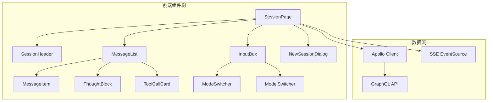
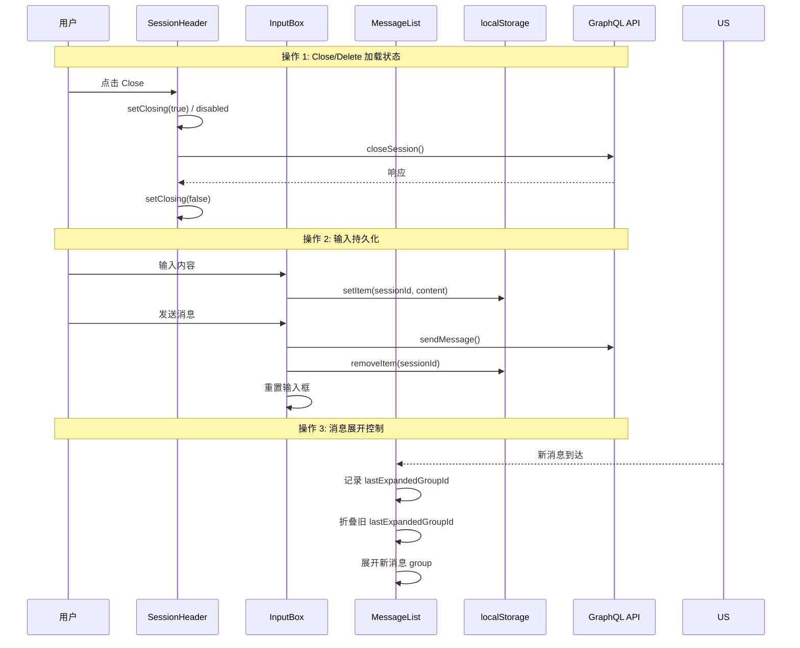

# 用户界面优化 - 技术提案

**功能名称**: 用户界面优化
**关联 PRD**: 20260526-ui-optimization.md
**技术提案版本**: v2.0
**创建日期**: 2026-05-26
**作者**: opencode

## 1. 概述

### 1.1 背景

本次优化覆盖前端交互的全链路体验问题，涉及 Session 页面、输入框、消息列表、创建弹窗等多个组件。所有改动均为纯前端，不涉及后端 API/数据模型变更。

### 1.2 目标

- 为所有 GraphQL mutation 调用增加 loading 状态反馈
- 重构 InputBox 布局，支持 textarea 自动增高和输入持久化
- 优化 MessageList 分组逻辑，分离用户/AI 消息，自动展开最后一条可折叠消息
- 修复创建弹窗的 UI 问题，Radio 替换为下拉选框

### 1.3 范围

| 模块 | 涉及组件 | 变更类型 |
|------|---------|---------|
| 加载状态 | SessionPage, SessionHeader, Sidebar | 新增 state + UI |
| 输入框 | InputBox | 重构布局 + 新增逻辑 |
| 消息展示 | MessageList, AcpCard, ThoughtBlock | 修改分组/展开逻辑 |
| 工具调用 | ToolCallCard, DiffView, TerminalOutput | 重构（差异化展示） |
| BUG 修复 | MessageList (groupMessages) | 修复分组 |
| 创建弹窗 | NewSessionDialog | 样式 + 控件替换 |

## 2. 技术架构

### 2.1 系统架构图



### 2.2 技术栈

| 层级 | 技术选型 | 说明 |
|------|---------|------|
| 前端框架 | React 19 + TypeScript 6 | |
| 状态管理 | React useState/useEffect | 无需全局状态库 |
| GraphQL 客户端 | Apollo Client 4 | useMutation/useQuery |
| 实时通信 | SSE (EventSource) | 消息流 |
| 样式 | Tailwind CSS v4 | |
| 下拉组件 | @base-ui/react/select | 已有依赖 |

### 2.3 模块划分

| 模块 | 职责 | 关键技术点 |
|------|------|-----------|
| 加载状态管理器 | 跟踪所有 mutation 的 loading 状态 | useState + loading 标志 |
| InputBox | 输入布局、auto-grow、持久化 | scrollHeight + localStorage |
| MessageList | 消息分组、展开控制、用户/AI 分离 | groupMessages 重构 + AcpCard 受控 |
| NewSessionDialog | 控件替换、样式修复 | base-ui Select 组件 |

## 3. API 设计

### 3.1 API 契约

无新增 API / GraphQL 变更。所有交互使用现有接口。

#### 加载状态覆盖清单

| 交互点 | 触发组件 | 当前状态 | 改动方案 |
|--------|---------|---------|---------|
| CLOSE_SESSION | SessionHeader | ❌ 无 | 新增 closing state |
| DELETE_SESSION | SessionHeader | ❌ 无 | 新增 deleting state |
| CREATE_SESSION | Sidebar / SessionPage | ❌ 无 | 创建弹窗关闭前已等待 |
| GET_SESSIONS (切换) | Sidebar | ❌ 无 | 页面加载前显示骨架屏 |
| SSE 连接 | SessionPage | ❌ 无 | status=connecting 已有显示 |

## 4. 数据模型

### 4.1 数据库设计

无变更。

### 4.2 缓存设计

- 输入持久化使用 `localStorage`，key 格式：`session_input_{sessionId}`

## 5. 技术实现方案

### 5.1 核心流程



### 5.2 关键实现点

#### 实现点 1: 加载状态追踪

- 在 `SessionPage` 新增 `closing` / `deleting` state
- 传入 `SessionHeader` 作为 props，按钮根据状态显示 spinner + disabled
- `handleCloseSession` / `handleDeleteSession` 执行前后设置对应状态
- 异常时也需要恢复状态（try/finally）

#### 实现点 2: InputBox 重构

- **布局**: 将 ModeSwitcher / ModelSwitcher 上移到独立的 toolbar 行
- **Auto-grow**: 
  - textarea 绑定 `onInput` 事件
  - 每次输入后 `e.target.style.height = 'auto'` + `e.target.scrollHeight` 设置高度
  - `max-height: 5rem` + `overflow-y: auto` 通过 Tailwind 控制
- **持久化**: 
  - `onChange` 时写入 `localStorage.setItem('session_input_' + sessionId, value)`
  - 组件 mount 时从 `localStorage.getItem` 恢复（通过 props 传入 sessionId）
  - 发送成功后 `localStorage.removeItem('session_input_' + sessionId)`
  - `SessionPage` 将 `id` 作为 `sessionId` 传入 `InputBox`

#### 实现点 3: MessageList 分组逻辑重构

##### 3a: 用户/AI 消息分离

在 `groupMessages` 函数中：

```typescript
// 当前: 统一为 'message' 类型
groupType = 'message'; // 同时对应 user_message_chunk 和 agent_message_chunk

// 改为: 按 direction 细分
if (sessionUpdateType === 'user_message_chunk') {
  groupType = 'user_message';
} else if (sessionUpdateType === 'agent_message_chunk') {
  groupType = 'agent_message';
}
```

由于 `user_message` 和 `agent_message` 是不同的 type，它们不会连续合并。用户连续发送多条也会各自独立（同类型不连续？不，同类连续还是会合并。但 BUG 2 说用户连续发两条会错误的合并——这里需要确认：用户连续发两条"user_message_chunk"是否应该合并？根据 BUG 2，不应该合并。

所以对于 `user_message` 类型，即使是连续的同类型消息，也不应该合并。换句话说，每条用户输入应该独占一个 group。

修改：`user_message_chunk` 类型不进行连续合并，每个 user message chunk 单独成组。可以通过不进入连续合并逻辑实现——即 user_message 放弃 groupIndex 复用，每次都新开一个 group。

对于 `agent_message` 类型，保持原有行为：连续的 agent_message_chunk 合并展示。

##### 3b: 自动展开控制

- `AcpCard` 新增受控模式：如果 props 中同时传入 `expanded`，则使用外部状态而非内部 state
- `MessageList` 维护 `lastAutoExpandedGroupKey` state
- 每次消息更新时，找到最后一个可展开的 group（thought / tool_call），如果它和 `lastAutoExpandedGroupKey` 不同：
  1. 获取旧的 `lastAutoExpandedGroupKey`，折叠它（如果还在列表中）
  2. 展开新的最后一个，更新 `lastAutoExpandedGroupKey`
- 用户手动点击展开/折叠不受此逻辑影响（AcpCard 内部 state 在展开时更新，外部受控仅对自动展开生效）

关于 AcpCard 受控设计：

```typescript
// AcpCard 新增 props
interface AcpCardProps {
  // ... 现有 props
  expanded?: boolean;       // 外部控制（可选）
  onExpandedChange?: (expanded: boolean) => void; // 外部监听
}
```

- 如果 `expanded` prop 未传入，则使用内部 state（向后兼容）
- 如果传入了 `expanded`，则内部 state 初始化时使用该值，并通过 `onExpandedChange` 回传内部变化
- 自动展开逻辑通过 `MessageList` 向 `AcpCard` 传入 `expanded={...}` 控制

#### 实现点 4: NewSessionDialog 控件替换

- 工作目录：`<fieldset>` + radio `<label>` 替换为 `@base-ui/react/select`
  - 使用 `<Select.Item>` 嵌套自定义内容，保留两行信息：
    ```tsx
    <SelectItem value={ws.id}>
      <div className="flex flex-col">
        <span>{ws.name}</span>
        <span className="text-xs text-muted-foreground">{ws.path}</span>
      </div>
    </SelectItem>
    ```
- ACP Server：同理替换
- 分支名称前缀：从 `inline-flex` 改为上下两行布局
- 复选框文字：添加显式 `text-foreground` 或 `text-gray-900` 类

#### 实现点 5: 工具调用差异化展示

`ToolCallCard` 只展示最新一条 `tool_call` message（不再聚合历史状态），根据 `kind` 和 `status` 决定内容渲染方式：

##### 5a: SDK 类型映射

| 用户描述 | SDK 类型 | 说明 |
|---------|---------|------|
| `$.kind === 'edit'` | `tool_call.kind === 'edit'` | 文件编辑 |
| `$.kind === 'bash'` | `tool_call.kind === 'execute'` | 命令行执行 |
| `$.locations` | `tool_call.locations: Array<{path: string, line?: number}>` | 修改位置 |
| `$.rawInput` | `tool_call.rawInput: {filePath, oldString, newString}` | edit 输入 |
| `$.rawInput` | `tool_call.rawInput: {workDir, description, command, timeout}` | execute 输入 |
| `$.content[]` | `tool_call.content: Array<ToolCallContent>` | 编辑完成结果 |
| `type=content` | `ToolCallContent & {type: 'content'} → Content` | 文本内容块 |
| `type=diff` | `ToolCallContent & {type: 'diff'} → Diff` | 文件差异块 |
| `$.rawOutput.output` | `tool_call.rawOutput.output: string` | 命令输出 |

##### 5b: 渲染逻辑

```typescript
const message = messages[messages.length - 1]; // 只取最新一条
const parsed = parseSessionUpdate(message.content);
if (parsed.sessionUpdate !== 'tool_call' && parsed.sessionUpdate !== 'tool_call_update') return null;
```

**kind === 'edit' + status === 'in_progress'**:
- `LocationsList` 组件：遍历 `locations`，每个显示文件路径和行号
- `DiffView` 组件（内联）：`rawInput.filePath` 作为标题，`rawInput.oldString` / `newString` 左右对比展示
  - 左右两栏布局，左侧原文本，右侧新文本
  - 使用 `<pre>` 保留空白格式
  - 差异行高亮

**kind === 'edit' + status === 'completed'**:
- 遍历 `content` 数组
- `type === 'content'` → 使用现有 Markdown 渲染（与 AI 消息相同）
- `type === 'diff'` → `DiffView` 组件：`oldText` / `newText` 左右对比，`path` 作为标题

**kind === 'execute' + status === 'in_progress'**:
- `CommandInfo` 组件：展示 `rawInput.workDir`、`rawInput.description`、`rawInput.command`（带代码高亮）、`rawInput.timeout`

**kind === 'execute' + status === 'completed'**:
- `TerminalOutput` 组件：展示 `rawOutput.output`
  - `<pre>` 容器，黑色背景，等宽字体
  - 处理特殊转义/控制字符（至少过滤掉 `\r`、处理 `\n`）
  - 最大高度限制，超出滚动

##### 5c: 新增子组件

| 组件 | 职责 | 文件 |
|------|------|------|
| `DiffView` | 左右对比 diff 展示（oldText vs newText） | `components/session/DiffView.tsx` |
| `TerminalOutput` | 命令行输出展示（含控制字符处理） | `components/session/TerminalOutput.tsx` |

**DiffView 接口**:
```typescript
interface DiffViewProps {
  oldText?: string | null;
  newText: string;
  filePath?: string;
  inline?: boolean; // true = compact inline (for in_progress), false = full page (for completed)
}
```

**TerminalOutput 接口**:
```typescript
interface TerminalOutputProps {
  output: string;
  maxHeight?: string;
}
```

## 6. 技术决策

### 6.1 决策列表

| 决策 | 选项 A | 选项 B | 最终选择 | 原因 |
|------|--------|--------|---------|------|
| 输入持久化方案 | localStorage | sessionStorage | localStorage | 页面切换后仍可恢复 |
| Auto-grow 实现 | JS scrollHeight | CSS field-sizing | scrollHeight | field-sizing 浏览器兼容性不足 |
| Select 组件库 | @base-ui/react/select | 原生 <select> | @base-ui/react/select | 支持自定义 option 内容（两行） |

### 6.2 依赖与约束

| 类型 | 内容 | 说明 |
|------|------|------|
| 依赖 | @base-ui/react/select | 已有依赖，直接使用 |
| 约束 | AcpCard 向后兼容 | 现有 defaultCollapsed 行为不受影响 |
| 约束 | 无新增 npm 包 | 所有功能使用现有依赖 |

## 7. 项目结构

```
apps/agent-web/src/
├── components/session/
│   ├── AcpCard.tsx              # + expanded/onExpandedChange props
│   ├── DiffView.tsx             # 新增：左右对比 diff 展示
│   ├── InputBox.tsx             # 重构布局 + auto-grow + 持久化
│   ├── MessageList.tsx          # 分组逻辑重构 + 展开控制
│   ├── NewSessionDialog.tsx     # 下拉替换 + 样式修复
│   ├── SessionHeader.tsx        # + closing/deleting props
│   ├── TerminalOutput.tsx       # 新增：命令行输出展示
│   ├── ToolCallCard.tsx         # 重构：差异化展示
│   └── ThoughtBlock.tsx         # 无变化（AcpCard 受控）
├── pages/
│   └── SessionPage.tsx          # + closing/deleting state + sessionId 传入
└── components/
    └── Sidebar.tsx              # session 切换骨架屏
```

## 8. 测试策略

### 8.1 测试覆盖要求

- 无需新增 API / E2E 测试（纯 UI 改动）
- 最小改动现有测试

### 8.2 测试类型

| 类型 | 工具 | 覆盖范围 |
|------|------|---------|
| 单元测试 | Vitest | InputBox, AcpCard, ToolCallCard, DiffView, TerminalOutput |
| 组件测试 | React Testing Library | MessageList 分组逻辑 |

## 9. 部署方案

### 9.1 环境规划

无变更。所有改动为纯前端，随主分支部署。

### 9.2 配置管理

无变更。

## 10. 验收标准

- [ ] 技术方案评审通过
- [ ] 代码实现完成
- [ ] 现有测试通过

## 11. 相关文档

- [关联 PRD](../product/reviewed/20260526-ui-optimization.md)
- [通用开发规范](../common-rules.md)
- [前端开发规范](../frontend-rules.md)
