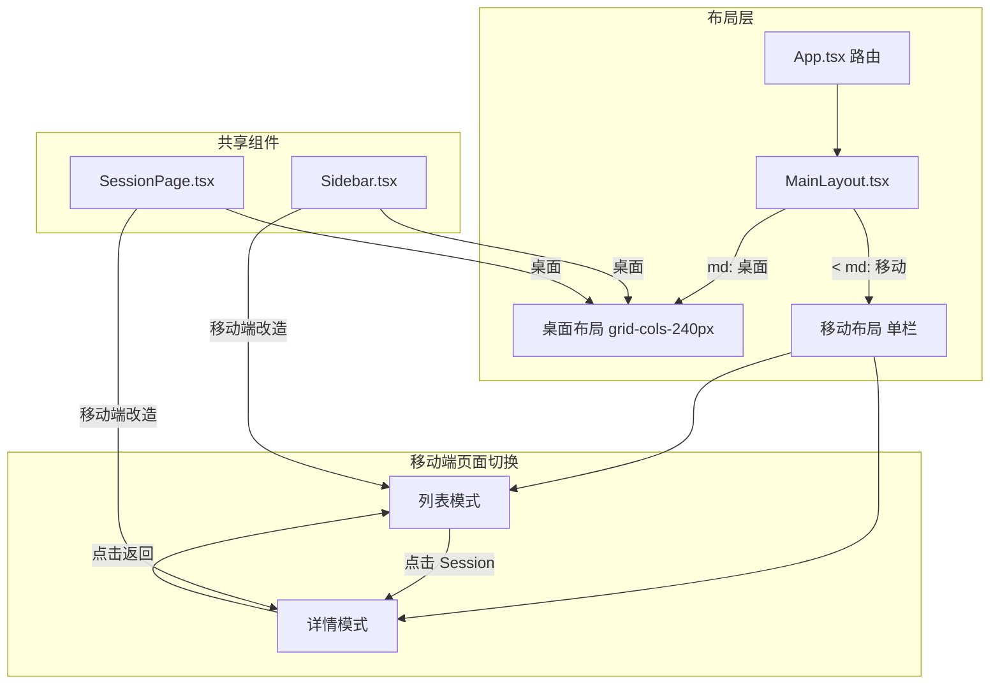
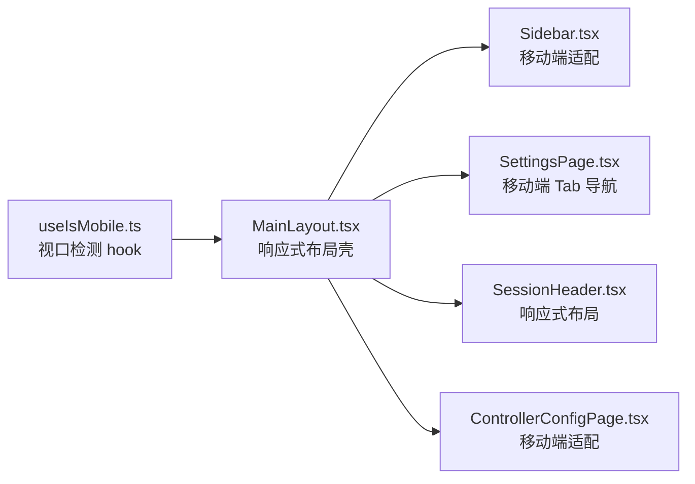
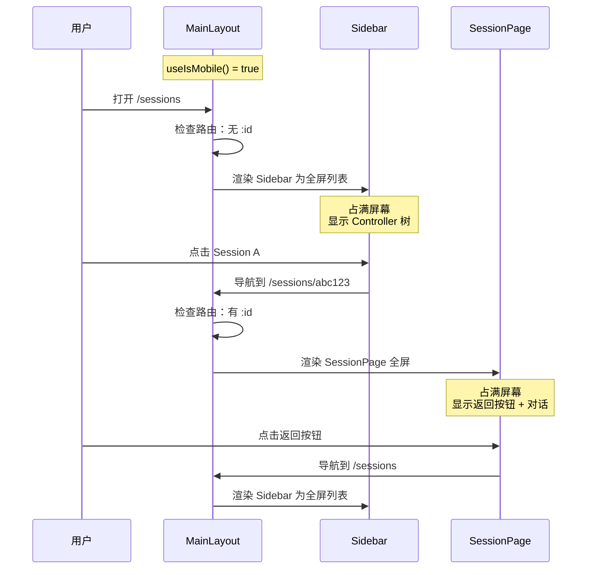
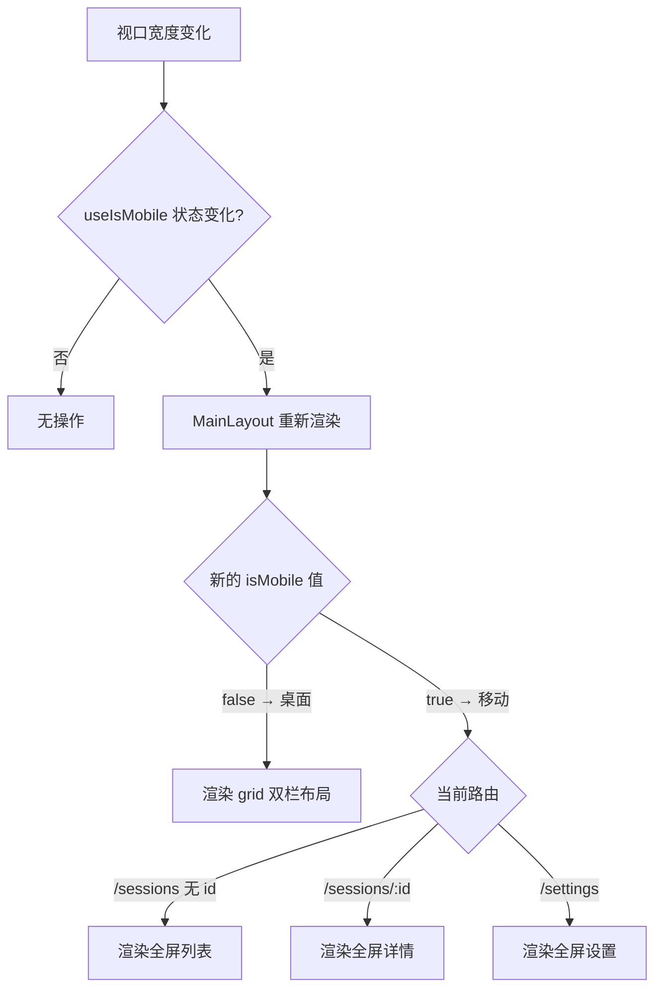

# Web 端移动端布局 - 技术提案

**功能名称**: 移动端布局
**关联 PRD**: `mobile-layout.md`
**技术提案版本**: v1.0
**创建日期**: 2026-05-27
**作者**: ZeroAsh Agent
**feat-branch**: `feat/mobile-layout`

## 1. 概述

### 1.1 背景

基于 PRD `mobile-layout.md`，当前 Web 端采用桌面优先的固定侧边栏布局，`MainLayout` 使用 `grid-cols-[240px_1fr]`，在移动端完全不可用。需要在不影响桌面端的前提下，为移动端提供列表-详情两级导航体验。

### 1.2 目标

1. 移动端（< 768px）采用单栏页面切换：Session 列表为主界面，点击后进入详情页
2. 桌面端（>= 768px）保持现有布局不变
3. 不引入新框架/库，使用 Tailwind CSS `md:` 断点 + React Router 实现

### 1.3 范围

**做：**
- 新增 `useIsMobile()` hook
- 修改 `MainLayout` 响应式切换
- 修改 `Sidebar` 适配移动端全屏模式
- 修改 `SettingsPage` / `ControllerConfigPage` 移动端 Tab 导航
- 修改 `SessionHeader` 响应式布局

**不做：**
- 不修改路由结构
- 不引入全局状态管理
- 不修改 GraphQL 查询或后端逻辑
- 不实现手势/滑动返回

## 2. 技术架构

### 2.1 系统架构图



### 2.2 技术栈

| 层级 | 技术 | 说明 |
|------|------|------|
| 视口检测 | `matchMedia` + React hook | `useIsMobile()` 响应式 hook |
| 布局 | Tailwind CSS `md:` 断点 | 768px 分界线 |
| 页面切换 | React Router `Outlet` + 条件渲染 | 基于路由 + isMobile 条件渲染 |

### 2.3 模块划分



| 模块 | 职责 | 变更类型 |
|------|------|---------|
| `useIsMobile.ts` | 监听视口宽度，返回 isMobile 布尔值 | 新增 |
| `MainLayout.tsx` | 桌面端双栏 / 移动端单栏切换 | 修改 |
| `Sidebar.tsx` | 移动端全屏模式 + 底部设置入口 | 修改 |
| `SettingsPage.tsx` | 移动端 Tab 导航替代侧边导航 | 修改 |
| `ControllerConfigPage.tsx` | 移动端 Tab 导航替代侧边导航 | 修改 |
| `SessionHeader.tsx` | 响应式布局，隐藏次要信息 | 修改 |
| `MobileBackButton.tsx` | 移动端返回按钮组件 | 新增 |

## 3. API 设计

### 3.1 无 API 变更

本次变更纯前端布局改造，不涉及 GraphQL Schema、REST API 或 WebSocket 协议的修改。

## 4. 数据模型

### 4.1 无数据模型变更

不修改任何 Mongoose Schema 或 GraphQL 类型。

## 5. 技术实现方案

### 5.1 核心流程

#### 流程 1: 移动端页面切换



#### 流程 2: 布局模式切换（视口变化）



### 5.2 关键实现点

#### 实现点 1: useIsMobile hook

**文件:** `apps/agent-web/src/hooks/useIsMobile.ts`（新增）

```typescript
import { useSyncExternalStore } from 'react';

const MOBILE_BREAKPOINT = 768;

function subscribe(callback: () => void): () => void {
  const mql = window.matchMedia(`(max-width: ${MOBILE_BREAKPOINT - 1}px)`);
  mql.addEventListener('change', callback);
  return () => mql.removeEventListener('change', callback);
}

function getSnapshot(): boolean {
  return window.innerWidth < MOBILE_BREAKPOINT;
}

export function useIsMobile(): boolean {
  return useSyncExternalStore(subscribe, getSnapshot, () => false);
}
```

**设计决策：**
- 使用 `useSyncExternalStore` 而非 `useState` + `useEffect`，避免 hydration 不一致
- SSR fallback 返回 `false`（默认桌面模式）
- `matchMedia` 的 `change` 事件确保视口变化时即时更新
- 阈值 768px 对应 Tailwind 的 `md:` 断点

#### 实现点 2: MainLayout 响应式切换

**文件:** `apps/agent-web/src/pages/MainLayout.tsx`

```typescript
import { Outlet, useLocation } from 'react-router-dom';
import { useAuth } from '../stores/auth';
import { useIsMobile } from '../hooks/useIsMobile';
import Sidebar from '../components/Sidebar';

export default function MainLayout() {
  const { user, loading } = useAuth();
  const isMobile = useIsMobile();
  const location = useLocation();

  if (loading) {
    return (
      <output className="flex h-screen items-center justify-center" aria-label="Loading…">
        <div className="motion-safe:h-8 motion-safe:w-8 motion-safe:animate-spin motion-safe:rounded-full motion-safe:border-4 motion-safe:border-gray-300 motion-safe:border-t-blue-600" />
        <span className="sr-only">Loading…</span>
      </output>
    );
  }

  // 桌面端：保持现有双栏布局
  if (!isMobile) {
    return (
      <div className="grid h-screen grid-cols-[240px_1fr]">
        <Sidebar username={user?.username ?? ''} />
        <main className="overflow-auto">
          <Outlet />
        </main>
      </div>
    );
  }

  // 移动端：根据路由决定显示列表还是详情
  const isSessionDetail = /^\/sessions\/[^/]+$/.test(location.pathname);
  const isSettings = location.pathname.startsWith('/settings');

  if (isSessionDetail || isSettings) {
    // 详情/设置模式：全屏显示内容，隐藏侧边栏
    return (
      <main className="h-screen overflow-auto">
        <Outlet />
      </main>
    );
  }

  // 列表模式：全屏显示侧边栏
  return (
    <div className="h-screen">
      <Sidebar username={user?.username ?? ''} mobile />
    </div>
  );
}
```

**关键逻辑：**
- `isMobile = false`：渲染现有的 `grid-cols-[240px_1fr]`，零改动
- `isMobile = true` + `/sessions/:id` 或 `/settings`：全屏 `<Outlet />`，隐藏 Sidebar
- `isMobile = true` + `/sessions` 或 `/`：全屏 `<Sidebar mobile />`，隐藏 Outlet
- 路由正则 `/^\/sessions\/[^/]+$/` 匹配 session 详情页

#### 实现点 3: Sidebar 移动端适配

**文件:** `apps/agent-web/src/components/Sidebar.tsx`

**变更 1: 接受 `mobile` prop**

```typescript
interface SidebarProps {
  username: string;
  mobile?: boolean;
}
```

**变更 2: 移动端根容器样式调整**

```typescript
// 桌面端：固定 240px 宽度，深色背景
// 移动端：占满屏幕宽度，浅色背景（或保持深色）
<nav className={`flex flex-col bg-gray-900 text-white ${
  mobile ? 'h-full' : 'h-screen'
}`}>
```

**变更 3: 移动端底部添加设置入口**

```typescript
// 移动端在底部增加设置入口（桌面端已有 footer 中的设置齿轮）
{mobile && (
  <div className="border-t border-gray-700 p-4">
    <NavLink to="/settings" className="flex items-center gap-2 text-sm">
      ⚙️ 设置
    </NavLink>
  </div>
)}
```

**变更 4: 移动端 Session NavLink 行为**

```typescript
// 桌面端：NavLink 直接导航
// 移动端：NavLink 导航后，MainLayout 检测路由切换为详情模式
// 无需修改 NavLink 本身，路由变化由 MainLayout 处理
```

#### 实现点 4: MobileBackButton 组件

**文件:** `apps/agent-web/src/components/MobileBackButton.tsx`（新增）

```typescript
import { useNavigate } from 'react-router-dom';

interface MobileBackButtonProps {
  to?: string;
  label?: string;
}

export default function MobileBackButton({ to, label = '返回' }: MobileBackButtonProps) {
  const navigate = useNavigate();

  return (
    <button
      type="button"
      onClick={() => to ? navigate(to) : navigate(-1)}
      className="flex items-center gap-1 text-sm text-gray-600 hover:text-gray-900 md:hidden"
    >
      ← {label}
    </button>
  );
}
```

**使用场景：**
- `SessionPage` 顶部：返回 `/sessions`
- `SettingsPage` 顶部：返回 `/sessions`
- `ControllerConfigPage` 顶部：返回 `/settings`
- `md:hidden` 确保桌面端不显示

#### 实现点 5: SessionHeader 响应式布局

**文件:** `apps/agent-web/src/components/session/SessionHeader.tsx`

**变更：移动端隐藏次要信息，添加返回按钮**

```typescript
import { useIsMobile } from '../../hooks/useIsMobile';
import MobileBackButton from '../MobileBackButton';

export default function SessionHeader({ session, status, ...props }) {
  const isMobile = useIsMobile();

  return (
    <div className="flex items-center justify-between border-b border-gray-200 bg-white px-4 py-3">
      <div className="flex items-center gap-2 md:gap-4">
        {isMobile && <MobileBackButton to="/sessions" />}
        <h1 className="text-base font-semibold md:text-lg truncate max-w-[200px] md:max-w-none">
          {session?.controllerName || 'Session'}
        </h1>
        <span className={`rounded-full px-2 py-1 text-xs font-medium ${getStatusBadgeClass(status)}`}>
          {STATUS_LABELS[status] ?? status}
        </span>
        {/* 桌面端显示详细信息，移动端隐藏 */}
        {session?.acpServerType && !isMobile && (
          <span className="rounded bg-gray-100 px-1.5 py-0.5 text-xs text-gray-600">
            {acpServerTypeLabels[session.acpServerType] || session.acpServerType}
          </span>
        )}
        {session?.cwd && !isMobile && (
          <span className="text-sm text-gray-500 font-mono">{session.cwd}</span>
        )}
      </div>
      {/* 按钮区域保持不变 */}
      <div className="flex items-center gap-2">
        {/* Close / Continue / Delete 按钮 */}
      </div>
    </div>
  );
}
```

**移动端简化：**
- 显示：返回按钮 + Session 名称（截断） + 状态徽章
- 隐藏：ACP Server 类型、cwd 路径、worktree 徽章、时间戳
- 桌面端：全部显示，不变

#### 实现点 6: SettingsPage 移动端 Tab 导航

**文件:** `apps/agent-web/src/pages/SettingsPage.tsx`

**变更：移动端用顶部 Tab 栏替代左侧导航**

```typescript
import { useIsMobile } from '../hooks/useIsMobile';
import MobileBackButton from '../components/MobileBackButton';

export default function SettingsPage() {
  const isMobile = useIsMobile();

  if (controllerId) {
    return <ControllerConfigPage controllerId={controllerId} onBack={() => setSearchParams({})} />;
  }

  // 移动端布局
  if (isMobile) {
    return (
      <div className="flex h-full flex-col">
        {/* 顶部栏 */}
        <div className="flex items-center gap-2 border-b px-4 py-3">
          <MobileBackButton to="/sessions" />
          <h1 className="text-lg font-semibold">设置</h1>
        </div>
        {/* 水平 Tab 栏 */}
        <div className="flex gap-2 overflow-x-auto border-b px-4 py-2">
          <TabButton onClick={() => scrollTo('account-section')}>帐号</TabButton>
          <TabButton onClick={() => scrollTo('provider-section')}>供应商</TabButton>
          <TabButton onClick={() => scrollTo('model-section')}>模型</TabButton>
          <TabButton onClick={() => scrollTo('controller-section')}>控制器</TabButton>
        </div>
        {/* 内容区 */}
        <div className="flex-1 overflow-y-auto p-4">
          {/* AccountSection, ProviderSection, ModelSection, ControllerListSection */}
        </div>
      </div>
    );
  }

  // 桌面端布局（保持不变）
  return (
    <div className="grid h-full grid-cols-[200px_1fr]">
      {/* 现有布局 */}
    </div>
  );
}
```

#### 实现点 7: ControllerConfigPage 移动端适配

**文件:** `apps/agent-web/src/pages/ControllerConfigPage.tsx`

**变更与 SettingsPage 类似：** 移动端用顶部 Tab 替代左侧导航。

```typescript
if (isMobile) {
  return (
    <div className="flex h-full flex-col">
      <div className="flex items-center gap-2 border-b px-4 py-3">
        <MobileBackButton to="/settings" />
        <span className="h-2 w-2 rounded-full ..." />
        <span className="font-medium truncate">{controller?.name}</span>
      </div>
      <div className="flex gap-2 border-b px-4 py-2">
        <TabButton active={activeSection === 'workspace'} onClick={() => setActiveSection('workspace')}>
          工作区
        </TabButton>
        <TabButton active={activeSection === 'harness'} onClick={() => setActiveSection('harness')}>
          Harness 工具
        </TabButton>
      </div>
      <div className="flex-1 overflow-y-auto p-4">
        {activeSection === 'workspace' ? <WorkspaceSection ... /> : <HarnessToolsSection ... />}
      </div>
    </div>
  );
}
```

## 6. 技术决策

### 6.1 决策列表

| 决策 | 选项 A | 选项 B | 最终选择 | 原因 |
|------|--------|--------|---------|------|
| 移动端导航模式 | 侧边栏 drawer overlay | 路由级页面切换 | **B: 路由级** | 更清晰的移动端 UX，无 z-index 层叠问题 |
| 视口检测方式 | CSS media query + class | JS `matchMedia` hook | **B: JS hook** | 需要根据 isMobile 条件渲染不同组件，CSS 无法实现 |
| hook 实现 | `useState` + `useEffect` | `useSyncExternalStore` | **B: useSyncExternalStore** | React 18 推荐方式，避免 hydration 不一致 |
| 断点值 | 640px (sm) | 768px (md) | **B: 768px** | iPad mini 宽度 768px，手机 < 768px |
| 返回按钮 | 浏览器 back | 指定路由 | **B: 指定路由** | 避免用户从外部链接进入时 back 到无关页面 |
| Settings 移动端导航 | 手风琴面板 | 顶部 Tab 栏 | **B: 顶部 Tab** | 更符合移动端设置页常见 UX 模式 |

### 6.2 依赖与约束

| 类型 | 内容 | 说明 |
|------|------|------|
| 依赖 | React 18 `useSyncExternalStore` | 已有（React 18+） |
| 依赖 | Tailwind CSS `md:` 断点 | 已有（Tailwind v4） |
| 约束 | 桌面端零改动 | `isMobile = false` 时渲染原有代码路径 |
| 约束 | 不修改路由结构 | 仅修改 MainLayout 的条件渲染逻辑 |

## 7. 项目结构

```
apps/agent-web/src/
├── hooks/
│   └── useIsMobile.ts              # 新增：视口检测 hook
├── components/
│   ├── MobileBackButton.tsx         # 新增：移动端返回按钮
│   ├── Sidebar.tsx                  # 修改：mobile prop + 全屏模式
│   ├── session/
│   │   └── SessionHeader.tsx        # 修改：响应式布局
│   └── settings/
│       └── (无变更)
├── pages/
│   ├── MainLayout.tsx               # 修改：响应式布局壳
│   ├── SettingsPage.tsx             # 修改：移动端 Tab 导航
│   └── ControllerConfigPage.tsx     # 修改：移动端 Tab 导航
└── App.tsx                          # 无变更
```

## 8. 测试策略

### 8.1 测试覆盖要求

- 单元测试覆盖率: >= 80%
- E2E 测试覆盖移动端关键流程

### 8.2 测试类型

| 类型 | 工具 | 覆盖范围 |
|------|------|---------|
| 单元测试 | Vitest + React Testing Library | `useIsMobile` hook、`MobileBackButton` 组件 |
| E2E 测试 | Playwright (mobile viewport) | 移动端完整流程 |

### 8.3 关键测试用例

| 用例 | 预期结果 |
|------|---------|
| `useIsMobile` 在 375px 返回 true | hook 正确响应视口变化 |
| `useIsMobile` 在 1024px 返回 false | hook 正确响应视口变化 |
| 移动端访问 /sessions 显示全屏列表 | Sidebar 占满屏幕 |
| 移动端点击 Session 进入详情页 | 详情页全屏显示，有返回按钮 |
| 移动端点击返回按钮回到列表 | 列表页重新显示 |
| 移动端访问 /settings 显示 Tab 导航 | 顶部 Tab 栏，无左侧导航 |
| 桌面端访问 /sessions 布局不变 | 240px 侧边栏 + 内容区 |
| 视口从 1024px 缩小到 375px | 布局自动切换为移动端 |
| SessionHeader 移动端隐藏 cwd/ACP type | 仅显示名称 + 状态 |

## 9. 部署方案

### 9.1 环境规划

| 环境 | 用途 | 部署方式 |
|------|------|---------|
| 本地开发 | 功能验证 | `aspire start` |
| 测试 | CI/CD | GitHub Actions |

### 9.2 配置管理

| 配置项 | 默认值 | 说明 |
|--------|--------|------|
| `MOBILE_BREAKPOINT` | `768` | 移动端断点像素值，对应 Tailwind `md:` |

### 9.3 部署顺序

1. 部署 `agent-web`（纯前端变更，无后端依赖）

## 10. 验收标准

- [ ] 技术方案评审通过
- [ ] 代码实现完成
- [ ] 单元测试覆盖达标
- [ ] E2E 测试通过（移动端 viewport）
- [ ] 375px 设备上 Session 列表完整可见
- [ ] 375px 设备上 Session 详情页全屏显示，返回按钮可用
- [ ] 375px 设备上设置页 Tab 导航可用
- [ ] 1024px 设备上布局与现有完全一致
- [ ] 视口变化时布局平滑切换

## 11. 实现计划

### Phase 1: 基础设施

| 任务 | 文件 | 预估工时 |
|------|------|---------|
| 新增 `useIsMobile` hook | `hooks/useIsMobile.ts` | 0.5h |
| 新增 `MobileBackButton` 组件 | `components/MobileBackButton.tsx` | 0.5h |
| 更新 hook 测试 | `hooks/useIsMobile.test.ts` | 0.5h |

### Phase 2: 布局改造

| 任务 | 文件 | 预估工时 |
|------|------|---------|
| 修改 `MainLayout` 响应式切换 | `pages/MainLayout.tsx` | 1h |
| 修改 `Sidebar` 接受 mobile prop | `components/Sidebar.tsx` | 1h |
| 修改 `SessionHeader` 响应式 | `components/session/SessionHeader.tsx` | 1h |

### Phase 3: 设置页适配

| 任务 | 文件 | 预估工时 |
|------|------|---------|
| 修改 `SettingsPage` 移动端 Tab | `pages/SettingsPage.tsx` | 1.5h |
| 修改 `ControllerConfigPage` 移动端 | `pages/ControllerConfigPage.tsx` | 1h |

### Phase 4: 测试

| 任务 | 预估工时 |
|------|---------|
| E2E 测试：移动端 Session 列表 → 详情 → 返回 | 2h |
| E2E 测试：移动端设置页 Tab 导航 | 1.5h |
| E2E 测试：桌面端回归 | 1h |

**总预估工时:** 11h

## 12. 相关文档

- [Web 端移动端布局适配 PRD](../../product/draft/mobile-layout.md)
- [Agent Web AGENTS.md](../../../apps/agent-web/AGENTS.md)
- [Tailwind CSS Responsive Design](https://tailwindcss.com/docs/responsive-design)
