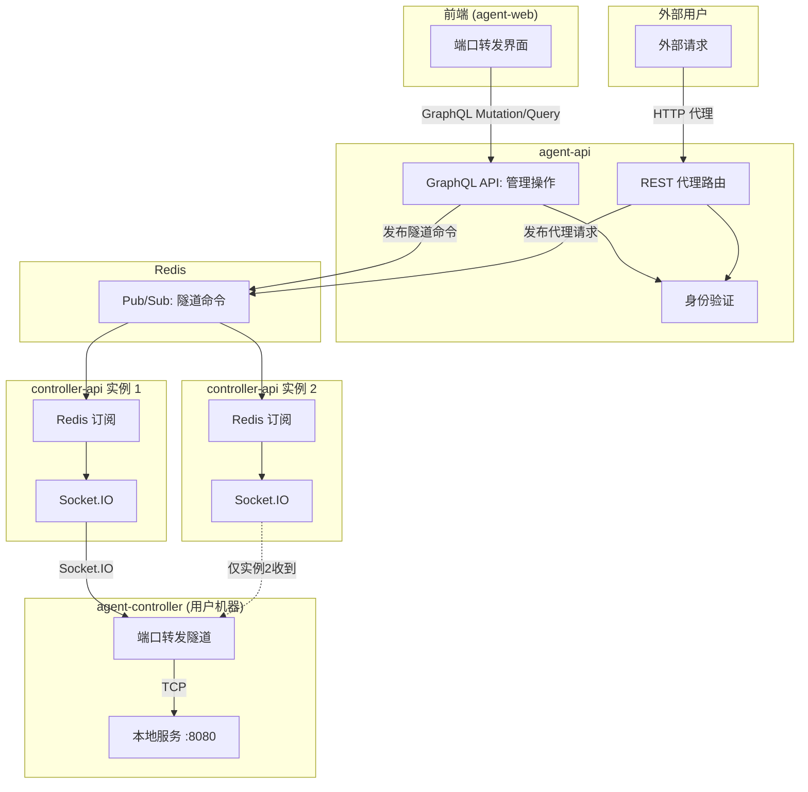
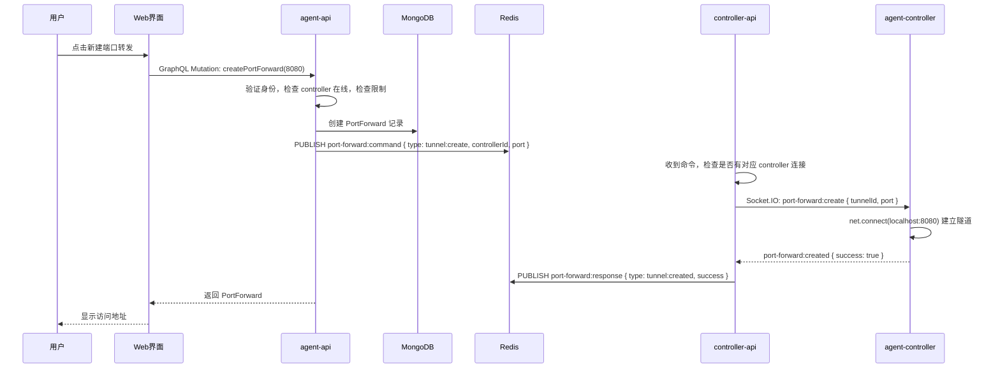
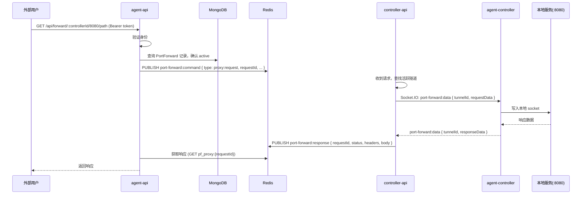

# 端口转发功能 - 技术提案

**功能名称**: 本地Agent控制器端口转发
**关联 PRD**: `20260527-port-forwarding-for-local-agent-controller.md`
**技术提案版本**: v1.2
**创建日期**: 2026-05-27
**更新日期**: 2026-05-27
**作者**: ZeroAsh
**feat-branch**: `feat/port-forwarding`

## 1. 概述

### 1.1 背景

用户在使用 local-agent-controller 运行开发环境时，需要从外部访问 agent-controller 所在机器上运行的本地服务（如 localhost:8080）。当前缺乏原生支持，用户需要手动配置反向代理或使用第三方工具（如 ngrok）。

PRD 要求实现端口转发功能，以 controller 为粒度管理，每个 controller 最多支持 5 个端口同时转发，端口转发的生命周期独立于 session。

### 1.2 目标

- 实现端口转发的完整生命周期管理（创建、查询、删除）
- 支持单个 controller 最多 5 个端口转发
- 端口转发独立于 session 生命周期，仅与 controller 连接状态相关
- 提供安全的访问控制（身份验证+用户隔离）
- 实现反向隧道：外部请求 → agent-api → controller-api → agent-controller → localhost:port
- 支持多服务器部署场景

### 1.3 范围

- **包含**：数据模型设计、GraphQL API（管理）、REST API（代理）、Redis Pub/Sub（内部通信）、Socket.IO（隧道数据传输）、agent-controller 本地连接隧道、前端界面
- **不包含**：UDP 支持、负载均衡、SSL 终止

## 2. 技术架构

### 2.1 系统架构图



### 2.2 数据流

**管理操作（创建/查询/删除）**：
```
前端 → GraphQL (agent-api) → MongoDB
                           → Redis Pub/Sub → controller-api → Socket.IO → agent-controller
```

**代理请求（外部访问本地服务）**：
```
外部用户 → REST 代理 (agent-api) → Redis Pub/Sub → controller-api → Socket.IO → agent-controller → localhost:port
响应沿原路返回
```

### 2.3 多服务器部署方案

在多服务器部署场景下，agent-api 的多个实例和 controller-api 的多个实例可能运行在不同服务器上。关键问题是：agent-api 如何将请求路由到 agent-controller 所注册的那台 controller-api 服务器。

**方案：Redis Pub/Sub 广播 + 实例匹配**

1. **隧道命令**：agent-api 通过 Redis Pub/Sub 广播隧道命令（create/close），所有 controller-api 实例都订阅该频道。每个实例收到命令后检查自己是否有对应的 agent-controller 连接，有则处理，无则忽略。
2. **代理请求**：agent-api 通过 Redis Pub/Sub 广播代理请求，携带 `requestId`。拥有对应 agent-controller 连接的 controller-api 实例处理请求并通过 Redis 返回响应。
3. **实例标识**：controller-api 启动时生成唯一 `instanceId`，agent-controller 注册时记录所属 `instanceId`。Redis 缓存 `{controllerId} → {instanceId}` 映射，用于精准路由。

### 2.4 技术栈

| 层级 | 技术选型 | 说明 |
|------|---------|------|
| 前端 | React + TypeScript | 现有技术栈 |
| 后端 | Express + GraphQL-Yoga | agent-api 现有技术栈 |
| 内部通信 | Redis Pub/Sub | 跨服务器通信 |
| 控制器通信 | Socket.IO | controller-api ↔ agent-controller |
| 客户端 | Node.js + Socket.IO-client + net | agent-controller 现有技术栈 |
| 数据库 | MongoDB + Mongoose | 现有数据模型 |

### 2.5 模块划分

| 模块 | 职责 | 关键技术点 |
|------|------|-----------|
| agent-api GraphQL | 管理操作（CRUD），身份验证，数量限制 | GraphQL-Yoga、Mongoose |
| agent-api 代理路由 | 接收外部请求，通过 Redis 发布代理请求 | Express 路由、Redis Pub/Sub |
| controller-api 中继 | 订阅 Redis，通过 Socket.IO 中继到 agent-controller | Redis 订阅、Socket.IO |
| agent-controller 隧道 | 连接本地端口，双向中继数据 | net.Socket、Socket.IO-client |

## 3. API 设计

### 3.1 管理 API — GraphQL（agent-api）

所有管理操作通过 GraphQL 进行，遵循项目现有 GraphQL-first 架构。

#### Query: 查询端口转发列表

```graphql
type PortForward {
  id: ID!
  controllerId: ID!
  port: Int!
  status: String!
  createdAt: DateTime!
}

type PortForwardList {
  portForwards: [PortForward!]!
  total: Int!
  limit: Int!
}

extend type Query {
  portForwards(controllerId: ID!): PortForwardList!
}
```

#### Mutation: 创建端口转发

```graphql
extend type Mutation {
  createPortForward(controllerId: ID!, port: Int!): PortForward!
  deletePortForward(controllerId: ID!, port: Int!): Boolean!
}
```

**createPortForward 逻辑**：
1. 验证身份（context.currentUser）
2. 验证 controller 存在且在线
3. 检查端口数量限制（per controller, max 5）
4. 检查端口是否已存在
5. 创建 PortForward 记录
6. 通过 Redis Pub/Sub 发布 `port-forward:create` 命令（通知 controller-api 建立隧道）
7. 返回创建的 PortForward

**deletePortForward 逻辑**：
1. 验证身份
2. 查找并删除 PortForward 记录
3. 通过 Redis Pub/Sub 发布 `port-forward:close` 命令（通知 controller-api 销毁隧道）
4. 返回 true

### 3.2 代理 API — REST（agent-api）

外部用户通过代理端点访问本地服务。**需要身份验证**。

- **请求**
  - Method: ANY（GET/POST/PUT/DELETE/...）
  - Path: `/api/forward/:controllerId/:port/*`（代理路径）
  - Headers: `Authorization: Bearer <token>`（必须），其余透传
  - Body: 任意（透传）

- **响应**
  - 透传本地服务的响应（状态码、Headers、 Body）

**代理逻辑**：
1. 验证身份（Bearer token）
2. 查询 PortForward 记录，确认存在且状态为 active
3. 通过 Redis Pub/Sub 发布代理请求，携带 `requestId`
4. 等待 Redis 响应（通过 `requestId` 对应的 Redis key）
5. 透传响应给外部用户

### 3.3 内部通信 — Redis Pub/Sub

controller-api 订阅 Redis 频道 `port-forward:command`，接收以下命令：

| 命令类型 | Payload | 说明 |
|---------|---------|------|
| `tunnel:create` | `{ controllerId, port, tunnelId }` | 建立到本地端口的隧道 |
| `tunnel:close` | `{ tunnelId }` | 销毁隧道 |
| `proxy:request` | `{ requestId, controllerId, port, path, method, headers, body }` | 代理外部请求 |

controller-api 处理后通过 Redis Pub/Sub 频道 `port-forward:response` 返回结果：

| 响应类型 | Payload | 说明 |
|---------|---------|------|
| `tunnel:created` | `{ tunnelId, success, instanceId, error? }` | 隧道建立结果 |
| `proxy:response` | `{ requestId, status, headers, body, error? }` | 代理响应 |

### 3.4 Socket.IO 事件（controller-api ↔ agent-controller）

| 事件 | 方向 | Payload | 说明 |
|------|------|---------|------|
| `port-forward:create` | controller-api → agent-controller | `{ tunnelId, port }` | 请求建立隧道 |
| `port-forward:created` | agent-controller → controller-api | `{ tunnelId, success, error? }` | 隧道建立结果 |
| `port-forward:data` | 双向 | `{ tunnelId, data (Buffer) }` | 隧道数据传输 |
| `port-forward:close` | 任意方向 | `{ tunnelId }` | 关闭隧道 |
| `port-forward:error` | agent-controller → controller-api | `{ tunnelId, error }` | 隧道错误 |

## 4. 数据模型

### 4.1 数据库设计

#### 集合: `portforwards`

| 字段 | 类型 | 说明 |
|------|------|------|
| `_id` | ObjectId | 主键 |
| `controllerId` | ObjectId | 关联的 Controller ID |
| `userId` | ObjectId | 所属用户 ID |
| `port` | Number | 目标本地端口号 |
| `status` | String | 状态：`active`, `inactive`, `error` |
| `createdAt` | Date | 创建时间 |
| `updatedAt` | Date | 更新时间 |

索引：
- `{ controllerId: 1, port: 1 }` - 唯一索引，防止重复转发
- `{ userId: 1 }` - 用户查询索引
- `{ controllerId: 1, status: 1 }` - Controller 状态查询索引

### 4.2 缓存设计

**端口转发状态缓存**：
- Redis 键：`port_forward:{controllerId}:{port}`
- 存储：PortForward ID、状态、instanceId
- TTL: 24 小时

**controller 实例映射**：
- Redis 键：`controller_instance:{controllerId}`
- 存储：controller-api 的 instanceId
- TTL: 由心跳维持（与 controller 上线状态同步）

**代理请求/响应**：
- Redis 键：`pf_proxy:{requestId}`
- 存储：代理响应（status, headers, body）
- TTL: 30 秒

## 5. 技术实现方案

### 5.1 核心流程：创建端口转发



### 5.2 核心流程：代理请求



### 5.3 关键实现点

#### 实现点 1: GraphQL 管理 API

- **描述**: 通过 GraphQL Mutation 和 Query 管理端口转发
- **技术细节**: 
  - 新增 `port-forward.ts` schema 和 resolver
  - 遵循现有 GraphQL 架构（schema + resolver 分离）
  - resolver 中验证身份、检查 controller 状态、检查限制
- **风险点**: 无

#### 实现点 2: Redis Pub/Sub 跨服务器通信

- **描述**: agent-api 通过 Redis Pub/Sub 发布命令，controller-api 订阅并处理
- **技术细节**: 
  - agent-api 发布到 `port-forward:command` 频道
  - controller-api 订阅 `port-forward:command` 频道
  - controller-api 处理后发布到 `port-forward:response` 频道
  - agent-api 通过 requestId 等待响应
  - 使用 `controller_instance:{controllerId}` 缓存精准路由
- **风险点**: Redis Pub/Sub 消息丢失（使用 Redis Streams 或请求-响应模式缓解）

#### 实现点 3: 隧道管理（agent-controller）

- **描述**: agent-controller 建立到本地端口的 TCP 连接隧道
- **技术细节**: 
  - 收到 `port-forward:create` 后，使用 `net.connect()` 连接本地端口
  - 隧道存储在 Map 中，key 为 `tunnelId`
  - 数据通过 `port-forward:data` 双向中继
  - 断开连接时清理资源
- **风险点**: 本地端口无服务监听

#### 实现点 4: 代理路由鉴权

- **描述**: 代理路由需要验证身份
- **技术细节**: 
  - 使用 Bearer token 验证（与现有 REST 路由一致）
  - 验证通过后查询 PortForward 记录
  - 记录不存在或状态非 active 时返回 404
- **风险点**: 无

## 6. 技术决策

### 6.1 决策列表

| 决策 | 选项 A | 选项 B | 最终选择 | 原因 |
|------|--------|--------|---------|------|
| 管理 API | REST | GraphQL | GraphQL | 遵循项目 GraphQL-first 架构 |
| 内部通信 | HTTP 内部接口 | Redis Pub/Sub | Redis Pub/Sub | 支持多服务器部署，精准路由 |
| 隧道传输 | Socket.IO 双向流 | 独立 TCP | Socket.IO 双向流 | 复用现有连接 |
| 管理粒度 | Session | Controller | Controller | 独立于 session 生命周期 |

### 6.2 依赖与约束

| 类型 | 内容 | 说明 |
|------|------|------|
| 依赖 | MongoDB | 存储端口转发记录 |
| 依赖 | Redis | Pub/Sub 跨服务器通信、状态缓存 |
| 依赖 | Socket.IO | controller-api ↔ agent-controller 隧道通信 |
| 约束 | 单个 controller 最多 5 个端口 | 防止资源滥用 |
| 约束 | 只有在线的 controller 才能开启 | 确保可用性 |
| 约束 | 代理 API 需要身份验证 | 安全访问 |

## 7. 项目结构

```
servers/agent-api/src/
├── graphql/
│   ├── schemas/
│   │   └── port-forward.ts      # 新增：GraphQL schema (Query + Mutation)
│   └── resolvers/
│       └── port-forward.ts      # 新增：GraphQL resolver
├── routes/
│   └── port-forward-proxy.ts    # 新增：代理路由 (REST，需鉴权)
├── services/
│   └── port-forward.ts          # 新增：端口转发服务 (含 Redis Pub/Sub)
├── models/
│   └── port-forward.ts          # 新增：端口转发模型
└── index.ts                     # 修改：注册代理路由

servers/controller-api/src/
├── services/
│   ├── port-forward.ts          # 新增：端口转发中继服务 (Redis 订阅 + Socket.IO)
│   └── socketio.ts              # 修改：添加端口转发 Socket.IO 事件
└── index.ts                     # 修改：启动中继服务

packages/agent-controller/src/
├── port-forward.ts              # 新增：端口转发隧道管理器
└── socketio-client.ts           # 修改：添加端口转发事件处理

apps/agent-web/src/
├── components/
│   ├── Sidebar.tsx              # 修改：添加端口转发分类
│   ├── PortForwardDialog.tsx    # 新增：端口转发对话框
│   └── PortForwardItem.tsx      # 新增：端口转发列表项
└── graphql/
    ├── queries.ts               # 修改：添加 portForwards 查询
    ├── mutations.ts             # 修改：添加 createPortForward / deletePortForward
    └── types.ts                 # 修改：添加端口转发类型
```

## 8. 测试策略

### 8.1 测试覆盖要求

- 单元测试覆盖率: >= 80%
- API 测试覆盖的端点: GraphQL Mutation/Query + 代理路由
- 集成测试: agent-api ↔ Redis ↔ controller-api ↔ agent-controller

### 8.2 测试类型

| 类型 | 工具 | 覆盖范围 |
|------|------|---------|
| 单元测试 | Vitest | 服务层、模型层、隧道管理器 |
| API 测试 | Vitest + Supertest | GraphQL 端点、代理路由 |
| 集成测试 | Vitest + Redis + Socket.IO | 跨服务器通信、隧道数据中继 |
| E2E 测试 | Playwright | 前端界面 |

## 9. 部署方案

### 9.1 环境规划

| 环境 | 用途 | 部署方式 |
|------|------|---------|
| 开发 | 本地开发测试 | Aspire 编排 |
| 测试 | 集成测试 | Docker Compose |
| 生产 | 生产环境 | Docker Compose |

### 9.2 配置管理

配置项：
- `PORT_FORWARD_MAX_PER_CONTROLLER`: 每个 controller 最大端口数（默认 5）

## 10. 验收标准

- [ ] 技术方案评审通过
- [ ] 代码实现完成
- [ ] 单元测试覆盖达标
- [ ] API 测试通过
- [ ] E2E 测试通过
- [ ] 外部请求能正确代理到本地端口
- [ ] 代理 API 身份验证正常
- [ ] 隧道数据双向传输正常
- [ ] 多服务器部署场景通信正常

## 11. 相关文档

- [端口转发功能 PRD](../product/draft/20260527-port-forwarding-for-local-agent-controller.md)
- [Session 管理 PRD](../product/draft/20260526-session-management.md)
- [Agent 控制器管理技术方案](./20260517-feat-agent-controller-v1.md)
- [通用开发规范](../common-rules.md)
- [后端开发规范](../backend-rules.md)
