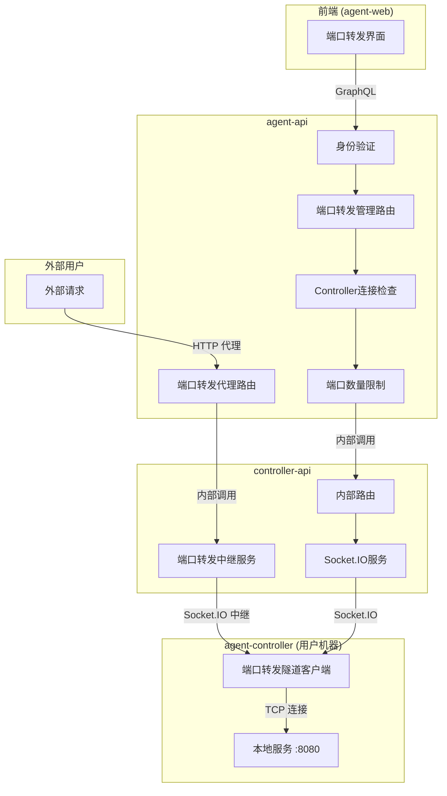
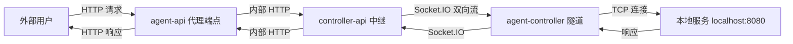
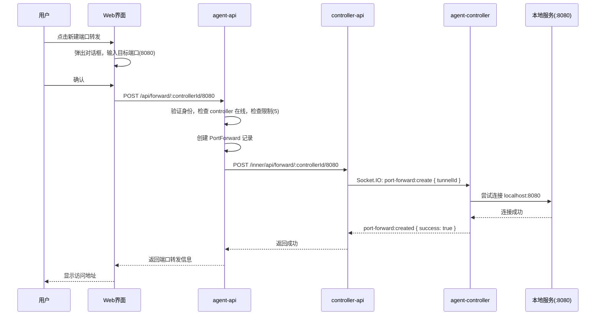
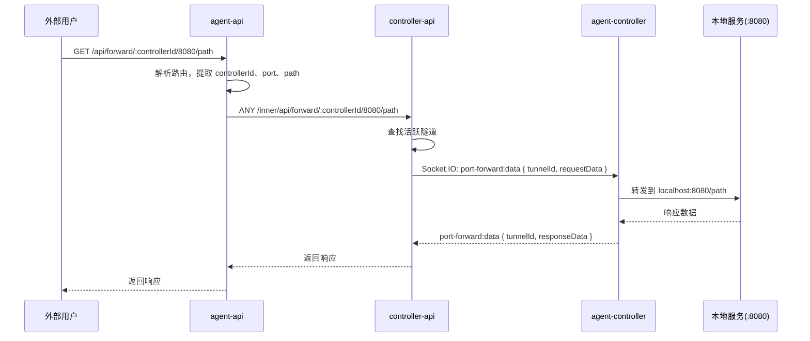

# 端口转发功能 - 技术提案

**功能名称**: 本地Agent控制器端口转发
**关联 PRD**: `20260527-port-forwarding-for-local-agent-controller.md`
**技术提案版本**: v1.1
**创建日期**: 2026-05-27
**更新日期**: 2026-05-27
**作者**: ZeroAsh
**feat-branch**: `feat/port-forwarding`

## 1. 概述

### 1.1 背景

用户在使用 local-agent-controller 运行开发环境时，需要从外部访问 agent-controller 所在机器上运行的本地服务（如 localhost:8080）。当前缺乏原生支持，用户需要手动配置反向代理或使用第三方工具（如 ngrok）。

PRD 要求实现端口转发功能，以 controller 为粒度管理，每个 controller 最多支持 5 个端口同时转发，端口转发的生命周期独立于 session。

### 1.2 目标

- 实现端口转发的完整生命周期管理（创建、查询、删除）
- 支持单个 controller 最多 5 个端口转发
- 端口转发独立于 session 生命周期，仅与 controller 连接状态相关
- 提供安全的访问控制（身份验证+用户隔离）
- 实现反向隧道：外部请求 → agent-api → controller-api → agent-controller → localhost:port

### 1.3 范围

- **包含**：数据模型设计、API 契约（REST+GraphQL+内部接口）、agent-api 路由与代理、controller-api 内部路由与 Socket.IO 中继、agent-controller 本地连接隧道、前端界面
- **不包含**：UDP 支持、负载均衡、SSL 终止

## 2. 技术架构

### 2.1 系统架构图



### 2.2 数据流



### 2.3 技术栈

| 层级 | 技术选型 | 说明 |
|------|---------|------|
| 前端 | React + TypeScript | 现有技术栈 |
| 后端 | Express + GraphQL-Yoga | agent-api 现有技术栈 |
| 内部通信 | Express + Socket.IO | controller-api 现有技术栈 |
| 客户端 | Node.js + Socket.IO-client + net | agent-controller 现有技术栈 |
| 数据库 | MongoDB + Mongoose | 现有数据模型 |

### 2.4 模块划分

| 模块 | 职责 | 关键技术点 |
|------|------|-----------|
| agent-api 端口转发管理路由 | CRUD 操作，身份验证，数量限制 | Express 路由、Mongoose |
| agent-api 端口转发代理路由 | 接收外部请求，转发到 controller-api | Express 路由、HTTP 代理 |
| controller-api 端口转发中继 | 在 agent-api 和 agent-controller 之间中继流量 | Socket.IO 双向流、Express |
| agent-controller 隧道客户端 | 连接本地端口，通过 Socket.IO 中继数据 | net.Socket、Socket.IO-client |

## 3. API 设计

### 3.1 管理 API（agent-api）

#### 接口 1: 创建端口转发

- **请求**
  - Method: POST
  - Path: `/api/forward/:controllerId/:port`
  - Headers: `Authorization: Bearer <token>`
  - Body: 无

- **响应**
  - Status: 201
  - Body:
    ```json
    {
      "id": "port_forward_id",
      "controllerId": "controller_id",
      "port": 8080,
      "status": "active",
      "createdAt": "2026-05-27T10:00:00Z"
    }
    ```

#### 接口 2: 查询端口转发列表

- **请求**
  - Method: GET
  - Path: `/api/forward/:controllerId`
  - Headers: `Authorization: Bearer <token>`

- **响应**
  - Status: 200
  - Body:
    ```json
    {
      "portForwards": [
        {
          "id": "port_forward_id",
          "controllerId": "controller_id",
          "port": 8080,
          "status": "active",
          "createdAt": "2026-05-27T10:00:00Z"
        }
      ],
      "total": 1,
      "limit": 5
    }
    ```

#### 接口 3: 删除端口转发

- **请求**
  - Method: DELETE
  - Path: `/api/forward/:controllerId/:port`
  - Headers: `Authorization: Bearer <token>`

- **响应**
  - Status: 200
  - Body:
    ```json
    {
      "success": true,
      "message": "Port forward deleted"
    }
    ```

### 3.2 代理 API（agent-api）

外部用户通过代理端点访问本地服务。代理端点接收外部请求，通过 controller-api 中继到 agent-controller，再由 agent-controller 转发到本地端口。

#### 接口: 代理请求

- **请求**
  - Method: ANY（GET/POST/PUT/DELETE/...）
  - Path: `/api/forward/:controllerId/:port/*`（代理路径）
  - Headers: 任意（透传）
  - Body: 任意（透传）

- **响应**
  - 透传本地服务的响应（状态码、Headers、Body）

### 3.3 内部接口（controller-api）

#### 内部接口 1: 创建端口转发（注册隧道）

- **请求**
  - Method: POST
  - Path: `/inner/api/forward/:controllerId/:port`
  - Body: 无

- **响应**
  - Status: 201
  - Body:
    ```json
    {
      "success": true,
      "portForwardId": "controllerId:port"
    }
    ```

#### 内部接口 2: 删除端口转发（销毁隧道）

- **请求**
  - Method: DELETE
  - Path: `/inner/api/forward/:controllerId/:port`

- **响应**
  - Status: 200
  - Body:
    ```json
    {
      "success": true
    }
    ```

#### 内部接口 3: 代理请求中继

- **请求**
  - Method: ANY
  - Path: `/inner/api/forward/:controllerId/:port/*`
  - Headers: 透传原始请求的 Headers
  - Body: 透传原始请求的 Body

- **响应**
  - 透传 agent-controller 返回的响应

### 3.4 Socket.IO 事件

| 事件 | 方向 | Payload | 说明 |
|------|------|---------|------|
| `port-forward:create` | controller-api → agent-controller | `{ controllerId, port, tunnelId }` | 请求建立到本地端口的隧道 |
| `port-forward:created` | agent-controller → controller-api | `{ tunnelId, success, error? }` | 隧道建立结果 |
| `port-forward:data` | 双向 | `{ tunnelId, data (Buffer) }` | 隧道数据传输 |
| `port-forward:close` | 任意方向 | `{ tunnelId }` | 关闭隧道 |
| `port-forward:error` | agent-controller → controller-api | `{ tunnelId, error }` | 隧道错误 |

### 3.5 GraphQL 扩展

```graphql
type PortForward {
  id: ID!
  controllerId: ID!
  port: Int!
  status: String!
  createdAt: DateTime!
}

extend type Query {
  portForwards(controllerId: ID!): [PortForward!]!
}
```

## 4. 数据模型

### 4.1 数据库设计

#### 集合: `portforwards`

| 字段 | 类型 | 说明 |
|------|------|------|
| `_id` | ObjectId | 主键 |
| `controllerId` | ObjectId | 关联的 Controller ID |
| `userId` | ObjectId | 所属用户 ID |
| `port` | Number | 目标本地端口号 |
| `status` | String | 状态：`active`, `inactive`, `error` |
| `createdAt` | Date | 创建时间 |
| `updatedAt` | Date | 更新时间 |

索引：
- `{ controllerId: 1, port: 1 }` - 唯一索引，防止重复转发
- `{ userId: 1 }` - 用户查询索引
- `{ controllerId: 1, status: 1 }` - Controller 状态查询索引

### 4.2 缓存设计

Redis 键格式：`port_forward:{controllerId}:{port}`
- 存储端口转发的实时状态和隧道映射
- TTL: 24 小时（或手动清理）
- 数据结构：Hash
  ```
  {
    "id": "port_forward_id",
    "tunnelId": "controllerId:port",
    "status": "active",
    "createdAt": "timestamp"
  }
  ```

## 5. 技术实现方案

### 5.1 核心流程：创建端口转发



### 5.2 核心流程：代理请求



### 5.3 关键实现点

#### 实现点 1: Controller 连接状态验证

- **描述**: 验证 controller 是否在线
- **技术细节**: 
  - 查询 Controller 模型，检查 status 字段是否为 `online`
  - 只有在线的 controller 才允许开启端口转发
- **风险点**: controller 可能在操作过程中断开

#### 实现点 2: 端口数量限制

- **描述**: 限制单个 controller 最多 5 个端口转发
- **技术细节**: 
  - 查询当前 controller 的 portforward 记录数量
  - 使用 MongoDB 的 countDocuments 方法
  - 在创建前检查，超过限制返回 400 错误
- **风险点**: 并发创建可能超过限制，需要使用唯一索引

#### 实现点 3: 隧道管理（agent-controller）

- **描述**: agent-controller 建立到本地端口的 TCP 连接隧道
- **技术细节**: 
  - 收到 `port-forward:create` 事件后，使用 `net.connect()` 连接本地端口
  - 连接成功后，通过 `port-forward:data` 事件双向中继数据
  - 隧道存储在 Map 中，key 为 `tunnelId`
  - 断开连接时清理隧道资源
- **风险点**: 本地端口无服务监听、连接被拒绝

#### 实现点 4: Socket.IO 双向数据中继

- **描述**: 通过 Socket.IO 在 controller-api 和 agent-controller 之间双向传输数据
- **技术细节**: 
  - 每个隧道分配唯一 `tunnelId`（格式：`controllerId:port:uuid`）
  - 使用 Socket.IO 的 room 机制隔离不同 controller 的隧道
  - 数据以 Buffer 传输，支持二进制协议
- **风险点**: 大数据量时的性能问题，需要考虑背压控制

#### 实现点 5: 代理路由（agent-api）

- **描述**: agent-api 接收外部请求并代理到 controller-api
- **技术细节**: 
  - 使用 Express 路由匹配 `/api/forward/:controllerId/:port/*`
  - 提取原始请求的 method、headers、body，转发到 controller-api 内部接口
  - 透传 controller-api 返回的响应
- **风险点**: WebSocket 升级、长连接超时

## 6. 技术决策

### 6.1 决策列表

| 决策 | 选项 A | 选项 B | 最终选择 | 原因 |
|------|--------|--------|---------|------|
| 数据存储 | MongoDB | Redis | MongoDB | 需要持久化存储 |
| 隧道传输 | Socket.IO 双向流 | 独立 TCP 隧道 | Socket.IO 双向流 | 复用现有连接，无需额外端口 |
| 端口转发协议 | TCP 代理 | HTTP 代理 | TCP 代理 | 支持所有协议，通用性强 |
| 管理粒度 | Session | Controller | Controller | 端口转发独立于 session |

### 6.2 依赖与约束

| 类型 | 内容 | 说明 |
|------|------|------|
| 依赖 | MongoDB | 存储端口转发记录 |
| 依赖 | Socket.IO | agent-controller 与 controller-api 的隧道通信 |
| 约束 | 单个 controller 最多 5 个端口 | 防止资源滥用 |
| 约束 | 只有在线的 controller 才能开启 | 确保可用性 |
| 约束 | 内部接口只能被 agent-api 访问 | 安全隔离 |

## 7. 项目结构

```
servers/agent-api/src/
├── routes/
│   ├── port-forward.ts          # 新增：端口转发管理路由 (CRUD)
│   └── port-forward-proxy.ts    # 新增：端口转发代理路由
├── services/
│   └── port-forward.ts          # 新增：端口转发服务
├── models/
│   └── port-forward.ts          # 新增：端口转发模型
└── graphql/
    └── schemas/
        └── port-forward.ts      # 新增：GraphQL schema

servers/controller-api/src/
├── routes/
│   └── port-forward.ts          # 新增：内部端口转发路由
├── services/
│   └── port-forward.ts          # 新增：端口转发中继服务
└── services/
    └── socketio.ts              # 修改：添加端口转发事件处理

packages/agent-controller/src/
├── port-forward.ts              # 新增：端口转发隧道客户端
└── socketio-client.ts           # 修改：添加端口转发事件处理

apps/agent-web/src/
├── components/
│   ├── Sidebar.tsx              # 修改：添加端口转发分类
│   ├── PortForwardDialog.tsx    # 新增：端口转发对话框
│   └── PortForwardItem.tsx      # 新增：端口转发列表项
└── graphql/
    ├── queries.ts               # 修改：添加端口转发查询
    └── types.ts                 # 修改：添加端口转发类型
```

## 8. 测试策略

### 8.1 测试覆盖要求

- 单元测试覆盖率: >= 80%
- API 测试覆盖的端点: 所有端口转发相关端点
- 集成测试: agent-api ↔ controller-api ↔ agent-controller

### 8.2 测试类型

| 类型 | 工具 | 覆盖范围 |
|------|------|---------|
| 单元测试 | Vitest | 服务层、模型层、隧道客户端 |
| API 测试 | Vitest + Supertest | REST API 端点 |
| 集成测试 | Vitest + Socket.IO | 隧道数据中继 |
| E2E 测试 | Playwright | 前端界面 |

## 9. 部署方案

### 9.1 环境规划

| 环境 | 用途 | 部署方式 |
|------|------|---------|
| 开发 | 本地开发测试 | Aspire 编排 |
| 测试 | 集成测试 | Docker Compose |
| 生产 | 生产环境 | Docker Compose |

### 9.2 配置管理

配置项：
- `PORT_FORWARD_INTERNAL_URL`: controller-api 内部地址
- `PORT_FORWARD_MAX_PER_CONTROLLER`: 每个 controller 最大端口数（默认 5）

## 10. 验收标准

- [ ] 技术方案评审通过
- [ ] 代码实现完成
- [ ] 单元测试覆盖达标
- [ ] API 测试通过
- [ ] E2E 测试通过
- [ ] 外部请求能正确代理到本地端口
- [ ] 隧道数据双向传输正常
- [ ] 安全性验证通过

## 11. 相关文档

- [端口转发功能 PRD](../product/draft/20260527-port-forwarding-for-local-agent-controller.md)
- [Session 管理 PRD](../product/draft/20260526-session-management.md)
- [Agent 控制器管理技术方案](./20260517-feat-agent-controller-v1.md)
- [通用开发规范](../common-rules.md)
- [后端开发规范](../backend-rules.md)
