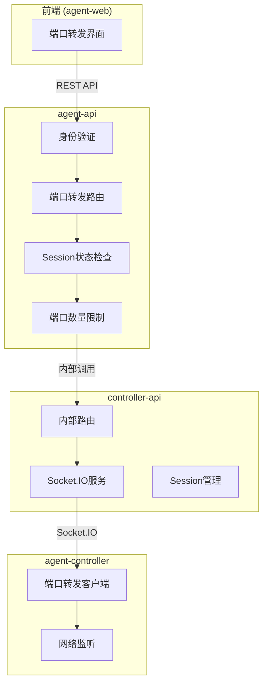
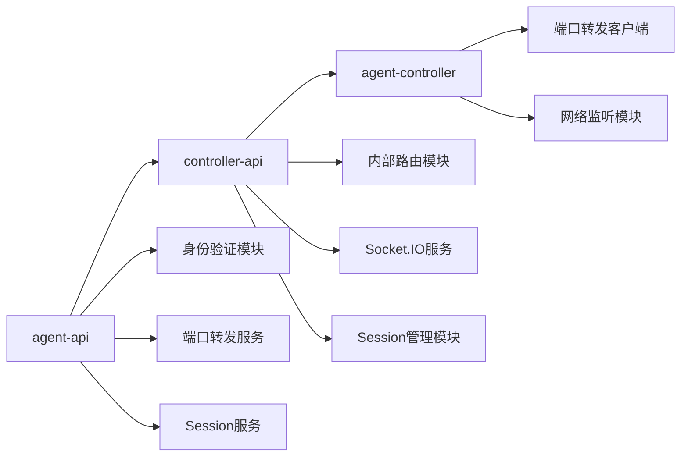
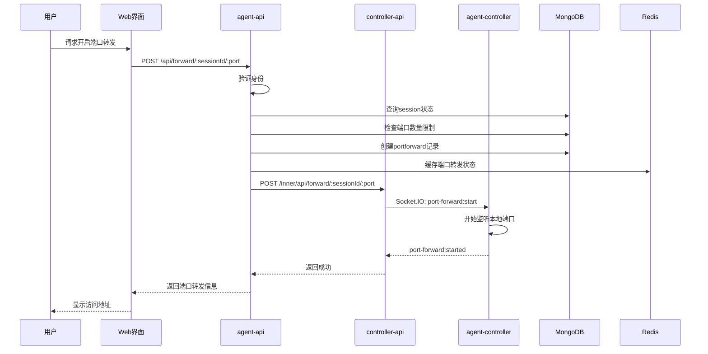

# 端口转发功能 - 技术提案

**功能名称**: 本地Agent控制器端口转发
**关联 PRD**: `20260527-port-forwarding-for-local-agent-controller.md`
**技术提案版本**: v1.0
**创建日期**: 2026-05-27
**作者**: ZeroAsh
**feat-branch**: `feat/port-forwarding`

## 1. 概述

### 1.1 背景

用户在使用local-agent-controller运行开发环境时，需要将本地服务端口暴露给外部访问。当前缺乏原生支持，用户需要手动配置反向代理或使用第三方工具。PRD要求实现端口转发功能，支持最多3个端口同时转发，并与session生命周期绑定。

### 1.2 目标

- 实现端口转发的完整生命周期管理（创建、查询、删除）
- 支持单个session最多3个端口转发
- 端口转发与session状态绑定（只有运行中的session才能开启）
- 提供安全的访问控制（身份验证+用户隔离）
- 实现内部通信机制（agent-api ↔ controller-api ↔ agent-controller）

### 1.3 范围

- **包含**：数据模型设计、API契约（REST+内部接口）、agent-api路由、controller-api内部路由、agent-controller端口转发实现、前端界面
- **不包含**：端口转发的具体协议实现（TCP/UDP）、负载均衡、SSL终止

## 2. 技术架构

### 2.1 系统架构图



### 2.2 技术栈

| 层级 | 技术选型 | 说明 |
|------|---------|------|
| 前端 | React + TypeScript | 现有技术栈 |
| 后端 | Express + GraphQL-Yoga | agent-api现有技术栈 |
| 内部通信 | Express + Socket.IO | controller-api现有技术栈 |
| 客户端 | Node.js + Socket.IO-client | agent-controller现有技术栈 |
| 数据库 | MongoDB + Mongoose | 现有数据模型 |
| 缓存 | Redis | 端口转发状态缓存 |

### 2.3 模块划分



| 模块 | 职责 | 关键技术点 |
|------|------|-----------|
| agent-api端口转发路由 | 提供REST API，身份验证，业务逻辑 | Express路由、中间件、Mongoose |
| controller-api内部路由 | 接收agent-api调用，转发给agent-controller | Express路由、Socket.IO |
| agent-controller端口转发客户端 | 实际的端口监听和转发 | Node.js net模块、Socket.IO-client |

## 3. API 设计

### 3.1 API 契约

#### 接口 1: 创建端口转发

- **请求**
  - Method: POST
  - Path: `/api/forward/:sessionId/:port`
  - Headers: `Authorization: Bearer <token>`
  - Body: 无

- **响应**
  - Status: 201
  - Body:
    ```json
    {
      "id": "port_forward_id",
      "sessionId": "session_id",
      "port": 8080,
      "status": "active",
      "createdAt": "2026-05-27T10:00:00Z"
    }
    ```

#### 接口 2: 查询端口转发列表

- **请求**
  - Method: GET
  - Path: `/api/forward/:sessionId`
  - Headers: `Authorization: Bearer <token>`

- **响应**
  - Status: 200
  - Body:
    ```json
    {
      "portForwards": [
        {
          "id": "port_forward_id",
          "sessionId": "session_id",
          "port": 8080,
          "status": "active",
          "createdAt": "2026-05-27T10:00:00Z"
        }
      ],
      "total": 1,
      "limit": 3
    }
    ```

#### 接口 3: 删除端口转发

- **请求**
  - Method: DELETE
  - Path: `/api/forward/:sessionId/:port`
  - Headers: `Authorization: Bearer <token>`

- **响应**
  - Status: 200
  - Body:
    ```json
    {
      "success": true,
      "message": "Port forward deleted"
    }
    ```

### 3.2 内部接口

#### 内部接口 1: 创建端口转发

- **请求**
  - Method: POST
  - Path: `/inner/api/forward/:sessionId/:port`
  - Body: 无

- **响应**
  - Status: 201
  - Body:
    ```json
    {
      "success": true,
      "portForwardId": "port_forward_id"
    }
    ```

#### 内部接口 2: 删除端口转发

- **请求**
  - Method: DELETE
  - Path: `/inner/api/forward/:sessionId/:port`

- **响应**
  - Status: 200
  - Body:
    ```json
    {
      "success": true
    }
    ```

## 4. 数据模型

### 4.1 数据库设计

#### 集合: `portforwards`

| 字段 | 类型 | 说明 |
|------|------|------|
| `_id` | ObjectId | 主键 |
| `sessionId` | ObjectId | 关联的Session ID |
| `userId` | ObjectId | 所属用户ID |
| `port` | Number | 要转发的端口号 |
| `status` | String | 状态：`active`, `inactive`, `error` |
| `createdAt` | Date | 创建时间 |
| `updatedAt` | Date | 更新时间 |

索引：
- `{ sessionId: 1, port: 1 }` - 唯一索引，防止重复转发
- `{ userId: 1 }` - 用户查询索引
- `{ sessionId: 1, status: 1 }` - Session状态查询索引

### 4.2 缓存设计

Redis键格式：`port_forward:{sessionId}:{port}`
- 存储端口转发的实时状态
- TTL: 与session生命周期一致
- 数据结构：Hash
  ```
  {
    "id": "port_forward_id",
    "status": "active",
    "createdAt": "timestamp"
  }
  ```

## 5. 技术实现方案

### 5.1 核心流程



### 5.2 关键实现点

#### 实现点 1: Session状态验证

- **描述**: 验证session是否为运行状态（idling或running）
- **技术细节**: 
  - 查询Session模型，检查status字段
  - 只有`idling`或`running`状态才允许开启端口转发
  - 使用Mongoose查询并添加状态条件
- **风险点**: 并发请求可能导致状态不一致，需要使用事务或乐观锁

#### 实现点 2: 端口数量限制

- **描述**: 限制单个session最多3个端口转发
- **技术细节**: 
  - 查询当前session的portforward记录数量
  - 使用MongoDB的countDocuments方法
  - 在创建前检查，超过限制返回400错误
- **风险点**: 并发创建可能超过限制，需要使用唯一索引或事务

#### 实现点 3: 内部通信机制

- **描述**: agent-api调用controller-api的内部接口
- **技术细节**: 
  - 使用HTTP客户端（如axios或node-fetch）调用内部接口
  - 内部接口不需要身份验证，但需要限制访问来源
  - 使用环境变量配置controller-api的内部地址
- **风险点**: 网络异常可能导致状态不一致，需要实现重试机制

#### 实现点 4: Socket.IO事件设计

- **描述**: 定义端口转发相关的Socket.IO事件
- **技术细节**: 
  - `port-forward:start` - 开始端口转发
  - `port-forward:started` - 端口转发已启动
  - `port-forward:stop` - 停止端口转发
  - `port-forward:stopped` - 端口转发已停止
  - `port-forward:error` - 端口转发错误
- **风险点**: 事件丢失可能导致状态不一致，需要实现确认机制

#### 实现点 5: 端口转发实现

- **描述**: agent-controller实际的端口监听和转发
- **技术细节**: 
  - 使用Node.js的net模块创建TCP服务器
  - 支持HTTP/HTTPS/WebSocket等协议
  - 实现连接池和并发控制
  - 错误处理和日志记录
- **风险点**: 端口占用、权限问题、资源泄漏

## 6. 技术决策

### 6.1 决策列表

| 决策 | 选项 A | 选项 B | 最终选择 | 原因 |
|------|--------|--------|---------|------|
| 数据存储 | MongoDB | Redis | MongoDB | 需要持久化存储，支持复杂查询 |
| 内部通信 | HTTP | gRPC | HTTP | 与现有技术栈一致，简单易维护 |
| 端口转发协议 | TCP代理 | HTTP代理 | TCP代理 | 支持所有协议，通用性强 |
| 状态缓存 | Redis | 内存 | Redis | 支持分布式部署，状态共享 |

### 6.2 依赖与约束

| 类型 | 内容 | 说明 |
|------|------|------|
| 依赖 | MongoDB | 存储端口转发记录 |
| 依赖 | Redis | 缓存端口转发状态 |
| 依赖 | Socket.IO | agent-controller与controller-api通信 |
| 约束 | 单个session最多3个端口 | 防止资源滥用 |
| 约束 | 只有运行中的session才能开启 | 确保安全性 |
| 约束 | 内部接口只能被agent-api访问 | 安全隔离 |

## 7. 项目结构

```
servers/agent-api/src/
├── routes/
│   ├── session-stream.ts
│   └── port-forward.ts          # 新增：端口转发路由
├── services/
│   ├── port-forward.ts          # 新增：端口转发服务
│   └── port-forward.test.ts     # 新增：端口转发测试
├── models/
│   └── port-forward.ts          # 新增：端口转发模型
└── graphql/
    └── schemas/
        └── port-forward.ts      # 新增：GraphQL schema（可选）

servers/controller-api/src/
├── routes/
│   └── port-forward.ts          # 新增：内部端口转发路由
├── services/
│   └── port-forward.ts          # 新增：端口转发服务
└── models/
    └── port-forward.ts          # 新增：端口转发模型（共享）

packages/agent-controller/src/
├── port-forward.ts              # 新增：端口转发客户端
└── socketio-client.ts           # 修改：添加端口转发事件处理
```

## 8. 测试策略

### 8.1 测试覆盖要求

- 单元测试覆盖率: >= 80%
- API 测试覆盖的端点: 所有端口转发相关端点
- 集成测试: agent-api ↔ controller-api ↔ agent-controller

### 8.2 测试类型

| 类型 | 工具 | 覆盖范围 |
|------|------|---------|
| 单元测试 | Vitest | 服务层、模型层 |
| API测试 | Vitest + Supertest | REST API端点 |
| 集成测试 | Vitest + Socket.IO | 内部通信 |
| E2E测试 | Playwright | 前端界面 |

## 9. 部署方案

### 9.1 环境规划

| 环境 | 用途 | 部署方式 |
|------|------|---------|
| 开发 | 本地开发测试 | Aspire编排 |
| 测试 | 集成测试 | Docker Compose |
| 生产 | 生产环境 | Docker Compose |

### 9.2 配置管理

配置项：
- `PORT_FORWARD_INTERNAL_URL`: controller-api内部地址
- `PORT_FORWARD_MAX_PER_SESSION`: 每个session最大端口数（默认3）
- `PORT_FORWARD_TIMEOUT`: 端口转发超时时间（可选）

## 10. 验收标准

- [ ] 技术方案评审通过
- [ ] Contract 评审通过
- [ ] 代码实现完成
- [ ] 单元测试覆盖达标
- [ ] API 测试通过
- [ ] E2E 测试通过
- [ ] 端口转发功能正常工作
- [ ] 安全性验证通过

## 11. 相关文档

- [端口转发功能PRD](../product/draft/20260527-port-forwarding-for-local-agent-controller.md)
- [Session管理PRD](../product/draft/20260526-session-management.md)
- [Agent控制器管理技术方案](./20260517-feat-agent-controller-v1.md)
- [通用开发规范](../common-rules.md)
- [后端开发规范](../backend-rules.md)