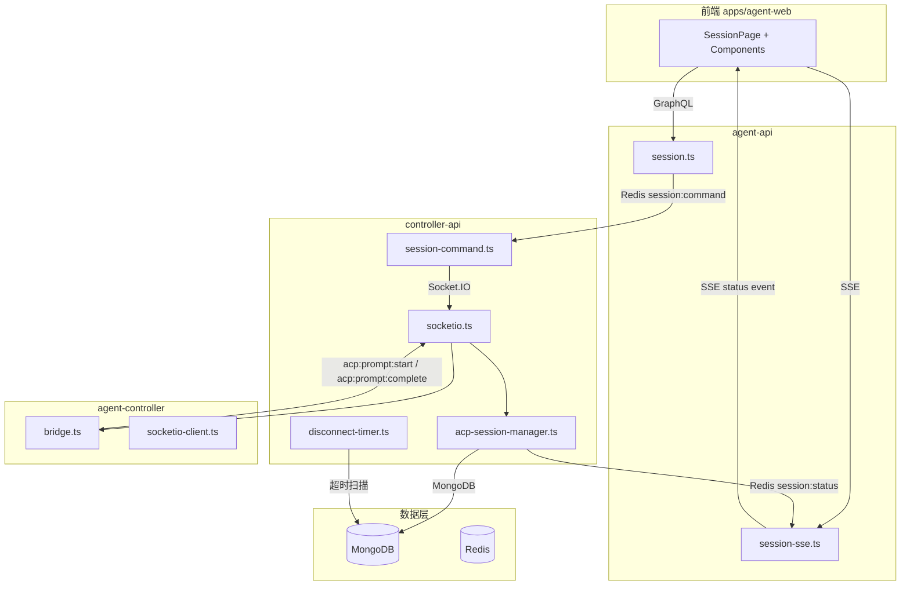
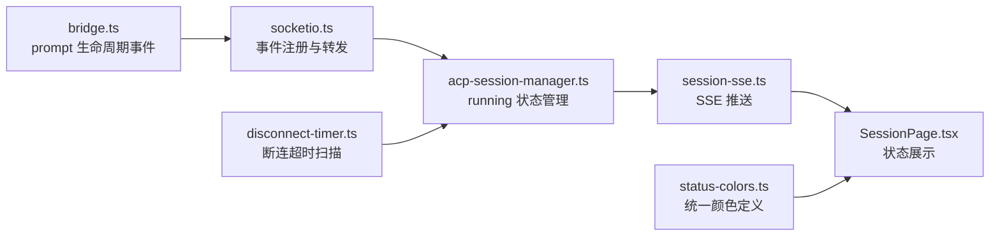
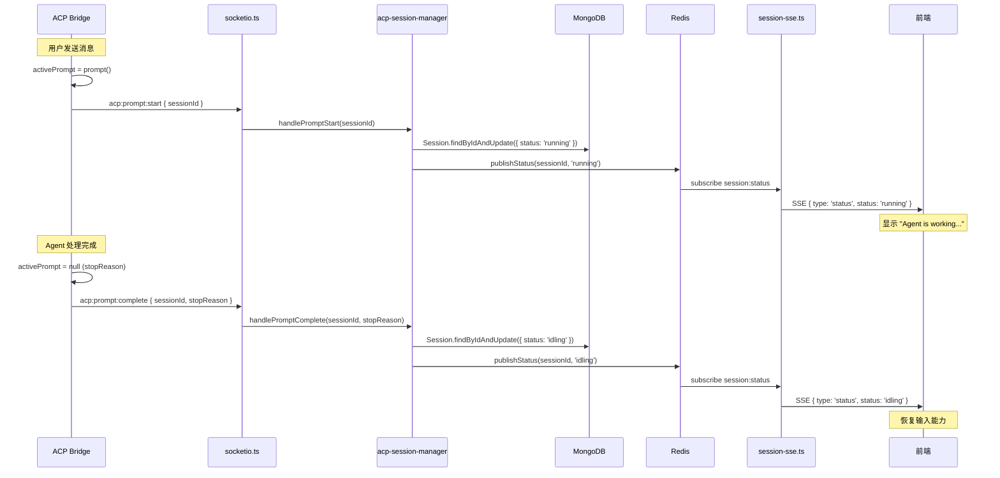
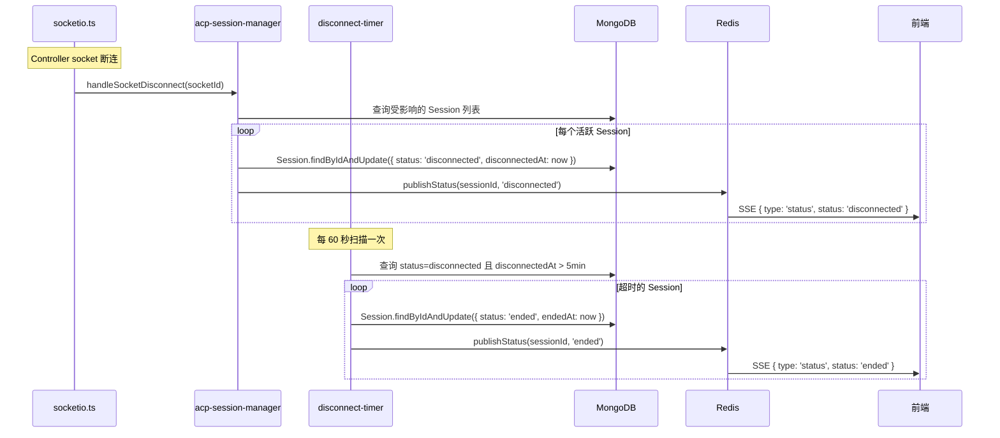
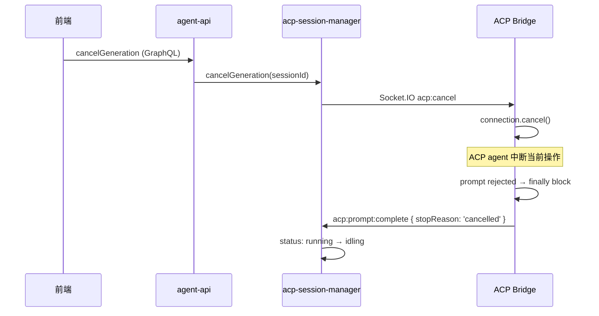
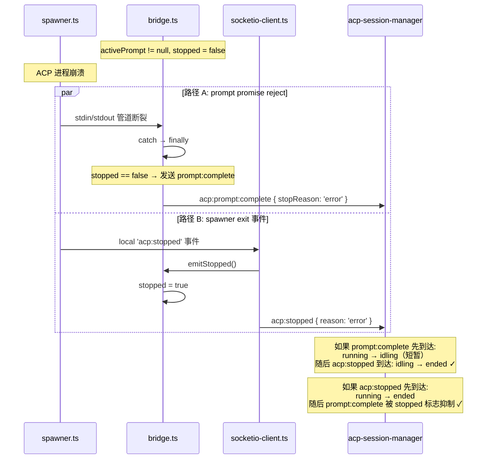

# Agent 状态统一 - 技术提案

**功能名称**: Agent 状态统一
**关联 PRD**: `20260527-unified-agent-status.md`
**技术提案版本**: v1.0
**创建日期**: 2026-05-27
**作者**: ZeroAsh Agent
**feat-branch**: `feat/unified-agent-status`

## 1. 概述

### 1.1 背景

基于 PRD `20260527-unified-agent-status.md`，当前系统存在以下技术问题：

1. `running` 状态在 Schema 中定义但生产代码从未设置，前端 `isWorking = status === 'running'` 永远为 false
2. `disconnected` 状态从未被使用，Controller socket 断连直接转为 `ended`
3. ACP Bridge 内部追踪 `activePrompt` 但未暴露给 controller-api
4. `session/prompt` response 的 `stopReason` 被丢弃
5. 前端 Sidebar 和 SessionHeader 状态颜色不一致

### 1.2 目标

1. ACP Bridge 在 prompt 开始/结束时发送事件，controller-api 据此设置 `running` / 回到 `idling`
2. Controller socket 断连时，活跃 Session 先设为 `disconnected`，超时后转 `ended`
3. 统一前端所有组件的状态颜色
4. 保持现有 API 向后兼容

### 1.3 范围

**做：**
- 新增 `acp:prompt:start` 和 `acp:prompt:complete` Socket.IO 事件
- 修改 `handleSocketDisconnect` 使用 `disconnected` 状态
- 新增 `disconnected` 超时扫描机制
- 统一前端状态颜色

**不做：**
- 不修改 ACP 协议本身
- 不引入新的 GraphQL mutation
- 不修改 Session 数据模型（枚举值不变）

## 2. 技术架构

### 2.1 系统架构图



### 2.2 技术栈

| 层级 | 技术 | 说明 |
|------|------|------|
| Controller daemon | Node.js + Socket.IO client | 发送 `acp:prompt:start/complete` 事件 |
| controller-api | Node.js + Socket.IO + Mongoose | 处理状态转换，管理断连超时 |
| agent-api | Node.js + Express + Redis | SSE 推送状态变更 |
| 前端 | React + Tailwind CSS | 状态展示和颜色统一 |

### 2.3 模块划分



| 模块 | 职责 | 变更类型 |
|------|------|---------|
| `bridge.ts` | 发送 prompt 生命周期事件 | 修改 |
| `socketio-client.ts` | 透传新事件 | 修改 |
| `socketio.ts` | 注册新事件监听 | 修改 |
| `acp-session-manager.ts` | 处理 running 状态转换 | 修改 |
| `disconnect-timer.ts` | 断连超时扫描 | 新增 |
| `session-sse.ts` | SSE 推送（无变更） | 无变更 |
| `status-colors.ts` | 统一状态颜色定义 | 新增 |
| `SessionHeader.tsx` | 使用统一颜色 | 修改 |
| `Sidebar.tsx` | 使用统一颜色 | 修改 |
| `InputBox.tsx` | 适配 running 状态 | 修改 |

## 3. API 设计

### 3.1 Socket.IO 新增事件

#### 3.1.1 `acp:prompt:start`（Controller → Server）

当 ACP Bridge 开始处理一个 prompt 时发送。

**Payload:**

| 字段 | 类型 | 必填 | 说明 |
|------|------|------|------|
| `sessionId` | `string` | 是 | Session ID |

**触发时机：** `bridge.ts` 中 `processPrompt()` 方法设置 `this.activePrompt` 之后。

#### 3.1.2 `acp:prompt:complete`（Controller → Server）

当 ACP Bridge 完成一个 prompt 处理时发送。

**Payload:**

| 字段 | 类型 | 必填 | 说明 |
|------|------|------|------|
| `sessionId` | `string` | 是 | Session ID |
| `stopReason` | `string` | 是 | 结束原因（`end_turn` / `max_tokens` / `max_turn_requests` / `refusal` / `cancelled` / `error`） |

**触发时机：** `bridge.ts` 中 `processPrompt()` 的 `finally` 块中，`activePrompt` 设为 null 之前。

### 3.2 GraphQL Schema（无变更）

现有 `SessionStatus` 枚举已包含所有需要的值，无需修改：

```graphql
enum SessionStatus {
  creating
  connecting
  idling
  running
  disconnected
  ended
}
```

### 3.3 SSE 事件（无变更）

现有 SSE `status` 事件格式已支持所有状态，无需修改。

## 4. 数据模型

### 4.1 MongoDB Session 集合（无 Schema 变更）

Session 模型的 `status` 字段枚举值不变。新增 `disconnectedAt` 字段用于超时计算：

| 字段 | 类型 | 说明 |
|------|------|------|
| `status` | `enum` | 现有枚举值，无变更 |
| `disconnectedAt` | `Date?` | 进入 `disconnected` 状态的时间戳，用于超时扫描 |

### 4.2 Redis（无变更）

现有 `session:status` 和 `session:command` 通道格式不变。

## 5. 技术实现方案

### 5.1 核心流程

#### 流程 1: Agent 工作状态流转（running ↔ idling）



#### 流程 2: Controller 断连处理（disconnected）



#### 流程 3: 用户取消操作



### 5.2 关键实现点

#### 实现点 1: Bridge 发送 prompt 生命周期事件

**文件:** `packages/agent-controller/src/acp/bridge.ts`

**变更:** 
1. 新增 `stopped` 标志位，进程终止后抑制 `acp:prompt:complete` 事件
2. 在 `processPrompt()` 中设置 `activePrompt` 后发送 `acp:prompt:start`，在 `finally` 块中发送 `acp:prompt:complete`（仅在未 stopped 时）
3. `emitStopped()` 和 `handleError()` 设置 `stopped = true`

```typescript
// bridge.ts - 新增字段
private stopped = false;

// bridge.ts - processPrompt() 修改
private async processPrompt(message: QueuedInput): Promise<void> {
  if (!this.connection || !this.acpSessionId || this.stopped) return;

  this.activePrompt = this.connection.prompt({
    sessionId: this.acpSessionId,
    prompt: [{ type: 'text' as const, text: message.content }],
  });

  // 新增：通知 server agent 开始工作
  this.socket.emit('acp:prompt:start', { sessionId: this.sessionId });

  let stopReason = 'end_turn';
  try {
    const result = await this.activePrompt;
    stopReason = result?.stopReason ?? 'end_turn';
  } catch {
    stopReason = 'error';
  } finally {
    this.activePrompt = null;
    // 新增：仅在进程未终止时发送 prompt:complete
    // 如果进程已崩溃，acp:stopped 是权威的终止信号，不需要 prompt:complete
    if (!this.stopped) {
      this.socket.emit('acp:prompt:complete', {
        sessionId: this.sessionId,
        stopReason,
      });
    }
    if (this.inputQueue.length > 0) {
      this.processPrompt(this.inputQueue.shift()!);
    }
  }
}

// bridge.ts - emitStopped() 修改
private emitStopped(reason: string, exitCode?: number): void {
  this.stopped = true;  // 新增：标记已停止
  this.socket.emit('acp:stopped', { sessionId: this.sessionId, reason, exitCode });
  this.emit('acp:stopped', { sessionId: this.sessionId, reason, exitCode });
}

// bridge.ts - handleError() 修改
private handleError(error: unknown): void {
  this.stopped = true;  // 新增：标记已停止
  const msg = error instanceof Error ? error.message : String(error);
  this.socket.emit('acp:stopped', { sessionId: this.sessionId, reason: 'error', error: msg });
  this.emit('acp:stopped', { sessionId: this.sessionId, reason: 'error', error: msg });
  this.spawner.stop();
}
```

**崩溃场景时序（修复后）：**



**风险点:**
- `connection.prompt()` 返回的 `PromptResponse` 类型需要确认包含 `stopReason` 字段。如果 ACP SDK 版本不支持，需要做类型兼容。
- `stopped` 标志是实例级别的，一旦设置不可重置。一个 bridge 实例只对应一个 ACP 进程生命周期，这是合理的。

#### 实现点 2: socketio-client.ts 透传

**文件:** `packages/agent-controller/src/socketio-client.ts`

**变更:** 无需修改。`acp:prompt:start` 和 `acp:prompt:complete` 由 bridge 直接通过 `this.socket.emit()` 发送，socketio-client.ts 不需要额外处理。

#### 实现点 3: socketio.ts 注册新事件监听

**文件:** `servers/controller-api/src/services/socketio.ts`

**变更:** 在 Socket.IO 连接建立时，注册 `acp:prompt:start` 和 `acp:prompt:complete` 事件监听。

```typescript
// socketio.ts - 新增事件注册（在 acp:stopped 监听之后）
socket.on('acp:prompt:start', async (payload: { sessionId: string }) => {
  if (!authenticated) return;
  try {
    await acpSessionManager.handlePromptStart(payload.sessionId);
  } catch (err) {
    console.error(`ACP prompt start error for session ${payload.sessionId}:`, err);
  }
});

socket.on('acp:prompt:complete', async (payload: {
  sessionId: string;
  stopReason: string;
}) => {
  if (!authenticated) return;
  try {
    await acpSessionManager.handlePromptComplete(payload.sessionId, payload.stopReason);
  } catch (err) {
    console.error(`ACP prompt complete error for session ${payload.sessionId}:`, err);
  }
});
```

#### 实现点 4: acp-session-manager 处理 running 状态

**文件:** `servers/controller-api/src/services/acp-session-manager.ts`

**变更:** 新增 `handlePromptStart` 和 `handlePromptComplete` 方法。

```typescript
// acp-session-manager.ts - 新增方法
async handlePromptStart(sessionId: string): Promise<void> {
  // 原子操作：仅当 status === 'idling' 时更新为 'running'
  const result = await Session.findOneAndUpdate(
    { _id: sessionId, status: 'idling' },
    { status: 'running' },
  );
  if (result) {
    await this.publishStatus(sessionId, 'running');
  }
}

async handlePromptComplete(sessionId: string, stopReason: string): Promise<void> {
  // 原子操作：仅当 status === 'running' 时更新为 'idling'
  // 关键：消除与 acp:stopped 的竞态——如果 acp:stopped 先将状态设为 ended，
  // 此处 findOneAndUpdate 的条件不匹配，不会覆盖
  const result = await Session.findOneAndUpdate(
    { _id: sessionId, status: 'running' },
    { status: 'idling' },
  );
  if (result) {
    await this.publishStatus(sessionId, 'idling');
  }
}
```

**Guard 逻辑（原子化）：**
- `handlePromptStart`: `findOneAndUpdate({ status: 'idling' })` — 仅 `idling` → `running`
- `handlePromptComplete`: `findOneAndUpdate({ status: 'running' })` — 仅 `running` → `idling`
- 如果 `acp:stopped` 先到达并将状态设为 `ended`，`handlePromptComplete` 的条件不匹配，**原子性地跳过**，不会出现竞态覆盖
- `stopReason` 暂不使用，预留用于未来扩展（如显示结束原因）

#### 实现点 5: handleSocketDisconnect 使用 disconnected 状态

**文件:** `servers/controller-api/src/services/acp-session-manager.ts`

**变更:** 修改 `handleSocketDisconnect`，对活跃 Session 使用 `disconnected` 而非 `ended`。

```typescript
// acp-session-manager.ts - 修改 handleSocketDisconnect
async handleSocketDisconnect(socketId: string): Promise<void> {
  const socketSessions = this.socketToSessions.get(socketId);
  if (socketSessions) {
    for (const sessionId of socketSessions) {
      await this.handleControllerDisconnect(sessionId);
    }
    this.socketToSessions.delete(socketId);
  }
}

private async handleControllerDisconnect(sessionId: string): Promise<void> {
  const session = this.sessions.get(sessionId);
  if (session) {
    this.sessions.delete(sessionId);
    const socketSessions = this.socketToSessions.get(session.controllerSocket.id);
    if (socketSessions) {
      socketSessions.delete(sessionId);
      if (socketSessions.size === 0) {
        this.socketToSessions.delete(session.controllerSocket.id);
      }
    }
  }

  const dbSession = await Session.findById(sessionId).lean();
  if (!dbSession) return;

  // 原子操作：活跃 Session（idling/running）→ disconnected
  // 使用 findOneAndUpdate + 条件确保不会覆盖已 ended 的 Session
  const result = await Session.findOneAndUpdate(
    { _id: sessionId, status: { $in: ['idling', 'running'] } },
    { status: 'disconnected', disconnectedAt: new Date() },
  );
  if (result) {
    await this.publishStatus(sessionId, 'disconnected');
  } else {
    // Session 已经是 ended/creating/connecting → 设为 ended
    await Session.findOneAndUpdate(
      { _id: sessionId, status: { $nin: ['ended', 'disconnected'] } },
      { status: 'ended', endedAt: new Date() },
    );
    await this.publishStatus(sessionId, 'ended');
  }
}
```

#### 实现点 6: disconnected 超时扫描

**文件:** `servers/controller-api/src/services/disconnect-timer.ts`（新增）

**变更:** 新增定时扫描服务，将超时的 `disconnected` Session 转为 `ended`。

```typescript
// disconnect-timer.ts - 新增文件
const SCAN_INTERVAL_MS = 60_000;   // 每 60 秒扫描
const TIMEOUT_MS = 5 * 60_000;     // 5 分钟超时

export class DisconnectTimer {
  private timer: ReturnType<typeof setInterval> | null = null;

  start(): void {
    this.timer = setInterval(() => this.scan(), SCAN_INTERVAL_MS);
  }

  stop(): void {
    if (this.timer) {
      clearInterval(this.timer);
      this.timer = null;
    }
  }

  private async scan(): Promise<void> {
    const threshold = new Date(Date.now() - TIMEOUT_MS);
    const sessions = await Session.updateMany(
      { status: 'disconnected', disconnectedAt: { $lt: threshold } },
      { status: 'ended', endedAt: new Date() },
    );
    if (sessions.modifiedCount > 0) {
      console.log(`[DisconnectTimer] ${sessions.modifiedCount} sessions timed out → ended`);
      // 发布状态变更到 Redis（需要遍历修改的 session）
    }
  }
}
```

**集成点:** 在 `servers/controller-api/src/index.ts` 中启动 `DisconnectTimer`。

#### 实现点 7: 前端统一状态颜色

**文件:** `apps/agent-web/src/components/session/status-colors.ts`（新增）

```typescript
// status-colors.ts - 统一状态颜色定义
export const STATUS_COLORS = {
  creating:     { dot: 'bg-yellow-500', badge: 'bg-yellow-100 text-yellow-800' },
  connecting:   { dot: 'bg-yellow-500', badge: 'bg-yellow-100 text-yellow-800' },
  idling:       { dot: 'bg-green-500',  badge: 'bg-green-100 text-green-800' },
  running:      { dot: 'bg-blue-500',   badge: 'bg-blue-100 text-blue-800 animate-pulse' },
  disconnected: { dot: 'bg-orange-500', badge: 'bg-orange-100 text-orange-800' },
  ended:        { dot: 'bg-gray-500',   badge: 'bg-gray-100 text-gray-800' },
} as const;

export const STATUS_LABELS: Record<string, string> = {
  creating: 'Creating',
  connecting: 'Connecting',
  idling: 'Idle',
  running: 'Working',
  disconnected: 'Disconnected',
  ended: 'Ended',
};
```

**修改文件：**
- `Sidebar.tsx`: 替换 `statusColors` 为 `STATUS_COLORS.dot`
- `SessionHeader.tsx`: 替换 `getStatusColor()` 为 `STATUS_COLORS.badge`

#### 实现点 8: 前端 InputBox 适配

**文件:** `apps/agent-web/src/pages/SessionPage.tsx`

**变更:** 移除 `sending` 状态的独立追踪，统一使用 `status === 'running'` 判断。

```typescript
// SessionPage.tsx - 简化 isWorking 逻辑
const isWorking = status === 'running';

// InputBox disabled 条件简化
<InputBox
  disabled={status !== 'idling' && status !== 'running'}
  isWorking={isWorking}
  // 移除 sending prop，统一由 isWorking 驱动
/>
```

## 6. 技术决策

### 6.1 决策列表

| 决策 | 选项 A | 选项 B | 最终选择 | 原因 |
|------|--------|--------|---------|------|
| running 状态通知方式 | 新增 Socket.IO 事件 | 通过现有 acp:message 推断 | **A: 新增事件** | 显式事件更可靠，不依赖消息流的推断逻辑 |
| disconnected 超时实现 | 定时扫描 MongoDB | Redis TTL key | **A: 定时扫描** | 与现有 heartbeat 扫描模式一致，实现简单 |
| disconnected 恢复方式 | 自动 resume | 用户手动 resume | **B: 用户手动** | ACP 进程可能已销毁，自动 resume 不可靠 |
| stopReason 存储 | 存入 MongoDB | 仅日志记录 | **B: 仅日志** | PRD 未要求展示 stopReason，预留即可 |
| 前端 sending 状态 | 保留独立追踪 | 统一用 running | **B: 统一用 running** | 消除 sending/isWorking 重叠，简化逻辑 |

### 6.2 依赖与约束

| 类型 | 内容 | 说明 |
|------|------|------|
| 依赖 | ACP SDK `PromptResponse.stopReason` | 需确认 SDK 版本支持此字段 |
| 依赖 | Socket.IO 双向通信 | 现有架构已满足 |
| 约束 | 不修改 GraphQL Schema | 保持向后兼容 |
| 约束 | 不修改 MongoDB Schema 枚举 | 仅新增可选字段 `disconnectedAt` |

## 7. 项目结构

```
packages/agent-controller/src/acp/
├── bridge.ts                    # 修改：发送 acp:prompt:start/complete

servers/controller-api/src/services/
├── socketio.ts                  # 修改：注册新事件监听
├── acp-session-manager.ts       # 修改：新增 handlePromptStart/Complete, 修改 handleSocketDisconnect
├── disconnect-timer.ts          # 新增：断连超时扫描

servers/controller-api/src/
├── index.ts                     # 修改：启动 DisconnectTimer

apps/agent-web/src/components/
├── session/status-colors.ts     # 新增：统一颜色定义
├── session/SessionHeader.tsx    # 修改：使用统一颜色
├── Sidebar.tsx                  # 修改：使用统一颜色

apps/agent-web/src/pages/
├── SessionPage.tsx              # 修改：简化 sending/isWorking 逻辑
```

## 8. 测试策略

### 8.1 测试覆盖要求

- 单元测试覆盖率: >= 80%
- API 测试覆盖新增的事件处理方法

### 8.2 测试类型

| 类型 | 工具 | 覆盖范围 |
|------|------|---------|
| 单元测试 | Vitest | `handlePromptStart`, `handlePromptComplete`, `handleControllerDisconnect`, `DisconnectTimer.scan` |
| 集成测试 | Vitest | Socket.IO 事件 → MongoDB 状态变更 → Redis 发布完整链路 |
| E2E 测试 | Playwright | 前端状态徽章颜色、InputBox 启用/禁用 |

### 8.3 关键测试用例

| 用例 | 预期结果 |
|------|---------|
| 发送消息后收到 `acp:prompt:start` | Session 状态变为 `running`，前端显示蓝色脉冲徽章 |
| Agent 完成后收到 `acp:prompt:complete` | Session 状态回到 `idling`，前端恢复绿色徽章 |
| Controller 断连，Session 为 `idling` | 状态变为 `disconnected`，前端显示橙色徽章 |
| Controller 断连，Session 为 `running` | 状态变为 `disconnected`，前端显示橙色徽章 |
| `disconnected` 超过 5 分钟 | 状态自动转为 `ended` |
| 用户 resume `disconnected` 的 Session | 状态变为 `connecting` → `idling` |
| `ended` 状态下收到 `acp:prompt:complete` | 忽略（原子 `findOneAndUpdate` 条件不匹配） |
| **Agent 进程崩溃（工作中）** | `acp:stopped` 将状态设为 `ended`，`acp:prompt:complete` 被 bridge `stopped` 标志抑制或被 controller-api 原子 guard 拦截 |
| **Agent 进程崩溃（空闲时）** | `acp:stopped` 将状态设为 `ended`，无 `acp:prompt:complete` 发出 |
| **acp:stopped 与 acp:prompt:complete 竞态** | 无论到达顺序，最终状态为 `ended`（`findOneAndUpdate` 原子条件保证不会被覆盖为 `idling`） |

## 9. 部署方案

### 9.1 环境规划

| 环境 | 用途 | 部署方式 |
|------|------|---------|
| 本地开发 | 功能验证 | `aspire start` |
| 测试 | CI/CD | GitHub Actions |

### 9.2 配置管理

| 配置项 | 默认值 | 说明 |
|--------|--------|------|
| `DISCONNECT_TIMEOUT_MS` | `300000` (5min) | disconnected 超时时间 |
| `DISCONNECT_SCAN_INTERVAL_MS` | `60000` (1min) | 超时扫描间隔 |

### 9.3 部署顺序

1. 部署 `agent-controller`（发送新事件）
2. 部署 `controller-api`（处理新事件 + disconnected 逻辑）
3. 部署 `agent-api`（无变更，仅 SSE 透传）
4. 部署 `agent-web`（前端颜色统一）

## 10. 验收标准

- [ ] 技术方案评审通过
- [ ] Contract 评审通过（无 Contract 变更）
- [ ] 代码实现完成
- [ ] 单元测试覆盖达标
- [ ] API 测试通过
- [ ] E2E 测试通过
- [ ] 用户发送消息后，Session 状态在 1 秒内变为 `running`
- [ ] Agent 完成回复后，Session 状态在 1 秒内回到 `idling`
- [ ] Controller 断连后，活跃 Session 状态变为 `disconnected`
- [ ] `disconnected` 超过 5 分钟自动转为 `ended`
- [ ] Sidebar 和 SessionHeader 状态颜色一致

## 11. 实现计划

### Phase 1: ACP Bridge 事件发送

| 任务 | 文件 | 预估工时 |
|------|------|---------|
| 修改 `processPrompt()` 发送 `acp:prompt:start/complete` | `bridge.ts` | 0.5h |
| 验证 `PromptResponse.stopReason` 类型兼容性 | `bridge.ts` | 0.5h |
| 更新 bridge 单元测试 | `acp-bridge.test.ts` | 1h |

### Phase 2: controller-api 状态处理

| 任务 | 文件 | 预估工时 |
|------|------|---------|
| 注册 `acp:prompt:start/complete` 事件监听 | `socketio.ts` | 0.5h |
| 实现 `handlePromptStart` 方法 | `acp-session-manager.ts` | 0.5h |
| 实现 `handlePromptComplete` 方法 | `acp-session-manager.ts` | 0.5h |
| 修改 `handleSocketDisconnect` 使用 `disconnected` | `acp-session-manager.ts` | 1h |
| 新增 `DisconnectTimer` 服务 | `disconnect-timer.ts` | 1h |
| 集成 `DisconnectTimer` 到 index.ts | `index.ts` | 0.5h |
| 更新 acp-session-manager 单元测试 | `*.test.ts` | 2h |

### Phase 3: 前端状态展示统一

| 任务 | 文件 | 预估工时 |
|------|------|---------|
| 新增 `status-colors.ts` | `status-colors.ts` | 0.5h |
| 修改 Sidebar 使用统一颜色 | `Sidebar.tsx` | 0.5h |
| 修改 SessionHeader 使用统一颜色 | `SessionHeader.tsx` | 0.5h |
| 简化 SessionPage sending/isWorking 逻辑 | `SessionPage.tsx` | 1h |
| 添加 `running` 状态脉冲动画 | `SessionHeader.tsx` | 0.5h |
| 更新前端组件测试 | `*.test.tsx` | 1.5h |

### Phase 4: 集成测试与验收

| 任务 | 预估工时 |
|------|---------|
| E2E 测试：消息发送 → running → idling 流程 | 2h |
| E2E 测试：断连 → disconnected → 超时 → ended 流程 | 2h |
| E2E 测试：resume disconnected session | 1h |
| 手动验收 | 1h |

**总预估工时:** 18h

## 12. 相关文档

- [Agent 状态统一方案 PRD](../../product/shipping/20260527-unified-agent-status.md)
- [contracts/agent-session.graphql](../../../contracts/agent-session.graphql)
- [contracts/agent-session-websocket.md](../../../contracts/agent-session-websocket.md)
- [ACP 协议规范 - Prompt Turn](https://agentclientprotocol.com/protocol/prompt-turn)
- [Agent Session 提案](./20260518-feat-agent-session.md)
- [Session Re-open 提案](./20260520-feat-session-reopen.md)
