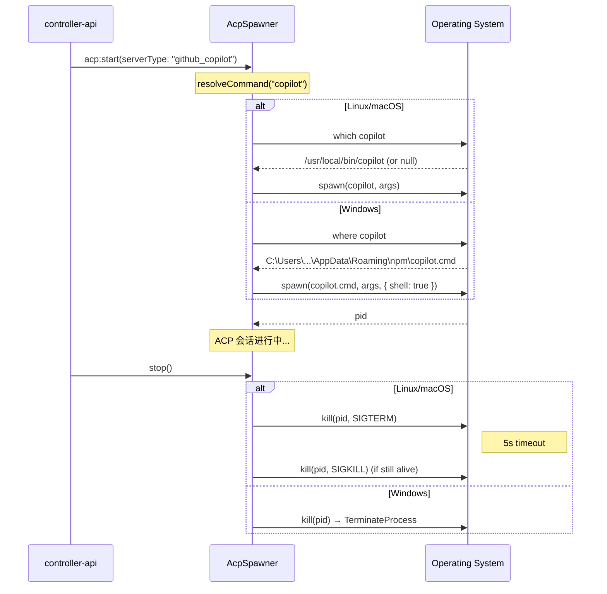

# ACP Server Windows 平台拉起 - 技术提案

**功能名称**: ACP Server Windows 平台兼容
**关联提案**: `20260526-feat-multi-acp-server-support.md`
**技术提案版本**: v1.0
**创建日期**: 2026-05-27
**作者**: opencode
**feat-branch**: `fix/acp-server-windows-launch`

## 1. 概述

### 1.1 背景

当前 agent-controller 的 ACP Server 拉起机制仅在 Linux/macOS 上验证过，Windows 用户无法启动 GitHub Copilot。用户报告 `copilot` 是通过 PowerShell 脚本启动的（npm 全局安装在 Windows 上生成的是 `copilot.cmd`），而现有代码存在多处平台不兼容问题。

### 1.2 目标

- Windows 上 `copilot` ACP Server 可正常检测和启动
- Windows 上 `opencode` ACP Server 可正常检测和启动
- 不影响 Linux/macOS 既有行为
- 进程停止信号处理兼容 Windows

### 1.3 范围

- **包含**：`AcpSpawner` 的 `start()`/`stop()`/`resolveCommand()` 平台适配、`AcpDetector` 检测命令平台适配
- **不包含**：`worktree-handler.ts` / `git-handler.ts` 的 Windows 兼容（独立问题）、前端层面的 Windows 适配

## 2. 问题分析

### 2.1 `AcpSpawner.resolveCommand()` — 命令解析

**文件**: `packages/agent-controller/src/acp/spawner.ts:82-93`

```typescript
private resolveCommand(): string {
  if (this.command.includes('/')) return this.command;
  const candidates = [this.command, `/usr/bin/${this.command}`, `/usr/local/bin/${this.command}`];
  for (const cmd of candidates) {
    try {
      const result = execFileSync('which', [cmd], { encoding: 'utf8', timeout: 1000 });
      if (result.trim()) return result.trim();
    } catch { /* try next */ }
    if (existsSync(cmd)) return cmd;
  }
  return this.command;
}
```

| 问题 | 影响 | 严重性 |
|------|------|--------|
| `which` 命令在 Windows 上不存在 | `execFileSync` 抛异常，所有候选路径都会 fallthrough | ❌ 致命 |
| 硬编码 Unix 路径 `/usr/bin/`、`/usr/local/bin/` | Windows 无此路径，`existsSync` 永远返回 false | ❌ 致命 |
| 路径分隔符使用 `/` | Windows 路径应为 `\`，但 Node.js 可转换，非主要问题 | ⚠️ 次要 |

### 2.2 `child_process.spawn()` 无 `shell: true`

**文件**: `packages/agent-controller/src/acp/spawner.ts:33-36`

```typescript
this.process = spawn(cmd, this.args, {
  cwd: this.cwd,
  stdio: ['pipe', 'pipe', 'pipe'],
});
```

- 不设置 `{ shell: true }` 时，Windows 上的 `spawn` 不会通过 `cmd.exe` 解析命令
- `copilot` 在 Windows 上以 `copilot.cmd` 形式存在（npm 全局安装生成的 wrapper），`spawn` 无法自动找到 `.cmd` 文件
- Node.js 文档：Windows 上无 shell 时，`spawn` 只会尝试 `cmd.exe /d /s /c` 不生效，仅对 `.exe`、`.bat`、`.cmd` 有有限支持

具体来说，Node.js 的 `spawn` 在 Windows 上会通过 `CreateProcess` API 查找文件，查找顺序为：
1. 精确文件名
2. 文件名 + `.exe`
3. 文件名 + `.com`
4. 文件名 + `.bat` 
5. 文件名 + `.cmd`

所以理论上 `spawn('copilot', ...)` 应该能找到 `copilot.cmd`。但问题在于 `resolveCommand()` 已经出错了（用 `which` 失败），导致 fallthrough 返回原始 `'copilot'` 字符串。而且即使 `spawn` 能找到 `.cmd`，这类 wrapper 脚本的行为可能与 Unix 不同。

**实际观察到的 Windows 失败链路**：
```
resolveCommand('copilot')
  → which copilot → ENOENT (Windows 没有 which)
  → /usr/bin/copilot → existsSync = false
  → /usr/local/bin/copilot → existsSync = false
  → return 'copilot' (bare string)
spawn('copilot', ['--acp', '--stdio'], { cwd, stdio })
  → CreateProcess 可能找到 copilot.cmd（取决于 PATH）
  → 如果 copilot.cmd 需要 PowerShell 解释执行，则失败
```

### 2.3 信号处理不兼容

**文件**: `packages/agent-controller/src/acp/spawner.ts:67-75`

```typescript
stop(): void {
  if (this.process) {
    this.process.kill('SIGTERM');
    setTimeout(() => {
      if (this.process) {
        this.process.kill('SIGKILL');
      }
    }, 5000);
  }
}
```

| 信号 | Windows 行为 |
|------|-------------|
| `SIGTERM` | Node.js 在 Windows 上发送 `SIGTERM` 会抛出 `EINVAL` 错误（不支持） |
| `SIGKILL` | Node.js 在 Windows 上也会抛出 `EINVAL` |

Windows 上正确的进程终止方式是 `process.kill(pid)`（无信号参数），等价于 `TerminateProcess`。

### 2.4 `AcpDetector` 检测命令

**文件**: `packages/agent-controller/src/acp/detector.ts:22,33`

```typescript
await execAsync('opencode -v');
await execAsync('copilot --version');
```

`child_process.exec()` 在 Windows 上默认通过 `cmd.exe` 执行，因此可以正确解析 `copilot.cmd`。在当前实现中这部分是工作的，无需改动。

但检测结果没有区分平台，Windows 上如果 `copilot` 未安装在默认 PATH 中（如通过 VS Code 扩展安装而非 npm global），检测可能失败。这个属于安装范围问题，提案不做处理。

## 3. 技术方案

### 3.1 总体架构

```
[Windows 进程模型的改动范围]

AcpSpawner (spawner.ts)
  ├── resolveCommand()  →  平台感知命令解析
  │     Linux/macOS:   which + /usr/bin/ + /usr/local/bin/
  │     Windows:       where + PATH 枚举 + PATHEXT 扩展
  │
  ├── start()          →  spawn 参数调整
  │     Linux/macOS:   spawn(cmd, args, { shell: false })
  │     Windows:       spawn(cmd, args, { shell: true })   ← 关键改动
  │
  └── stop()           →  信号差异处理
        Linux/macOS:   kill('SIGTERM') → 5s → kill('SIGKILL')
        Windows:       kill() (无信号，TerminateProcess)

AcpDetector (detector.ts)
  └── detect()          →  检测命令不变（exec 已走 shell）
```

### 3.2 关键实现点

#### 实现点 1: 平台感知命令解析

**文件**: `packages/agent-controller/src/acp/spawner.ts`

方案 A: 去除 `resolveCommand()` 直接依赖 `spawn` 的 PATH 解析能力

```
resolveCommand() 平台适配：

Linux/macOS:
  1. 如果 command 包含路径分隔符，直接返回
  2. 尝试 which <command> → 解析到完整路径
  3. 尝试 /usr/bin/<command>
  4. 尝试 /usr/local/bin/<command>
  5. 返回原始 command（让 spawn 通过 PATH 查找）

Windows:
  1. 如果 command 包含路径分隔符（\ 或 /），直接返回
  2. 尝试 where <command> → 解析到完整路径
  3. 对每个 PATHEXT 扩展名尝试 existsSync(<command>.<ext>)
  4. 返回原始 command（让 spawn 通过 PATH+shell 查找）
```

#### 实现点 2: spawn 参数平台适配

**文件**: `packages/agent-controller/src/acp/spawner.ts`

对于 `{ shell: true }` 的使用：

| 方案 | 说明 | 优点 | 缺点 |
|------|------|------|------|
| A. 始终 `shell: true` | 所有平台统一 | 代码简单，Windows 上 `.cmd` 自动解析 | Linux 上多一层 sh 进程，可能影响信号传播 |
| B. 仅 Windows `shell: true` | 按平台选择 | 精确控制，不影响 Linux 行为 | 需要 platform() 检测 |

**选择方案 B**：只在 Windows 上启用 `shell: true`，Linux/macOS 保持原样。

**Windows 上使用 `shell: true` 的详细影响**：
- `spawn(cmd, args, { shell: true })` 在 Windows 上等同于 `cmd.exe /d /s /c "<cmd> <args>"`
- `.cmd` 文件可正常执行
- 如果 `copilot` 以 `.ps1` 形式安装（PowerShell 脚本），则 `cmd.exe` 无法直接执行，需要额外的处理
- 信号传播：`process.kill()` 会杀掉 `cmd.exe` 进程，但其子进程（copilot）可能成为孤儿进程

#### 实现点 3: `.ps1` 文件支持（可选增强）

如果 `copilot` 是以 `.ps1` 形式存在（如通过某些 Windows 包管理器安装），则需要在 Windows 上做额外检测：

```typescript
// 检测是否为 PowerShell 脚本
const ps1Path = command.endsWith('.ps1') ? command : `${command}.ps1`;
try {
  await access(ps1Path);
  // 用 PowerShell 启动
  spawn('powershell.exe', ['-ExecutionPolicy', 'Bypass', '-File', ps1Path, ...args], { shell: true });
}
```

**当前决策**：先不实现 `.ps1` 专用路径，因为 npm 全局安装生成的是 `.cmd`，`copilot` 官方也推荐通过 npm 安装。如果未来有 `.ps1` 的需求可以再补充。

#### 实现点 4: stop() 方法信号适配

**文件**: `packages/agent-controller/src/acp/spawner.ts`

```typescript
stop(): void {
  if (!this.process) return;
  
  if (platform() === 'win32') {
    this.process.kill();  // TerminateProcess
  } else {
    this.process.kill('SIGTERM');
    setTimeout(() => {
      if (this.process) {
        this.process.kill('SIGKILL');
      }
    }, 5000);
  }
}
```

### 3.3 核心流程



### 3.4 .ps1 支持决策

| 场景 | 命令形式 | 启动方式 | 当前支持 |
|------|---------|---------|---------|
| npm i -g @github/copilot | `copilot.cmd` | `cmd.exe` 通过 `shell:true` | ✅ |
| scoop install copilot | `copilot.exe` 或 `copilot.cmd` | 同上 | ✅ |
| VS Code 内建 `copilot` | `copilot.ps1` | 需要 `powershell.exe -File` | ❌ 暂不支持 |
| winget install copilot | 视包而定 | 待定 | ❌ 暂不支持 |

**决策**：先支持 npm 安装方式（主流），通过 `{ shell: true }` 使 `cmd.exe` 解析 `.cmd`。如有 `.ps1` 需求后续补充。

### 3.5 进程树与信号传播

Windows 上使用 `shell: true` 后，进程结构变为：

```
agent-controller (Node.js)
  └── cmd.exe /d /s /c copilot --acp --stdio
        └── node.exe copilot/cli.js ...  (copilot.cmd → node)
```

调用 `process.kill()` 时：
- 只杀掉 `cmd.exe`，`node.exe` 子进程成为孤儿
- 需要显式管理子进程树

**解决方案**：使用 `{ shell: true, windowsHide: true }` 并配合 `taskkill /T`（Windows 专用）或 `process.kill(pid)` 的默认行为。在 `stop()` 中，为 Windows 增加 `taskkill /PID <pid> /T /F` 回退。

但考虑到 ACP session 的典型生命周期较短（用户关闭 session 时终止），且 `copilot` 子进程通常在 stdin 关闭后自行退出，使用简单的 `process.kill()` 在大多数场景下已足够。

## 4. 项目结构变更

```

packages/agent-controller/src/
├── acp/
│   ├── detector.ts     # 无改动（exec 已走 shell，Windows 兼容）
│   ├── spawner.ts      # 修改：resolveCommand() + start() + stop() 平台适配
│   └── bridge.ts       # 无改动
```

## 5. 代码改动清单

| 文件 | 改动类型 | 说明 |
|------|---------|------|
| `packages/agent-controller/src/acp/spawner.ts` | 修改 | `resolveCommand()` 平台感知、`start()` 参数、`stop()` 信号处理 |

**无需改动**：
- `detector.ts` — `exec()` 已通过 shell 执行，Windows 兼容
- `bridge.ts` — 不涉及子进程管理
- `sync-bridge.ts` — 不涉及子进程管理

## 6. 技术决策

### 6.1 决策列表

| 决策 | 选项 A | 选项 B | 最终选择 | 原因 |
|------|--------|--------|---------|------|
| `shell: true` 使用范围 | 仅 Windows | 所有平台 | 仅 Windows | Linux 上无需多一层 sh，信号传播更直接 |
| `.ps1` 文件支持 | 立即支持 | 后续补充 | 后续补充 | npm 安装的主流场景是 `.cmd`，`.ps1` 需要额外检测逻辑 |
| 进程树清理 | `taskkill /T` | `process.kill()` | `process.kill()` | 简单可靠，copilot 在 stdin 关闭后自行退出 |

### 6.2 依赖与约束

| 类型 | 内容 | 说明 |
|------|------|------|
| 依赖 | Node.js 跨平台 API | `process.platform`、`child_process.spawn` |
| 约束 | npm 全局安装为推荐安装方式 | `copilot.cmd` 是标准 wrapper |
| 约束 | Windows 上 PowerShell 执行策略 | 如果未来需要 `.ps1`，需处理 `-ExecutionPolicy` |

## 7. 测试策略

### 7.1 测试覆盖要求

- 单元测试覆盖 `resolveCommand()` 的 Windows/Linux 两条路径
- 单元测试覆盖 `stop()` 的信号适配
- 单元测试不依赖实际 Windows 环境（通过 mock `platform()`）

### 7.2 测试类型

| 类型 | 工具 | 覆盖范围 |
|------|------|---------|
| 单元测试 | Vitest | `spawner.ts` 的 `resolveCommand()`、`stop()` 平台分支 |

### 7.3 测试数据

```typescript
// resolveCommand Windows 路径
//   - platform() === 'win32' → 使用 where 而非 which
//   - 不尝试 Unix 路径

// stop Windows 路径
//   - platform() === 'win32' → kill() 无信号
//   - 无 SIGTERM/SIGKILL 调用

// start
//   - Windows → spawn 包含 { shell: true }
//   - Linux → spawn 不包含 { shell: true }
```

## 8. 验收标准

- [ ] 技术方案评审通过
- [ ] Windows 上 `copilot --acp --stdio` 可正常启动
- [ ] Windows 上 `opencode acp` 可正常启动
- [ ] Windows 上进程停止无 `EINVAL` 信号错误
- [ ] Linux/macOS 上行为完全不受影响
- [ ] 现有测试全部通过

## 9. 相关文档

- [多 ACP Server 支持技术方案](./20260526-feat-multi-acp-server-support.md)
- [Node.js child_process.spawn Windows 文档](https://nodejs.org/api/child_process.html#child_processspawncommand-args-options)
