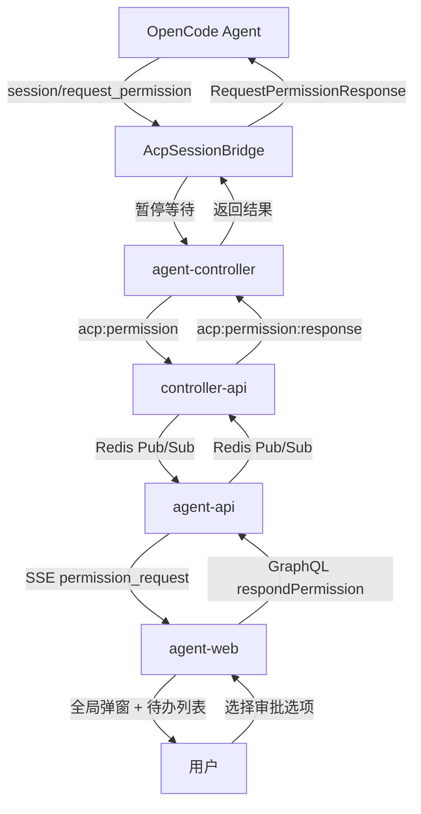
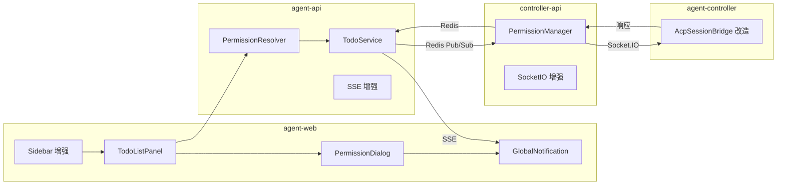
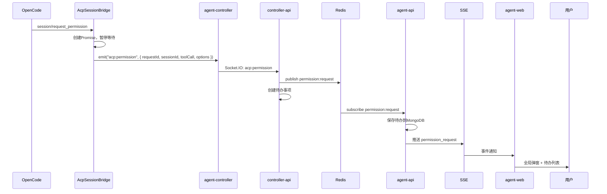
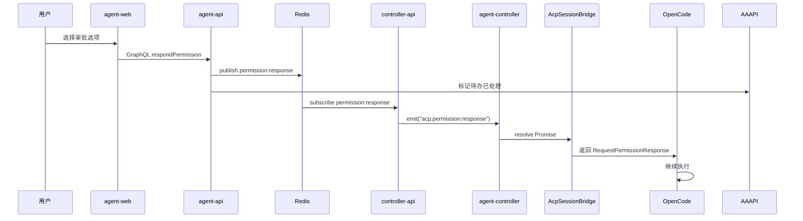

# ACP授权提醒 - 技术提案

**功能名称**: ACP授权提醒与待办系统
**关联 PRD**: `draft/20260528-acp-permission-reminder.md`
**技术提案版本**: v1.0
**创建日期**: 2026-05-28
**作者**: ZeroAsh
**feat-branch**: `feat/acp-permission-reminder`

## 1. 概述

### 1.1 背景

当前系统中，当Agent发送`session/request_permission`请求时，`AcpSessionBridge.requestPermission()`自动选择`allow_once`选项返回，完全没有用户交互。这导致用户无法感知和控制Agent的敏感操作。

根据ACP协议规范，`session/request_permission`是一个需要用户审批的强提醒消息。系统需要：
1. 拦截权限请求，暂停Agent执行
2. 通过待办系统通知用户
3. 用户审批后将结果返回给Agent

### 1.2 目标

- 改造`AcpSessionBridge.requestPermission()`从自动允许改为等待用户响应
- 新增WebSocket事件支持权限请求的转发和响应
- 新增待办事项系统，支持优先级和全局弹窗
- 新增权限审批Dialog，展示操作详情和审批选项
- 审批结果正确返回给Agent继续执行

### 1.3 范围

**做**:
- 新增WebSocket事件 `acp:permission` / `acp:permission:response`
- 新增Redis Pub/Sub命令 `permission:request` / `permission:response`
- 新增数据模型 `TodoItem`（待办事项）
- 新增GraphQL查询 `getTodoList` 和变更 `respondPermission`、`markTodoRead`
- 新增SSE事件类型 `permission_request`
- 改造 `AcpSessionBridge.requestPermission()` 支持等待用户响应
- 新增前端组件 `TodoListPanel`、`PermissionDialog`、`GlobalNotification`

**不做**:
- 待办事项的持久化存储（使用Redis + 内存，重启清空）
- 待办事项的分页加载（初期限制100条）
- 多语言支持
- 移动端适配

## 2. 技术架构

### 2.1 系统架构图



### 2.2 技术栈

| 层级 | 技术选型 | 说明 |
|------|---------|------|
| 前端 | React 19 + TypeScript + Tailwind CSS | shadcn/ui Dialog, Toast |
| 后端 | Express v5 + GraphQL-Yoga + Mongoose | Node.js 24+ |
| 数据库 | MongoDB | Session + AcpMessage + TodoItem |
| 缓存 | Redis | 待办事项缓存 + 权限请求状态 |
| 通信 | Redis Pub/Sub + Socket.IO + SSE | 命令下发 + 实时推送 |
| ACP | `@agentclientprotocol/sdk` | `requestPermission` API |

### 2.3 模块划分



| 模块 | 职责 | 关键技术点 |
|------|------|-----------|
| `AcpSessionBridge` | 改造requestPermission，暂停等待用户响应 | Promise + 超时机制 |
| `PermissionManager` | controller-api侧权限请求管理 | 请求-响应模式，超时处理 |
| `TodoService` | agent-api侧待办事项管理 | Redis缓存 + SSE推送 |
| `PermissionDialog` | 权限审批UI | 解析options和toolCallId |
| `GlobalNotification` | 全局弹窗提醒 | 最高优先级待办触发 |

## 3. 协议设计

### 3.1 新增Socket.IO事件

#### `acp:permission`（Controller → Server）

Controller收到Agent的权限请求后，转发给server。

**Payload:**

| 字段 | 类型 | 必填 | 说明 |
|------|------|------|------|
| `requestId` | `string` | 是 | 请求ID，用于匹配响应 |
| `sessionId` | `string` | 是 | 当前Session ID |
| `toolCall` | `object` | 是 | 工具调用信息 |
| `toolCall.toolCallId` | `string` | 是 | 工具调用ID |
| `options` | `PermissionOption[]` | 是 | 可选审批选项 |

**`PermissionOption`结构:**

| 字段 | 类型 | 说明 |
|------|------|------|
| `optionId` | `string` | 选项ID |
| `name` | `string` | 显示名称 |
| `kind` | `PermissionOptionKind` | 选项类型 |

**`PermissionOptionKind`枚举:**
- `allow_once` - 允许一次
- `allow_always` - 始终允许
- `reject_once` - 拒绝一次
- `reject_always` - 始终拒绝

#### `acp:permission:response`（Server → Controller）

Server将用户审批结果返回给Controller。

**Payload:**

| 字段 | 类型 | 必填 | 说明 |
|------|------|------|------|
| `requestId` | `string` | 是 | 对应的请求ID |
| `outcome` | `RequestPermissionOutcome` | 是 | 审批结果 |

**`RequestPermissionOutcome`结构:**

| 字段 | 类型 | 说明 |
|------|------|------|
| `outcome` | `'selected' \| 'cancelled'` | 结果类型 |
| `optionId` | `string?` | 选择的选项ID（outcome=selected时） |

### 3.2 新增Redis Pub/Sub命令

#### `permission:request`（agent-api发布，controller-api订阅）

| 字段 | 类型 | 说明 |
|------|------|------|
| `requestId` | `string` | 请求ID |
| `controllerId` | `string` | Controller ID |
| `sessionId` | `string` | Session ID |
| `userId` | `string` | 用户ID |
| `toolCall` | `object` | 工具调用信息 |
| `options` | `PermissionOption[]` | 审批选项 |

#### `permission:response`（controller-api发布，agent-api订阅）

| 字段 | 类型 | 说明 |
|------|------|------|
| `requestId` | `string` | 请求ID |
| `controllerId` | `string` | Controller ID |
| `outcome` | `RequestPermissionOutcome` | 审批结果 |

### 3.3 新增SSE事件类型

#### `permission_request`

当有待办事项（特别是权限请求）时，通过SSE推送给前端。

**数据格式:**

```json
{
  "type": "permission_request",
  "data": {
    "requestId": "req_001",
    "sessionId": "sess_abc123",
    "toolCallId": "call_001",
    "options": [
      { "optionId": "allow-once", "name": "Allow once", "kind": "allow_once" },
      { "optionId": "reject-once", "name": "Reject", "kind": "reject_once" }
    ],
    "createdAt": "2026-05-28T12:00:00Z"
  }
}
```

### 3.4 新增GraphQL Schema

#### 新类型

```graphql
type PermissionOption {
  optionId: String!
  name: String!
  kind: PermissionOptionKind!
}

enum PermissionOptionKind {
  ALLOW_ONCE
  ALLOW_ALWAYS
  REJECT_ONCE
  REJECT_ALWAYS
}

type PermissionRequest {
  requestId: String!
  sessionId: ID!
  toolCallId: String!
  options: [PermissionOption!]!
  createdAt: String!
}

enum TodoPriority {
  IMMEDIATE
  URGENT
  MEDIUM
  LOW
}

enum TodoType {
  PERMISSION_REQUEST
  SYSTEM_NOTIFICATION
}

type TodoItem {
  id: ID!
  type: TodoType!
  priority: TodoPriority!
  title: String!
  description: String
  isRead: Boolean!
  data: JSON
  createdAt: String!
}

type RequestPermissionOutcome {
  outcome: String!
  optionId: String
}
```

#### 新查询

```graphql
extend type Query {
  """获取待办事项列表"""
  getTodoList: [TodoItem!]!
  
  """获取未读待办数量"""
  getUnreadTodoCount: Int!
}
```

#### 新变更

```graphql
extend type Mutation {
  """响应权限请求"""
  respondPermission(
    requestId: String!
    outcome: String!
    optionId: String
  ): RequestPermissionOutcome!
  
  """标记待办为已读"""
  markTodoRead(todoId: ID!): Boolean!
  
  """标记所有待办为已读"""
  markAllTodoRead: Boolean!
}
```

## 4. 数据模型

### 4.1 新增TodoItem集合

```typescript
const todoItemSchema = new mongoose.Schema({
  userId: { type: ObjectId, ref: 'User', required: true },
  type: { type: String, enum: ['permission_request', 'system_notification'], required: true },
  priority: { type: String, enum: ['immediate', 'urgent', 'medium', 'low'], required: true },
  title: { type: String, required: true },
  description: { type: String },
  isRead: { type: Boolean, default: false },
  data: { type: Mixed },  // 存储权限请求相关数据
  expiresAt: { type: Date },  // 过期时间
}, { timestamps: true });
```

### 4.2 Redis缓存设计

| Key | 类型 | TTL | 说明 |
|-----|------|-----|------|
| `permission:request:{requestId}` | Hash | 300s | 权限请求状态 |
| `todo:user:{userId}` | Sorted Set | 无 | 用户待办列表（按优先级+时间排序） |
| `todo:unread:{userId}` | String | 无 | 未读待办计数 |

### 4.3 AcpMessage模型扩展

在`AcpMessageType`枚举中新增`permission_request`类型：

```typescript
// 修改前
type: { type: String, enum: ['text', 'image', 'tool_call', 'tool_result', 'plan', 'error'] }

// 修改后
type: { type: String, enum: ['text', 'image', 'tool_call', 'tool_result', 'plan', 'error', 'permission_request'] }
```

## 5. 技术实现方案

### 5.1 核心流程

#### 权限请求流程



#### 审批响应流程



### 5.2 关键实现点

#### 实现点1: AcpSessionBridge改造

**文件**: `packages/agent-controller/src/acp/bridge.ts`

改造`requestPermission()`方法，从自动允许改为等待用户响应：

```typescript
// 新增属性
private pendingPermissions = new Map<string, {
  resolve: (response: acp.RequestPermissionResponse) => void;
  timeout: NodeJS.Timeout;
}>();

// 改造后的方法
async requestPermission(
  params: acp.RequestPermissionRequest,
): Promise<acp.RequestPermissionResponse> {
  const requestId = `perm_${Date.now()}_${Math.random().toString(36).slice(2)}`;
  
  return new Promise((resolve) => {
    // 设置超时（60秒）
    const timeout = setTimeout(() => {
      this.pendingPermissions.delete(requestId);
      resolve({
        outcome: { outcome: 'cancelled' }
      });
    }, 60_000);
    
    this.pendingPermissions.set(requestId, { resolve, timeout });
    
    // 发送权限请求到controller-api
    this.emit('acp:permission', {
      requestId,
      sessionId: this.sessionId,
      toolCall: params.toolCall,
      options: params.options,
    });
  });
}

// 新增：处理用户响应
handlePermissionResponse(requestId: string, outcome: acp.RequestPermissionOutcome): void {
  const pending = this.pendingPermissions.get(requestId);
  if (pending) {
    clearTimeout(pending.timeout);
    this.pendingPermissions.delete(requestId);
    pending.resolve({ outcome });
  }
}
```

#### 实现点2: controller-api PermissionManager

**文件**: `servers/controller-api/src/services/permission-manager.ts`（新建）

```typescript
export class PermissionManager {
  private pendingRequests = new Map<string, {
    socketId: string;
    sessionId: string;
    timeout: NodeJS.Timeout;
  }>();

  async handlePermissionRequest(
    socket: Socket,
    data: PermissionRequestData,
  ): Promise<void> {
    const { requestId, sessionId, toolCall, options } = data;
    
    // 保存请求状态
    const timeout = setTimeout(() => {
      this.handleTimeout(requestId);
    }, 300_000); // 5分钟超时
    
    this.pendingRequests.set(requestId, {
      socketId: socket.id,
      sessionId,
      timeout,
    });
    
    // 发布到Redis
    await redis.publish('permission:request', {
      requestId,
      controllerId: socket.data.controllerId,
      sessionId,
      userId: socket.data.userId,
      toolCall,
      options,
    });
  }

  async handlePermissionResponse(
    data: PermissionResponseData,
  ): Promise<void> {
    const { requestId, outcome } = data;
    const pending = this.pendingRequests.get(requestId);
    
    if (!pending) {
      console.warn(`Permission request ${requestId} not found`);
      return;
    }
    
    clearTimeout(pending.timeout);
    this.pendingRequests.delete(requestId);
    
    // 发送响应到controller
    const socket = this.io.sockets.sockets.get(pending.socketId);
    if (socket) {
      socket.emit('acp:permission:response', { requestId, outcome });
    }
  }

  private handleTimeout(requestId: string): void {
    const pending = this.pendingRequests.get(requestId);
    if (pending) {
      this.pendingRequests.delete(requestId);
      // 发送超时响应
      const socket = this.io.sockets.sockets.get(pending.socketId);
      if (socket) {
        socket.emit('acp:permission:response', {
          requestId,
          outcome: { outcome: 'cancelled' },
        });
      }
    }
  }
}
```

#### 实现点3: agent-api TodoService

**文件**: `servers/agent-api/src/services/todo-service.ts`（新建）

```typescript
export class TodoService {
  async createPermissionTodo(
    userId: string,
    data: PermissionRequestData,
  ): Promise<TodoItem> {
    // 保存到MongoDB
    const todo = await TodoItem.create({
      userId,
      type: 'permission_request',
      priority: 'immediate',
      title: 'Agent请求权限审批',
      description: `工具调用 ${data.toolCall.toolCallId} 请求权限`,
      data: {
        requestId: data.requestId,
        sessionId: data.sessionId,
        toolCallId: data.toolCall.toolCallId,
        options: data.options,
      },
      expiresAt: new Date(Date.now() + 5 * 60 * 1000), // 5分钟过期
    });
    
    // 更新Redis缓存
    await redis.zadd(`todo:user:${userId}`, Date.now(), todo._id.toString());
    await redis.incr(`todo:unread:${userId}`);
    
    // 通过SSE推送
    this.sseService.pushToUser(userId, {
      type: 'permission_request',
      data: {
        requestId: data.requestId,
        sessionId: data.sessionId,
        toolCallId: data.toolCall.toolCallId,
        options: data.options,
        createdAt: todo.createdAt,
      },
    });
    
    return todo;
  }

  async respondPermission(
    userId: string,
    requestId: string,
    outcome: RequestPermissionOutcome,
  ): Promise<void> {
    // 发布到Redis
    await redis.publish('permission:response', {
      requestId,
      outcome,
    });
    
    // 标记待办已处理
    await TodoItem.updateOne(
      { userId, 'data.requestId': requestId },
      { $set: { isRead: true } }
    );
    
    // 更新Redis计数
    await redis.decr(`todo:unread:${userId}`);
  }
}
```

#### 实现点4: 前端PermissionDialog

**文件**: `apps/agent-web/src/components/PermissionDialog.tsx`（新建）

```tsx
interface PermissionDialogProps {
  open: boolean;
  onOpenChange: (open: boolean) => void;
  requestId: string;
  sessionId: string;
  toolCallId: string;
  options: PermissionOption[];
}

export function PermissionDialog({
  open,
  onOpenChange,
  requestId,
  sessionId,
  toolCallId,
  options,
}: PermissionDialogProps) {
  const [toolCallInfo, setToolCallInfo] = useState<ToolCallInfo | null>(null);
  const [responding, setResponding] = useState(false);
  
  // 查询toolCallId关联的历史消息
  useEffect(() => {
    if (open && toolCallId) {
      queryToolCallInfo(sessionId, toolCallId).then(setToolCallInfo);
    }
  }, [open, toolCallId, sessionId]);
  
  const handleRespond = async (optionId?: string) => {
    setResponding(true);
    try {
      await respondPermission({
        requestId,
        outcome: optionId ? 'selected' : 'cancelled',
        optionId,
      });
      onOpenChange(false);
    } finally {
      setResponding(false);
    }
  };
  
  return (
    <Dialog open={open} onOpenChange={onOpenChange}>
      <DialogContent>
        <DialogHeader>
          <DialogTitle>Agent请求权限审批</DialogTitle>
        </DialogHeader>
        
        {/* 工具调用详情 */}
        {toolCallInfo && (
          <div className="mb-4">
            <p className="text-sm text-muted-foreground">
              工具: {toolCallInfo.title}
            </p>
            {toolCallInfo.content && (
              <pre className="mt-2 p-2 bg-muted rounded text-xs overflow-auto max-h-40">
                {toolCallInfo.content}
              </pre>
            )}
          </div>
        )}
        
        {/* 审批选项 */}
        <div className="flex flex-col gap-2">
          {options.map((option) => (
            <Button
              key={option.optionId}
              variant={getVariant(option.kind)}
              onClick={() => handleRespond(option.optionId)}
              disabled={responding}
            >
              {option.name}
            </Button>
          ))}
          
          <Button
            variant="outline"
            onClick={() => handleRespond()}
            disabled={responding}
          >
            取消
          </Button>
        </div>
      </DialogContent>
    </Dialog>
  );
}

function getVariant(kind: PermissionOptionKind): ButtonVariant {
  switch (kind) {
    case 'allow_once':
    case 'allow_always':
      return 'default';
    case 'reject_once':
    case 'reject_always':
      return 'destructive';
    default:
      return 'outline';
  }
}
```

#### 实现点5: 前端GlobalNotification

**文件**: `apps/agent-web/src/components/GlobalNotification.tsx`（新建）

```tsx
export function GlobalNotification() {
  const [currentTodo, setCurrentTodo] = useState<TodoItem | null>(null);
  
  // 监听SSE权限请求事件
  useEffect(() => {
    const unsubscribe = sseService.on('permission_request', (data) => {
      // 立即优先级待办触发全局弹窗
      setCurrentTodo({
        type: 'permission_request',
        priority: 'immediate',
        ...data,
      });
    });
    
    return unsubscribe;
  }, []);
  
  if (!currentTodo) return null;
  
  return (
    <div className="fixed top-4 right-4 z-50 animate-in slide-in-from-right">
      <Card className="w-80 border-destructive">
        <CardHeader className="pb-2">
          <div className="flex items-center gap-2">
            <Bell className="h-4 w-4 text-destructive" />
            <CardTitle className="text-sm">{currentTodo.title}</CardTitle>
          </div>
        </CardHeader>
        <CardContent className="pb-2">
          <p className="text-sm text-muted-foreground">
            {currentTodo.description}
          </p>
        </CardContent>
        <CardFooter className="flex gap-2">
          <Button
            size="sm"
            onClick={() => {
              // 打开权限审批Dialog
              openPermissionDialog(currentTodo.data);
              setCurrentTodo(null);
            }}
          >
            查看详情
          </Button>
          <Button
            size="sm"
            variant="outline"
            onClick={() => setCurrentTodo(null)}
          >
            稍后处理
          </Button>
        </CardFooter>
      </Card>
    </div>
  );
}
```

### 5.3 关键设计决策

| 决策 | 选项A | 选项B | 最终选择 | 原因 |
|------|-------|-------|---------|------|
| 权限请求超时 | 60秒 | 5分钟 | 60秒 | 用户响应应在1分钟内，超时自动取消 |
| 待办存储 | Redis缓存 | MongoDB持久化 | 两者结合 | Redis用于实时查询，MongoDB用于审计 |
| 全局弹窗 | Toast通知 | Dialog弹窗 | Toast卡片 | 不阻塞用户操作，可手动关闭 |
| toolCallInfo查询 | 实时查询MongoDB | 缓存到Redis | 实时查询 | 权限请求低频，实时查询足够 |
| 前端状态管理 | Context | Zustand | Zustand | 与现有状态管理方案一致 |

## 6. 项目结构

```
packages/agent-controller/src/
├── acp/
│   ├── bridge.ts              # 修改：改造requestPermission
│   └── types.ts               # 修改：新增权限相关类型

servers/controller-api/src/
├── services/
│   ├── permission-manager.ts  # 新增：权限请求管理
│   └── socketio.ts            # 修改：注册权限事件处理

servers/agent-api/src/
├── models/
│   └── todo-item.ts           # 新增：待办事项模型
├── services/
│   └── todo-service.ts        # 新增：待办事项服务
├── graphql/
│   ├── schemas/
│   │   └── todo.ts            # 新增：待办GraphQL schema
│   └── resolvers/
│       └── todo.ts            # 新增：待办resolver

apps/agent-web/src/
├── components/
│   ├── Sidebar.tsx            # 修改：增加待办入口图标
│   ├── TodoListPanel.tsx      # 新增：待办列表面板
│   ├── PermissionDialog.tsx   # 新增：权限审批Dialog
│   └── GlobalNotification.tsx # 新增：全局弹窗通知
├── hooks/
│   └── useTodo.ts             # 新增：待办状态管理
├── graphql/
│   ├── queries.ts             # 修改：新增待办查询
│   └── mutations.ts           # 修改：新增权限响应变更

contracts/
├── agent-session-websocket.md # 修改：新增权限事件定义
└── agent-session.graphql      # 修改：新增待办类型和变更
```

## 7. 测试策略

### 7.1 测试覆盖要求

- 单元测试覆盖率: >= 80%（新增代码）
- API测试覆盖: `respondPermission`, `getTodoList`, `getUnreadTodoCount`

### 7.2 测试类型

| 类型 | 工具 | 覆盖范围 |
|------|------|---------|
| 单元测试 | Vitest | `PermissionManager`, `TodoService`, `AcpSessionBridge` |
| 协议测试 | Vitest | `acp:permission` / `acp:permission:response`事件收发 |
| GraphQL API测试 | Vitest | `respondPermission`, `getTodoList` resolver |
| 前端组件测试 | Vitest | `PermissionDialog`, `TodoListPanel`, `GlobalNotification` |
| E2E测试 | Vitest | 完整流程：Agent请求权限 → 用户审批 → Agent继续执行 |

### 7.3 测试重点

1. `AcpSessionBridge`改造后，超时自动返回cancelled
2. 权限请求-响应的端到端流程
3. 待办事项的创建、查询、标记已读
4. 全局弹窗的触发和关闭
5. 用户刷新页面后待办状态恢复
6. 多个权限请求并发处理

## 8. 验收标准

- [ ] 技术方案评审通过
- [ ] Contract评审通过（WebSocket + GraphQL + SSE）
- [ ] AcpSessionBridge.requestPermission()正确等待用户响应
- [ ] 超时后自动返回cancelled
- [ ] 权限请求通过SSE正确推送到前端
- [ ] 待办列表正确显示权限审批待办
- [ ] 全局弹窗在收到立即优先级待办时触发
- [ ] 用户审批后结果正确返回给Agent
- [ ] Agent收到结果后继续执行
- [ ] 单元测试覆盖达标
- [ ] E2E测试通过

## 9. 相关文档

- [关联PRD](../../product/draft/20260528-acp-permission-reminder.md)
- [ACP协议 - Tool Calls](https://agentclientprotocol.com/protocol/tool-calls#requesting-permission)
- [现有WebSocket契约](../../contracts/agent-session-websocket.md)
- [现有GraphQL契约](../../contracts/agent-session.graphql)
- [开发规范](../common-rules.md)
