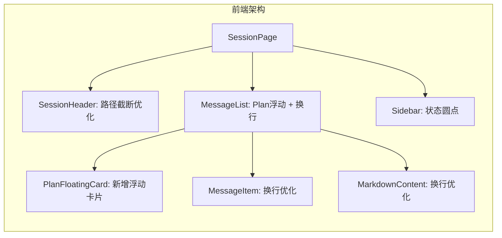
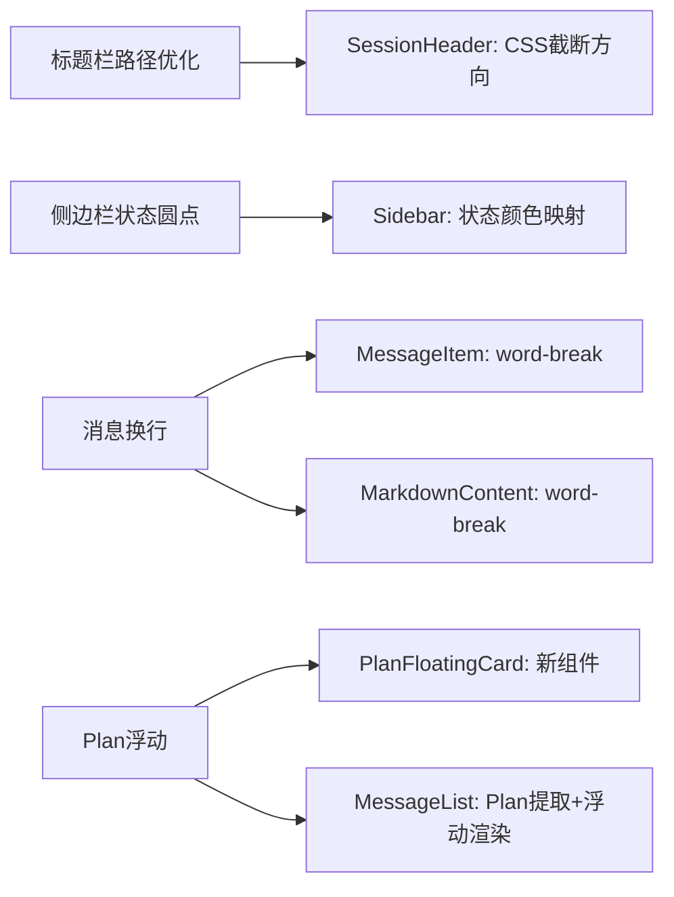
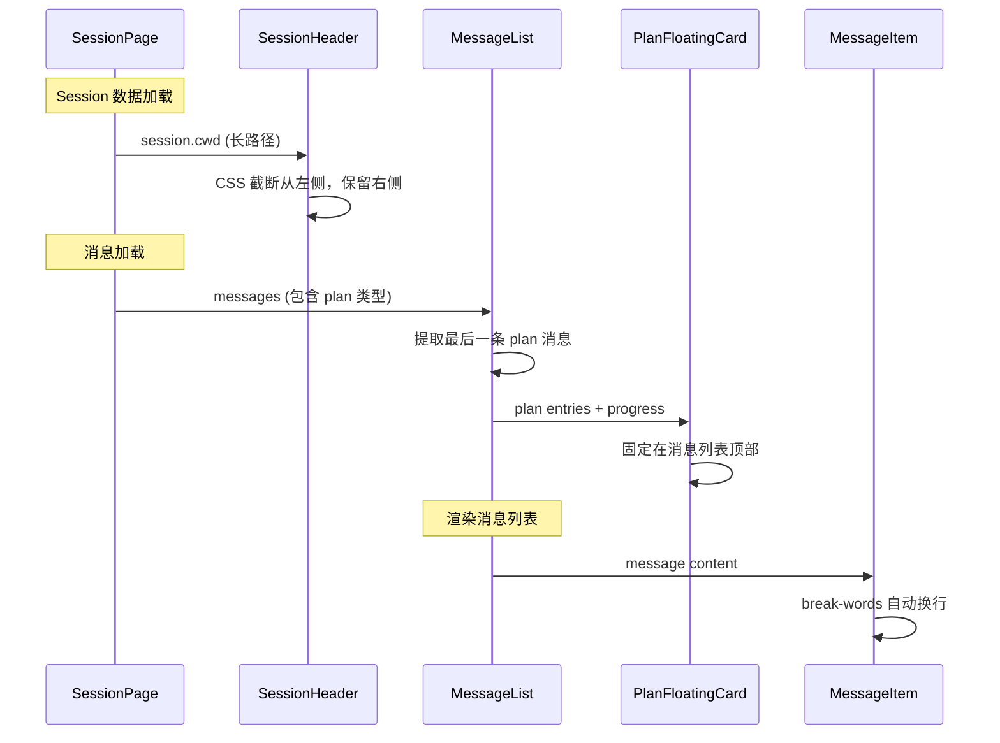
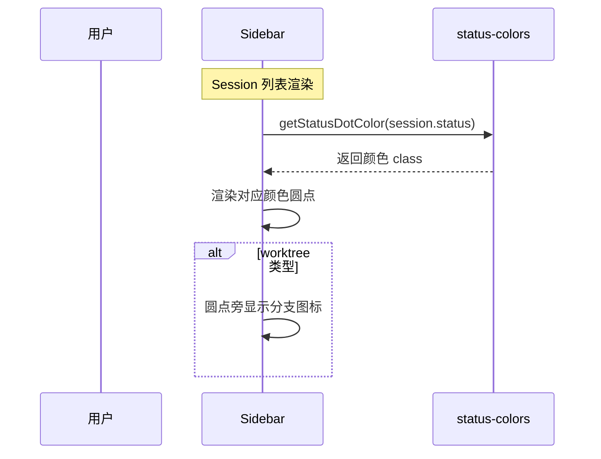

# 前端界面优化三期 - 技术提案

**功能名称**: 前端界面优化三期
**关联 PRD**: docs/product/draft/20260528-frontend-ui-optimization.md
**技术提案版本**: v1.0
**创建日期**: 2026-05-28
**作者**: opencode
**feat-branch**: `feat/ui-optimization-phase3`

## 1. 概述

### 1.1 背景

二期 UI 优化已完成消息类型差异化展示、Thinking Markdown 渲染、SSE 加载状态、输入框高度提升、Agent 运行状态指示等功能。三期在此基础上继续优化 Session 界面的四个区域体验：

1. **标题栏路径截断方向错误**：当前 `cwd` 使用 Tailwind `truncate` 从右侧截断，长路径只剩末尾文件名，用户无法判断目录层级
2. **侧边栏状态图标不直观**：Session 列表中普通 Session 显示固定灰色圆点，无法区分运行状态
3. **消息内容撑开容器**：消息气泡虽有 `max-w-[70%]`，但长文本/代码可能溢出或水平滚动
4. **Plan 信息不易发现**：Plan 混在消息列表中，需滚动查找

### 1.2 目标

- `cwd` 路径过长时从左侧截断（保留右侧目录层级），Tooltip 显示完整路径
- Session 列表每个 Session 显示与状态对应颜色的圆点
- 消息内容过长时自动换行，不撑开容器
- 包含 Plan 的 Session 在消息列表顶部浮动显示最后一条 Plan 的进度摘要

### 1.3 范围

- 本次优化限定在前端 `apps/agent-web`，不涉及后端或 API 变更
- 不修改 SDK 类型定义
- 不修改消息数据流（SSE -> state -> render）
- 现有测试必须保持通过
- 不引入新的 npm 依赖

## 2. 技术架构

### 2.1 系统架构图



### 2.2 技术栈

| 层级 | 技术选型 | 说明 |
|------|---------|------|
| 框架 | React 19 + TypeScript | 不变 |
| 构建 | Vite 8 | 不变 |
| 样式 | Tailwind CSS v4 | 不变 |
| 图标 | lucide-react | 复用现有 |
| 测试 | Vitest + Testing Library + Playwright | 不变 |

### 2.3 模块划分



| 模块 | 职责 | 关键技术点 |
|------|------|-----------|
| SessionHeader 路径截断 | `cwd` 从左侧截断，保留右侧目录层级 | CSS `direction: rtl` + `text-align: left` + `unicode-bidi: plaintext`，或使用 JS 截取路径 |
| Sidebar 状态圆点 | 每个 Session 显示状态颜色圆点 | 复用 `status-colors.ts` 的 `getStatusDotColor()`，worktree 类型保留分支图标 |
| MessageItem 换行 | 消息内容过长时自动换行 | 添加 `break-words` class（已有），确保用户消息 `whitespace-pre-wrap` 生效 |
| PlanFloatingCard | 浮动在消息列表顶部的 Plan 摘要 | 新建组件，从 messages 中提取最后一条 Plan，固定定位在消息列表顶部 |

## 3. API 设计

本次不涉及新增或修改 API。

## 4. 数据模型

无需变更数据模型。

## 5. 技术实现方案

### 5.1 核心流程





### 5.2 关键实现点

#### 实现点 1: SessionHeader 路径从右侧截断

- **描述**: 修改 `SessionHeader.tsx` 中 `cwd` 的展示方式，使长路径从左侧截断、保留右侧目录层级
- **技术细节**:
  - 当前实现：`<span className="text-sm text-gray-500 font-mono">{session.cwd}</span>` — 默认文本溢出从右侧截断
  - 方案 A（CSS 方案）：使用 `direction: rtl` + `text-align: left` + `unicode-bidi: plaintext`，使文本从右侧开始显示，左侧自动截断。需注意 `font-mono` 与 RTL 的兼容性
  - 方案 B（JS 方案）：当路径长度超过阈值（如 40 字符）时，截取路径后半部分，前面拼接 `...`。使用 `title` 属性显示完整路径
  - **选择方案 B**：更可控，不受 RTL 对 mono 字体的影响，且能精确控制截断逻辑
  - 实现：新增辅助函数 `truncatePathLeft(path: string, maxLen?: number): string`，当 `path.length > maxLen` 时返回 `'...' + path.slice(-(maxLen - 3))`
  - 在 `<span>` 上添加 `title={session.cwd}` 提供 Tooltip
- **风险点**: 无

#### 实现点 2: Sidebar Session 状态圆点

- **描述**: 修改 `Sidebar.tsx` 中 Session 列表项的图标，替换为按状态显示对应颜色的圆点
- **技术细节**:
  - 当前实现：worktree 类型显示蓝色分支 SVG，普通类型显示 `<span className="h-2 w-2 rounded-full ${getStatusDotColor(session.status)}" />`
  - 修改：worktree 类型也显示状态圆点，但在圆点旁保留分支图标（缩小为 12px）
  - 统一所有 Session 的图标逻辑：先渲染状态圆点，如果是 worktree 类型再在圆点旁追加分支图标
  - 颜色映射复用 `status-colors.ts` 中的 `getStatusDotColor()`
  - Running 状态的圆点需添加 `animate-pulse` 动画（当前 `status-colors.ts` 中 Running 的 dot 颜色为 `bg-blue-500`，需确认是否已有 pulse，如无则需在 Sidebar 中单独添加）
- **风险点**: 无

#### 实现点 3: 消息内容自动换行

- **描述**: 确保所有消息内容过长时自动换行，不撑开容器
- **技术细节**:
  - `MessageItem.tsx` 中消息气泡已有 `max-w-[70%]`，用户消息已有 `whitespace-pre-wrap`
  - AI 消息通过 `MarkdownContent` 渲染，`react-markdown` 默认支持换行
  - 需要确保：
    - 消息气泡容器添加 `overflow-hidden` 防止内容溢出
    - 代码块（`<pre>` / `<code>`）保持 `overflow-x-auto` 允许水平滚动（不被截断）
    - 长 URL 或长单词不会撑开容器：添加 `break-all` 或 `break-words`
  - 修改 `MessageItem.tsx`：消息气泡 div 添加 `overflow-hidden`
  - 修改 `MarkdownContent.tsx`：`<pre>` 标签保持 `overflow-x-auto`
- **风险点**: 代码块的水平滚动是期望行为，不应被 `break-words` 影响

#### 实现点 4: Plan 浮动在消息列表顶部

- **描述**: 新建 `PlanFloatingCard` 组件，从消息历史中提取最后一条 Plan，在消息列表顶部浮动显示
- **技术细节**:
  - 新建 `src/components/session/PlanFloatingCard.tsx`
  - Props: `{ entries: Array<{ content: string; status: string; priority: string }>; progress: string }`
  - 样式：`sticky top-0 z-10`，半透明背景 (`bg-white/90 backdrop-blur-sm`)，圆角 (`rounded-lg`)，阴影 (`shadow-md`)
  - 显示内容：进度摘要（如 "2/5 completed"）+ 最后一条条目的内容（截断到 80 字符）
  - 可点击展开/收起完整 Plan（复用 `AcpCard` 的折叠逻辑或简化为 inline 展开）
  - 在 `MessageList.tsx` 中：
    - 在 `groupMessages` 之后，扫描 `groups` 找到所有 `type === 'plan'` 的 group
    - 取最后一个 plan group，解析其 entries
    - 计算进度：`completed / total`
    - 将 `PlanFloatingCard` 渲染在消息列表顶部（`<div className="space-y-4">` 之前）
    - 消息列表为空时不显示
- **风险点**: Plan 消息可能包含多个 plan update（每次 update 覆盖之前的 entries），需要取最后一个 plan 的完整 entries

### 5.3 组件变更清单

| 文件 | 操作 | 说明 |
|------|------|------|
| `src/components/session/SessionHeader.tsx` | 修改 | `cwd` 路径截断从左侧 + Tooltip |
| `src/components/Sidebar.tsx` | 修改 | Session 状态圆点 + worktree 图标 |
| `src/components/session/MessageItem.tsx` | 修改 | 消息气泡添加 `overflow-hidden` |
| `src/components/session/MarkdownContent.tsx` | 微调 | 确保 `<pre>` 有 `overflow-x-auto` |
| `src/components/session/PlanFloatingCard.tsx` | 新增 | Plan 浮动卡片组件 |
| `src/components/session/MessageList.tsx` | 修改 | 提取 Plan + 渲染浮动卡片 |
| `src/components/session/status-colors.ts` | 可能微调 | 确认 Running dot 有 pulse 动画 |

## 6. 技术决策

### 6.1 决策列表

| 决策 | 选项 A | 选项 B | 最终选择 | 原因 |
|------|--------|--------|---------|------|
| 路径截断方式 | CSS `direction: rtl` | JS 截取拼接 `...` | JS 截取 | 更可控，不受 RTL 对 mono 字体影响 |
| Plan 浮动卡片实现 | 使用 `AcpCard` 组件 | 独立简化组件 | 独立简化组件 | 浮动卡片不需要标题区和折叠 chevron，独立组件更轻量 |
| worktree Session 图标 | 仅显示分支图标 | 状态圆点 + 分支图标 | 状态圆点 + 分支图标 | 统一所有 Session 的状态展示，worktree 附加分支图标作为类型标识 |

### 6.2 依赖与约束

| 类型 | 内容 | 说明 |
|------|------|------|
| 约束 | 不引入新 npm 依赖 | 现有 Tailwind + lucide-react 已满足需求 |
| 约束 | 现有测试必须保持通过 | 组件修改需同步更新测试 |
| 依赖 | `status-colors.ts` 的 `getStatusDotColor()` | Sidebar 和 PlanFloatingCard 都依赖此函数 |
| 依赖 | `PlanCard.tsx` 的 Plan 解析逻辑 | PlanFloatingCard 需复用 Plan 条目解析 |

## 7. 项目结构

```
apps/agent-web/src/components/session/
├── SessionHeader.tsx          # [修改] cwd 路径截断
├── PlanFloatingCard.tsx       # [新增] Plan 浮动卡片
├── MessageList.tsx            # [修改] Plan 提取 + 浮动渲染
├── MessageItem.tsx            # [修改] overflow-hidden
├── MarkdownContent.tsx        # [微调] pre overflow-x-auto
├── status-colors.ts           # [可能微调] Running pulse
├── PlanCard.tsx               # 不变（复用解析逻辑）
├── AcpCard.tsx                # 不变
├── ...                        # 其他不变

apps/agent-web/src/components/
├── Sidebar.tsx                # [修改] Session 状态圆点
```

## 8. 测试策略

### 8.1 测试覆盖要求

- 单元测试：新增 PlanFloatingCard 渲染测试、SessionHeader 路径截断测试、Sidebar 状态圆点测试
- E2E 测试：验证路径截断展示、状态圆点颜色、消息换行、Plan 浮动卡片

### 8.2 测试类型

| 类型 | 工具 | 覆盖范围 |
|------|------|---------|
| 单元测试 | Vitest + Testing Library | PlanFloatingCard 渲染、SessionHeader 路径截断、Sidebar 状态圆点 |
| E2E 测试 | Playwright | 路径截断、状态圆点颜色、消息换行、Plan 浮动卡片交互 |

## 9. 部署方案

前端无独立部署变更，随下次 agent-web 部署一起发布。

## 10. 验收标准

- [ ] 技术方案评审通过
- [ ] `cwd` 路径过长时从左侧截断，保留右侧目录层级
- [ ] 鼠标悬停在路径上时显示完整路径
- [ ] Session 列表每个 Session 显示与状态对应颜色的圆点
- [ ] Running 状态圆点带脉冲动画
- [ ] worktree 类型 Session 在圆点旁保留分支图标
- [ ] 消息气泡内容过长时自动换行，不撑开容器
- [ ] 代码块支持水平滚动
- [ ] 包含 Plan 的 Session 在消息列表顶部显示浮动 Plan 卡片
- [ ] Plan 浮动卡片显示进度和最后一条条目
- [ ] Plan 浮动卡片不随消息列表滚动
- [ ] 现有测试全部通过

## 11. 相关文档

- [PRD 前端界面优化三期](../../product/draft/20260528-frontend-ui-optimization.md)
- [二期 PRD](../../product/released/20260526-ui-optimization-phase2.md)
- [一期 PRD](../../product/released/20260526-ui-optimization.md)
- [Frontend Rules](../frontend-rules.md)
- [Common Rules](../common-rules.md)
