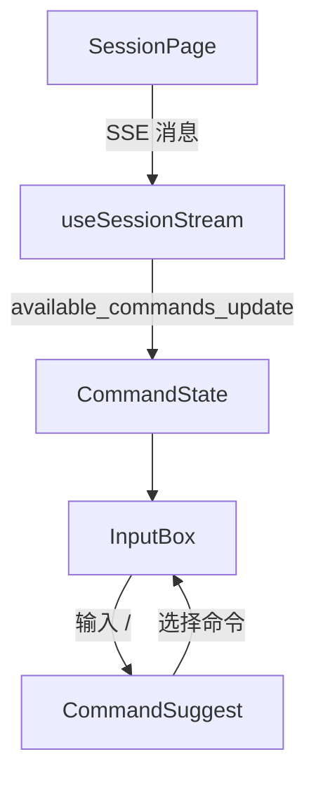
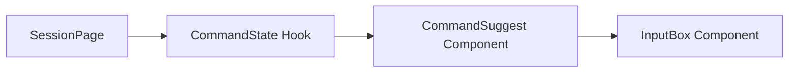
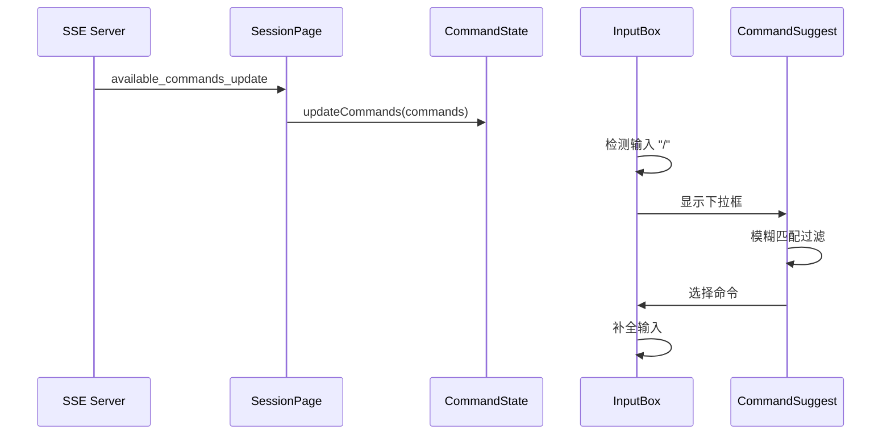

# 命令模式 - 技术提案

**功能名称**: 命令模式（Command Mode）
**关联 PRD**: 20260529-command-mode.md
**技术提案版本**: v1.0
**创建日期**: 2026-05-29
**作者**: opencode
**feat-branch**: `prd/command-mode`

## 1. 概述

### 1.1 背景

产品需求要求在用户输入 `/` 时触发命令检索功能，显示当前可用命令的下拉列表，支持模糊匹配和自动补全。SSE 消息中已存在 `available_commands_update` 事件，需要前端处理并实现 UI 交互。

### 1.2 目标

- 接收并存储可用命令列表
- 实现命令检索触发逻辑
- 实现顺序模糊匹配算法
- 创建命令下拉选择 UI 组件
- 支持键盘导航和鼠标点击选择

### 1.3 范围

- 前端实现，无后端改动
- 复用现有 SSE 消息协议
- 不涉及命令执行逻辑（命令作为文本发送给 agent）

## 2. 技术架构

### 2.1 系统架构图



### 2.2 技术栈

| 层级 | 技术选型 | 说明 |
|------|---------|------|
| 前端 | React + TypeScript | 现有技术栈 |
| 状态管理 | useState | 组件内状态 |
| UI 组件 | Tailwind CSS | 现有样式方案 |

### 2.3 模块划分



| 模块 | 职责 | 关键技术点 |
|------|------|-----------|
| useCommandState | 管理可用命令状态 | SSE 消息处理 |
| CommandSuggest | 命令下拉选择 UI | 定位、模糊匹配 |
| InputBox | 输入框集成 | 触发检测、补全 |

## 3. API 设计

### 3.1 API 契约

无新增 API，复用现有 SSE 消息协议。

### 3.2 内部接口

#### Hook: useCommandState

```typescript
interface Command {
  name: string;
  description?: string;
}

interface UseCommandStateReturn {
  commands: Command[];
  updateCommands: (commands: Command[]) => void;
}
```

#### Component: CommandSuggest

```typescript
interface CommandSuggestProps {
  commands: Command[];
  query: string;
  position: { top: number; left: number };
  onSelect: (command: Command) => void;
  onClose: () => void;
  selectedIndex: number;
  onSelectedIndexChange: (index: number) => void;
}
```

## 4. 数据模型

### 4.1 数据库设计

无数据库改动，命令列表存储在前端内存中。

### 4.2 缓存设计

命令列表随 SSE 消息更新，无需额外缓存。

## 5. 技术实现方案

### 5.1 核心流程



### 5.2 关键实现点

#### 实现点 1: SSE 消息处理

- **描述**: 在 SessionPage 中处理 `available_commands_update` 消息
- **技术细节**: 解析消息内容，提取命令列表，更新状态
- **风险点**: 消息格式变化

#### 实现点 2: 命令检索触发

- **描述**: 检测用户输入，判断是否触发命令检索
- **技术细节**: 
  - 监听输入变化
  - 判断第一个字符是否为 `/`
  - 判断光标前无空格或回车
- **风险点**: 边界条件处理

#### 实现点 3: 顺序模糊匹配

- **描述**: 实现顺序模糊匹配算法
- **技术细节**: 
  - 遍历命令名字符
  - 按顺序匹配输入字符
  - 返回匹配结果
- **风险点**: 性能

#### 实现点 4: 下拉框定位

- **描述**: 计算下拉框显示位置
- **技术细节**: 
  - 获取光标位置
  - 计算相对输入框的偏移
- **风险点**: 边界溢出

## 6. 技术决策

### 6.1 决策列表

| 决策 | 选项 A | 选项 B | 最终选择 | 原因 |
|------|--------|--------|---------|------|
| 状态管理 | useState | useContext | useState | 命令状态仅在 SessionPage 使用 |
| 下拉框定位 | 光标位置 | 输入框底部 | 输入框底部 | 实现简单，兼容性好 |

### 6.2 依赖与约束

| 类型 | 内容 | 说明 |
|------|------|------|
| 依赖 | SSE available_commands_update 消息 | 命令来源 |
| 依赖 | 现有 InputBox 组件 | 集成入口 |

## 7. 项目结构

```
apps/agent-web/src/
├── hooks/
│   └── useCommandState.ts       # 命令状态管理
├── components/
│   └── session/
│       ├── CommandSuggest.tsx    # 命令下拉组件
│       └── InputBox.tsx          # 修改：集成命令触发
```

## 8. 测试策略

### 8.1 测试覆盖要求

- 单元测试覆盖率: >= 80%
- 模糊匹配算法测试覆盖: 100%

### 8.2 测试类型

| 类型 | 工具 | 覆盖范围 |
|------|------|---------|
| 单元测试 | Vitest | 模糊匹配算法 |
| 组件测试 | React Testing Library | CommandSuggest 组件 |
| 集成测试 | React Testing Library | InputBox + CommandSuggest |

## 9. 部署方案

### 9.1 环境规划

| 环境 | 用途 | 部署方式 |
|------|------|---------|
| 开发 | 开发测试 | Aspire |
| 生产 | 正式环境 | Docker |

### 9.2 配置管理

无新增配置项。

## 10. 验收标准

- [ ] 技术方案评审通过
- [ ] 代码实现完成
- [ ] 单元测试覆盖达标
- [ ] 组件测试通过
- [ ] 集成测试通过

## 11. 相关文档

- [关联 PRD](../product/draft/20260529-command-mode.md)
- [前端开发规范](../../docs/engineering/frontend-rules.md)
