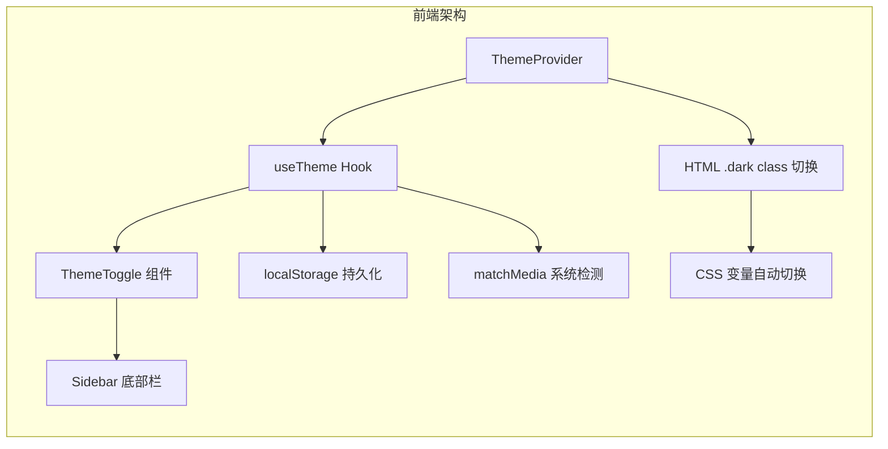
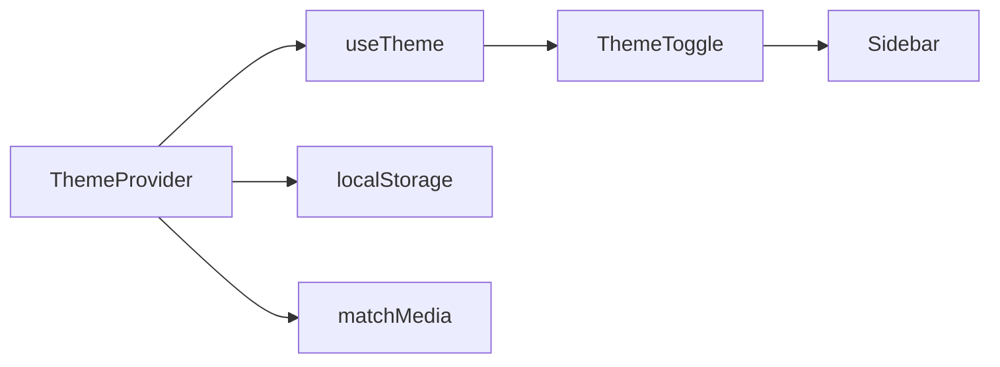
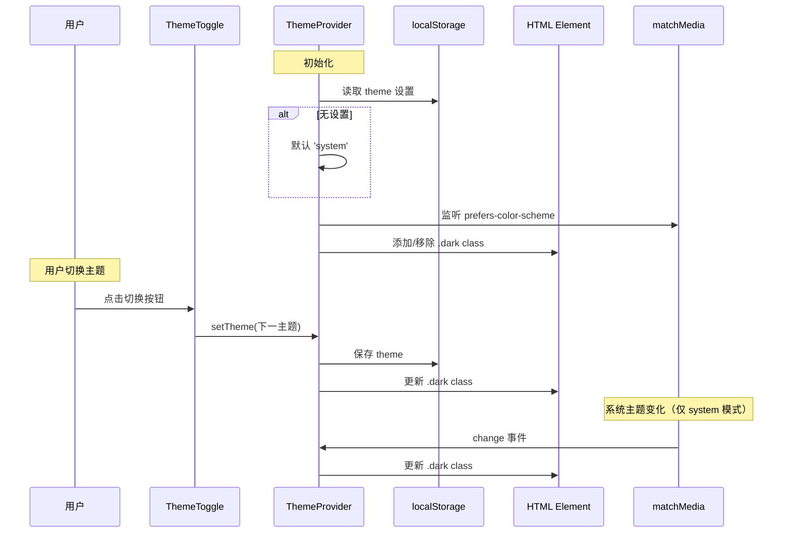

# 黑暗模式 - 技术提案

**功能名称**: 黑暗模式切换
**关联 PRD**: docs/product/draft/prd-dark-mode.md
**技术提案版本**: v1.0
**创建日期**: 2026-05-29
**作者**: Agent
**feat-branch**: `feat/dark-mode`

## 1. 概述

### 1.1 背景

用户需要在不同光照环境下使用系统，当前界面仅支持明亮模式。系统已有 CSS 变量基础（`:root` 和 `.dark` 两套颜色方案），但缺少主题切换机制和用户界面入口。

### 1.2 目标

- 实现黑暗/明亮/跟随系统三种主题模式切换
- 在侧边栏底部设置按钮左侧提供主题切换入口
- 主题设置持久化到 localStorage
- 默认跟随系统主题偏好

### 1.3 范围

- 仅涉及前端 `apps/agent-web`，不涉及后端 API
- 需要将 Sidebar 硬编码颜色迁移到 CSS 变量
- 复用现有 shadcn/ui 组件和 Tailwind CSS 变量系统
- 不引入新的 npm 依赖

## 2. 技术架构

### 2.1 系统架构图



### 2.2 技术栈

| 层级 | 技术选型 | 说明 |
|------|---------|------|
| 框架 | React 19 + TypeScript | 不变 |
| 样式 | Tailwind CSS v4 | 复用 `dark:` variant |
| 状态 | React Context | 主题状态全局共享 |
| 图标 | lucide-react | Moon/Sun 图标 |
| 存储 | localStorage | 主题偏好持久化 |

### 2.3 模块划分



| 模块 | 职责 | 关键技术点 |
|------|------|-----------|
| ThemeProvider | 主题状态管理、系统主题监听 | React Context + matchMedia listener |
| useTheme Hook | 提供主题读取和切换方法 | useContext 封装 |
| ThemeToggle | 主题切换按钮 UI | 三档循环切换 + 图标变化 |
| Sidebar 适配 | 迁移硬编码颜色到 CSS 变量 | bg-gray-900 → bg-sidebar |

## 3. API 设计

本次不涉及新增或修改 API，主题设置完全在前端 localStorage 管理。

## 4. 数据模型

### 4.1 localStorage 设计

| Key | 类型 | 说明 |
|-----|------|------|
| `theme` | `'light' \| 'dark' \| 'system'` | 用户主题偏好，默认 `'system'` |

## 5. 技术实现方案

### 5.1 核心流程



### 5.2 关键实现点

#### 实现点 1: ThemeProvider 实现

- **描述**: 创建全局主题上下文，管理主题状态和系统主题监听
- **技术细节**:
  - 新建 `src/contexts/ThemeContext.tsx`
  - 定义类型 `Theme = 'light' | 'dark' | 'system'`
  - Context 提供 `theme: Theme` 和 `setTheme: (theme: Theme) => void`
  - 初始化时从 localStorage 读取，无则默认 `'system'`
  - 使用 `window.matchMedia('(prefers-color-scheme: dark)')` 监听系统主题
  - 计算实际应用主题：`resolvedTheme = theme === 'system' ? (matches ? 'dark' : 'light') : theme`
  - 通过 `document.documentElement.classList.toggle('dark', resolvedTheme === 'dark')` 切换
- **风险点**: SSR 兼容性（当前项目为纯 SPA，无风险）

#### 实现点 2: useTheme Hook

- **描述**: 封装 ThemeContext 的消费逻辑
- **技术细节**:
  - 新建 `src/hooks/useTheme.ts`
  - 导出 `useTheme()` 返回 `{ theme, setTheme, resolvedTheme }`
  - 添加错误边界：在 Provider 外使用时抛出明确错误
- **风险点**: 无

#### 实现点 3: ThemeToggle 组件

- **描述**: 侧边栏底部的主题切换按钮
- **技术细节**:
  - 新建 `src/components/ThemeToggle.tsx`
  - 使用 lucide-react 的 `Moon`、`Sun`、`Monitor` 图标
  - 三档循环：light → dark → system → light
  - 图标映射：
    - `light` 模式显示 `Moon`（点击切换到 dark）
    - `dark` 模式显示 `Sun`（点击切换到 system）
    - `system` 模式显示 `Monitor`（点击切换到 light）
  - 添加 `title` 属性显示当前模式名称
  - 样式复用设置按钮的 `rounded p-1.5 text-sm transition-colors` 类
- **风险点**: 无

#### 实现点 4: Sidebar 颜色迁移

- **描述**: 将 Sidebar 硬编码颜色迁移到 CSS 变量
- **技术细节**:
  - 当前 Sidebar 使用 `bg-gray-900 text-white` 等硬编码颜色
  - 迁移到 CSS 变量：
    - `bg-gray-900` → `bg-sidebar`
    - `text-white` → `text-sidebar-foreground`
    - `border-gray-700` → `border-sidebar-border`
    - `hover:bg-gray-800` → `hover:bg-sidebar-accent`
    - `text-gray-400` → `text-muted-foreground`
    - `text-gray-300` → `text-sidebar-foreground`
    - `bg-gray-700` → `bg-sidebar-accent`
  - 需要检查所有 Sidebar 内的硬编码颜色并统一迁移
- **风险点**: 需要仔细对比迁移前后的视觉效果

#### 实现点 5: App 入口集成

- **描述**: 在 App 根组件集成 ThemeProvider
- **技术细节**:
  - 修改 `src/App.tsx`，在 `BrowserRouter` 外层包裹 `ThemeProvider`
  - 确保 ThemeProvider 在所有组件之前初始化
- **风险点**: 无

### 5.3 组件变更清单

| 文件 | 操作 | 说明 |
|------|------|------|
| `src/contexts/ThemeContext.tsx` | 新增 | 主题 Context 和 Provider |
| `src/hooks/useTheme.ts` | 新增 | useTheme Hook |
| `src/components/ThemeToggle.tsx` | 新增 | 主题切换按钮组件 |
| `src/components/Sidebar.tsx` | 修改 | 集成 ThemeToggle + 颜色迁移 |
| `src/App.tsx` | 修改 | 包裹 ThemeProvider |
| `src/index.css` | 不变 | CSS 变量已存在 |

## 6. 技术决策

### 6.1 决策列表

| 决策 | 选项 A | 选项 B | 最终选择 | 原因 |
|------|--------|--------|---------|------|
| 主题状态管理 | React Context | Zustand Store | React Context | 主题是全局 UI 状态，Context 更轻量，无需持久化中间件 |
| 系统主题检测 | matchMedia | CSS only | matchMedia | 需要在 JS 层判断当前实际主题，CSS 无法提供此信息 |
| 图标库 | lucide-react | 自定义 SVG | lucide-react | 项目已使用，Moon/Sun/Monitor 图标可用 |
| 切换交互 | 三档循环按钮 | 下拉菜单选择 | 三档循环按钮 | 操作简单，符合 PRD 要求 |

### 6.2 依赖与约束

| 类型 | 内容 | 说明 |
|------|------|------|
| 依赖 | lucide-react | 已安装，提供 Moon/Sun/Monitor 图标 |
| 依赖 | Tailwind CSS dark variant | 已配置 `@custom-variant dark (&:is(.dark *))` |
| 依赖 | CSS 变量 | `:root` 和 `.dark` 已定义完整颜色方案 |
| 约束 | 不引入新 npm 依赖 | 纯前端实现 |
| 约束 | 保持现有 shadcn/ui 组件兼容 | 组件已有 `dark:` variant 类 |

## 7. 项目结构

```
apps/agent-web/src/
├── contexts/
│   └── ThemeContext.tsx        # [新增] 主题 Context + Provider
├── hooks/
│   └── useTheme.ts            # [新增] useTheme Hook
├── components/
│   ├── ThemeToggle.tsx         # [新增] 主题切换按钮
│   ├── Sidebar.tsx             # [修改] 集成 ThemeToggle + 颜色迁移
│   └── ui/                     # 不变
├── App.tsx                     # [修改] 包裹 ThemeProvider
├── index.css                   # 不变（CSS 变量已存在）
└── main.tsx                    # 不变
```

## 8. 测试策略

### 8.1 测试覆盖要求

- 单元测试覆盖率: >= 80%
- 新增组件必须有测试

### 8.2 测试类型

| 类型 | 工具 | 覆盖范围 |
|------|------|---------|
| 单元测试 | Vitest + Testing Library | ThemeProvider 初始化、主题切换、localStorage 持久化、系统主题检测 |
| 单元测试 | Vitest + Testing Library | ThemeToggle 图标渲染、点击切换、三档循环 |
| 集成测试 | Vitest + Testing Library | Sidebar 集成 ThemeToggle、颜色正确应用 |
| E2E 测试 | Playwright | 主题切换完整流程、刷新后保持、系统主题跟随 |

## 9. 部署方案

前端无独立部署变更，随下次 agent-web 部署一起发布。

## 10. 验收标准

- [ ] 技术方案评审通过
- [ ] 侧边栏底部设置按钮左侧显示主题切换图标
- [ ] 点击图标在三种模式间循环切换
- [ ] 图标随主题变化：明亮→🌙、黑暗→☀️、跟随系统→🖥️
- [ ] 主题切换后界面立即生效
- [ ] 主题设置持久化到 localStorage
- [ ] 默认跟随系统主题
- [ ] 系统主题变化时自动切换（跟随系统模式）
- [ ] Sidebar 使用 CSS 变量，正确响应主题切换
- [ ] 现有测试全部通过
- [ ] 新增测试覆盖核心逻辑

## 11. 相关文档

- [PRD 黑暗模式](../../product/draft/prd-dark-mode.md)
- [Frontend Rules](../frontend-rules.md)
- [Common Rules](../common-rules.md)
- [CSS 变量定义](../../../apps/agent-web/src/index.css)
