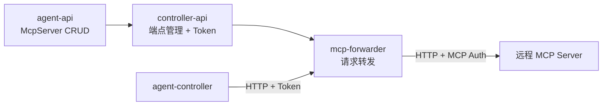
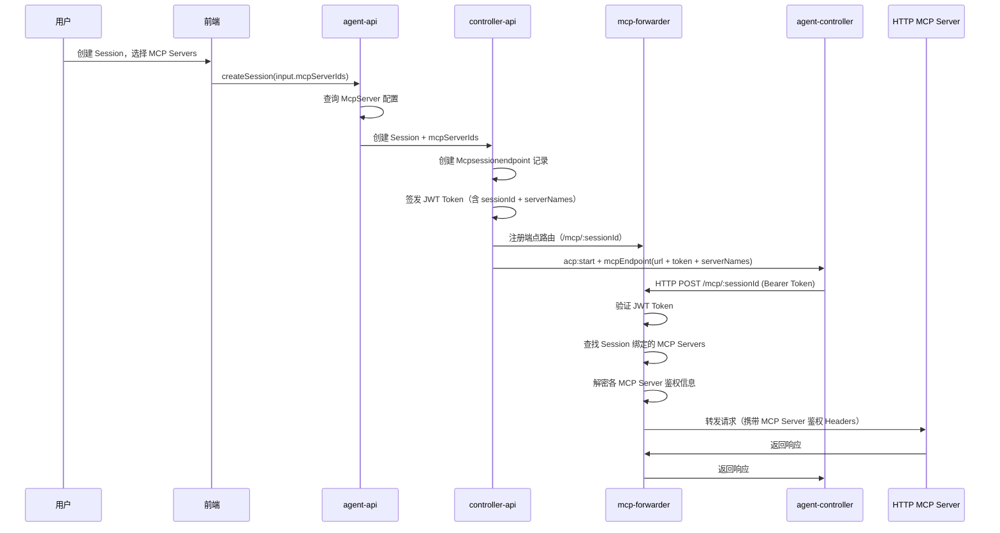
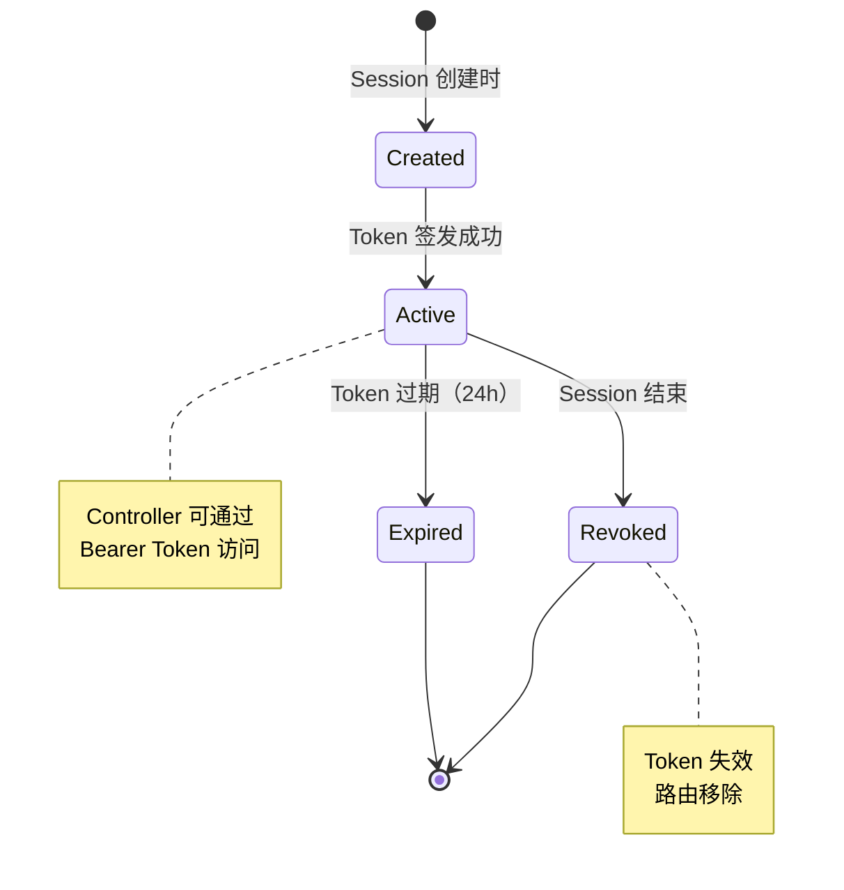

# MCP 代理服务管理与配置下发 - 技术提案

**功能名称**: MCP 代理服务与配置下发
**关联 PRD**: `docs/product/draft/20260530-mcp-proxy-config.md`
**技术提案版本**: v2.0
**创建日期**: 2026-05-30
**作者**: ZeroAsh
**feat-branch**: `feat/mcp-proxy-config`

## 1. 概述

### 1.1 背景

ACP 协议支持在 `acp:start` 时传递 `mcpServers` 参数，当前该字段为预留状态（仅支持 stdio 结构）。PRD 要求：

1. 用户可在平台管理 HTTP 类型的 MCP Server 配置（含鉴权）
2. 创建 Session 时可选择 MCP Servers
3. 通过服务端转发服务，将用户选择的 MCP Servers 聚合为单一端点下发给 Controller

**核心设计原则**：用户的 MCP Server 配置（含鉴权信息）不下发到 Controller，而是由服务端转发服务统一管理。Controller 仅访问服务端提供的转发端点。

### 1.2 目标

- 新增 `McpServer` Mongoose Model，支持 HTTP 传输和加密鉴权存储
- 新增 GraphQL Schema/Resolver 实现 MCP Server CRUD
- 新增 `McpSessionEndpoint` 模型，为每个 Session 创建独立的转发端点
- 实现 MCP 转发服务（mcp-forwarder），聚合多个 MCP Server 为单一 HTTP 端点
- 转发端点自身需要鉴权，Controller 通过 Token 访问
- 更新 Session 创建流程，集成 MCP Server 选择

### 1.3 范围

- **包含**：agent-api（GraphQL CRUD + 加密存储）、controller-api（转发端点管理 + 鉴权 Token 下发）、mcp-forwarder 转发服务、contracts（GraphQL + WebSocket 契约更新）、前端（MCP Server 管理 UI + Session 创建选择）
- **不包含**：MCP Server 的 OAuth 交互式认证流程、MCP Server 市场/推荐

## 2. 技术架构

### 2.1 系统架构图

```mermaid
graph TD
    subgraph "前端 (agent-web)"
        UI_MCP[MCP Server 管理页]
        UI_SESSION[Session 创建页]
    end

    subgraph "agent-api (GraphQL)"
        RES[McpServer Resolver]
        SVC[McpServer Service]
        ENC[Encryption Service]
        MOD[(MongoDB McpServer)]
    end

    subgraph "controller-api (Socket.IO + HTTP)"
        CAPI[Session Service]
        EP[MCP Endpoint Manager]
        AUTH[Endpoint Auth Service]
    end

    subgraph "mcp-forwarder (HTTP)"
        FWD[MCP Forwarder Service]
        ROUTE[/mcp/:sessionId/*]
    end

    subgraph "agent-controller (Daemon)"
        SIO[Socket.IO Client]
        HTTP[HTTP Client]
    end

    subgraph "外部"
        MCP1[HTTP MCP Server A]
        MCP2[HTTP MCP Server B]
        MCP3[HTTP MCP Server C]
    end

    UI_MCP -->|CRUD| RES
    UI_SESSION -->|选择 MCP Servers| RES
    RES --> SVC
    SVC --> ENC
    SVC --> MOD

    CAPI -->|创建 Session| EP
    EP -->|生成转发端点 + Token| AUTH
    EP -->|注册端点路由| FWD
    CAPI -->|下发 endpoint URL + token| SIO

    SIO -->|acp:start| HTTP
    HTTP -->|HTTP + Bearer Token| ROUTE
    ROUTE --> FWD
    FWD -->|转发到对应 MCP Server| MCP1
    FWD -->|转发| MCP2
    FWD -->|转发| MCP3
```

### 2.2 核心概念

**转发端点（Session Endpoint）**：
- 每个 Session 创建时，为其选中的 MCP Servers 生成一个独立的 HTTP 端点
- 端点格式：`/mcp/:sessionId`
- 该端点聚合了该 Session 选择的所有 MCP Server
- Controller 通过此单一端点访问所有 MCP 功能

**端点鉴权**：
- 每个端点生成独立的 Bearer Token
- Token 与 Session 绑定，Session 结束后 Token 失效
- Controller 请求时携带 `Authorization: Bearer <token>`

**转发逻辑**：
- mcp-forwarder 收到请求后，根据 sessionId 查找对应的 MCP Server 列表
- 解密各 MCP Server 的鉴权信息
- 将请求转发到目标 MCP Server（携带对应的鉴权 Headers）
- 返回响应给 Controller

### 2.3 技术栈

| 层级 | 技术选型 | 说明 |
|------|---------|------|
| 前端 | React + TypeScript | MCP Server 管理 UI |
| agent-api | GraphQL-Yoga + Mongoose | MCP Server CRUD + 加密存储 |
| controller-api | Socket.IO + Express | 转发端点管理、Token 签发 |
| mcp-forwarder | Express | MCP 请求转发服务 |
| agent-controller | Node.js | HTTP 客户端连接转发端点 |
| 加密 | Node.js crypto (AES-256-GCM) | 鉴权信息加密存储 |
| Token | JWT | 端点访问鉴权 |

### 2.4 模块划分



| 模块 | 职责 | 关键技术点 |
|------|------|-----------|
| agent-api | MCP Server CRUD、加密存储、GraphQL API | AES-256-GCM 加密、Mongoose Model |
| controller-api | Session 端点管理、Token 签发与验证、端点注册 | JWT 签发、端点生命周期管理 |
| mcp-forwarder | 接收 Controller 请求、解密鉴权、转发到 MCP Server | 动态路由、鉴权注入、请求转发 |
| agent-controller | 通过 HTTP 连接转发端点 | HTTP Client、Bearer Token 注入 |

## 3. API 设计

### 3.1 GraphQL Schema（agent-api）

```graphql
enum McpServerTransport {
  http
}

enum McpServerAuthType {
  none
  api_key
  bearer_token
  custom_headers
}

enum McpServerStatus {
  active
  disabled
}

type McpServer {
  id: ID!
  name: String!
  url: String!
  transport: McpServerTransport!
  authType: McpServerAuthType!
  status: McpServerStatus!
  createdAt: String!
  updatedAt: String!
}

type McpServerDetail {
  id: ID!
  name: String!
  url: String!
  transport: McpServerTransport!
  authType: McpServerAuthType!
  authConfig: JSON
  status: McpServerStatus!
  createdAt: String!
  updatedAt: String!
}

input CreateMcpServerInput {
  name: String!
  url: String!
  authType: McpServerAuthType! = none
  authConfig: JSON
}

input UpdateMcpServerInput {
  id: ID!
  name: String
  url: String
  authType: McpServerAuthType
  authConfig: JSON
  status: McpServerStatus
}

type Query {
  mcpServers: [McpServer!]!
  mcpServer(id: ID!): McpServerDetail
}

type Mutation {
  createMcpServer(input: CreateMcpServerInput!): McpServer!
  updateMcpServer(input: UpdateMcpServerInput!): McpServer!
  deleteMcpServer(id: ID!): Boolean!
  toggleMcpServer(id: ID!): McpServer!
}
```

**authConfig JSON 结构：**

| authType | authConfig 结构 |
|----------|----------------|
| `none` | `null` |
| `api_key` | `{ "keyName": "X-API-Key", "keyValue": "sk-xxx" }` |
| `bearer_token` | `{ "token": "eyJhbG..." }` |
| `custom_headers` | `{ "headers": [{ "name": "Authorization", "value": "Basic xxx" }] }` |

### 3.2 REST API（mcp-forwarder）

#### 3.2.1 MCP 转发端点

```
POST /mcp/:sessionId
Authorization: Bearer <session-endpoint-token>
Content-Type: application/json
```

**行为：**
1. 验证 Bearer Token（JWT），确认 sessionId 匹配且 Session 有效
2. 查找该 Session 绑定的 MCP Server 列表
3. 解密各 MCP Server 的鉴权信息
4. 根据请求中的 MCP 方法和目标 Server，转发到对应的 HTTP MCP Server
5. 返回响应

**请求 Body：** 标准 JSON-RPC 格式

```json
{
  "jsonrpc": "2.0",
  "id": 1,
  "method": "tools/call",
  "params": {
    "serverName": "github",
    "name": "create_pr",
    "arguments": { ... }
  }
}
```

**特殊处理：**
- `serverName` 字段用于指定转发到哪个 MCP Server
- 如果未指定 `serverName`，默认转发到第一个 MCP Server
- `tools/list` 方法返回所有 MCP Server 的工具聚合列表

### 3.3 WebSocket 契约更新（controller-api ↔ agent-controller）

#### 3.3.1 `acp:check:result` 扩展

在 `AcpServerInfo` 中新增 `mcpCapabilities` 字段：

| 字段 | 类型 | 必填 | 说明 |
|------|------|------|------|
| `mcpCapabilities` | `McpCapabilities` | 否 | MCP 传输能力 |

**McpCapabilities 结构：**

| 字段 | 类型 | 必填 | 说明 |
|------|------|------|------|
| `http` | `boolean` | 是 | 是否支持 HTTP MCP |
| `sse` | `boolean` | 否 | 是否支持 SSE MCP |

#### 3.3.2 `acp:start` 扩展

新增 `mcpEndpoint` 字段：

| 字段 | 类型 | 必填 | 说明 |
|------|------|------|------|
| `mcpEndpoint` | `McpEndpoint` | 否 | MCP 转发端点信息 |

**McpEndpoint 结构：**

| 字段 | 类型 | 必填 | 说明 |
|------|------|------|------|
| `url` | `string` | 是 | 转发端点 URL（如 `https://api.example.com/mcp/:sessionId`） |
| `token` | `string` | 是 | Bearer Token（用于访问转发端点） |
| `serverNames` | `string[]` | 是 | 该端点聚合的 MCP Server 名称列表 |

#### 3.3.3 新增 `mcp:endpoint:revoke` 事件

| 方向 | 事件名 | 说明 |
|------|--------|------|
| Server → Controller | `mcp:endpoint:revoke` | 撤销端点 Token（Session 结束时） |

**Payload：**

| 字段 | 类型 | 必填 | 说明 |
|------|------|------|------|
| `sessionId` | `string` | 是 | 关联的 Session ID |

## 4. 数据模型

### 4.1 MongoDB Collection: `mcpservers`

| 字段 | 类型 | 说明 |
|------|------|------|
| `_id` | ObjectId | 主键 |
| `userId` | ObjectId | 所属用户 |
| `name` | String | MCP Server 名称 |
| `url` | String | HTTP URL |
| `transport` | String | 传输类型，固定 `http` |
| `authType` | String | 认证类型：`none` / `api_key` / `bearer_token` / `custom_headers` |
| `authConfig` | String | AES-256-GCM 加密后的认证配置 JSON |
| `authConfigIv` | String | 加密 IV（初始化向量） |
| `authConfigTag` | String | GCM 认证标签 |
| `status` | String | 状态：`active` / `disabled` |
| `createdAt` | Date | 创建时间 |
| `updatedAt` | Date | 更新时间 |

**索引：**
- `{ userId: 1, name: 1 }` — 唯一索引，同一用户下名称不可重复
- `{ userId: 1, status: 1 }` — 查询优化

### 4.2 MongoDB Collection: `mcpsessionendpoints`

| 字段 | 类型 | 说明 |
|------|------|------|
| `_id` | ObjectId | 主键 |
| `sessionId` | ObjectId | 关联的 Session |
| `userId` | ObjectId | 所属用户 |
| `mcpServerIds` | [ObjectId] | 绑定的 MCP Server ID 列表 |
| `tokenHash` | String | Token 的 bcrypt hash（用于验证） |
| `status` | String | 状态：`active` / `revoked` |
| `expiresAt` | Date | Token 过期时间 |
| `createdAt` | Date | 创建时间 |

**索引：**
- `{ sessionId: 1 }` — 唯一索引
- `{ status: 1, expiresAt: 1 }` — TTL 索引，自动清理过期记录

### 4.3 加密方案

```
密钥来源: 环境变量 MCP_SERVER_ENCRYPTION_KEY (32 bytes hex)
算法: AES-256-GCM
IV: 每次加密随机生成 16 bytes
存储: authConfig (密文) + authConfigIv (IV) + authConfigTag (GCM Tag)
```

### 4.4 Token 方案

```
密钥来源: 环境变量 MCP_ENDPOINT_JWT_SECRET
算法: HS256
Payload: { sessionId, userId, serverNames, exp }
有效期: Session 生命周期（默认 24 小时）
存储: 仅存储 tokenHash (bcrypt)，用于服务端验证
```

## 5. 技术实现方案

### 5.1 核心流程：Session 创建时 MCP 端点创建与下发



### 5.2 关键实现点

#### 实现点 1: McpServer Service（agent-api）

- **描述**: 实现 MCP Server CRUD 业务逻辑，包含加密/解密鉴权信息
- **技术细节**:
  - `createMcpServer`: 加密 authConfig 后存储
  - `getMcpServersByIds`: 批量查询并解密，返回用于转发的格式
  - 加密使用 Node.js `crypto.createCipheriv('aes-256-gcm', key, iv)`
- **风险点**: 密钥管理，需确保 MCP_SERVER_ENCRYPTION_KEY 环境变量安全

#### 实现点 2: MCP Endpoint Manager（controller-api）

- **描述**: 管理 Session 级别的 MCP 转发端点生命周期
- **技术细节**:
  - `createEndpoint(sessionId, userId, mcpServerIds)`: 创建端点记录 + 签发 JWT + 注册路由
  - `revokeEndpoint(sessionId)`: 撤销 Token + 标记端点为 revoked
  - JWT Payload: `{ sessionId, userId, serverNames, exp }`
  - Token Hash: 使用 bcrypt 存储 tokenHash，用于服务端验证
- **风险点**: 需确保 Session 结束时端点被正确撤销

#### 实现点 3: MCP Forwarder Service（mcp-forwarder）

- **描述**: 独立的 HTTP 服务，负责接收 Controller 请求并转发到目标 MCP Server
- **技术细节**:
  - 路由：`POST /mcp/:sessionId`
  - 中间件：验证 JWT Token、检查 Session 有效性
  - 转发逻辑：
    1. 从 JWT 获取 serverNames
    2. 从数据库查询对应 MCP Server 配置
    3. 解密鉴权信息
    4. 根据请求中的 serverName 选择目标
    5. 转发请求（携带目标 MCP Server 的鉴权 Headers）
  - `tools/list` 聚合：返回所有绑定 MCP Server 的工具列表
- **风险点**: 需处理 MCP Server 不可达、鉴权失败等异常

#### 实现点 4: agent-controller HTTP Client

- **描述**: agent-controller 在 `acp:start` 时接收 mcpEndpoint 信息，使用 HTTP 连接转发端点
- **技术细节**:
  - 收到 `acp:start` 中的 `mcpEndpoint` 后，保存 `url` 和 `token`
  - Agent 通过 HTTP 请求转发端点，Header 携带 `Authorization: Bearer <token>`
  - 收到 `mcp:endpoint:revoke` 时，清除本地端点信息
- **风险点**: 需处理 Token 过期、网络超时等情况

### 5.3 mcp-forwarder 服务结构

```
servers/mcp-forwarder/
├── src/
│   ├── index.ts              # 入口：Express 服务
│   ├── routes/
│   │   └── mcp.ts            # /mcp/:sessionId 路由
│   ├── middleware/
│   │   └── auth.ts           # JWT 验证中间件
│   ├── services/
│   │   ├── endpoint.ts       # 端点查询服务
│   │   ├── decrypt.ts        # 鉴权信息解密
│   │   └── forwarder.ts      # 请求转发逻辑
│   └── config/
│       └── index.ts          # 配置（JWT Secret、加密 Key）
├── package.json
└── tsconfig.json
```

### 5.4 转发端点生命周期



## 6. 技术决策

### 6.1 决策列表

| 决策 | 选项 A | 选项 B | 最终选择 | 原因 |
|------|--------|--------|---------|------|
| MCP 转发位置 | Controller 端 mcp-proxy | 服务端 mcp-forwarder | 服务端 mcp-forwarder | 鉴权信息不下发到 Controller，安全性更高 |
| 端点粒度 | 全局共享端点 | 每 Session 独立端点 | 每 Session 独立端点 | 隔离性好，便于权限控制和生命周期管理 |
| 端点鉴权方式 | API Key | JWT Bearer Token | JWT Bearer Token | 自包含、无状态、可携带元数据 |
| Token 存储 | 明文存储 | bcrypt hash 存储 | bcrypt hash 存储 | 即使数据库泄露也无法还原 Token |
| MCP Server 鉴权信息存储 | 明文 | AES-256-GCM | AES-256-GCM | GCM 提供完整性校验，更安全 |
| 转发服务部署 | 独立服务 | 集成到 controller-api | 独立服务 | 关注点分离，可独立扩展 |

### 6.2 依赖与约束

| 类型 | 内容 | 说明 |
|------|------|------|
| 依赖 | ACP 协议 v1 | `acp:start` 的 `mcpEndpoint` 参数 |
| 依赖 | JWT 库 | `jsonwebtoken` 用于 Token 签发和验证 |
| 依赖 | bcrypt | 用于 Token Hash 存储 |
| 约束 | MCP_SERVER_ENCRYPTION_KEY | 必须在环境变量中配置 32 bytes hex 密钥 |
| 约束 | MCP_ENDPOINT_JWT_SECRET | 必须在环境变量中配置 JWT 签名密钥 |
| 约束 | mcp-forwarder 可用性 | 转发服务必须对 Controller 可达 |

## 7. 项目结构

```
z-agent-gear/
├── contracts/
│   ├── mcp-server.graphql          # 新增：MCP Server GraphQL Schema
│   └── agent-session-websocket.md  # 更新：新增 mcpEndpoint 字段
├── servers/
│   ├── agent-api/
│   │   └── src/
│   │       ├── graphql/
│   │       │   ├── schemas/mcp-server.ts   # 新增
│   │       │   └── resolvers/mcp-server.ts # 新增
│   │       ├── models/mcp-server.ts        # 新增
│   │       └── services/mcp-server.ts      # 新增
│   ├── controller-api/
│   │   └── src/
│   │       └── services/
│   │           ├── mcp-endpoint.ts         # 新增：端点管理
│   │           └── session.ts              # 更新：集成端点创建
│   └── mcp-forwarder/                      # 新增：MCP 转发服务
│       ├── src/
│       │   ├── index.ts
│       │   ├── routes/mcp.ts
│       │   ├── middleware/auth.ts
│       │   └── services/
│       │       ├── endpoint.ts
│       │       ├── decrypt.ts
│       │       └── forwarder.ts
│       ├── Dockerfile
│       ├── package.json
│       └── tsconfig.json
└── apps/
    └── agent-web/
        └── src/
            └── pages/settings/
                └── mcp-servers/            # 新增：MCP Server 管理页
```

## 8. 测试策略

### 8.1 测试覆盖要求

- 单元测试覆盖率: >= 80%
- API 测试覆盖的端点: MCP Server CRUD + 转发端点访问

### 8.2 测试类型

| 类型 | 工具 | 覆盖范围 |
|------|------|---------|
| 单元测试 | Vitest | McpServer Service（CRUD + 加密解密）、Endpoint Manager（Token 签发/验证）、Forwarder（转发逻辑） |
| API 测试 | Vitest + GraphQL | MCP Server CRUD 全流程、Session 创建时端点创建 |
| E2E 测试 | Playwright | MCP Server 管理 UI、Session 创建选择 MCP Server |

### 8.3 关键测试场景

| 场景 | 预期结果 |
|------|---------|
| 创建 MCP Server（无认证） | 成功存储，authConfig 为空 |
| 创建 MCP Server（各种认证类型） | authConfig 加密存储，查询时解密返回 |
| 同名 MCP Server 创建 | 返回错误，名称冲突 |
| Session 创建 + 选择 MCP Servers | 创建端点记录、签发 Token、注册路由 |
| Controller 访问转发端点（有效 Token） | 请求成功转发到目标 MCP Server |
| Controller 访问转发端点（无效 Token） | 返回 401 |
| Controller 访问转发端点（过期 Token） | 返回 401 |
| Session 结束 | Token 撤销、端点标记为 revoked |
| MCP Server 鉴权失败 | 返回错误，Session 仍可用 |
| 多 MCP Server 聚合请求 | 正确路由到对应 MCP Server |

## 9. 部署方案

### 9.1 环境规划

| 环境 | 用途 | 部署方式 |
|------|------|---------|
| 开发 | 本地开发测试 | Aspire 编排 |
| 生产 | 线上服务 | Docker Compose |

### 9.2 配置管理

| 配置项 | 说明 | 必填 |
|--------|------|------|
| `MCP_SERVER_ENCRYPTION_KEY` | AES-256-GCM 加密密钥（32 bytes hex） | 是 |
| `MCP_ENDPOINT_JWT_SECRET` | JWT 签名密钥 | 是 |
| `MCP_FORWARDER_PORT` | 转发服务端口 | 否，默认 3002 |
| `MCP_FORWARDER_URL` | 转发服务外部 URL（Controller 可达） | 是 |

### 9.3 Aspire 编排

```yaml
# 需新增 mcp-forwarder 服务
services:
  mcp-forwarder:
    build: ./servers/mcp-forwarder
    ports:
      - "3002:3002"
    environment:
      - MCP_SERVER_ENCRYPTION_KEY
      - MCP_ENDPOINT_JWT_SECRET
      - MONGODB_CONNECTION_STRING
```

## 10. 验收标准

- [ ] 技术方案评审通过
- [ ] Contract（GraphQL + WebSocket）评审通过
- [ ] MCP Server CRUD 功能完成
- [ ] 鉴权信息加密存储/解密读取正常
- [ ] Session 创建时端点创建 + Token 签发正常
- [ ] Controller 通过 Token 访问转发端点正常
- [ ] 转发请求携带 MCP Server 鉴权 Headers 正常
- [ ] Session 结束时 Token 撤销正常
- [ ] 多 MCP Server 聚合路由正常
- [ ] 单元测试覆盖达标
- [ ] API 测试通过
- [ ] E2E 测试通过

## 11. 相关文档

- [PRD: MCP 代理服务管理与配置下发](docs/product/draft/20260530-mcp-proxy-config.md)
- [Contract: agent-session.graphql](contracts/agent-session.graphql)
- [Contract: agent-session-websocket.md](contracts/agent-session-websocket.md)
- [Proposal: 多 ACP Server 支持](docs/engineering/proposals/20260526-feat-multi-acp-server-support.md)
- [ACP 协议: Session Setup - MCP Servers](https://agentclientprotocol.com/protocol/session-setup#mcp-servers)
