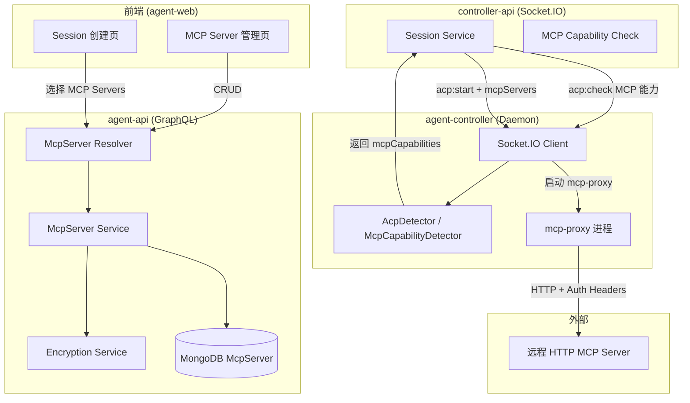
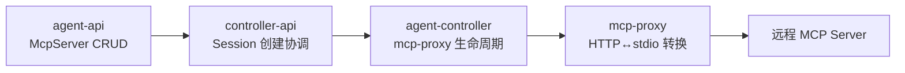
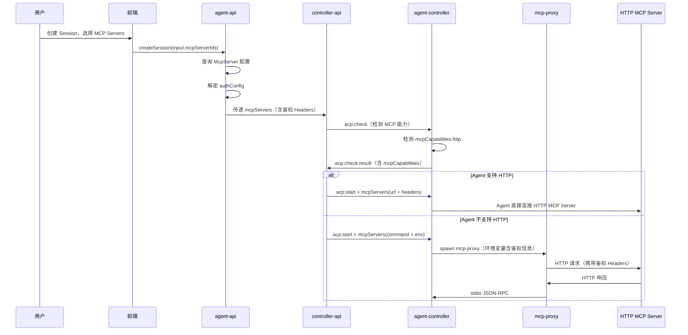

# MCP 代理服务管理与配置下发 - 技术提案

**功能名称**: MCP 代理服务与配置下发
**关联 PRD**: `docs/product/draft/20260530-mcp-proxy-config.md`
**技术提案版本**: v1.0
**创建日期**: 2026-05-30
**作者**: ZeroAsh
**feat-branch**: `feat/mcp-proxy-config`

## 1. 概述

### 1.1 背景

ACP 协议支持在 `acp:start` 时传递 `mcpServers` 参数，当前该字段为预留状态（仅支持 stdio 结构）。PRD 要求：

1. 用户可在平台管理 HTTP 类型的 MCP Server 配置（含鉴权）
2. 创建 Session 时可选择 MCP Servers
3. Agent 支持 HTTP 时直接下发；不支持时通过 mcp-proxy 代理转 stdio

### 1.2 目标

- 新增 `McpServer` Mongoose Model，支持 HTTP 传输和加密鉴权存储
- 新增 GraphQL Schema/Resolver 实现 MCP Server CRUD
- 更新 `McpServerConfig` 契约，支持 HTTP + 鉴权 Headers 传递
- 实现 mcp-proxy 代理程序，HTTP 转 stdio
- 更新 Session 创建流程，集成 MCP Server 选择和能力检测

### 1.3 范围

- **包含**：agent-api（GraphQL CRUD + 加密存储）、controller-api（MCP 能力检测 + mcp-proxy 生命周期管理）、agent-controller（mcp-proxy 进程管理）、contracts（GraphQL + WebSocket 契约更新）、前端（MCP Server 管理 UI + Session 创建选择）
- **不包含**：MCP Server 的 OAuth 交互式认证流程、MCP Server 市场/推荐

## 2. 技术架构

### 2.1 系统架构图



### 2.2 技术栈

| 层级 | 技术选型 | 说明 |
|------|---------|------|
| 前端 | React + TypeScript | MCP Server 管理 UI |
| agent-api | GraphQL-Yoga + Mongoose | MCP Server CRUD + 加密存储 |
| controller-api | Socket.IO | MCP 能力检测协调 |
| agent-controller | Node.js child_process | mcp-proxy 进程管理 |
| mcp-proxy | Node.js (ESM) | HTTP ↔ stdio MCP 协议转换 |
| 加密 | Node.js crypto (AES-256-GCM) | 鉴权信息加密存储 |

### 2.3 模块划分



| 模块 | 职责 | 关键技术点 |
|------|------|-----------|
| agent-api | MCP Server CRUD、加密存储、GraphQL API | AES-256-GCM 加密、Mongoose Model |
| controller-api | Session 创建时协调 MCP 能力检测和下发 | Socket.IO 事件编排 |
| agent-controller | 启动/管理 mcp-proxy 进程 | child_process.spawn、环境变量注入 |
| mcp-proxy | HTTP ↔ stdio MCP 协议转换 | JSON-RPC stdio、HTTP fetch、Header 注入 |

## 3. API 设计

### 3.1 GraphQL Schema（agent-api）

```graphql
enum McpServerTransport {
  http
}

enum McpServerAuthType {
  none
  api_key
  bearer_token
  custom_headers
}

enum McpServerStatus {
  active
  disabled
}

type McpServer {
  id: ID!
  name: String!
  url: String!
  transport: McpServerTransport!
  authType: McpServerAuthType!
  status: McpServerStatus!
  createdAt: String!
  updatedAt: String!
}

type McpServerDetail {
  id: ID!
  name: String!
  url: String!
  transport: McpServerTransport!
  authType: McpServerAuthType!
  authConfig: JSON
  status: McpServerStatus!
  createdAt: String!
  updatedAt: String!
}

input CreateMcpServerInput {
  name: String!
  url: String!
  authType: McpServerAuthType! = none
  authConfig: JSON
}

input UpdateMcpServerInput {
  id: ID!
  name: String
  url: String
  authType: McpServerAuthType
  authConfig: JSON
  status: McpServerStatus
}

type Query {
  mcpServers: [McpServer!]!
  mcpServer(id: ID!): McpServerDetail
}

type Mutation {
  createMcpServer(input: CreateMcpServerInput!): McpServer!
  updateMcpServer(input: UpdateMcpServerInput!): McpServer!
  deleteMcpServer(id: ID!): Boolean!
  toggleMcpServer(id: ID!): McpServer!
}
```

**authConfig JSON 结构：**

| authType | authConfig 结构 |
|----------|----------------|
| `none` | `null` |
| `api_key` | `{ "keyName": "X-API-Key", "keyValue": "sk-xxx" }` |
| `bearer_token` | `{ "token": "eyJhbG..." }` |
| `custom_headers` | `{ "headers": [{ "name": "Authorization", "value": "Basic xxx" }] }` |

### 3.2 WebSocket 契约更新（controller-api ↔ agent-controller）

#### 3.2.1 `acp:check:result` 扩展

在 `AcpServerInfo` 中新增 `mcpCapabilities` 字段：

| 字段 | 类型 | 必填 | 说明 |
|------|------|------|------|
| `mcpCapabilities` | `McpCapabilities` | 否 | MCP 传输能力 |

**McpCapabilities 结构：**

| 字段 | 类型 | 必填 | 说明 |
|------|------|------|------|
| `http` | `boolean` | 是 | 是否支持 HTTP MCP |
| `sse` | `boolean` | 否 | 是否支持 SSE MCP |

#### 3.2.2 `acp:start` 扩展

更新 `McpServerConfig` 结构：

| 字段 | 类型 | 必填 | 说明 |
|------|------|------|------|
| `name` | `string` | 是 | Server 名称 |
| `url` | `string` | 否 | HTTP URL（HTTP 传输时必填） |
| `command` | `string` | 否 | 启动命令（stdio 传输时必填，即 mcp-proxy 路径） |
| `args` | `string[]` | 否 | 命令参数 |
| `env` | `Record<string, string>` | 否 | 环境变量（含鉴权信息） |

#### 3.2.3 新增 `mcp-proxy:stop` 事件

| 方向 | 事件名 | 说明 |
|------|--------|------|
| Server → Controller | `mcp-proxy:stop` | 请求停止 mcp-proxy 实例 |

**Payload：**

| 字段 | 类型 | 必填 | 说明 |
|------|------|------|------|
| `sessionId` | `string` | 是 | 关联的 Session ID |

## 4. 数据模型

### 4.1 MongoDB Collection: `mcpservers`

| 字段 | 类型 | 说明 |
|------|------|------|
| `_id` | ObjectId | 主键 |
| `userId` | ObjectId | 所属用户 |
| `name` | String | MCP Server 名称 |
| `url` | String | HTTP URL |
| `transport` | String | 传输类型，固定 `http` |
| `authType` | String | 认证类型：`none` / `api_key` / `bearer_token` / `custom_headers` |
| `authConfig` | String | AES-256-GCM 加密后的认证配置 JSON |
| `authConfigIv` | String | 加密 IV（初始化向量） |
| `authConfigTag` | String | GCM 认证标签 |
| `status` | String | 状态：`active` / `disabled` |
| `createdAt` | Date | 创建时间 |
| `updatedAt` | Date | 更新时间 |

**索引：**
- `{ userId: 1, name: 1 }` — 唯一索引，同一用户下名称不可重复
- `{ userId: 1, status: 1 }` — 查询优化

### 4.2 加密方案

```
密钥来源: 环境变量 MCP_SERVER_ENCRYPTION_KEY (32 bytes hex)
算法: AES-256-GCM
IV: 每次加密随机生成 16 bytes
存储: authConfig (密文) + authConfigIv (IV) + authConfigTag (GCM Tag)
```

## 5. 技术实现方案

### 5.1 核心流程：Session 创建时 MCP Server 下发



### 5.2 关键实现点

#### 实现点 1: McpServer Service（agent-api）

- **描述**: 实现 MCP Server CRUD 业务逻辑，包含加密/解密鉴权信息
- **技术细节**:
  - `createMcpServer`: 加密 authConfig 后存储
  - `getMcpServersForSession`: 批量查询并解密，返回用于下发的格式
  - 加密使用 Node.js `crypto.createCipheriv('aes-256-gcm', key, iv)`
- **风险点**: 密钥管理，需确保 MCP_SERVER_ENCRYPTION_KEY 环境变量安全

#### 实现点 2: McpCapabilityDetector（agent-controller）

- **描述**: 检测 Agent 的 MCP 传输能力
- **技术细节**:
  - 在 `acp:check` 时检测 `opencode` 是否支持 HTTP MCP
  - 检测方式：检查 opencode 版本 >= 某个支持 HTTP MCP 的版本阈值
  - 缓存检测结果 1 小时
- **风险点**: 版本检测逻辑需与 opencode 版本同步更新

#### 实现点 3: mcp-proxy 代理程序

- **描述**: 独立的 Node.js 程程，实现 HTTP ↔ stdio MCP 协议转换
- **技术细节**:
  - 入口：`packages/mcp-proxy/src/index.ts`
  - 通过环境变量接收配置：`MCP_PROXY_URL`（目标 HTTP URL）、`MCP_PROXY_HEADERS`（JSON 格式鉴权 Headers）
  - stdio 读取 JSON-RPC 请求 → HTTP POST 到目标 URL → 将 HTTP 响应写回 stdio
  - 使用 `readline` 接口逐行读取 stdio JSON-RPC
- **风险点**: 需处理 HTTP 超时、连接错误等异常情况

#### 实现点 4: agent-controller 进程管理

- **描述**: agent-controller 在收到 `acp:start` 且 mcpServers 包含 proxy 类型时，spawn mcp-proxy 进程
- **技术细节**:
  - 使用 `child_process.spawn` 启动 mcp-proxy
  - 通过环境变量传递 URL 和 Headers
  - 将 mcp-proxy 的 stdio 连接到 ACP Session 的 stdio
  - Session 结束时 kill mcp-proxy 进程
- **风险点**: 进程清理需确保异常退出时也能 kill

### 5.3 mcp-proxy 程序结构

```
packages/mcp-proxy/
├── src/
│   └── index.ts          # 入口：stdio ↔ HTTP 转换
├── package.json
└── tsconfig.json
```

**核心逻辑：**

```typescript
// 伪代码
process.stdin.setEncoding('utf-8');
const rl = readline.createInterface({ input: process.stdin });

rl.on('line', async (line) => {
  const request = JSON.parse(line);
  const response = await fetch(MCP_PROXY_URL, {
    method: 'POST',
    headers: { 'Content-Type': 'application/json', ...JSON.parse(MCP_PROXY_HEADERS) },
    body: JSON.stringify(request),
  });
  const result = await response.json();
  process.stdout.write(JSON.stringify(result) + '\n');
});
```

## 6. 技术决策

### 6.1 决策列表

| 决策 | 选项 A | 选项 B | 最终选择 | 原因 |
|------|--------|--------|---------|------|
| MCP Server 存储位置 | agent-api MongoDB | controller-api 本地文件 | agent-api MongoDB | 多端同步、云服务架构 |
| 鉴权加密方案 | AES-256-GCM | AES-256-CBC | AES-256-GCM | GCM 提供完整性校验，更安全 |
| mcp-proxy 语言 | Node.js | Go/Rust | Node.js | 与项目技术栈一致，依赖共享 |
| mcp-proxy 部署方式 | 随 agent-controller 打包 | 独立 npm 包 | 独立 npm 包 | 可独立更新，agent-controller 通过 npx 调用 |
| MCP 能力检测方式 | opencode 版本号判断 | 尝试连接测试 | 版本号判断 | 简单可靠，无需网络请求 |
| 鉴权信息传递给 mcp-proxy | 命令行参数 | 环境变量 | 环境变量 | 避免进程列表泄露敏感信息 |

### 6.2 依赖与约束

| 类型 | 内容 | 说明 |
|------|------|------|
| 依赖 | ACP 协议 v1 | `acp:start` 的 `mcpServers` 参数 |
| 依赖 | opencode MCP 能力 | 需要 opencode 支持 HTTP MCP 或通过 stdio 连接 mcp-proxy |
| 约束 | MCP_SERVER_ENCRYPTION_KEY | 必须在环境变量中配置 32 bytes hex 密钥 |
| 约束 | mcp-proxy 可用性 | `packages/mcp-proxy` 需已安装或可通过 npx 获取 |

## 7. 项目结构

```
z-agent-gear/
├── contracts/
│   ├── mcp-server.graphql          # 新增：MCP Server GraphQL Schema
│   └── agent-session-websocket.md  # 更新：McpServerConfig 结构扩展
├── packages/
│   └── mcp-proxy/                  # 新增：mcp-proxy 代理程序
│       ├── src/
│       │   └── index.ts
│       ├── package.json
│       └── tsconfig.json
├── servers/
│   ├── agent-api/
│   │   └── src/
│   │       ├── graphql/
│   │       │   ├── schemas/mcp-server.ts   # 新增
│   │       │   └── resolvers/mcp-server.ts # 新增
│   │       ├── models/mcp-server.ts        # 新增
│   │       └── services/mcp-server.ts      # 新增
│   └── controller-api/
│       └── src/
│           └── services/
│               └── session.ts              # 更新：集成 MCP 下发逻辑
└── apps/
    └── agent-web/
        └── src/
            └── pages/settings/
                └── mcp-servers/            # 新增：MCP Server 管理页
```

## 8. 测试策略

### 8.1 测试覆盖要求

- 单元测试覆盖率: >= 80%
- API 测试覆盖的端点: `mcpServers`, `mcpServer`, `createMcpServer`, `updateMcpServer`, `deleteMcpServer`, `toggleMcpServer`

### 8.2 测试类型

| 类型 | 工具 | 覆盖范围 |
|------|------|---------|
| 单元测试 | Vitest | McpServer Service（CRUD + 加密解密）、mcp-proxy（stdio↔HTTP 转换） |
| API 测试 | Vitest + GraphQL | MCP Server CRUD 全流程、Session 创建时 MCP Server 下发 |
| E2E 测试 | Playwright | MCP Server 管理 UI 操作、Session 创建时选择 MCP Server |

### 8.3 关键测试场景

| 场景 | 预期结果 |
|------|---------|
| 创建 MCP Server（无认证） | 成功存储，authConfig 为空 |
| 创建 MCP Server（API Key 认证） | authConfig 加密存储，查询时解密返回 |
| 创建 MCP Server（Bearer Token 认证） | authConfig 加密存储 |
| 创建 MCP Server（自定义 Headers） | 多组 Headers 加密存储 |
| 更新认证信息 | 旧密文被新密文覆盖 |
| 同名 MCP Server 创建 | 返回错误，名称冲突 |
| Agent 支持 HTTP → Session 创建 | mcpServers 以 HTTP 格式下发 |
| Agent 不支持 HTTP → Session 创建 | 启动 mcp-proxy，以 stdio 格式下发 |
| mcp-proxy 转发请求 | HTTP 请求携带正确鉴权 Headers |
| Session 结束 | mcp-proxy 进程被清理 |

## 9. 部署方案

### 9.1 环境规划

| 环境 | 用途 | 部署方式 |
|------|------|---------|
| 开发 | 本地开发测试 | Aspire 编排 |
| 生产 | 线上服务 | Docker Compose |

### 9.2 配置管理

| 配置项 | 说明 | 必填 |
|--------|------|------|
| `MCP_SERVER_ENCRYPTION_KEY` | AES-256-GCM 加密密钥（32 bytes hex） | 是 |
| `MCP_PROXY_PACKAGE_PATH` | mcp-proxy 包路径（开发环境可指向本地） | 否，默认 `@zag/mcp-proxy` |

## 10. 验收标准

- [ ] 技术方案评审通过
- [ ] Contract（GraphQL + WebSocket）评审通过
- [ ] MCP Server CRUD 功能完成
- [ ] 鉴权信息加密存储/解密读取正常
- [ ] Agent 支持 HTTP 时直接下发正常
- [ ] Agent 不支持 HTTP 时 mcp-proxy 代理正常
- [ ] mcp-proxy 鉴权 Headers 注入正常
- [ ] Session 结束时 mcp-proxy 进程清理正常
- [ ] 单元测试覆盖达标
- [ ] API 测试通过
- [ ] E2E 测试通过

## 11. 相关文档

- [PRD: MCP 代理服务管理与配置下发](docs/product/draft/20260530-mcp-proxy-config.md)
- [Contract: agent-session.graphql](contracts/agent-session.graphql)
- [Contract: agent-session-websocket.md](contracts/agent-session-websocket.md)
- [Proposal: 多 ACP Server 支持](docs/engineering/proposals/20260526-feat-multi-acp-server-support.md)
- [ACP 协议: Session Setup - MCP Servers](https://agentclientprotocol.com/protocol/session-setup#mcp-servers)
