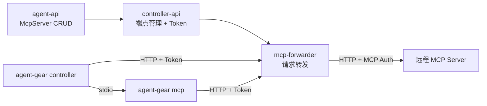
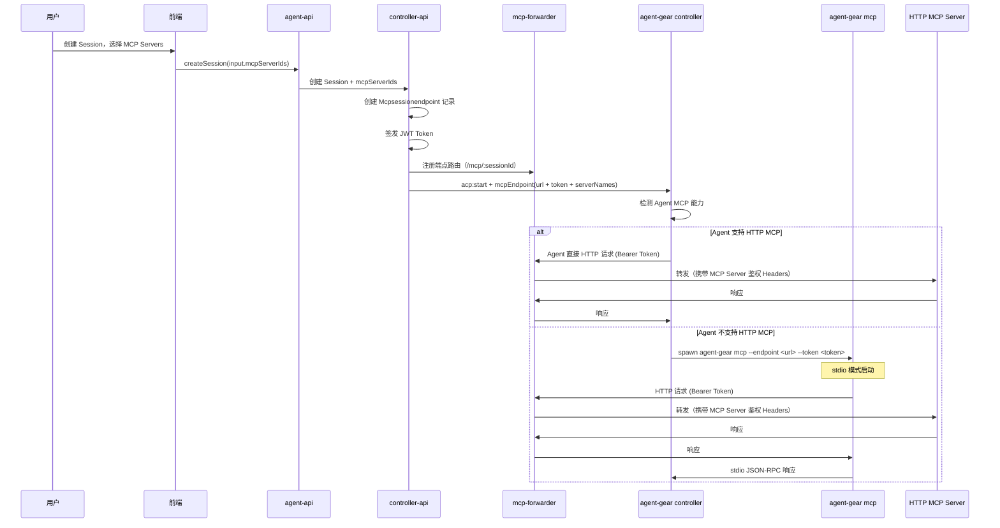
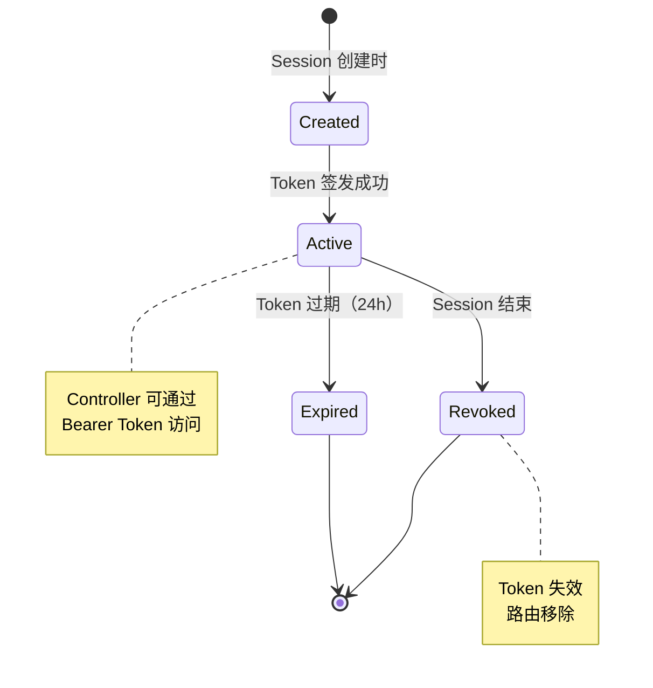

# MCP 代理服务管理与配置下发 - 技术提案

**功能名称**: MCP 代理服务与配置下发
**关联 PRD**: `docs/product/draft/20260530-mcp-proxy-config.md`
**技术提案版本**: v3.0
**创建日期**: 2026-05-30
**作者**: ZeroAsh
**feat-branch**: `feat/mcp-proxy-config`

## 1. 概述

### 1.1 背景

ACP 协议支持在 `acp:start` 时传递 `mcpServers` 参数，当前该字段为预留状态（仅支持 stdio 结构）。PRD 要求：

1. 用户可在平台管理 HTTP 类型的 MCP Server 配置（含鉴权）
2. 创建 Session 时可选择 MCP Servers
3. 通过服务端转发服务，将用户选择的 MCP Servers 聚合为单一 HTTP 端点
4. Agent 支持 HTTP MCP 时直接使用 HTTP 端点；不支持时通过 agent-gear 内置的 stdio 代理转换

**核心设计原则**：
- 用户的 MCP Server 配置（含鉴权信息）不下发到 Controller，由服务端转发服务统一管理
- Controller 仅接收转发端点 URL + Token
- agent-gear 新增 `mcp` 子命令，提供 stdio → HTTP 代理能力

### 1.2 目标

- 新增 `McpServer` Mongoose Model，支持 HTTP 传输和加密鉴权存储
- 新增 GraphQL Schema/Resolver 实现 MCP Server CRUD
- 新增 `McpSessionEndpoint` 模型，为每个 Session 创建独立的转发端点
- 实现 MCP 转发服务（mcp-forwarder），聚合多个 MCP Server 为单一 HTTP 端点
- agent-gear 新增 `mcp` 子命令，将 HTTP MCP 转为 stdio（供不支持 HTTP 的 Agent 使用）
- 更新 Session 创建流程，集成 MCP Server 选择和能力检测

### 1.3 范围

- **包含**：agent-api（GraphQL CRUD + 加密存储）、controller-api（转发端点管理 + Token 签发）、mcp-forwarder 转发服务、agent-controller（`mcp` 子命令）、contracts（GraphQL + WebSocket 契约更新）、前端（MCP Server 管理 UI + Session 创建选择）
- **不包含**：MCP Server 的 OAuth 交互式认证流程、MCP Server 市场/推荐

## 2. 技术架构

### 2.1 系统架构图

```mermaid
graph TD
    subgraph "前端 (agent-web)"
        UI_MCP[MCP Server 管理页]
        UI_SESSION[Session 创建页]
    end

    subgraph "agent-api (GraphQL)"
        RES[McpServer Resolver]
        SVC[McpServer Service]
        ENC[Encryption Service]
        MOD[(MongoDB McpServer)]
    end

    subgraph "controller-api (Socket.IO + HTTP)"
        CAPI[Session Service]
        EP[MCP Endpoint Manager]
    end

    subgraph "mcp-forwarder (HTTP)"
        FWD[MCP Forwarder Service]
        ROUTE[/mcp/:sessionId/*]
    end

    subgraph "agent-controller"
        SIO[Socket.IO Client]
        subgraph "模式1: controller 守护进程"
            SERVER[agent-gear --key --server]
        end
        subgraph "模式2: stdio MCP 代理"
            MCP_CMD[agent-gear mcp --endpoint --token]
        end
    end

    subgraph "外部"
        MCP_EXT[远程 HTTP MCP Server]
    end

    UI_MCP -->|CRUD| RES
    UI_SESSION -->|选择 MCP Servers| RES
    RES --> SVC
    SVC --> ENC
    SVC --> MOD

    CAPI -->|创建 Session| EP
    EP -->|生成转发端点 + Token| FWD
    CAPI -->|下发 endpoint URL + token| SIO

    SIO -->|检测 Agent MCP 能力| SERVER
    SERVER -->|支持 HTTP| ROUTE
    SERVER -->|不支持 HTTP| MCP_CMD
    MCP_CMD -->|stdio JSON-RPC| SERVER

    ROUTE --> FWD
    FWD -->|HTTP + MCP Auth Headers| MCP_EXT
```

### 2.2 核心概念

**转发端点（Session Endpoint）**：
- 每个 Session 创建时，为其选中的 MCP Servers 生成一个独立的 HTTP 端点
- 端点格式：`POST /mcp/:sessionId`
- 该端点聚合了该 Session 选择的所有 MCP Server
- Controller 通过此单一端点访问所有 MCP 功能

**端点鉴权**：
- 每个端点生成独立的 Bearer Token（JWT）
- Token 与 Session 绑定，Session 结束后 Token 失效
- Controller 请求时携带 `Authorization: Bearer <token>`

**agent-gear 双模式**：
- `agent-gear --key --server`：原有 controller 守护进程模式
- `agent-gear mcp --endpoint <url> --token <token>`：stdio MCP 代理模式，将 HTTP MCP 转为 stdio 供 Agent 使用

### 2.3 技术栈

| 层级 | 技术选型 | 说明 |
|------|---------|------|
| 前端 | React + TypeScript | MCP Server 管理 UI |
| agent-api | GraphQL-Yoga + Mongoose | MCP Server CRUD + 加密存储 |
| controller-api | Socket.IO + Express | 转发端点管理、Token 签发 |
| mcp-forwarder | Express | MCP 请求转发服务 |
| agent-controller | Node.js | HTTP 客户端 + stdio 代理 |
| 加密 | Node.js crypto (AES-256-GCM) | 鉴权信息加密存储 |
| Token | JWT | 端点访问鉴权 |

### 2.4 模块划分



| 模块 | 职责 | 关键技术点 |
|------|------|-----------|
| agent-api | MCP Server CRUD、加密存储、GraphQL API | AES-256-GCM 加密、Mongoose Model |
| controller-api | Session 端点管理、Token 签发与验证 | JWT 签发、端点生命周期管理 |
| mcp-forwarder | 接收请求、解密鉴权、转发到 MCP Server | 动态路由、鉴权注入、请求转发 |
| agent-gear (controller) | 守护进程，检测 Agent 能力，选择下发方式 | 能力检测、进程管理 |
| agent-gear (mcp) | stdio MCP 代理，HTTP 转 stdio | JSON-RPC stdio、HTTP fetch |

## 3. API 设计

### 3.1 GraphQL Schema（agent-api）

```graphql
enum McpServerTransport {
  http
}

enum McpServerAuthType {
  none
  api_key
  bearer_token
  custom_headers
}

enum McpServerStatus {
  active
  disabled
}

type McpServer {
  id: ID!
  name: String!
  url: String!
  transport: McpServerTransport!
  authType: McpServerAuthType!
  status: McpServerStatus!
  createdAt: String!
  updatedAt: String!
}

type McpServerDetail {
  id: ID!
  name: String!
  url: String!
  transport: McpServerTransport!
  authType: McpServerAuthType!
  authConfig: JSON
  status: McpServerStatus!
  createdAt: String!
  updatedAt: String!
}

input CreateMcpServerInput {
  name: String!
  url: String!
  authType: McpServerAuthType! = none
  authConfig: JSON
}

input UpdateMcpServerInput {
  id: ID!
  name: String
  url: String
  authType: McpServerAuthType
  authConfig: JSON
  status: McpServerStatus
}

type Query {
  mcpServers: [McpServer!]!
  mcpServer(id: ID!): McpServerDetail
}

type Mutation {
  createMcpServer(input: CreateMcpServerInput!): McpServer!
  updateMcpServer(input: UpdateMcpServerInput!): McpServer!
  deleteMcpServer(id: ID!): Boolean!
  toggleMcpServer(id: ID!): McpServer!
}
```

**authConfig JSON 结构：**

| authType | authConfig 结构 |
|----------|----------------|
| `none` | `null` |
| `api_key` | `{ "keyName": "X-API-Key", "keyValue": "sk-xxx" }` |
| `bearer_token` | `{ "token": "eyJhbG..." }` |
| `custom_headers` | `{ "headers": [{ "name": "Authorization", "value": "Basic xxx" }] }` |

### 3.2 REST API（mcp-forwarder）

#### 3.2.1 MCP 转发端点

```
POST /mcp/:sessionId
Authorization: Bearer <session-endpoint-token>
Content-Type: application/json
```

**行为：**
1. 验证 Bearer Token（JWT），确认 sessionId 匹配且 Session 有效
2. 查找该 Session 绑定的 MCP Server 列表
3. 解密各 MCP Server 的鉴权信息
4. 根据请求中的 MCP 方法和目标 Server，转发到对应的 HTTP MCP Server
5. 返回响应

**请求 Body：** 标准 JSON-RPC 格式

```json
{
  "jsonrpc": "2.0",
  "id": 1,
  "method": "tools/call",
  "params": {
    "serverName": "github",
    "name": "create_pr",
    "arguments": { ... }
  }
}
```

**特殊处理：**
- `serverName` 字段用于指定转发到哪个 MCP Server
- 如果未指定 `serverName`，默认转发到第一个 MCP Server
- `tools/list` 方法返回所有 MCP Server 的工具聚合列表

### 3.3 WebSocket 契约更新（controller-api ↔ agent-controller）

#### 3.3.1 `acp:check:result` 扩展

在 `AcpServerInfo` 中新增 `mcpCapabilities` 字段：

| 字段 | 类型 | 必填 | 说明 |
|------|------|------|------|
| `mcpCapabilities` | `McpCapabilities` | 否 | MCP 传输能力 |

**McpCapabilities 结构：**

| 字段 | 类型 | 必填 | 说明 |
|------|------|------|------|
| `http` | `boolean` | 是 | 是否支持 HTTP MCP |
| `sse` | `boolean` | 否 | 是否支持 SSE MCP |

#### 3.3.2 `acp:start` 扩展

新增 `mcpEndpoint` 字段：

| 字段 | 类型 | 必填 | 说明 |
|------|------|------|------|
| `mcpEndpoint` | `McpEndpoint` | 否 | MCP 转发端点信息 |

**McpEndpoint 结构：**

| 字段 | 类型 | 必填 | 说明 |
|------|------|------|------|
| `url` | `string` | 是 | 转发端点 URL（如 `https://api.example.com/mcp/:sessionId`） |
| `token` | `string` | 是 | Bearer Token（用于访问转发端点） |
| `serverNames` | `string[]` | 是 | 该端点聚合的 MCP Server 名称列表 |

#### 3.3.3 新增 `mcp:endpoint:revoke` 事件

| 方向 | 事件名 | 说明 |
|------|--------|------|
| Server → Controller | `mcp:endpoint:revoke` | 撤销端点 Token（Session 结束时） |

**Payload：**

| 字段 | 类型 | 必填 | 说明 |
|------|------|------|------|
| `sessionId` | `string` | 是 | 关联的 Session ID |

## 4. 数据模型

### 4.1 MongoDB Collection: `mcpservers`

| 字段 | 类型 | 说明 |
|------|------|------|
| `_id` | ObjectId | 主键 |
| `userId` | ObjectId | 所属用户 |
| `name` | String | MCP Server 名称 |
| `url` | String | HTTP URL |
| `transport` | String | 传输类型，固定 `http` |
| `authType` | String | 认证类型：`none` / `api_key` / `bearer_token` / `custom_headers` |
| `authConfig` | String | AES-256-GCM 加密后的认证配置 JSON |
| `authConfigIv` | String | 加密 IV（初始化向量） |
| `authConfigTag` | String | GCM 认证标签 |
| `status` | String | 状态：`active` / `disabled` |
| `createdAt` | Date | 创建时间 |
| `updatedAt` | Date | 更新时间 |

**索引：**
- `{ userId: 1, name: 1 }` — 唯一索引，同一用户下名称不可重复
- `{ userId: 1, status: 1 }` — 查询优化

### 4.2 MongoDB Collection: `mcpsessionendpoints`

| 字段 | 类型 | 说明 |
|------|------|------|
| `_id` | ObjectId | 主键 |
| `sessionId` | ObjectId | 关联的 Session |
| `userId` | ObjectId | 所属用户 |
| `mcpServerIds` | [ObjectId] | 绑定的 MCP Server ID 列表 |
| `tokenHash` | String | Token 的 bcrypt hash（用于验证） |
| `status` | String | 状态：`active` / `revoked` |
| `expiresAt` | Date | Token 过期时间 |
| `createdAt` | Date | 创建时间 |

**索引：**
- `{ sessionId: 1 }` — 唯一索引
- `{ status: 1, expiresAt: 1 }` — TTL 索引，自动清理过期记录

### 4.3 加密方案

```
密钥来源: 环境变量 MCP_SERVER_ENCRYPTION_KEY (32 bytes hex)
算法: AES-256-GCM
IV: 每次加密随机生成 16 bytes
存储: authConfig (密文) + authConfigIv (IV) + authConfigTag (GCM Tag)
```

### 4.4 Token 方案

```
密钥来源: 环境变量 MCP_ENDPOINT_JWT_SECRET
算法: HS256
Payload: { sessionId, userId, serverNames, exp }
有效期: Session 生命周期（默认 24 小时）
存储: 仅存储 tokenHash (bcrypt)，用于服务端验证
```

## 5. 技术实现方案

### 5.1 核心流程：Session 创建与 MCP 下发



### 5.2 agent-gear 双模式设计

#### 5.2.1 模式 1：Controller 守护进程（已有）

```bash
agent-gear --key <controller-key> --server
```

- 启动 Socket.IO 守护进程
- 注册到 controller-api
- 等待 `acp:start` 等事件
- 管理 ACP Session 生命周期

#### 5.2.2 模式 2：stdio MCP 代理（新增）

```bash
agent-gear mcp --endpoint <转发端点URL> --token <bearer-token>
```

- 启动 stdio JSON-RPC 服务
- 从 stdin 读取 JSON-RPC 请求
- 将请求通过 HTTP 转发到 `--endpoint` 指定的转发端点
- 请求携带 `Authorization: Bearer <token>` Header
- 将 HTTP 响应写回 stdout
- Agent 通过 stdio 与此进程通信

#### 5.2.3 入口文件设计

```typescript
// packages/agent-controller/src/index.ts
import { parseArgs } from 'node:util';

const args = parseArgs({
  options: {
    key: { type: 'string' },
    server: { type: 'boolean' },
  },
  strict: false,
  allowPositionals: true,
});

if (args.positionals[0] === 'mcp') {
  // 模式 2: stdio MCP 代理
  const mcpArgs = parseArgs({
    args: args.positionals.slice(1),
    options: {
      endpoint: { type: 'string' },
      token: { type: 'string' },
    },
  });
  await startMcpProxy(mcpArgs.values.endpoint, mcpArgs.values.token);
} else if (args.values.server) {
  // 模式 1: controller 守护进程
  await startController(args.values.key);
} else {
  // 显示帮助
  showHelp();
}
```

### 5.3 关键实现点

#### 实现点 1: McpServer Service（agent-api）

- **描述**: 实现 MCP Server CRUD 业务逻辑，包含加密/解密鉴权信息
- **技术细节**:
  - `createMcpServer`: 加密 authConfig 后存储
  - `getMcpServersByIds`: 批量查询并解密，返回用于转发的格式
  - 加密使用 Node.js `crypto.createCipheriv('aes-256-gcm', key, iv)`
- **风险点**: 密钥管理，需确保 MCP_SERVER_ENCRYPTION_KEY 环境变量安全

#### 实现点 2: MCP Endpoint Manager（controller-api）

- **描述**: 管理 Session 级别的 MCP 转发端点生命周期
- **技术细节**:
  - `createEndpoint(sessionId, userId, mcpServerIds)`: 创建端点记录 + 签发 JWT + 注册路由
  - `revokeEndpoint(sessionId)`: 撤销 Token + 标记端点为 revoked
  - JWT Payload: `{ sessionId, userId, serverNames, exp }`
  - Token Hash: 使用 bcrypt 存储 tokenHash，用于服务端验证
- **风险点**: 需确保 Session 结束时端点被正确撤销

#### 实现点 3: MCP Forwarder Service（mcp-forwarder）

- **描述**: 独立的 HTTP 服务，负责接收请求并转发到目标 MCP Server
- **技术细节**:
  - 路由：`POST /mcp/:sessionId`
  - 中间件：验证 JWT Token、检查 Session 有效性
  - 转发逻辑：
    1. 从 JWT 获取 serverNames
    2. 从数据库查询对应 MCP Server 配置
    3. 解密鉴权信息
    4. 根据请求中的 serverName 选择目标
    5. 转发请求（携带目标 MCP Server 的鉴权 Headers）
  - `tools/list` 聚合：返回所有绑定 MCP Server 的工具列表
- **风险点**: 需处理 MCP Server 不可达、鉴权失败等异常

#### 实现点 4: agent-gear mcp 子命令

- **描述**: 在 agent-controller 包中新增 `mcp` 子命令，实现 stdio MCP 代理
- **技术细节**:
  - 入口：`packages/agent-controller/src/commands/mcp.ts`
  - 通过 `--endpoint` 和 `--token` 参数接收转发端点信息
  - stdio 读取 JSON-RPC → HTTP POST 到 endpoint → 响应写回 stdio
  - 使用 `readline` 接口逐行读取 stdio JSON-RPC
  - 请求 Header：`Authorization: Bearer <token>`
- **风险点**: 需处理 HTTP 超时、连接错误、Token 过期等异常

#### 实现点 5: agent-controller 能力检测与进程管理

- **描述**: agent-controller 在 `acp:start` 时根据 Agent 能力选择下发方式
- **技术细节**:
  - 收到 `acp:start` 中的 `mcpEndpoint` 后，检测 Agent 的 `mcpCapabilities.http`
  - 支持 HTTP → 将 `mcpEndpoint.url` 和 `mcpEndpoint.token` 传递给 Agent
  - 不支持 HTTP → spawn `agent-gear mcp --endpoint <url> --token <token>`，将 stdio 连接到 Agent
  - Session 结束时 kill mcp 子进程
- **风险点**: 需确保子进程异常退出时也能正确清理

### 5.4 转发端点生命周期



## 6. 技术决策

### 6.1 决策列表

| 决策 | 选项 A | 选项 B | 最终选择 | 原因 |
|------|--------|--------|---------|------|
| MCP 转发位置 | Controller 端独立程序 | 服务端 mcp-forwarder | 服务端 mcp-forwarder | 鉴权信息不下发到 Controller，安全性更高 |
| stdio 代理位置 | 独立 mcp-proxy 包 | 集成到 agent-gear | 集成到 agent-gear | 统一工具链，减少依赖 |
| 端点粒度 | 全局共享端点 | 每 Session 独立端点 | 每 Session 独立端点 | 隔离性好，便于权限控制和生命周期管理 |
| 端点鉴权方式 | API Key | JWT Bearer Token | JWT Bearer Token | 自包含、无状态、可携带元数据 |
| Token 存储 | 明文存储 | bcrypt hash 存储 | bcrypt hash 存储 | 即使数据库泄露也无法还原 Token |
| MCP Server 鉴权信息存储 | 明文 | AES-256-GCM | AES-256-GCM | GCM 提供完整性校验，更安全 |

### 6.2 依赖与约束

| 类型 | 内容 | 说明 |
|------|------|------|
| 依赖 | ACP 协议 v1 | `acp:start` 的 `mcpEndpoint` 参数 |
| 依赖 | JWT 库 | `jsonwebtoken` 用于 Token 签发和验证 |
| 依赖 | bcrypt | 用于 Token Hash 存储 |
| 约束 | MCP_SERVER_ENCRYPTION_KEY | 必须在环境变量中配置 32 bytes hex 密钥 |
| 约束 | MCP_ENDPOINT_JWT_SECRET | 必须在环境变量中配置 JWT 签名密钥 |
| 约束 | mcp-forwarder 可用性 | 转发服务必须对 Controller 可达 |

## 7. 项目结构

```
z-agent-gear/
├── contracts/
│   ├── mcp-server.graphql          # 新增：MCP Server GraphQL Schema
│   └── agent-session-websocket.md  # 更新：新增 mcpEndpoint 字段
├── packages/
│   └── agent-controller/
│       └── src/
│           ├── index.ts            # 更新：新增 mcp 子命令入口
│           └── commands/
│               └── mcp.ts          # 新增：stdio MCP 代理逻辑
├── servers/
│   ├── agent-api/
│   │   └── src/
│   │       ├── graphql/
│   │       │   ├── schemas/mcp-server.ts   # 新增
│   │       │   └── resolvers/mcp-server.ts # 新增
│   │       ├── models/mcp-server.ts        # 新增
│   │       └── services/mcp-server.ts      # 新增
│   ├── controller-api/
│   │   └── src/
│   │       └── services/
│   │           ├── mcp-endpoint.ts         # 新增：端点管理
│   │           └── session.ts              # 更新：集成端点创建
│   └── mcp-forwarder/                      # 新增：MCP 转发服务
│       ├── src/
│       │   ├── index.ts
│       │   ├── routes/mcp.ts
│       │   ├── middleware/auth.ts
│       │   └── services/
│       │       ├── endpoint.ts
│       │       ├── decrypt.ts
│       │       └── forwarder.ts
│       ├── Dockerfile
│       ├── package.json
│       └── tsconfig.json
└── apps/
    └── agent-web/
        └── src/
            └── pages/settings/
                └── mcp-servers/            # 新增：MCP Server 管理页
```

## 8. 测试策略

### 8.1 测试覆盖要求

- 单元测试覆盖率: >= 80%
- API 测试覆盖的端点: MCP Server CRUD + 转发端点访问

### 8.2 测试类型

| 类型 | 工具 | 覆盖范围 |
|------|------|---------|
| 单元测试 | Vitest | McpServer Service（CRUD + 加密解密）、Endpoint Manager（Token 签发/验证）、Forwarder（转发逻辑）、mcp 子命令（stdio↔HTTP） |
| API 测试 | Vitest + GraphQL | MCP Server CRUD 全流程、Session 创建时端点创建 |
| E2E 测试 | Playwright | MCP Server 管理 UI、Session 创建选择 MCP Server |

### 8.3 关键测试场景

| 场景 | 预期结果 |
|------|---------|
| 创建 MCP Server（无认证） | 成功存储，authConfig 为空 |
| 创建 MCP Server（各种认证类型） | authConfig 加密存储，查询时解密返回 |
| 同名 MCP Server 创建 | 返回错误，名称冲突 |
| Session 创建 + 选择 MCP Servers | 创建端点记录、签发 Token、注册路由 |
| Agent 支持 HTTP → 直接访问转发端点 | 请求成功转发到目标 MCP Server |
| Agent 不支持 HTTP → agent-gear mcp 代理 | stdio 请求正确转换为 HTTP 转发 |
| 访问转发端点（无效 Token） | 返回 401 |
| 访问转发端点（过期 Token） | 返回 401 |
| Session 结束 | Token 撤销、端点标记为 revoked |
| agent-gear mcp 子进程异常退出 | Controller 正确清理 |

## 9. 部署方案

### 9.1 环境规划

| 环境 | 用途 | 部署方式 |
|------|------|---------|
| 开发 | 本地开发测试 | Aspire 编排 |
| 生产 | 线上服务 | Docker Compose |

### 9.2 配置管理

| 配置项 | 说明 | 必填 |
|--------|------|------|
| `MCP_SERVER_ENCRYPTION_KEY` | AES-256-GCM 加密密钥（32 bytes hex） | 是 |
| `MCP_ENDPOINT_JWT_SECRET` | JWT 签名密钥 | 是 |
| `MCP_FORWARDER_PORT` | 转发服务端口 | 否，默认 3002 |
| `MCP_FORWARDER_URL` | 转发服务外部 URL（Controller 可达） | 是 |

### 9.3 Aspire 编排

```yaml
# 需新增 mcp-forwarder 服务
services:
  mcp-forwarder:
    build: ./servers/mcp-forwarder
    ports:
      - "3002:3002"
    environment:
      - MCP_SERVER_ENCRYPTION_KEY
      - MCP_ENDPOINT_JWT_SECRET
      - MONGODB_CONNECTION_STRING
```

## 10. 验收标准

- [ ] 技术方案评审通过
- [ ] Contract（GraphQL + WebSocket）评审通过
- [ ] MCP Server CRUD 功能完成
- [ ] 鉴权信息加密存储/解密读取正常
- [ ] Session 创建时端点创建 + Token 签发正常
- [ ] Agent 支持 HTTP 时直接访问转发端点正常
- [ ] Agent 不支持 HTTP 时 `agent-gear mcp` 代理正常
- [ ] `agent-gear mcp --endpoint --token` stdio 模式工作正常
- [ ] 转发请求携带 MCP Server 鉴权 Headers 正常
- [ ] Session 结束时 Token 撤销正常
- [ ] 多 MCP Server 聚合路由正常
- [ ] 单元测试覆盖达标
- [ ] API 测试通过
- [ ] E2E 测试通过

## 11. 相关文档

- [PRD: MCP 代理服务管理与配置下发](docs/product/draft/20260530-mcp-proxy-config.md)
- [Contract: agent-session.graphql](contracts/agent-session.graphql)
- [Contract: agent-session-websocket.md](contracts/agent-session-websocket.md)
- [Proposal: 多 ACP Server 支持](docs/engineering/proposals/20260526-feat-multi-acp-server-support.md)
- [ACP 协议: Session Setup - MCP Servers](https://agentclientprotocol.com/protocol/session-setup#mcp-servers)
