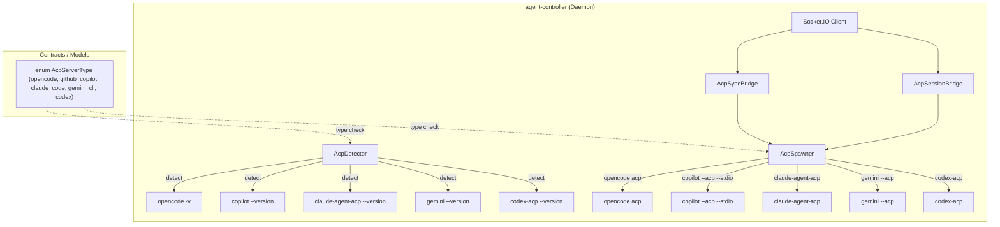
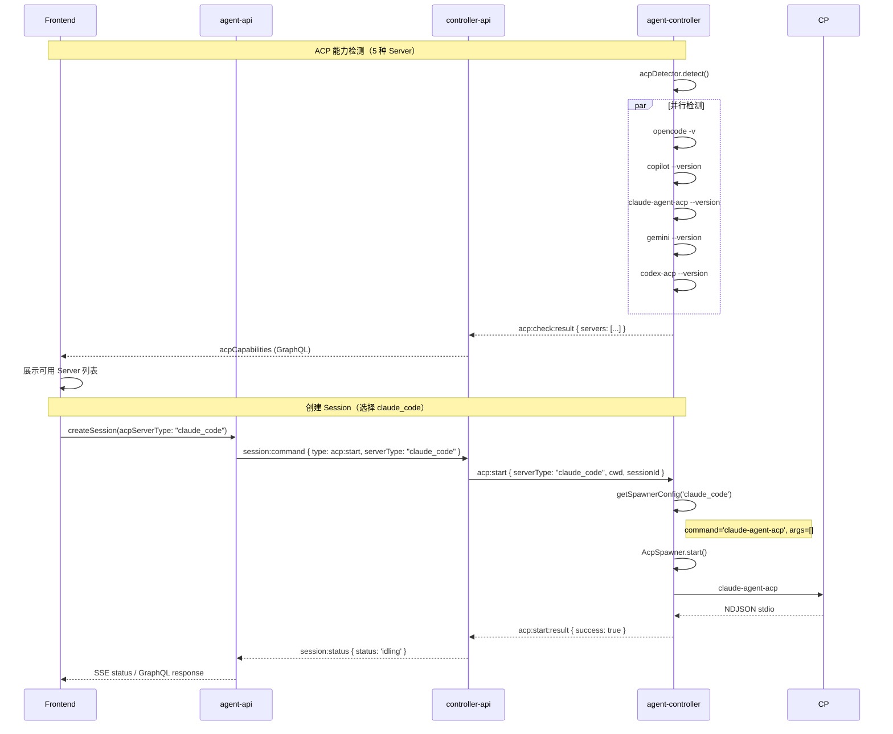

# ACP Server 支持扩展 — 技术提案

**功能名称**: ACP Server 支持扩展
**关联 PRD**: `20260705-acp-server-extend.md`
**技术提案版本**: v1.0
**创建日期**: 2026-07-05
**作者**: opencode
**feat-branch**: `feat/acp-server-extend`

## 1. 概述

### 1.1 背景

当前系统已支持 OpenCode 和 GitHub Copilot 两种 ACP Server。PRD 要求新增 **Claude Code**（Anthropic）、**Gemini CLI**（Google）、**Codex CLI**（OpenAI）三种 ACP Server。

三种新工具的 ACP 接入方式各不相同：

- **Gemini CLI**：原生支持 ACP 模式，启动参数为 `gemini --acp`
- **Claude Code**：需通过官方 ACP 适配器 `@agentclientprotocol/claude-agent-acp`（npm 包）接入，启动命令为 `claude-agent-acp`
- **Codex CLI**：需通过官方 ACP 适配器 `@agentclientprotocol/codex-acp`（npm 包）接入，启动命令为 `codex-acp`

通信协议均为 ACP JSON-RPC over stdio。系统架构已在首次多 ACP Server 支持中做好了扩展准备，新增 Server 类型不需要架构变更。

### 1.2 目标

- `enum AcpServerType` 增加 `claude_code`、`gemini_cli`、`codex` 三个值
- `AcpDetector` 扩展检测三种新 Server
- `AcpDetector.getSpawnerConfig()` 返回对应启动命令
- 前端 ACP Server 标签添加三个新类型的可读名称
- 所有测试覆盖新 Server 类型

### 1.3 范围

- **包含**：Contract（GraphQL enum）、Mongoose models（enum 扩展）、agent-controller（detector + spawner config）、controller-api（透传 serverType）、agent-api（透传）、前端（标签展示）
- **不包含**：各 CLI 工具的安装和认证流程、各 Server 特有的 ACP 能力适配（如 config options 差异）、Session 创建后切换 ACP Server 类型

## 2. 技术架构

### 2.1 系统架构图



### 2.2 架构决策

| 决策 | 选项 A | 选项 B | 最终选择 | 原因 |
|------|--------|--------|---------|------|
| 启动命令到 Server 类型的映射方式 | AcpDetector 内部映射表 | controller-api 下发完整启动参数 | AcpDetector 内部映射表 | 启动命令是与 Agent 绑定的静态知识，不应由服务端控制 |
| 三种新 Server 检测失败的处理 | 静默返回 available=false | 抛出异常告警 | 静默返回 available=false | 与现有检测行为一致，某个 Server 未安装不影响其他 Server |
| session list/load 对新 Server 的支持 | 分别尝试各 Server | 始终使用 OpenCode | 始终使用 OpenCode | 只有 OpenCode 支持 session 持久化查询 |

### 2.3 模块划分

| 模块 | 职责 | 关键技术点 |
|------|------|-----------|
| Contract | 扩展 `enum AcpServerType` | 增加 `claude_code`、`gemini_cli`、`codex` |
| agent-controller (detector) | 多 ACP Server 检测 | 新增 `detectClaudeCode()`、`detectGeminiCli()`、`detectCodex()` |
| agent-controller (socketio-client) | 根据 serverType 选择 spawner | 已通过 `createSpawner()` 泛化，无改动 |
| agent-controller (spawner) | 无改动 | 已支持自定义 command/args |
| agent-controller (bridge) | 无改动 | 构造函数已接受可选 spawner 参数 |
| agent-controller (sync-bridge) | 根据 serverType 创建 spawner | 构造函数已接受可选 spawner，需调用方传入 |
| agent-api (model) | enum 扩展 | `enum: ['opencode', 'github_copilot', 'claude_code', 'gemini_cli', 'codex']` |
| agent-api (GraphQL) | enum 扩展 | `enum AcpServerType { opencode, github_copilot, claude_code, gemini_cli, codex }` |
| controller-api (model) | enum 扩展 | `enum: ['opencode', 'github_copilot', 'claude_code', 'gemini_cli', 'codex']` |
| controller-api (ACM) | 无改动 | 已使用 `serverType: string` |
| frontend (SessionHeader) | 标签可读展示 | 新增三个映射 |

## 3. API 设计

### 3.1 Contract 变更

`contracts/agent-session.graphql`:

```graphql
enum AcpServerType {
  opencode
  github_copilot
  claude_code
  gemini_cli
  codex
}
```

其他接口无需变更，`AcpServerType` 现有的使用位置（`Session.acpServerType`、`AcpCapability.type`、`CreateSessionInput.acpServerType`）均使用该 enum 类型，新增值自然生效。

### 3.2 Socket.IO 协议

无变更。`acp:start` payload 中的 `serverType: string` 字段已存在，仅传递新字符串值（`'claude_code'`、`'gemini_cli'`、`'codex'`）。

`acp:check` 响应中的 `servers` 数组自然包含新 Server 的检测结果。

### 3.3 Redis Pub/Sub

无变更。`session:command` 中的 `acpServerType` 字段已存在，透传不变。

## 4. 数据模型

### 4.1 MongoDB enum 扩展

```typescript
// agent-api/src/models/session.ts
acpServerType: {
  type: String,
  enum: ['opencode', 'github_copilot', 'claude_code', 'gemini_cli', 'codex'],
  required: true,
},

// controller-api/src/models/session.ts
acpServerType: {
  type: String,
  enum: ['opencode', 'github_copilot', 'claude_code', 'gemini_cli', 'codex'],
  required: true,
},
```

已有数据的 `acpServerType` 为 `'opencode'` 或 `'github_copilot'`，向后兼容，无需数据迁移。

## 5. 技术实现方案

### 5.1 核心流程



### 5.2 关键实现点

#### 实现点 1: AcpDetector 扩展三种新 Server 检测

**文件**: `packages/agent-controller/src/acp/detector.ts`

在现有 `detect()` 方法中增加三种新 Server 的并行检测：

```typescript
export class AcpDetector {
  async detect(): Promise<AcpServerInfo[]> {
    const [opencode, copilot, claudeCode, geminiCli, codex] = await Promise.all([
      this.detectOpenCode(),
      this.detectGitHubCopilot(),
      this.detectClaudeCode(),
      this.detectGeminiCli(),
      this.detectCodex(),
    ]);
    return [opencode, copilot, claudeCode, geminiCli, codex];
  }

  private async detectClaudeCode(): Promise<AcpServerInfo> {
    try {
      const { stdout } = await execAsync('claude-agent-acp --version');
      const version = this.parseVersion(stdout);
      return { type: 'claude_code', available: true, version };
    } catch {
      return { type: 'claude_code', available: false };
    }
  }

  private async detectGeminiCli(): Promise<AcpServerInfo> {
    try {
      const { stdout } = await execAsync('gemini --version');
      const version = this.parseVersion(stdout);
      return { type: 'gemini_cli', available: true, version };
    } catch {
      return { type: 'gemini_cli', available: false };
    }
  }

  private async detectCodex(): Promise<AcpServerInfo> {
    try {
      const { stdout } = await execAsync('codex-acp --version');
      const version = this.parseVersion(stdout);
      return { type: 'codex', available: true, version };
    } catch {
      return { type: 'codex', available: false };
    }
  }

  getSpawnerConfig(serverType: string): { command: string; args: string[] } {
    switch (serverType) {
      case 'github_copilot':
        return { command: 'copilot', args: ['--acp', '--stdio'] };
      case 'claude_code':
        return { command: 'claude-agent-acp', args: [] };
      case 'gemini_cli':
        return { command: 'gemini', args: ['--acp'] };
      case 'codex':
        return { command: 'codex-acp', args: [] };
      case 'opencode':
      default:
        return { command: 'opencode', args: ['acp'] };
    }
  }
}
```

#### 实现点 2: socketio-client.ts — acp:list-sessions 和 acp:load-session 支持 serverType

**文件**: `packages/agent-controller/src/socketio-client.ts`

当前 `acp:list-sessions` 和 `acp:load-session` handler 创建 `AcpSyncBridge` 时未指定 spawner，导致默认使用 OpenCode。需改造为接收 `serverType` 参数并根据类型创建对应 spawner：

```typescript
// AcpListSessionsPayload 增加 serverType
interface AcpListSessionsPayload {
  requestId: string;
  serverType: string;  // 新增
  cwd: string;
}

// AcpLoadSessionPayload 增加 serverType
interface AcpLoadSessionPayload {
  requestId: string;
  sessionId: string;
  serverType: string;  // 新增
  cwd: string;
}

// acp:list-sessions handler
socket.on('acp:list-sessions', async (data: AcpListSessionsPayload) => {
  const spawner = createSpawner(data.serverType, `sync_${Date.now()}`, data.cwd);
  const bridge = new AcpSyncBridge({ cwd: data.cwd }, spawner);
  // ... rest unchanged
});

// acp:load-session handler
socket.on('acp:load-session', async (data: AcpLoadSessionPayload) => {
  const spawner = createSpawner(data.serverType, `sync_${Date.now()}`, data.cwd);
  const bridge = new AcpSyncBridge({ cwd: data.cwd }, spawner);
  // ... rest unchanged
});
```

`acp:start`/`acp:resume` handler 已通过 `createSpawner()` 泛化，无需改动。

#### 实现点 3: controller-api — acp-session-sync 透传 serverType

**文件**: `servers/controller-api/src/services/acp-session-sync.ts`

`listSessions` 和 `loadSession` 方法接收 `serverType` 参数并传给 agent-controller：

```typescript
async listSessions(controllerSocket: Socket, serverType: string, cwd: string): Promise<ListResult> {
  const requestId = `sync_list_${Date.now()}_${Math.random().toString(36).slice(2)}`;
  // ... existing promise setup ...
  controllerSocket.emit('acp:list-sessions', { requestId, serverType, cwd });
}

async loadSession(controllerSocket: Socket, serverType: string, acpSessionId: string, cwd: string): Promise<LoadResult> {
  const requestId = `sync_load_${Date.now()}_${Math.random().toString(36).slice(2)}`;
  // ... existing promise setup ...
  controllerSocket.emit('acp:load-session', { requestId, sessionId: acpSessionId, serverType, cwd });
}
```

**文件**: `servers/controller-api/src/services/session-command.ts`

`handleAcpListSessions` 和 `handleAcpLoadSession` 从 Redis 命令中读取 `serverType` 并传递：

```typescript
// 从 agent-api 的 Redis 命令中获取 serverType（无则默认 opencode）
const serverType = command.serverType ?? 'opencode';

// handleAcpListSessions
await acpSessionSyncService.listSessions(socket, serverType, cwd);

// handleAcpLoadSession
await acpSessionSyncService.loadSession(socket, serverType, sessionId, cwd);
```

**文件**: `servers/agent-api/src/services/session-import.ts`

`listHistorySessions` 和 `importSessions` 方法接收 `acpServerType` 参数，传递到 Redis 命令中，并将导入的 Session 标记为对应类型：

```typescript
async listHistorySessions(
  userId: string,
  controllerId: string,
  workspaceId: string,
  acpServerType: string = 'opencode',  // 新增，默认 opencode
): Promise<HistorySessionInfo[]> {
  // ... existing setup ...
  await redis.publish('session:command', JSON.stringify({
    type: 'acp:list-sessions',
    requestId,
    controllerId,
    serverType: acpServerType,  // 新增
    cwd,
  }));
  // ... rest unchanged
}

async importSessions(
  userId: string,
  controllerId: string,
  controllerName: string,
  workspaceId: string,
  acpServerType: string,  // 新增，从传入参数获取
  acpSessionIds: string[],
): Promise<ImportSessionResult[]> {
  // ... existing setup ...
  await redis.publish('session:command', JSON.stringify({
    type: 'acp:load-session',
    requestId,
    controllerId,
    serverType: acpServerType,  // 新增
    sessionId: acpSessionId,
    cwd,
  }));
  // 创建 Session 时标记正确的 acpServerType
  const session = await Session.create({
    userId,
    controllerId,
    controllerName,
    acpServerType,  // 从硬编码 'opencode' 改为参数传入
    status: 'ended',
    title,
    externalSessionId: acpSessionId,
    cwd,
    endedAt: new Date(),
  });
}
```

**文件**: `servers/agent-api/src/graphql/schemas/session.ts`

GraphQL 接口增加 `acpServerType` 参数：

```graphql
listHistorySessions(controllerId: ID!, workspaceId: ID!, acpServerType: AcpServerType = opencode): [HistorySessionInfo!]!
importHistorySessions(controllerId: ID!, workspaceId: ID!, acpServerType: AcpServerType! = opencode, sessionIds: [String!]!): [ImportSessionResult!]!
```

#### 实现点 4: controller-api — 无额外改动

`startSession` 和 `resumeSession` 已使用 `serverType: string` 透传，新增的 enum 值自然生效。无需改动。

#### 实现点 4: 前端 ACP Server 标签可读展示

**文件**: `apps/agent-web/src/components/session/SessionHeader.tsx`

```typescript
const acpServerTypeLabels: Record<string, string> = {
  opencode: 'OpenCode',
  github_copilot: 'GitHub Copilot',
  claude_code: 'Claude Code',
  gemini_cli: 'Gemini CLI',
  codex: 'Codex',
};
```

### 5.3 代码改动清单

| 文件 | 改动类型 | 说明 |
|------|---------|------|
| `contracts/agent-session.graphql` | 修改 | AcpServerType enum 增加 `claude_code`、`gemini_cli`、`codex` |
| `servers/agent-api/src/graphql/schemas/session.ts` | 修改 | 同步 GraphQL enum |
| `servers/agent-api/src/models/session.ts` | 修改 | enum 数组增加三个新值 |
| `servers/controller-api/src/models/session.ts` | 修改 | enum 数组增加三个新值 |
| `packages/agent-controller/src/acp/detector.ts` | 修改 | 新增三个 detect 方法 + getSpawnerConfig 新增三个 case |
| `packages/agent-controller/src/socketio-client.ts` | 修改 | acp:list-sessions / acp:load-session 接收 serverType 并使用对应 spawner |
| `servers/controller-api/src/services/acp-session-sync.ts` | 修改 | listSessions / loadSession 接收并透传 serverType |
| `servers/controller-api/src/services/session-command.ts` | 修改 | handleAcpListSessions / handleAcpLoadSession 读取并传递 serverType |
| `servers/agent-api/src/services/session-import.ts` | 修改 | 接收 acpServerType 参数并传递到命令和 Session 创建 |
| `servers/agent-api/src/graphql/schemas/session.ts` | 修改 | listHistorySessions / importHistorySessions 增加 acpServerType 参数 |
| `servers/agent-api/src/graphql/resolvers/session.ts` | 修改 | resolver 传递 acpServerType |
| `contracts/agent-session.graphql` | 修改 | listHistorySessions / importHistorySessions 增加 acpServerType 参数 |
| `apps/agent-web/src/components/session/SessionHeader.tsx` | 修改 | 标签映射新增三个条目 |

**无需改动的文件**：

- `packages/agent-controller/src/acp/spawner.ts` — 已支持自定义 command/args
- `packages/agent-controller/src/acp/bridge.ts` — 已支持外部 spawner
- `packages/agent-controller/src/acp/sync-bridge.ts` — 构造函数已接受可选 spawner 参数
- `servers/controller-api/src/services/acp-session-manager.ts` — 已使用 `serverType: string`
- `servers/agent-api/src/services/session.ts` — 已使用字符串类型
- `apps/agent-web/src/components/session/NewSessionDialog.tsx` — 已自动渲染可用 Server 列表
- `apps/agent-web/src/components/Sidebar.tsx` — 已透传 acpServerType

## 6. 技术决策

### 6.1 决策列表

| 决策 | 选项 A | 选项 B | 最终选择 | 原因 |
|------|--------|--------|---------|------|
| 检测命令格式 | `cli --version` | `cli acp --version` | `cli --version` | `--version` 是 CLI 工具的标准参数，轻量快速 |
| Gemini CLI ACP 启动方式 | `gemini --acp` | `gemini --acp --stdio` | `gemini --acp` | Gemini CLI 原生 ACP 模式仅需 `--acp` 参数，不识别 `--stdio` |
| Claude Code ACP 接入方式 | 使用官方 ACP 适配器 `claude-agent-acp` | 直接在 `claude` CLI 上加 `--acp` 参数 | 使用 `claude-agent-acp` 适配器 | Claude Code CLI 本身不内置 ACP 模式，需通过适配器接入 |
| Codex CLI ACP 接入方式 | 使用官方 ACP 适配器 `codex-acp` | 直接在 `codex` CLI 上加 `--acp` 参数 | 使用 `codex-acp` 适配器 | Codex CLI 本身不内置 ACP 模式，需通过适配器接入 |
| session list/load 支持多 ACP Server | 为 SyncBridge 添加 serverType 参数 | 保持始终使用 OpenCode | 为 SyncBridge 添加 serverType 参数 | 各 ACP Server 可能在工作目录中持久化了不同格式的会话数据，需要对应的 Server 才能正确读取 |
| 适配器检测方式 | 执行适配器二进制 `--version` |  执行 `npx` 检测 | 执行适配器二进制 `--version` | 用户需全局安装适配器包（`npm install -g`），全局安装后二进制在 PATH 中可用 |

### 6.2 依赖与约束

| 类型 | 内容 | 说明 |
|------|------|------|
| 依赖 | `@agentclientprotocol/claude-agent-acp` 已全局安装（`npm install -g @agentclientprotocol/claude-agent-acp`） | 非本项目责任，用户自行安装 |
| 依赖 | Gemini CLI 已安装 | 非本项目责任，用户自行安装 |
| 依赖 | `@agentclientprotocol/codex-acp` 已全局安装（`npm install -g @agentclientprotocol/codex-acp`） | 非本项目责任，用户自行安装 |
| 约束 | Claude 和 Codex 通过独立 ACP 适配器接入，适配器的协议能力可能与原生 OpenCode 存在差异 | 仅保证基础 ACP 消息通信可用，高级功能不做强制对齐 |
| 约束 | Gemini CLI 原生 ACP 模式需 `--acp` 参数启动 | 与 OpenCode 和 Copilot 的启动参数格式不同 |
| 约束 | `claude-agent-acp` 和 `codex-acp` 需要用户通过 npm 全局安装 | 检测和 spawner 均假设二进制在 PATH 中 |
| 约束 | 不同 ACP Server 的 session list/load 协议实现可能不一致 | sync-bridge 仅转发请求和响应，不保证各 Server 返回数据格式的兼容性 |

## 7. 项目结构

```
packages/agent-controller/src/acp/
├── detector.ts      # 修改：新增三个 detect 方法 + getSpawnerConfig 三个 case
├── spawner.ts       # 无改动
├── bridge.ts        # 无改动
├── sync-bridge.ts   # 无改动

packages/agent-controller/src/
├── socketio-client.ts  # 修改：acp:list-sessions / acp:load-session 支持 serverType

servers/agent-api/src/
├── graphql/schemas/session.ts      # 修改：enum 增加三个值 + listHistorySessions/importHistorySessions 增加 acpServerType 参数
├── graphql/resolvers/session.ts    # 修改：resolver 传递 acpServerType
├── models/session.ts               # 修改：enum 增加三个值
├── services/session-import.ts      # 修改：接收 acpServerType 并传递到 Redis 命令和 Session 创建

servers/controller-api/src/
├── models/session.ts               # 修改：enum 增加三个值
├── services/acp-session-sync.ts    # 修改：listSessions/loadSession 透传 serverType
├── services/session-command.ts     # 修改：handleAcpListSessions/handleAcpLoadSession 读取 serverType

apps/agent-web/src/components/session/
├── SessionHeader.tsx  # 修改：标签映射新增三个条目

contracts/
├── agent-session.graphql  # 修改：AcpServerType enum 增加三个值 + listHistorySessions/importHistorySessions 增加 acpServerType 参数
```

## 8. 测试策略

### 8.1 测试覆盖要求

- 单元测试覆盖三种新 Server 的检测方法和 spawner config
- 不影响现有 opencode / github_copilot 的测试
- 不需要新增 API 测试（现有测试已覆盖 `serverType` 字符串传参，新增值自然生效）

### 8.2 测试类型

| 类型 | 工具 | 覆盖范围 |
|------|------|---------|
| 单元测试 | Vitest | `detector.ts` 新增的三个 detect 方法 |
| 单元测试 | Vitest | `detector.ts` `getSpawnerConfig()` 新增三个 case |
| 单元测试 | Vitest | socketio-client.ts sync-bridge 使用 serverType 创建 spawner |
| 单元测试 | Vitest | session-import.ts 传递 acpServerType |
| 单元测试 | Vitest | acp-session-sync.ts 透传 serverType |
| 单元测试 | Vitest | SessionHeader 组件显示三种新 Server 标签 |

### 8.3 测试文件变更

| 文件 | 改动类型 | 说明 |
|------|---------|------|
| `packages/agent-controller/tests/acp-detector.test.ts` | 修改 | 新增三种 Server 的检测测试 + spawner config 测试 |
| `packages/agent-controller/tests/acp-sync-bridge.test.ts` | 修改 | 新增 serverType spawner 测试 |
| `servers/controller-api/src/services/acp-session-sync.test.ts` | 修改 | 新增 serverType 透传测试 |
| `servers/agent-api/src/services/session-import.test.ts` | 修改 | 新增 acpServerType 参数测试 |
| `apps/agent-web/src/components/session/SessionHeader.test.tsx` | 修改 | 新增三种 Server 的标签展示测试 |

## 9. 验收标准

- [ ] 技术方案评审通过
- [ ] Contract 中 `AcpServerType` enum 包含 `claude_code`、`gemini_cli`、`codex`
- [ ] agent-controller `AcpDetector.detect()` 返回 5 个 Server 的检测结果
- [ ] `getSpawnerConfig('claude_code')` 返回 `{ command: 'claude-agent-acp', args: [] }`
- [ ] `getSpawnerConfig('gemini_cli')` 返回 `{ command: 'gemini', args: ['--acp'] }`
- [ ] `getSpawnerConfig('codex')` 返回 `{ command: 'codex-acp', args: [] }`
- [ ] 前端 SessionHeader 显示 "Claude Code"、"Gemini CLI"、"Codex" 标签
- [ ] `acp:list-sessions` 携带 `serverType: 'claude_code'` 时使用 `claude-agent-acp` 适配器
- [ ] `acp:load-session` 携带 `serverType: 'gemini_cli'` 时使用 `gemini --acp`
- [ ] `listHistorySessions` GraphQL 查询接收并传递 acpServerType 参数
- [ ] `importHistorySessions` 导入的 Session 标记正确的 acpServerType
- [ ] 不指定 serverType 时默认使用 opencode，向后兼容
- [ ] 现有 opencode / github_copilot Session 完全不受影响
- [ ] 所有测试通过

## 10. 相关文档

- [ACP Server 支持扩展 PRD](../../product/draft/20260705-acp-server-extend.md)
- [多 ACP Server 支持 PRD](../../product/released/20260526-multi-acp-server-support.md)
- [多 ACP Server 支持技术方案](./20260526-feat-multi-acp-server-support.md)
- [Agent Session GraphQL Contract](../../../contracts/agent-session.graphql)
