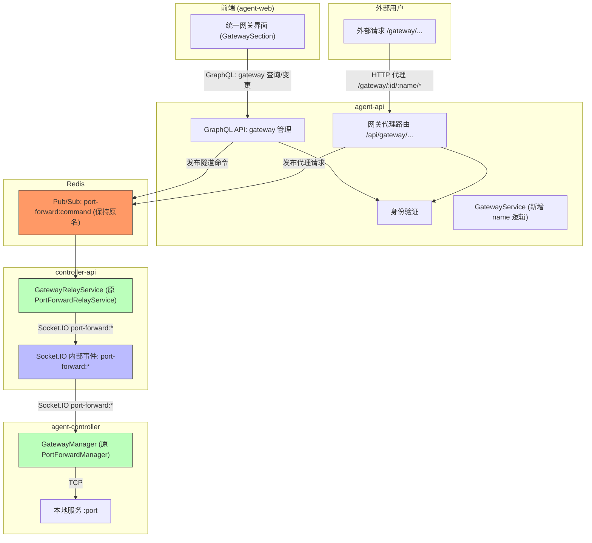
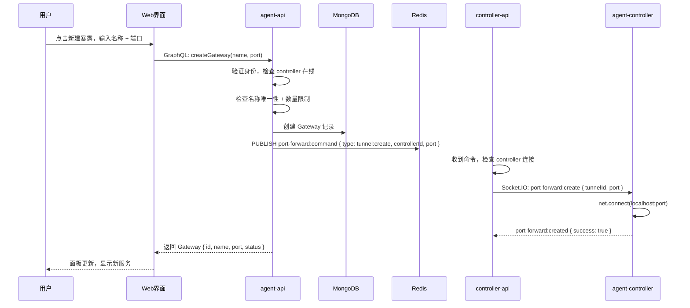
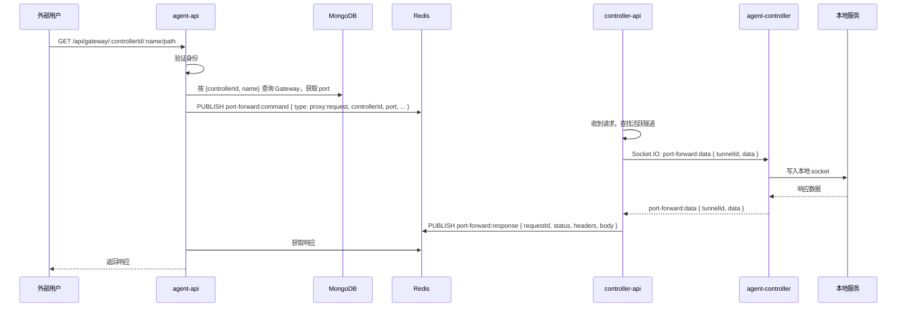

# 统一网关功能 - 技术提案

**功能名称**: 统一网关 (Unified Gateway)
**关联 PRD**: `20260707-unified-gateway.md`
**技术提案版本**: v1.0
**创建日期**: 2026-07-07
**作者**: ZeroAsh
**feat-branch**: `feat/unified-gateway`

## 1. 概述

### 1.1 背景

端口转发功能已在 v1.1 完成实现并发布，提供了以 controller 为粒度的本地端口公网暴露能力，包括 GraphQL 管理 API、REST 代理路由、Redis Pub/Sub 内部通信、Socket.IO 隧道传输等完整实现。前端因 UI/UX 调整，入口暂被注释隐藏。

PRD 要求将"端口转发"升级为"统一网关"，核心变化：
- 产品语义从"暴露端口"变为"暴露服务"
- 引入服务名称作为标识，替代纯端口号标识
- 访问路径从 `/api/forward/{controllerId}/{port}` 变为 `/api/gateway/{controllerId}/{serviceName}`

### 1.2 目标

- 基于现有端口转发代码进行改造，最大程度复用隧道传输、内部通信等底层机制
- 数据模型增加 `name` 字段，作为服务标识
- GraphQL 管理 API 升级为服务语义（增 `name` 参数）
- 代理路由改为按服务名查找
- 前端组件和入口全部更新为"统一网关"

### 1.3 范围

- **包含**：数据模型变更、GraphQL API 改造、REST 代理路由改造、controller-api 中继重命名、agent-controller 隧道管理器重命名、前端组件重命名和升级、契约文件更新、测试文件更新
- **不包含**：Socket.IO 内部事件名变更（保持 `port-forward:*` 以降低风险）、Redis Pub/Sub 频道名变更、底层隧道传输机制修改

## 2. 技术架构

### 2.1 架构变化



### 2.2 增量改造策略

**不改动**（降低风险、减少工作量）：

| 组件 | 原因 |
|------|------|
| Socket.IO 事件名 `port-forward:*` | 仅内部通信，不暴露给用户；改名需同步更新 agent-controller 版本 |
| Redis Pub/Sub 频道 `port-forward:command` / `port-forward:response` | 内部通信频道，无用户感知 |
| 隧道 ID 格式 `{controllerId}:{port}:{uuid}` | port 仍为内部必需字段 |
| 代理请求内部数据格式 | controller-api 与 agent-controller 间的数据协议不变 |

**改造**（面向用户和代码组织）：

| 组件 | 改造方式 |
|------|---------|
| MongoDB 模型 | 改名 + 增加 `name` 字段 |
| GraphQL 类型和操作 | 全部改为 Gateway 语义 |
| REST 代理路由 | 路径改为 `/api/gateway/...`，按 name 查端口 |
| 服务层 / 路由层文件 | 全部重命名 |
| 前端组件 | 重命名 + 增加名称输入 + Sidebar 入口恢复 |
| 契约文件 | 更新为 Gateway 语义 |

### 2.3 技术栈

与现有端口转发一致，无新增依赖。

| 层级 | 技术选型 | 说明 |
|------|---------|------|
| 前端 | React + TypeScript + Apollo Client | 无变化 |
| 后端管理 API | Express + GraphQL-Yoga + Mongoose | 无变化 |
| 后端代理路由 | Express Router | 无变化 |
| 内部通信 | Redis Pub/Sub | 无变化 |
| 控制器通信 | Socket.IO | 无变化 |
| 客户端 | Node.js + Socket.IO-client + net | 无变化 |
| 数据库 | MongoDB | 无变化 |

### 2.4 模块划分

| 模块 | 职责 | 变更类型 |
|------|------|---------|
| agent-api Gateway Model | 数据模型（增 `name` 字段） | 修改 |
| agent-api GraphQL Schema/Resolver | 统一网关管理 API | 修改 |
| agent-api Gateway Service | CRUD + Redis 命令发布（含名称唯一性校验） | 修改 |
| agent-api Gateway Proxy Route | 代理路由（按服务名查找端口再代理） | 修改 |
| controller-api Gateway Relay | Redis 订阅 → Socket.IO 中继 | 重命名 |
| agent-controller Gateway Manager | 本地 TCP 隧道管理 | 重命名 |
| agent-web Gateway Components | 网关 UI（Section/Dialog/Item） | 重命名 + 功能升级 |

## 3. API 设计

### 3.1 管理 API — GraphQL

```graphql
type Gateway {
  id: ID!
  controllerId: ID!
  name: String!        # 新增：服务名称
  port: Int!           # 保留：目标端口
  status: String!
  createdAt: String!
}

type GatewayList {
  gateways: [Gateway!]!
  total: Int!
  limit: Int!
}

extend type Query {
  gateways(controllerId: ID!): GatewayList!
}

extend type Mutation {
  createGateway(controllerId: ID!, name: String!, port: Int!): Gateway!
  deleteGateway(controllerId: ID!, name: String!): Boolean!
}
```

**变更说明**：
- `PortForward` → `Gateway`，增加 `name: String!`
- `createPortForward(controllerId, port)` → `createGateway(controllerId, name, port)`
- `deletePortForward(controllerId, port)` → `deleteGateway(controllerId, name)` — 按服务名删除

### 3.2 代理 API — REST

- **变更**
  - Path: `/api/forward/:controllerId/:port/{*path}` → `/api/gateway/:controllerId/:name/{*path}`
  - 代理内部先通过 `name` 查找 Gateway 记录获取 `port`，再走原有隧道逻辑

- **请求**
  - Method: ANY
  - Path: `/api/gateway/:controllerId/:name/{*path}`
  - Headers: `Authorization: Bearer <token>`

- **响应**
  - 透传本地服务响应

**代理逻辑变更**：
1. 验证身份
2. 按 `controllerId + name` 查询 Gateway 记录（而非 `controllerId + port`）
3. 取出 `port` 后走原有代理流程（Redis Pub/Sub + 隧道）

### 3.3 内部通信 — Redis Pub/Sub

**无变更**。保持频道名和消息格式。

| 频道 | 用途 | 变更 |
|------|------|------|
| `port-forward:command` | agent-api → controller-api 隧道命令 | 不改 |
| `port-forward:response` | controller-api → agent-api 代理响应 | 不改 |

### 3.4 Socket.IO 事件（controller-api ↔ agent-controller）

**无变更**。保持事件名和 Payload 格式。

| 事件 | 方向 | 变更 |
|------|------|------|
| `port-forward:create` | Server → Controller | 不改 |
| `port-forward:created` | Controller → Server | 不改 |
| `port-forward:data` | 双向 | 不改 |
| `port-forward:close` | 双向 | 不改 |
| `port-forward:error` | Controller → Server | 不改 |

## 4. 数据模型

### 4.1 数据库变更

#### 集合: `gateways`（原名 `portforwards`）

| 字段 | 类型 | 变更 | 说明 |
|------|------|------|------|
| `_id` | ObjectId | 不变 | 主键 |
| `controllerId` | ObjectId | 不变 | 关联的 Controller ID |
| `userId` | ObjectId | 不变 | 所属用户 ID |
| `name` | String | **新增** | 服务名称（同一 controller 下唯一） |
| `port` | Number | 不变 | 目标本地端口号 |
| `status` | String | 不变 | `active`, `inactive`, `error` |
| `createdAt` | Date | 不变 | 创建时间 |
| `updatedAt` | Date | 不变 | 更新时间 |

索引变更：
- ~~`{ controllerId: 1, port: 1 }` - 唯一索引~~ → **删除**
- `{ controllerId: 1, name: 1 }` - **新增**唯一索引
- `{ userId: 1 }` - 不变
- `{ controllerId: 1, status: 1 }` - 不变

#### 数据迁移

需为现有 `portforwards` 集合中的每条记录生成 `name` 字段。
策略：使用 `port_${port}` 作为默认名称（如 `port_8080`），保证唯一性。

### 4.2 缓存设计

**无变更**。缓存 key 格式 `port_forward:{controllerId}:{port}` 可保留（port 仍为内部字段）。
如需按 name 查询可新增二级索引：

```
gateway_name:{controllerId}:{name} → { port, status }
TTL: 24 小时
```

## 5. 技术实现方案

### 5.1 核心流程：创建服务暴露



### 5.2 核心流程：代理请求



### 5.3 关键实现点

#### 实现点 1: 数据模型改造

- **描述**: 将 `PortForward` model 改造为 `Gateway` model，增加 `name` 字段，变更唯一索引
- **技术细节**:
  - 重命名文件 `models/port-forward.ts` → `models/gateway.ts`
  - 新增字段 `name: { type: String, required: true }`
  - 唯一索引从 `{ controllerId: 1, port: 1 }` 改为 `{ controllerId: 1, name: 1 }`
  - Model 名从 `PortForward` 改为 `Gateway`
  - 编写迁移脚本：为现有记录生成 `name = "port_${port}"`
- **风险点**: 生产环境已有数据需要迁移

#### 实现点 2: GraphQL API 改造

- **描述**: 重命名 GraphQL 类型和操作，增加 `name` 参数
- **技术细节**:
  - 重命名文件 `graphql/schemas/port-forward.ts` → `graphql/schemas/gateway.ts`
  - 重命名文件 `graphql/resolvers/port-forward.ts` → `graphql/resolvers/gateway.ts`
  - `type PortForward` → `Gateway`，增加 `name: String!`
  - `createPortForward(controllerId, port)` → `createGateway(controllerId, name, port)`
  - 新增名称唯一性校验（同一 controller 下 name 不可重复）
  - `deletePortForward(controllerId, port)` → `deleteGateway(controllerId, name)`
  - resolver 中按 name 查找和删除
- **风险点**: 前端如果使用了旧查询名称会报错，需同步更新前端

#### 实现点 3: 代理路由改造

- **描述**: 更改路由路径，按服务名称查找端口
- **技术细节**:
  - 路由从 `/forward/:controllerId/:port/{*path}` 改为 `/gateway/:controllerId/:name/{*path}`
  - 代理逻辑中：先按 `{controllerId, name}` 查询 Gateway 记录
  - 获取 `port` 后，后续隧道逻辑不变
  - 记录不存在返回 404
- **风险点**: 无

#### 实现点 4: 服务层改造

- **描述**: 重命名 `PortForwardService` 为 `GatewayService`，增加 name 相关逻辑
- **技术细节**:
  - `findAllByController` → 查询 Gateway 记录
  - `create` → 新增 `name` 参数、校验名称唯一性
  - `delete` → 改为按 name 删除
  - 内部 Redis 命令不受影响（仍使用 port）
- **风险点**: 无

#### 实现点 5: controller-api 重命名

- **描述**: `PortForwardRelayService` → `GatewayRelayService`，代码内部重命名
- **技术细节**:
  - 文件重命名 `services/port-forward.ts` → `services/gateway-relay.ts`
  - Class 重命名
  - Socket.IO 事件处理中调用的方法名更新
  - 内部逻辑、Redis 频道名、Socket.IO 事件名不变
- **风险点**: 低

#### 实现点 6: agent-controller 重命名

- **描述**: `PortForwardManager` → `GatewayManager`
- **技术细节**:
  - 文件重命名 `port-forward.ts` → `gateway.ts`
  - Class 和方法重命名
  - `socketio-client.ts` 中 import 更新
- **风险点**: 低

#### 实现点 7: 前端组件升级

- **描述**: 重命名并升级前端组件，增加服务名称输入
- **技术细节**:
  - `PortForwardSection.tsx` → `GatewaySection.tsx`
  - `PortForwardDialog.tsx` → `GatewayDialog.tsx`：（关键变化）增加服务名称输入框
  - `PortForwardItem.tsx` → `GatewayItem.tsx`：显示服务名称为主，端口号为辅
  - `Sidebar.tsx`：取消注释，引入 GatewaySection，名称改为"统一网关"
  - GraphQL queries/mutations/types 全部更新
- **风险点**: Sidebar 入口已注释，需验证恢复后布局正常

#### 实现点 8: 文件重命名清单

所有需要重命名的文件：

| 原文件 | 新文件 |
|--------|--------|
| `servers/agent-api/src/models/port-forward.ts` | `models/gateway.ts` |
| `servers/agent-api/src/graphql/schemas/port-forward.ts` | `graphql/schemas/gateway.ts` |
| `servers/agent-api/src/graphql/resolvers/port-forward.ts` | `graphql/resolvers/gateway.ts` |
| `servers/agent-api/src/services/port-forward.ts` | `services/gateway.ts` |
| `servers/agent-api/src/routes/port-forward-proxy.ts` | `routes/gateway-proxy.ts` |
| `servers/controller-api/src/services/port-forward.ts` | `services/gateway-relay.ts` |
| `packages/agent-controller/src/port-forward.ts` | `gateway.ts` |
| `packages/agent-controller/src/port-forward.test.ts` | `port-forward.test.ts` |
| `apps/agent-web/src/components/PortForwardSection.tsx` | `GatewaySection.tsx` |
| `apps/agent-web/src/components/PortForwardDialog.tsx` | `GatewayDialog.tsx` |
| `apps/agent-web/src/components/PortForwardItem.tsx` | `GatewayItem.tsx` |
| `contracts/port-forward.graphql` | `gateway.graphql` |
| `contracts/port-forward-proxy.openapi.yaml` | `gateway-proxy.openapi.yaml` |

**不重命名**（内容更新即可）：
- `contracts/port-forward-websocket.md`（引用内部事件名，无需改名，更新说明即可）
- 测试文件（内容跟随代码变更）

## 6. 技术决策

### 6.1 决策列表

| 决策 | 选项 A | 选项 B | 最终选择 | 原因 |
|------|--------|--------|---------|------|
| Socket.IO 事件名 | 改为 `gateway:*` | 保持 `port-forward:*` | 保持原名 | 降低风险，减少 agent-controller 强制更新；用户无感知 |
| Redis 频道名 | 改为 `gateway:*` | 保持原名 | 保持原名 | 与 Socket.IO 同理 |
| 内部隧道 ID 格式 | 改为 `{cid}:{name}:{uuid}` | 保持 `{cid}:{port}:{uuid}` | 保持原格式 | port 仍为必需字段，不影响功能 |
| 删除标识 | 按 port 删除 | 按 name 删除 | 按 name 删除 | 产品语义以服务名称为主 |
| 数据迁移策略 | 停机迁移 | 在线迁移（默认 name） | 默认 name 生成 | 现有记录极少，直接生成默认名 |

### 6.2 依赖与约束

| 类型 | 内容 | 说明 |
|------|------|------|
| 依赖 | MongoDB | 存储 Gateway 记录，需迁移现有数据 |
| 依赖 | Redis | Pub/Sub 内部通信，无变更 |
| 依赖 | Socket.IO | controller-api ↔ agent-controller 通信，无变更 |
| 约束 | 同一 controller 下 name 唯一 | 新增约束，需在代码和数据库层面保证 |
| 约束 | 单个 controller 最多 5 个暴露 | 不变 |
| 约束 | 代理 API 需要身份验证 | 不变 |
| 约束 | 服务名 1-50 字符，仅支持字母、数字、中划线和下划线 | 新增格式约束 |

## 7. 项目结构变更

```
servers/agent-api/src/
├── graphql/
│   ├── schemas/
│   │   ├── gateway.ts             # 新增（原 port-forward.ts 改名）
│   │   └── ...                    # index.ts 更新 import
│   └── resolvers/
│       └── gateway.ts             # 新增（原 port-forward.ts 改名）
├── routes/
│   ├── gateway-proxy.ts           # 新增（原 port-forward-proxy.ts 改名）
│   └── ...
├── services/
│   ├── gateway.ts                 # 新增（原 port-forward.ts 改名）
│   └── ...
├── models/
│   ├── gateway.ts                 # 新增（原 port-forward.ts 改名）
│   └── ...
└── index.ts                       # 修改：import 路径更新

servers/controller-api/src/
├── services/
│   ├── gateway-relay.ts           # 新增（原 port-forward.ts 改名）
│   └── socketio.ts               # 修改：import 路径更新
└── index.ts                       # 修改：import 路径更新

packages/agent-controller/src/
├── gateway.ts                     # 新增（原 port-forward.ts 改名）
└── socketio-client.ts             # 修改：import 路径更新

apps/agent-web/src/
├── components/
│   ├── GatewaySection.tsx         # 新增（原 PortForwardSection.tsx 改名）
│   ├── GatewayDialog.tsx          # 新增（原 PortForwardDialog.tsx 改名）
│   ├── GatewayItem.tsx            # 新增（原 PortForwardItem.tsx 改名）
│   └── Sidebar.tsx               # 修改：更新 import，恢复入口
└── graphql/
    ├── queries.ts                 # 修改：更新查询名
    ├── mutations.ts               # 修改：更新变更名和参数
    └── types.ts                   # 修改：更新类型名

contracts/
├── gateway.graphql               # 新增（原 port-forward.graphql 改名）
└── gateway-proxy.openapi.yaml    # 新增（原 port-forward-proxy.openapi.yaml 改名）
```

## 8. 测试策略

### 8.1 测试覆盖要求

- 单元测试覆盖率: >= 80%
- API 测试覆盖的端点: GraphQL `gateway` 查询/变更 + REST 代理路由
- 现有端口转发测试全部迁移到新命名

### 8.2 测试变更

| 测试文件 | 变更类型 | 说明 |
|---------|---------|------|
| `packages/agent-controller/src/port-forward.test.ts` | 重命名 + 内容更新 | `PortForwardManager` → `GatewayManager` |
| `servers/agent-api/src/services/port-forward.test.ts` | 重命名 + 内容更新 | `PortForwardService` → `GatewayService`；测试 name 相关逻辑 |
| `servers/agent-api/src/graphql/resolvers/port-forward.test.ts` | 重命名 + 内容更新 | 更新 GraphQL 操作名和参数 |
| `servers/controller-api/src/services/port-forward.test.ts` | 重命名 + 内容更新 | `PortForwardRelayService` → `GatewayRelayService` |
| `tests/api/src/agent-api/port-forward.test.ts` | 内容更新 | 更新 API 请求路径和 payload |
| `tests/e2e/src/port-forward.spec.ts` | 内容更新 | 更新选择器和交互流程；考虑取消 skip |

### 8.3 新增测试场景

| 类型 | 场景 | 说明 |
|------|------|------|
| 单元测试 | 名称唯一性校验 | 同一 controller 下重复名称返回错误 |
| 单元测试 | 名称格式校验 | 非法字符返回错误 |
| API 测试 | 按名称删除 | `deleteGateway(controllerId, name)` |
| API 测试 | 按名称代理请求 | `GET /api/gateway/:controllerId/:name/path` |
| E2E 测试 | 创建暴露（含名称输入） | 输入名称 + 端口 |
| E2E 测试 | 列表展示服务名称 | 验证服务名称正确显示 |

## 9. 部署方案

### 9.1 环境规划

| 环境 | 用途 | 部署方式 | 注意事项 |
|------|------|---------|---------|
| 开发 | 本地开发测试 | Aspire 编排 | 需先跑数据迁移脚本 |
| 测试 | 集成测试 | Docker Compose | 需验证现有端口转发数据迁移 |
| 生产 | 生产环境 | Docker Compose | 先迁移再部署新版本 |

### 9.2 配置管理

| 配置项 | 默认值 | 说明 |
|--------|--------|------|
| `GATEWAY_MAX_PER_CONTROLLER` | `5` | 一个 Controller 最多暴露的服务数 |

### 9.3 数据迁移

```typescript
// MongoDB 迁移脚本示例
db.portforwards.find().forEach(function(doc) {
  var defaultName = 'port_' + doc.port;
  // 处理同一 controller 下端口不同但默认名称相同的情况
  var uniqueName = defaultName;
  var counter = 1;
  while (db.gateways.findOne({ controllerId: doc.controllerId, name: uniqueName })) {
    uniqueName = defaultName + '_' + counter;
    counter++;
  }
  db.gateways.insert({
    _id: doc._id,
    controllerId: doc.controllerId,
    userId: doc.userId,
    name: uniqueName,
    port: doc.port,
    status: doc.status,
    createdAt: doc.createdAt,
    updatedAt: doc.updatedAt,
  });
  db.portforwards.remove({ _id: doc._id });
});
```

## 10. 验收标准

- [ ] 技术方案评审通过
- [ ] 数据模型变更完成（含迁移脚本）
- [ ] GraphQL API：`createGateway(name, port)` 正常工作
- [ ] GraphQL API：`deleteGateway(name)` 正常工作
- [ ] REST 代理：`/api/gateway/:id/:name/*` 正常代理请求
- [ ] 代理 API 身份验证正常
- [ ] 服务名称唯一性校验正确
- [ ] 名称格式校验正确
- [ ] 前端 Sidebar 入口"统一网关"正常显示
- [ ] 前端创建对话框包含服务名称输入
- [ ] 前端列表项显示服务名称
- [ ] 单元测试覆盖达标
- [ ] API 测试通过
- [ ] E2E 测试通过

## 11. 相关文档

- [统一网关 PRD](../product/draft/20260707-unified-gateway.md)
- [端口转发技术方案（原版）](./20260527-feat-port-forwarding.md)
- [端口转发 PRD（原版）](../product/released/20260527-port-forwarding-for-local-agent-controller.md)
- [通用开发规范](../common-rules.md)
- [后端开发规范](../backend-rules.md)
