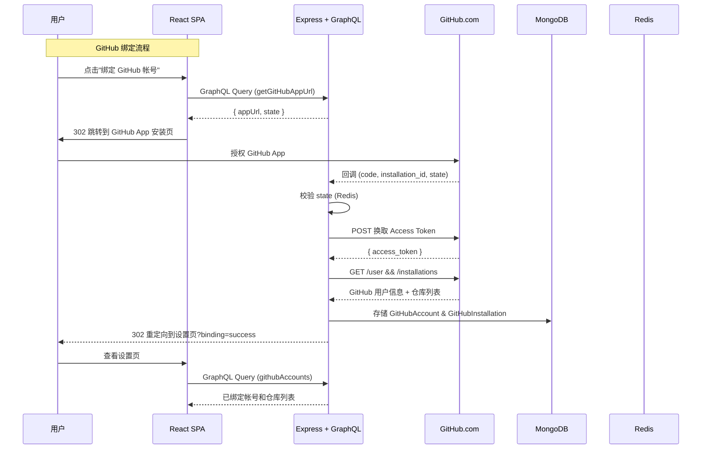
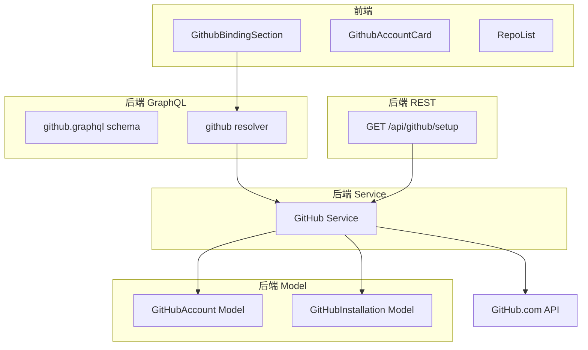
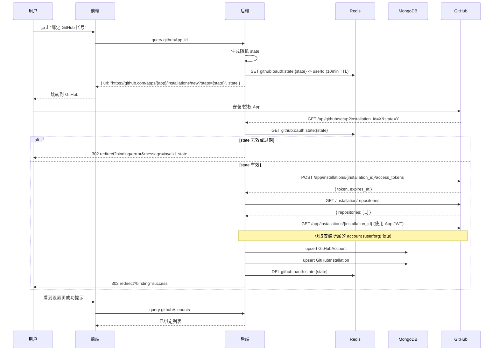
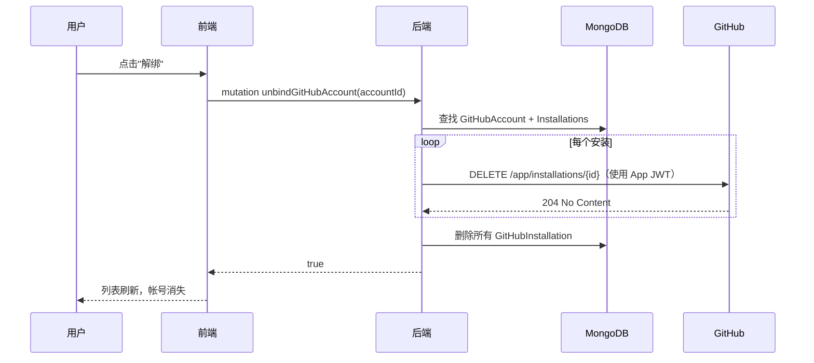

# GitHub 帐号绑定 - 技术提案

**功能名称**: GitHub 帐号绑定
**关联 PRD**: `github-account-binding.md`
**技术提案版本**: v1.0
**创建日期**: 2026-07-09
**作者**: ZeroAsh Agent
**feat-branch**: `feat/github-account-binding`

## 1. 概述

### 1.1 背景

基于 PRD `github-account-binding.md`，平台需要支持用户绑定 GitHub 帐号，以便后续基于 GitHub 仓库触发自动化工作流（CI/CD、代码审查等）。当前系统没有任何 GitHub 集成能力，需要从零构建 GitHub App OAuth 绑定流程。

### 1.2 目标

- 在设置页新增 "GitHub 绑定" section，展示已绑定帐号和仓库列表
- 实现 GitHub App Installation OAuth 流程，支持绑定多个 GitHub 帐号
- 实现回调 endpoint，完成平台用户与 GitHub 用户关联
- 支持解绑操作

### 1.3 范围

- 包含：GitHub App OAuth 绑定流程、回调 endpoint、设置页 UI、数据模型
- 不包含：基于绑定的后续功能（PR 管理、CI 触发等）、GitHub Enterprise 支持

## 2. 技术架构

### 2.1 系统架构图



### 2.2 技术栈

| 层级 | 技术选型 | 说明 |
|------|---------|------|
| 前端 | React 19 + TypeScript | 与现有项目一致 |
| 前端 GraphQL | Apollo Client | 已有 |
| 前端样式 | Tailwind CSS v4 | 与现有项目一致 |
| 后端 | Express v5 + GraphQL-Yoga | 现有项目 |
| 数据库 | MongoDB + Mongoose | OAuth token 和绑定关系存储 |
| 缓存 | Redis | OAuth state 校验 |
| GitHub SDK | 自封装 fetch 调用 | 无需额外 npm 包，直接调用 GitHub REST API |

### 2.3 模块划分



| 模块 | 职责 | 关键技术点 |
|------|------|-----------|
| 前端 GithubBindingSection | 设置页中展示绑定入口和已绑定列表 | 折叠式帐号卡片 |
| 后端 github.graphql | GitHub 绑定的 GraphQL typeDefs | Query + Mutation |
| 后端 github resolver | 处理绑定/解绑/列表查询 | JWT 鉴权上下文 |
| 后端 GitHub Service | 与 GitHub API 交互的核心逻辑 | OAuth token 换取、用户信息获取 |
| 后端 Setup Endpoint | 接收 GitHub App 安装后回调 | Express GET route，state 校验 |

## 3. API 设计

### 3.1 GraphQL Schema

新增 `contracts/github.graphql`：

```graphql
type GitHubAccount {
  id: ID!
  githubUserId: Int!
  githubLogin: String!
  githubAvatarUrl: String
  installations: [GitHubInstallation!]
  createdAt: String!
}

type GitHubInstallation {
  id: ID!
  installationId: Int!
  managementUrl: String!
  repos: [GitHubRepo!]
  createdAt: String!
}

type GitHubRepo {
  id: ID!
  repoId: Int!
  repoName: String!
  fullName: String!
  private: Boolean!
  permissions: GitHubRepoPermissions!
}

type GitHubRepoPermissions {
  read: Boolean!
  write: Boolean!
}

type GitHubAppUrl {
  url: String!
  state: String!
}

type Query {
  githubAccounts: [GitHubAccount!]!
  githubAppUrl: GitHubAppUrl!
}

type Mutation {
  unbindGitHubAccount(accountId: ID!): Boolean!
  refreshGitHubInstallations(accountId: ID!): GitHubAccount!
}
```

### 3.2 REST Endpoint

#### Endpoint: GitHub App Setup URL

- **Method**: GET
- **Path**: `/api/github/setup`
- **Query 参数**:
  - `installation_id` (required): GitHub App Installation ID
  - `setup_action` (optional): 操作类型 (install/update)
  - `state` (required): CSRF state token
- **成功响应**: 302 重定向至 `{FRONTEND_URL}/settings?binding=success`
- **失败响应**: 302 重定向至 `{FRONTEND_URL}/settings?binding=error&message={msg}`
- **处理逻辑**:
  1. 校验 `state` 与 Redis 中存储的值一致
  2. 使用 `installation_id` 换取 Access Token
  3. 获取 GitHub 用户信息和授权仓库
  4. 建立平台用户与 GitHub 用户的关联
  5. 存储到 MongoDB

### 3.3 内部接口

#### GitHub Service

```typescript
interface IGitHubService {
  getAppUrl(userId: string): Promise<{ url: string; state: string }>;
  handleSetup(params: SetupParams): Promise<void>;
  getAccounts(userId: string): Promise<GitHubAccount[]>;
  unbindAccount(userId: string, accountId: string): Promise<void>;
  refreshInstallations(userId: string, accountId: string): Promise<GitHubAccount>;
}
```

## 4. 数据模型

### 4.1 数据库设计

#### 集合: `github_accounts`

| 字段 | 类型 | 说明 |
|------|------|------|
| _id | ObjectId | 主键 |
| userId | ObjectId, ref: User, required | 平台用户 ID |
| githubUserId | Number, required | GitHub 用户 ID |
| githubLogin | String, required | GitHub 用户名 |
| githubAvatarUrl | String | GitHub 头像 URL |
| accessToken | String, encrypted | GitHub App access token（加密存储） |
| tokenExpiresAt | Date | Token 过期时间 |
| createdAt | Date | 创建时间 |
| updatedAt | Date | 更新时间 |

索引: `{ userId: 1 }`, `{ githubUserId: 1 }`, `{ userId: 1, githubUserId: 1 }` (unique compound)

#### 集合: `github_installations`

| 字段 | 类型 | 说明 |
|------|------|------|
| _id | ObjectId | 主键 |
| accountId | ObjectId, ref: GitHubAccount, required | 关联的 GitHub 帐号 |
| installationId | Number, required | GitHub App Installation ID |
| accountLogin | String, required | 安装所属的 GitHub 登录名（用于构建管理 URL） |
| accountType | String, required | 安装所属的账号类型: User / Organization |
| repos | Array | 授权仓库列表 |
| repos[].repoId | Number | GitHub 仓库 ID |
| repos[].repoName | String | 仓库名称 |
| repos[].fullName | String | 完整名 (owner/repo) |
| repos[].private | Boolean | 是否私有 |
| repos[].permissions | Object | 权限对象 |
| repos[].permissions.read | Boolean | 读权限 |
| repos[].permissions.write | Boolean | 写权限 |
| createdAt | Date | 创建时间 |

索引: `{ accountId: 1 }`, `{ installationId: 1 }` (unique)

### 4.2 缓存设计

| Key | Value | TTL | 用途 |
|-----|-------|-----|------|
| `github:oauth:state:{state}` | userId | 10 分钟 | OAuth state 校验 |

## 5. 技术实现方案

### 5.1 核心流程

#### OAuth 绑定流程



#### 解绑流程



### 5.2 关键实现点

#### 实现点 1: GitHub App 配置与管理

- **描述**: 需要配置 GitHub App 并管理其私钥
- **技术细节**:
  - GitHub App 需在 GitHub 上注册，获取 App ID 和 Private Key
  - 后端使用 JWT (以 App ID + Private Key 签发) 来获取 Installation Token
  - GitHub App 需要 `Contents` (read/write) 和 `Metadata` (read) 权限
  - 配置项:
    ```
    GITHUB_APP_ID=<app_id>
    GITHUB_APP_PRIVATE_KEY=<base64_encoded_private_key>
    GITHUB_APP_URL=https://github.com/apps/<app_name>
    GITHUB_SETUP_URL=https://<api_domain>/api/github/setup
    FRONTEND_URL=https://<frontend_domain>
    ```
- **风险点**: Private Key 泄露会带来安全风险，需妥善保管

#### 实现点 2: 回调 Endpoint 的身份绑定

- **描述**: 在 Express REST route 中处理 OAuth 回调
- **技术细节**:
  - 新增路由文件 `servers/agent-api/src/routes/github.ts`
  - 在 `index.ts` 中注册到 Express: `app.use('/api', githubRouter)`
  - 从 `state` 参数反查 Redis 获取 `userId`
  - 使用 Installation Token 查询 GitHub API，获取 account 信息和 repo 列表
  - 存储到 MongoDB，采用 upsert 策略（同一 GitHub 用户不重复绑定）
- **风险点**: GitHub API 可能限流，需处理 429 错误

#### 实现点 3: Token 加密存储

- **描述**: Access Token 在数据库中必须加密
- **技术细节**:
  - 使用 Node.js 内置 `crypto` 模块 AES-256-GCM 加密
  - 加密密钥来自环境变量 `GITHUB_TOKEN_ENCRYPTION_KEY`
  - 在 Mongoose Schema 中使用 `set`/`get` 自动处理加解密
  - 或使用 mongoose-auto-encrypt 插件（需评估是否已引入）
- **风险点**: 加密密钥丢失导致历史 token 无法解密

#### 实现点 4: 前端 GitHubBindingSection 组件

- **描述**: 在设置页新增 GitHub 绑定 section
- **技术细节**:
  - 参考现有 `ProviderSection.tsx` 的 section 模式
  - 未绑定状态：显示空状态 + "绑定 GitHub 帐号" 按钮
  - 已绑定状态：展示帐号卡片列表，每张卡片可展开显示仓库
  - 支持解绑操作（需二次确认弹窗）
  - 监听 URL 参数 `?binding=success` 显示 Toast 提示
- **组件结构**:
  ```
  components/settings/
  ├── GithubBindingSection.tsx       # 主 section 组件
  ├── GithubAccountCard.tsx          # 单个帐号卡片（含展开/收拢）
  ├── GithubRepoList.tsx             # 仓库列表
  └── UnbindConfirmDialog.tsx        # 解绑确认弹窗
  ```

#### 实现点 5: OAuth CSRF 防护

- **描述**: 防止 OAuth 回调被伪造
- **技术细节**:
  - 每次生成 `githubAppUrl` 时，生成随机 state (crypto.randomUUID)
  - 将 `{ state: userId }` 存入 Redis，TTL 10 分钟
  - 回调时校验 state 存在且匹配，校验后立即删除
  - 避免重放攻击

#### 实现点 6: 更新绑定按钮

- **描述**: 绑定后用户可快速回到 GitHub 安装配置页管理仓库授权
- **技术细节**:
  - 后端在 `handleSetup` 中存储 `accountLogin` 和 `accountType`（User/Organization）
  - 后端 `getAccounts` 计算 `managementUrl`：
    - User 类型: `https://github.com/settings/installations/{installationId}`
    - Organization 类型: `https://github.com/organizations/{login}/settings/installations/{installationId}`
  - GraphQL `GitHubInstallation` type 新增 `managementUrl: String!`
  - Contract `contracts/github.graphql` 同步更新
  - 前端从 `managementUrl` 取值，打开新标签页

## 6. 技术决策

### 6.1 决策列表

| 决策 | 选项 A | 选项 B | 最终选择 | 原因 |
|------|--------|--------|---------|------|
| GitHub 集成方式 | GitHub App (Installation) | GitHub OAuth App | GitHub App | GitHub App 支持 Installation 级别的仓库选择，支持 read/write 权限声明 |
| Token 换取时机 | 回调时立即换取 | 延迟换取（使用时） | 回调时立即换取 | 用户体验好，绑定即完成授权 |
| Setup 实现 | Express REST Route | GraphQL Mutation | Express REST Route | GitHub 回调是浏览器 302 跳转，无法使用 GraphQL |
| Token 加密方式 | AES-256-GCM | node-crypton | AES-256-GCM | 原生 crypto 模块，零依赖 |
| 绑定关系存储 | 独立 Collection | 嵌入 User 文档 | 独立 Collection | GitHub 数据结构复杂（多帐号+多 repo），独立 collection 更方便查询和扩展 |
| 前端状态管理 | React Context | Apollo Cache | Apollo Cache | 绑定数据来自 GraphQL query，Apollo Cache 自动管理 |

### 6.2 依赖与约束

| 类型 | 内容 | 说明 |
|------|------|------|
| 依赖 | GitHub App 已注册 | 需提前创建 GitHub App 并获取 App ID 和 Private Key |
| 依赖 | GitHub App 权限：Contents (read/write) + Metadata (read) | PRD 要求每个 repo 都有 read + write 权限 |
| 依赖 | Redis | OAuth state 存储和校验 |
| 约束 | 遵循 `docs/engineering/backend-rules.md` | |
| 约束 | 遵循 `docs/engineering/frontend-rules.md` | |
| 约束 | Setting 页 section 遵循现有组件模式 | 参考 ProviderSection 的结构和风格 |

## 7. 项目结构

```
# 新增/修改文件清单

# 后端
servers/agent-api/
├── src/
│   ├── graphql/
│   │   ├── schemas/
│   │   │   ├── github.ts             # 新增: GitHub GraphQL typeDefs
│   │   │   └── index.ts              # 修改: 注册 github schema
│   │   └── resolvers/
│   │       ├── github.ts             # 新增: GitHub resolvers
│   │       └── index.ts              # 修改: 注册 github resolvers
│   ├── models/
│   │   ├── github-account.ts         # 新增: GitHubAccount Mongoose model
│   │   └── github-installation.ts    # 新增: GitHubInstallation Mongoose model
│   ├── services/
│   │   └── github.ts                 # 新增: GitHub 业务逻辑服务
│   ├── routes/
│ │   └── github.ts                 # 新增: GitHub 安装回调 REST route
│   └── index.ts                      # 修改: 注册 github route
├── src/config/
│   └── index.ts                      # 修改: 新增 GitHub 配置项

# 前端
apps/agent-web/
├── src/
│   ├── components/settings/
│   │   ├── GithubBindingSection.tsx   # 新增
│   │   ├── GithubAccountCard.tsx      # 新增
│   │   ├── GithubRepoList.tsx         # 新增
│   │   └── UnbindConfirmDialog.tsx    # 新增
│   ├── graphql/
│   │   ├── queries.ts                 # 修改: 新增 githubAccounts, githubAppUrl query
│   │   ├── mutations.ts               # 修改: 新增 unbindGitHubAccount mutation
│   │   └── types.ts                   # 修改: 新增 GitHub 相关 TypeScript 类型
│   └── pages/
│       └── SettingsPage.tsx           # 修改: 引入 GithubBindingSection

# Contracts
contracts/
└── github.graphql                    # 新增: GitHub binding GraphQL schema

# Tests
tests/api/src/agent-api/
└── github.test.ts                    # 新增: GitHub binding API 集成测试
tests/e2e/src/
└── settings-github-binding.spec.ts   # 新增: GitHub binding E2E 测试
```

## 8. 测试策略

### 8.1 测试覆盖要求

- 后端 GraphQL query/mutation 全覆盖
- 回调 endpoint 全覆盖（含异常场景）
- 前端组件渲染和交互覆盖
- API 集成测试覆盖核心绑定/解绑流程
- E2E 测试覆盖设置页 GitHub 绑定 UI 交互

### 8.2 测试类型

| 类型 | 工具 | 覆盖范围 |
|------|------|---------|
| 后端 GraphQL 集成测试 | Vitest | githubAccounts query、githubAppUrl query、unbindGitHubAccount mutation |
| 后端 REST 集成测试 | Vitest + supertest | setup endpoint 正常/异常流程 |
| 后端 Service 单元测试 | Vitest | GitHub API 调用、token 加解密、state 校验 |
| 前端组件测试 | Vitest + React Testing Library | GithubBindingSection 渲染、绑定/解绑交互、空状态 |
| API 集成测试 | Vitest (tests/api) | 认证用户执行绑定/解绑全流程，使用真实 GraphQL 端点 |
| E2E 测试 | Playwright (tests/e2e) | 设置页 GitHub 绑定 section 可见性、空状态、绑定跳转、解绑确认 |

### 8.3 API 集成测试 (`tests/api/src/agent-api/github.test.ts`)

通过 `gqlRequest` 辅助函数（复用 `auth.test.ts` 模式）直接调用 GraphQL 端点进行集成测试：

```typescript
describe('GitHub Binding API', () => {
  const SIGNUP = `mutation Signup(...) { signup(...) { token user { id } } }`;

  it('githubAppUrl - 无 auth', async () => {
    const res = await gqlRequest(GITHUB_APP_URL);
    const body = await res.json();
    expect(body.errors[0].message).toBe('Not authenticated');
  });

  it('githubAppUrl - 已认证', async () => {
    const res = await gqlRequest(GITHUB_APP_URL, undefined, token);
    const body = await res.json();
    expect(body.data.githubAppUrl.url).toContain('github.com');
    expect(body.data.githubAppUrl.state).toBeDefined();
  });

  it('githubAccounts - 无 auth', async () => {
    const res = await gqlRequest(GITHUB_ACCOUNTS);
    const body = await res.json();
    expect(body.errors[0].message).toBe('Not authenticated');
  });

  it('githubAccounts - 初始为空', async () => {
    const res = await gqlRequest(GITHUB_ACCOUNTS, undefined, token);
    const body = await res.json();
    expect(body.data.githubAccounts).toEqual([]);
  });

  it('unbindGitHubAccount - 无 auth', async () => {
    const res = await gqlRequest(UNBIND, { accountId: 'fake' });
    const body = await res.json();
    expect(body.errors[0].message).toBe('Not authenticated');
  });

  it('unbindGitHubAccount - 不存在的帐号应返回 false', async () => {
    const res = await gqlRequest(UNBIND, { accountId: new ObjectId().toString() }, token);
    const body = await res.json();
    expect(body.data.unbindGitHubAccount).toBe(false);
  });
});
```

### 8.4 E2E 测试 (`tests/e2e/src/settings-github-binding.spec.ts`)

使用 Playwright 模拟用户在设置页的 GitHub 绑定交互：

```typescript
test.describe('Settings GitHub Binding E2E', () => {
  test.beforeAll(async ({ browser }) => {
    // 注册用户并登录
  });

  test('should show GitHub binding section in settings', async ({ page }) => {
    await page.goto('/settings');
    await expect(page.getByText('GitHub 绑定')).toBeVisible();
  });

  test('should show empty state when no accounts bound', async ({ page }) => {
    await page.goto('/settings');
    await expect(page.getByText(/暂无绑定/)).toBeVisible();
    await expect(page.getByRole('button', { name: '绑定 GitHub 帐号' })).toBeVisible();
  });

  test('should navigate to GitHub App on bind click', async ({ page }) => {
    await page.goto('/settings');
    await page.getByRole('button', { name: '绑定 GitHub 帐号' }).click();
    // 检查是否跳转到 github.com/apps/...
    await expect(page).toHaveURL(/github\.com\/apps\//);
  });

  test('should show success toast on binding setup', async ({ page }) => {
    await page.goto('/settings?binding=success');
    await expect(page.getByText(/绑定成功/)).toBeVisible();
  });

  test('should show error toast on binding failure', async ({ page }) => {
    await page.goto('/settings?binding=error&message=invalid_state');
    await expect(page.getByText(/绑定失败/)).toBeVisible();
  });

  test('should show confirm dialog on unbind', async ({ page }) => {
    // 先通过 API 创建绑定数据
    await page.goto('/settings');
    await page.getByRole('button', { name: '解绑' }).first().click();
    await expect(page.getByText(/确认解绑/)).toBeVisible();
  });
});
```

## 9. 验收标准

- [ ] 技术方案评审通过
- [ ] Contract 评审通过 (`contracts/github.graphql`)
- [ ] 后端模型和 GraphQL 实现完成
- [ ] 回调 endpoint 实现完成
- [ ] 前端 GitHub 绑定 section 实现完成
- [ ] Token 加密存储实现
- [ ] API 测试通过
- [ ] 前端组件测试通过

## 10. 相关文档

- [关联 PRD](../../product/draft/github-account-binding.md)
- [后端规范](../backend-rules.md)
- [前端规范](../frontend-rules.md)
- [通用规范](../common-rules.md)
- [GitHub App 开发文档](https://docs.github.com/en/apps/creating-github-apps)
- [GitHub REST API - Installation](https://docs.github.com/en/rest/apps/apps?apiVersion=2022-11-28#create-an-installation-access-token-for-an-app)
