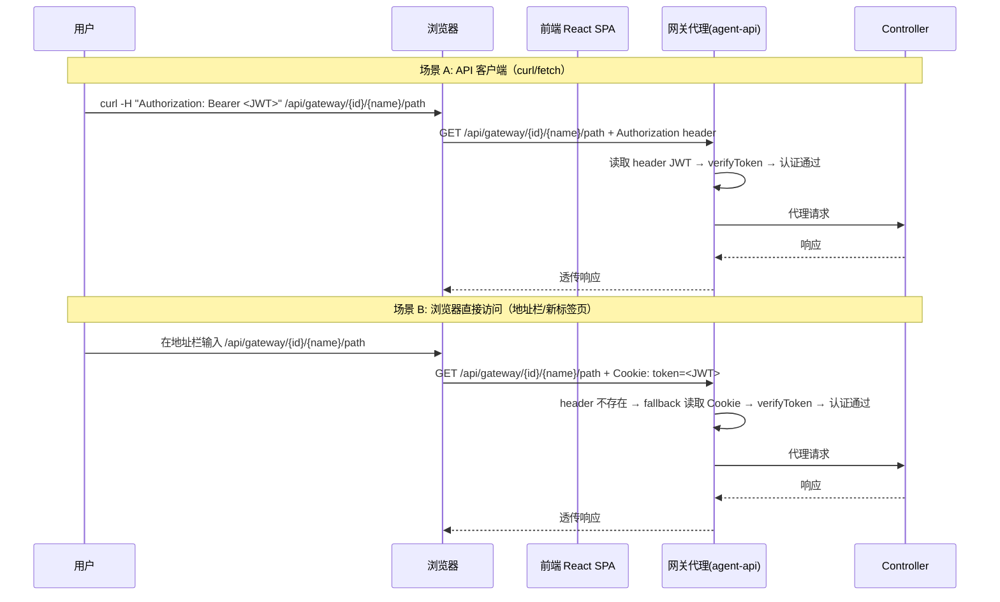
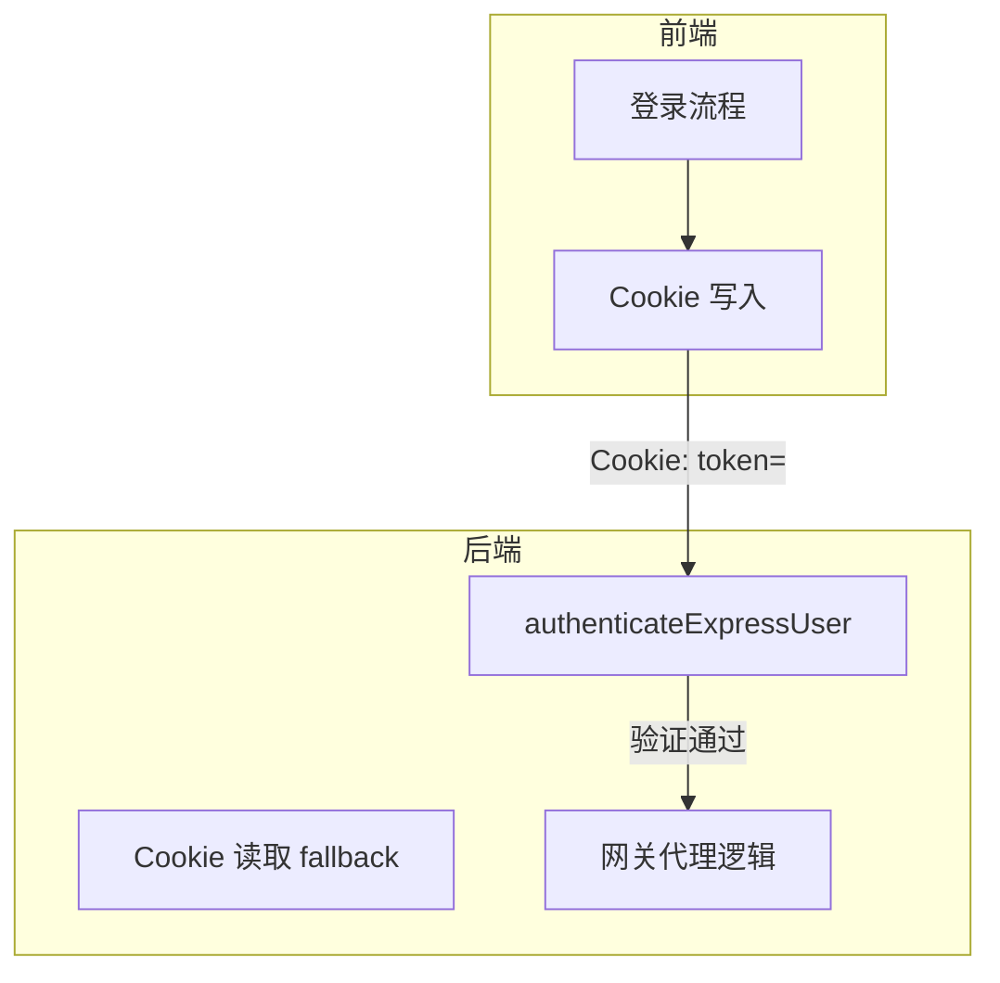

# 网关代理双模式认证 - 技术提案

**功能名称**: 网关代理双模式认证
**关联 PRD**: 无（验收问题驱动）
**技术提案版本**: v1.0
**创建日期**: 2026-07-10
**作者**: ZeroAsh Agent
**feat-branch**: `fix/gateway-dual-auth`

## 1. 概述

### 1.1 背景

统一网关（Gateway Proxy）用于将外部请求代理到 agent-controller 所在机器的本地服务，访问路径格式为 `http://<host>/api/gateway/{controllerId}/{name}/{path}`。

当前网关认证仅支持 `Authorization: Bearer <token>` header，但浏览器直接访问（地址栏输入、新标签打开、页面跳转）无法携带自定义 header，导致返回 `{"error":"Not authenticated"}`。这阻碍了用户通过浏览器直接使用网关暴露的服务（如 Web UI、API 调试工具等）。

### 1.2 目标

- 网关代理同时支持 header 和 cookie 两种 JWT 传递方式
- 兼容已有的 API 客户端（curl/fetch 使用 `Authorization` header）
- 使浏览器直接访问网关 URL 时能自动携带认证信息

### 1.3 范围

- 包含：网关认证逻辑修改、前端登录 cookie 写入、契约文档更新、测试覆盖
- 不包含：OAuth2 / SSO 集成、会话管理改造、网关以外的认证机制修改

## 2. 技术架构

### 2.1 系统架构图



### 2.2 技术栈

| 层级 | 技术选型 | 说明 |
|------|---------|------|
| 后端认证 | jsonwebtoken + cookie-parser | JWT 验证复用已有 `verifyToken`，cookie-parser 解析 cookie |
| 前端存储 | js-cookie 或原生 document.cookie | 登录成功后写入 httpOnly 或 js 可读的 cookie |
| 契约 | OpenAPI 3.1 | 更新 `gateway-proxy.openapi.yaml` 补充 cookie 认证方式 |

### 2.3 模块划分



| 模块 | 职责 | 关键技术点 |
|------|------|-----------|
| 后端 `authenticateExpressUser` | 双模式认证：优先 header → fallback cookie | `cookie-parser` 中间件 |
| 前端登录后写 cookie | 登录成功后种 JWT cookie | `document.cookie` 或 `js-cookie` |

## 3. API 设计

### 3.1 API 契约

```
GET /api/gateway/{controllerId}/{name}/{path}
```

**Security**:
- `Authorization: Bearer <JWT>` header（API 客户端用）
- `Cookie: token=<JWT>`（浏览器用）

认证优先级：`Authorization` header > `token` cookie。

### 3.2 内部接口

#### `authenticateExpressUser(req)`

```
input:  Express Request
output: { id: string; username: string } | null

logic:
  1. 读取 req.headers.authorization
  2. 若存在且为 Bearer 格式 → 解析 JWT → 查 User → 返回
  3. 若不存在 → 读取 req.cookies.token
  4. 若存在 → 解析 JWT → 查 User → 返回
  5. 都无 → 返回 null
```

## 4. 数据模型

无变更。认证信息（JWT）无状态，不引入新存储。

## 5. 技术实现方案

### 5.1 核心流程

```mermaid
sequenceDiagram
    participant U as 用户
    participant F as 前端
    participant G as 网关
    participant A as Auth

    Note over U,A: 登录时写 cookie
    U->>F: 登录
    F->>A: mutation login(username, password)
    A-->>F: { token }
    F->>F: document.cookie = "token=<JWT>; path=/; SameSite=Lax"

    Note over U,A: 访问网关
    U->>F: 点击链接 /api/gateway/{id}/{name}/path
    F->>G: GET + Cookie: token=<JWT>
    G->>G: authenticateExpressUser → 读 cookie → verifyToken
    G->>G: 代理请求
    G-->>F: 响应
```

### 5.2 关键实现点

#### 实现点 1: 后端引入 cookie-parser 中间件

- **描述**: 在 agent-api 中引入 `cookie-parser` 解析请求 cookie
- **技术细节**:
  - 安装 `cookie-parser` npm 包
  - 在 `src/index.ts` 中注册 `cookieParser()` 中间件
  - `authenticateExpressUser` 中读取 `req.cookies.token`
- **风险点**: cookie-parser 是已有成熟中间件，无显著风险

#### 实现点 2: 修改 authenticateExpressUser

- **描述**: 在 `src/routes/gateway-proxy.ts` 中添加 cookie fallback 逻辑
- **变更**:

```typescript
// 当前（仅 header）
async function authenticateExpressUser(req: Request): Promise<{ id: string; username: string } | null> {
  const header = req.headers.authorization;
  if (!header || !header.startsWith('Bearer ')) {
    return null;
  }
  const token = header.slice(7);
  // ... verifyToken + findById
}

// 改为（双模式）
async function authenticateExpressUser(req: Request): Promise<{ id: string; username: string } | null> {
  let token: string | undefined;

  // 模式 1: Authorization header
  const header = req.headers.authorization;
  if (header?.startsWith('Bearer ')) {
    token = header.slice(7);
  }

  // 模式 2: Cookie fallback
  if (!token) {
    token = req.cookies?.token;
  }

  if (!token) return null;

  try {
    const payload = verifyToken(token);
    const user = await User.findById(payload.userId).select('username');
    if (!user) return null;
    return { id: user._id.toString(), username: user.username };
  } catch {
    return null;
  }
}
```

#### 实现点 3: 前端登录后写 cookie

- **描述**: 登录成功后，在前端将 JWT 写入 cookie
- **技术细节**:
  - 在登录 `/src/pages/LoginPage.tsx` 或 auth hook 中，`login` 成功后执行 `document.cookie` 写入
  - cookie 配置: `path=/; max-age=86400; SameSite=Lax`
  - 与现有 localStorage 存储并存，不冲突
- **风险点**: XSS 可读取 cookie 中的 JWT；但如果选择 httpOnly 则需要后端在登录响应中 Set-Cookie。权衡：当前用 js 可读 cookie，简单且与现有架构一致（token 已在 localStorage 中）。

#### 实现点 4: 前端登出删除 cookie

- **描述**: 登出时同步清除 cookie 中的 token
- **技术细节**: `document.cookie = "token=; path=/; max-age=0"`

## 6. 技术决策

### 6.1 决策列表

| 决策 | 选项 A | 选项 B | 选项 C | 最终选择 | 原因 |
|------|--------|--------|---------|---------|------|
| Cookie 写入方 | 前端 js-cookie | 后端 Set-Cookie | — | 前端写入 | 与现有架构一致，登录已是 GraphQL mutation，无需新增 endpoint |
| Cookie 名称 | `token` | `auth_token` | `jwt` | `token` | 简单直观 |
| Cookie path | `/` | `/api/gateway` | — | `/` | 根路径确保所有子路径可用 |
| Cookie SameSite | `Lax` | `Strict` | `None` | `Lax` | 兼顾安全和跨页面访问可用性 |

### 6.2 依赖与约束

| 类型 | 内容 | 说明 |
|------|------|------|
| 依赖 | `cookie-parser` npm 包 | Express 中间件，解析 cookie |
| 约束 | JWT 有效期由现有 `config.jwtSecret` 控制 | cookie max-age 应与 JWT 有效期一致 |
| 约束 | 不引入额外 session 存储 | JWT 无状态设计 |

## 7. 项目结构

```
# 后端
servers/agent-api/
├── src/
│   ├── routes/
│   │   └── gateway-proxy.ts        # 修改: authenticateExpressUser 添加 cookie fallback
│   └── index.ts                    # 修改: 注册 cookieParser() 中间件
├── package.json                    # 修改: 添加 cookie-parser 依赖

# 前端
apps/agent-web/
├── src/
│   ├── pages/
│   │   └── LoginPage.tsx           # 修改: 登录成功后写 cookie
│   └── hooks/
│       └── useAuth.ts              # 或此处集中处理登录/登出的 cookie 操作

# Contracts
contracts/
└── gateway-proxy.openapi.yaml      # 修改: 补充 cookie 认证方式说明

# Tests
servers/agent-api/src/routes/
└── gateway-proxy.test.ts           # 新增: 双模式认证单元测试
```

## 8. 测试策略

### 8.1 测试覆盖要求

- `authenticateExpressUser` 三种场景全覆盖：header 认证、cookie 认证、无认证
- 前端 cookie 写入/清除测试（可选）

### 8.2 测试类型

| 类型 | 工具 | 覆盖范围 |
|------|------|---------|
| 后端单元测试 | Vitest | `authenticateExpressUser` header/cookie 认证逻辑 |
| 后端集成测试 | Vitest + supertest | 网关路由 header/cookie 认证完整流程 |

## 9. 验收标准

- [ ] 技术方案评审通过
- [ ] `authenticateExpressUser` 支持 `Authorization` header + `token` cookie 双模式
- [ ] 前端登录后自动写入 `token` cookie
- [ ] 浏览器直接访问网关 URL 不再返回 401
- [ ] 已有的 API 客户端（curl/fetch 使用 header）不受影响
- [ ] 单元测试通过
- [ ] API 测试通过
- [ ] Contract（OpenAPI）更新完成

## 10. 相关文档

- [现有网关契约](../../contracts/gateway-proxy.openapi.yaml)
- [GraphQL 网关契约](../../contracts/gateway.graphql)
- [后端规范](../backend-rules.md)
- [通用规范](../common-rules.md)
