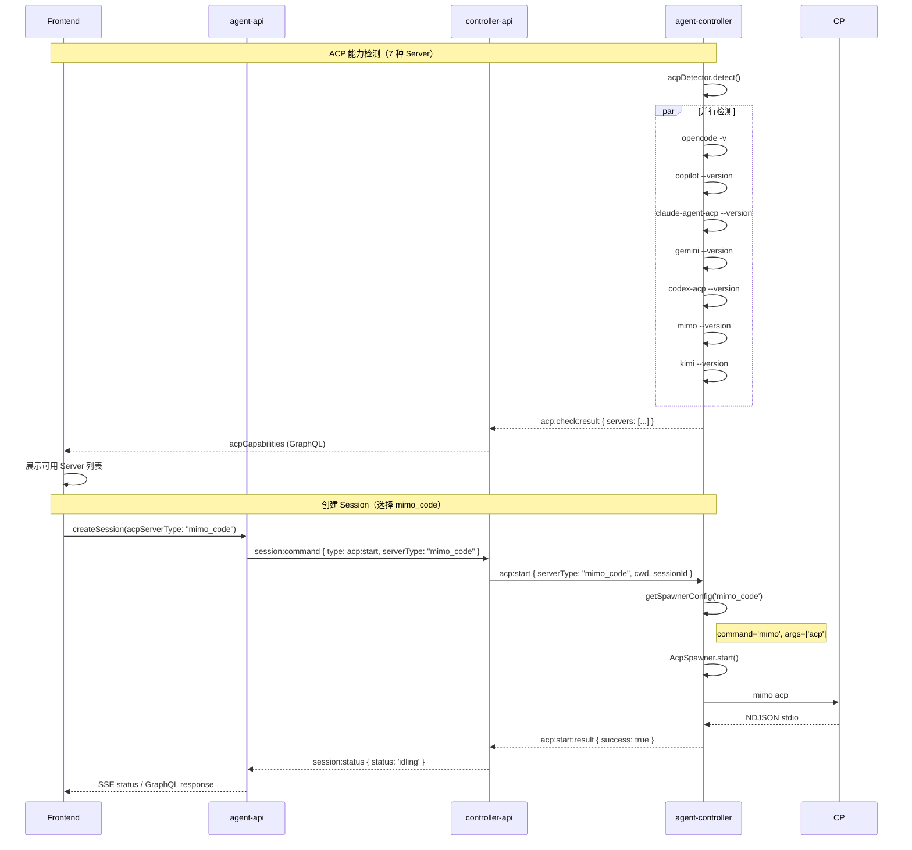

# ACP Server 支持 MiMo Code / Kimi Code CLI — 技术提案

**功能名称**: ACP Server 支持 MiMo Code / Kimi Code CLI
**关联 PRD**: `20260721-acp-server-mimo-kimi.md`
**技术提案版本**: v1.0
**创建日期**: 2026-07-21
**作者**: ZeroAsh
**feat-branch**: `feat/acp-mimo-kimi`

## 1. 概述

### 1.1 背景

PRD 要求在已支持的五种 ACP Server（OpenCode、GitHub Copilot、Claude Code、Gemini CLI、Codex）基础上，新增 **MiMo Code**（Xiaomi）和 **Kimi Code CLI**（Moonshot AI）两种新 Server。

两种新工具的 ACP 接入方式：

- **MiMo Code**：原生支持 ACP 模式，CLI 命令为 `mimo`，ACP 启动参数为 `mimo acp`
- **Kimi Code CLI**：原生支持 ACP 模式，CLI 命令为 `kimi`，ACP 启动参数为 `kimi acp`

通信协议均为 ACP JSON-RPC over stdio。系统架构已在之前的多次扩展中做好了充分准备，新增 Server 类型不需要架构变更。

### 1.2 目标

- `enum AcpServerType` 增加 `mimo_code`、`kimi_code` 两个值
- `AcpDetector` 扩展检测两种新 Server
- `AcpDetector.getSpawnerConfig()` 返回对应启动命令
- 前端 ACP Server 标签添加两个新类型的可读名称
- 所有测试覆盖新 Server 类型

### 1.3 范围

- **包含**：Contract（GraphQL enum）、Mongoose models（enum 扩展）、agent-controller（detector + spawner config）、前端（标签展示）
- **不包含**：各 CLI 工具的安装和认证流程、各 Server 特有的 ACP 能力适配、Session 创建后切换 ACP Server 类型、历史会话导入相关改动（已在之前扩展中完成泛化）

## 2. 技术架构

### 2.1 系统架构图

```mermaid
graph TD
    subgraph "agent-controller (Daemon)"
        DET[AcpDetector]
        SIO[Socket.IO Client]
        BR[AcpSessionBridge]
        SYNC[AcpSyncBridge]
        SPAWN[AcpSpawner]

        DET -->|detect| OC1[opencode -v]
        DET -->|detect| GC[copilot --version]
        DET -->|detect| CA[claude-agent-acp --version]
        DET -->|detect| GM[gemini --version]
        DET -->|detect| CX[codex-acp --version]
        DET -->|detect| MIMO[mimo --version]
        DET -->|detect| KIMI[kimi --version]

        SIO --> BR
        SIO --> SYNC
        BR --> SPAWN
        SYNC --> SPAWN

        SPAWN -->|"opencode acp"| OCPROC[opencode acp]
        SPAWN -->|"copilot --acp --stdio"| CPROC[copilot --acp --stdio]
        SPAWN -->|"claude-agent-acp"| CAPROC[claude-agent-acp]
        SPAWN -->|"gemini --acp"| GMPROC[gemini --acp]
        SPAWN -->|"codex-acp"| CXPROC[codex-acp]
        SPAWN -->|"mimo acp"| MIPROC[mimo acp]
        SPAWN -->|"kimi acp"| KIPROC[kimi acp]
    end

    subgraph "Contracts / Models"
        ENUM["enum AcpServerType (opencode, github_copilot, claude_code, gemini_cli, codex, mimo_code, kimi_code)"]
    end

    ENUM -.->|type check| SPAWN
    ENUM -.->|type check| DET
```



### 2.2 架构决策

| 决策 | 选项 A | 选项 B | 最终选择 | 原因 |
|------|--------|--------|---------|------|
| 启动命令到 Server 类型的映射方式 | AcpDetector 内部映射表 | controller-api 下发完整启动参数 | AcpDetector 内部映射表 | 启动命令是与 Agent 绑定的静态知识，不应由服务端控制（与现有决策一致） |
| 新 Server 检测失败的处理 | 静默返回 available=false | 抛出异常告警 | 静默返回 available=false | 与现有检测行为一致，某个 Server 未安装不影响其他 Server |
| 检测命令格式 | `cli --version` | `cli acp --version` | `cli --version` | `--version` 是 CLI 工具的标准参数，轻量快速（与现有决策一致） |

### 2.3 模块划分

| 模块 | 职责 | 关键技术点 |
|------|------|-----------|
| Contract | 扩展 `enum AcpServerType` | 增加 `mimo_code`、`kimi_code` |
| agent-controller (detector) | 多 ACP Server 检测 | 新增 `detectMiMoCode()`、`detectKimiCode()` |
| agent-controller (socketio-client) | 根据 serverType 选择 spawner | 已通过 `createSpawner()` 泛化，无改动 |
| agent-controller (spawner) | 无改动 | 已支持自定义 command/args |
| agent-controller (bridge) | 无改动 | 构造函数已接受可选 spawner 参数 |
| agent-controller (sync-bridge) | 无改动 | 构造函数已接受可选 spawner |
| agent-api (model) | enum 扩展 | `enum: ['opencode', 'github_copilot', 'claude_code', 'gemini_cli', 'codex', 'mimo_code', 'kimi_code']` |
| agent-api (GraphQL) | enum 扩展 | `enum AcpServerType` 增加两值 |
| controller-api (model) | enum 扩展 | `enum` 数组增加两值 |
| controller-api (ACM) | 无改动 | 已使用 `serverType: string` |
| frontend (SessionHeader) | 标签可读展示 | 新增两个映射 |

## 3. API 设计

### 3.1 Contract 变更

`contracts/agent-session.graphql`:

```graphql
enum AcpServerType {
  opencode
  github_copilot
  claude_code
  gemini_cli
  codex
  mimo_code
  kimi_code
}
```

其他接口无需变更，`AcpServerType` 现有的使用位置（`Session.acpServerType`、`AcpCapability.type`、`CreateSessionInput.acpServerType`）均使用该 enum 类型，新增值自然生效。

### 3.2 Socket.IO 协议

无变更。`acp:start` payload 中的 `serverType: string` 字段已存在，仅传递新字符串值（`'mimo_code'`、`'kimi_code'`）。

`acp:check` 响应中的 `servers` 数组自然包含新 Server 的检测结果。

### 3.3 Redis Pub/Sub

无变更。`session:command` 中的 `acpServerType` 字段已存在，透传不变。

## 4. 数据模型

### 4.1 MongoDB enum 扩展

```typescript
// agent-api/src/models/session.ts
acpServerType: {
  type: String,
  enum: ['opencode', 'github_copilot', 'claude_code', 'gemini_cli', 'codex', 'mimo_code', 'kimi_code'],
  required: true,
},

// controller-api/src/models/session.ts
acpServerType: {
  type: String,
  enum: ['opencode', 'github_copilot', 'claude_code', 'gemini_cli', 'codex', 'mimo_code', 'kimi_code'],
  required: true,
},
```

已有数据的 `acpServerType` 为已有五种值之一，向后兼容，无需数据迁移。

## 5. 技术实现方案

### 5.1 核心流程



### 5.2 关键实现点

#### 实现点 1: AcpDetector 扩展两种新 Server 检测

**文件**: `packages/agent-controller/src/acp/detector.ts`

在现有 `detect()` 方法中增加两种新 Server 的并行检测：

```typescript
export class AcpDetector {
  async detect(): Promise<AcpServerInfo[]> {
    const [opencode, copilot, claudeCode, geminiCli, codex, mimoCode, kimiCode] = await Promise.all([
      this.detectOpenCode(),
      this.detectGitHubCopilot(),
      this.detectClaudeCode(),
      this.detectGeminiCli(),
      this.detectCodex(),
      this.detectMiMoCode(),
      this.detectKimiCode(),
    ]);
    return [opencode, copilot, claudeCode, geminiCli, codex, mimoCode, kimiCode];
  }

  private async detectMiMoCode(): Promise<AcpServerInfo> {
    try {
      const { stdout } = await execAsync('mimo --version');
      const version = this.parseVersion(stdout);
      return { type: 'mimo_code', available: true, version };
    } catch {
      return { type: 'mimo_code', available: false };
    }
  }

  private async detectKimiCode(): Promise<AcpServerInfo> {
    try {
      const { stdout } = await execAsync('kimi --version');
      const version = this.parseVersion(stdout);
      return { type: 'kimi_code', available: true, version };
    } catch {
      return { type: 'kimi_code', available: false };
    }
  }

  getSpawnerConfig(serverType: string): { command: string; args: string[] } {
    switch (serverType) {
      case 'github_copilot':
        return { command: 'copilot', args: ['--acp', '--stdio'] };
      case 'claude_code':
        return { command: 'claude-agent-acp', args: [] };
      case 'gemini_cli':
        return { command: 'gemini', args: ['--acp'] };
      case 'codex':
        return { command: 'codex-acp', args: [] };
      case 'mimo_code':
        return { command: 'mimo', args: ['acp'] };
      case 'kimi_code':
        return { command: 'kimi', args: ['acp'] };
      case 'opencode':
      default:
        return { command: 'opencode', args: ['acp'] };
    }
  }
}
```

#### 实现点 2: 前端 ACP Server 标签可读展示

**文件**: `apps/agent-web/src/components/session/SessionHeader.tsx`

```typescript
const acpServerTypeLabels: Record<string, string> = {
  opencode: 'OpenCode',
  github_copilot: 'GitHub Copilot',
  claude_code: 'Claude Code',
  gemini_cli: 'Gemini CLI',
  codex: 'Codex',
  mimo_code: 'MiMo Code',
  kimi_code: 'Kimi Code',
};
```

### 5.3 代码改动清单

| 文件 | 改动类型 | 说明 |
|------|---------|------|
| `contracts/agent-session.graphql` | 修改 | AcpServerType enum 增加 `mimo_code`、`kimi_code` |
| `servers/agent-api/src/graphql/schemas/session.ts` | 修改 | 同步 GraphQL enum |
| `servers/agent-api/src/models/session.ts` | 修改 | enum 数组增加两个新值 |
| `servers/controller-api/src/models/session.ts` | 修改 | enum 数组增加两个新值 |
| `packages/agent-controller/src/acp/detector.ts` | 修改 | 新增两个 detect 方法 + getSpawnerConfig 新增两个 case |
| `apps/agent-web/src/components/session/SessionHeader.tsx` | 修改 | 标签映射新增两个条目 |

**无需改动的文件**：

- `packages/agent-controller/src/acp/spawner.ts` — 已支持自定义 command/args
- `packages/agent-controller/src/acp/bridge.ts` — 已支持外部 spawner
- `packages/agent-controller/src/acp/sync-bridge.ts` — 构造函数已接受可选 spawner 参数
- `packages/agent-controller/src/socketio-client.ts` — 已通过 `createSpawner(serverType, ...)` 泛化
- `servers/controller-api/src/services/acp-session-manager.ts` — 已使用 `serverType: string`
- `servers/controller-api/src/services/acp-capability-detector.ts` — 已泛化
- `servers/controller-api/src/services/acp-session-sync.ts` — 已支持 serverType 透传
- `servers/controller-api/src/services/session-command.ts` — 已泛化
- `servers/agent-api/src/services/session-import.ts` — 已支持 acpServerType
- `servers/agent-api/src/services/session.ts` — 已使用字符串类型
- `servers/agent-api/src/graphql/resolvers/session.ts` — 已泛化
- `apps/agent-web/src/components/session/NewSessionDialog.tsx` — 已自动渲染可用 Server 列表
- `apps/agent-web/src/components/settings/HistorySessionDialog.tsx` — 已支持多 ACP Server 选择
- `apps/agent-web/src/graphql/queries.ts` — 已支持 acpServerType 参数
- `apps/agent-web/src/graphql/mutations.ts` — 已支持 acpServerType 参数
- `apps/agent-web/src/graphql/types.ts` — 类型自动生成
- `contracts/agent-session-websocket.md` — 协议已通用化

## 6. 技术决策

### 6.1 决策列表

| 决策 | 选项 A | 选项 B | 最终选择 | 原因 |
|------|--------|--------|---------|------|
| MiMo Code 检测命令 | `mimo --version` | `mimo acp --version` | `mimo --version` | `--version` 是 CLI 标准参数，轻量快速 |
| Kimi Code CLI 检测命令 | `kimi --version` | `kimi acp --version` | `kimi --version` | 同上 |
| MiMo Code ACP 启动方式 | `mimo acp` | `mimo serve --acp` | `mimo acp` | MiMo Code 原生 ACP 子命令 |
| Kimi Code CLI ACP 启动方式 | `kimi acp` | `kimi serve --acp` | `kimi acp` | Kimi Code CLI 原生 ACP 子命令 |
| session list/load 对新 Server 的支持 | 使用对应 Server 类型创建 spawner | 始终使用 OpenCode | 使用对应 Server 类型创建 spawner | 已在之前扩展中完成泛化，serverType 透传自然生效 |

### 6.2 依赖与约束

| 类型 | 内容 | 说明 |
|------|------|------|
| 依赖 | MiMo Code CLI 已安装（`npm install -g @mimo-ai/cli` 或官方安装脚本） | 非本项目责任，用户自行安装 |
| 依赖 | Kimi Code CLI 已安装（`npm install -g @kimi-ai/cli` 或官方安装脚本） | 非本项目责任，用户自行安装 |
| 约束 | 检测和 spawner 均假设 CLI 二进制在 PATH 中 | 与其他 Server 行为一致 |
| 约束 | 不同 ACP Server 的协议版本可能存在差异 | 仅保证基础 ACP 消息通信可用，高级功能不做强制对齐 |

## 7. 项目结构

```
packages/agent-controller/src/acp/
├── detector.ts      # 修改：新增两个 detect 方法 + getSpawnerConfig 两个 case
├── spawner.ts       # 无改动
├── bridge.ts        # 无改动
├── sync-bridge.ts   # 无改动

packages/agent-controller/src/
├── socketio-client.ts  # 无改动（已泛化）

servers/agent-api/src/
├── graphql/schemas/session.ts  # 修改：enum 增加两个值
├── models/session.ts           # 修改：enum 增加两个值

servers/controller-api/src/
├── models/session.ts           # 修改：enum 增加两个值

apps/agent-web/src/components/session/
├── SessionHeader.tsx  # 修改：标签映射新增两个条目

contracts/
├── agent-session.graphql  # 修改：AcpServerType enum 增加两个值
```

## 8. 测试策略

### 8.1 测试覆盖要求

- 单元测试覆盖两种新 Server 的检测方法和 spawner config
- 不影响现有五种 Server 的测试

### 8.2 测试类型

| 类型 | 工具 | 覆盖范围 |
|------|------|---------|
| 单元测试 | Vitest | `detector.ts` 新增的两个 detect 方法 |
| 单元测试 | Vitest | `detector.ts` `getSpawnerConfig()` 新增两个 case |
| 单元测试 | Vitest | 前端 SessionHeader 显示两种新 Server 标签 |

### 8.3 测试文件变更

| 文件 | 改动类型 | 说明 |
|------|---------|------|
| `packages/agent-controller/tests/acp-detector.test.ts` | 修改 | 新增两种 Server 的检测测试 + spawner config 测试 |
| `apps/agent-web/src/components/session/SessionHeader.test.tsx` | 修改 | 新增两种 Server 的标签展示测试（如存在） |

## 9. 验收标准

- [ ] 技术方案评审通过
- [ ] Contract 中 `AcpServerType` enum 包含 `mimo_code`、`kimi_code`
- [ ] agent-controller `AcpDetector.detect()` 返回 7 个 Server 的检测结果
- [ ] `getSpawnerConfig('mimo_code')` 返回 `{ command: 'mimo', args: ['acp'] }`
- [ ] `getSpawnerConfig('kimi_code')` 返回 `{ command: 'kimi', args: ['acp'] }`
- [ ] 前端 SessionHeader 显示 "MiMo Code"、"Kimi Code" 标签
- [ ] 控制器安装 MiMo Code 时，检测结果包含 `mimo_code`，前端可见
- [ ] 控制器安装 Kimi Code CLI 时，检测结果包含 `kimi_code`，前端可见
- [ ] 未安装时，对应 Server 不向前端展示
- [ ] 现有五种 ACP Server Session 完全不受影响
- [ ] 所有测试通过

## 10. 相关文档

- [ACP Server 支持 MiMo Code / Kimi Code CLI PRD](../../product/draft/20260721-acp-server-mimo-kimi.md)
- [ACP Server 支持扩展 PRD](../../product/released/20260705-acp-server-extend.md)
- [ACP Server 支持扩展技术方案](../proposals/20260705-feat-acp-server-extend.md)
- [多 ACP Server 支持 PRD](../../product/released/20260526-multi-acp-server-support.md)
- [Agent Session GraphQL Contract](../../../contracts/agent-session.graphql)
