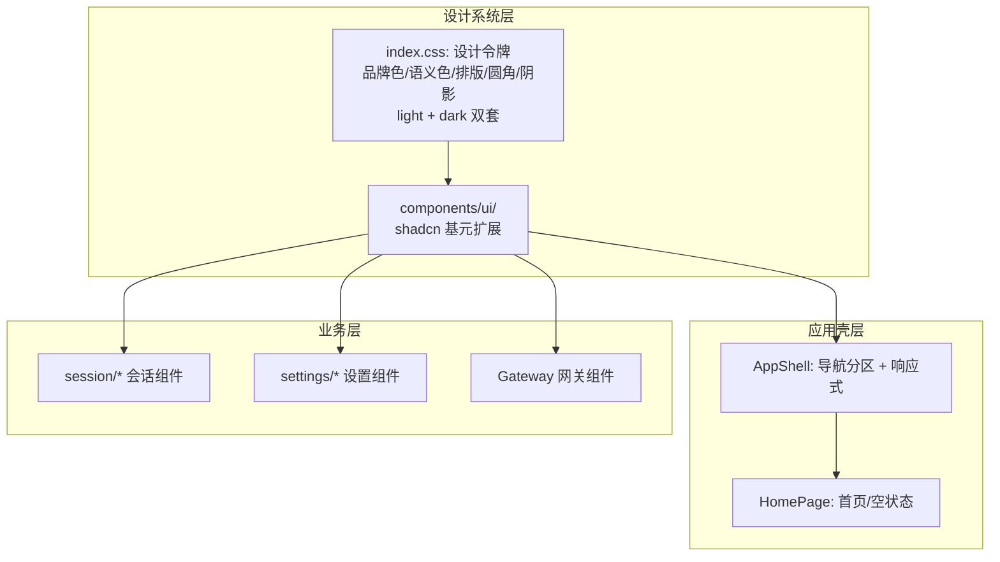
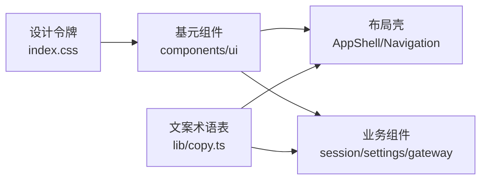
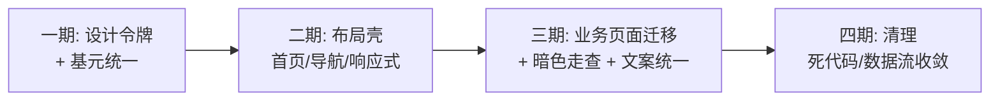

# 整体前端设计优化 - 技术提案

**功能名称**: 整体前端设计优化（设计语言升级与视觉重构）
**关联 PRD**: docs/product/draft/20260721-frontend-design-overhaul.md
**技术提案版本**: v1.0
**创建日期**: 2026-07-21
**作者**: kimi-cli
**feat-branch**: `feat/frontend-design-overhaul`

## 1. 概述

### 1.1 背景

`apps/agent-web` 经多期迭代后功能完整，但视觉与代码层面积累了系统性不一致。现状审查结论（含代码证据）：

1. **两套颜色体系冲突**：语义 token（`src/index.css`，全 neutral 灰阶，`--primary: oklch(0.205 0 0)` 纯黑）与硬编码 Tailwind 色板并存——全项目 **88 处 `bg/text/border-{颜色}-{数值}` 硬编码，分布 25 个文件**。同一"主按钮"存在 ≥3 种写法（原生 button+`bg-blue-600`、`bg-primary`、`ui/button`），如 `MessageItem.tsx:67`、`Sidebar.tsx:159`、`SessionPage.tsx:331`。
2. **暗色模式半成品**：机制完整（`.dark` + `@custom-variant dark` + ThemeToggle），但全项目仅 9 处 `dark:` 变体；`status-colors.ts` 全部使用 `bg-*-100 text-*-800` 亮色硬编码，暗色下不可读。
3. **组件不统一**：SessionHeader 操作按钮（`SessionHeader.tsx:91-147`）、SettingsPage 导航均手写 className，未复用 `ui/button`；已装 `lucide-react` 却大量手写内联 SVG（`Sidebar.tsx:204-207`、`SessionHeader.tsx:71-78`）并混用 emoji（📁⚙️）与字符箭头（▼▶）。
4. **文案中英混杂**：登录/设置用中文，会话页 Close/Continue/Delete、STATUS_LABELS、apollo.ts 报错 toast 用英文。
5. **布局与响应式**：以 768px 硬切两套 JSX（MainLayout、SettingsPage 各自重复渲染两份 markup，如 `SettingsPage.tsx:60-125` vs `127-251`）；首页为内联占位 div（`App.tsx:31-35`）。
6. **死代码与数据流重复**：`components/_test_use.tsx`（命名不符不被执行）、`assets/react.svg|vite.svg|hero.png` 模板残留、`hooks/useSessionStream.ts` 未被使用（SessionPage 内联重复实现 SSE）、自实现 `errorToast`（`SessionPage.tsx:351-355`）与 sonner 并存、`components.json` 指向不存在的 `src/App.css`。

### 1.2 目标

- 在 token 层注入品牌色与完整语义色体系（含暗色），消灭硬编码色板。
- 统一组件基元使用（`ui/button` 等）、图标体系（lucide）、文案语言（简体中文 + 术语表）。
- 重构应用布局壳（导航分区、首页、空状态），收敛响应式实现。
- 暗色模式全量可用，关键对比度达 WCAG AA。
- 清理死代码，收敛重复数据流实现。
- 现有 23 个测试文件全部保持通过（测试与样式解耦，是重构安全网）。

### 1.3 范围

**做**：

- 仅限 `apps/agent-web` 前端的视觉与代码结构重构
- 设计令牌、组件统一、布局壳、暗色模式、文案、死代码清理
- 数据流小幅收敛（SessionPage 复用 `useSessionStream`、toast 统一为 sonner），不改变数据语义

**不做**：

- **不改变任何后端 API、GraphQL schema、SSE 事件协议**（`contracts/` 零改动）
- 不改变路由结构与功能逻辑
- 不引入新的 UI 组件库/框架级依赖
- GraphQL Code Generator 迁移（`frontend-rules.md` 要求但属独立技术债，另行提案）

## 2. 技术架构

### 2.1 系统架构图



### 2.2 技术栈

| 层级 | 技术选型 | 说明 |
|------|---------|------|
| 样式 | Tailwind CSS v4（CSS-first `@theme`） | 维持现状，token 全部收敛至 `src/index.css` |
| 组件基元 | shadcn（@base-ui/react）+ cva | 维持现状，扩展变体 |
| 图标 | lucide-react | 全量替换内联 SVG / emoji / 字符箭头 |
| 字体 | Geist Variable | 维持现状，补充排版 scale |
| 数据 | Apollo Client / EventSource / fetch | **不变** |
| 测试 | Vitest + RTL | 维持现状 |

### 2.3 模块划分



| 模块 | 职责 | 关键技术点 |
|------|------|-----------|
| 设计令牌 | 品牌色、语义色、排版、间距、圆角、阴影的单一来源 | Tailwind v4 `@theme inline`，oklch 色彩空间，`.dark` 双套 |
| 基元组件 | 按钮/徽章/卡片/表单等统一变体 | cva 变体扩展，语义 token 绑定 |
| 布局壳 | 导航分区、响应式容器、首页、空状态 | 单一 JSX + Tailwind 响应式类替代双套 markup |
| 业务组件迁移 | 88 处硬编码色板语义化替换 | 逐文件替换 + 走查清单 |
| 文案 | 简体中文统一 + 术语表 | 常量集中管理 |

## 3. API 设计

### 3.1 API 契约

**无变更。** 本提案不新增、不修改、不删除任何后端 API（GraphQL / REST / SSE），`contracts/` 目录零改动。

### 3.2 内部接口

无新增模块间接口。仅 SessionPage 的 SSE 消费从内联实现切换为复用既有 `hooks/useSessionStream.ts`（事件语义不变）。

## 4. 数据模型

无数据库与缓存变更。新增纯前端静态数据：

#### 设计令牌（`src/index.css`）

| 令牌组 | 内容 | 说明 |
|--------|------|------|
| 品牌色 | `--primary` 及 hover/active 梯度 | oklch 有彩色相（替换纯黑 primary），亮/暗双套 |
| 语义色 | success / warning / info / destructive（含 `-foreground`） | 状态标识统一来源，替代 `bg-*-100 text-*-800` |
| 状态色 | session/agent 各状态（running/idle/error/...） | 收敛 `status-colors.ts` 为 token 映射 |
| 排版 | heading 1~4 / body / caption 字号字重 | 替代各页随意混用的 `text-lg~2xl font-semibold/bold` |
| 阴影 | elevation 1~3 | 卡片/弹层/浮层分级 |

## 5. 技术实现方案

### 5.1 核心流程

分期实施，每期独立可验收、可上线（对应 PRD 约束）：



### 5.2 关键实现点

#### 实现点 1: 设计令牌注入与硬编码色板语义化

- **描述**: 在 `src/index.css` 的 `@theme inline` 中注入品牌色（oklch 有彩 primary）、补齐语义色与状态色，亮/暗双套；随后将 25 个文件 88 处硬编码 `bg/text/border-{颜色}-{数值}` 逐处替换为语义类（`bg-primary`、`bg-success/10 text-success` 等）。
- **技术细节**: 替换映射表先行定义（如 `bg-blue-600` → `bg-primary`、`bg-green-500` 在线点 → `bg-success`）；`status-colors.ts` 改为返回语义 token 类名。
- **风险点**: 色板到语义的映射存在主观判断 → 建立替换对照表并逐页截图走查。

#### 实现点 2: 组件与图标统一

- **描述**: 全部手写 button（SessionHeader、SettingsPage 导航、Sidebar "新建" 等）迁移至 `ui/button` 变体；全部内联 SVG / emoji / ▼▶ 替换为 lucide 图标。
- **技术细节**: 先扩展 `ui/button` 缺少的变体（如 xs 尺寸、ghost-danger），再迁移调用点；图标逐个对照 lucide 目录选型。
- **风险点**: 迁移改变 Dom 结构可能影响 RTL 查询 → 现有测试先行跑通作为基线，逐个文件迁移逐文件验证。

#### 实现点 3: 布局壳与响应式收敛

- **描述**: 抽取统一 AppShell（导航分区：会话/网关/设置 + 用户区），首页由占位 div 升级为概况页（复用既有 sessions/controllers 查询数据）；MainLayout、SettingsPage 的双套 JSX 收敛为单一 markup + Tailwind 响应式类（`md:` 断点）。
- **技术细节**: 保持路由不变；移动端"列表/详情"切换逻辑保留，仅统一实现方式；空状态做统一 `EmptyState` 组件。
- **风险点**: 移动端行为回归 → 复用既有 `useIsMobile` 与移动端测试（SessionHeader.mobile.test.tsx）作为回归网，补充 AppShell 测试。

#### 实现点 4: 暗色模式补全

- **描述**: 逐页走查暗色适配，为状态徽章、在线指示、spinner、消息气泡等补齐 dark 语义色；以对比度检查（WCAG AA 4.5:1）为验收。
- **技术细节**: 由于实现点 1 已将颜色收敛到语义 token，本实现点主要工作量在 token 的暗色值调校与少量 `dark:` 变体补充。

#### 实现点 5: 文案统一与术语表

- **描述**: 新建 `lib/copy.ts`（或按页面局部常量）集中管理界面文案，英文操作文案（Close/Continue/Delete、STATUS_LABELS、apollo.ts toast 等）统一为简体中文；制定术语表（Session/Workspace/Worktree/MCP 等保留英文原词，全产品统一）。
- **风险点**: 测试断言包含英文文案的用例需同步更新（如 toast 文案断言）。

#### 实现点 6: 死代码清理与数据流收敛

- **描述**: 删除 `components/_test_use.tsx`、`assets/react.svg|vite.svg|hero.png`；SessionPage 内联 SSE 切换到 `useSessionStream`（或反向保留内联并删 hook，以行为不变为准择一）；自实现 `errorToast` 统一为 sonner；修正 `components.json` 的 css 路径；`@types/react-syntax-highlighter` 移至 devDependencies。
- **风险点**: SSE 切换需保证 history/message/status/mode:changed 事件处理逐条对齐 → 为 SessionPage 流处理补充测试后再切换（TDD 红-绿-重构）。

## 6. 技术决策

### 6.1 决策列表

| 决策 | 选项 A | 选项 B | 最终选择 | 原因 |
|------|--------|--------|---------|------|
| 样式体系 | 维持 Tailwind v4 + token 注入 | 引入 CSS-in-JS / 设计系统库 | A | 现状 token 层已是良好切入点，改动最小 |
| 组件基元 | 扩展现有 shadcn 基元 | 引入 MUI/AntD 等 | A | 不引入框架级依赖，包体与风险最小 |
| 图标 | lucide-react 全量统一 | 保留内联 SVG 修补 | A | 已装依赖，风格统一且可 tree-shake |
| 响应式 | 单一 JSX + 响应式类 | 维持双套 markup | A | 消除 SettingsPage 等重复实现 |
| GraphQL 类型 | 本期维持手写类型 | 引入 Code Generator | A | 独立技术债，避免本期范围膨胀 |
| 文案方案 | 常量集中 + 术语表 | 引入 i18n 框架 | A | 单语言产品，i18n 为过度设计 |

### 6.2 依赖与约束

| 类型 | 内容 | 说明 |
|------|------|------|
| 依赖 | 无新增 npm 运行时依赖 | lucide-react 等均已安装 |
| 约束 | `contracts/` 零改动，后端 API 不变 | PRD 硬性约束 |
| 约束 | 现有 23 个测试文件全部通过 | 重构安全网，文案变更类断言允许同步更新 |
| 约束 | TS strict + lint 通过 | common-rules.md 要求 |

## 7. 项目结构

仅展示变化点（目录结构遵循 `frontend-rules.md`，无新增目录层级）：

```
apps/agent-web/src/
├── index.css               # 设计令牌：品牌色/语义色/状态色/排版/阴影（light+dark）
├── App.tsx                 # 首页占位 → HomePage 路由
├── components/
│   ├── ui/                 # 基元扩展：button 变体、EmptyState、状态徽章
│   ├── AppShell.tsx        # 新增：统一导航壳（会话/网关/设置分区）
│   ├── _test_use.tsx       # 删除（死代码）
│   └── session|settings/   # 硬编码色板语义化 + 按钮/图标/文案统一
├── lib/copy.ts             # 新增：文案常量与术语表
├── hooks/useSessionStream.ts  # SessionPage 复用（消除重复实现）
└── assets/                 # 清理模板残留 svg/png
```

## 8. 测试策略

### 8.1 测试覆盖要求

- 现有 23 个测试文件全部通过；因文案/结构变化受影响的断言允许同步更新，但不允许删除行为断言。
- 新增组件（AppShell、EmptyState、扩展的 button 变体）按 TDD 红-绿-重构补齐单测。
- SessionPage SSE 切换前，先补流处理测试（红），再切换实现（绿）。
- 覆盖率维持 >80%（common-rules.md 要求）。

### 8.2 测试类型

| 类型 | 工具 | 覆盖范围 |
|------|------|---------|
| 单元/组件测试 | Vitest + RTL | 新组件、变更组件、SessionPage 流处理 |
| 暗色对比度走查 | 手动 + 对比度工具 | 全页面 WCAG AA 清单 |
| 视觉走查 | 手动（亮/暗 × 桌面/移动四象限） | 逐页面核对设计语言一致性 |
| E2E | 现有 tests/e2e | 全流程回归，零新增失败 |

## 9. 部署方案

纯前端变更，部署方式不变（Aspire / Docker Compose 编排中的 agent-web 镜像随常规流程发布）。分期实施时各期独立 PR、独立上线，无配置变更。

## 10. 验收标准

- [ ] 技术方案评审通过
- [ ] Contract 零改动确认
- [ ] 88 处硬编码色板清零，全项目颜色均来自语义 token
- [ ] 内联 SVG / emoji 图标清零，统一 lucide
- [ ] 暗色模式逐页走查通过，关键对比度 ≥ 4.5:1
- [ ] 操作文案 100% 简体中文，术语表落地
- [ ] 首页上线，占位文案移除
- [ ] 死代码清理完成
- [ ] 全部单测通过，E2E 回归零新增失败

## 11. 相关文档

- [[../../product/draft/20260721-frontend-design-overhaul.md]] — 关联 PRD
- [[20260526-proposal-ui-optimization.md]] / [[20260526-proposal-ui-optimization-phase2.md]] / [[20260528-proposal-ui-optimization-phase3.md]] — UI 优化一~三期
- [[20260529-feat-dark-mode.md]] — 黑暗模式
- [[../frontend-rules.md]] — 前端开发规范
- [[../common-rules.md]] — 通用开发规范
