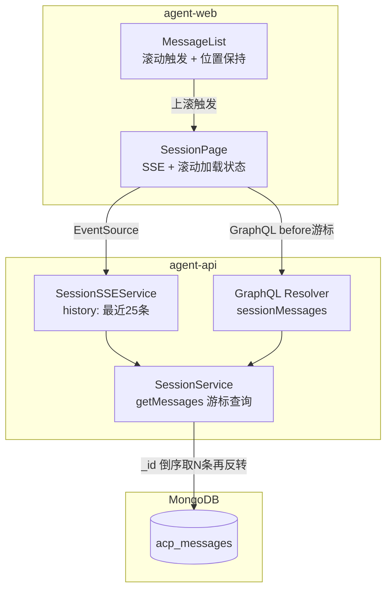
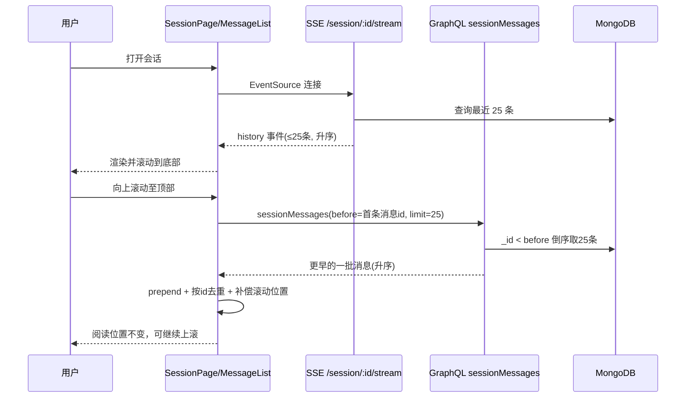

# Session 对话滚动加载 - 技术提案

**功能名称**: Session 对话滚动加载
**关联 PRD**: `docs/product/draft/20260723-session-scroll-loading.md`
**技术提案版本**: v1.0
**创建日期**: 2026-07-23
**作者**: ZeroAsh
**feat-branch**: `feat/session-scroll-loading`

## 1. 概述

### 1.1 背景

当前会话消息历史通过 `SessionService.getMessages()`（`servers/agent-api/src/services/session.ts:332-361`）返回，采用"倒数第 3 条 usage_update 截断"策略，约等于最近 2 轮用户发言的完整内容。长任务场景下单轮消息量巨大，导致 SSE `history` 事件数据量不可控；且截断发生在分页之前，前端无法获取更早的历史消息。

前端 `MessageList` 组件已具备 `hasMore / onLoadMore / loadingMore` props 和滚动到顶部触发加载的能力（`apps/agent-web/src/components/session/MessageList.tsx:229-237`），`GET_SESSION_MESSAGES` query 也已定义（`apps/agent-web/src/graphql/queries.ts:120`），但均未接线。

### 1.2 目标

- SSE `history` 事件返回数据量恒定为最近最多 25 条消息，与会话总长度无关
- GraphQL `sessionMessages` 支持基于游标（`before`）的向前翻页，前端上滚自动加载更早历史
- 加载历史时保持用户阅读位置不跳动；历史与实时消息无重复、无遗漏

### 1.3 范围

**做**:
- 重构 `SessionService.getMessages()`：移除 usage_update 截断，改为"最近 N 条 + before 游标"查询
- SSE `history` 事件改为返回最近 25 条
- 更新 GraphQL 契约 `sessionMessages`（`offset` → `before`）及 SSE OpenAPI 契约描述
- 前端 SessionPage 接线滚动加载，MessageList 增加滚动位置保持与顶部加载状态

**不做**:
- 修改消息写入路径（controller-api / agent-controller 不变）
- 修改 AcpMessage 数据模型与索引
- 引入 Relay Connection 等复杂分页结构
- 向下翻页（新消息仍由 SSE 实时推送）

## 2. 技术架构

### 2.1 系统架构图



### 2.2 技术栈

| 层级 | 技术选型 | 说明 |
|------|---------|------|
| 前端 | React 19 + TypeScript + Apollo Client v4 | 复用现有 EventSource SSE 与 gql query 模式 |
| 后端 | Express v5 + GraphQL-Yoga + Mongoose | Node.js 24+ ESM |
| 数据库 | MongoDB | 复用现有 `{ sessionId: 1, createdAt: 1 }` 索引与 `_id` 有序性 |

### 2.3 模块划分

| 模块 | 职责 | 关键技术点 |
|------|------|-----------|
| `SessionService.getMessages` | 最近 N 条 / before 游标查询 | 移除 usage_update 截断；`_id` 倒序 limit 后反转 |
| `SessionSSEService.addConnection` | history 事件下发最近 25 条 | 调用统一查询，limit=25 |
| `sessionMessages` resolver | 透传 before/limit | 鉴权逻辑不变 |
| `SessionPage` | 维护 messages/hasMore/loadingMore，执行加载 | Apollo `client.query`，按 id 去重拼接 |
| `MessageList` | 上滚触发、顶部加载态、滚动位置保持 | prepend 前后 scrollHeight 差值补偿 |

## 3. API 设计

### 3.1 API 契约

#### 接口 1: SSE `GET /api/session/{id}/stream`（行为变更）

- `history` 事件负载从"最近约 2 轮用户发言的全部消息"改为**最近最多 25 条消息**（按时间升序）。
- 其余事件（`message` / `status` / `heartbeat`）不变。

#### 接口 2: GraphQL `sessionMessages`（签名变更）

```graphql
type Query {
  sessionMessages(sessionId: ID!, before: ID, limit: Int = 25): [AcpMessage!]!
}
```

- `before`: 可选，消息 `_id` 游标，仅返回该消息**之前**（更早）的消息
- `limit`: 可选，默认 25，上限 100
- 返回按时间升序排列
- `hasMore` 由前端推断：返回条数 == limit 则可能还有更多
- 移除 `offset` 参数（当前无任何调用方使用）

### 3.2 内部接口

```ts
// servers/agent-api/src/services/session.ts
getMessages(
  sessionId: string,
  userId: string,
  options?: { before?: string; limit?: number },  // limit 默认 25，上限 100
): Promise<Record<string, unknown>[]>
```

查询逻辑：`filter = { sessionId }`，若 `before` 为合法 ObjectId 则追加 `_id: { $lt: before }`；`.sort({ _id: -1 }).limit(limit)` 后反转数组返回升序结果。

## 4. 数据模型

无变更。`AcpMessage` 复用现有模型（`servers/agent-api/src/models/acp-message.ts`），`_id`（ObjectId）单调递增，与消息写入顺序一致，可直接作为游标。

## 5. 技术实现方案

### 5.1 核心流程



### 5.2 关键实现点

#### 实现点 1: 后端游标查询

- **描述**: `getMessages` 移除 Query A/B 双阶段 usage_update 截断，统一为"最近 N 条 + before 游标"
- **技术细节**: `_id: { $lt: before }` + `.sort({ _id: -1 }).limit(limit)`，内存中 `reverse()` 恢复升序；`before` 非法时忽略该参数（视为请求最新一页）；limit 钳制到 [1, 100]
- **风险点**: 现有 API 测试可能断言旧的截断行为，需同步更新

#### 实现点 2: 前端滚动加载接线

- **描述**: SessionPage 在 SSE `history` 到达后初始化 `hasMore = history.length >= 25`；`onLoadMore` 以当前首条消息 id 为 `before` 发起 query，结果 prepend 并按 `id` 去重（防御 SSE 实时消息与页边界重叠）
- **技术细节**: 使用 Apollo `client.query`（`fetchPolicy: 'network-only'`，避免缓存干扰分页）；`loadingMore` 防止并发触发；失败时保留重试能力（下次上滚重新触发）
- **风险点**: 加载期间 SSE 新消息到达导致 `messages[0]` 引用变化——读取首条 id 时基于发起请求瞬间的快照即可，不影响正确性

#### 实现点 3: 滚动位置保持

- **描述**: prepend 历史消息后保持用户视口不跳动
- **技术细节**: 加载前记录 `listRef.scrollHeight` 与 `scrollTop`；prepend 渲染后在 `useLayoutEffect` 中执行 `scrollTop = 新scrollHeight - 旧scrollHeight + 旧scrollTop`；prepend 场景跳过"新消息自动滚到底部"逻辑（通过比较首尾消息 id 或显式 prepend 标记区分）
- **风险点**: 图片/Markdown 异步渲染导致 scrollHeight 二次变化，可接受轻微偏移

#### 实现点 4: 顶部加载状态

- **描述**: `loadingMore` 时列表顶部显示加载指示；`hasMore === false` 且已有消息时显示"已加载全部历史"

## 6. 技术决策

### 6.1 决策列表

| 决策 | 选项 A | 选项 B | 最终选择 | 原因 |
|------|--------|--------|---------|------|
| 分页方式 | `before` 游标 | `offset` | A | 长任务实时写入新消息，offset 会错位重复/遗漏；`_id` 天然有序 |
| 限量粒度 | 25 条消息记录 | 25 轮用户发言 | A | 数据量恒定可控，符合优化目标；实现简单 |
| 旧截断逻辑 | 移除 usage_update 截断 | 保留并叠加分页 | A | 截断使分页无法触及更早历史，两者互斥 |
| hasMore 判定 | 返回数 == limit 推断 | 新增 Connection/PageInfo 结构 | A | 前端唯一消费方，推断足够，避免过度设计 |

### 6.2 依赖与约束

| 类型 | 内容 | 说明 |
|------|------|------|
| 依赖 | MongoDB ObjectId 有序性 | `_id` 作为游标与排序键 |
| 约束 | 契约先行 | 先更新 `contracts/` 再实现 |

## 7. 项目结构

```
contracts/
├── agent-session.graphql            # sessionMessages: offset → before
├── agent-session.openapi.yaml       # history 事件描述更新为最近25条
servers/agent-api/
├── src/services/session.ts          # getMessages 游标查询重构
├── src/services/session-sse.ts      # history limit=25
├── src/graphql/schemas/session.ts   # schema 同步
└── src/graphql/resolvers/session.ts # 参数透传
apps/agent-web/
├── src/graphql/queries.ts           # GET_SESSION_MESSAGES 更新
├── src/pages/SessionPage.tsx        # 接线 hasMore/onLoadMore/loadingMore
└── src/components/session/MessageList.tsx  # 滚动位置保持 + 顶部状态
```

## 8. 测试策略

### 8.1 测试覆盖要求

- 后端 `getMessages` 单元测试覆盖游标/限量/权限分支
- API 测试覆盖 `sessionMessages` 分页与 SSE history 限量

### 8.2 测试类型

| 类型 | 工具 | 覆盖范围 |
|------|------|---------|
| 单元测试 | vitest | getMessages：默认25条、before游标、limit钳制、非法before、升序返回 |
| API 测试 | 现有 tests/api 框架 | sessionMessages 翻页完整性（翻N页遍历全部历史无重复）、SSE history ≤ 25 条 |
| E2E 测试 | 现有 tests/e2e 框架 | 长会话打开 → 上滚加载 → 位置保持 → 加载至最早消息 |

## 9. 部署方案

无新增配置与基础设施变更，随常规发布流程上线。旧版本前端未使用 `sessionMessages`，契约签名变更无兼容风险。

## 10. 验收标准

- [ ] 技术方案评审通过
- [ ] Contract 评审通过
- [ ] 代码实现完成
- [ ] 单元测试覆盖达标
- [ ] API 测试通过
- [ ] E2E 测试通过

## 11. 相关文档

- 关联 PRD: [20260723-session-scroll-loading](../../product/draft/20260723-session-scroll-loading.md)
- 关联 Contract: `contracts/agent-session.graphql`、`contracts/agent-session.openapi.yaml`
- 历史提案: [20260524-feat-session-message-history-optimization](./20260524-feat-session-message-history-optimization.md)
