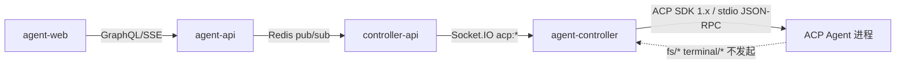
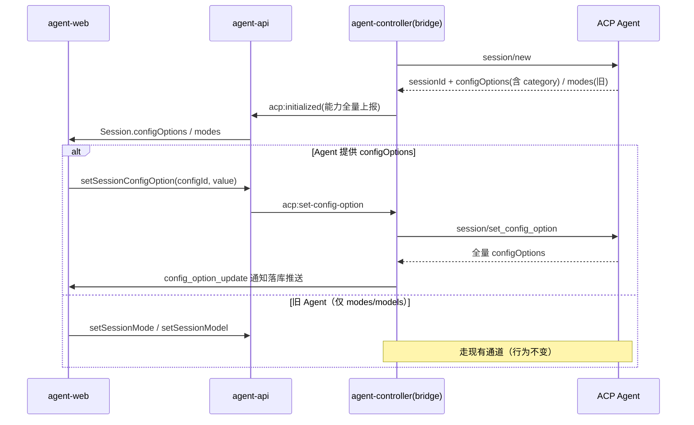
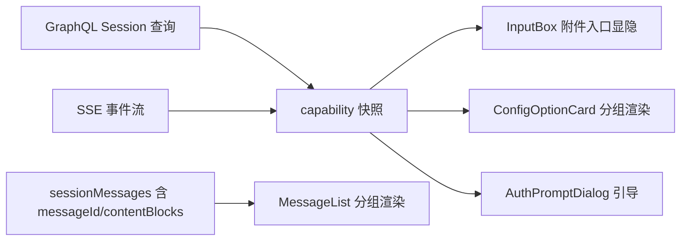

# ACP v1 协议补全与展示优化 — 技术提案

**功能名称**: ACP v1 协议补全
**关联 PRD**: `docs/product/draft/20260803-acp-v1-completion.md`
**技术提案版本**: v1.1
**创建日期**: 2026-08-03
**作者**: Kimi
**feat-branch**: `feat/acp-v1-completion`

> v1.1 变更（Review 意见）：
> 1. 移除终端能力（`clientCapabilities.terminal` 及 `terminal/*` 方法）——云端架构，client 运行在用户各自环境，不实施；
> 2. 移除全部 MCP 相关更新（含 mcpEndpoint→acp:start 透传修复、HTTP 传输注入）——MCP 模块存在遗留问题，维持现状；
> 3. 补充前端变更方案（见 §6.3）。

## 1. 概述

### 1.1 背景

仓库通过 `@agentclientprotocol/sdk`（当前 `^0.22.1`）在 `packages/agent-controller` 中实现 ACP Client，经 Socket.IO（`acp:*` 事件）→ controller-api → Redis → agent-api → GraphQL/SSE 四层透传管线向 agent-web 提供会话能力。ACP v1 在同一主版本内以 capability 方式持续新增稳定特性（2026-02 ~ 2026-07 共稳定 13 项），官方 TypeScript SDK 已于 2026-06-25 发布 1.0。当前实现存在：SDK 版本落后、依赖 `unstable_setSessionModel` 不稳定 API、多模态/认证等能力空白、若干已稳定能力（`session/delete`、`messageId`、boolean config、`$/cancel_request`、Elicitation、`additionalDirectories`）未接入。

### 1.2 目标

1. 协议底座升级到 SDK 1.x，消除全部 unstable API 依赖。
2. 已稳定但缺失的能力按范围接入，全部以 capability 协商门控，向前兼容。
3. 展示层补全工具类型、多模态内容块渲染与 messageId 分组。

### 1.3 范围

**做**：SDK 升级、Config Options（含 boolean、category）双轨迁移、`session/delete`、`session/list` cursor 分页、`messageId` 分组、多模态 prompt 与内容块渲染、`authenticate`/`logout`、`additionalDirectories`、工具 kind 展示补全、`$/cancel_request`（P2）、Elicitation（P2）。

**不做**：
- **终端能力**（`clientCapabilities.terminal`、`terminal/*` 方法）：云端架构决策，client 运行在用户各自环境，不实施。
- **MCP 相关一切变更**：MCP 模块存在遗留问题，本期不修复、不扩展（含 stdio 注入链路、HTTP/SSE 传输）。
- ACP `fs/*` client 能力：维持现有设计决策（契约 `agent-session-websocket.md` §5.3）。
- ACP v2 实施（仅跟踪评估）、ACP Registry 接入。

## 2. 现状盘点与差距分析

### 2.1 ACP v1 能力对照矩阵

| 协议模块 | ACP v1 稳定能力 | 仓库现状 | 差距/动作 | 优先级 |
|---|---|---|---|---|
| 初始化 | `initialize` v1、版本协商 | ✅ 已实现，版本硬编码 1 | 补版本协商失败提示 | P0 |
| 初始化 | `clientInfo`/`agentInfo` | ✅ clientInfo 已上报 | 展示 agentInfo（名称/版本）于会话信息 | P2 |
| 初始化 | `clientCapabilities.fs` | ❌ 有意不实现 | 维持设计决策 | — |
| 初始化 | `clientCapabilities.terminal` | ❌ 未声明 | **不实施**（云端架构决策，见 §1.3） | — |
| 初始化 | `clientCapabilities.session.configOptions.boolean` | ❌ | 声明并支持布尔配置项 | P0 |
| 认证 | `authenticate`/`authMethods`/`logout` | ❌ 未实现 | 新增认证流程 | P1 |
| 会话 | `session/new`（stdio MCP 注入） | ✅ | 保持现状（MCP 不纳入本期） | — |
| 会话 | `session/load` | ✅ | 保持 | — |
| 会话 | `session/resume`（2026-04 稳定） | ✅（失败回退 new） | 保持 | — |
| 会话 | `session/close`（2026-04 稳定） | ✅ | 保持 | — |
| 会话 | `session/list`（2026-03 稳定，cursor 分页） | ✅ 基础支持 | 补齐 cursor 分页透传 | P0 |
| 会话 | `session/delete`（2026-06 稳定） | ❌ 仅删本地库 | 按 capability 转发 agent | P0 |
| 会话 | `additionalDirectories`（2026-06 稳定） | ❌ | new/load 请求附加目录 | P1 |
| 配置 | `configOptions`/`session/set_config_option`（2026-02 稳定） | ⚠️ 仅接收 `config_option_update` 通知 | 实现 set 方法，按 category 路由 | P0 |
| 配置 | modes/`session/set_mode` | ✅ | 降级为回退通道 | P0 |
| 配置 | models/`unstable_setSessionModel` | ⚠️ 不稳定 API | 迁移到 `set_config_option`（category=model），旧 agent 回退 | P0 |
| 配置 | boolean config（2026-07 稳定） | ❌ | 声明 capability + UI 开关 | P0 |
| 配置 | category：mode/model/model_config/thought_level | ⚠️ 部分 | 前端按 category 分组展示 | P0 |
| Prompt | text 内容块 | ✅ | 保持 | — |
| Prompt | image/audio/resource/resource_link（按 promptCapabilities） | ❌ 仅 text | 多模态输入 | P1 |
| Prompt | `session/cancel` + stopReason | ✅ | 保持 | — |
| 通知 | `agent_message_chunk`/`user_message_chunk`/`agent_thought_chunk` | ✅ 仅 text chunk | 渲染 image/audio/resource chunk | P1 |
| 通知 | `messageId` 分组（2026-06 稳定） | ❌ 50ms debounce 猜测 | 按 messageId 精确分组，无 ID 回退现状 | P0 |
| 通知 | tool_call/tool_call_update | ✅ | kind 补全 delete/move/search/think；diff oldText=null（新文件） | P0 |
| 通知 | plan / current_mode_update / available_commands_update | ✅ | 保持 | — |
| 通知 | config_option_update / usage_update / session_info_update | ✅ | 保持 | — |
| 权限 | `session/request_permission` 全链路 | ✅ | 取消时未决请求自动 cancelled（协议 MUST）核查 | P0 |
| 终端 | `terminal/*` | ❌ | **不实施**（云端架构决策） | — |
| MCP | stdio transport | ⚠️ 链路存在遗留问题 | **维持现状，不修复不扩展** | — |
| MCP | http/sse transport | ❌ | **不实施**（sse 已被 MCP 规范废弃） | — |
| 取消 | `$/cancel_request`（2026-06 稳定） | ❌ | 请求级取消 | P2 |
| 交互 | Elicitation（2026-07 稳定） | ❌ | 结构化输入/URL 引导 | P2 |
| SDK | TS SDK 1.0（2026-06 发布） | ⚠️ ^0.22.1 | 升级 1.x | P0 |

### 2.2 已确认的实现层问题

1. **`unstable_setSessionModel`**（`packages/agent-controller/src/acp/bridge.ts:166`）：依赖不稳定 API，Agent 升级后可能失效。
2. **`clientCapabilities: {}`**（`bridge.ts:217`）：未声明任何客户端能力，Agent 无法使用布尔配置项（终端能力按决策不声明）。
3. **多模态 chunk 丢弃**：`agent_message_chunk` 仅聚合 `content.type==='text'`，image/audio/resource 被静默丢弃。
4. **文本分组依赖 50ms debounce**：未利用已稳定的 `messageId`。

## 3. 技术架构

### 3.1 系统架构图

架构不变。所有变更收敛在三层：agent-controller（协议面）、controller-api/agent-api（透传与持久化）、agent-web（展示）。Socket.IO `acp:*` 事件契约只做增量扩展，保持对旧版 controller 的兼容。

### 3.2 技术栈

| 层级 | 技术选型 | 说明 |
|------|---------|------|
| 前端 | React + TypeScript + Vite | 多模态附件、配置项分组/开关、消息分组渲染 |
| 后端 | Node.js + Express + GraphQL + Mongoose | 契约增量扩展 |
| 协议层 | `@agentclientprotocol/sdk` 1.x | bridge 层隔离升级影响 |

### 3.3 模块划分

| 模块 | 职责 | 关键变更 |
|------|------|-----------|
| `agent-controller/acp/bridge.ts` | ACP 协议面 | SDK 1.x、capability 声明（boolean config）、set_config_option、多模态 prompt、messageId 透传、authenticate/logout、session/delete、additionalDirectories |
| `controller-api/acp-session-manager.ts` | 会话状态与落库 | 新事件透传、session/delete 转发、configOptions 缓存 |
| `agent-api` | 对外契约 | GraphQL/SSE 增量：configOptions、附件上传、认证状态、删除同步 |
| `agent-web` | 展示 | 工具 kind、多模态渲染与附件输入、配置项分组/开关、认证引导、messageId 分组（见 §6.3） |

## 4. API 设计

### 4.1 契约变更（`contracts/`，全部增量、向后兼容）

**`agent-session.graphql`（增量）**：
- `Session` 增加：`configOptions: [SessionConfigOption!]`（id/name/description/category/type/currentValue/options）、`agentInfo`、`authRequired: Boolean!`、`promptCapabilities`（image/audio/embeddedContext）、`supportsAdditionalDirectories: Boolean!`。
- Mutation 增加：`setSessionConfigOption(sessionId, configId, value)`、`deleteHistorySession(sessionId, syncAgent: Boolean)`、`logoutAcpSession`（P1）、`respondElicitation`（P2）。
- `sendSessionMessage` 输入增加 `attachments: [MessageAttachment!]`（image/audio/resource/resource_link，P1）。
- `createSession`/`resumeSession` 输入增加 `additionalDirectories: [String!]`（P1）。
- `SessionConfigOption.currentValue` 支持 `String | Boolean`（boolean config）。

**`agent-session-websocket.md`（controller ⇄ controller-api 事件增量）**：
- 新增 `acp:set-config-option` / `acp:config-options`；`acp:auth:required` / `acp:authenticate` / `acp:logout`；`acp:delete-session`。
- `acp:start`/`acp:resume` payload 增加 `additionalDirectories`。
- `acp:message` 增加可选 `messageId` 字段。

**SSE（`agent-session.openapi.yaml`）**：新增 `config:changed`、`auth:required` 事件类型。

### 4.2 内部接口

- bridge → controller-api：capability 协商结果随 `acp:initialized` 全量上报（agentCapabilities + promptCapabilities + agentInfo + sessionCapabilities），上层按能力驱动 UI 显隐与功能路由。
- config 变更路由规则：agent 提供 `configOptions` → `session/set_config_option`（按 configId，含 category=mode/model）；否则回退现有 `session/set_mode` / `setSessionModel` 通道。

## 5. 数据模型

- `AcpMessage` 增加可选字段：`messageId`（String，索引）、`contentBlocks`（Mixed，多模态原始块，P1）。全部可选，旧数据无需迁移。
- `Session` 增加可选字段：`configOptions`（Array）、`agentInfo`（Object）、`authState`（String）。Redis 缓存结构同步扩展，保留旧 key 兼容。

## 6. 技术实现方案

### 6.1 核心流程（Config Options 双轨，P0 代表例）

### 6.2 关键实现点

#### 实现点 1: SDK 1.x 升级（P0）

- **描述**: `packages/agent-controller` 升级 `@agentclientprotocol/sdk` 至 1.x（controller-api/agent-web 的类型导入同步升级）。
- **技术细节**: bridge 层已封装 `ClientSideConnection`，升级面收敛；按 SDK 1.0 changelog 适配 breaking changes（`unstable_*` 移除、类型重命名）。
- **风险点**: 0.22→1.x 类型变更；以 `acp-bridge.test.ts` 红-绿重构保障。

#### 实现点 2: Config Options 双轨迁移（P0）

- **描述**: 实现 `session/set_config_option`；声明 `session.configOptions.boolean` client capability。
- **技术细节**: 会话初始化时若响应含 `configOptions` 则以其为准（协议要求忽略 modes）；模式/模型切换按 category 路由到 configId；无 configOptions 的旧 agent 走现有 `set_mode`/models 通道。
- **风险点**: 双通道状态同步——以 `config_option_update`/`current_mode_update` 通知为唯一事实源落库。

#### 实现点 3: messageId 分组（P0）

- **描述**: chunk 携带 `messageId` 时按 ID 分组落库与渲染；无 ID 时保留 50ms debounce 现状。
- **技术细节**: bridge 透传 messageId；`acp-session-manager` 分组键从"时间窗"改为"messageId 优先，时间窗兜底"。

#### 实现点 4: 多模态（P1）

- **描述**: prompt 按 `promptCapabilities` 组装 image/audio/resource/resource_link 块；chunk 渲染补全非 text 类型。
- **技术细节**: agent-web 附件选择 → base64/uri 上送；agent-api 校验大小与 capability 门控（Agent 未声明则拒绝并提示）；bridge 不再过滤非 text chunk，原样透传落库。

#### 实现点 5: 认证（P1）

- **描述**: initialize 响应含非空 `authMethods` 时进入认证流程；实现 `authenticate`/`logout`。
- **技术细节**: 认证状态机并入会话状态机；认证凭据不落库、仅内存持有并透传；事件 `acp:auth:required` → 前端引导。

#### 实现点 6: 向前兼容总策略

- 一切新能力 = **capability 门控 + 优雅降级**：协商未声明即隐藏入口/走旧通道。
- 契约只增不改：GraphQL 新字段均可空、新事件类型旧端忽略。
- Socket.IO 事件版本兼容：旧 controller 不发送新事件，controller-api 按可选处理。
- 数据模型新增字段全部可选，无迁移脚本。
- 回归基线：7 种 ACP Server 的 `tests/api/src/controller-api/acp-websocket.test.ts` 全量通过。

### 6.3 前端变更方案（agent-web）

**总体原则**：所有新 UI 以会话的 capability 快照（`Session.promptCapabilities` / `configOptions` / `authRequired` / `supportsAdditionalDirectories`）驱动显隐，Agent 未声明即不渲染，与现状保持一致。

#### 6.3.1 组件变更清单

| 组件 | 变更 | 阶段 |
|------|------|------|
| `MessageList.tsx` | 分组逻辑改为 `messageId` 优先：消息记录携带 `messageId` 时按 ID 分组，缺失时走现有时间窗分组；新增 `resource`/`audio` 分组类型 | P0/P1 |
| `MessageItem.tsx` | 内容块渲染扩展：`image`（点击放大预览）、`audio`（内联播放器）、`resource`（可折叠代码/文档卡片，按 mimeType 高亮）、`resource_link`（链接卡片：名称/大小/描述） | P1 |
| `ToolCallCard.tsx` | kind 映射补全：`delete`（删除图标+红色标识）、`move`（路径 A→B 展示）、`search`（搜索图标+查询词）、`think`（折叠思考块）；`diff` 内容 `oldText=null` 时渲染"新建文件"全文新增视图（现有 DiffView 增加 new-file 模式）；terminal 内容维持现状降级展示（不声明终端能力，正常不会出现，万一出现仍显示 terminalId） | P0 |
| `InputBox.tsx` | 新增附件按钮与附件条（chip 列表）：按 `promptCapabilities` 显示图片/音频/文件入口；选择后本地预览、大小校验（超限提示阻止）；发送时组装 `attachments` 随 `sendSessionMessage` 上送 | P1 |
| `ConfigOptionCard.tsx` | 重构为分组配置面板：按 category 分组（mode/model/model_config/thought_level/其他），尊重 configOptions 数组顺序；`select` 渲染下拉、`boolean` 渲染开关；修改调 `setSessionConfigOption`，响应全量状态整体替换 | P0 |
| `ModeSwitcher.tsx` / `ModelSwitcher.tsx` | 改为适配层：会话含 configOptions 时从对应 category 的配置项取数并路由到 `setSessionConfigOption`；否则走现有 `setSessionMode`/`setSessionModel`（UI 与行为不变） | P0 |
| `AuthPromptDialog.tsx`（新增） | 认证引导：展示 authMethods 说明与操作入口（凭据输入/跳转链接），提交调认证 mutation；失败展示错误与重试；`authRequired=true` 时会话页顶部常驻提示条 | P1 |
| `NewSessionDialog.tsx` | 新增"附加工作目录"多选（复用现有目录浏览能力），仅 `supportsAdditionalDirectories=true` 时显示 | P1 |
| 历史会话页 | 删除按钮增加"同步删除 Agent 侧记录"能力标识与结果反馈（按 `sessionCapabilities.delete`） | P0 |
| `SessionHeader.tsx` | 展示 `agentInfo.title/version`（P2） | P2 |

#### 6.3.2 状态与数据流

- capability 快照随 `session` 查询与 SSE `config:changed`/`auth:required` 事件更新，存入现有会话状态管理（与 modes/models 同层）。
- `setSessionConfigOption` 响应为全量 configOptions，前端不做局部合并，整体替换后触发重渲染（与协议语义一致）。
- 附件在发送前仅存于组件本地状态；发送成功后由消息流中的 `user_message_chunk` 回显渲染。

#### 6.3.3 兼容性细则

- 旧会话（无 `messageId`/`contentBlocks` 历史数据）：渲染路径完全走现有逻辑。
- 未升级 agent-api 的 controller（不产生新事件）：前端无新事件可收，表现与现状一致。
- GraphQL 新字段均可空，前端一律做空值兜底。

### 6.4 分阶段交付

| 阶段 | 内容 | 验收 |
|---|---|---|
| P0 协议对齐 | SDK 1.x、configOptions 双轨、boolean config、session/delete、session/list cursor、messageId 分组、工具 kind/diff 展示、配置面板重构、版本协商提示 | 7 Server 回归 + 新单测 |
| P1 能力补全 | 多模态输入输出、authenticate/logout、additionalDirectories | 按 capability 门控的 E2E |
| P2 前沿跟进 | `$/cancel_request`、Elicitation、agentInfo 展示、ACP v2 评估报告 | 专项验收 |

## 7. 技术决策

### 7.1 决策列表

| 决策 | 选项 A | 选项 B | 最终选择 | 原因 |
|------|--------|--------|---------|------|
| 模型切换迁移 | 直切 set_config_option | 双轨按能力路由 | B | 旧 agent 无 configOptions，须向前兼容 |
| 终端能力 | 实现 | 不实施 | B | 云端架构，client 运行在用户各自环境（Review 决策） |
| MCP 链路修复/扩展 | 本期修复 | 维持现状 | B | MCP 模块存在遗留问题，另行处理（Review 决策） |
| fs capability | 开放 | 维持不开放 | B | 现有设计决策，Agent 自行读写文件 |
| ACP v2 | 本期实施 | 跟踪评估 | B | v2 仍为草案（2026-07-20） |

### 7.2 依赖与约束

| 类型 | 内容 | 说明 |
|------|------|------|
| 依赖 | `@agentclientprotocol/sdk` 1.x | P0 引入 |
| 约束 | 契约只增不改；新能力全部 capability 门控；不触碰 MCP 链路 | 向前兼容与范围约束 |

## 8. 测试策略

### 8.1 测试覆盖要求

- 单元测试：bridge（SDK 适配、capability 声明、config 路由、messageId 分组）、acp-session-manager（新事件落库）；前端 `MessageList`/`MessageItem`/`ConfigOptionCard`/`InputBox` 组件测试；遵循 TDD 红-绿-重构。
- API 测试：`tests/api/src/controller-api/acp-websocket.test.ts` 扩展 config/delete 用例；7 种 Server 回归。
- E2E：`tests/e2e/src/session-acp-server.spec.ts` 扩展配置项分组/开关、附件入口显隐（按 capability mock）、历史会话删除同步标识。

### 8.2 测试类型

| 类型 | 工具 | 覆盖范围 |
|------|------|---------|
| 单元 | vitest/jest（沿用现有） | 协议面、状态机、前端组件 |
| API 集成 | tests/api | Socket.IO 事件链路 |
| E2E | Playwright | 展示与交互降级 |

## 9. 验收标准

- [ ] 技术方案评审通过
- [ ] Contract 增量评审通过
- [ ] P0：SDK 1.x 无 unstable API 依赖；7 Server 回归通过
- [ ] P0：config 双轨、session/delete、messageId 分组、工具展示补全、配置面板重构上线
- [ ] P1：多模态/认证/附加目录按 capability 门控可用，不支持 agent 无回退
- [ ] P2：Elicitation 与 `$/cancel_request` 支持；输出 ACP v2 评估
- [ ] API 测试与 E2E 测试通过

## 10. 相关文档

- 关联 PRD：`docs/product/draft/20260803-acp-v1-completion.md`
- ACP 协议规范：https://agentclientprotocol.com/（Protocol / Updates 页，2026-02 ~ 2026-07 稳定项）
- 关联 Contract：`contracts/agent-session.graphql`、`contracts/agent-session.openapi.yaml`、`contracts/agent-session-websocket.md`
- 历史提案：`proposals/20260520-refactor-controller-acp-sdk.md`、`proposals/20260705-feat-acp-server-extend.md`、`proposals/20260721-feat-acp-mimo-kimi.md`
