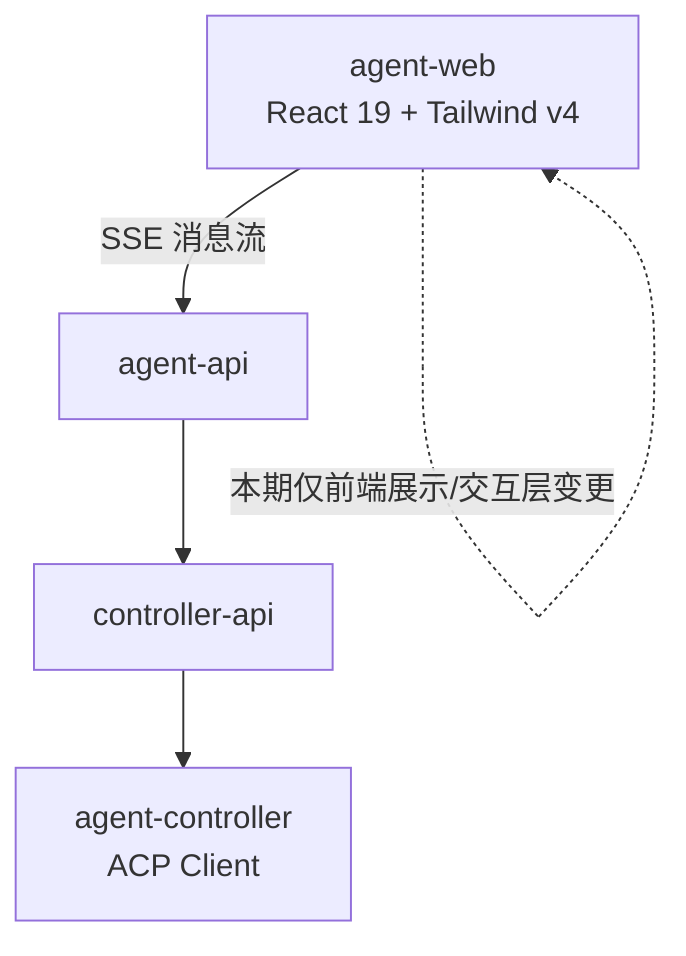
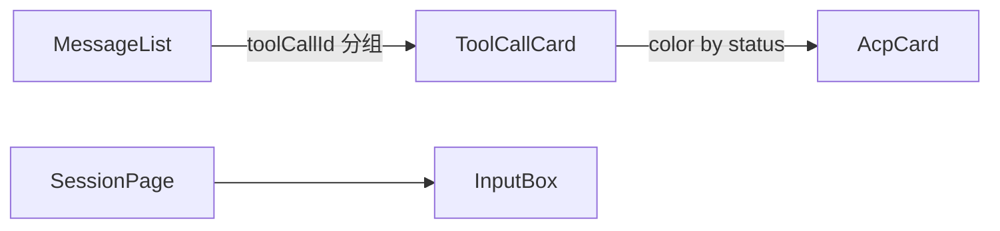
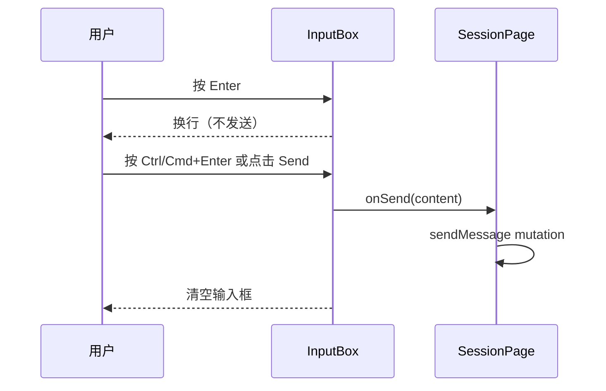
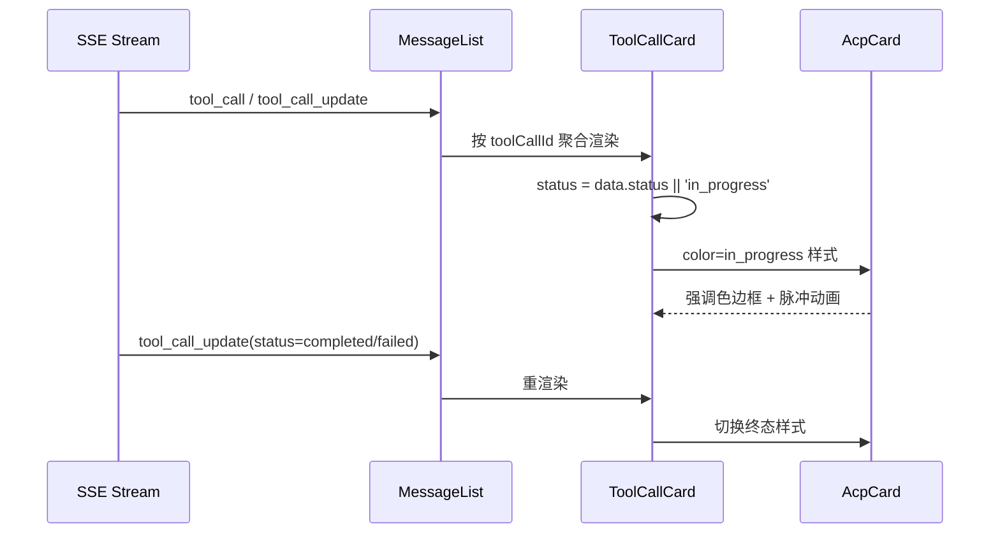

# 对话交互优化 — 技术提案

**功能名称**: 对话交互优化
**关联 PRD**: `docs/product/draft/20260804-chat-interaction-optimization.md`
**技术提案版本**: v1.0
**创建日期**: 2026-08-04
**作者**: Kimi
**feat-branch**: `feat/chat-interaction-optimization`

## 1. 概述

### 1.1 背景

PRD 提出两处会话页交互优化：

1. 工具调用处于 `in_progress` 状态时，卡片需以不同颜色展示；
2. 输入框 Enter 改为换行，仅 Send 按钮（及快捷键）发送。

现状盘点（代码走查结论）：

- `apps/agent-web/src/components/session/ToolCallCard.tsx` 已按 `status` 向 `AcpCard` 传 `color`（completed→blue / failed→yellow / 其他→purple），但 `AcpCard.tsx` 的 `colorClasses` 中四种颜色**全部映射为相同样式**（`bg-muted border border-border`），颜色参数无实际视觉效果；且 `ToolCallCard.tsx` L102–104 的 `containerClass` 三元表达式两边相同（dead code）。
- `apps/agent-web/src/components/session/InputBox.tsx` `handleKeyDown`（L143–146）在 `Enter && !shiftKey` 时直接 `handleSubmit`，Shift+Enter 换行。

### 1.2 目标

1. 让 `in_progress` 状态的工具调用卡片在消息流中以强调色 + 脉冲动画差异化呈现，浅色/深色主题自适应。
2. Enter 行为调整为换行；新增 `Ctrl+Enter` / `Cmd+Enter` 快捷键发送；Send 按钮发送保持不变。

### 1.3 范围

**做**：

- `AcpCard` 颜色体系落地：`in_progress`（purple）映射为强调色 + 脉冲动画，completed/failed 维持现状样式。
- `ToolCallCard` 清理 dead code，确保 `pending`/`in_progress` 统一走进行中样式。
- `InputBox` 键盘行为调整：Enter 换行、Ctrl/Cmd+Enter 发送。

**不做**：

- 后端、契约（GraphQL/SSE/ACP 透传）无任何变更。
- completed/failed 状态的颜色重构（维持现有样式，仅保证可区分）。
- ReadCard / FetchCard / SubAgentCard 的样式重构（其复用 AcpCard 的颜色体系随之生效，但不单独调整）。

## 2. 技术架构

### 2.1 系统架构图



### 2.2 技术栈

| 层级 | 技术选型 | 说明 |
|------|---------|------|
| 前端 | React 19 + TypeScript + Vite | 现有 |
| 样式 | Tailwind CSS v4 + 语义 token | 主题定义于 `src/index.css`（`--primary/--info/--warning` 等 oklch 变量，`:root` / `.dark` 双套） |
| 后端 | 无变更 | — |
| 数据库 | 无变更 | — |

### 2.3 模块划分



| 模块 | 职责 | 关键技术点 |
|------|------|-----------|
| `AcpCard.tsx` | 可折叠卡片容器，按 `color` 渲染容器样式 | `colorClasses` 各颜色映射差异化；in_progress 引入 `border-info`/`text-info` + `animate-pulse` |
| `ToolCallCard.tsx` | 工具调用消息渲染，推导 status | 删除 L102–104 dead code；`pending` 归并到进行中分支 |
| `InputBox.tsx` | 输入与键盘交互 | `handleKeyDown` 调整 Enter 分支，新增 ctrlKey/metaKey 判断 |

## 3. API 设计

无 API 变更。消息数据结构（AcpMessage / SessionUpdate）与传输链路（GraphQL mutation、SSE stream）均保持不变。

## 4. 数据模型

无数据模型变更。`ToolCallStatus` 枚举（`'pending' | 'in_progress' | 'completed' | 'failed'`，来自 `@agentclientprotocol/sdk`）维持现状，仅前端渲染分支归并：`pending` 与 `in_progress` 同走进行中样式。

## 5. 技术实现方案

### 5.1 核心流程





### 5.2 关键实现点

#### 实现点 1: AcpCard 颜色体系差异化

- **描述**: 当前 `colorClasses` 四色同质，本方案仅改动 `purple`（in_progress 实际使用色）映射为进行中样式，其余三色暂维持现状（后续需求再差异化）。
- **技术细节**:
  - 容器：`bg-info/10 border border-info animate-pulse`（脉冲作用于边框/背景透明度，轻量 CSS 动画，不触发 layout）。
  - 摘要/标题文本使用 `text-info`，与 `text-muted-foreground` 形成层级。
  - `index.css` 已存在 `--info` token（深浅双主题），无需新增主题变量；若走查确认 `--info` 缺失则补齐。
  - 遵守 `prefers-reduced-motion`：通过 Tailwind `motion-safe:animate-pulse` 使动画仅在用户未要求减少动态时生效。
- **风险点**: 长消息流中多个进行中卡片同时脉冲可能造成视觉噪音——实际场景中同一时刻通常仅最新一组处于进行中（MessageList 自动展开最后一个可展开组），风险可控。

#### 实现点 2: ToolCallCard 状态归并与 dead code 清理

- **描述**: 删除 L102–104 两边相同的 `containerClass` 三元表达式；`status === 'pending'` 归并到进行中分支（summary 显示 `...`，color 传 purple）。
- **技术细节**: `const isActive = !status || status === 'in_progress' || status === 'pending'`，后续分支统一使用该判断。
- **风险点**: 无，纯渲染分支重构。

#### 实现点 3: InputBox 键盘行为调整

- **描述**: Enter 换行（textarea 默认行为，不再 `preventDefault` + submit）；新增 Ctrl/Cmd+Enter 发送。
- **技术细节**:
  ```ts
  if (e.key === 'Enter' && (e.ctrlKey || e.metaKey)) {
    e.preventDefault();
    handleSubmit(e);
  }
  // Enter 无修饰键：不拦截，走 textarea 默认换行
  ```
  - 命令建议面板打开时的 Enter（选中命令）分支优先级高于上述逻辑，保持不变（L120–141）。
  - `handleSubmit` 内部的空输入/`disabled`/`sending` 校验已存在，快捷键路径自动复用。
  - Send 按钮 `type="submit"` 提交路径不变。
- **风险点**: 用户习惯迁移成本——在输入框 placeholder 或按钮 tooltip 中提示「Ctrl+Enter 发送」（沿用现有 placeholder 机制，见 InputBox props）。

## 6. 技术决策

### 6.1 决策列表

| 决策 | 选项 A | 选项 B | 最终选择 | 原因 |
|------|--------|--------|---------|------|
| in_progress 视觉方案 | 强调色 + 脉冲动画 | 仅静态强调色 | A（motion-safe） | PRD 要求「动态视觉效果」；`motion-safe` 兼顾可访问性 |
| 进行中颜色 token | `--info`（蓝系） | `--warning`（琥珀） | `--info` | 与 failed（黄/红系）色距更大，避免与失败态混淆 |
| 快捷键发送 | Ctrl/Cmd+Enter | 不支持快捷键 | Ctrl/Cmd+Enter | 兼顾桌面端效率，主流聊天产品惯例 |
| completed/failed 是否一并改色 | 本期一并差异化 | 维持现状 | 维持现状 | PRD 仅要求 in_progress 区分；最小改动 |

### 6.2 依赖与约束

| 类型 | 内容 | 说明 |
|------|------|------|
| 依赖 | 无新增依赖 | Tailwind v4 已内置 `animate-pulse`、`motion-safe` |
| 约束 | 不改后端/契约 | 纯前端变更 |
| 约束 | 深浅主题双适配 | 使用语义 token，不写死色值 |

## 7. 项目结构

```
apps/agent-web/src/
├── components/session/
│   ├── AcpCard.tsx        # colorClasses: purple → 进行中样式（info + motion-safe:animate-pulse）
│   ├── ToolCallCard.tsx   # status 归并（pending/in_progress），删除 dead code
│   └── InputBox.tsx       # Enter 换行；Ctrl/Cmd+Enter 发送
└── index.css              # 确认 --info token 存在（预期无需改动）
```

## 8. 测试策略

### 8.1 测试覆盖要求

- 前端组件测试覆盖变更组件：`AcpCard`、`ToolCallCard`、`InputBox`。
- 沿用项目现有测试基建（见 `apps/agent-web` package.json scripts 与 tests/ 目录约定）。

### 8.2 测试类型

| 类型 | 工具 | 覆盖范围 |
|------|------|---------|
| 组件测试 | Vitest + Testing Library（沿用现有基建） | AcpCard 各色映射快照；ToolCallCard pending/in_progress/completed/failed 渲染；InputBox 键盘行为（Enter 换行不调用 onSend、Ctrl/Cmd+Enter 调用 onSend、空输入不发送、建议面板 Enter 选中命令） |
| E2E | Playwright（tests/e2e） | 会话页发送路径：点击 Send 发送成功；输入框 Enter 产生多行文本 |

## 9. 部署方案

### 9.1 环境规划

| 环境 | 用途 | 部署方式 |
|------|------|---------|
| 本地 | 开发自测 | `aspire start` |
| 集成 | 验收 | 现有流水线 |

### 9.2 配置管理

无新增配置项。

## 10. 验收标准

- [ ] 技术方案评审通过
- [ ] PRD 评审通过（draft → reviewed）
- [ ] 代码实现完成
- [ ] 组件测试通过（AcpCard / ToolCallCard / InputBox）
- [ ] E2E 测试通过
- [ ] 浅色/深色主题下人工走查通过

## 11. 相关文档

- 关联 PRD：`docs/product/draft/20260804-chat-interaction-optimization.md`
- [[20260526-proposal-ui-optimization]]（工具调用按状态渲染的初版方案）
- 开发规范：`docs/engineering/frontend-rules.md`、`docs/engineering/common-rules.md`
