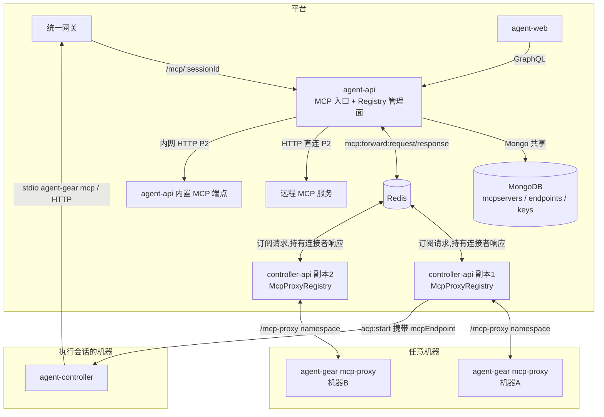
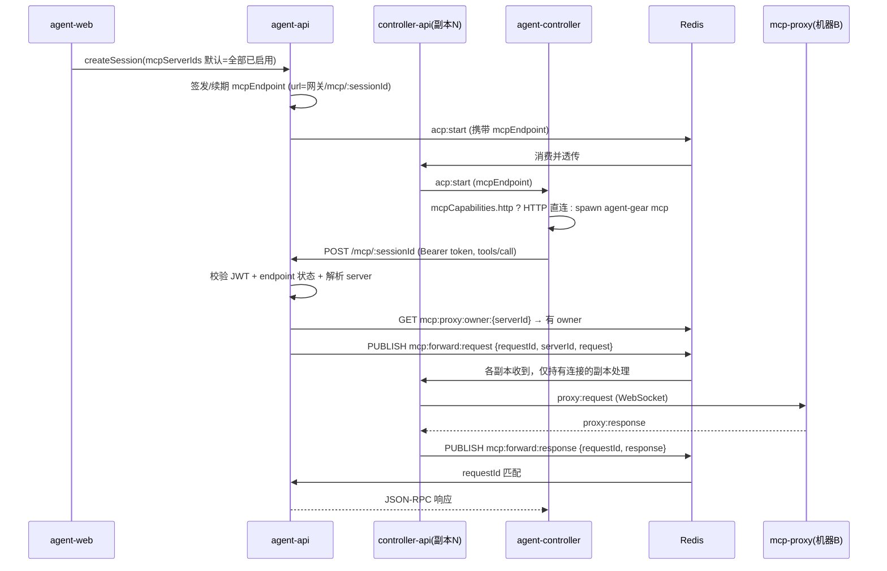

# 集成式 MCP 注册中心 - 技术提案

**功能名称**: 集成式 MCP 注册中心（Integrated MCP Registry）
**关联 PRD**: `docs/product/draft/20260804-integrated-mcp-registry.md`
**技术提案版本**: v2.0
**创建日期**: 2026-08-04
**作者**: ZeroAsh
**feat-branch**: `feat/integrated-mcp-registry`

> v2.0 变更（Review 意见）：
> 1. **移除独立的 mcp-forwarder 服务**，MCP HTTP 入口收敛到 agent-api（经统一网关暴露），减少一个服务的部署与编排成本；
> 2. **入口到执行侧改为 Redis 请求-响应交互**，复用 `port-forward` 既有模式，天然支持 controller-api 多副本部署下的代理寻址。

## 1. 概述

### 1.1 背景

`feat/mcp-proxy-config`（见 [[20260530-feat-mcp-proxy-config.md]]）落地了 MCP 代理注册与转发的骨干，但当前实现存在**多处断链与缺口**，端到端不可用：

| # | 问题 | 位置 |
|---|------|------|
| 1 | GraphQL `CreateSessionInput` 缺少 `mcpServerIds` 字段（契约已有，实现未同步），前端无选择 UI | agent-api schema / agent-web |
| 2 | `acp:start` 消息中的 `mcpEndpoint` 字段被 controller-api 丢弃，不下发给 agent-controller | controller-api `session-command.ts` |
| 3 | mcp-forwarder emit 的 `mcp:forward` 事件在 controller-api **没有 handler**，整条调用链不通 | mcp-forwarder / controller-api |
| 4 | mcp-forwarder 是独立服务但**未被 Aspire / docker-compose 编排**，且与 controller-api 之间按 serverName/serverId 不匹配 | aspire/ |
| 5 | Endpoint revoke 不生效（forwarder 只验 JWT 不查状态），JWT 固定 24h 无续期 | controller-api |
| 6 | `McpServerTransport` 仅 `registered_proxy`，无 HTTP 绑定与平台内置入口 | contracts / controller-api / agent-api |
| 7 | McpServer 无工具清单元数据，无法展示能力目录 | 数据模型 |
| 8 | 现有转发设计（forwarder → Socket.IO 直连 controller-api）**未考虑多副本部署**：请求落到的副本未必持有目标代理的 WebSocket 连接 | 架构 |

### 1.2 目标

1. **移除 mcp-forwarder 独立服务**，MCP HTTP 入口（`POST /mcp/:sessionId`）收敛到 agent-api，经统一网关对外暴露。
2. **Redis 请求-响应转发**：agent-api → Redis → 持有目标代理连接的 controller-api 副本 → WebSocket → mcp-proxy，复用 `port-forward:command/response` 既有模式，解决多副本寻址（#8）。
3. 修复断链（#1–#5），使「注册 → 装配 → 调用」端到端可用。
4. 将 McpServer 集合升级为 **Integrated MCP Registry**：统一抽象三种来源（`registered_proxy` / `http` / `platform`），携带工具清单元数据（#6、#7）。
5. 会话创建时自动装配全部已启用 MCP 服务；平台自身能力（首期：会话只读查询）以内置 MCP 服务形式注册（P2）。

### 1.3 范围

**分期（与 PRD 约束对齐）：**

- **P1（本期主体）**：移除 mcp-forwarder、入口收敛 agent-api + Redis 转发、链路修复（#1–#5、#8）、Registry 数据模型升级、会话自动装配 + 创建对话框 MCP 多选、Registry 目录页（状态/来源/启停用）、endpoint 吊销即时生效。
- **P2**：远程 HTTP MCP 绑定（agent-api 直连转发）、平台内置 MCP 服务、工具清单抓取与展示、同名工具命名空间隔离。

**不做：** MCP notifications / sampling 等双向特性（保持请求-响应模式）；平台写操作类 MCP 工具；对接官方 MCP Registry。

## 2. 技术架构

### 2.1 系统架构图



### 2.2 技术栈

| 层级 | 技术选型 | 说明 |
|------|---------|------|
| 前端 | React + TS + GraphQL | Registry 目录页、会话创建多选 |
| MCP 入口 | agent-api Express 路由 | JWT 校验 + 分流调度，经统一网关暴露 |
| 执行侧 | controller-api Socket.IO | 代理连接管理 + Redis 请求消费 |
| 转发总线 | Redis pub/sub | 复用 port-forward 请求-响应模式 |
| 数据库 | MongoDB | 共享库，扩展 mcpservers |

### 2.3 模块划分

| 模块 | 职责 | 关键技术点 |
|------|------|-----------|
| agent-api `routes/mcp.ts`（新增） | MCP HTTP 入口：JWT 校验、endpoint 状态校验、serverName 解析、按 transport 分流 | registered_proxy → Redis 转发；http/platform → HTTP 直连（P2） |
| agent-api GraphQL | Registry 管理面（查询、启停用、绑定/解绑） | Mutation 补齐、transport 扩展 |
| agent-api 内置 MCP 端点 | 平台能力 MCP 化（P2） | 只读 tools：session 列表/状态 |
| controller-api `McpProxyRegistry` | 代理 WebSocket 连接管理 + Redis 请求消费 | 订阅 `mcp:forward:request`，本地命中才处理并回 `mcp:forward:response` |
| agent-api `McpEndpointService`（迁入） | 会话端点签发/吊销/续期 | revoke 写 Redis 即时生效、TTL 滑动续期 |
| agent-controller | 接收 mcpEndpoint，桥接给 ACP Agent | 按 `mcpCapabilities.http` 选择直连或 `agent-gear mcp` stdio 桥 |
| agent-web | Registry 目录页 + 会话创建装配 UI | 分组多选、来源徽标 |
| ~~servers/mcp-forwarder~~ | **删除** | 入口能力并入 agent-api |

## 3. API 设计

### 3.1 契约变更清单

| 契约文件 | 变更 |
|---------|------|
| `contracts/mcp-server.graphql` | transport 枚举扩展 `http` / `platform`；`McpServer` 增加 `source`、`hostname`、`url`、`tools[]`、`toolsSyncedAt`、`enabled`；新增 Mutation `setMcpServerEnabled(id, enabled)`、`bindRemoteMcpServer(input)`、`unbindMcpServer(id)` |
| `contracts/mcp-forward-redis.md`（新增） | Redis 请求-响应转发协议：频道命名、消息结构、错误码、超时与寻址规则 |
| `contracts/gateway-proxy.openapi.yaml` | 新增 `/mcp/{sessionId}` 网关路由（转发到 agent-api） |
| `contracts/agent-session.graphql` | `CreateSessionInput.mcpServerIds` 已有，**实现侧补齐**（agent-api schema + resolver + 前端） |
| `contracts/agent-session-websocket.md` | `acp:start.mcpEndpoint` 已定义，实现侧补齐透传；mcpEndpoint.url 改为指向统一网关 |
| `contracts/mcp-proxy-websocket.md` | 补齐 `proxy:unregistered` / `proxy:shutdown` 实现；**删除**根 namespace `mcp:forward` 相关描述（被 Redis 协议取代） |

### 3.2 MCP 入口（agent-api）

#### `POST /mcp/:sessionId`

- **鉴权**: Bearer JWT（`MCP_ENDPOINT_JWT_SECRET`，payload 含 `sessionId/userId/serverNames`），URL sessionId 须与 JWT 一致。
- **处理**:
  1. 校验 endpoint 状态（Redis `mcp:endpoint:{sessionId}` → Mongo 回源），revoked/expired → 401；
  2. 从 `params.serverName`（缺省取 JWT `serverNames[0]`）解析目标 McpServer；
  3. 按 transport 分流：
     - `registered_proxy` → Redis 请求-响应转发（见 3.3）；
     - `http` / `platform`（P2）→ agent-api 直接发起 HTTP JSON-RPC 调用（注入存储的 headers，10s 超时）；
  4. `tools/list`（无 serverName 时）聚合全部绑定 server 的工具清单（P2 加 `{serverName}__{tool}` 前缀）。
- **响应**: JSON-RPC 响应；错误映射为 JSON-RPC error（`SERVER_OFFLINE` / `ENDPOINT_REVOKED` / `FORWARD_TIMEOUT` / `SERVER_NOT_FOUND`）。

### 3.3 Redis 转发协议（`contracts/mcp-forward-redis.md` 核心内容）

复用 `port-forward:command/response` 模式：

| 频道 | 发布者 | 订阅者 | 说明 |
|------|--------|--------|------|
| `mcp:forward:request` | agent-api | 全部 controller-api 副本 | `{ requestId, serverId, sessionId, request }` |
| `mcp:forward:response` | controller-api（持有连接者） | agent-api | `{ requestId, response \| error }` |

**多副本寻址规则：**

1. agent-api 先查 Redis 所有权注册表 `mcp:proxy:owner:{serverId}`（值为副本 instanceId，代理注册/心跳时写入，TTL 45s 随心跳刷新，断开时删除）。**无 owner → 直接返回 `SERVER_OFFLINE`**，无需等超时。
2. 有 owner → 广播 `mcp:forward:request`；各副本检查本地 `McpProxyRegistry` 是否持有该 serverId 的活跃 socket，**仅持有者**经 `/mcp:forward` namespace 发 `proxy:request` 并等待 ack，随后 publish 响应。
3. agent-api 按 `requestId` 匹配响应，30s 超时返回 `FORWARD_TIMEOUT`。

> 与 port-forward 的差异：增加了 owner 注册表用于快速失败（fail-fast），避免代理离线时所有请求空等 30s。

### 3.4 GraphQL Mutation（agent-api，管理面）

```graphql
extend type Mutation {
  setMcpServerEnabled(id: ID!, enabled: Boolean!): McpServer!
  bindRemoteMcpServer(input: BindRemoteMcpServerInput!): BindRemoteMcpServerResult!  # P2
  unbindMcpServer(id: ID!): Boolean!                                                 # P2
}
input BindRemoteMcpServerInput { name: String!, url: String!, headers: [HeaderInput!] }
```

`bindRemoteMcpServer` 同步执行连通性探测（`initialize` + `tools/list`），失败返回具体原因。

## 4. 数据模型

### 4.1 `mcpservers`（扩展）

| 字段 | 类型 | 说明 |
|------|------|------|
| transport | enum | `registered_proxy` / `http`(P2) / `platform`(P2) |
| source | enum | `proxy` / `manual` / `platform`，来源标识 |
| hostname | string? | 代理注册来源机器 |
| url | string? | http/platform 类型的访问地址 |
| headersEncrypted | object? | 远程绑定凭证，AES 加密存储 |
| enabled | bool | 启停用（默认 true），停用不装配进新会话 |
| tools | array | 工具清单快照 `[{name, description}]`（P2 抓取） |
| toolsSyncedAt | Date? | 清单最近同步时间 |

存量 `registered_proxy` 记录自动迁移 `source=proxy, enabled=true`，无需重新注册。

### 4.2 `mcpsessionendpoints`（调整）

- 增加 `serverIds: [ObjectId]`（签发时快照）。
- 吊销/过期状态同步写入 Redis（`mcp:endpoint:{sessionId}`），agent-api 入口请求时校验 → **revoke 即时生效**（入口与管理面同在 agent-api/共享存储，天然一致）。
- JWT 有效期从固定 24h 调整为「会话活跃期滑动续期」：会话心跳时续签，会话结束后过期。
- 签发的 endpoint URL 从 `MCP_FORWARDER_URL` 改为**统一网关地址**（`GATEWAY_URL/mcp/{sessionId}`）。

### 4.3 Redis 设计

| Key / 频道 | 内容 | TTL / 说明 |
|-----|------|-----|
| `mcp:endpoint:{sessionId}` | endpoint 状态（active/revoked） | 与 JWT 一致 |
| `mcp:proxy:owner:{serverId}` | 持有代理连接的副本 instanceId | 45s，心跳刷新 |
| `mcp:forward:request` | 转发请求频道 | pub/sub |
| `mcp:forward:response` | 转发响应频道 | pub/sub，requestId 关联 |

## 5. 技术实现方案

### 5.1 核心流程：会话装配与调用（P1）



### 5.2 关键实现点

#### 实现点 1: 移除 mcp-forwarder，入口并入 agent-api

- 删除 `servers/mcp-forwarder/` 目录与相关契约描述；`routes/mcp.ts` 的 JWT 校验逻辑迁移至 agent-api。
- 网关 `gateway-proxy.openapi.yaml` 增加 `/mcp/{sessionId}` 路由。
- 收益：少一个服务的编排/运维成本；入口即管理面，revoke 天然即时生效；多副本问题从「forwarder 单点 Socket.IO 直连」转为「Redis 广播 + 持有者应答」。

#### 实现点 2: Redis 请求-响应转发与多副本寻址

- controller-api 启动时生成 `instanceId`，订阅 `mcp:forward:request`；本地 `McpProxyRegistry` 命中（持有该 serverId 活跃 socket）才处理。
- 代理注册/心跳时写 `mcp:proxy:owner:{serverId}=instanceId`（TTL 45s），断开/超时删除 → agent-api 侧 fail-fast。
- 响应按 `requestId` 关联，30s 超时。

#### 实现点 3: 会话装配链路补齐

- agent-api：`CreateSessionInput` schema 补 `mcpServerIds`；缺省时取该用户全部 `enabled=true` 的 server（自动装配）；endpoint 直接由 agent-api 签发（`McpEndpointService` 从 controller-api 迁移/共享到 agent-api，共享 Mongo）。
- controller-api `handleAcpStart`：透传 `mcpEndpoint` 到 agent-controller。
- agent-controller：`acp:start` 收到 `mcpEndpoint` 后构造 ACP `mcpServers`——Agent 支持 HTTP MCP 则直连网关 URL；否则 spawn `agent-gear mcp --endpoint --token` 作 stdio 桥（复用已有子命令，客户端侧保留）。

#### 实现点 4: 工具名命名空间（P2）

- 入口聚合 `tools/list` 时将工具名改写为 `{serverName}__{tool}`；`tools/call` 按前缀拆解路由到对应 server，避免多服务同名工具冲突。

#### 实现点 5: 平台内置 MCP（P2）

- agent-api 暴露内网 HTTP JSON-RPC 端点 `/internal/mcp`（仅平台网络可达），实现只读 tools：`list_sessions`、`get_session_status`。
- 服务启动时 upsert 一条 `transport=platform, source=platform` 的 McpServer（幂等，url 指向内网地址）；不可删除，可停用。
- 入口分流时 platform/http 统一走 agent-api HTTP JSON-RPC 客户端（注入 headers、10s 超时），**不经过 Redis**。

#### 实现点 6: Registry 目录页与会话装配 UI（P1）

- 设置页「MCP」区块升级为目录视图：来源徽标（代理/远程/内置）、状态、工具数、启停用开关。
- NewSessionDialog 增加按来源分组的 MCP 多选（默认全选已启用项），提交时携带 `mcpServerIds`。

## 6. 技术决策

| 决策 | 选项 A | 选项 B | 最终选择 | 原因 |
|------|--------|--------|---------|------|
| MCP HTTP 入口 | 独立 mcp-forwarder 服务 | 并入 agent-api | **B** | 少一个服务；入口即管理面，revoke 即时生效；可经统一网关暴露 |
| 入口→执行侧交互 | Socket.IO 直连某副本 | Redis 请求-响应广播 | **B** | 多副本部署下请求落点与连接持有者解耦；复用 port-forward 既有模式 |
| 代理离线检测 | 等 30s 超时 | owner 注册表 fail-fast | **B** | 避免代理离线时所有调用空等超时 |
| http/platform 转发 | 经 Redis 到 controller-api | agent-api 直接 HTTP 调用 | **B** | agent-api 同时具备公网/内网访问能力，无需多一跳 |
| Registry 管理面落点 | agent-api GraphQL 直写 Mongo | 转发到 controller-api REST | A | 沿用共享库既有模式 |
| 同名工具冲突 | 禁止同名 | serverName 前缀改写 | B | 不限制用户注册自由，Agent 侧无冲突 |
| 会话 MCP 下发 | 每 server 独立端点 | 单聚合端点 + serverName 路由 | B | Agent 只需配置一个入口 |

## 7. 项目结构（主要改动文件）

```
contracts/
  mcp-server.graphql              # transport/source/tools 扩展 + Mutation
  mcp-forward-redis.md            # 新增：Redis 转发协议
  gateway-proxy.openapi.yaml      # 新增 /mcp/{sessionId} 路由
  agent-session-websocket.md      # mcpEndpoint.url 指向网关
  mcp-proxy-websocket.md          # 移除 mcp:forward，补齐 unregistered/shutdown
servers/agent-api/src/
  routes/mcp.ts                   # 新增：MCP HTTP 入口（JWT + 分流 + Redis 转发）
  services/mcp-endpoint.ts        # 从 controller-api 迁入：端点签发/吊销/续期
  services/mcp-forwarder.ts       # 新增：Redis 请求-响应客户端
  graphql/schemas/mcp-server.ts   # Mutation + 字段补齐
  graphql/schemas/session.ts      # CreateSessionInput.mcpServerIds
  services/session.ts             # 默认全量装配
  mcp/platform-server.ts          # 内置 MCP 端点(P2)
servers/controller-api/src/
  services/mcp-proxy-registry.ts  # 订阅 Redis 请求、owner 注册表维护
  socket/session-command.ts       # 透传 mcpEndpoint
  services/mcp-endpoint.ts        # 移除（迁至 agent-api）
servers/mcp-forwarder/            # 删除整个服务
packages/agent-controller/src/
  socketio-client.ts              # acp:start 接收 mcpEndpoint
  acp/bridge.ts                   # mcpServers 注入
apps/agent-web/src/
  components/settings/McpRegistrySection.tsx  # 目录页
  components/session/NewSessionDialog.tsx     # MCP 多选
```

## 8. 测试策略

- 单元测试：入口 JWT/endpoint 校验、Redis 转发 requestId 关联与超时、owner 注册表 fail-fast、工具名改写、自动装配缺省逻辑；覆盖率 ≥ 80%（新增代码）。
- API 测试（`tests/api/`）：`POST /mcp/:sessionId` 全链路（mock Redis + 代理）、多副本场景（两个 registry 实例仅持有者响应）、bind/unbind、启停用、revoke 即时生效。
- E2E（`tests/e2e/`）：注册代理 → 目录可见 → 创建会话自动装配 → 工具列表包含注册服务的工具。
- 遵循 TDD 红-绿-重构循环，先写失败测试再实现。

## 9. 部署方案

- **无新增服务**（相比现状减少一个未编排的 mcp-forwarder）；Aspire AppHost 无需增加资源，仅需为 agent-api 增加配置。
- 配置项：`MCP_ENDPOINT_JWT_SECRET`（移至 agent-api）、`GATEWAY_URL`（endpoint 签发）、`MCP_PLATFORM_INTERNAL_URL`（P2）、`MCP_ENDPOINT_TOKEN_TTL`。
- controller-api 多副本部署开箱支持（Redis 转发 + owner 注册表）。

## 10. 验收标准

- [ ] 技术方案评审通过
- [ ] Contract 更新评审通过
- [ ] P1：两台机器各注册一个 MCP 服务，同一会话可同时调用两者工具（E2E 通过）
- [ ] P1：controller-api 双副本部署下，请求能正确路由到持有代理连接的副本
- [ ] P1：创建会话默认装配全部已启用服务，revoke 后调用即时 401
- [ ] P1：`servers/mcp-forwarder/` 移除后 `aspire start` 一键拉起全部服务
- [ ] P2：绑定远程 HTTP MCP 成功并可调用；平台内置服务开箱可用
- [ ] 单元 / API / E2E 测试全部通过

## 11. 相关文档

- [[20260530-feat-mcp-proxy-config.md]] — MCP 代理配置技术方案（本方案的前置）
- [[20260707-feat-unified-gateway.md]] — 统一网关（MCP 入口的网关集成与 port-forward Redis 模式来源）
- PRD：`docs/product/draft/20260804-integrated-mcp-registry.md`
