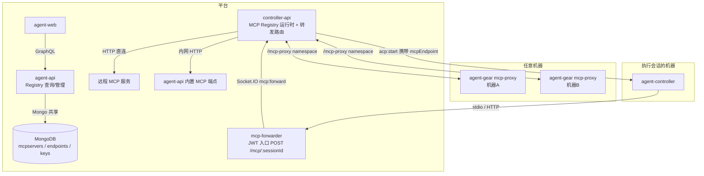
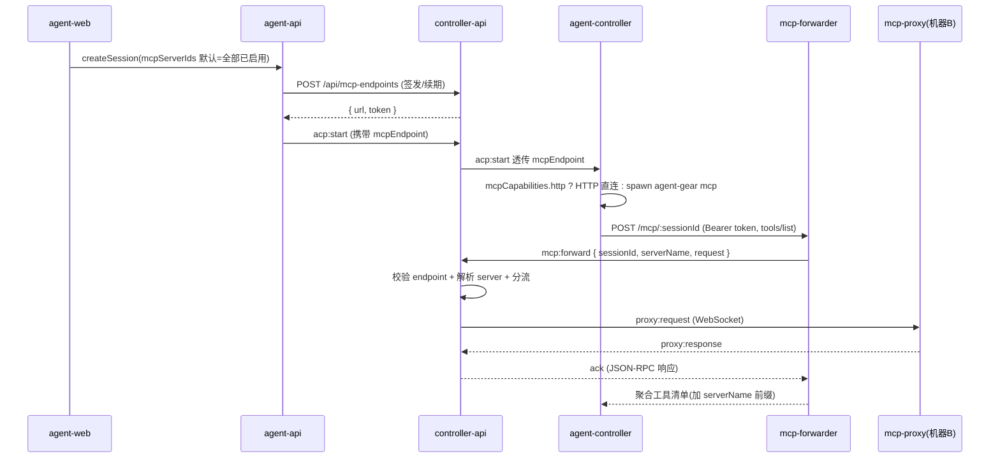

# 集成式 MCP 注册中心 - 技术提案

**功能名称**: 集成式 MCP 注册中心（Integrated MCP Registry）
**关联 PRD**: `docs/product/draft/20260804-integrated-mcp-registry.md`
**技术提案版本**: v1.0
**创建日期**: 2026-08-04
**作者**: ZeroAsh
**feat-branch**: `feat/integrated-mcp-registry`

## 1. 概述

### 1.1 背景

`feat/mcp-proxy-config`（见 [[20260530-feat-mcp-proxy-config.md]]）落地了 MCP 代理注册与转发的骨干，但当前实现存在**多处断链与缺口**，端到端不可用：

| # | 问题 | 位置 |
|---|------|------|
| 1 | GraphQL `CreateSessionInput` 缺少 `mcpServerIds` 字段（契约已有，实现未同步），前端无选择 UI | agent-api schema / agent-web |
| 2 | `acp:start` 消息中的 `mcpEndpoint` 字段被 controller-api 丢弃，不下发给 agent-controller | controller-api `session-command.ts` |
| 3 | mcp-forwarder emit 的 `mcp:forward` 事件在 controller-api 根 namespace **没有 handler** | controller-api |
| 4 | forwarder 按 `serverName` 路由，Registry 按 `serverId` 索引，二者不匹配 | mcp-forwarder / controller-api |
| 5 | mcp-forwarder 未被 Aspire / docker-compose 编排 | aspire/ |
| 6 | Endpoint revoke 不生效（forwarder 只验 JWT 不查状态），JWT 固定 24h 无续期 | controller-api / mcp-forwarder |
| 7 | `McpServerTransport` 仅 `registered_proxy`，无 HTTP 绑定与平台内置入口 | contracts / controller-api / agent-api |
| 8 | McpServer 无工具清单元数据，无法展示能力目录 | 数据模型 |

### 1.2 目标

1. 修复断链（上表 #1–#6），使「注册 → 装配 → 调用」端到端可用。
2. 将 McpServer 集合升级为 **Integrated MCP Registry**：统一抽象三种来源（`registered_proxy` / `http` / `platform`），携带工具清单元数据。
3. 会话创建时自动装配全部已启用 MCP 服务，经 mcp-forwarder 统一入口下发到执行会话的 agent-controller。
4. 平台自身能力（首期：会话只读查询）以内置 MCP 服务形式注册进 Registry。

### 1.3 范围

**分期（与 PRD 约束对齐）：**

- **P1（本期主体）**：链路修复（#1–#6）、Registry 数据模型升级、会话自动装配 + 创建对话框 MCP 多选、Registry 目录页（状态/来源/启停用）、endpoint 吊销生效、Aspire 编排。
- **P2**：远程 HTTP MCP 绑定（#7）、平台内置 MCP 服务、工具清单抓取与展示（#8）、同名工具命名空间隔离。

**不做：** MCP notifications / sampling 等双向特性（保持请求-响应模式）；平台写操作类 MCP 工具；对接官方 MCP Registry。

## 2. 技术架构

### 2.1 系统架构图



### 2.2 技术栈

| 层级 | 技术选型 | 说明 |
|------|---------|------|
| 前端 | React + TS + GraphQL | Registry 目录页、会话创建多选 |
| 后端 | Express + Socket.IO + Mongoose | controller-api（运行时 Registry）、agent-api（管理面） |
| 入口 | Express + socket.io-client | mcp-forwarder（保持独立服务，新增编排） |
| 数据库 | MongoDB | 共享库，扩展 mcpservers |
| 缓存 | Redis | endpoint 状态缓存、工具清单缓存 |

### 2.3 模块划分

| 模块 | 职责 | 关键技术点 |
|------|------|-----------|
| controller-api `McpProxyRegistry` | 代理连接管理 + **统一转发路由**（按 transport 分流 proxy/HTTP/platform） | 新增 `mcp:forward` handler、serverName→server 解析、endpoint 校验 |
| controller-api `McpEndpointService` | 会话端点签发/吊销/续期 | revoke 即时生效、TTL 续期 |
| agent-api GraphQL | Registry 管理面（查询、启停用、绑定/解绑） | Mutation 补齐、transport 扩展 |
| agent-api 内置 MCP 端点 | 平台能力 MCP 化（P2） | 只读 tools：session 列表/状态 |
| mcp-forwarder | JWT 校验入口，透传到 controller-api | 修复路由参数、加入编排 |
| agent-controller | 接收 mcpEndpoint，桥接给 ACP Agent | 按 `mcpCapabilities.http` 选择直连或 `agent-gear mcp` stdio 桥 |
| agent-web | Registry 目录页 + 会话创建装配 UI | 分组多选、来源徽标 |

## 3. API 设计

### 3.1 契约变更清单

| 契约文件 | 变更 |
|---------|------|
| `contracts/mcp-server.graphql` | transport 枚举扩展 `http` / `platform`；`McpServer` 增加 `source`、`hostname`、`url`、`tools[]`、`toolsSyncedAt`；新增 Mutation `setMcpServerEnabled(id, enabled)`、`bindRemoteMcpServer(name, url, headers)`、`unbindMcpServer(id)` |
| `contracts/agent-session.graphql` | `CreateSessionInput.mcpServerIds` 已有，**实现侧补齐**（agent-api schema + resolver + 前端） |
| `contracts/agent-session-websocket.md` | 补充定义根 namespace `mcp:forward`（forwarder→controller-api，含 endpoint 校验失败错误码）；新增 `mcp:endpoint:revoke`（吊销通知）；`acp:start.mcpEndpoint` 已定义，实现侧补齐透传 |
| `contracts/mcp-proxy-websocket.md` | 补齐 `proxy:unregistered` / `proxy:shutdown` 实现，与契约对齐 |

### 3.2 关键接口

#### `mcp:forward`（Socket.IO，根 namespace，P1 修复核心）

- **请求**: `{ sessionId, serverName, request: JsonRpcRequest }`
- **处理**: ① 按 sessionId 校验 endpoint 状态（ revoked/expired → 返回 `ENDPOINT_REVOKED`）；② serverName → McpServer 解析（内存索引，miss 回源 DB 重建）；③ 按 transport 分流：`registered_proxy` → `proxy:request` WebSocket 转发；`http`/`platform` → HTTP JSON-RPC 直连（P2）。
- **响应**: ack 返回 JSON-RPC 响应或 `{ error: { code, message } }`，code 枚举：`SERVER_OFFLINE` / `ENDPOINT_REVOKED` / `FORWARD_TIMEOUT` / `SERVER_NOT_FOUND`。

#### GraphQL Mutation（agent-api，管理面）

```graphql
extend type Mutation {
  setMcpServerEnabled(id: ID!, enabled: Boolean!): McpServer!
  bindRemoteMcpServer(input: BindRemoteMcpServerInput!): BindRemoteMcpServerResult!  # P2
  unbindMcpServer(id: ID!): Boolean!                                                 # P2
}
input BindRemoteMcpServerInput { name: String!, url: String!, headers: [HeaderInput!] }
```

`bindRemoteMcpServer` 同步执行连通性探测（`initialize` + `tools/list`），失败返回具体原因。

## 4. 数据模型

### 4.1 `mcpservers`（扩展）

| 字段 | 类型 | 说明 |
|------|------|------|
| transport | enum | `registered_proxy` / `http`(P2) / `platform`(P2) |
| source | enum | `proxy` / `manual` / `platform`，来源标识 |
| hostname | string? | 代理注册来源机器 |
| url | string? | http/platform 类型的访问地址 |
| headersEncrypted | object? | 远程绑定凭证，AES 加密存储 |
| enabled | bool | 启停用（默认 true），停用不装配进新会话 |
| tools | array | 工具清单快照 `[{name, description}]`（P2 抓取） |
| toolsSyncedAt | Date? | 清单最近同步时间 |

存量 `registered_proxy` 记录自动迁移 `source=proxy, enabled=true`，无需重新注册。

### 4.2 `mcpsessionendpoints`（调整）

- 增加 `serverIds: [ObjectId]`（签发时快照）。
- 吊销/过期状态同步写入 Redis（`mcp:endpoint:{sessionId}`，TTL 与 JWT 对齐），`mcp:forward` 处理时优先读缓存 → revoke 即时生效。
- JWT 有效期从固定 24h 调整为「会话活跃期滑动续期」：会话心跳时由 endpoint service 续签，会话结束后过期。

### 4.3 缓存设计

| Key | 内容 | TTL |
|-----|------|-----|
| `mcp:endpoint:{sessionId}` | endpoint 状态（active/revoked） | 与 JWT 一致 |
| `mcp:server:name:{userId}:{name}` | serverName→server 解析索引 | 60s，回源重建 |

## 5. 技术实现方案

### 5.1 核心流程：会话装配与调用（P1）



### 5.2 关键实现点

#### 实现点 1: `mcp:forward` handler（断链修复核心）

- controller-api 根 namespace 注册 handler，调用 `McpProxyRegistry.forwardRequest`。
- serverName 解析：registry 内存索引（注册/心跳时维护）→ miss 时查 DB（`name + userId + status`）。
- endpoint 校验：读 Redis 状态，revoked 时拒绝并通知 forwarder 返回 401。

#### 实现点 2: 会话装配链路补齐

- agent-api：`CreateSessionInput` schema 补 `mcpServerIds`；缺省时取该用户全部 `enabled=true` 的 server（自动装配）。
- controller-api `handleAcpStart`：透传 `mcpEndpoint` 到 agent-controller。
- agent-controller：`acp:start` 收到 `mcpEndpoint` 后构造 ACP `mcpServers`——Agent 支持 HTTP MCP 则直连 forwarder URL；否则 spawn `agent-gear mcp --endpoint --token` 作 stdio 桥（复用已有子命令）。

#### 实现点 3: 工具名命名空间（P2）

- forwarder 聚合 `tools/list` 时将工具名改写为 `{serverName}__{tool}`；`tools/call` 按前缀拆解路由到对应 server，避免多服务同名工具冲突。

#### 实现点 4: 平台内置 MCP（P2）

- agent-api 暴露内网 HTTP JSON-RPC 端点 `/internal/mcp`（仅平台网络可达），实现只读 tools：`list_sessions`、`get_session_status`。
- 服务启动时 upsert 一条 `transport=platform, source=platform` 的 McpServer（幂等，url 指向内网地址）；不可删除，可停用。
- `mcp:forward` 分流时 platform/http 统一走 HTTP JSON-RPC 客户端（带 headers 注入、10s 超时）。

#### 实现点 5: Registry 目录页与会话装配 UI（P1）

- 设置页「MCP」区块升级为目录视图：来源徽标（代理/远程/内置）、状态、工具数、启停用开关。
- NewSessionDialog 增加按来源分组的 MCP 多选（默认全选已启用项），提交时携带 `mcpServerIds`。

## 6. 技术决策

| 决策 | 选项 A | 选项 B | 最终选择 | 原因 |
|------|--------|--------|---------|------|
| Registry 管理面落点 | agent-api GraphQL 直写 Mongo | 转发到 controller-api REST | A | 沿用共享库既有模式，避免多一跳 |
| HTTP/platform 转发位置 | mcp-forwarder 直连 | controller-api 统一分流 | B | 路由逻辑单点收敛，forwarder 保持薄入口 |
| endpoint 吊销生效 | forwarder 查 DB | controller-api 转发时校验 + Redis 缓存 | B | forwarder 不连 DB，转发必经 controller-api，成本最低 |
| 同名工具冲突 | 禁止同名 | serverName 前缀改写 | B | 不限制用户注册自由，Agent 侧无冲突 |
| 会话 MCP 下发 | 每 server 独立端点 | 单聚合端点 + serverName 路由 | B | 沿用现有设计，Agent 只需配置一个入口 |

## 7. 项目结构（主要改动文件）

```
contracts/
  mcp-server.graphql              # transport/source/tools 扩展 + Mutation
  agent-session-websocket.md      # mcp:forward / mcp:endpoint:revoke
servers/controller-api/src/
  services/mcp-proxy-registry.ts  # mcp:forward handler、serverName 索引、HTTP 分流(P2)
  services/mcp-endpoint.ts        # revoke 生效、滑动续期
  socket/session-command.ts       # 透传 mcpEndpoint
servers/agent-api/src/
  graphql/schemas/mcp-server.ts   # Mutation + 字段补齐
  graphql/schemas/session.ts      # CreateSessionInput.mcpServerIds
  services/session.ts             # 默认全量装配
  mcp/platform-server.ts          # 内置 MCP 端点(P2)
servers/mcp-forwarder/src/
  routes/mcp.ts                   # serverName 路由修复、401 处理
packages/agent-controller/src/
  socketio-client.ts              # acp:start 接收 mcpEndpoint
  acp/bridge.ts                   # mcpServers 注入
apps/agent-web/src/
  components/settings/McpRegistrySection.tsx  # 目录页
  components/session/NewSessionDialog.tsx     # MCP 多选
aspire/AgentGear.AppHost/         # 编排 mcp-forwarder
```

## 8. 测试策略

- 单元测试：`mcp:forward` 路由与分流、endpoint 校验、工具名改写、自动装配缺省逻辑；覆盖率 ≥ 80%（新增代码）。
- API 测试（`tests/api/`）：`mcp:forward` 全链路 mock、bind/unbind、启停用、revoke 即时生效。
- E2E（`tests/e2e/`）：注册代理 → 目录可见 → 创建会话自动装配 → 工具列表包含注册服务的工具。
- 遵循 TDD 红-绿-重构循环，先写失败测试再实现。

## 9. 部署方案

- Aspire AppHost 增加 mcp-forwarder 资源（env：`MCP_ENDPOINT_JWT_SECRET`、`CONTROLLER_API_URL`、端口 3002），`aspire publish` 重新生成 manifest。
- 新增环境变量：`MCP_PLATFORM_INTERNAL_URL`（P2，platform 分流目标）、`MCP_ENDPOINT_TOKEN_TTL`。

## 10. 验收标准

- [ ] 技术方案评审通过
- [ ] Contract 更新评审通过
- [ ] P1：两台机器各注册一个 MCP 服务，同一会话可同时调用两者工具（E2E 通过）
- [ ] P1：创建会话默认装配全部已启用服务，revoke 后调用即时 401
- [ ] P1：`aspire start` 一键拉起含 mcp-forwarder 的全部服务
- [ ] P2：绑定远程 HTTP MCP 成功并可调用；平台内置服务开箱可用
- [ ] 单元 / API / E2E 测试全部通过

## 11. 相关文档

- [[20260530-feat-mcp-proxy-config.md]] — MCP 代理配置技术方案（本方案的前置）
- [[20260707-feat-unified-gateway.md]] — 统一网关（forwarder 入口的网关集成参考）
- PRD：`docs/product/draft/20260804-integrated-mcp-registry.md`
