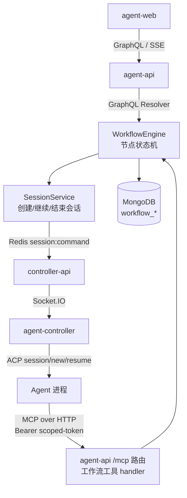
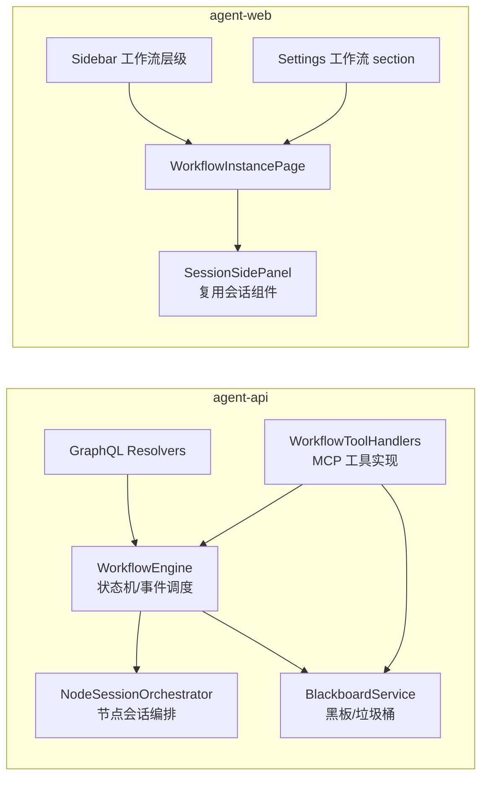
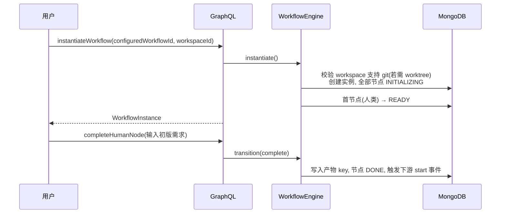
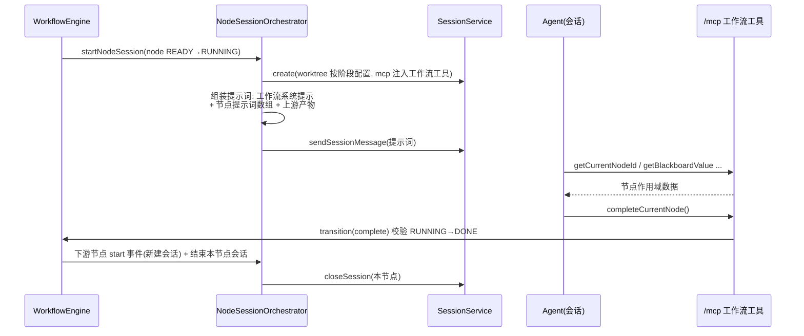
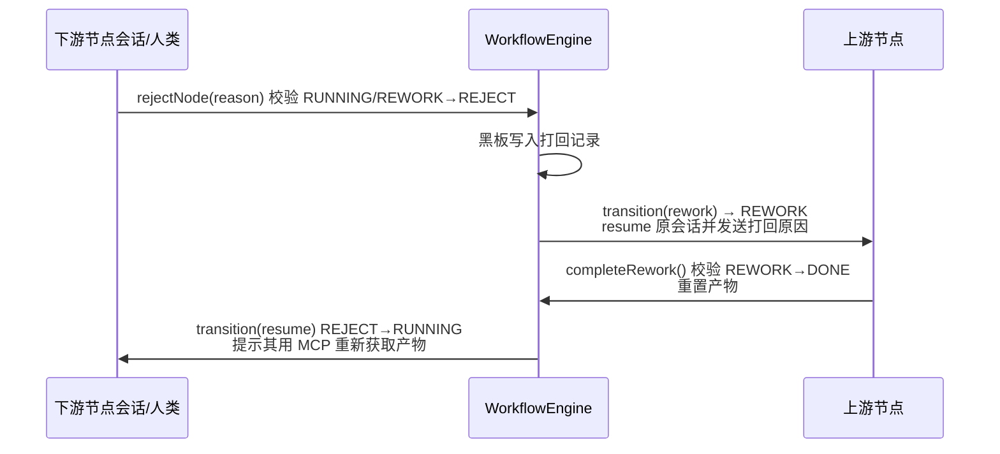

# Agent 工作流 — 技术提案

**功能名称**: Agent 工作流
**关联 PRD**: `docs/product/draft/20260808-agent-workflow.md`
**技术提案版本**: v1.0
**创建日期**: 2026-08-08
**作者**: Kimi
**feat-branch**: `feat/agent-workflow`

## 1. 概述

### 1.1 背景

PRD 提出「Agent 工作流」：横跨多个会话、围绕 GitHub PR 与分支工作的统一工作流体系。现状盘点（代码走查结论）：

- **会话模型**（`servers/agent-api/src/models/session.ts`）已具备 `worktreePath`/`worktreeBranch`/`externalSessionId`/`status`，创建会话支持 `enableWorktree + worktreeBranchSuffix`（`SessionService.create` 通过 Redis `session:command` 频道发布 `git:worktree:add`），`resume()` 支持继续已结束会话。Session 与 Workspace 是**创建期瞬态关联**（仅取 `workspace.path` 作为 `cwd`），Session 上未持久化 `workspaceId`。
- **MCP 分发**：已有会话级 MCP Endpoint（`McpSessionEndpoint` + JWT，路由 `servers/agent-api/src/routes/mcp.ts`，`POST /:sessionId[/:serverName]`，经 Redis `mcp:forward:*` 转发给 controller-api 的 MCP Proxy）。`McpServer.transport` 已预留 `platform` 类型（契约中标记 P2，未实现），可作为平台内置 MCP 工具的挂载点。当前仅支持**服务级**装配，无**工具级 / 作用域级**分发。
- **前端**：侧边栏（`apps/agent-web/src/components/Sidebar.tsx`）为 Controller → Workspace（按 path 派生）→ Session 三级；设置页（`SettingsPage.tsx`）按 section 注册；会话页 `SessionPage.tsx` 状态与页面耦合，无可嵌入的侧面板形态（仅有 `TodoListPanel` 的 popover 先例）。

### 1.2 目标

1. 落地工作流领域模型：工作流模板、已配置工作流、工作流实例、实例节点、工作流黑板（含垃圾桶）。
2. 实现节点状态机引擎：初始化 / 开始 / 完成 / 打回 / 返工 / 返工完成 / 复工 / 旗帜透传，驱动会话的创建、继续与结束。
3. 实现**节点作用域 MCP Registry**（Scoped MCP Registry）：把「工作流工具集」作为平台 MCP 服务注入节点会话，token 可映射到具体实例节点。
4. 前端落地：侧边栏工作流层级、设置工作流 section、工作流实例视图（阶段分组节点树 + 黑板 + 会话侧面板）。
5. 内置默认「开发工作流」模板。

### 1.3 范围

**做**：

- agent-api：工作流模型与 GraphQL 契约、节点状态机引擎（WorkflowEngine）、节点作用域 MCP 工具端点、会话结束兜底提示词。
- agent-web：侧边栏「工作流」层级（隐藏工作流会话）、设置「工作流」section、工作流实例视图与会话侧面板。
- contracts：新增 `workflow.graphql`，更新 `agent-session.graphql` / `mcp-server.graphql`。
- 默认「开发工作流」模板种子数据。

**不做**：

- 工作流模板的多用户分享 / 导入导出。
- 非人类首节点的工作流（本期约束：首节点必须是人类节点）。
- controller-api 与 agent-controller（CLI）的协议变更（沿用现有 `acp:start/resume/stop`、`git:worktree:*`、`session:*` 通道）。
- MCP Proxy 链路的改造（平台 MCP 工具不经过 Proxy，由 agent-api 直接处理）。

## 2. 技术架构

### 2.1 系统架构图



### 2.2 技术栈

| 层级 | 技术选型 | 说明 |
|------|---------|------|
| 前端 | React 19 + TypeScript + Vite + Tailwind v4 + urql | 复用现有技术栈 |
| 后端 | Node.js + Express + GraphQL Yoga + Mongoose | 工作流引擎落于 agent-api |
| 数据库 | MongoDB | 新增 workflow 相关集合 |
| 缓存/消息 | Redis Pub/Sub | 沿用 `session:command` 等既有频道，不新增控制器侧协议 |
| 其他 | MCP over HTTP（Streamable HTTP） | 节点作用域工具挂载于既有 `/mcp` 路由 |

### 2.3 模块划分



| 模块 | 职责 | 关键技术点 |
|------|------|-----------|
| WorkflowEngine | 节点状态转移校验、事件（start/complete/reject/rework/resume）调度 | 纯函数状态机 + Mongo 事务更新 |
| NodeSessionOrchestrator | AI 节点会话的拉起、继续、结束；提示词组装（系统提示 + 节点提示词数组 + 上游产物） | 复用 `SessionService.create/resume`，会话打标 `workflowInstanceId/workflowNodeId` |
| BlackboardService | 黑板 key-value 读写、产物 key 前缀匹配、移除入垃圾桶、打回记录 | Mongo `Map` 字段 |
| WorkflowToolHandlers | 12 个 MCP 工具的参数校验、状态转移校验、错误提示 | 挂载 `transport: platform` 的 McpServer |
| Scoped MCP Registry | 节点作用域 token 签发与映射 | 扩展 `McpSessionEndpoint` token payload |

## 3. API 设计

### 3.1 API 契约

新增 `contracts/workflow.graphql`（要点摘录）：

```graphql
enum WorkflowNodeType { HUMAN, AI, FLAG }
enum WorkflowNodeStatus { INITIALIZING, READY, RUNNING, DONE, REJECT, REWORK }

type WorkflowTemplate {
  id: ID!, name: String!, description: String
  nodes: [WorkflowTemplateNode!]!, isBuiltin: Boolean!
  createdAt: String!, updatedAt: String!
}
type WorkflowTemplateNode {
  nodeKey: String!, type: WorkflowNodeType!, name: String!, description: String
  stage: String!, prompts: [String!]          # AI 节点提示词数组
  artifactTitles: [String!]                   # 预定义产物 title
  dependsOn: [String!]!                       # 上游 nodeKey
  requiresWorktree: Boolean!
}
type ConfiguredWorkflow {
  id: ID!, name: String!, controllerId: ID!
  sourceTemplateId: ID, sourceTemplateVersion: String   # 复制来源, 无强关联
  nodes: [ConfiguredWorkflowNode!]!
}
type ConfiguredWorkflowNode {
  nodeKey: String!, agentConfig: AgentNodeConfig        # AI 节点必填
}
type AgentNodeConfig {
  acpServerType: String!, modeId: String, modelId: String
  initNewWorktree: Boolean!
}
type WorkflowInstance {
  id: ID!, configuredWorkflowId: ID!, controllerId: ID!, workspaceId: ID!
  name: String!, currentNodeNames: [String!]!   # 对外状态 = 执行中节点
  nodes: [WorkflowNode!]!, blackboard: [BlackboardEntry!]!
  blackboardTrash: [BlackboardEntry!]!
  createdAt: String!
}
type WorkflowNode {
  id: ID!, nodeKey: String!, type: WorkflowNodeType!, name: String!
  description: String, status: WorkflowNodeStatus!
  stage: String!, sessionId: ID
  createdAt: String!, startedAt: String, reworkedAt: String, reworkCount: Int!
}
type BlackboardEntry { key: String!, value: String!, updatedAt: String! }

type Query {
  workflowTemplates: [WorkflowTemplate!]!
  workflowTemplate(id: ID!): WorkflowTemplate
  configuredWorkflows(controllerId: ID): [ConfiguredWorkflow!]!
  configuredWorkflow(id: ID!): ConfiguredWorkflow
  workflowInstances(workspaceId: ID!): [WorkflowInstance!]!
  workflowInstance(id: ID!): WorkflowInstance
}

input WorkflowTemplateNodeInput {
  nodeKey: String!, type: WorkflowNodeType!, name: String!, description: String
  stage: String!, prompts: [String!], artifactTitles: [String!]
  dependsOn: [String!]!, requiresWorktree: Boolean!
}
input WorkflowTemplateInput {
  name: String!, description: String
  nodes: [WorkflowTemplateNodeInput!]!
}
input ConfiguredWorkflowNodeInput {
  nodeKey: String!, agentConfig: AgentNodeConfigInput
}
input AgentNodeConfigInput {
  acpServerType: String!, modeId: String, modelId: String
  initNewWorktree: Boolean!
}
input ConfigureWorkflowInput {
  name: String!, controllerId: ID!
  nodes: [ConfiguredWorkflowNodeInput!]!
}

type Mutation {
  createWorkflowTemplate(input: WorkflowTemplateInput!): WorkflowTemplate!
  updateWorkflowTemplate(id: ID!, input: WorkflowTemplateInput!): WorkflowTemplate!
  deleteWorkflowTemplate(id: ID!): Boolean!
  configureWorkflow(templateId: ID!, input: ConfigureWorkflowInput!): ConfiguredWorkflow!  # 从模板复制
  updateConfiguredWorkflow(id: ID!, input: ConfigureWorkflowInput!): ConfiguredWorkflow!
  deleteConfiguredWorkflow(id: ID!): Boolean!
  instantiateWorkflow(configuredWorkflowId: ID!, workspaceId: ID!, name: String!): WorkflowInstance!
  completeHumanNode(instanceId: ID!, nodeId: ID!, input: String): WorkflowNode!
  rejectNode(instanceId: ID!, nodeId: ID!, reason: String!): WorkflowNode!   # 人类打回
}
```

对既有契约的增量：

- `contracts/agent-session.graphql`：`Session` 增加 `workflowInstanceId: ID`、`workflowNodeId: ID`；`sessions` 查询默认**排除**工作流会话（新增参数 `includeWorkflowSessions: Boolean` 供实例视图使用）。`CreateSessionInput` 不暴露工作流字段（由引擎内部调用服务层）。
- `contracts/mcp-server.graphql`：`transport: platform` 从 P2 转为正式支持，`source: platform` 的平台服务「agent-workflow-tools」随系统自动注册（仅在工作流节点会话装配时生效）。

### 3.2 内部接口

- `WorkflowEngine.transition(instanceId, nodeId, event, payload)`：唯一状态转移入口，所有路径（GraphQL mutation / MCP 工具 / 兜底逻辑）统一走此入口做校验。
- `NodeSessionOrchestrator.startNodeSession(instance, node)` / `reworkNodeSession(...)` / `endNodeSession(...)`：封装会话创建/继续/结束与提示词组装。
- `BlackboardService.get/set/remove(instanceId, key, value)`：`remove` 将 entry 挪入 `blackboardTrash` 并记录时间。

## 4. 数据模型

### 4.1 数据库设计

#### 集合： workflow_templates

| 字段 | 类型 | 说明 |
|------|------|------|
| userId | ObjectId | 归属用户（内置模板 `isBuiltin=true`，用户只读） |
| name / description | String | 模板名称/描述 |
| version | Number | 模板版本号，每次更新 +1（配置工作流快照记录来源版本） |
| nodes[] | SubDoc | 模板节点（结构见下表） |
| isBuiltin | Boolean | 是否为内置默认模板 |
| createdAt / updatedAt | Date | 时间戳 |

**模板节点（nodes[] 子文档）**：

| 字段 | 类型 | 说明 |
|------|------|------|
| nodeKey | String | 模板内唯一标识（稳定 key，供 dependsOn 引用；实例化后映射为实例节点 nodeId） |
| type | Enum | `HUMAN` / `AI` / `FLAG` |
| name / description | String | 节点名称/描述 |
| stage | String | 所属阶段名称（同 stage 的节点共享一个 worktree） |
| prompts | [String] | AI 节点提示词数组；首元素由系统强制注入工作流系统提示（存储时不含，组装时注入） |
| artifactTitles | [String] | 预定义产物 title，用于提示词生成与产物 key 校验提示 |
| dependsOn | [String] | 上游 nodeKey 列表，空数组 = 首节点候选 |
| requiresWorktree | Boolean | 该节点会话是否需要 worktree 隔离 |

**模板校验规则**（`createWorkflowTemplate` / `updateWorkflowTemplate` 时执行，失败返回具体错误信息）：

1. `nodeKey` 全局唯一；`dependsOn` 引用的 nodeKey 必须存在。
2. 图必须是 DAG（拓扑排序检测环，检测到环时报出环上的节点）。
3. 入度为 0 的节点**有且仅有一个**，且 `type = HUMAN`（PRD 约束：首节点只允许人类节点）。
4. `AI` 节点 `prompts` 至少 1 条；`HUMAN`/`FLAG` 节点不允许有 `prompts`/`artifactTitles`（FLAG 节点同时要求无出度或作为终结点，仅告警不拦截）。
5. 同一 `stage` 的节点在拓扑序上应连续（不强制，仅用于展示分组）。
6. 内置模板（`isBuiltin=true`）不允许 `update/delete`，仅允许 `configureWorkflow` 复制。

#### 集合： configured_workflows

| 字段 | 类型 | 说明 |
|------|------|------|
| userId / controllerId | ObjectId | 归属用户 / 关联 Controller |
| name | String | 名称 |
| sourceTemplateId / sourceTemplateVersion | ObjectId / Number | 复制来源模板及版本（仅展示用，**无强关联**；模板后续更新不影响本副本） |
| nodes[] | SubDoc | 模板节点的**完整快照副本**（含模板节点全部字段）+ agentConfig（AI 节点：acpServerType/modeId/modelId/initNewWorktree；HUMAN 节点：operatorUserId，默认实例化操作人） |
| createdAt / updatedAt | Date | 时间戳 |

**配置校验规则**（`configureWorkflow` / `updateConfiguredWorkflow` 时执行）：

1. `controllerId` 必须属于当前用户。
2. 所有 `AI` 节点必须提供完整 `agentConfig`；`acpServerType` 必须在该 Controller 的 ACP capabilities（Redis `acp:capability:<controllerId>`）可用列表内。
3. `modeId`/`modelId` 允许为空（会话创建后由用户或 Agent 切换），非空时仅做格式校验，不在配置期强校验存在性（capabilities 是动态的）。
4. `nodes` 的 nodeKey 集合必须与来源模板快照一致（`updateConfiguredWorkflow` 不允许增删节点，仅允许改 `name/controllerId/agentConfig`；如需改图则重新从模板复制）。
5. 删除约束：存在未终结（仍有节点未 DONE/REJECT 终结态）实例引用时，`deleteConfiguredWorkflow` 拒绝并提示；无引用或实例已全部终结时允许删除（实例保留快照副本不受影响）。

#### 集合： workflow_instances

| 字段 | 类型 | 说明 |
|------|------|------|
| userId / controllerId / workspaceId / configuredWorkflowId | ObjectId | 归属四元组 |
| name | String | 实例名称 |
| nodes[] | SubDoc | 实例节点：nodeId, nodeKey, type, name, description, stage, status, sessionId, createdAt, startedAt, reworkedAt, reworkCount, rejectInfo{reason, fromNodeId, at} |
| blackboard | Map<String,String> | 工作流黑板（产物 key：`{nodeId}-{nodeName}-产物-{title}`；打回记录 key：`打回-{nodeId}-{序号}`） |
| blackboardTrash | Map<String,String> | 黑板垃圾桶 |

#### 集合： sessions（增量字段）

| 字段 | 类型 | 说明 |
|------|------|------|
| workflowInstanceId | ObjectId? | 归属工作流实例（可空） |
| workflowNodeId | String? | 归属实例节点（可空） |

### 4.2 缓存设计

- 沿用 Redis 既有缓存模式；工作流实例当前状态读多写少，引擎每次转移后失效 `workflow:instance:<id>` 缓存（TTL 60s 兜底）。
- 节点作用域 MCP token 沿用 `McpSessionEndpoint` 的 Redis 状态缓存（`mcp:endpoint:<sessionId>`）。

## 5. 技术实现方案

### 5.1 核心流程

**实例化与首节点**：



**AI 节点执行（开始 → 完成 → 下游接力）**：



**打回与返工**：



**链式打回复工**：a→b→c 链式打回（c 打回 b、b 打回 a）后，a 返工完成使 b 复工（RUNNING），但 c 仍为 REJECT；此时 b `complete` 会对下游 REJECT 节点执行 `resume`（而非 `start`——`start` 对 REJECT 非法会导致流程卡住），语义与 `completeRework` 的「通知下游 REJECT 复工」一致。

**实例删除（软删除）**：`deleteWorkflowInstance(id)` 停止流程运转并删除流程下全部会话（`Session.find({ workflowInstanceId })` 逐个走 `sessionService.delete`：停止 ACP 会话、清理 worktree 与消息），实例文档仅标记 `deletedAt` 不物理删除。实现上**先标记 deletedAt 再删会话**：引擎 `transition` 对 `deletedAt` 非空的实例直接抛错，orchestrator 兜底查询排除已删实例，避免删除过程中的状态竞态；实例列表/详情查询均过滤 `deletedAt: null`。前端实例页头部提供「删除实例」按钮与确认框，删除后跳转回会话列表。

**会话兜底**：`SessionService` 状态变为 `ended` 时，引擎检查其绑定节点状态是否在会话存续期内发生过转移；若未转移且节点仍处于 RUNNING，则 `resume()` 会话并发送兜底提示词（面向 LLM 撰写，说明其身处自动化系统、必须使用提供的工作流工具对当前节点执行完成/打回等操作）。兜底提醒限 1 次；提醒后会话再次停止（仍未转移）时，节点升级为 **FAILED**（failInfo.source=SESSION_STUCK），流程阻断并等待人工介入。LLM 判断任务无法继续时也可主动调用 `failCurrentNode`（source=LLM_REPORTED）；人类在节点会话中给出处理指示后，由 AI 调用 `resumeFailedNode`（FAILED→RUNNING）恢复。

**断连恢复**：Controller socket 断连时会话进入 `disconnected`（不触发上述兜底，提示词无法送达）。`resume()` 允许 `ended`/`disconnected`；前端断连会话显示「继续」（而非「关闭」），点击后弹确认框，确认并等会话 ready（SSE idling）后自动发送工作流继续提示词（显式要求 AI 调 `getNodeInfo`/`resumeFailedNode`/`completeCurrentNode` 等 MCP 工具继续之前的工作）。

### 5.2 关键实现点

#### 实现点 1：节点作用域 MCP Registry（Scoped MCP Registry）

- **描述**：将「工作流工具集」实现为 `transport: platform`、`source: platform` 的平台 MCP 服务 `agent-workflow-tools`，注册逻辑内置于 `routes/mcp.ts`：当请求的 serverName 为该平台服务时，不经 Redis 转发，直接调用 `WorkflowToolHandlers`。
- **技术细节**：节点会话创建时，`McpSessionEndpoint` 的 JWT payload 扩展 `{sessionId, userId, serverNames, workflow: {instanceId, nodeId}}`；工具 handler 从 token 解析节点上下文，实现「获得当前节点 ID / 父节点 ID」的作用域映射。节点操作类工具调用 `WorkflowEngine.transition` 做状态转移校验，失败返回结构化错误（code + 人类/LLM 可读的提示）。
- **风险点**：token 泄漏即可操作节点 → token TTL 沿用会话级配置，会话结束即吊销 endpoint（既有逻辑）。

#### 实现点 2：阶段与 Worktree 的对应

- **描述**：PRD 要求「每个阶段使用一个 Worktree」。实例化时按阶段生成 `worktreeBranchSuffix = <instance-slug>/<stage-slug>`；节点 `agentConfig.initNewWorktree = true` 的会话使用所属阶段的后缀创建 worktree（同一阶段内多个节点会话**复用**同一 worktree 路径，由 `SessionService.create` 幂等处理：worktree 已存在则直接使用）。
- **风险点**：同阶段多个 AI 节点串行执行（引擎保证依赖顺序），不存在并发写同一 worktree；若模板出现同阶段并行分支，需在后置迭代处理并发隔离（本期不做）。

#### 实现点 3：前端会话侧面板

- **描述**：从 `SessionPage.tsx` 抽取会话主体（`SessionHeader + MessageList + InputBox + useSessionStream`）为可复用组件 `<SessionView sessionId />`，`SessionPage` 与 `WorkflowInstancePage` 的侧面板（基于 `ui/dialog` 的 Sheet 模式）共同复用。
- **风险点**：`SessionPage` 内状态与路由耦合（`NewSessionDialog` 等），抽取时需保持路由页行为不变。

#### 实现点 4：侧边栏隐藏工作流会话

- **描述**：`sessions` 查询默认排除 `workflowInstanceId != null` 的会话；侧边栏在工作区节点下新增「工作流」分组（实例列表 + 「+」），实例项展示当前执行节点名作为状态。
- **技术细节**：工作区分组现有逻辑按 `cwd` 派生；工作流实例直接挂 `workspaceId`，不再依赖路径推导。

#### 实现点 5：默认模板种子

- **描述**：agent-api 启动时幂等 upsert 内置模板「开发工作流」（10 节点：产品需求 → 产出产品需求技术方案 → 审核产品文档与技术方案 → 产出实现方案 → 审核实现文档 → 代码实现 → AI审核代码 → 人类审核代码与验收 → 代码合并 → 完成开发），各 AI 节点提示词数组按 PRD §3.4 完善为面向 LLM 的正式文案，产物 title 预定义，首节点为人类节点，`requiresWorktree: true`。

#### 实现点 6：工作流模板与已配置工作流管理

- **模板编辑交互**：设置页「工作流模板」列表 + 「创建工作流模板」按钮进入模板编辑器。编辑器采用「节点列表 + 依赖下拉多选」的表单形态（本期不引入可视化拖拽画布，节点图以阶段分组的只读流程图预览，用 Mermaid/静态渲染呈现），降低前端复杂度。每个节点可编辑类型、名称、描述、阶段、提示词数组（AI 节点）、产物 title 列表、依赖节点。保存时前端先做基础校验（nodeKey 唯一、dependsOn 存在），后端执行完整校验规则（见 §4.1）。
- **配置工作流交互**：设置页「已配置工作流」列表 + 「配置工作流」按钮 → 选择一个模板 → 生成快照副本（深拷贝 nodes，记录 `sourceTemplateId/sourceTemplateVersion`）→ 进入配置表单：选择 Controller（在线），逐个 AI 节点选择 Agent 配置（acpServerType 从该 Controller 的 capabilities 下拉选择；modeId/modelId 可选；initNewWorktree 开关）。表单顶部展示文案：「本配置复制自模板《{模板名}》v{version}，模板后续更新不会同步到此配置」。
- **更新语义**：`updateConfiguredWorkflow` 仅允许修改 name/controllerId/agentConfig，不允许改图；模板更新后，已配置工作流卡片展示「模板已更新至 v{latest}，当前配置基于 v{source}」的非阻断提示，用户可选择「重新从模板复制」生成新配置（不覆盖旧配置）。
- **内置模板保护**：`isBuiltin` 模板在设置页只读展示（可复制），update/delete mutation 直接拒绝。
- **后端组织**：`services/workflow/template.ts`（模板 CRUD + 图校验 `validateTemplateGraph()`，纯函数便于单测）、`services/workflow/configured.ts`（复制快照 + 配置校验 + 删除约束）。

## 6. 技术决策

### 6.1 决策列表

| 决策 | 选项 A | 选项 B | 最终选择 | 原因 |
|------|--------|--------|---------|------|
| 工作流引擎落点 | agent-api | controller-api | agent-api | 数据模型、SessionService、MCP 路由均在 agent-api；controller-api 仅做转发 |
| 黑板存储 | 实例文档内 Map | 独立集合 | 实例文档内 Map | 单实例黑板规模小，原子更新简单 |
| 工作流工具分发 | 复用 MCP Proxy 链路 | 平台 MCP 服务（`transport: platform`） | 平台 MCP 服务 | 工具由平台自身提供，无需转发到执行机；契约已预留该类型 |
| 节点上下文映射 | 工具参数显式传 nodeId | scoped token 隐式映射 | scoped token | 防止会话越权操作其他节点，符合 PRD 要求 |
| 模板与已配置工作流 | 引用 + 继承 | 快照复制 | 快照复制 | PRD 明确要求无强关联，文案体现「复制」 |

### 6.2 依赖与约束

| 类型 | 内容 | 说明 |
|------|------|------|
| 依赖 | Git Worktree 会话隔离（已上线） | worktree 工作流的前提 |
| 依赖 | 集成式 MCP Registry（`feat/integrated-mcp-registry`） | 会话 MCP 装配链路 |
| 约束 | 首节点必须是人类节点 | PRD 约束 |
| 约束 | controller-api / agent-controller 协议不变 | 降低改动面 |

## 7. 项目结构

```
servers/agent-api/src/
├── models/
│   ├── workflow-template.ts        # 新增
│   ├── configured-workflow.ts      # 新增
│   ├── workflow-instance.ts        # 新增
│   └── session.ts                  # 增量 workflowInstanceId/workflowNodeId
├── services/workflow/
│   ├── engine.ts                   # 状态机与事件调度
│   ├── orchestrator.ts             # 节点会话编排/提示词组装/兜底
│   ├── blackboard.ts               # 黑板/垃圾桶/打回记录
│   ├── tool-handlers.ts            # 10 个 MCP 工具实现
│   └── seed.ts                     # 默认「开发工作流」模板种子
├── graphql/workflow/               # resolvers + typeDefs
└── routes/mcp.ts                   # 平台 MCP 服务分发分支

apps/agent-web/src/
├── components/workflow/            # 节点树/黑板/实例化对话框
├── components/session/SessionView.tsx   # 从 SessionPage 抽取复用
├── components/settings/WorkflowSection.tsx
├── pages/WorkflowInstancePage.tsx
└── components/Sidebar.tsx          # 工作流层级 + 隐藏工作流会话

contracts/
├── workflow.graphql                # 新增
├── agent-session.graphql           # 增量
└── mcp-server.graphql              # transport: platform 转正
```

## 8. 测试策略

### 8.1 测试覆盖要求

- 状态机引擎：所有合法/非法转移 100% 覆盖（单元测试）。
- API 测试覆盖：`workflow.graphql` 全部 Query/Mutation；`/mcp` 工作流工具的参数校验与作用域校验。
- 后端单测沿用 vitest（`.test.ts` 与源码同目录，如 `services/workflow/engine.test.ts`）；前端组件测试沿用 `__tests__` 目录约定。

### 8.2 单元测试用例（agent-api）

**模板图校验 `validateTemplateGraph()`**（`services/workflow/template.test.ts`）：

| # | 用例 | 预期 |
|---|------|------|
| T1 | 合法线性链 A→B→C | 通过 |
| T2 | nodeKey 重复 | 拒绝，报重复 key |
| T3 | dependsOn 引用不存在的 nodeKey | 拒绝，报缺失引用 |
| T4 | 存在环 A→B→A | 拒绝，报环上节点 |
| T5 | 两个入度为 0 的节点 | 拒绝（首节点必须唯一） |
| T6 | 首节点为 AI 节点 | 拒绝（首节点必须 HUMAN） |
| T7 | AI 节点 prompts 为空 | 拒绝 |
| T8 | HUMAN 节点携带 prompts | 拒绝 |
| T9 | 钻石型依赖 A→(B,C)→D | 通过，拓扑序正确 |

**状态机引擎 `WorkflowEngine.transition()`**（`services/workflow/engine.test.ts`）：

| # | 用例 | 预期 |
|---|------|------|
| E1 | INITIALIZING→READY（AI 节点会话关联成功） | 允许 |
| E2 | READY→RUNNING（收到全部上游 start 事件） | 允许，写入 startedAt |
| E3 | RUNNING→DONE（complete） | 允许，触发下游 start + 结束本会话 |
| E4 | RUNNING→REJECT（reject，携带 reason） | 允许，写黑板打回记录，触发上游 REWORK |
| E16 | REWORK→REJECT（返工中再次打回上游，a→b→c 中 c 打回 b 后 b 打回 a） | 允许，rejectInfo 覆盖，上游再次 REWORK |
| E17 | 链式打回后 complete（下游仍为 REJECT） | 允许，下游 REJECT 节点 resume 复工（而非 start，避免流程卡住） |
| E5 | REJECT→RUNNING（上游 REWORK→DONE 后 resume） | 允许 |
| E6 | REWORK→DONE（completeRework） | 允许，重置产物，通知下游 resume |
| E7 | READY/RUNNING/DONE→REWORK（收到打回） | 允许，reworkCount+1，写 reworkedAt |
| E8 | INITIALIZING→DONE / READY→DONE / DONE→RUNNING 等非法转移 | 拒绝，返回可读错误 |
| E9 | 打回无依赖上游的节点（首节点） | 拒绝，提示无上游可打回 |
| E10 | 多上游节点：部分上游 DONE 时 | 不 start；全部 DONE 才 READY→RUNNING |
| E11 | FLAG 节点收到上游完成事件 | 透传事件到下游，自身不产生会话 |
| E12 | 并行分支两个节点同时 RUNNING | 实例 currentNodeNames 含两个节点名 |

**黑板服务**（`services/workflow/blackboard.test.ts`）：

| # | 用例 | 预期 |
|---|------|------|
| B1 | set/get value | 读写一致，更新 updatedAt |
| B2 | remove key | key 从黑板消失，出现在垃圾桶 |
| B3 | 产物 key 前缀匹配 `{nodeId}-{nodeName}-产物` | 仅返回该节点产物 keys |
| B4 | 打回记录 key 写入 `打回-{nodeId}-{序号}` | 序号递增，内容含 reason/来源节点/时间 |

**会话编排**（`services/workflow/orchestrator.test.ts`）：

| # | 用例 | 预期 |
|---|------|------|
| O1 | AI 节点 start 提示词组装 | 含工作流系统提示 + 节点提示词数组 + 全部上游产物 |
| O2 | 无上游产物的节点 | 提示词仅含系统提示 + 节点提示词 |
| O3 | 会话打标 | create 参数含 workflowInstanceId/workflowNodeId |
| O4 | 阶段 worktree 后缀 | `<instance-slug>/<stage-slug>`，同阶段节点复用 |
| O5 | requiresWorktree=true 但工作区不支持 git | 实例化拒绝并提示 |
| O6 | 兜底：会话 ended 且节点状态未转移 | resume 会话并发送兜底提示词（仅 1 次） |
| O7 | 兜底：会话 ended 但节点已转移 | 不发送兜底提示词 |
| O8 | 节点完成 | 先触发下游 start（新建会话）再结束本会话 |

**Scoped MCP token**（`services/mcp-endpoint.test.ts` 增量）：

| # | 用例 | 预期 |
|---|------|------|
| S1 | 节点会话 endpoint token | payload 含 workflow.{instanceId,nodeId} |
| S2 | 普通会话 endpoint token | payload 无 workflow 字段，兼容既有逻辑 |
| S3 | 会话结束后调用工具 | 401 未授权 |

### 8.3 API 测试用例（tests/api）

| # | 接口 | 用例 | 预期 |
|---|------|------|------|
| A1 | createWorkflowTemplate | 合法模板 | 创建成功 |
| A2 | createWorkflowTemplate | 非法图（环/双首节点/AI 首节点） | 422 + 具体错误 |
| A3 | updateWorkflowTemplate | 内置模板 | 拒绝 |
| A4 | updateWorkflowTemplate | version 自增 | version+1 |
| A5 | configureWorkflow | 从模板复制 | 快照完整，记录来源版本；后续改模板不影响副本 |
| A6 | configureWorkflow | 缺 AI 节点 agentConfig | 422 指出缺失节点 |
| A7 | configureWorkflow | acpServerType 不在 controller capabilities | 422 |
| A8 | updateConfiguredWorkflow | 尝试增删节点 | 拒绝 |
| A9 | deleteConfiguredWorkflow | 存在活跃实例引用 | 拒绝并提示 |
| A10 | instantiateWorkflow | 正常 | 首节点 READY，其余 INITIALIZING/待激活 |
| A11 | instantiateWorkflow | requiresWorktree 但工作区非 git | 拒绝 |
| A12 | completeHumanNode | 首节点输入文本 | 产物写入黑板，下游 AI 节点拉起会话 |
| A13 | rejectNode | 人类打回 | 黑板有打回记录，上游 REWORK |
| A14 | sessions 查询 | 默认 | 不含工作流会话；`includeWorkflowSessions=true` 含 |
| A15 | /mcp 工具 getCurrentNodeId | 节点会话 token | 返回正确 nodeId；普通会话 token 不可用 |
| A16 | /mcp 工具 completeCurrentNode | 非 RUNNING 状态调用 | 返回状态非法提示 |
| A17 | /mcp 工具 removeBlackboardKey | 移除后查询 | 黑板无，垃圾桶有 |
| A18 | workflowInstance 查询 | 权限 | 他人实例 404/未授权 |

### 8.4 E2E 测试用例（tests/e2e）

| # | 场景 | 验证点 |
|---|------|--------|
| E2E-1 | 配置默认模板 → 实例化 → 人类节点输入需求 → AI 节点拉起 | 实例状态推进、会话打标、侧边栏不可见工作流会话 |
| E2E-2 | AI 节点完成接力 | 下游会话收到含上游产物的提示词，上游会话结束 |
| E2E-3 | 打回 → 返工 → 复工 | 原会话被 resume 收到打回原因；返工完成后下游继续 |
| E2E-4 | 会话兜底 | 会话结束未转移状态时收到兜底提示词 |
| E2E-5 | 实例视图 | 节点树按阶段分组、黑板可见、会话侧面板可打开 |
| E2E-6 | 设置页模板/配置管理 | 创建模板、从模板复制配置、复制关系文案可见 |

### 8.5 测试类型

| 类型 | 工具 | 覆盖范围 |
|------|------|---------|
| 单元测试 | vitest | 模板校验、状态机、提示词组装、黑板 key 匹配、兜底逻辑、scoped token |
| API 测试 | 既有 tests/api 框架 | workflow GraphQL 全量、/mcp 工作流工具、会话打标与排除 |
| E2E 测试 | 既有 tests/e2e 框架 | 实例化 → 接力 → 打回/返工 → 完成 全链路 |

## 9. 部署方案

### 9.1 环境规划

| 环境 | 用途 | 部署方式 |
|------|------|---------|
| 本地 | 开发调试 | aspire start（既有编排，无新增服务） |
| 测试 | API/E2E | 既有测试环境 |

### 9.2 配置管理

- 无新增环境变量；MCP token TTL 沿用 `mcpEndpointTokenTtl`。
- 新增 Mongo 集合无需迁移脚本（纯增量）。

## 10. 验收标准

- [ ] 技术方案评审通过
- [ ] Contract 评审通过
- [ ] 代码实现完成
- [ ] 单元测试覆盖达标（状态机 100%）
- [ ] API 测试通过
- [ ] E2E 测试通过（含打回/返工链路）

## 11. 相关文档

- 关联 PRD：`docs/product/draft/20260808-agent-workflow.md`
- 关联 Contract：`contracts/workflow.graphql`（待新增）
- 参考：[[20260523-feat-git-worktree-support]]
