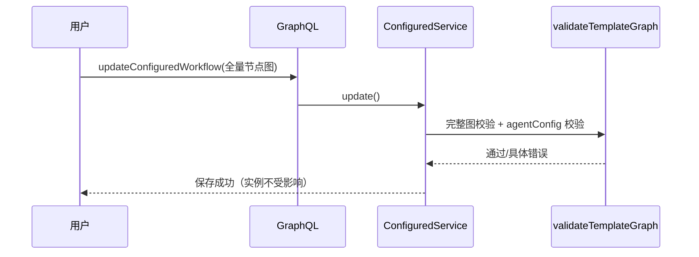
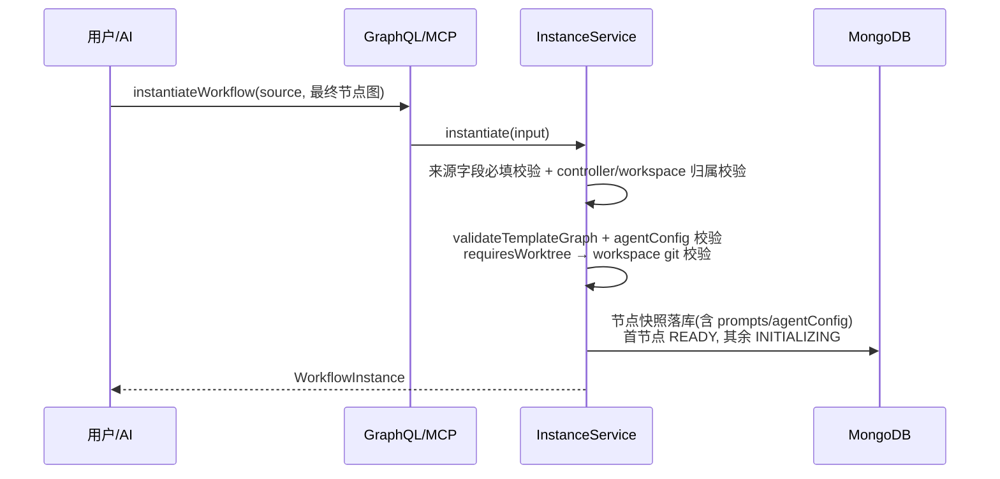
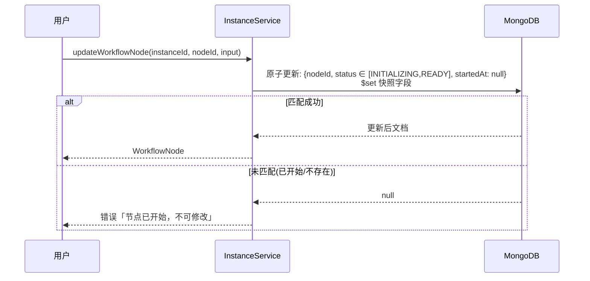
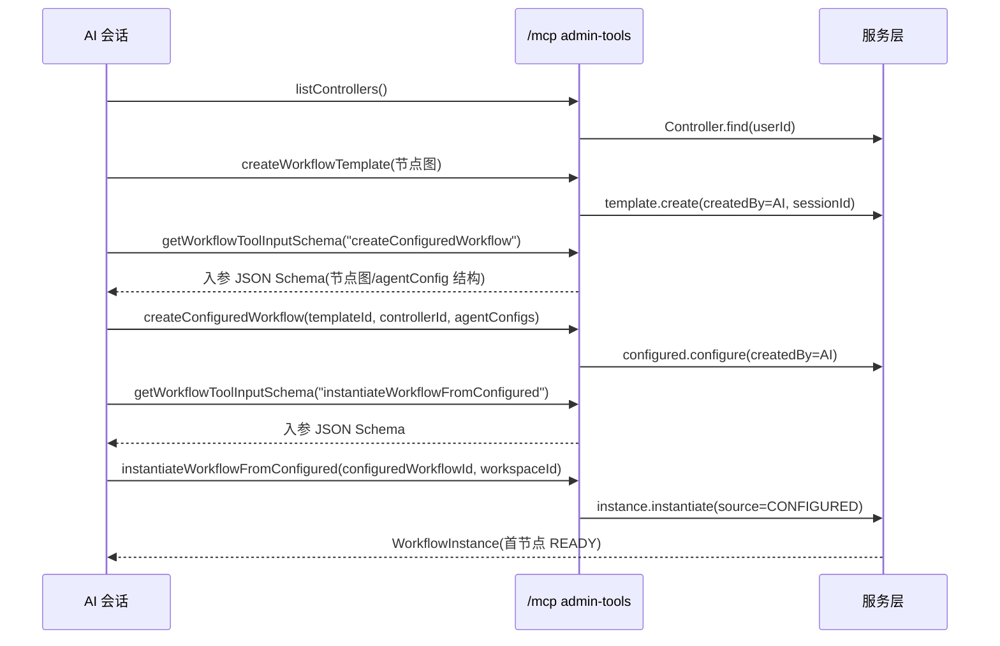

# Agent 工作流二期：工作流管理与实例化机制完善 — 技术提案

**功能名称**: Agent 工作流二期（工作流管理与实例化机制完善）
**关联 PRD**: `docs/product/draft/20260811-agent-workflow-phase2.md`
**技术提案版本**: v1.0
**创建日期**: 2026-08-11
**作者**: Kimi
**feat-branch**: `feat/agent-workflow-phase2`

## 1. 概述

### 1.1 背景

工作流一期（[[20260808-feat-agent-workflow]]）已上线：模板/已配置工作流/实例模型、节点状态机引擎、节点作用域 MCP 工具集（`agent-workflow-tools`，12 个工具）、实例视图均已就绪。二期 PRD 提出四项需求，代码走查（现状摸底）结论：

- **已配置工作流改不动**：`configured.ts` 的 `update()` 只允许改 `name/controllerId/agentConfig`，nodeKey 集合不一致直接报错；`ConfigureWorkflowInput.nodes` 入参只含 `nodeKey + agentConfig`，入口上就没有改图/改提示词的通道。
- **实例化入口单一**：`instance.ts` 仅 `instantiate(userId, configuredWorkflowId, workspaceId, name)` 一条路径；前端 `InstantiateWorkflowDialog` 只有「选配置 + 起名」，无实例化前配置界面。
- **实例节点无修改入口**：实例节点**不存** `prompts/artifactTitles/agentConfig`，orchestrator 通过 `loadConfiguredNode()` 按 nodeKey **运行时回查** ConfiguredWorkflow——实例对配置是引用而非快照。这既是「改已配置工作流影响进行中实例」的隐患，也使「实例级节点修改」无处落地。
- **MCP scope 机制单点**：platform 分发只有一条分支、一个平台服务、一种节点作用域（token `workflow.{instanceId,nodeId}`）；orchestrator 硬编码注入 `mcpServerIds: [workflowTools]`，无「多平台服务 / 工作流管理 scope」的扩展位。

### 1.2 目标

1. 已配置工作流开放图编辑（步骤、依赖、提示词、产物、阶段、Agent 配置），保存时执行与模板一致的完整图校验。
2. 实例节点改为**快照模型**（实例化时复制 prompts/artifactTitles/agentConfig 入实例节点），为「实例化前覆盖」「实例节点编辑」「配置可自由迭代」三者共同奠基。
3. 实例化三入口（已配置工作流 / 模板 / 空白）+ 实例化前统一配置界面，契约收敛为单一 `instantiateWorkflow(input)`。
4. 未开始实例节点支持编辑（保存时状态校验，仅 `INITIALIZING/READY` 且未开始过）。
5. 新增「工作流管理工具集」平台 MCP 服务（独立 scope）：模板管理、控制器列表、已配置工作流管理、三种方式实例化、入参 schema 查询；AI 创建的资源记录归属，仅可删除自己创建的。

### 1.3 范围

**做**：

- agent-api：实例快照模型迁移（含旧实例兼容回退）、`updateConfiguredWorkflow` 图编辑语义、`instantiateWorkflow` 统一 input、`updateWorkflowNode` mutation、工作流管理 MCP 工具集（新平台服务 + 分发机制泛化）、模板/配置集合的 AI 归属字段。
- agent-web：设置页已配置工作流编辑器升级（完整图编辑）、实例化对话框升级为「入口选择 + 实例化前配置界面」、实例视图未开始节点编辑入口。
- contracts：`workflow.graphql` 增量（input 扩展、新 mutation、类型字段增量）、`mcp-server.graphql` 注释更新。

**不做**：

- 工作流模板/配置的多用户分享、导入导出。
- 实例化后增删节点（本期只放开「修改未开始节点设置」，不改实例图结构）。
- controller-api 与 agent-controller（CLI）协议变更。
- 一期节点作用域工具集（`agent-workflow-tools`）的工具增删。

## 2. 技术架构

### 2.1 系统架构图

```mermaid
graph TD
    A[agent-web] -->|GraphQL| B[agent-api]
    B --> TPL[TemplateService<br/>模板 CRUD + 图校验]
    B --> CFG[ConfiguredService<br/>配置 CRUD + 图校验]
    B --> INST[InstanceService<br/>统一实例化 input]
    INST --> SNAP[实例节点快照<br/>prompts/artifactTitles/agentConfig]
    B --> NM[updateWorkflowNode<br/>状态校验后改快照]
    AG[任意 AI 会话] -->|MCP over HTTP| MCP[/mcp 路由<br/>platform 分发]
    MCP -->|serverName=agent-workflow-tools| WT[节点作用域工具<br/>一期]
    MCP -->|serverName=agent-workflow-admin-tools| AT[工作流管理工具集<br/>二期]
    AT --> TPL
    AT --> CFG
    AT --> INST
    AT --> CTRL[Controller 列表]
```

### 2.2 技术栈

| 层级 | 技术选型 | 说明 |
|------|---------|------|
| 前端 | React 19 + TypeScript + Vite + Tailwind v4 + urql | 复用现有技术栈与组件 |
| 后端 | Node.js + Express + GraphQL Yoga + Mongoose | 全部改动落于 agent-api |
| 数据库 | MongoDB | 既有集合增量字段，无新集合 |
| 其他 | MCP over HTTP（Streamable HTTP） | 新增第二个 platform 服务 |

### 2.3 模块划分

| 模块 | 职责 | 关键技术点 |
|------|------|-----------|
| `services/workflow/template.ts` | 模板 CRUD + `validateTemplateGraph()` 图校验 | 一期已有；新增 `createdBy` 归属写入与 AI 删除校验；图校验函数被配置服务与实例化复用 |
| `services/workflow/configured.ts` | 已配置工作流 CRUD | `update()` 放开图编辑：全量节点入参 + 完整图校验；删除约束放宽（快照模型下实例不再运行时引用） |
| `services/workflow/instance.ts` | 统一实例化 | 单一 `instantiate(input)`：三来源解析为统一节点图 → 图校验 → 快照落库 |
| `services/workflow/orchestrator.ts` | 节点会话编排 | 提示词/Agent 配置改从实例节点快照读取；旧实例回退 `loadConfiguredNode()` |
| `services/workflow/admin-tools.ts`（新增） | 工作流管理 MCP 工具集 | 薄封装：复用 template/configured/instance 服务函数；归属校验 |
| `services/workflow/tool-handlers.ts` | 节点作用域工具（一期） | 抽出 platform 分发公共部分，按 serverName 路由到两个 handler |
| `services/mcp-endpoint.ts` | token 签发 | 不变；admin 工具集走既有 `serverNames` 白名单装配（无 `workflow` payload） |

## 3. API 设计

### 3.1 API 契约

`contracts/workflow.graphql` 增量（要点）：

```graphql
enum ResourceCreatedBy { HUMAN, AI }

# —— 类型增量 ——
type WorkflowTemplate {
  # ...一期字段
  createdBy: ResourceCreatedBy!
}
type ConfiguredWorkflow {
  # ...一期字段
  createdBy: ResourceCreatedBy!
}
type WorkflowNode {
  # ...一期字段
  prompts: [String!]          # 实例快照
  artifactTitles: [String!]   # 实例快照
  agentConfig: AgentNodeConfig # 实例快照
}

# —— 已配置工作流图编辑 ——
# ConfiguredWorkflowNodeInput 扩展为全量节点字段（与模板节点同构 + agentConfig）
input ConfiguredWorkflowNodeInput {
  nodeKey: String!, type: WorkflowNodeType!, name: String!, description: String
  stage: String!, prompts: [String!], artifactTitles: [String!]
  dependsOn: [String!]!, requiresWorktree: Boolean!
  agentConfig: AgentNodeConfigInput
}

# —— 统一实例化 ——
enum InstantiateSource { CONFIGURED, TEMPLATE, BLANK }
input InstantiateWorkflowInput {
  source: InstantiateSource!
  configuredWorkflowId: ID   # source=CONFIGURED 必填
  templateId: ID             # source=TEMPLATE 必填
  controllerId: ID!          # 三来源均必填（实例归属控制器）
  workspaceId: ID!
  name: String!
  nodes: [ConfiguredWorkflowNodeInput!]!   # 实例化前配置界面编辑后的最终节点图
}

# —— 实例节点编辑 ——
input WorkflowNodeUpdateInput {
  name: String, description: String, stage: String
  prompts: [String!], artifactTitles: [String!]
  requiresWorktree: Boolean
  agentConfig: AgentNodeConfigInput
}

type Mutation {
  # ...一期 mutation 保留
  updateConfiguredWorkflow(id: ID!, input: ConfigureWorkflowInput!): ConfiguredWorkflow!
    # 语义变更：允许改图（全量节点 + 完整图校验）
  instantiateWorkflow(input: InstantiateWorkflowInput!): WorkflowInstance!
    # 签名变更：替代一期 (configuredWorkflowId, workspaceId, name)
  updateWorkflowNode(instanceId: ID!, nodeId: ID!, input: WorkflowNodeUpdateInput!): WorkflowNode!
}
```

**兼容说明**：`instantiateWorkflow` 签名变更为破坏性变更，但契约与前端同仓库发布，一并更新即可；`ConfigureWorkflowInput` 为输入类型扩展（新增可选字段语义升级为必填校验由服务端按规则执行），旧调用方（传 name/controllerId/agentConfig 全量 nodes）仍可通过校验。

`contracts/mcp-server.graphql`：`source: platform` 注释更新为「平台内置服务；节点作用域工具集随节点会话自动装配，工作流管理工具集可装配到任意会话」。

### 3.2 内部接口

- `validateTemplateGraph(nodes)`（一期已有，纯函数）：被 `template.create/update`、`configured.configure/update`、`instance.instantiate`（含 MCP 从原始内容实例化）四方复用。
- `instance.instantiate(userId, input)`：三来源统一入口；来源仅决定「节点图初始值」，服务端始终以 `input.nodes` 为准校验并快照落库（前端在配置界面中把来源节点图载入后供用户编辑，提交的就是最终图）。
- `instance.updateNode(instanceId, nodeId, input)`：状态校验（见 §5.2 实现点 3）后更新实例节点快照字段。
- `admin-tools.ts`：`handleAdminToolCall(name, args, { userId, sessionId })`，13 个工具薄封装服务层（见 §5.2 实现点 4）。

## 4. 数据模型

### 4.1 数据库设计

#### 集合： workflow_templates（增量）

| 字段 | 类型 | 说明 |
|------|------|------|
| createdBy | Enum | `HUMAN`（默认）/ `AI`；AI 经管理工具集创建时置 `AI` |
| createdBySessionId | ObjectId? | AI 创建来源会话（追溯用，可空） |

#### 集合： configured_workflows（增量）

| 字段 | 类型 | 说明 |
|------|------|------|
| createdBy | Enum | 同上 |
| createdBySessionId | ObjectId? | 同上 |

**update 语义变更**：`update()` 接受全量节点图，执行与模板一致的完整校验（nodeKey 唯一、依赖存在、DAG、唯一人类首节点、AI 节点 prompts 非空与 agentConfig 完整、acpServerType 在 controller capabilities 内）。快照模型下编辑配置**不影响**任何实例（含进行中）。

**delete 语义变更**：一期「存在活跃实例引用则拒绝删除」的约束**移除**——实例已快照自包含，删除配置不影响实例；归属校验（AI 工具仅可删 `createdBy=AI`）在工具层叠加，人类 UI 删除不受归属限制。

#### 集合： workflow_instances（增量：节点快照）

| 字段（nodes[] 子文档） | 类型 | 说明 |
|------|------|------|
| prompts | [String] | 实例化时从最终节点图快照 |
| artifactTitles | [String] | 同上 |
| agentConfig | SubDoc | 同上（AI 节点） |
| requiresWorktree | Boolean | 同上 |

**旧实例兼容**：存量实例节点无上述字段。orchestrator 读取顺序：实例节点快照字段存在则用快照；否则回退一期 `loadConfiguredNode()` 按 nodeKey 回查（保留该函数仅服务于旧实例）。`updateWorkflowNode` 命中旧实例节点时，先按回查结果补齐快照字段再应用修改。

### 4.2 缓存设计

- 沿用一期：`workflow:instance:<id>` 缓存（TTL 60s），`instantiate/updateNode` 后失效。
- `acp:capability:<controllerId>` 沿用一期读取方式（配置校验与实例化校验共用）。

## 5. 技术实现方案

### 5.1 核心流程

**编辑已配置工作流（图编辑）**：



**统一实例化（三入口）**：



**未开始节点编辑**：



**AI 经管理工具集编排工作流**：



### 5.2 关键实现点

#### 实现点 1：实例快照模型

- **描述**：`instance.instantiate` 落库实例节点时写入 `prompts/artifactTitles/agentConfig/requiresWorktree` 全量快照；orchestrator 的提示词组装与 `SessionService.create` 参数（acpServerType/modeId/modelId/initNewWorktree）改从实例节点读取。
- **技术细节**：保留 `loadConfiguredNode()` 仅作旧实例回退；新实例不再依赖 ConfiguredWorkflow 存续（配置被删/被改均不影响实例）。
- **风险点**：旧实例回退路径需单测覆盖；快照与配置可能产生认知分歧（用户在实例视图看到的提示词是快照副本）——前端文案注明「实例节点为实例化时的副本」。

#### 实现点 2：已配置工作流图编辑

- **描述**：`configured.update` 接受全量 `nodes`，复用 `validateTemplateGraph()` + `validateAgentConfigs()`；`ConfigureWorkflowInput.nodes` 契约扩展为全量节点字段。
- **技术细节**：`sourceTemplateId/Version` 保留（仅展示）；改图后 nodeKey 集合可与原快照不同（不再限制），因实例已不再引用配置。
- **风险点**：无；校验规则与模板完全一致，复用既有单测矩阵。

#### 实现点 3：实例节点编辑的状态校验

- **描述**：`updateWorkflowNode` 使用**原子条件更新**（`findOneAndUpdate` 条件 `{_id, deletedAt: null, nodes: {$elemMatch: {nodeId, status: {$in: ['INITIALIZING','READY']}, startedAt: null}}}` + 数组过滤器 `$set`），避免「校验后、写入前节点被引擎 start」的竞态。
- **技术细节**：`INITIALIZING/READY` 且 `startedAt == null` 即 PRD「从未开始过」；`REWORK` 节点 `startedAt` 非空天然排除。未匹配时区分「节点不存在」与「已开始」二次查询以返回准确错误。
- **风险点**：引擎 `maybeActivate` 与编辑并发时，原子条件保证只有一个获胜；编辑失败方收到状态提示。

#### 实现点 4：工作流管理 MCP 工具集（新 scope）

- **描述**：新增平台服务 `agent-workflow-admin-tools`（`transport/source: platform`），随系统启动按 `{name}` 幂等 upsert（同 `ensureWorkflowToolsServer` 模式）。工具清单（13 个）：
  - 模板：`createWorkflowTemplate` / `listWorkflowTemplates` / `getWorkflowTemplate` / `deleteWorkflowTemplate`
  - 控制器：`listControllers`（返回 id/name/在线状态/acpServerTypes 摘要）
  - 已配置工作流：`createConfiguredWorkflow` / `listConfiguredWorkflows` / `getConfiguredWorkflow` / `deleteConfiguredWorkflow`
  - 实例化：`instantiateWorkflowFromTemplate` / `instantiateWorkflowFromConfigured` / `instantiateWorkflowFromContent`，三者均必填 `controllerId`（+ `workspaceId`、`name`；FromContent 直接传完整节点图，不落库模板/配置）
  - 入参 schema 查询：`getWorkflowToolInputSchema(toolName)` —— 返回指定管理工具的入参 JSON Schema（含字段类型、必填项、嵌套结构与字段说明），供 AI 在调用 `createConfiguredWorkflow`、`instantiateWorkflowFromConfigured` 等复杂入参工具前获取准确的参数结构；`toolName` 限管理工具集内的工具名，非法工具名返回可读错误
- **技术细节**：
  - **分发泛化**：`tool-handlers.ts` 抽出 platform 公共层 `PLATFORM_HANDLERS: Record<serverName, PlatformHandler>`；`routes/mcp.ts` 的 platform 分支按 serverName 查表分发。`agent-workflow-tools` 仍要求 token 含 `workflow` payload（节点作用域）；`agent-workflow-admin-tools` 仅需 `{userId, sessionId}`（会话作用域）。
  - **装配**：admin 工具集不经 orchestrator 硬编码注入，而是作为普通 McpServer 出现在 MCP Registry，用户/AI 在会话创建时通过既有 `mcpServerIds` 装配；token `serverNames` 白名单（既有逻辑）天然完成访问门控。
  - **入参 schema 单一来源**：admin 工具集每个工具的入参 JSON Schema 集中定义为 `ADMIN_TOOL_SCHEMAS`（同时服务于 `tools/list` 的 `inputSchema` 与调用前参数校验），`getWorkflowToolInputSchema` 直接从中查表返回，保证「AI 读到的 schema」与「服务端实际校验的 schema」一致，不维护第二份描述。
  - **归属**：创建类工具写 `createdBy=AI` + `createdBySessionId`；删除类工具仅允许 `createdBy=AI` 的资源，否则返回结构化错误「该资源由人类创建，不允许 AI 删除」。内置模板（`isBuiltin`）删除拒绝沿用一期逻辑。
  - **复用**：所有工具薄封装 `template.ts/configured.ts/instance.ts` 的既有服务函数，校验规则与 GraphQL 路径完全一致。
- **风险点**：AI 误操作实例化 → 实例化产物（实例、会话）均在实例视图可见可删，人类可兜底；token 泄漏风险与一期相同（TTL + 会话结束吊销）。

#### 实现点 5：前端实例化前配置界面

- **描述**：`InstantiateWorkflowDialog` 重构为两步：① 选择来源（已配置工作流 / 模板 / 空白）与目标；② 配置界面展示节点图（复用 `TemplateEditorDialog` 的节点表单组件），可编辑节点设置，确认后提交 `instantiateWorkflow(input)`。
- **技术细节**：从已配置工作流/模板载入的节点图作为表单初值；空白来源初始为首节点占位（人类节点）。前端基础校验（nodeKey 唯一、依赖存在）后提交，服务端完整校验错误回显。
- **风险点**：`TemplateEditorDialog` 与配置界面共用表单组件，抽取时保持设置页行为不变。

#### 实现点 6：前端实例节点编辑与已配置工作流编辑器

- **实例节点编辑**：`WorkflowInstancePage` 节点树中 `INITIALIZING/READY` 节点显示「编辑」入口，弹出节点设置表单（复用实现点 5 组件），保存调 `updateWorkflowNode`；服务端拒绝时 toast 错误文案。
- **已配置工作流编辑器**：`ConfigureWorkflowDialog` 升级为完整图编辑（增删节点、依赖多选、提示词编辑），与模板编辑器同形态；顶部保留「复制自模板《x》v{n}」文案。

## 6. 技术决策

### 6.1 决策列表

| 决策 | 选项 A | 选项 B | 最终选择 | 原因 |
|------|--------|--------|---------|------|
| 实例节点与配置的关系 | 维持运行时引用 | 实例快照 | 实例快照 | 同时支撑配置自由编辑、实例化前覆盖、实例节点编辑三个需求；消除「改配置影响进行中实例」隐患 |
| 实例化契约 | 三个 mutation（每来源一个） | 单一 input mutation | 单一 input | 三入口差异仅在「节点图初值」，服务端统一以最终图为准；MCP 三个工具内部复用同一服务函数 |
| 实例节点编辑的并发控制 | 先查后写 | 原子条件更新 | 原子条件更新 | 消除与引擎 start 的竞态，PRD 明确「以保存时状态校验为准」 |
| admin 工具集装配 | orchestrator 硬编码注入所有会话 | 走既有 mcpServerIds 装配 | 既有装配机制 | 避免全量会话注入多余工具；serverNames 白名单天然门控 |
| AI 归属记录 | 独立集合记录 | 资源文档上加 createdBy 字段 | 文档字段 | 查询/校验路径最短，删除校验一次查询完成 |
| 已配置工作流删除约束 | 保留活跃实例引用检查 | 移除（快照自包含） | 移除 | 快照模型下实例不再引用配置；约束失去存在意义且阻碍 AI 删除工具的可用性 |

### 6.2 依赖与约束

| 类型 | 内容 | 说明 |
|------|------|------|
| 依赖 | 工作流一期全部能力 | 模型、引擎、orchestrator、MCP 路由、前端页面 |
| 约束 | 首节点必须是人类节点 | 一期约束延续，图校验覆盖全部新入口 |
| 约束 | 实例图结构不可改 | 本期实例级只放开「修改未开始节点设置」，不开放增删实例节点 |
| 约束 | controller-api / agent-controller 协议不变 | 降低改动面 |

## 7. 项目结构

```
servers/agent-api/src/
├── models/
│   ├── workflow-template.ts        # 增量 createdBy/createdBySessionId
│   ├── configured-workflow.ts      # 增量 createdBy/createdBySessionId；节点入参全量化
│   └── workflow-instance.ts        # 增量节点快照字段 prompts/artifactTitles/agentConfig/requiresWorktree
├── services/workflow/
│   ├── template.ts                 # createdBy 写入；AI 删除校验辅助
│   ├── configured.ts               # update 图编辑语义；delete 约束移除
│   ├── instance.ts                 # 统一 instantiate(input)；updateNode()；快照落库
│   ├── orchestrator.ts             # 快照读取优先，旧实例回退 loadConfiguredNode
│   ├── admin-tools.ts              # 新增：工作流管理工具集 13 个工具（含入参 schema 查询）
│   └── tool-handlers.ts            # 抽 platform 公共层，按 serverName 分发
├── graphql/workflow/               # 契约增量 resolver
└── routes/mcp.ts                   # platform 分支按 serverName 查表分发

apps/agent-web/src/
├── components/workflow/
│   ├── InstantiateWorkflowDialog.tsx   # 重构：来源选择 + 实例化前配置界面
│   ├── WorkflowGraphEditor.tsx         # 新增：节点图表单（供配置界面/设置页复用）
│   └── WorkflowNodeTree.tsx            # 未开始节点「编辑」入口
├── components/workflow/EditInstanceNodeDialog.tsx  # 新增
└── components/settings/WorkflowSection.tsx         # ConfigureWorkflowDialog 升级图编辑

contracts/
├── workflow.graphql                # 增量（§3.1）
└── mcp-server.graphql              # 注释更新
```

## 8. 测试策略

### 8.1 测试覆盖要求

- `updateWorkflowNode` 状态校验全组合（单元测试 100% 覆盖状态枚举）。
- API 测试覆盖：新增/变更的全部 Query/Mutation 与 13 个管理工具。
- 后端单测沿用 vitest（`.test.ts` 与源码同目录）；前端组件测试沿用 `__tests__` 约定。

### 8.2 单元测试用例（agent-api）

**统一实例化 `instance.instantiate()`**（`services/workflow/instance.test.ts` 增量）：

| # | 用例 | 预期 |
|---|------|------|
| I1 | source=CONFIGURED 正常 | 实例节点含全量快照字段 |
| I2 | source=TEMPLATE/BLANK + controllerId | 校验来源必填字段，缺失报错 |
| I3 | 节点图非法（环/双首节点） | 复用图校验，报具体错误 |
| I4 | AI 节点 agentConfig 缺失/类型不在 capabilities | 拒绝并指出节点 |
| I5 | requiresWorktree 但工作区非 git | 拒绝 |
| I6 | 提交图与来源图不同（实例化前被修改） | 以提交图为准落库 |

**实例节点编辑 `instance.updateNode()`**：

| # | 用例 | 预期 |
|---|------|------|
| N1 | INITIALIZING/READY 且 startedAt=null | 更新成功 |
| N2 | RUNNING/DONE/REJECT/REWORK/FAILED | 拒绝「节点已开始，不可修改」 |
| N3 | 旧实例节点（无快照字段） | 先回查补齐快照再应用修改 |
| N4 | 实例已删除（deletedAt 非空） | 拒绝 |
| N5 | 并发：编辑与引擎 start 竞争 | 原子条件仅一方生效 |

**快照读取**（`orchestrator.test.ts` 增量）：

| # | 用例 | 预期 |
|---|------|------|
| S1 | 新实例节点 | 提示词/Agent 配置来自快照，不回查配置 |
| S2 | 旧实例节点 | 回退 loadConfiguredNode，行为与一期一致 |
| S3 | 配置被删除后旧实例节点 | 回查失败的错误可读 |

**管理工具集**（`services/workflow/admin-tools.test.ts`）：

| # | 用例 | 预期 |
|---|------|------|
| M1 | createWorkflowTemplate | createdBy=AI、createdBySessionId 写入；图校验生效 |
| M2 | deleteWorkflowTemplate（AI 创建） | 成功 |
| M3 | deleteWorkflowTemplate（人类创建/内置） | 拒绝归属错误 |
| M4 | listControllers | 仅返回当前用户控制器 |
| M5 | createConfiguredWorkflow | 复用配置校验（capabilities 等） |
| M6 | deleteConfiguredWorkflow（AI 创建且实例引用中） | 成功（快照模型不影响实例） |
| M7 | 三个实例化工具缺 controllerId | 参数错误 |
| M8 | instantiateWorkflowFromContent 传完整图 | 不落库模板/配置，直接建实例 |
| M9 | 无 workflow payload 的 token 调节点工具 / 反之越权 | 结构化错误 |
| M10 | getWorkflowToolInputSchema("createConfiguredWorkflow") / ("instantiateWorkflowFromConfigured") | 返回与 ADMIN_TOOL_SCHEMAS 一致的入参 JSON Schema |
| M11 | getWorkflowToolInputSchema 传非法/非管理工具名 | 可读错误，列出可用工具名 |

**已配置工作流图编辑**（`configured.test.ts` 增量）：

| # | 用例 | 预期 |
|---|------|------|
| C1 | 改 prompts/增删节点/调依赖 | 通过完整图校验后保存 |
| C2 | 非法图 | 与模板校验一致的具体错误 |
| C3 | 编辑配置后，新实例 | 以编辑后内容快照，互不影响 |
| C4 | 编辑配置后，一期旧实例（无快照字段） | 回退路径读到的是配置当前内容；若 nodeKey 已被删除则报可读错误（已知边界，文案提示「旧实例引用的配置已变更」） |

### 8.3 API 测试用例（tests/api）

| # | 接口 | 用例 | 预期 |
|---|------|------|------|
| A1 | updateConfiguredWorkflow | 全量图编辑 | 保存成功，来源模板不变 |
| A2 | instantiateWorkflow | 三来源 | 均创建成功，节点快照完整 |
| A3 | updateWorkflowNode | 未开始/已开始 | 分别成功/拒绝 |
| A4 | /mcp admin-tools 全工具 | 装配 admin 服务 token | 功能与归属校验符合 §8.2 M 系列 |
| A5 | /mcp admin-tools | 未装配该服务的 token | serverNames 白名单拒绝 |
| A6 | deleteConfiguredWorkflow | 存在活跃实例 | 删除成功，实例不受影响 |

### 8.4 E2E 测试用例（tests/e2e）

| # | 场景 | 验证点 |
|---|------|--------|
| E2E-1 | 设置页编辑已配置工作流图 | 保存成功、校验错误回显 |
| E2E-2 | 从模板实例化（配置界面补齐 Agent 配置） | 实例创建、节点快照为提交内容 |
| E2E-3 | 从空白实例化 | 配置界面从零搭建节点图后创建成功 |
| E2E-4 | 实例视图编辑未开始节点 | 保存生效；开始后再编辑被拒绝 |
| E2E-5 | AI 会话装配管理工具集完成编排 | 创建模板→配置→实例化全链路；删除人类资源被拒 |

### 8.5 测试类型

| 类型 | 工具 | 覆盖范围 |
|------|------|---------|
| 单元测试 | vitest | 图校验复用、实例化 input 校验、快照读取/回退、updateNode 状态组合、admin 工具归属 |
| API 测试 | 既有 tests/api 框架 | 全部新/变更契约 + admin 工具集 |
| E2E 测试 | 既有 tests/e2e 框架 | 三入口实例化、节点编辑、AI 编排链路 |

## 9. 部署方案

### 9.1 环境规划

| 环境 | 用途 | 部署方式 |
|------|------|---------|
| 本地 | 开发调试 | aspire start（无新增服务） |
| 测试 | API/E2E | 既有测试环境 |

### 9.2 配置管理

- 无新增环境变量；`agent-workflow-admin-tools` 平台服务随系统启动幂等 upsert。
- 存量数据无迁移脚本：`createdBy` 缺省按 `HUMAN` 处理；旧实例节点靠 orchestrator 回退兼容。

## 10. 验收标准

- [ ] 技术方案评审通过
- [ ] Contract 评审通过
- [ ] 代码实现完成（含快照模型与旧实例兼容）
- [ ] 单元测试覆盖达标（updateNode 状态组合 100%）
- [ ] API 测试通过（含 admin 工具集归属校验）
- [ ] E2E 测试通过（三入口实例化 + 节点编辑 + AI 编排链路）

## 11. 相关文档

- 关联 PRD：`docs/product/draft/20260811-agent-workflow-phase2.md`
- 一期提案：[[20260808-feat-agent-workflow]]
- 关联 Contract：`contracts/workflow.graphql`、`contracts/mcp-server.graphql`
