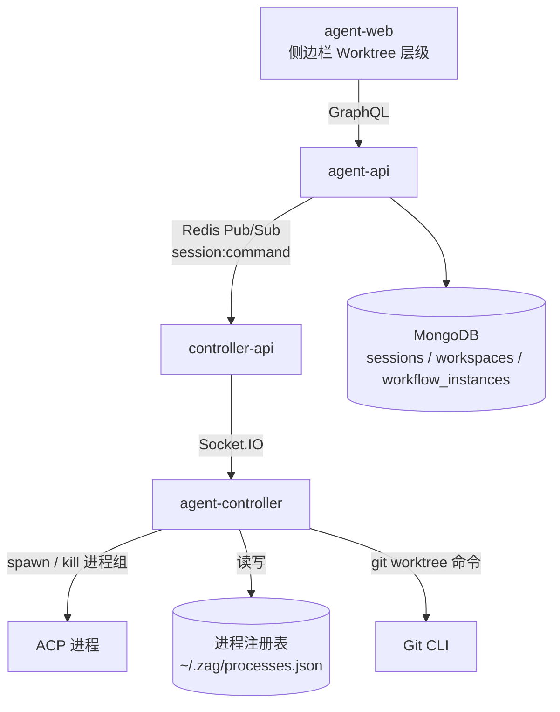
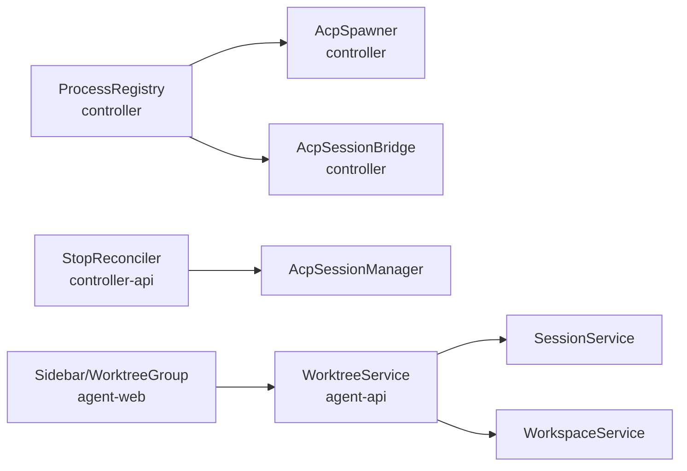
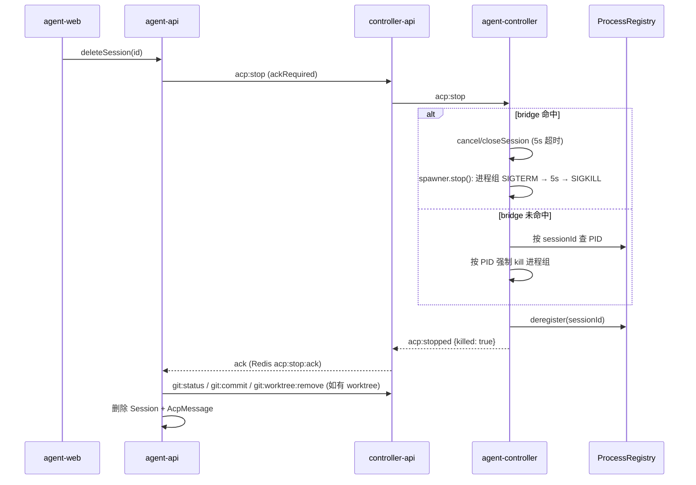
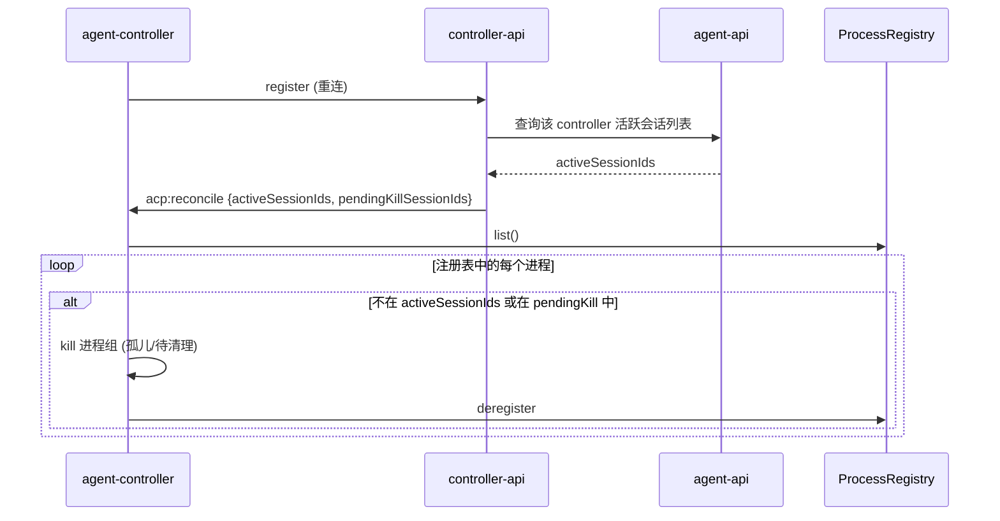
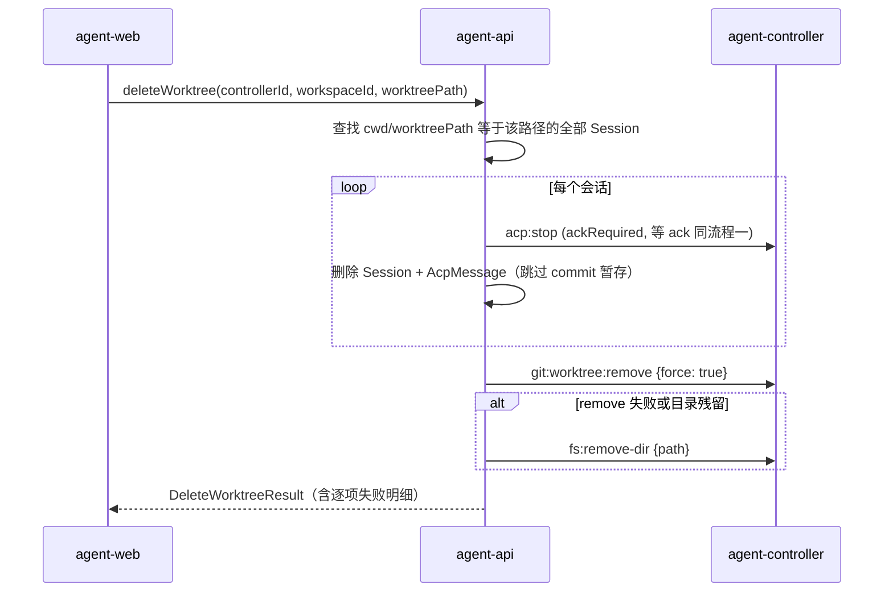

# 会话生命周期与 Worktree 管理增强 - 技术提案

**功能名称**: 会话生命周期与 Worktree 管理增强
**关联 PRD**: docs/product/draft/20260817-session-lifecycle-and-worktree-management.md
**技术提案版本**: v1.1（返工：补充多工作流并发 MCP 丢失修复方案）
**创建日期**: 2026-08-17
**作者**: AI
**feat-branch**: `feat/session-lifecycle-worktree`

## 1. 概述

### 1.1 背景

当前会话删除链路为：`agent-web → agent-api (sessionService.delete) → Redis session:command → controller-api → Socket.IO acp:stop → agent-controller → AcpSessionBridge.stop()`。调研发现该链路存在以下缺陷，导致 ACP 进程无法被彻底销毁：

1. **controller 无进程注册表**：仅有内存 `Map<sessionId, AcpSessionBridge>`（`packages/agent-controller/src/socketio-client.ts:20`），不记录 PID/cwd，daemon 重启后无法识别与收割孤儿进程。
2. **`acp:stop` 无送达保证**：controller-api 只在内存 Map 命中时才转发（`servers/controller-api/src/services/acp-session-manager.ts:342-368`），controller 离线 / controller-api 重启 / 会话已 ended 时指令被静默丢弃；无 ack、无重试、无离线补发。
3. **controller 侧无兜底**：bridge 查不到时静默 return（`socketio-client.ts:585-589`）；daemon 收到 SIGINT/SIGTERM 只断 socket 不杀子进程（`index.ts:46-58`）。
4. **`bridge.stop()` 可被挂死**：`connection.cancel()`/`closeSession()` 无超时（`acp/bridge.ts:322-333`）。
5. **非进程组 kill**：spawn 未 `detached`，Windows `shell: true` 只杀 cmd 包装进程（`acp/spawner.ts:30-91`）。
6. **删除顺序颠倒**：`sessionService.delete` 先 `git:worktree:remove`（进程 cwd 被删）再发 `acp:stop`（`servers/agent-api/src/services/session.ts:314-391`）。

同时，Worktree 目前只是 Session 的冗余字段（`worktreePath`/`worktreeBranch`），无实体、无列表 API，侧边栏将 Worktree 会话平铺混在工作区会话列表中，缺少「workspace → worktree → session」层级及 Worktree 维度的添加/删除能力。

此外，调研确认一个**多工作流并发缺陷**：当多个工作流实例同时运行时，只有一个节点会话能正常使用 workflow MCP 工具，其余会话拿不到 MCP 工具。根因是 controller-api `startSession`/`resumeSession` 使用 `controllerSocket.once('acp:start:result')` 等待结果（`servers/controller-api/src/services/acp-session-manager.ts:61-85, 478-502`）：同一 controller 上多个并发启动共享同一 Socket.IO 连接，第一个到达的 `acp:start:result` 会触发**所有**挂起的 `once` 监听器；requestId 不匹配的监听器在 `clearTimeout` 后直接 return，但 `once` 语义已将其注销——等它们自己的结果到达时已无监听器，且 30s 超时兜底也被提前清除，Promise 永不 resolve。后果：输家会话永远停留在 `connecting`、不进入 `this.sessions`、首条 prompt 滞留 `pendingInputs`，表现为「只有第一个会话真正可用」。另有两个加剧因素：平台 MCP server 文档（`agent-workflow-tools`/`agent-workflow-admin-tools`）并发首建时触发 `{userId, name}` 唯一索引 `E11000` 使节点启动直接抛错（`orchestrator.ts:230-245`、`mcp-server.ts:23`）；MCP endpoint 创建失败被静默吞掉，会话以 `mcpServers: []` 启动（`session.ts:129-143`），同样表现为无 MCP 工具且无任何报错。

### 1.2 目标

- 任意删除路径（删除单会话、删除工作流实例、删除 Worktree）下，ACP 进程及其子进程被**彻底销毁**，且链路有送达保证与对账兜底。
- 新增 Worktree 列表能力与侧边栏「工作区 → Worktree → 对话」层级展示（仅 Git 仓库）。
- 新增 Worktree 维度操作：在该 Worktree 下新建会话 / 拉起工作流实例；Worktree 强制删除（递归关闭全部会话 + 彻底删除目录）。
- 修复多工作流并发场景下节点会话丢失 workflow MCP 工具的缺陷：同一 controller 上 N 个并发启动的会话全部正常建立并获得 MCP 工具。

### 1.3 范围

**做**：

- agent-controller：进程注册表（PID 持久化）、进程组 kill、stop 超时、daemon 退出清理、重连对账、`git:worktree:list`、强制删除 worktree 事件。
- controller-api：`acp:stop` 送达保证（ack + 离线补发）；`acp:start`/`acp:resume` 结果按 requestId 路由（修复并发 `once` 竞态）。
- agent-api：删除顺序修正、worktree 列表查询、Worktree 强制删除 mutation、会话按路径批量终止；平台 MCP server upsert 竞态与 endpoint 创建失败处理加固。
- agent-web：侧边栏 Worktree 层级、Worktree 节点添加/删除入口、删除确认弹窗、新建会话预选 worktree 目录。
- contracts：GraphQL 与 WebSocket 契约更新。

**不做**：

- 不改变工作流引擎节点编排逻辑。
- 不改变单个会话删除时的 worktree 暂存策略（commit + remove 保留式清理保持不变；只有 Worktree 节点删除是强制删除）。
- 不做 agent 侧历史会话记录清理（`acp:delete-history-session` 维持现状）。

## 2. 技术架构

### 2.1 系统架构图



### 2.2 技术栈

| 层级 | 技术选型 | 说明 |
|------|---------|------|
| 前端 | React + TypeScript + Vite, Apollo Client | 侧边栏组件改造 |
| 后端 | Node.js + Express + GraphQL + Mongoose | agent-api |
| 实时通信 | Socket.IO + Redis Pub/Sub | controller-api ↔ controller 事件链路 |
| 数据库 | MongoDB | Session/Workspace 模型扩展 |
| 缓存 | Redis | git 检测结果缓存、stop ack 等待 |
| 其他 | Git CLI (>= 2.5) | worktree list / remove --force |

### 2.3 模块划分



| 模块 | 职责 | 关键技术点 |
|------|------|-----------|
| ProcessRegistry（agent-controller） | 会话→进程元数据的持久化注册表 | JSON 文件 `~/.zag/processes.json`，记录 sessionId/pid/cwd/acpServerType/startedAt；spawn 时注册、进程退出时注销 |
| AcpSpawner 改造 | 进程组管理与彻底 kill | POSIX `detached: true` + `process.kill(-pid)`；Windows 去掉 `shell: true` 或使用 `taskkill /PID /T /F` |
| AcpSessionBridge 改造 | stop 增加超时与兜底 | cancel/closeSession 包 `Promise.race` 超时（5s），超时直接走 spawner.stop() |
| StopReconciler（controller-api） | acp:stop 送达保证 | 等待 `acp:stopped` ack（超时重发）；controller 离线时记录待清理 sessionId，重连后补发 |
| WorktreeService（agent-api） | worktree 列表聚合与强制删除编排 | 组合 controller `git:worktree:list` 结果与 sessions 归组；`deleteWorktree` 编排批量终止 + 强制删除 |
| Sidebar WorktreeGroup（agent-web） | Worktree 层级展示与操作入口 | 新组件 `WorktreeSidebarGroup`、`DeleteWorktreeConfirmDialog` |

## 3. API 设计

### 3.1 API 契约

契约文件更新：

- `contracts/agent-session.graphql`：新增 `WorkspaceWorktree` 类型、`workspaceWorktrees` 查询、`deleteWorktree` mutation；`CreateSessionInput` 增加 `existingWorktreePath`。
- `contracts/controller-workspace.graphql`：`ControllerWorkspace` 增加 `isGitRepo` 字段。
- `contracts/agent-session-websocket.md`：新增 `git:worktree:list`、`fs:remove-dir` 事件；`git:worktree:remove` 增加 `force` 参数；`acp:stop` 增加 ack/补发语义。
- `contracts/agent-controller-websocket.md`：新增重连对账事件 `acp:reconcile`。

#### 接口 1: 查询工作区 Worktree 列表

- **请求**
  - GraphQL Query:
    ```graphql
    query WorkspaceWorktrees($controllerId: ID!, $workspaceId: ID!) {
      workspaceWorktrees(controllerId: $controllerId, workspaceId: $workspaceId) {
        path
        branch
        sessions { id title status }
        sessionCount
      }
    }
    ```
- **响应**
  - `WorkspaceWorktree { path: String!, branch: String, sessions: [Session!]!, sessionCount: Int! }`
  - 数据来源：controller 侧 `git worktree list --porcelain` 的实际目录 ∪ sessions 集合中 `worktreePath` 归组（两者并集，保证空 worktree 也能展示）；controller 离线时降级为仅 sessions 归组。

#### 接口 2: 删除 Worktree（强制）

- **请求**
  - GraphQL Mutation:
    ```graphql
    mutation DeleteWorktree($controllerId: ID!, $workspaceId: ID!, $worktreePath: String!) {
      deleteWorktree(controllerId: $controllerId, workspaceId: $workspaceId, worktreePath: $worktreePath) {
        success
        closedSessionIds
        failures { sessionId error }
        error
      }
    }
    ```
- **响应**
  - `DeleteWorktreeResult { success: Boolean!, closedSessionIds: [ID!]!, failures: [WorktreeDeleteFailure!]!, error: String }`
  - 语义：递归终止 `cwd`/`worktreePath` 等于该路径的全部会话（走增强后的删除链路，但跳过 commit 暂存），再 `git worktree remove --force` + 递归删除目录，逐项汇报失败。

#### 接口 3: 新建会话复用已有 Worktree

- `CreateSessionInput` 增加可选字段 `existingWorktreePath: String`：
  - 提供时跳过 `git:worktree:add`，`cwd` 直接设为该路径，且持久化 `worktreePath`（分支名通过 `git:branches` 检测补充）。
  - 与 `enableWorktree` 互斥，同时提供返回 `BAD_USER_INPUT`。

#### 接口 4: ControllerWorkspace.isGitRepo

- `ControllerWorkspace` 增加 `isGitRepo: Boolean`：复用现有 `detectGitRepo` 链路（`controller-workspace.ts:91-145` 的 Redis 缓存 + `git:check`），在 workspace 注册/查询时懒填充，避免侧边栏 N+1 次检测。

### 3.2 内部接口

**agent-api ↔ controller-api（Redis `session:command`）新增/扩展**：

| 事件 | 方向 | 说明 |
|------|------|------|
| `git:worktree:list` | agent-api → controller | 参数 `{workspacePath}`，返回 `git worktree list --porcelain` 解析结果 `[{path, branch, head}]` |
| `git:worktree:remove` 扩展 | agent-api → controller | 新增 `force: boolean`；`force: true` 时执行 `git worktree remove --force`，不做 commit 暂存 |
| `fs:remove-dir` | agent-api → controller | 参数 `{path}`，递归删除目录（`fs.rm(path, {recursive: true, force: true})`）；仅限 worktreeDir 下或已注册 worktree 路径，防越界 |
| `acp:stop` 语义增强 | controller-api → controller | 增加 `ackRequired: true`；controller 处理完必须回 `acp:stopped {sessionId, killed: boolean}` |
| `acp:reconcile` | controller-api → controller | controller 重连后下发权威存活 sessionId 列表 `{activeSessionIds: string[], pendingKillSessionIds: string[]}` |

**controller 内部**：

- `ProcessRegistry.register(sessionId, {pid, cwd, acpServerType})` / `.deregister(sessionId)` / `.list()`：读写 `~/.zag/processes.json`，写入采用临时文件 + rename 保证原子性。
- `acp:reconcile` 处理：对 `pendingKillSessionIds` 按注册表 PID 强制 kill；对注册表中存在但不在 `activeSessionIds` 的条目（孤儿）执行 kill 并注销。

## 4. 数据模型

### 4.1 数据库设计

#### 集合: sessions（修改）

| 字段 | 类型 | 说明 |
|------|------|------|
| worktreePath | String | 已有；现允许由 `existingWorktreePath` 写入 |
| worktreeBranch | String | 已有；复用已有 worktree 时通过检测补充 |

不新增字段。

#### 集合: controller_workspaces（修改）

| 字段 | 类型 | 说明 |
|------|------|------|
| isGitRepo | Boolean | 新增，可选。git 检测结果缓存，注册 workspace 或首次查询时填充，`git:init` 后更新 |

#### 文件: ~/.zag/processes.json（agent-controller 本地，新增）

```json
{
  "version": 1,
  "processes": [
    {
      "sessionId": "string",
      "pid": 12345,
      "cwd": "string",
      "acpServerType": "string",
      "startedAt": "ISO-8601"
    }
  ]
}
```

### 4.2 缓存设计

| Key | 内容 | TTL |
|-----|------|-----|
| `git:branches:{controllerId}:{pathMd5}` | 已有，git 检测结果 | 沿用现状 |
| `acp:stop:ack:{sessionId}` | stop ack 等待标记 | 60s |
| `acp:stop:pending:{controllerId}` | 离线待补发 sessionId 列表（Redis list） | 24h |

## 5. 技术实现方案

### 5.1 核心流程

#### 流程一：删除单会话（增强后）



注意顺序修正为「先停进程、后清 worktree」。ack 等待 10s 超时：超时仍继续后续清理（不阻塞用户），但该 sessionId 进入 `acp:stop:pending` 待重连补发。

#### 流程二：controller 重连对账



同时：daemon 收到 SIGINT/SIGTERM 时，先遍历注册表 kill 全部进程组再退出（`index.ts` 信号处理改造）。

#### 流程三：删除 Worktree（强制）



### 5.2 关键实现点

#### 实现点 1: ProcessRegistry 与进程组 kill

- **描述**: `packages/agent-controller/src/acp/process-registry.ts` 新模块；`AcpSpawner.start()` 改为 `detached: true`（POSIX）并注册 PID；`stop()` 先 `process.kill(-pid, 'SIGTERM')`，5s 后 `process.kill(-pid, 'SIGKILL')`。Windows 下去掉 `shell: true`（直接 spawn 可执行文件），kill 使用 `taskkill /PID <pid> /T /F` 覆盖进程树。
- **技术细节**: 注册表写入用 `tmp + rename` 原子写；进程自然退出（`exit` 事件）时自动 deregister；启动时校验注册表中 PID 的 cwd（读 `/proc/<pid>/cwd` 或忽略校验失败项），防止 PID 复用误杀。
- **风险点**: Windows 进程树 kill 依赖 `taskkill`，需处理其不存在/失败的降级（退回 `process.kill`）；PID 复用校验在 Windows 上能力有限，以 startedAt + cwd 双校验降低误杀概率。

#### 实现点 2: acp:stop 送达保证

- **描述**: controller-api `stopSession` 改造：发 `acp:stop` 后在 Redis 等 `acp:stopped` ack（10s）；超时重发一次；controller 离线时将 sessionId 追加到 `acp:stop:pending:{controllerId}`。controller 重连注册时触发对账补发。
- **技术细节**: agent-api 侧 `sessionService.delete` 等待 ack 上限 10s，超时继续流程（保证 UX 不阻塞），由补发机制兜底。
- **风险点**: ack 通过 Socket.IO 事件回传 → controller-api 写 Redis → agent-api 轮询，链路段多，需统一超时与重试参数。

#### 实现点 3: 删除顺序修正

- **描述**: `servers/agent-api/src/services/session.ts` `delete()` 将 `acp:stop`（含 ack 等待）移至 worktree 清理之前；`close()` 同样调整。工作流实例删除（`services/workflow/instance.ts:335-351`）复用该路径，自动继承。
- **风险点**: 先停进程会使后续 `git:status`/`git:commit` 轮询窗口内不再有进程写文件，行为更安全；需回归测试原 worktree 暂存语义不变。

#### 实现点 4: Worktree 列表与侧边栏层级

- **描述**: agent-api 新增 `worktreeService.list(controllerId, workspaceId)`：发布 `git:worktree:list` 等结果（30s 轮询窗口，复用现有 Redis 结果模式），与 `Session.find({controllerId, worktreePath: {$ne: null}})` 按 `worktreePath` 归组取并集；controller 离线时降级为仅 sessions 归组。前端 `Sidebar.tsx` 在 workspace 节点下渲染 `WorktreeSidebarGroup`：worktree 节点（分支名 + 展开 + 添加 + 删除），展开后渲染该 worktree 的会话项；非 worktree 会话保持平铺。`isGitRepo` 为 falsy 时不渲染分组。
- **技术细节**: 前端归组不再依赖 `getWorkspacePath()` 的名称反推（`Sidebar.tsx:57-67`，重名 workspace 会串），改为按后端返回的 `worktreePath` 精确归组。列表数据挂到 Sidebar 现有 15s 轮询 query 中（扩展 GET_WORKSPACES 或新增 query）。
- **风险点**: `git:worktree:list` 需要 workspace 目录仍为有效 git 仓库；仓库被删/损坏时降级为 sessions 归组并正常展示。

#### 实现点 5: Worktree 节点添加/删除

- **描述**: 「添加」按钮弹出菜单：「新建会话」→ 打开 `NewSessionDialog` 并预选 controller/workspace/`existingWorktreePath`（隐藏 worktree 创建 Section）；「拉起工作流实例」→ 打开 `InstantiateWorkflowDialog`（复用 `WorkflowSidebarGroup` 入口逻辑）。「删除」→ `DeleteWorktreeConfirmDialog`（参考 `ResumeConfirmDialog` 与 `ui/Dialog`），文案含「彻底删除」「不可恢复」及将关闭的对话数量（由 `workspaceWorktrees` 的 `sessionCount` 提供），确认后调用 `deleteWorktree` mutation。
- **风险点**: 删除期间用户可能正在查看其中某个会话页面，删除成功后前端需跳转回首页并刷新会话列表。

#### 实现点 6: 多工作流并发 MCP 丢失修复

- **描述**: 修复「多个工作流同时运行时只有一个会话拿到 workflow MCP」的并发缺陷，分三层：
  1. **根因修复（controller-api）**：`acp-session-manager.ts` 将 `acp:start`/`acp:resume` 的 per-call `controllerSocket.once(...)` 改为「每 socket 一个常驻 dispatcher + `Map<requestId, PendingRequest>` 路由」。`startSession`/`resumeSession` 不再各自注册 `once`，而是向 Map 登记 `{resolve, timeout, sessionId, statusAtStart}`；常驻 handler 收到 `acp:start:result`/`acp:resume:result` 后按 `payload.requestId` 精确路由到对应 PendingRequest，命中后才 `clearTimeout` 并 resolve，未命中（未知 requestId）仅记录日志。socket 断开时遍历该 socket 全部 PendingRequest 统一失败处理。同一改造同步审计 `acp:stop` 等其它 `once` 等待点，确保无同类竞态。
  2. **并发首建加固（agent-api）**：`ensureWorkflowToolsServer`/`ensureAdminToolsServer` 的 `findOneAndUpdate(upsert)` 并发触发 `{userId, name}` 唯一索引 `E11000` 时，捕获后重新 `findOne` 读取既有文档返回（或改用 `$setOnInsert` 语义），保证并发首次启动工作流不会因 upsert 竞态抛错。
  3. **失败显性化（agent-api）**：`session.ts` 中 MCP endpoint 创建失败不再静默吞掉——当会话显式携带 `mcpServerIds`（工作流节点会话必定携带）时直接抛错使创建失败，避免会话以 `mcpServers: []`「裸奔」启动；无 `mcpServerIds` 的普通会话维持现状。
- **技术细节**: 现有 `socketio.ts:216-235` 的 socket 级 no-op handler 注释已声明「由 acpSessionManager 通过 promise 处理」，改造后该注释路径与 dispatcher 对应；`cleanupFailedSession` 逻辑复用，由 dispatcher 在未命中/超时/断连路径统一调用。
- **风险点**: dispatcher 需处理结果先于登记到达的乱序（理论上同 socket 内 emit/回包有序，风险低，防御性丢弃并记日志即可）；需为「同一 socket 并发 N 个 startSession」补充单元测试（现有测试只覆盖消息顺序，未覆盖并发启动，`common-rules.md:97` 已指出即时回复的 fake controller 会掩盖此类竞态，测试需注入延迟与乱序）。

## 6. 技术决策

### 6.1 决策列表

| 决策 | 选项 A | 选项 B | 最终选择 | 原因 |
|------|--------|--------|---------|------|
| Worktree 列表来源 | 仅扫描 sessions.worktreePath 归组 | controller `git worktree list` ∪ sessions 归组 | B | 纯 sessions 归组在会话删完后 worktree 即「消失」，无法发现空目录残留；并集可展示空 worktree，且离线可降级 |
| 进程跟踪方式 | 内存 Map + 启动时全量扫描进程表 | 持久化注册表（PID+cwd+startedAt） | B | PID 复用风险可用 cwd/startedAt 校验控制；全量扫描无法可靠识别「哪个进程属于哪个会话」 |
| stop 不送达的处理 | agent-api 直接标记失败 | 离线挂起 + 重连对账补发 | B | 满足「彻底销毁」语义，且不阻塞用户删除操作 |
| 强制删除目录能力 | 复用 `git:worktree:remove` | remove(force) + 独立 `fs:remove-dir` 兜底 | B | force remove 仍可能因锁文件等残留目录，需要独立递归删除兜底；`fs:remove-dir` 必须限制路径白名单 |
| Windows 进程树 kill | 保持 `shell: true` + kill | 直接 spawn + `taskkill /T /F` | B | `shell: true` 下 kill 只杀 cmd 包装器，agent 本体残留 |
| start/resume 结果等待 | per-call `socket.once('acp:start:result')` | 常驻 dispatcher + `Map<requestId, …>` 路由 | B | `once` 在并发下同 socket 相互消费监听器，输家 Promise 永不 resolve；按 requestId 精确路由是唯一正确语义 |

### 6.2 依赖与约束

| 类型 | 内容 | 说明 |
|------|------|------|
| 依赖 | Git >= 2.5 | worktree list/remove --force |
| 依赖 | 现有 Redis 结果轮询模式 | git:worktree:list、stop ack 复用 |
| 约束 | `fs:remove-dir` 路径白名单 | 仅允许 controller worktreeDir 之下或已注册 workspace 的 worktree 路径，防越界删除 |
| 约束 | 不引入新基础设施 | 注册表用本地 JSON 文件，不新增服务 |
| 约束 | 单会话删除的暂存语义不变 | commit + worktree remove 保留式清理回归不变 |

## 7. 项目结构

```
packages/agent-controller/src/
├── acp/
│   ├── spawner.ts              # 改：detached 进程组 spawn、进程组 kill、Windows taskkill
│   ├── bridge.ts               # 改：stop() cancel/closeSession 加 5s 超时
│   └── process-registry.ts     # 新：~/.zag/processes.json 持久化注册表
├── worktree-handler.ts         # 改：新增 list()、remove 支持 force
├── fs-handler.ts               # 改：新增 removeDir()（路径白名单校验）
├── socketio-client.ts          # 改：acp:stop 兜底查注册表、acp:reconcile、git:worktree:list、fs:remove-dir 事件注册
└── index.ts                    # 改：退出信号先清理注册表全部进程

servers/controller-api/src/services/
├── acp-session-manager.ts      # 改：stopSession ack 等待/重发/离线挂起；start/resume 结果改常驻 dispatcher + requestId 路由（修并发竞态）
└── session-command.ts          # 改：acp:stopped 回传写 Redis、pending 补发

servers/agent-api/src/
├── models/controller-workspace.ts   # 改：新增 isGitRepo
├── services/session.ts              # 改：delete/close 顺序修正、ack 等待、existingWorktreePath；MCP endpoint 创建失败对显式 mcpServerIds 会话 fail-fast
├── services/worktree.ts             # 新：list 聚合、deleteWorktree 编排
├── services/workflow/orchestrator.ts # 改：平台 MCP server upsert 竞态（E11000 捕获重读）
├── services/workflow/instance.ts    # 改：删除失败项汇报（沿用 sessionService.delete）
└── graphql/{schemas,resolvers}/     # 改：workspaceWorktrees/deleteWorktree/isGitRepo

apps/agent-web/src/
├── components/Sidebar.tsx                    # 改：workspace 下挂 Worktree 层级
├── components/WorktreeSidebarGroup.tsx       # 新：worktree 节点（展开/添加/删除）
├── components/DeleteWorktreeConfirmDialog.tsx # 新：彻底删除确认弹窗
├── components/NewSessionDialog.tsx           # 改：支持 existingWorktreePath 预选
└── graphql/                                  # 改：新增 query/mutation 文档

contracts/
├── agent-session.graphql           # 改
├── controller-workspace.graphql    # 改
├── agent-session-websocket.md      # 改
└── agent-controller-websocket.md   # 改
```

## 8. 测试策略

### 8.1 测试覆盖要求

- 单元测试覆盖率：新增模块（process-registry、worktree service）>= 80%
- API 测试覆盖的端点：`workspaceWorktrees`、`deleteWorktree`、`createSession(existingWorktreePath)`、`deleteSession`（顺序与 ack）、`deleteWorkflowInstance`（进程清理）

### 8.2 测试类型

| 类型 | 工具 | 覆盖范围 |
|------|------|---------|
| 单元测试 | Vitest | ProcessRegistry 注册/注销/原子写、PID 校验；spawner 进程组 kill 参数；worktree 归组并集逻辑；路径白名单校验；start/resume dispatcher 并发 N 个请求按 requestId 正确路由（注入延迟与乱序结果）、socket 断连统一失败；平台 MCP server 并发 upsert 不抛 E11000 |
| API 测试 | tests/api | 上述 GraphQL 端点的正常/异常路径（controller 离线降级、部分会话清理失败、worktree remove 失败走 fs:remove-dir） |
| E2E 测试 | tests/e2e (Playwright) | 侧边栏 Git 仓库工作区展示 worktree 层级、非 Git 不展示；worktree 展开显示会话；添加菜单两条路径；删除确认弹窗文案与确认后会话消失；删除会话后进程不复存在（通过测试控制器桩验证） |

TDD：按红-绿-重构循环，先写 API/单元测试再实现。

## 9. 验收标准

- [ ] 技术方案评审通过
- [ ] Contract 评审通过
- [ ] 代码实现完成
- [ ] 单元测试覆盖达标
- [ ] API 测试通过
- [ ] E2E 测试通过
- [ ] 删除单会话/工作流实例/Worktree 后宿主机无残留 ACP 进程（含子进程）
- [ ] controller 重启后对账清理生效（孤儿进程被收割）
- [ ] controller 离线期间删除会话，重连后补做进程清理
- [ ] 同一 controller 并发启动 N 个工作流实例，全部节点会话正常建立且均可用 workflow MCP 工具（无 stuck `connecting`）

## 10. 相关文档

- [[../../product/draft/20260817-session-lifecycle-and-worktree-management.md]] — 关联 PRD
- [[20260523-feat-git-worktree-support.md]] — Git Worktree 支持技术提案
- [[20260523-feat-workspace-git-support.md]] — 工作区 Git 支持技术提案
- [[20260808-feat-agent-workflow.md]] — Agent 工作流技术提案
- [[../common-rules.md]] — 通用开发规范
- `contracts/agent-session-websocket.md`、`contracts/agent-controller-websocket.md` — 现有事件契约
