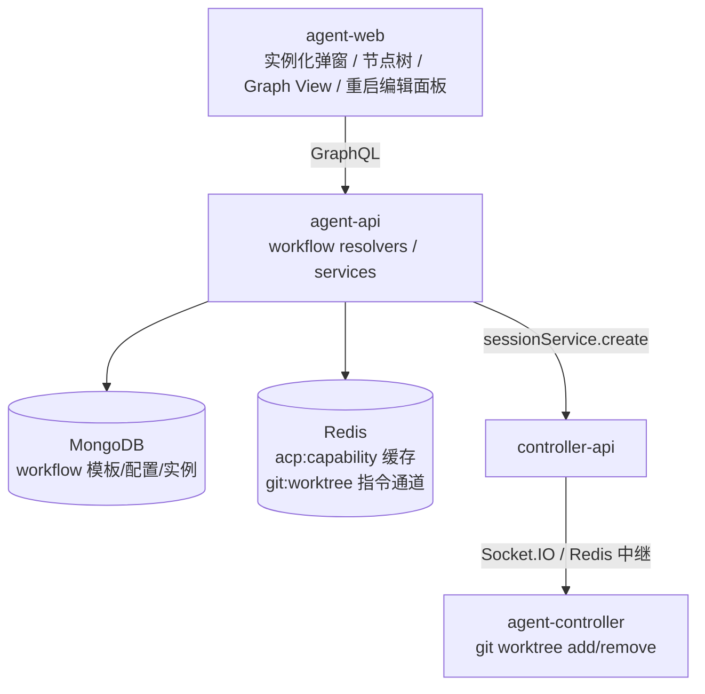
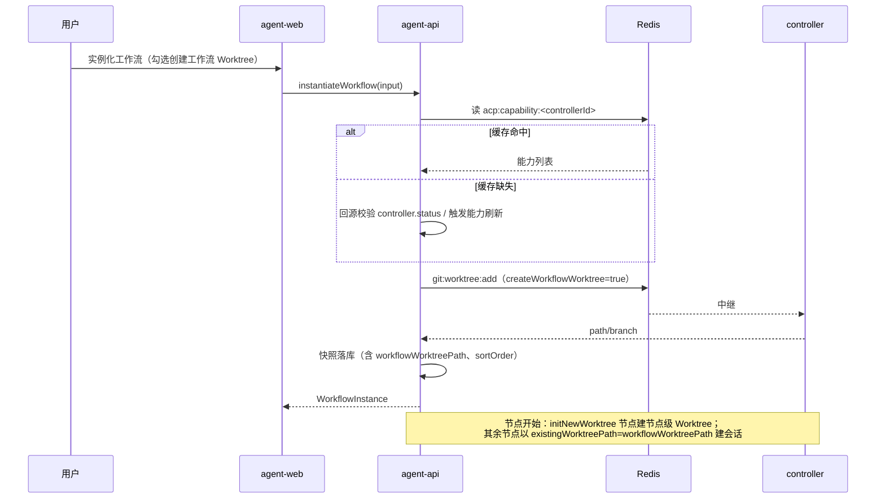

# 工作流优化 0821 - 技术提案

**功能名称**: 工作流优化
**关联 PRD**: `docs/product/draft/20260821-workflow-optimization.md`
**技术提案版本**: v1.0
**创建日期**: 2026-08-21
**作者**: Kimi
**feat-branch**: `feat/workflow-optimization`

## 1. 概述

### 1.1 背景

Agent 工作流（提案 [[20260808-feat-agent-workflow]]、[[20260811-feat-agent-workflow-phase2]]）上线后收集到六项优化诉求：工作流级 Worktree 隔离、实例化偶发误报「控制器已下线」、节点图拖拽排序与按依赖执行、实例详情多视图、节点展示 Harness 与模型、可更换执行配置的重启。本提案覆盖全部六项的技术实现。

### 1.2 目标

1. 实例级工作流 Worktree：实例化时可创建一个供整个实例共享的 Worktree，未单独启用 Worktree 的节点会话在该目录工作。
2. 消除实例化时 controller 在线状态的误报（根因：能力缓存与在线状态判定不一致）。
3. 节点增加可持久化的展示顺序，编辑器支持拖拽排序；执行顺序按依赖拓扑排序。
4. 实例详情页新增 Graph View。
5. 节点卡片展示 agentConfig 中的 Harness（acpServerType）与模型（modelId）。
6. 重启节点支持携带新的 agentConfig。

### 1.3 范围

- **做**：上述六项，涉及 `contracts/workflow.graphql`、agent-api 工作流模型与服务、agent-web 工作流相关页面组件。
- **不做**：工作流模板结构改版、跨 Controller 执行、黑板能力变更、会话侧交互改版。

## 2. 技术架构

### 2.1 系统架构图



### 2.2 技术栈

| 层级 | 技术选型 | 说明 |
|------|---------|------|
| 前端 | React + TypeScript + Apollo Client | 沿用现状；Graph View 新增 `@xyflow/react` + `@dagrejs/dagre`（见 6.1） |
| 后端 | Node.js + Express + GraphQL + Mongoose | 沿用现状 |
| 数据库 | MongoDB | workflow 三个集合增量加字段 |
| 缓存 | Redis | `acp:capability:*` 缓存读取策略修复；`git:worktree:*` 指令复用 |

### 2.3 模块划分

| 模块 | 职责 | 关键技术点 |
|------|------|-----------|
| `contracts/workflow.graphql` | 契约先行：实例 Worktree 字段、节点 order 字段、restartNode 可选 agentConfig | GraphQL schema |
| agent-api `services/workflow/instance.ts` | 实例化（建工作流 Worktree）、在线校验修复、重启携带配置 | Redis 指令、能力缓存回源 |
| agent-api `services/workflow/orchestrator.ts` | 节点会话创建时选择 Worktree 目录 | `existingWorktreePath` 下发 |
| agent-web 工作流组件 | 实例化选项、拖拽排序、多视图、节点信息展示、重启编辑面板 | 复用 WorkflowGraphEditor / 节点编辑表单 |

## 3. API 设计

### 3.1 API 契约

契约文件：`contracts/workflow.graphql`（契约先行，先改契约再实现）。

#### 变更 1：实例化支持工作流级 Worktree

- `InstantiateWorkflowInput` 新增 `createWorkflowWorktree: Boolean`（默认 false；仅当 workspace 支持 Git 时前端默认置 true）。
- `WorkflowInstance` 新增 `workflowWorktreePath: String`、`workflowWorktreeBranch: String`。

#### 变更 2：节点展示顺序

- `WorkflowTemplateNode` / `ConfiguredWorkflowNode` / `WorkflowNode`（含对应 Input）新增 `sortOrder: Int`：持久化的展示顺序，仅影响展示，不影响执行。

#### 变更 3：可配置重启

- `restartNode(instanceId: ID!, nodeId: ID!, agentConfig: AgentNodeConfigInput): WorkflowNode!` —— `agentConfig` 可选；传入时先更新实例节点快照的 `agentConfig`，再执行现有重启语义（关闭旧会话、以新配置全新拉起会话）。服务层需校验新 `acpServerType` 在该 controller 的可用能力内（复用实例化时的能力校验逻辑）。

#### 接口行为示例：实例化（含工作流 Worktree）

- **请求**
  - Method: GraphQL Mutation
  - Body:
    ```json
    {
      "query": "mutation($input: InstantiateWorkflowInput!){ instantiateWorkflow(input:$input){ id workflowWorktreePath } }",
      "variables": { "input": { "configuredWorkflowId": "...", "workspaceId": "...", "name": "...", "createWorkflowWorktree": true, "nodes": [] } }
    }
    ```
- **响应**
  - 成功：实例对象，含 `workflowWorktreePath`。
  - 失败：`WORKTREE_ADD_FAILED`（复用现有错误码，session.ts 已定义同类语义）或 controller 离线/能力不可用错误。

### 3.2 内部接口

- `workflowInstanceService.instantiate()`：在图校验通过、快照落库前，若 `createWorkflowWorktree` 且 workspace 支持 Git，经 Redis 请求/响应向 controller 发 `git:worktree:add`（复用 `services/session.ts:109-144` 的通道），拿到 path/branch 存入实例；失败则整体失败、不落库半成品实例（已建 Worktree 需回滚 `git:worktree:remove`）。
- `orchestrator.startNodeSession()`：节点选择 Worktree 目录的优先级改为——节点 `agentConfig.initNewWorktree && requiresWorktree` → 维持现状（新建节点级 Worktree）；否则若实例存在 `workflowWorktreePath` → 以 `existingWorktreePath` 下发（`session.ts:84-85` 已保证与 `enableWorktree` 互斥）；否则工作区根目录。
- 实例删除：在现有删除流程中追加清理 `workflowWorktreePath`（复用 `session.ts:390-452` 的 worktree 清理路径与 controller 侧白名单机制）。

## 4. 数据模型

### 4.1 数据库设计

#### 集合: workflow_instances（`servers/agent-api/src/models/workflow-instance.ts`）

| 字段 | 类型 | 说明 |
|------|------|------|
| workflowWorktreePath | String? | 实例级 Worktree 路径（新增） |
| workflowWorktreeBranch | String? | 实例级 Worktree 分支（新增） |
| nodes[].sortOrder | Number? | 节点展示顺序（新增） |

#### 集合: workflow_templates / configured_workflows（`models/workflow-template.ts`、`models/configured-workflow.ts`）

| 字段 | 类型 | 说明 |
|------|------|------|
| nodes[].sortOrder | Number? | 节点展示顺序（新增，默认按数组下标回填） |

存量数据兼容：`sortOrder` 缺省时以数组下标作为展示顺序，无需迁移脚本。

### 4.2 缓存设计

- 沿用 `acp:capability:<controllerId>`（Redis）。本提案不改变其写入方与 TTL，只改变**读取缺失时的处理策略**（见 5.2 实现点 2）。

## 5. 技术实现方案

### 5.1 核心流程



### 5.2 关键实现点

#### 实现点 1：工作流级 Worktree

- **描述**: 实例化时创建实例级 Worktree，节点会话按优先级选择工作目录。
- **技术细节**: 复用 `services/session.ts` 的 `git:worktree:add` Redis 通道与 `WORKTREE_ADD_FAILED` 错误语义；实例模型新增两个字段；`orchestrator.ts:140-150` 的 `enableWorktree` 计算扩展为上述优先级；删除实例时统一清理。
- **风险点**: 实例化中途失败需回滚已建 Worktree；多节点并发开始时会话共用同一目录是预期行为（与 PRD 一致），需在文档与日志中可辨识。

#### 实现点 2：实例化误报修复

- **描述**: 根因是 `services/workflow/instance.ts:62-74 getAvailableServerTypes()` 只读 Redis `acp:capability:*` 缓存，缓存缺失（过期/重建窗口）即报「能力不可用（可能离线）」，而 DB 中 `controller.status` 实为 online，刷新页面后缓存已被其他链路回热故恢复——表现为偶发误报。`configured.ts:206` 有同样问题。
- **技术细节**: 缓存缺失时不再直接报错，改为回源：查 DB `controller.status`，若 online 则通过既有 controller 通道主动拉取一次能力并回热缓存（短超时），成功则继续校验；DB 为 offline 或拉取超时才真正报离线。抽取为共享函数，`instance.ts` 与 `configured.ts` 共用。
- **风险点**: 回源拉取增加一次实例化延迟（毫秒~秒级，可接受）；需补「缓存缺失 + controller 在线」与「缓存缺失 + controller 离线」两组 API 测试（参照 common-rules 中 fake controller 延迟变体的经验）。

#### 实现点 3：拖拽排序与拓扑执行

- **描述**: `sortOrder` 持久化展示顺序；编辑器拖拽改顺序；执行顺序由依赖关系拓扑排序。
- **技术细节**: 前端 `WorkflowGraphEditor.tsx` / 节点列表支持拖拽（HTML5 DnD 或既有交互库，实现时按前端规范选型），拖拽结果写回 `sortOrder` 并随保存提交；后端保存时校验图仍为 DAG（复用现有图校验）。执行侧编排器本即按 `dependsOn` 驱动，补充一层防御：节点启动前断言全部上游已 Done。
- **风险点**: `sortOrder` 与 `dependsOn` 不一致是合法状态（PRD 明确），UI 不得暗示展示顺序即执行顺序。

#### 实现点 4：Graph View

- **描述**: 实例详情页新增视图切换，Graph View 按依赖关系渲染节点图。
- **技术细节**: 在 `WorkflowInstancePage.tsx` 增加视图状态（List 默认，localStorage 记忆）；新组件 `WorkflowGraphView` 使用 `@xyflow/react` 渲染 + `@dagrejs/dagre` 计算分层布局（方向 LR，与执行顺序一致），节点复用状态徽章样式，数据来自现有 5s 轮询的实例查询，两视图天然一致。
- **风险点**: 新增依赖需构建验证；大图的缩放/平移由库内建支持。

#### 实现点 5：节点展示 Harness 与模型

- **描述**: 节点卡片展示 `agentConfig.acpServerType` 与 `agentConfig.modelId`。
- **技术细节**: 实例节点快照已含完整 `agentConfig` 且 GraphQL 已映射（`resolvers/workflow.ts:71-108`），纯前端改动：`WorkflowNodeTree.tsx` 节点卡片（及 Graph View 节点）增加两个字段展示，人类/旗帜节点不渲染。

#### 实现点 6：可配置重启

- **描述**: 重启按钮改为打开节点编辑面板，可更换 Harness（联动 Mode/模型），保存后以新配置重启。
- **技术细节**: 前端复用节点编辑表单（`TemplateEditorDialog`/`ConfigureWorkflowDialog` 中的 agentConfig 编辑块）替换 `WorkflowNodeTree.tsx:387-415` 的确认弹窗；契约变更 3 使 `restartNode` 接受可选 `agentConfig`；服务层在 `engine.transition('restart')` 前更新节点快照并做能力校验，后续走现有 `onNodeRestart → resumeNodeSession` 链路（`orchestrator.ts:204-216`）。
- **风险点**: 快照被更新后，「重启前配置」不可追溯——本期接受（黑板与产物不受影响）；校验失败时不触发任何会话操作。

## 6. 技术决策

### 6.1 决策列表

| 决策 | 选项 A | 选项 B | 最终选择 | 原因 |
|------|--------|--------|---------|------|
| Graph View 渲染 | `@xyflow/react` + dagre 布局 | 纯 SVG + 手写布局与缩放 | A | 内建平移/缩放/连线，工作量小；dagre 只做分层坐标计算 |
| 工作流 Worktree 创建时机 | 实例化时创建 | 首个未启用节点级 Worktree 的节点开始时懒创建 | A | 失败快速暴露在实例化阶段，实例模型语义简单；代价是无 AI 节点实例多建一个目录（可接受） |
| 误报修复策略 | 缓存缺失时回源校验 | 缩短 TTL / 提高缓存刷新频率 | A | 根治判定不一致；调 TTL 只是降低概率 |
| 重启换配置的契约形态 | `restartNode` 加可选参数 | 新增 `restartNodeWithConfig` mutation | A | 语义同一操作，避免两个入口 |

### 6.2 依赖与约束

| 类型 | 内容 | 说明 |
|------|------|------|
| 依赖 | `@xyflow/react`、`@dagrejs/dagre` | agent-web 新增前端依赖（纯前端，无安全面） |
| 依赖 | 既有 `git:worktree:*` Redis 通道、controller worktree-handler | 不改动 controller 侧协议 |
| 约束 | 契约先行：`contracts/workflow.graphql` 先评审再实现 | 项目开发规范 |
| 约束 | 存量实例/模板无 `sortOrder`、无 `workflowWorktreePath` 时行为不变 | 向后兼容 |

## 7. 项目结构

```
contracts/workflow.graphql                     # 契约变更（3 处）
servers/agent-api/src/
├── models/workflow-instance.ts                # +workflowWorktreePath/Branch、nodes[].sortOrder
├── models/workflow-template.ts                # +nodes[].sortOrder
├── models/configured-workflow.ts              # +nodes[].sortOrder
├── graphql/resolvers/workflow.ts              # 新字段映射、restartNode 可选 agentConfig
└── services/workflow/
    ├── instance.ts                            # 实例化建 Worktree、在线校验回源、可配置重启
    ├── configured.ts                          # 在线校验回源（共用函数）
    └── orchestrator.ts                        # 节点会话 Worktree 目录选择
apps/agent-web/src/
├── components/workflow/
│   ├── InstantiateWorkflowDialog.tsx          # +「为工作流创建 Worktree」选项
│   ├── WorkflowGraphEditor.tsx                # +拖拽排序（sortOrder）
│   ├── WorkflowNodeTree.tsx                   # +Harness/模型展示、重启编辑面板
│   └── WorkflowGraphView.tsx                  # 新增：Graph View
└── pages/WorkflowInstancePage.tsx             # +视图切换
```

## 8. 测试策略

### 8.1 测试覆盖要求

- 单元测试覆盖率: >= 80%（新增逻辑）
- API 测试覆盖的端点/操作：`instantiateWorkflow`（含 createWorkflowWorktree 开/关、非 Git 工作区、Worktree 创建失败回滚）、能力缓存缺失时的回源校验（在线/离线两路）、`restartNode` 携带 agentConfig（合法/能力外 Harness）、实例删除清理工作流 Worktree、sortOrder 保存与读取

### 8.2 测试类型

| 类型 | 工具 | 覆盖范围 |
|------|------|---------|
| API 测试 | tests/api（真实 Mongo/Redis + fake controller 延迟变体） | 上述端点行为与误报回归 |
| E2E 测试 | tests/e2e（Playwright） | 实例化选项、视图切换、节点信息展示、重启编辑面板、拖拽排序 |

## 9. 部署方案

### 9.1 环境规划

| 环境 | 用途 | 部署方式 |
|------|------|---------|
| 本地 | 开发与测试 | aspire start |
| 集成 | API/E2E 验收 | aspire publish + docker compose |

### 9.2 配置管理

- 无新增配置项；`@xyflow/react`、`@dagrejs/dagre` 为构建期依赖。

## 10. 验收标准

- [ ] 技术方案评审通过
- [ ] Contract 评审通过（`contracts/workflow.graphql` 三处变更）
- [ ] 代码实现完成
- [ ] 单元测试覆盖达标
- [ ] API 测试通过（含误报回归用例）
- [ ] E2E 测试通过

## 11. 相关文档

- PRD：`docs/product/draft/20260821-workflow-optimization.md`
- 关联提案：`docs/engineering/proposals/20260808-feat-agent-workflow.md`、`docs/engineering/proposals/20260811-feat-agent-workflow-phase2.md`、`docs/engineering/proposals/20260817-feat-session-lifecycle-and-worktree-management.md`
- 开发规范：`docs/engineering/common-rules.md`、`docs/engineering/backend-rules.md`、`docs/engineering/frontend-rules.md`
