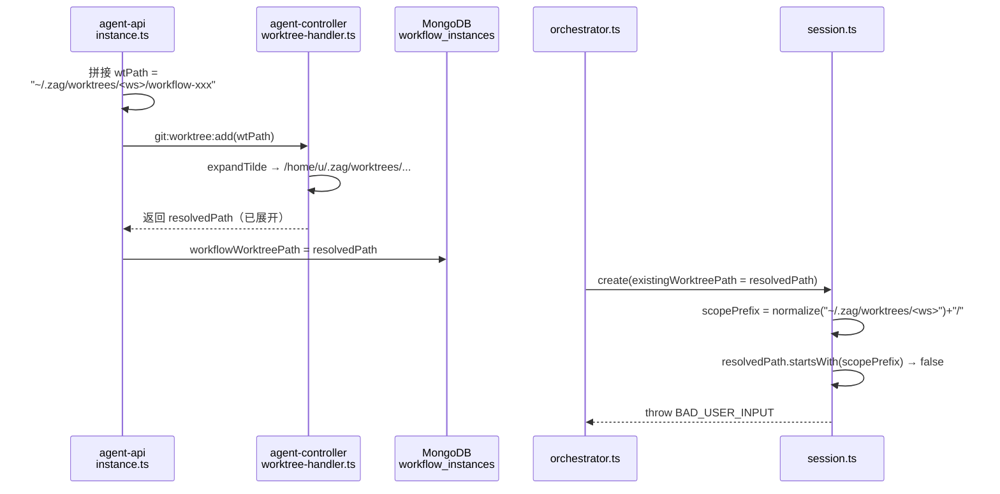
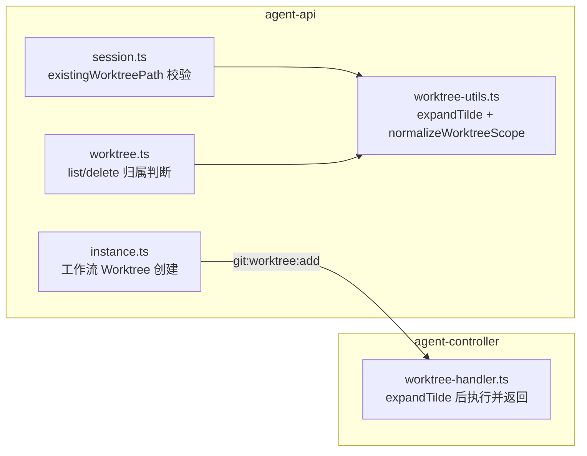
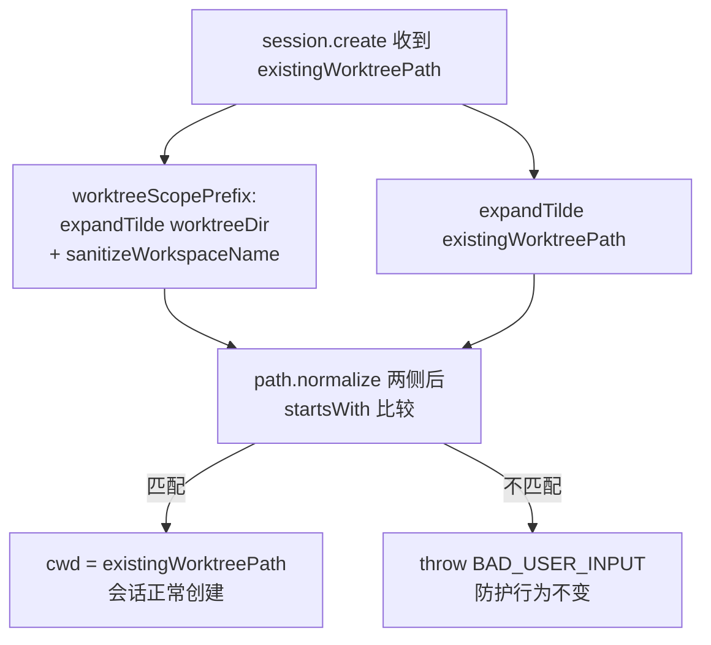

# 工作流 Worktree 节点会话启动失败修复 - 技术提案

**功能名称**: 工作流 Worktree 节点会话启动失败修复
**关联 PRD**: docs/product/draft/20260829-workflow-worktree-session-start.md
**技术提案版本**: v1.0
**创建日期**: 2026-08-29
**作者**: Kimi
**feat-branch**: `prd/workflow-worktree-session-start`

## 1. 概述

### 1.1 背景

创建工作流时勾选「为工作流创建 Worktree」，进入工作流节点、流转到 AI 节点时报错：

```
existingWorktreePath does not belong to this workspace
```

节点会话启动失败，工作流阻断。

### 1.2 根因分析

完整链路：



1. **路径生成端（未展开）**：`servers/agent-api/src/services/workflow/instance.ts:206,222` 中 `worktreeDir` 默认为 `'~/.zag/worktrees'`（带 `~` 原始形式），直接拼出 `wtPath` 下发给控制器。
2. **控制器端（展开）**：`packages/agent-controller/src/worktree-handler.ts:6-7,60,71` 的 `expandTilde` 将 `~/` 展开为真实 home 目录，并把**展开后的绝对路径**作为 `worktreePath` 返回。
3. **实例落库**：`instance.ts:249` 以 `parsed.worktreePath || wtPath` 落库——默认配置下存的是**展开后的绝对路径**。
4. **校验端（未展开）**：`servers/agent-api/src/services/session.ts:101-108` 用**未展开**的 `worktreeDir` 构造 `scopePrefix`，与展开后的 `existingWorktreePath` 做 `startsWith` 比较——`"/home/u/.zag/..."` 永远不以 `"~/.zag/..."` 开头，校验必失败，抛出上述 `BAD_USER_INPUT`。

**触发条件**：`worktreeDir` 含 `~`（默认配置 `~/.zag/worktrees` 即命中）。用户把 `worktreeDir` 配成绝对路径时不触发，因此该问题在默认配置下必现。

**同源隐患**：`servers/agent-api/src/services/worktree.ts:103-104` 构造 `scopePrefix` 时同样未展开 `~`，且使用未清洗的 `workspace.name`（`session.ts` 已改用 `sanitizeWorkspaceName`），两处口径不一致。

### 1.3 目标

- 修复 `session.create` 的 `existingWorktreePath` 归属校验在 `worktreeDir` 含 `~` 时的误判。
- 对齐 agent-api 内所有 Worktree 路径归属判断的口径（统一展开 `~` + 统一清洗工作区名）。
- 校验防护强度不回退：越权路径仍被 `BAD_USER_INPUT` 拒绝。

### 1.4 范围

| 子项目 | 修改 |
|--------|------|
| servers/agent-api | ① `worktree-utils.ts` 新增共享的 `~` 展开/归一化函数；② `session.ts` 校验前对两侧路径统一归一化；③ `worktree.ts` 的 `scopePrefix` 对齐（展开 `~` + `sanitizeWorkspaceName`） |
| packages/agent-controller | 不修改（`expandTilde` 行为保持不变） |
| apps/agent-web | 不修改 |

## 2. 技术架构

### 2.1 系统架构图



### 2.2 技术栈

TypeScript / Node.js（agent-api 服务端）、Vitest（单测）。无新增依赖。

### 2.3 模块划分

- `servers/agent-api/src/services/workflow/worktree-utils.ts`：共享路径工具（现有 `sanitizeWorkspaceName` / `generateWorktreeSuffix`，新增 `~` 展开与 scope 归一化）。
- `servers/agent-api/src/services/session.ts`：会话创建与 `existingWorktreePath` 校验。
- `servers/agent-api/src/services/worktree.ts`：Worktree 列表/删除的归属判断。

## 3. API 设计

### 3.1 API 契约

无契约变更。`CreateSessionInput.existingWorktreePath`、`controller-workspace.graphql`、错误码（`BAD_USER_INPUT`）均保持不变。

### 3.2 内部接口

`worktree-utils.ts` 新增：

```ts
/** 展开路径开头的 ~ 为 home 目录（与 controller 端 expandTilde 语义一致） */
export function expandTilde(p: string): string;

/** 归一化 worktreeDir 下的工作区 scope 前缀（展开 ~ → 拼接收清洗的工作区名 → normalize → 保证末尾分隔符） */
export function worktreeScopePrefix(worktreeDir: string, workspaceName: string): string;
```

## 4. 数据模型

### 4.1 数据库设计

无 schema 变更。`workflow_instances.workflowWorktreePath`、`controllers.worktreeDir` 存储格式不变（继续存控制器回报的解析后路径 / 用户配置的原始字符串）。

### 4.2 缓存设计

无变更。

## 5. 技术实现方案

### 5.1 核心流程

修复后校验链路：



### 5.2 关键实现点

1. **`worktree-utils.ts` 新增 `expandTilde`**：仅处理 `~/` 前缀（与 `packages/agent-controller/src/worktree-handler.ts:6-7` 语义一致），home 取自 `os.homedir()`。
2. **`session.ts:101-108`**：`scopePrefix` 改用 `worktreeScopePrefix(worktreeDir, workspace.name)`；比较前对 `input.existingWorktreePath` 也做 `expandTilde` 再 `normalize`。两侧同口径后，默认配置下控制器回报的 `/home/u/.zag/worktrees/<ws>/workflow-xxx` 可正确匹配。
3. **`worktree.ts:103-104`**：`scopePrefix` 同样改用 `worktreeScopePrefix`，顺带修复「未展开 `~`」与「未清洗 `workspace.name`」两处口径不一致，使列表/删除入口与会话创建入口结论一致。
4. **同机假设说明**：`~` 展开依赖 agent-api 与 agent-controller 同机（同 home）。该校验本身就是对控制器本地路径的字符串前缀判断，默认 `~/.zag/worktrees` 配置语义上即指向控制器所在机的 home；标准个人部署（Aspire 单机）满足该假设。远端控制器场景应配置绝对路径的 `worktreeDir`（现状即如此，修复后不受影响）。

### 5.3 备选方案（未采纳）

控制器在 `git:worktree:add` 响应中额外返回解析后的 scope 前缀并随实例落库，`session.create` 优先使用实例携带的 scope。该方案需改协议、模型与编排传参，改动面大；当前字符串归一化方案即可闭环，故不采纳，留作未来跨机部署增强的候选。

## 6. 技术决策

### 6.1 决策列表

| 决策 | 选择 | 理由 |
|------|------|------|
| 在生成端还是校验端统一 | 校验端统一归一化 | 落库路径已是控制器回报的解析后路径，改动最小；协议/模型零变更 |
| `~` 展开位置 | 共享工具函数 | `session.ts` 与 `worktree.ts` 两处校验同源修复，防止再次漂移 |
| controller 端行为 | 保持不变 | `expandTilde` 语义正确，返回解析后路径对调用方更明确 |

### 6.2 依赖与约束

- 无新增依赖；`os.homedir()` 为 Node 内置。
- 不削弱 `BAD_USER_INPUT` 防护；越权路径用例必须保持红色→绿色通过。

## 7. 项目结构

```
servers/agent-api/src/services/
├── session.ts                  # 修改：existingWorktreePath 校验归一化
├── session.test.ts             # 修改：新增 ~ 展开校验用例
├── worktree.ts                 # 修改：scopePrefix 对齐
├── worktree.test.ts            # 修改：口径一致性用例
└── workflow/
    ├── worktree-utils.ts       # 修改：新增 expandTilde / worktreeScopePrefix
    └── worktree-utils.test.ts  # 新增（如无则并入现有测试）：工具函数用例
```

## 8. 测试策略

按 TDD 红-绿-重构：

| 层 | 用例 |
|----|------|
| agent-api `session.test.ts` | ① worktreeDir 为 `~/.zag/worktrees`（mock homedir）+ existingWorktreePath 为展开后路径 → 创建成功；② 展开后仍越界的路径（如 `<scope>/../evil`、其他工作区目录）→ `BAD_USER_INPUT`；③ existingWorktreePath 本身带 `~` 前缀 → 同样正确判定 |
| agent-api `worktree-utils` 用例 | ④ `expandTilde('~/x')` → `<home>/x`；绝对路径原样返回；⑤ `worktreeScopePrefix` 末尾分隔符与清洗后工作区名正确 |
| agent-api `worktree.test.ts` | ⑥ 工作区名含空格/斜杠时，list/delete 归属判断与会话创建入口结论一致 |
| 回归 | agent-api / agent-controller 单测全绿；Aspire 环境下 `tests/api`（worktree.test.ts）、`tests/e2e`（worktree.spec.ts）全量 |

## 9. 验收标准

- [ ] 默认 `worktreeDir`（`~/.zag/worktrees`）下，勾选「为工作流创建 Worktree」的实例流转到 AI 节点，会话正常启动，工作目录为工作流 Worktree。
- [ ] 自定义绝对路径 `worktreeDir` 下行为不变（回归通过）。
- [ ] 越权 `existingWorktreePath` 仍被 `BAD_USER_INPUT` 拒绝。
- [ ] `session.ts` 与 `worktree.ts` 的归属判断口径一致（同一路径同一结论）。
- [ ] 单测 / API / E2E 全绿。

## 10. 相关文档

- [[../../product/draft/20260829-workflow-worktree-session-start.md]] — 本修复的产品文档
- [[20260821-feat-workflow-optimization.md]] — 工作流级 Worktree 引入方案
- [[20260817-feat-session-lifecycle-and-worktree-management.md]] — 会话生命周期与 Worktree 管理方案
