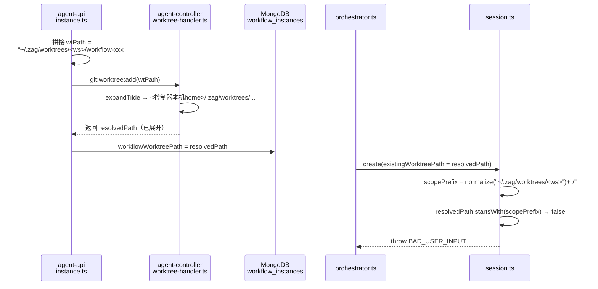
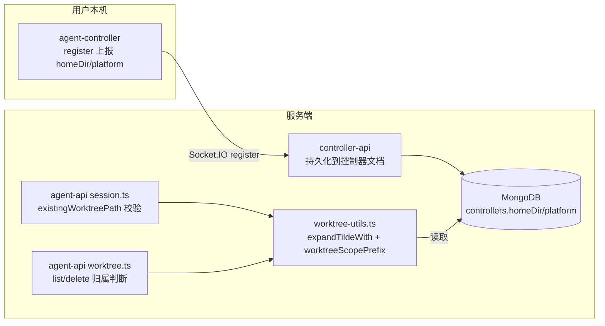
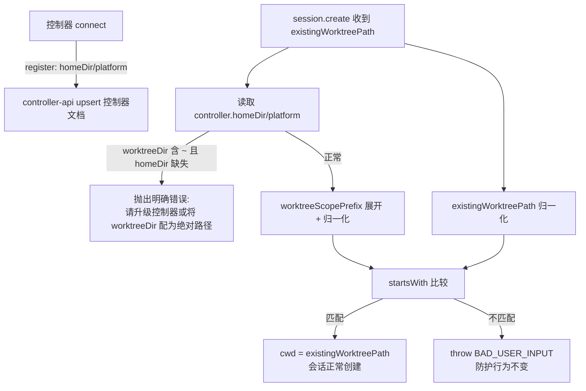

# 工作流 Worktree 节点会话启动失败修复 - 技术提案

**功能名称**: 工作流 Worktree 节点会话启动失败修复
**关联 PRD**: docs/product/draft/20260829-workflow-worktree-session-start.md
**技术提案版本**: v1.2（v1.0 评审打回：原方案用 agent-api 侧 `os.homedir()` 展开 `~`，但 agent-api 与 agent-controller 不同机，方案不成立；v1.1 改为控制器注册时上报 homeDir/platform。v1.1 评审打回：未明确生效目录规则——Worktree 目录必须以控制器设置中的「Git Worktree 工作目录」配置为准，默认值需单一定义并与设置页展示一致；v1.2 补充生效目录解析规则与默认值收敛）
**创建日期**: 2026-08-29
**作者**: Kimi
**feat-branch**: `prd/workflow-worktree-session-start`

## 1. 概述

### 1.1 背景

创建工作流时勾选「为工作流创建 Worktree」，进入工作流节点、流转到 AI 节点时报错：

```
existingWorktreePath does not belong to this workspace
```

节点会话启动失败，工作流阻断。

### 1.2 根因分析

完整链路：



1. **路径生成端（未展开）**：`servers/agent-api/src/services/workflow/instance.ts:206,222` 中 `worktreeDir` 默认为 `'~/.zag/worktrees'`（带 `~` 原始形式），直接拼出 `wtPath` 下发给控制器。
2. **控制器端（展开）**：`packages/agent-controller/src/worktree-handler.ts:6-7,60,71` 的 `expandTilde` 将 `~/` 展开为**控制器本机** home 目录，并把展开后的绝对路径作为 `worktreePath` 返回。
3. **实例落库**：`instance.ts:249` 以 `parsed.worktreePath || wtPath` 落库——默认配置下存的是展开后的绝对路径。
4. **校验端（未展开）**：`servers/agent-api/src/services/session.ts:101-108` 用未展开的 `worktreeDir` 构造 `scopePrefix`，与展开后的 `existingWorktreePath` 做 `startsWith` 比较——永不匹配，校验必失败，抛出上述 `BAD_USER_INPUT`。

**触发条件**：`worktreeDir` 含 `~`（默认配置 `~/.zag/worktrees` 即命中），默认配置下必现。

**生效目录规则（v1.1 打回补充）**：Worktree 目录的生效值必须**以控制器设置中的「Git Worktree 工作目录」（`controllers.worktreeDir`，设置页 `WorkspaceSection` 可修改）为准**；仅当未配置时才生效默认值 `~/.zag/worktrees`（指**控制器本机** home 下的 `.zag/worktrees`，与设置页 `WorkspaceSection.tsx:231` 的展示文案 `~/.zag/worktrees（默认）` 一致）。当前该默认值兜底**分散硬编码在 4 处**（`session.ts:101`、`session.ts:114`、`worktree.ts:103`、`instance.ts:206`）加前端 1 处文案，任何一处漂移都会造成生成端与校验端、展示与实际生效不一致，本次修复需将默认值收敛为单一定义。

**关键约束（v1.0 打回原因）**：agent-api 是服务端，agent-controller 运行在用户本机（Linux / Windows / macOS 均可），两者不共享文件系统。agent-api 侧用 `os.homedir()` 展开 `~` 得到的是**服务器的** home，与控制器机器无关，且无法感知控制器的操作系统与路径分隔符。**`~` 的展开只能以控制器上报的信息为准。**

**同源隐患**：`servers/agent-api/src/services/worktree.ts:103-104` 构造 `scopePrefix` 时同样未展开 `~`，且使用未清洗的 `workspace.name`（`session.ts` 已改用 `sanitizeWorkspaceName`），两处口径不一致。

### 1.3 目标

- 修复 `session.create` 的 `existingWorktreePath` 归属校验在 `worktreeDir` 含 `~` 时的误判。
- **生效目录以控制器设置为准**：路径生成端与校验端统一通过单一的「生效目录解析」入口取值——设置页已配置则用配置值，未配置则用默认值 `~/.zag/worktrees`；默认值全平台单一定义，与设置页展示一致。
- agent-api 侧所有 `~` 展开一律使用**控制器注册时上报的 homeDir**，禁止任何 `os.homedir()` 兜底猜测。
- 兼容控制器多操作系统（Linux / macOS / Windows 路径分隔符与大小写差异）。
- 校验防护强度不回退：越权路径仍被 `BAD_USER_INPUT` 拒绝。

### 1.4 范围

| 子项目 | 修改 |
|--------|------|
| packages/agent-controller | ① `register` 上报增加 `homeDir`（控制器本机 `os.homedir()`）与 `platform`（`os.platform()`） |
| servers/controller-api | ② `register` 处理将 `homeDir`/`platform` 持久化到控制器文档（upsert 字段） |
| servers/agent-api | ③ `worktree-utils.ts` 新增生效目录解析（`DEFAULT_WORKTREE_DIR` 单一定义 + `resolveEffectiveWorktreeDir`）与基于上报 homeDir 的展开/归一化函数；④ `session.ts`（2 处）、`instance.ts`、`worktree.ts` 的 `worktreeDir` 取值统一改走生效目录解析，校验前对两侧路径统一归一化；⑤ `Controller` 模型补充 `homeDir`/`platform` 字段 |
| contracts | ⑥ `agent-controller-websocket.md` 的 `register` 负载契约更新 |
| apps/agent-web | ⑦ 设置页默认目录文案与 `DEFAULT_WORKTREE_DIR` 语义对齐（仅文案/注释对齐，不改交互） |

## 2. 技术架构

### 2.1 系统架构图



### 2.2 技术栈

TypeScript / Node.js、Socket.IO、MongoDB（Mongoose）、Vitest。无新增依赖。

### 2.3 模块划分

- `packages/agent-controller/src/socketio-client.ts`：`register` 负载（现有 `key/hostname/version/resumeToken`）新增 `homeDir`、`platform`。
- `servers/controller-api/src/services/socketio.ts`：`register` 处理器 upsert 控制器文档时写入 `homeDir`/`platform`。
- `servers/agent-api/src/models/controller.ts`：`Controller` schema 增加 `homeDir: String`、`platform: String`（读取侧）。
- `servers/agent-api/src/services/workflow/worktree-utils.ts`：共享路径工具。
- `servers/agent-api/src/services/session.ts` / `worktree.ts`：归属校验统一走共享工具。

## 3. API 设计

### 3.1 API 契约

**变更**：`contracts/agent-controller-websocket.md` 的 `register` 事件负载新增两个可选字段（契约先行，实现以契约为准）：

```jsonc
// Controller → Server: register
{
  "key": "...",
  "hostname": "...",
  "version": "...",
  "resumeToken": "...",
  "homeDir": "/home/user",        // 新增：控制器本机 os.homedir()
  "platform": "linux"             // 新增：控制器本机 os.platform()（linux/darwin/win32）
}
```

- 旧版本控制器不上报这两个字段，服务端按字段缺失处理（见 5.2 兜底），不破坏既有握手。
- GraphQL 契约（`CreateSessionInput.existingWorktreePath`、错误码 `BAD_USER_INPUT`）不变。

### 3.2 内部接口

`worktree-utils.ts` 新增：

```ts
/** 默认 Worktree 工作目录（全平台单一定义；~ 指控制器本机 home，与设置页展示一致） */
export const DEFAULT_WORKTREE_DIR = '~/.zag/worktrees';

/** 生效目录解析：以控制器设置（controllers.worktreeDir）为准，未配置时回退默认值 */
export function resolveEffectiveWorktreeDir(controller: { worktreeDir?: string | null }): string;

/** 用「控制器上报的 homeDir」展开路径开头的 ~/；无 homeDir 或不含 ~ 时原样返回 */
export function expandTildeWith(p: string, homeDir?: string | null): string;

/** 归一化用于比较的路径：统一分隔符（\ → /）；win32 控制器时转小写 */
export function normalizeForCompare(p: string, platform?: string | null): string;

/** 构造工作区 worktree scope 前缀：expandTildeWith(生效目录) + 清洗后的工作区名 + 末尾分隔符 */
export function worktreeScopePrefix(worktreeDir: string, workspaceName: string, homeDir?: string | null): string;
```

## 4. 数据模型

### 4.1 数据库设计

`controllers` 集合新增两个字段（每次 `register` 刷新，无需迁移，旧文档缺字段按缺失处理）：

| 字段 | 类型 | 说明 |
|------|------|------|
| `homeDir` | String | 控制器本机 home 目录（注册时上报） |
| `platform` | String | 控制器操作系统（`linux` / `darwin` / `win32`） |

`workflow_instances.workflowWorktreePath`、`controllers.worktreeDir` 存储格式不变。

### 4.2 缓存设计

无变更。

## 5. 技术实现方案

### 5.1 核心流程



### 5.2 关键实现点

1. **agent-controller（`socketio-client.ts:228-233`）**：`register` 负载新增 `homeDir: homedir()`、`platform: platform()`（`os` 模块已在该文件引入）。
2. **controller-api（`socketio.ts:34-98`）**：`RegisterPayload` 增加两字段并随 upsert 落库；保持每次连接刷新，保证控制器换机/换系统后数据及时更新。
3. **生效目录统一解析**：`session.ts:101,114`、`worktree.ts:103`、`instance.ts:206` 的 `controller.worktreeDir || '~/.zag/worktrees'` 全部替换为 `resolveEffectiveWorktreeDir(controller)`——任何路径的生成与校验都以控制器设置中的「Git Worktree 工作目录」为准，未配置时才使用 `DEFAULT_WORKTREE_DIR`，根除 4 处硬编码漂移的隐患。
4. **agent-api 校验（`session.ts:101-108`）**：`scopePrefix = worktreeScopePrefix(resolveEffectiveWorktreeDir(controller), workspace.name, controller.homeDir)`；两侧经 `normalizeForCompare(..., controller.platform)` 后比较。
5. **`worktree.ts:103-104` 对齐**：同样改走生效目录解析 + 共享工具，顺带修复「未展开 `~`」与「未清洗 `workspace.name`」两处口径不一致，使列表/删除入口与会话创建入口结论一致。
6. **多 OS 兼容**：`normalizeForCompare` 统一 `\` → `/`；`platform === 'win32'` 时两侧转小写比较（Windows 路径大小写不敏感）。
7. **旧控制器兜底**：生效目录含 `~` 且 `homeDir` 缺失（旧版控制器）时，抛出**可操作的明确错误**（升级控制器或在设置页将「Git Worktree 工作目录」配置为绝对路径），而不是静默放行——静默放行会使路径归属校验形同虚设。生效目录为绝对路径时不受任何影响（设置页目录选择器产出的即为绝对路径，是现状主路径）。
8. **版本门槛**：`socketio.ts:54` 已有 `clientMajor` 检查；是否将上报 `homeDir` 纳入最低版本要求留作实现期决策，兜底错误提示已保证可感知。

### 5.3 备选方案（未采纳）

| 方案 | 不采纳理由 |
|------|-----------|
| agent-api 侧 `os.homedir()` 展开（v1.0） | 与控制器不同机，服务器 home 与控制器文件系统无关——本次打回根因 |
| 新增 `path:resolve` 请求/响应命令（redis → socket 往返解析 `~`） | 每次会话启动多一次跨进程往返与超时失败面；register 上报零额外往返，数据随心跳连接自然刷新 |
| 从 `git:worktree:add` 响应反推 resolvedWorktreeDir 并缓存 | 仅在平台创建过 worktree 后才有映射，覆盖不了「挂载外部已有 worktree」的首次使用场景；可作为后续优化叠加 |

## 6. 技术决策

### 6.1 决策列表

| 决策 | 选择 | 理由 |
|------|------|------|
| 生效目录来源 | 控制器设置 `controllers.worktreeDir` 优先，未配置回退 `DEFAULT_WORKTREE_DIR` | 设置页是用户配置入口，生成端/校验端/展示必须同源；默认值收敛为单一定义，消除 4 处硬编码漂移 |
| `~` 展开的事实来源 | 控制器 register 上报 `homeDir` | 控制器是唯一知道自己文件系统的一方；复用既有握手通道，零新增往返 |
| 多 OS 路径比较 | 统一分隔符 + win32 小写化 | 覆盖控制器为 Windows 的场景，避免分隔符/大小写造成的二次误判 |
| 旧控制器缺 homeDir | 明确报错引导升级/配绝对路径 | 静默放行会削弱安全校验；报错文案给出可执行动作 |
| controller 端 `expandTilde` | 保持不变 | 控制器本机展开语义正确，返回解析后路径对调用方更明确 |

### 6.2 依赖与约束

- 契约先行：先更新 `contracts/agent-controller-websocket.md`，再实现三端。
- 无新增第三方依赖（`os.homedir()`/`os.platform()` 为控制器侧 Node 内置）。
- 不削弱 `BAD_USER_INPUT` 防护；越权路径用例必须保持红色→绿色通过。

## 7. 项目结构

```
contracts/
└── agent-controller-websocket.md       # 修改：register 负载契约
packages/agent-controller/src/
└── socketio-client.ts                  # 修改：register 上报 homeDir/platform
servers/controller-api/src/
├── services/socketio.ts                # 修改：register upsert 持久化
└── models/（controller 模型）            # 修改：schema 增加 homeDir/platform
servers/agent-api/src/
├── models/controller.ts                # 修改：schema 增加 homeDir/platform
└── services/
    ├── session.ts                      # 修改：existingWorktreePath 校验归一化
    ├── session.test.ts                 # 修改：新增上报 homeDir 的校验用例
    ├── worktree.ts                     # 修改：scopePrefix 对齐
    ├── worktree.test.ts                # 修改：口径一致性用例
    └── workflow/
        ├── instance.ts                     # 修改：createWorkflowWorktree 的 worktreeDir 取值改走生效目录解析
        ├── worktree-utils.ts           # 修改：新增 DEFAULT_WORKTREE_DIR / resolveEffectiveWorktreeDir / expandTildeWith / normalizeForCompare / worktreeScopePrefix
        └── worktree-utils.test.ts      # 新增（如无则并入现有测试）：工具函数用例
```

## 8. 测试策略

按 TDD 红-绿-重构：

| 层 | 用例 |
|----|------|
| agent-controller `tests/socketio-client.test.ts` | ① register 负载包含 `homeDir`/`platform` |
| controller-api `socketio` 相关测试 | ② register upsert 后控制器文档含 `homeDir`/`platform`；旧负载（无两字段）不报错 |
| agent-api `worktree-utils` 用例 | ③ `expandTildeWith('~/x', '/home/u')` → `/home/u/x`；无 homeDir 原样返回；④ `normalizeForCompare` 的 `\`→`/` 与 win32 小写化；⑤ `worktreeScopePrefix` 末尾分隔符与清洗后工作区名正确；⑤a `resolveEffectiveWorktreeDir`：已配置返回配置值，未配置/空串返回 `DEFAULT_WORKTREE_DIR` |
| agent-api `session.test.ts` | ⑥ 未配置 worktreeDir（生效默认 `~/.zag/worktrees`）+ controller.homeDir 已上报 + existingWorktreePath 为展开后路径 → 创建成功；⑥a 设置页配置了自定义目录（绝对路径/含 `~` 两种）时，生成与校验均以配置值为准；⑦ 展开后仍越界的路径（`<scope>/../evil`、其他工作区目录）→ `BAD_USER_INPUT`；⑧ homeDir 缺失且生效目录含 `~` → 明确错误；⑨ win32 控制器（`\` 路径、大小写差异）→ 正确判定 |
| agent-api `worktree.test.ts` | ⑩ 工作区名含空格/斜杠时，list/delete 归属判断与会话创建入口结论一致 |
| 回归 | agent-api / controller-api / agent-controller 单测全绿；Aspire 环境下 `tests/api`（worktree.test.ts）、`tests/e2e`（worktree.spec.ts）全量 |

## 9. 验收标准

- [ ] 未配置「Git Worktree 工作目录」（生效默认 `~/.zag/worktrees`）时，勾选「为工作流创建 Worktree」的实例流转到 AI 节点，会话正常启动，工作目录为工作流 Worktree。
- [ ] 在设置页配置自定义「Git Worktree 工作目录」后，Worktree 的创建、会话启动校验、列表/删除归属判断全部以该配置为准。
- [ ] 设置页展示的默认目录与实际生效目录始终一致（默认值单一定义）。
- [ ] 控制器为 Linux / macOS / Windows 时上述流程均正常（单测覆盖分隔符与大小写场景）。
- [ ] 越权 `existingWorktreePath` 仍被 `BAD_USER_INPUT` 拒绝。
- [ ] 旧版控制器 + 生效目录含 `~` 时给出明确的升级/配置提示。
- [ ] `session.ts` 与 `worktree.ts` 的归属判断口径一致（同一路径同一结论）。
- [ ] 单测 / API / E2E 全绿。

## 10. 相关文档

- [[../../product/draft/20260829-workflow-worktree-session-start.md]] — 本修复的产品文档
- [[20260821-feat-workflow-optimization.md]] — 工作流级 Worktree 引入方案
- [[20260817-feat-session-lifecycle-and-worktree-management.md]] — 会话生命周期与 Worktree 管理方案
