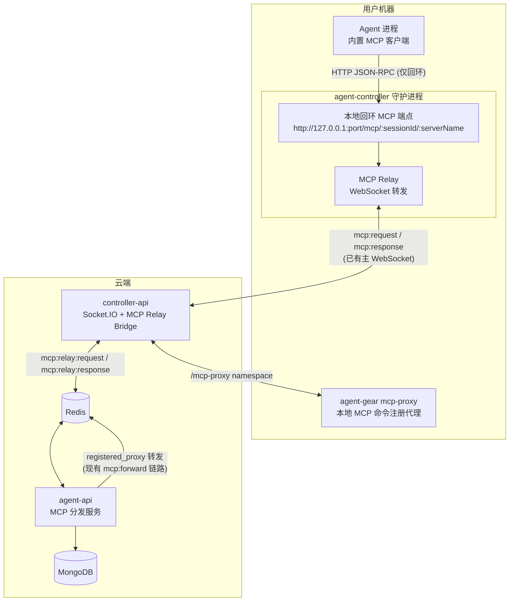
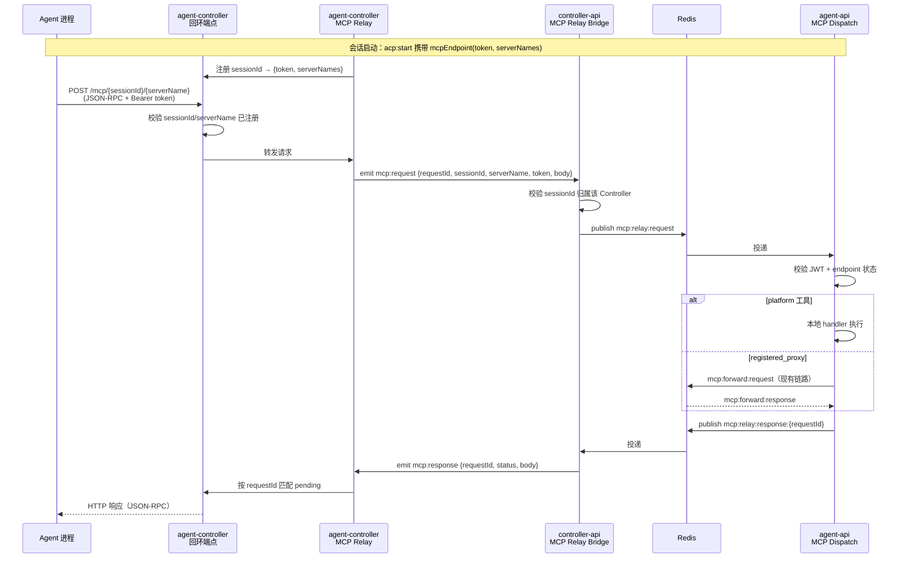
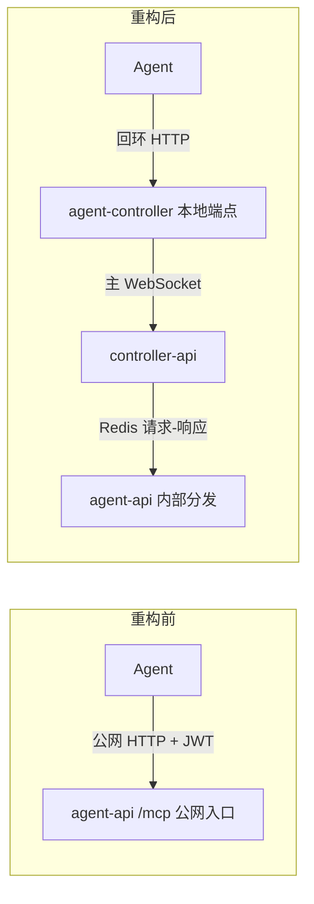

# MCP 传递重构一期 - 技术提案

**功能名称**: MCP 传递重构（MCP Controller Proxy）
**关联 PRD**: `docs/product/draft/20260829-mcp-controller-proxy.md`
**技术提案版本**: v1.0
**创建日期**: 2026-08-29
**作者**: Kimi
**feat-branch**: `feat/mcp-controller-proxy`

## 1. 概述

### 1.1 背景

现状 MCP 传递链路（见 [[20260530-feat-mcp-proxy-config]]、[[20260804-feat-integrated-mcp-registry]]）：

1. 创建会话时 agent-api 签发 `{url, token, serverNames}`（`servers/agent-api/src/services/mcp-endpoint.ts`），url 为 `${GATEWAY_URL}/mcp/{sessionId}`，即 **agent-api 的公网地址**；
2. 该端点经 Redis `session:command` → controller-api → WebSocket `acp:start` 下发到 agent-controller；
3. agent-controller 在 ACP `session/new.mcpServers` 中为每个 server 注入 **HTTP 类型** MCP server（`packages/agent-controller/src/acp/bridge.ts` 的 `toMcpEndpointServers()`），URL 指向 agent-api 公网地址 + Bearer JWT；
4. Agent 进程内置 MCP 客户端直接向 agent-api 公网地址 `POST /mcp/{sessionId}/{serverName}` 发起 JSON-RPC 调用（`servers/agent-api/src/routes/mcp.ts`）。

PRD 要求一期 Break Change：Agent 不再通过互联网访问 agent-api，改由 agent-controller 通过其与 controller-api 之间**已连接的 WebSocket** 代理所有 MCP 访问。

### 1.2 目标

- agent-controller 新增**本机回环 MCP 代理端点**：Agent 的 MCP 请求只发往 `127.0.0.1`；
- agent-controller 主 WebSocket 连接新增 **MCP 转发消息**，复用现有 requestId 请求-响应模式；
- controller-api 将转发来的 MCP 请求经 Redis 请求-响应链路送至 agent-api，复用现有鉴权与分发逻辑（platform / registered_proxy）；
- **下线 agent-api 对公网暴露的 `POST /mcp/*` 路由**（Break Change）；
- 通过控制器版本门禁（major 版本校验）显式拒绝旧版 agent-controller。

### 1.3 范围

- **包含**：agent-controller 本地回环 HTTP MCP 端点与 WebSocket 转发、controller-api 转发桥接、agent-api MCP 分发逻辑改造与公网入口下线、WebSocket 契约更新、版本门禁、测试覆盖。
- **不包含**：MCP 注册体系变更（`agent-gear mcp-proxy` 注册链路不变）、`http` 类型第三方 MCP Server（现状即未实现）、前端交互变更（装配入口不变）。

## 2. 技术架构

### 2.1 系统架构图（重构后）



关键变化：**Agent → agent-api 的公网 HTTP 通路被移除**，替换为 Agent → 回环 → WebSocket → Redis → agent-api 的内部链路。

### 2.2 技术栈

| 层级 | 技术选型 | 说明 |
|------|---------|------|
| agent-controller | Node.js | 本地回环 HTTP 服务（`node:http`）+ Socket.IO 客户端转发 |
| controller-api | Express + Socket.IO | 主连接上新增 `mcp:request`/`mcp:response` 桥接 |
| agent-api | Express + GraphQL-Yoga + Mongoose | MCP 分发逻辑下沉为内部服务，公网 `/mcp` 路由下线 |
| 内部通信 | Redis Pub/Sub | controller-api ↔ agent-api 请求-响应（沿用现有 mcp:forward 模式） |
| 鉴权 | JWT（HS256） | 会话级端点 Token，签发/吊销逻辑不变 |

### 2.3 模块划分

| 模块 | 职责 | 关键技术点 |
|------|------|-----------|
| agent-controller `mcp/local-server.ts`（新增） | 本机回环 HTTP MCP 端点，按 `:sessionId/:serverName` 路由 | 仅监听 `127.0.0.1`、 ephemeral 端口、并发请求管理 |
| agent-controller `mcp/relay.ts`（新增） | 回环端点 ↔ 主 WebSocket 的 JSON-RPC 转发 | requestId 匹配、超时、断线快速失败 |
| agent-controller `acp/bridge.ts`（修改） | 注入 ACP `mcpServers` 时将 URL 改写为回环端点 | `toMcpEndpointServers()` 改造 |
| controller-api `services/mcp-relay.ts`（新增） | 主连接 `mcp:request` → Redis → agent-api 的桥接 | requestId pending Map、会话-控制器归属校验 |
| agent-api `services/mcp-dispatch.ts`（新增，自 `routes/mcp.ts` 抽取） | JWT 校验 + endpoint 状态校验 + platform/registered_proxy 分发 | 逻辑不变，改为被 Redis 消费者调用 |
| agent-api `services/mcp-relay-consumer.ts`（新增） | 订阅 Redis `mcp:relay:request`，调用分发服务并回写响应 | 沿用 mcp-forwarder 的请求-响应模式 |
| agent-api `routes/mcp.ts`（删除） | 公网 MCP 入口 | **Break Change：整体下线** |

## 3. API 设计

### 3.1 WebSocket 契约更新（`contracts/agent-session-websocket.md`）

#### 3.1.1 `acp:start` / `acp:resume` 的 `McpEndpoint` 结构变更

| 字段 | 类型 | 必填 | 说明 |
|------|------|------|------|
| ~~`url`~~ | ~~string~~ | ~~是~~ | **移除**。不再下发 agent-api 公网地址；回环地址由 agent-controller 自行生成本地端口 |
| `token` | string | 是 | Bearer Token（会话级 JWT，会话关闭即吊销），语义不变 |
| `serverNames` | string[] | 是 | MCP Server 名称列表（签发时快照），语义不变 |

> agent-controller 收到 `mcpEndpoint` 后，为每个 serverName 生成 `http://127.0.0.1:{port}/mcp/{sessionId}/{serverName}` 注入 ACP `session/new.mcpServers`（HTTP 类型 + `Authorization: Bearer {token}` header，header 原样透传以供 agent-api 校验）。

#### 3.1.2 新增 MCP 转发事件（Controller ↔ Server，主连接）

**`mcp:request`（Controller → Server）**

| 字段 | 类型 | 必填 | 说明 |
|------|------|------|------|
| `requestId` | string | 是 | 请求 ID（`mcpreq_*`），用于匹配响应 |
| `sessionId` | string | 是 | 会话 ID |
| `serverName` | string | 是 | 目标 MCP Server 名称 |
| `token` | string | 是 | 会话级 JWT（由 Agent 请求头透传） |
| `body` | object | 是 | 原始 MCP JSON-RPC 请求体 |

**`mcp:response`（Server → Controller）**

| 字段 | 类型 | 必填 | 说明 |
|------|------|------|------|
| `requestId` | string | 是 | 对应请求的 ID |
| `status` | number | 是 | HTTP 语义状态码（200 / 401 / 404 / 410 / 502 / 504） |
| `body` | object | 否 | MCP JSON-RPC 响应体（status 非 200 时为错误对象） |

约束：
- Server 校验 `sessionId` 归属该 Controller，不匹配直接返回 404；
- 单次请求超时 60s（MCP 工具调用可能较长），超时返回 504；
- Controller 长连接断开时，Controller 侧对所有 pending 请求立即以 503 失败，不挂起。

### 3.2 内部接口（Redis，controller-api ↔ agent-api）

新增频道，模式沿用现有 `mcp:forward:request` / `mcp:forward:response`：

| 频道 | 方向 | Payload |
|------|------|---------|
| `mcp:relay:request` | controller-api → agent-api | `{ requestId, sessionId, serverName, token, body }` |
| `mcp:relay:response:{requestId}` | agent-api → controller-api | `{ requestId, status, body }` |

agent-api 侧处理逻辑与现 `routes/mcp.ts` 的 POST handler 一致（校验 JWT → 校验 endpoint 状态 → 按 server transport 分发），抽取为 `services/mcp-dispatch.ts` 后由 Redis 消费者调用；`registered_proxy` 分发继续走现有 `mcp:forward:*` 链路不变。

### 3.3 下线接口（Break Change）

- 删除 `servers/agent-api/src/routes/mcp.ts` 及 `src/index.ts` 中的 `/mcp` 挂载；
- 删除 `GATEWAY_URL` 对 MCP 签发的依赖（`mcp-endpoint.ts` 不再生成 url）；
- agent-api 不再需要对 Agent 暴露任何公网 HTTP 端点（GraphQL 管理面不在本期范围内，维持现状）。

## 4. 数据模型

无新增集合；现有集合语义微调：

### 4.1 `mcpsessionendpoints`

| 字段 | 变化 | 说明 |
|------|------|------|
| `sessionId` / `userId` / `mcpServerIds` / `tokenHash` / `status` / `expiresAt` | 不变 | 签发、重签（resume）、吊销（close/delete）逻辑全部保留 |
| （无 url 字段） | — | 现状 url 为签发时动态拼接，不落库，移除无迁移成本 |

### 4.2 缓存设计

- Redis `mcp:endpoint:{sessionId}` 状态缓存：不变；
- 新增 `mcp:relay:response:{requestId}` 为一次性响应频道，无持久状态；
- agent-controller 本地内存维护 `pendingRequests: Map<requestId, {resolve, timer}>` 与 `sessionEndpoints: Map<sessionId, {token, serverNames}>`，会话停止 / `acp:reconcile` 时清理。

## 5. 技术实现方案

### 5.1 核心流程



### 5.2 关键实现点

#### 实现点 1: 本地回环 MCP 端点（agent-controller）

- **描述**: 守护进程启动时在 `127.0.0.1` 监听 ephemeral 端口（`server.listen(0, '127.0.0.1')`），全守护进程共享一个端口，按路径 `:sessionId/:serverName` 路由到对应会话。
- **技术细节**:
  - 使用 `node:http`，不引入新依赖；
  - 请求校验：sessionId 已注册、serverName 在签发快照内、Authorization header 存在（token 正确性由 agent-api 终验，本地只做快速失败）；
  - 仅支持 POST；GET 返回 405（与现状一致，不支持 SSE）；
  - 守护进程内只有一个 Agent 进程集合归属于本机，回环监听无跨机器暴露风险。
- **风险点**: 同机其他进程可访问回环端口。缓解：仅回环监听 + agent-api 侧 JWT 终验 + 会话吊销即失效，与现状安全等级一致（现状 token 也是下发到本机）。

#### 实现点 2: WebSocket MCP Relay（agent-controller）

- **描述**: `socketio-client.ts` 注册 `mcp:response` handler；回环端点请求经 relay 生成 `mcpreq_*` requestId 后 emit `mcp:request`。
- **技术细节**:
  - pending Map + 60s 超时定时器，超时回 504；
  - Socket 断开 / 未注册完成时立即以 503 失败全部 pending 请求（PRD：不无限挂起）；
  - 会话清理：`acp:stop`、`acp:reconcile` 时注销本地 sessionEndpoint 并失败该会话的 pending 请求（410）。
- **风险点**: 大体积 MCP 响应（如文件读取）经 Socket.IO 单帧传输。缓解：Socket.IO 默认 maxHttpBufferSize 为 1MB，controller-api 侧按需调大并在契约中标注上限；超出返回 502 与明确错误。

#### 实现点 3: controller-api MCP Relay Bridge

- **描述**: 在主连接 handler 中新增 `mcp:request` 监听，复用 `acp-session-manager.ts` 的 requestId pending 模式。
- **技术细节**:
  - 校验 sessionId → controllerId 归属（会话注册表），不匹配回 404；
  - publish `mcp:relay:request`，订阅 `mcp:relay:response:{requestId}`（一次性订阅，收到即退订）；
  - 60s 超时回 504；Controller 断开时由 Socket.IO 自动清理，agent-api 侧超时兜底。

#### 实现点 4: agent-api 分发逻辑抽取与公网入口下线

- **描述**: 将 `routes/mcp.ts` POST handler 的鉴权与分发逻辑原样抽取为 `services/mcp-dispatch.ts`，新增 `services/mcp-relay-consumer.ts` 订阅 Redis 调用之；删除路由与挂载。
- **技术细节**:
  - JWT 校验、endpoint 状态校验（Mongo + Redis 缓存）、`platform` 本地 handler、`registered_proxy` 经 `mcp:forward:*` 转发，行为与现状完全一致；
  - 工作流节点会话依赖的 platform 工具（agent-workflow-tools / agent-workflow-admin-tools）走同一分发路径，重构后自动可用；
  - `mcp-endpoint.ts` 的 `createEndpoint` / `reissueEndpoint` 移除 url 生成与 `GATEWAY_URL` 依赖，返回值改为 `{ token, serverNames }`。
- **风险点**: 分发行为回归。缓解：现有 `routes/mcp.ts` 的测试用例平移到 `mcp-dispatch` 层，输入输出契约不变。

#### 实现点 5: 版本门禁（Break Change 保护）

- **描述**: agent-controller 发布新 major 版本；controller-api 注册握手（`register`，`contracts/agent-controller-websocket.md` 版本兼容节）校验 major 版本，不匹配返回 `VERSION_MISMATCH` 并断开。
- **技术细节**:
  - 现状契约已有 major 版本校验机制，本期提升要求版本号即可；
  - agent-controller 收到 `VERSION_MISMATCH` 后在 CLI 输出明确升级指引。
- **风险点**: 用户未升级控制器导致会话不可用。这是 PRD 接受的 Break Change 行为，以明确提示替代静默失败。

### 5.3 重构前后链路对比



## 6. 技术决策

### 6.1 决策列表

| 决策 | 选项 A | 选项 B | 最终选择 | 原因 |
|------|--------|--------|---------|------|
| Agent 侧 MCP 传输形态 | 回环 HTTP 端点 | stdio 桥（spawn `agent-gear mcp`） | 回环 HTTP | 现有注入链路本来就是 HTTP 类型，Agent 已声明 `mcpCapabilities.http`；改动最小，不引入每 server 一个子进程的开销 |
| 转发通道 | 复用主 WebSocket | 新增独立连接/namespace | 复用主 WebSocket | PRD 明确要求「通过已经连接的 websocket」；复用现有认证与重连语义 |
| controller-api ↔ agent-api | Redis 请求-响应 | controller-api 内网 HTTP 回调 agent-api | Redis 请求-响应 | 沿用现有 `mcp:forward:*` 模式，无新网络拓扑，服务发现零成本 |
| Token 校验位置 | controller 本地终验 | agent-api 终验 | agent-api 终验 | 签发/吊销状态在 agent-api，本地仅快速失败，避免状态双写 |
| 旧版控制器处理 | 版本门禁拒绝 | 双链路并存灰度 | 版本门禁拒绝 | PRD 明确本期为 Break Change，双链路会保留公网入口违背目标 |

### 6.2 依赖与约束

| 类型 | 内容 | 说明 |
|------|------|------|
| 依赖 | ACP 协议 `session/new.mcpServers`（HTTP 类型） | 现状已使用，无新增协议依赖 |
| 依赖 | Socket.IO v4+ | 主连接新增两个事件 |
| 依赖 | Redis | 新增 `mcp:relay:*` 频道 |
| 约束 | Socket.IO maxHttpBufferSize | MCP 响应体积上限需在部署配置中评估调大 |
| 约束 | `MCP_ENDPOINT_JWT_SECRET` | 签发/校验不变，仍需配置 |
| 约束 | 部署顺序 | agent-api 与 controller-api 需同版本发布；agent-controller 升级前会话 MCP 不可用（Break Change 预期行为） |

## 7. 项目结构

```
z-agent-gear/
├── contracts/
│   ├── agent-session-websocket.md   # 更新：McpEndpoint 移除 url；新增 mcp:request/mcp:response
│   └── agent-controller-websocket.md # 更新：版本门禁要求版本提升说明
├── packages/
│   └── agent-controller/
│       └── src/
│           ├── socketio-client.ts   # 修改：注册 mcp:response handler、断线快速失败
│           ├── acp/bridge.ts        # 修改：toMcpEndpointServers() 改写为回环 URL
│           └── mcp/
│               ├── local-server.ts  # 新增：回环 HTTP MCP 端点
│               └── relay.ts         # 新增：WebSocket 转发与 pending 管理
├── servers/
│   ├── controller-api/
│   │   └── src/
│   │       └── services/
│   │           └── mcp-relay.ts     # 新增：mcp:request 桥接 + Redis 请求-响应
│   └── agent-api/
│       └── src/
│           ├── index.ts             # 修改：移除 /mcp 挂载
│           ├── routes/mcp.ts        # 删除
│           ├── services/
│           │   ├── mcp-endpoint.ts  # 修改：移除 url 生成与 GATEWAY_URL 依赖
│           │   ├── mcp-dispatch.ts  # 新增：自 routes/mcp.ts 抽取的鉴权与分发
│           │   └── mcp-relay-consumer.ts # 新增：订阅 mcp:relay:request
│           └── config/index.ts      # 修改：移除 GATEWAY_URL 对 MCP 的要求
└── aspire/
    └── AgentGear.AppHost/AppHost.cs # 修改：移除 MCP 相关 GATEWAY_URL 配置
```

## 8. 测试策略

### 8.1 测试覆盖要求

- 单元测试覆盖率: >= 80%（新增/修改模块）

### 8.2 测试类型

| 类型 | 工具 | 覆盖范围 |
|------|------|---------|
| 单元测试 | Vitest | local-server 路由与校验、relay requestId 匹配/超时/断线快速失败、controller-api 归属校验、mcp-dispatch 分发 |
| API 测试 | Vitest | 经 Redis 链路的 MCP initialize / tools/list / tools/call（platform 与 registered_proxy 各一）、吊销后 410、无效 token 401 |
| E2E 测试 | Playwright | 装配 MCP 创建会话 → 工具调用全链路；旧版控制器接入被拒提示 |

### 8.3 关键测试场景

| 场景 | 预期结果 |
|------|---------|
| 装配 MCP 创建会话 | ACP `session/new.mcpServers` URL 均为 `http://127.0.0.1:*`，无公网地址 |
| MCP tools/call（platform 工具） | 经 WebSocket + Redis 链路返回正确结果 |
| MCP tools/call（registered_proxy） | 经 relay → mcp:forward → mcp-proxy 链路返回正确结果 |
| 无效 / 过期 token | agent-api 终验失败，Agent 收到 401 |
| 会话结束后调用 | endpoint 吊销，Agent 收到 410 |
| controller-api 转发 sessionId 归属不符 | 返回 404 |
| 请求超时（60s） | Agent 收到 504，后续请求不受影响 |
| Controller WebSocket 断开 | 全部 pending 请求立即 503 失败 |
| 旧版 agent-controller 注册 | 返回 VERSION_MISMATCH，CLI 输出升级指引 |
| agent-api 公网 /mcp 路由 | 不再挂载，请求返回 404 |

## 9. 部署方案

### 9.1 环境规划

| 环境 | 用途 | 部署方式 |
|------|------|---------|
| 开发 | 本地开发测试 | Aspire 编排 |
| 生产 | 线上服务 | Docker Compose（aspire publish 产物） |

### 9.2 配置管理

| 配置项 | 变化 | 说明 |
|--------|------|------|
| `MCP_ENDPOINT_JWT_SECRET` | 不变 | JWT 签发/校验 |
| `GATEWAY_URL` | **移除 MCP 依赖** | 不再用于 MCP 端点签发；若其他功能（网关代理）仍引用则保留该用途 |
| Socket.IO `maxHttpBufferSize`（controller-api） | 新增评估 | 按 MCP 响应体积上限调大（建议 16MB） |
| agent-api 公网暴露面 | **收敛** | 防火墙/网关层面不再需要向 Agent 开放 `/mcp` |

### 9.3 发布顺序

1. 发布 agent-api + controller-api（同版本）：公网 `/mcp` 下线、`mcp:relay` 桥接上线、版本门禁生效；
2. 用户升级 agent-controller 至新 major 版本后恢复 MCP 能力；
3. 未升级的旧版控制器被拒绝并提示升级（Break Change 预期行为）。

## 10. 验收标准

- [ ] 技术方案评审通过
- [ ] Contract（`agent-session-websocket.md` / `agent-controller-websocket.md`）评审通过
- [ ] Agent 的 MCP 请求不再出现指向 agent-api 公网地址的流量
- [ ] 回环端点仅监听 `127.0.0.1`
- [ ] platform / registered_proxy 两类 MCP Server 工具调用全链路通过
- [ ] 会话吊销、超时、断线、归属不符等异常路径行为符合契约
- [ ] 旧版控制器被版本门禁拒绝且有明确升级提示
- [ ] 单元测试覆盖达标
- [ ] API 测试通过
- [ ] E2E 测试通过

## 11. 相关文档

- [PRD: MCP 传递重构一期](docs/product/draft/20260829-mcp-controller-proxy.md)
- [[20260530-feat-mcp-proxy-config]] — MCP 代理服务配置（现状链路）
- [[20260804-feat-integrated-mcp-registry]] — 集成 MCP 注册中心（现状链路）
- [Contract: agent-session-websocket.md](contracts/agent-session-websocket.md)
- [Contract: agent-controller-websocket.md](contracts/agent-controller-websocket.md)
- [ACP 协议: Session Setup - MCP Servers](https://agentclientprotocol.com/protocol/session-setup#mcp-servers)
