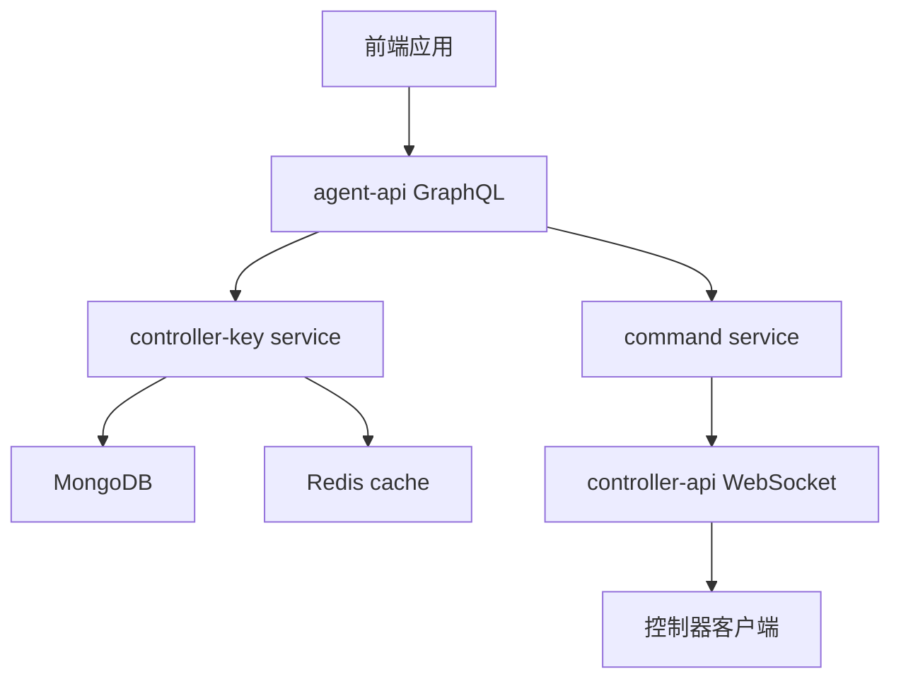
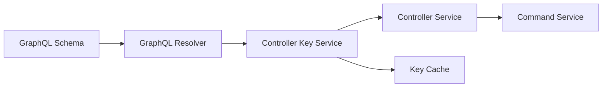
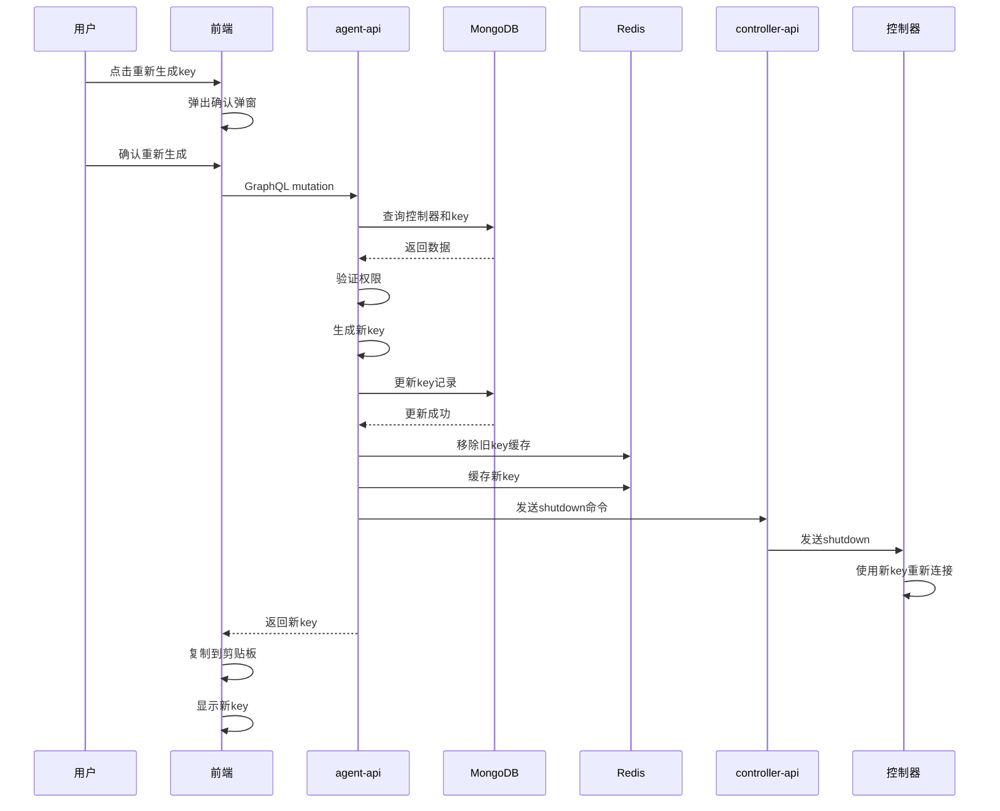

# 控制器Key重新生成 - 技术提案

**功能名称**: 控制器Key重新生成
**关联 PRD**: 20260830-regenerate-controller-key.md
**技术提案版本**: v1.0
**创建日期**: 2026-08-30
**作者**: ZeroAsh
**feat-branch**: `feat/regenerate-controller-key`

## 1. 概述

### 1.1 背景

在控制器管理功能中，用户需要为已绑定的控制器重新生成key，以应对安全考虑、定期轮换和功能完善等场景。当前系统仅支持生成新的未绑定key和解绑控制器，不支持为已绑定的控制器重新生成key。

### 1.2 目标

- 在 agent-api 中添加 `regenerateControllerKey` GraphQL mutation
- 在 agent-api 的 controller-key service 中添加 `regenerate` 方法
- 新key生成后，旧key立即失效
- 操作权限控制为仅控制器所有者可操作
- 操作日志记录谁在什么时间重新生成了哪个控制器的key

### 1.3 范围

**包含**：
- agent-api 中的 GraphQL schema 和 resolver
- controller-key service 中的 regenerate 方法
- 前端控制器管理页面的重新生成key按钮和确认弹窗

**不包含**：
- controller-api 中的变更（控制器使用新key重新连接是现有逻辑）
- 控制器客户端的变更

## 2. 技术架构

### 2.1 系统架构图



### 2.2 技术栈

| 层级 | 技术选型 | 说明 |
|------|---------|------|
| 前端 | React + TypeScript + GraphQL | 现有前端技术栈 |
| 后端 | Node.js + Express + GraphQL-Yoga | agent-api 现有技术栈 |
| 数据库 | MongoDB (Mongoose) | 存储控制器和key信息 |
| 缓存 | Redis | 缓存key信息，加速验证 |
| 通信 | WebSocket | 控制器与服务器通信 |

### 2.3 模块划分



| 模块 | 职责 | 关键技术点 |
|------|------|-----------|
| GraphQL Schema | 定义 regenerateControllerKey mutation | GraphQL type definitions |
| GraphQL Resolver | 处理 GraphQL 请求 | 权限验证、错误处理 |
| Controller Key Service | 核心业务逻辑 | key生成、旧key失效、缓存更新 |
| Controller Service | 控制器相关操作 | 控制器状态管理 |
| Key Cache | Redis 缓存管理 | key缓存和失效 |
| Command Service | 发送命令给控制器 | WebSocket 通信 |

## 3. API 设计

### 3.1 API 契约

#### 接口 1: regenerateControllerKey

- **请求**
  - Method: GraphQL Mutation
  - Path: /graphql
  - Body:
    ```graphql
    mutation RegenerateControllerKey($input: RegenerateControllerKeyInput!) {
      regenerateControllerKey(input: $input) {
        key {
          id
          name
          type
          keyPrefix
          status
          rawKey
          lastUsedAt
          createdAt
          updatedAt
        }
        rawKey
      }
    }
    ```

  - Variables:
    ```json
    {
      "input": {
        "controllerId": "controller_id_here"
      }
    }
    ```

- **响应**
  - Status: 200
  - Body:
    ```json
    {
      "data": {
        "regenerateControllerKey": {
          "key": {
            "id": "new_key_id",
            "name": "controller_name",
            "type": "local",
            "keyPrefix": "zag_k_1_",
            "status": "active",
            "rawKey": null,
            "lastUsedAt": "2026-08-30T10:00:00.000Z",
            "createdAt": "2026-08-30T10:00:00.000Z",
            "updatedAt": "2026-08-30T10:00:00.000Z"
          },
          "rawKey": "zag_k_1_abc123def456..."
        }
      }
    }
    ```

### 3.2 内部接口

#### 接口 1: ControllerKeyService.regenerate

- **描述**: 为已绑定的控制器重新生成key
- **输入**: controllerId: string, userId: string
- **输出**: { key: Record<string, unknown>, rawKey: string }
- **逻辑**:
  1. 验证控制器存在且属于当前用户
  2. 生成新的rawKey和keyHash
  3. 更新ControllerKey记录（status保持active，更新keyHash和keyPrefix）
  4. 从Redis缓存中移除旧key
  5. 缓存新key到Redis
  6. 发送shutdown命令给控制器（使用旧key）
  7. 返回新key信息

## 4. 数据模型

### 4.1 数据库设计

#### 表/集合: controllerkeys

| 字段 | 类型 | 说明 |
|------|------|------|
| _id | ObjectId | 主键 |
| userId | ObjectId | 用户ID |
| name | String | key名称 |
| type | String | 控制器类型 |
| keyHash | String | key的bcrypt哈希 |
| keyPrefix | String | key前缀（用于显示） |
| status | String | key状态 |
| boundControllerId | ObjectId | 绑定的控制器ID |
| lastUsedAt | Date | 最后使用时间 |
| createdAt | Date | 创建时间 |
| updatedAt | Date | 更新时间 |

### 4.2 缓存设计

**缓存策略**：
- Key: `controller_key:{keyId}`
- Value: `{ keyId, keyHash, userId, status, type }`
- TTL: 无过期（主动失效）

**失效策略**：
- 重新生成key时，从缓存中移除旧key
- 新key生成后，添加到缓存

## 5. 技术实现方案

### 5.1 核心流程



### 5.2 关键实现点

#### 实现点 1: GraphQL Schema 定义

- **描述**: 在 controller.ts 中添加 RegenerateControllerKeyInput 和 regenerateControllerKey mutation
- **技术细节**:
  ```graphql
  input RegenerateControllerKeyInput {
    controllerId: ID!
  }

  extend type Mutation {
    regenerateControllerKey(input: RegenerateControllerKeyInput!): CreateKeyPayload!
  }
  ```
- **风险点**: 无

#### 实现点 2: GraphQL Resolver 实现

- **描述**: 在 controller resolver 中添加 regenerateControllerKey mutation 的处理
- **技术细节**:
  - 验证用户已登录
  - 调用 controllerKeyService.regenerate 方法
  - 处理错误情况
- **风险点**: 权限验证需要确保只能操作自己的控制器

#### 实现点 3: ControllerKeyService.regenerate 方法

- **描述**: 核心业务逻辑，实现key重新生成
- **技术细节**:
  1. 查询控制器和key信息
  2. 验证控制器存在且属于当前用户
  3. 生成新的rawKey和keyHash
  4. 更新ControllerKey记录
  5. 从Redis缓存中移除旧key
  6. 缓存新key到Redis
  7. 发送shutdown命令给控制器
  8. 返回新key信息
- **风险点**: 需要确保操作的原子性，避免数据不一致

#### 实现点 4: 前端重新生成key按钮

- **描述**: 在控制器管理页面添加重新生成key按钮
- **技术细节**:
  - 按钮仅对控制器所有者可见
  - 点击后弹出确认弹窗
  - 确认后调用GraphQL mutation
  - 新key生成后自动复制到剪贴板
  - 页面显示新key
- **风险点**: 需要处理网络错误和权限错误

## 6. 技术决策

### 6.1 决策列表

| 决策 | 选项 A | 选项 B | 最终选择 | 原文 |
|------|--------|--------|---------|------|
| 旧key处理方式 | 立即失效 | 保留一段时间 | 立即失效 | 安全考虑，立即失效更安全 |
| 操作权限 | 所有用户 | 控制器所有者 | 控制器所有者 | 符合最小权限原则 |
| 操作日志记录 | 记录 | 不记录 | 记录 | 便于审计和问题排查 |

### 6.2 依赖与约束

| 类型 | 内容 | 说明 |
|------|------|------|
| 依赖 | agent-api GraphQL 服务 | 现有服务 |
| 依赖 | controller-api WebSocket 服务 | 发送shutdown命令 |
| 依赖 | MongoDB | 存储数据 |
| 依赖 | Redis | 缓存key |
| 约束 | 仅控制器所有者可操作 | 权限控制 |
| 约束 | 重新生成key后旧key立即失效 | 安全策略 |

## 7. 项目结构

```
servers/agent-api/
├── src/
│   ├── graphql/
│   │   ├── schemas/
│   │   │   └── controller.ts          # 添加 RegenerateControllerKeyInput
│   │   └── resolvers/
│   │       └── controller.ts          # 添加 regenerateControllerKey resolver
│   └── services/
│       └── controller-key.ts          # 添加 regenerate 方法

apps/agent-web/
├── src/
│   ├── components/
│   │   └── ControllerManagement.tsx    # 添加重新生成key按钮和确认弹窗
│   └── graphql/
│       └── mutations/
│           └── controller.ts           # 添加 REGENERATE_CONTROLLER_KEY mutation
```

## 8. 测试策略

### 8.1 测试覆盖要求

- 单元测试覆盖率: >= 80%
- API 测试覆盖的端点: regenerateControllerKey

### 8.2 测试类型

| 类型 | 工具 | 覆盖范围 |
|------|------|---------|
| 单元测试 | Vitest | ControllerKeyService.regenerate 方法 |
| 集成测试 | Vitest | GraphQL resolver 和 service 集成 |
| E2E 测试 | Playwright | 前端重新生成key流程 |

## 9. 部署方案

### 9.1 环境规划

| 环境 | 用途 | 部署方式 |
|------|------|---------|
| 开发 | 开发和测试 | Aspire 本地编排 |
| 测试 | 集成测试 | Aspire 本地编排 |
| 生产 | 线上环境 | Docker Compose |

### 9.2 配置管理

无需额外配置，使用现有配置。

## 10. 验收标准

- [ ] 技术方案评审通过
- [ ] Contract 评审通过
- [ ] 代码实现完成
- [ ] 单元测试覆盖达标
- [ ] API 测试通过
- [ ] E2E 测试通过

## 11. 相关文档

- 产品文档: `docs/product/shipping/20260830-regenerate-controller-key.md`
- 开发规范: `docs/engineering/common-rules.md`
- 后端规范: `docs/engineering/backend-rules.md`