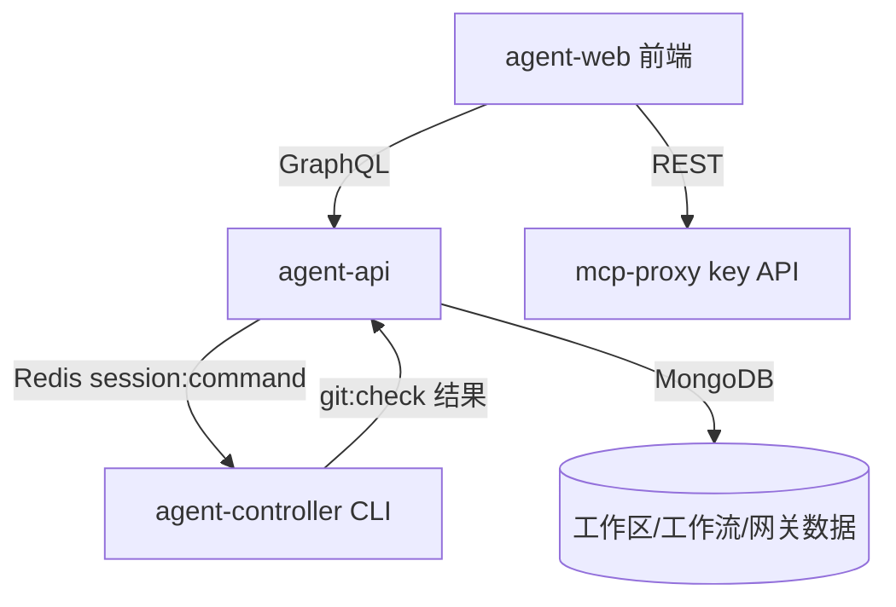
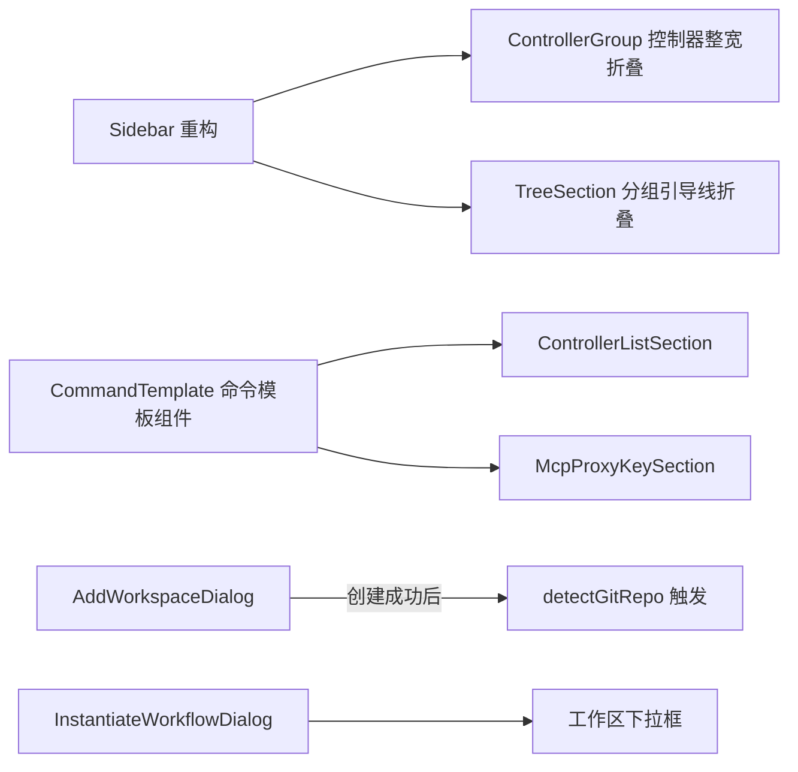
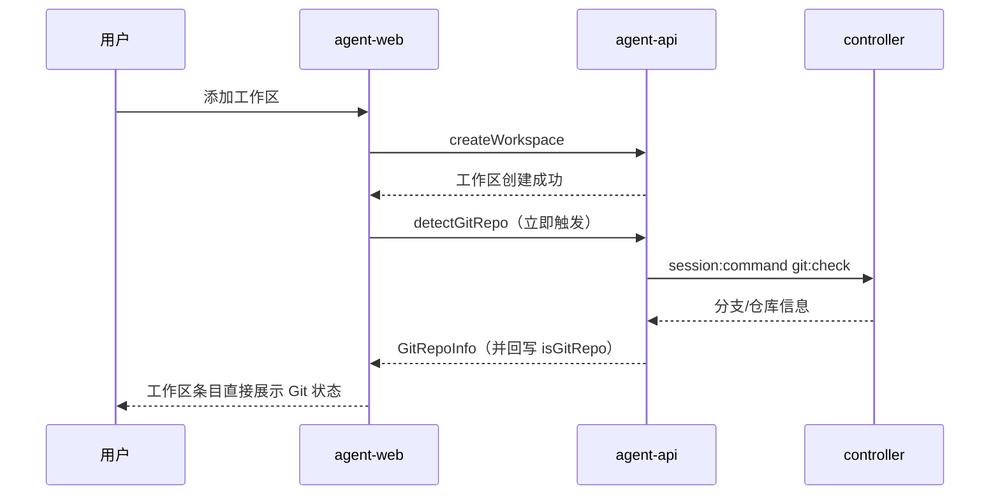

# 综合体验优化一期 - 技术提案

**功能名称**: 综合体验优化一期
**关联 PRD**: `docs/product/draft/20260907-experience-optimization-phase1.md`
**技术提案版本**: v1.0
**创建日期**: 2026-09-07
**作者**: ZeroAsh
**feat-branch**: `feat/experience-optimization-phase1`

## 1. 概述

### 1.1 背景

本期为体验优化需求，四个模块的现状（代码探查结论）：

- **会话树/侧边栏**：`apps/agent-web/src/components/Sidebar.tsx` 以「控制器 → 工作区 → 工作流/Worktree/会话」组织，统一网关在 `GatewaySection.tsx` 平铺；折叠用本地 state（`expandedControllers`/`expandedWorkspaces`）+ Tailwind `ml-4` 缩进实现；「会话」标题与新建按钮在 `Sidebar.tsx:169-175`；侧边栏宽度在 `MainLayout.tsx:23` 的 `grid-cols-[240px_1fr]`。
- **创建工作流**：`InstantiateWorkflowDialog.tsx` 的 `workspaceId` 由父组件固定传入，对话框内不可选；契约 `InstantiateWorkflowInput` 已含必填 `workspaceId`（`contracts/workflow.graphql:235-249`），后端无需改动。
- **控制器/MCP Key**：`ControllerListSection.tsx`（151-153 行生成 Key、164-189 行展示 rawKey）与 `McpProxyKeySection.tsx`（91-142 行内嵌 Dialog，走 REST `api/mcp-proxy.ts`）均只展示 Key，无命令模板；CLI 侧 `packages/agent-controller/src/config.ts` 的 `resolveKey`/`resolveEndpoint` 已支持 `ZAG_CONTROLLER_KEY`/`ZAG_SERVER_ENDPOINT` 环境变量，无需改动。
- **Git 发现**：`createWorkspace`（`servers/agent-api/src/graphql/resolvers/controller-workspace.ts:87-104` → `services/controller-workspace.ts:30-57`）仅落库不扫描；`detectGitRepo`（service 91-138 行，Redis 缓存 `git:branches:{controllerId}:{md5(path)}` + `session:command` 通道 `git:check`）由前端在展开工作区时才调用（`WorkspaceSection.handleExpand` 131-154 行）。

### 1.2 目标

1. 前端重构会话树为「控制器 → 工作流/统一网关/会话/工作区」四平级分组，控制器整宽 Label 折叠，分组带引导线窄缩进。
2. 创建工作流对话框内新增工作区下拉选择。
3. 侧边栏去「会话」标题、新建会话图标按钮置底、栏体加宽、网关新增按钮与工作流对齐。
4. 新增控制器/MCP 代理 Key 时展示可配置启动命令模板（npm/pnpm/bun/pm2 × 全球/国内）。
5. 添加工作区成功后前端立即触发 `detectGitRepo`。

### 1.3 范围

- **做**：`apps/agent-web` 前端全部上述改动；复用现有 GraphQL/REST 契约。
- **不做**：契约变更（GraphQL/OpenAPI/WebSocket 均无新增字段或接口）；CLI（`packages/agent-controller`）改动；后端改动；树数据的虚拟滚动等性能重构。

## 2. 技术架构

### 2.1 系统架构图



本期改动全部落在 A（agent-web）。

### 2.2 技术栈

| 层级 | 技术选型 | 说明 |
|------|---------|------|
| 前端 | React + TypeScript + Vite + Tailwind + lucide-react | 沿用现状，无新依赖 |
| 后端 | 不改动 | 复用现有 `detectGitRepo`、`instantiateWorkflow` 等接口 |
| 数据 | 不改动 | 无新增实体/字段 |

### 2.3 模块划分



| 模块 | 职责 | 关键技术点 |
|------|------|-----------|
| Sidebar/ControllerGroup | 控制器节点整宽 Label 折叠，去掉下拉 icon | 复用 `expandedControllers` state；整行 button |
| TreeSection | 四个分组（工作流/统一网关/会话/工作区）的带引导线窄缩进折叠 | 新增统一的分组容器组件，引导线用 border-l |
| CommandTemplate | 包管理器 × 服务器组合生成命令文本 | 纯函数生成 + 一键复制，无后端依赖 |
| AddWorkspaceDialog | 创建成功后触发 Git 发现 | 复用现有 `DETECT_GIT_REPO` lazy query |
| InstantiateWorkflowDialog | 工作区下拉选择 | 查询 `controllerWorkspaces`，写入既有 `workspaceId` |

## 3. API 设计

### 3.1 API 契约

**无契约变更。** 复用以下现有契约：

| 用途 | 契约 | 说明 |
|------|------|------|
| 工作区列表 | `contracts/controller-workspace.graphql` Query `controllerWorkspaces` | 创建工作流对话框的工作区下拉数据源 |
| 工作流实例化 | `contracts/workflow.graphql` Mutation `instantiateWorkflow`（`InstantiateWorkflowInput.workspaceId` 已必填） | 仅前端把可选值填入既有字段 |
| Git 发现 | `contracts/controller-workspace.graphql` Query `detectGitRepo` | 添加工作区成功后立即调用 |
| 控制器 Key | 现有 `createControllerKey` mutation | 不改动，仅展示层增加命令模板 |
| MCP 代理 Key | 现有 REST（`apps/agent-web/src/api/mcp-proxy.ts`） | 不改动，仅展示层增加命令模板 |

### 3.2 内部接口

新增一个纯前端函数（命令模板生成），签名约定：

```ts
type PackageManager = 'npm' | 'pnpm' | 'bun' | 'pm2';
type ServerRegion = 'global' | 'cn';

function buildControllerCommand(opts: {
  pm: PackageManager;
  region: ServerRegion;
  key: string;
}): string;
```

- 服务器地址：`global → https://zag-ctrl-api.fffdan.com`，`cn → https://ctrl.zag.cn.fffdan.com`。
- npm/pnpm/bun：生成 `{npm: npx, pnpm: pnpm dlx, bun: bunx}[pm] agent-gear --key <key> --server <endpoint>` 单行运行命令。
- pm2：返回两部分内容——
  1. 全局安装提示：`{npm: npm install -g, pnpm: pnpm add -g, bun: bun install -g}` 之外的包管理器选择仍独立生效，pm2 模式下安装提示固定展示当前选中包管理器的全局安装命令（默认 `npm install -g agent-gear`）；
  2. pm2 应用配置 JSON 片段，供用户保存为配置文件后 `pm2 start` 启动，通过环境变量传递配置（CLI `config.ts` 已支持该优先级）：

  ```json
  {
    "apps": [
      {
        "name": "agent-gear",
        "script": "agent-gear",
        "env": {
          "ZAG_CONTROLLER_KEY": "<key>",
          "ZAG_SERVER_ENDPOINT": "<endpoint>"
        }
      }
    ]
  }
  ```

  因此 `buildControllerCommand` 对 pm2 返回结构化结果（安装命令 + JSON 片段文本），而非单行命令。

## 4. 数据模型

无数据库与缓存变更。Git 发现沿用现有 Redis 缓存 `git:branches:{controllerId}:{md5(path)}` 与 `ControllerWorkspace.isGitRepo` 回写逻辑。

## 5. 技术实现方案

### 5.1 核心流程



### 5.2 关键实现点

#### 实现点 1: 会话树重构（Sidebar.tsx）

- **描述**: 树结构改为 控制器 → [工作流 | 统一网关 | 会话 | 工作区] 四个分组。工作区分组展开后为 worktree 列表；会话分组为会话列表（自 `Sidebar.tsx:275-318` 现有 NavLink 列表迁移）；工作流分组复用 `WorkflowSidebarGroup`；网关分组复用 `GatewaySection` 的列表能力。
- **技术细节**: 控制器行整体渲染为整宽 button（占满侧边栏宽度），移除右侧 Chevron 下拉 icon，点击整行切换 `expandedControllers`。四个分组使用新的 `TreeSection` 容器：`ml-2` 级窄缩进 + `border-l` 引导线，组头为 Label 折叠。
- **条目工作区辅助行**: 工作流与会话不再按工作区聚合，两类条目改为两行布局——第一行为条目名称（沿用现有样式），第二行为 muted 小字展示所属工作区名称。工作流条目按其 `workspaceId` 关联 `controllerWorkspaces` 取名称；会话条目按其所属工作区（现有会话数据中的工作区关联）取名称。工作区已删除/停用时辅助行显示「未知工作区」并置灰。
- **风险点**: 现有「工作流挂在工作区下」逻辑（`Sidebar.tsx:259-264` 的 `workspace.isEnabled && 有配置记录` 渲染条件）迁移到控制器级分组后，需按控制器聚合其全部工作区的 configured workflows；空分组展示空态与新建入口。

#### 实现点 2: 侧边栏优化（Sidebar.tsx / GatewaySection.tsx / MainLayout.tsx）

- 删除「会话」标题与 `Sidebar.tsx:169-175` 的新建按钮；在侧边栏底部新增仅图标（Plus）的新建会话按钮，仍打开 `NewSessionDialog`。
- `MainLayout.tsx:23` 的 `grid-cols-[240px_1fr]` 加宽（如 280px，以设计评审为准）。
- `GatewaySection.tsx:40-49` 的新增按钮从 `buttonVariants({size:'xs'})` 实心按钮改为与 `WorkflowSidebarGroup.tsx:64-72` 相同的 ghost icon（Plus）按钮。

#### 实现点 3: 创建工作流工作区选择（InstantiateWorkflowDialog.tsx）

- 对话框内新增工作区 Select：数据源为当前 controllerId 下的 `controllerWorkspaces`；默认选中父组件传入的 `workspaceId`（保持现有入口行为不变）；用户可改选，最终随 `InstantiateWorkflowInput.workspaceId` 提交。契约已支持，零后端改动。

#### 实现点 4: 启动命令模板（ControllerListSection.tsx / McpProxyKeySection.tsx）

- 在 Key 生成成功的展示区域下方渲染 `CommandTemplate` 组件：两个 Select（包管理器 npm/pnpm/bun/pm2，默认 npm；服务器 国内/全球，默认国内）+ 命令文本 + 复制按钮。
- 命令文本由 `buildControllerCommand` 纯函数生成，Key 自动填入；选择 pm2 时组件改为展示两行内容：第一行为全局安装提示（如 `npm install -g agent-gear`），第二行为 pm2 应用配置 JSON 代码片段（`{ "apps": [{ ... }] }`，env 内含 `ZAG_CONTROLLER_KEY`/`ZAG_SERVER_ENDPOINT`），两块内容各自带复制按钮。
- 两处复用同一组件，仅 Key 来源不同（GraphQL rawKey / REST createdKey）。

#### 实现点 5: 添加工作区即时 Git 发现（AddWorkspaceDialog.tsx / WorkspaceSection.tsx）

- `handleAdd`（`AddWorkspaceDialog.tsx:97-104`）在 `CREATE_WORKSPACE` 成功后立即对该工作区调用 `DETECT_GIT_REPO`（复用 `WorkspaceSection` 现有 lazy query 模式），结果沿用现有缓存与 `isGitRepo` 回写。
- 失败处理：`detectGitRepo` 已有 30s 超时与异常路径；失败时工作区条目维持「未发现」状态，用户展开时按现有逻辑可重试，不阻塞添加。

## 6. 技术决策

### 6.1 决策列表

| 决策 | 选项 A | 选项 B | 最终选择 | 原因 |
|------|--------|--------|---------|------|
| Git 即时发现触发方 | 前端创建成功后调 `detectGitRepo` | 后端 `createWorkspace` 内自动触发 | A | 复用现有查询与缓存链路，无契约/后端改动；控制器离线时由查询超时自然兜底 |
| 命令模板生成 | 前端纯函数 | 后端下发模板 | A | 模板内容静态（端点固定两个），无需服务端配置 |
| 树引导线实现 | border-l + 窄缩进 | 独立 SVG 树组件 | A | 与现有 Tailwind 实现一致，成本最低 |
| 工作流分组数据源 | 按控制器聚合全部工作区工作流 | 保持挂工作区下 | A | PRD 明确要求平级分组 |

### 6.2 依赖与约束

| 类型 | 内容 | 说明 |
|------|------|------|
| 依赖 | 现有 `detectGitRepo`/`controllerWorkspaces`/`instantiateWorkflow` 契约 | 均已在 `contracts/` 中定义，本期不变更 |
| 约束 | 无新依赖包 | 全部使用现有 Tailwind/lucide/GraphQL 客户端 |
| 约束 | Key 明文仅生成时展示 | 命令模板随 Key 一同仅展示一次 |

## 7. 项目结构

涉及改动文件（均在 `apps/agent-web/src`）：

```
apps/agent-web/src/
├── components/
│   ├── Sidebar.tsx                      # 树结构重构、去「会话」标题、底部新建按钮
│   ├── GatewaySection.tsx               # 新增按钮样式对齐工作流
│   ├── tree/TreeSection.tsx             # 新增：分组引导线折叠容器
│   ├── common/CommandTemplate.tsx       # 新增：启动命令模板组件
│   ├── settings/ControllerListSection.tsx   # 接入 CommandTemplate
│   ├── settings/McpProxyKeySection.tsx      # 接入 CommandTemplate
│   ├── settings/AddWorkspaceDialog.tsx      # 创建成功后触发 detectGitRepo
│   └── workflow/InstantiateWorkflowDialog.tsx  # 新增工作区下拉框
├── lib/command-template.ts              # 新增：buildControllerCommand 纯函数
└── pages/MainLayout.tsx                 # 侧边栏加宽
```

## 8. 测试策略

### 8.1 测试覆盖要求

- `buildControllerCommand` 纯函数：单元测试覆盖 4 种包管理器 × 2 种服务器共 8 组组合；pm2 场景额外断言返回的全局安装提示与 pm2 JSON 片段（env 含 `ZAG_CONTROLLER_KEY`/`ZAG_SERVER_ENDPOINT`）。
- E2E：沿用 `tests/e2e` 现有 Playwright 体系。

### 8.2 测试类型

| 类型 | 工具 | 覆盖范围 |
|------|------|---------|
| 单元测试 | Vitest | 命令模板生成函数 8 组组合 |
| E2E | Playwright | 树分组展开/折叠；创建工作流选择工作区；添加工作区后 Git 状态展示；命令模板切换与复制 |

## 9. 验收标准

- [ ] 技术方案评审通过
- [ ] 树结构为 控制器 → 工作流/统一网关/会话/工作区 四平级分组，整宽 Label 折叠 + 引导线窄缩进
- [ ] 工作流与会话条目均展示所属工作区辅助行（工作区缺失时置灰提示）
- [ ] 创建工作流对话框可选择工作区并正确归属
- [ ] 侧边栏去「会话」标题、新建图标置底、栏体加宽、网关新增按钮样式与工作流一致
- [ ] 新增控制器/MCP 代理 Key 时命令模板可选 npm/pnpm/bun/pm2 与全球/国内，默认 npm + 国内；pm2 展示全局安装提示 + pm2 配置 JSON 片段（环境变量传参）
- [ ] 添加工作区后无需进入即可见 Git 状态与分支信息
- [ ] 单元测试与 E2E 测试通过

## 10. 相关文档

- 关联 PRD：`docs/product/draft/20260907-experience-optimization-phase1.md`
- 相关契约：`contracts/controller-workspace.graphql`、`contracts/workflow.graphql`
- 开发规范：`docs/engineering/common-rules.md`、`docs/engineering/frontend-rules.md`
