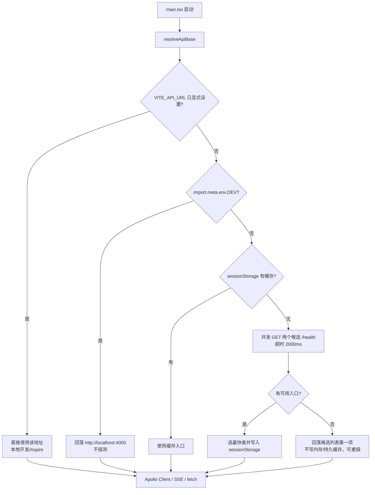
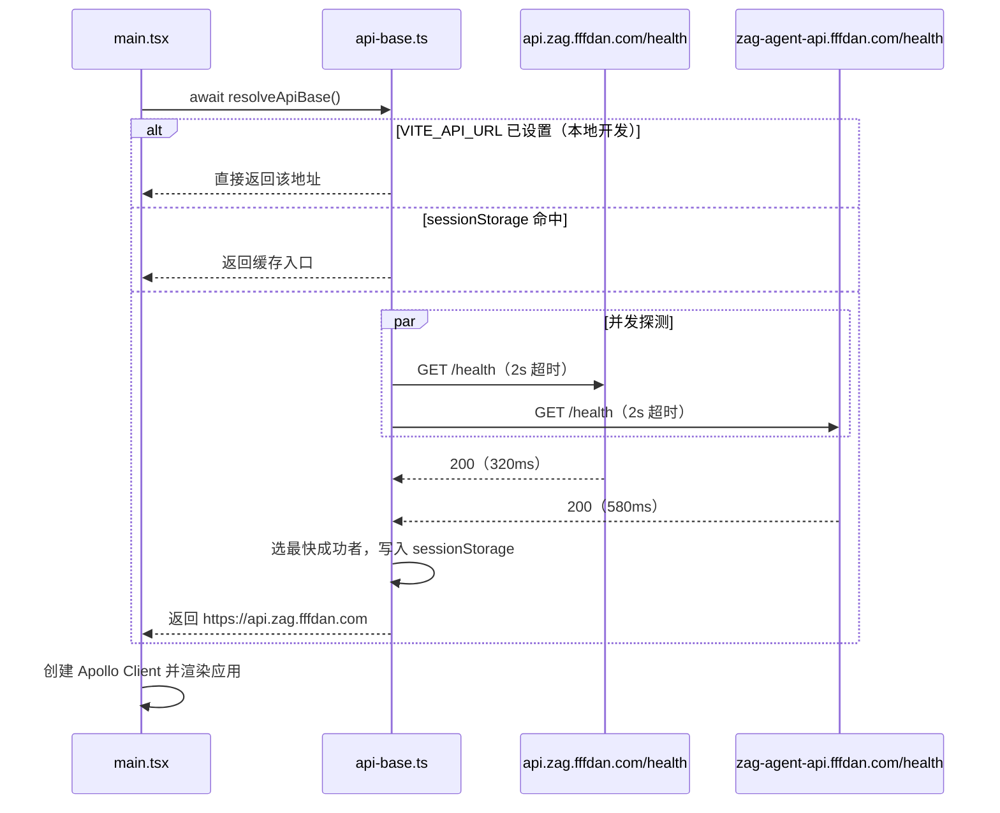

# 前端支持服务器自动选择 - 技术提案

**功能名称**: 前端支持服务器自动选择
**关联 PRD**: docs/product/draft/20260908-frontend-auto-select-server.md
**技术提案版本**: v1.1
**创建日期**: 2026-09-08
**作者**: Kimi
**feat-branch**: `prd/frontend-auto-select-server`

## 版本变更

- **v1.1（2026-10-08）**：按集成评审意见修订——未显式注入 env 且 `import.meta.env.DEV` 为真（本地手动 `npm run dev`）时，跳过线上探测并回落 `http://localhost:4000`，避免误连生产；探测全部失败不再写内存缓存（可重探）；并发探测以在途 Promise 去重；`main.tsx` 增加 `try/catch` 降级与加载态。详见 [[20261008-feat-domestic-api-acceleration]] v1.2。
- **v1.0（2026-09-08）**：初稿。

## 1. 概述

### 1.1 背景

线上有两个可用 API 入口（`https://api.zag.fffdan.com`、`https://zag-agent-api.fffdan.com`），当前前端在构建期通过 `.github/workflows/deploy-agent-web.yml:42-44` 硬编码注入 `VITE_API_URL=https://zag-agent-api.fffdan.com`，所有用户固定走单一入口，无法利用对各自网络更快的另一入口。

### 1.2 现状分析

前端没有统一的 API 基址封装，地址读取分散在各调用点，且 fallback 不一致：

| 调用点 | 位置 | 当前取值 |
|--------|------|---------|
| Apollo Client（GraphQL） | `apps/agent-web/src/lib/apollo.ts:25` | `VITE_API_URL \|\| ''`（相对路径） |
| 会话 SSE 流 | `apps/agent-web/src/hooks/useSessionStream.ts:35` | `VITE_API_URL \|\| 'http://localhost:4000'` |
| 会话 SSE 流（组件内） | `apps/agent-web/src/components/session/SessionView.tsx:159` | `VITE_API_URL \|\| ''` |
| 工作区设置（fetch /graphql） | `apps/agent-web/src/components/settings/WorkspaceSection.tsx:59,157` | `VITE_API_URL \|\| 'http://localhost:4000'` |

本地开发另有两条注入路径：`apps/agent-web/vite.config.ts:8` 的 dev server proxy（`/graphql`、`/api` 代理到 `VITE_API_URL || VITE_BASE_URL || 'http://localhost:4000'`）与 Aspire 编排 `aspire/AgentGear.AppHost/AppHost.cs:84-86` 的环境变量注入。

`VITE_CONTROLLER_API_URL`（`apps/agent-web/src/api/mcp-proxy.ts:1`）是另一套独立服务地址，不在本需求范围内，保持不变。

### 1.3 目标

- 线上构建不再注入固定 `VITE_API_URL`，前端启动时并发探测两个候选入口的 `/health`，选用最快可用者。
- 探测结果会话级缓存（`sessionStorage`），单会话内不重复探测。
- 显式设置 `VITE_API_URL` 时（本地开发、Aspire 编排）直接使用该值，跳过一切探测。
- 收敛上述分散的基址读取到单一解析入口，统一 fallback 口径。

### 1.4 范围

| 范围 | 内容 |
|------|------|
| 做 | `apps/agent-web` 新增统一 API 基址解析模块；Apollo / SSE / fetch 各消费点改走统一入口；deploy workflow 不再注入 `VITE_API_URL` |
| 不做 | `VITE_CONTROLLER_API_URL` 相关逻辑；后端与 contracts 变更；会话中途的动态切换与手动切换 UI |

## 2. 技术架构

### 2.1 系统架构图



### 2.2 技术栈

| 层级 | 技术选型 | 说明 |
|------|---------|------|
| 前端 | React + TypeScript + Vite | 既有栈，无新依赖 |
| 测试 | Vitest（沿用 `apps/agent-web` 既有测试配置） | 单元测试 |

### 2.3 模块划分

| 模块 | 职责 | 关键技术点 |
|------|------|-----------|
| `apps/agent-web/src/lib/api-base.ts`（新增） | API 基址的统一解析：环境变量优先 → 会话缓存 → 并发测速 → 回落 | `Promise` 并发竞速、`AbortController` 超时、`sessionStorage` 缓存 |
| `apps/agent-web/src/main.tsx` | 启动引导：`await resolveApiBase()` 后再创建 Apollo Client 并渲染 | 探测与首屏并行度由超时上限兜底 |
| `apollo.ts` / `useSessionStream.ts` / `SessionView.tsx` / `WorkspaceSection.tsx` | 改为从 `api-base.ts` 读取已解析的基址 | 消除分散的 `import.meta.env` 直读与不一致 fallback |

## 3. API 设计

无对外 API 变更。探测复用候选入口已有的 `GET /health`；GraphQL `/graphql` 与 SSE `/api/session/{id}/stream` 路径不变，与 `contracts/agent-session.openapi.yaml` 及各 `*.graphql` 契约保持一致。

## 4. 数据模型

无数据库变更。仅前端 `sessionStorage` 缓存：

| key | 值 | 生命周期 |
|-----|-----|---------|
| `zag:api-base` | 选中的入口 origin（如 `https://api.zag.fffdan.com`） | 会话级（sessionStorage 天然语义），探测失败时不写入 |

## 5. 技术实现方案

### 5.1 核心流程



### 5.2 关键实现点

#### 实现点 1：统一基址解析 `api-base.ts`

- **描述**: 导出 `resolveApiBase(): Promise<string>` 与同步读取的 `getApiBase()`。解析优先级：`import.meta.env.VITE_API_URL` 非空 → 直接使用并跳过探测；否则 `import.meta.env.DEV` 为真 → 回落 `http://localhost:4000` 且不探测；否则查 `sessionStorage`；否则并发探测候选列表；全部失败回落 `API_CANDIDATES[0]`。
- **技术细节**: 候选列表为模块内常量 `['https://api.zag.fffdan.com', 'https://zag-agent-api.fffdan.com']`。探测用 `fetch(`${origin}/health`, { signal })`，`AbortController` 实现 2000ms 超时；以「首个返回 2xx 的 Promise」胜出（其余请求 abort），等价于最快可用者。结果写入 `sessionStorage`，失败（全部超时/非 2xx）不缓存（内存态与持久态均不写，后续调用可重探）、返回回落值；在途探测以模块级 Promise 去重。`sessionStorage` 读写以 `try/catch` 包裹以兼容沙箱/隐私模式。
- **风险点**: `/health` 若未配置 CORS，浏览器会拦截跨域探测——需在实现阶段验证两个入口的 `/health` 允许跨域读取；若不允许，备选方案为后端补充 CORS 头（改动极小，但仍属范围外事项，届时升级决策）。

#### 实现点 2：启动引导与消费点收敛

- **描述**: `main.tsx` 中 `await resolveApiBase()` 后再创建 Apollo Client（`apollo.ts` 改为接受解析后基址或导出工厂函数）并 `render`。`useSessionStream.ts`、`SessionView.tsx`、`WorkspaceSection.tsx` 三处基址直读全部改为 `getApiBase()`，统一 fallback 口径。
- **技术细节**: `getApiBase()` 在解析完成前回落 `VITE_API_URL || (import.meta.env.DEV ? 'http://localhost:4000' : '')` 的保守值；由于渲染发生在 `await` 之后，正常运行路径不会命中未完成状态。SSE 的 EventSource 构造发生在组件挂载后，天然晚于解析完成。
- **风险点**: 探测最坏增加 2s 启动耗时（全部不可达时）。可接受——该场景现状同样是不可用；且本地开发不经过此路径。

#### 实现点 3：部署配置调整

- **描述**: `.github/workflows/deploy-agent-web.yml` 构建步骤移除 `VITE_API_URL: https://zag-agent-api.fffdan.com` 注入（保留 `VITE_CONTROLLER_API_URL`），让线上产物进入自动选择路径。
- **风险点**: 若线上还依赖相对路径 fallback（`VITE_API_URL || ''`），移除注入后该路径消失——本方案以显式候选列表替代，行为更明确。

## 6. 技术决策

### 6.1 决策列表

| 决策 | 选项 A | 选项 B | 最终选择 | 原因 |
|------|--------|--------|---------|------|
| 测速时机 | 启动时一次性探测 | 每次请求前动态选择 | A | 请求级切换复杂度高（Apollo 链接重建、SSE 重连），收益不成比例 |
| 缓存粒度 | sessionStorage（会话级） | localStorage（持久） | A | 网络质量随时间/地点变化，持久缓存会把过期结论固化；会话级每次重新打开站点重新测速，代价仅一次并行探测 |
| 竞速策略 | 首个 2xx 胜出 | 全部完成后比较耗时 | A | 「首个成功」即最快可用者，省去等待慢入口 |
| 候选列表来源 | 代码常量 | 新增环境变量 | A | 候选固定为平台自有域名，无需可配置；KISS |
| 环境变量语义 | 已设置即跳过探测 | 已设置仅作为候选之一 | A | 需求明确要求本地开发不受影响 |

### 6.2 依赖与约束

| 类型 | 内容 | 说明 |
|------|------|------|
| 依赖 | 两个候选入口的 `GET /health` 可用且允许跨域读取 | 实现点 1 风险点，需实现阶段验证 |
| 约束 | 不修改后端、不修改 contracts、不引入新 npm 依赖 | 纯前端变更 + 一处 CI 配置 |
| 约束 | 本地开发（vite proxy / Aspire 注入）行为不变 | 环境变量优先级最高 |

## 7. 项目结构

```
apps/agent-web/src/
├── lib/
│   ├── api-base.ts          # 新增：统一 API 基址解析（环境变量/缓存/测速/回落）
│   └── apollo.ts            # 修改：使用解析后的基址
├── hooks/
│   └── useSessionStream.ts  # 修改：基址改走 getApiBase()
├── components/
│   ├── session/SessionView.tsx          # 修改：基址改走 getApiBase()
│   └── settings/WorkspaceSection.tsx    # 修改：基址改走 getApiBase()
└── main.tsx                 # 修改：await resolveApiBase() 后渲染
```

## 8. 测试策略

### 8.1 测试覆盖要求

- `api-base.ts` 核心分支单元测试全覆盖：环境变量优先、缓存命中、最快者胜出、单入口失败、全部失败回落、超时处理。

### 8.2 测试类型

| 类型 | 工具 | 覆盖范围 |
|------|------|---------|
| 单元测试 | Vitest（mock `fetch` + fake timers） | `api-base.ts` 全部分支 |
| 手工验证 | 本地 dev / 线上构建产物 | 本地环境变量直连无探测；线上自动选最快入口；断其一自动兜底 |

## 9. 部署方案

### 9.1 环境规划

| 环境 | API 基址来源 | 说明 |
|------|-------------|------|
| 本地开发（Aspire，注入 env） | `VITE_API_URL` 环境变量 | 行为不变 |
| 本地手动开发（`npm run dev`，无 env） | `import.meta.env.DEV` → `http://localhost:4000` | 不探测，行为与变更前一致 |
| 线上（GitHub Pages） | 自动测速选择 | deploy workflow 移除 `VITE_API_URL` 注入 |

### 9.2 配置管理

- 移除：`.github/workflows/deploy-agent-web.yml` 中 `VITE_API_URL` 注入。
- 保留：`VITE_CONTROLLER_API_URL` 注入不变。
- 无新增配置项。

## 10. 验收标准

- [ ] 技术方案评审通过
- [ ] 代码实现完成，`api-base.ts` 单元测试全部通过
- [ ] 本地 `VITE_API_URL` 指定地址时，无任何探测请求，全部请求发往指定地址
- [ ] 线上产物启动时自动探测并选用最快可用入口（DevTools 可观测）
- [ ] 阻断一个入口后，自动使用另一入口，站点功能正常
- [ ] 两个入口均不可达时，回落默认入口，错误表现不劣于现状

## 11. 相关文档

- 关联 PRD：[[20260908-frontend-auto-select-server]]
- SSE 契约：`contracts/agent-session.openapi.yaml`
- 部署配置：`.github/workflows/deploy-agent-web.yml`
