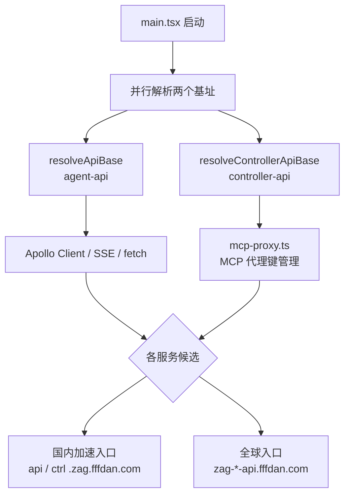
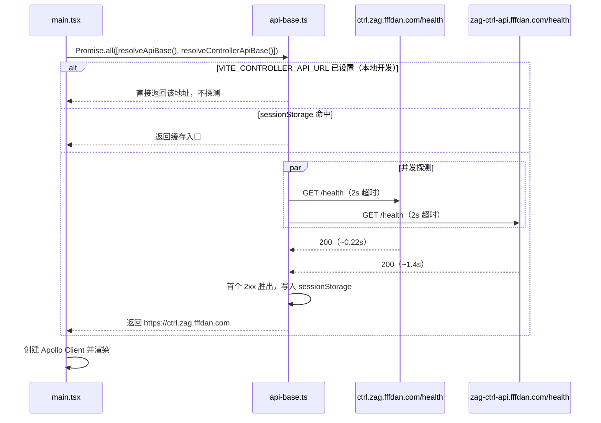

# Web 国内加速 API 接入（Controller API 自动选择） - 技术提案

**功能名称**: Web 国内加速 API 接入（Controller API 自动选择）
**关联 PRD**: 无（工程优化需求，由需求方直接下达）
**技术提案版本**: v1.0
**创建日期**: 2026-10-08
**作者**: DeepSeek
**feat-branch**: `feat/domestic-api-acceleration`

## 1. 概述

### 1.1 背景

Web 端需要接入国内加速 API 地址以降低国内用户的访问延迟。平台为每个后端服务各提供两个入口：

| 服务 | 国内加速入口（Alibaba ESA） | 全球入口（Cloudflare） |
|------|---------------------------|----------------------|
| agent-api（GraphQL / SSE） | `https://api.zag.fffdan.com` | `https://zag-agent-api.fffdan.com` |
| controller-api（MCP 代理等） | `https://ctrl.zag.fffdan.com` | `https://zag-ctrl-api.fffdan.com` |

agent-api 一侧的「两个候选 + `/health` 测速选快」已在 `20260908-feat-frontend-auto-select-server` 落地（`apps/agent-web/src/lib/api-base.ts`），线上构建不再注入固定 `VITE_API_URL`。

controller-api 一侧仍是旧状态，存在两个问题：

1. **未接入国内加速**：线上构建在 `.github/workflows/deploy-agent-web.yml:42` 硬编码注入 `VITE_CONTROLLER_API_URL=https://zag-ctrl-api.fffdan.com`（全球 Cloudflare 入口），`apps/agent-web/src/api/mcp-proxy.ts:1` 直接读取该值，Web 的 MCP 代理相关请求固定走单一全球入口，无法利用国内加速入口，也无故障兜底。
2. **命令模板国内地址失效**：`apps/agent-web/src/lib/command-template.ts:6` 的国内地址为 `https://ctrl.zag.cn.fffdan.com`，该域名当前 **DNS 无法解析（NXDOMAIN）**，而界面默认选中「国内」，导致用户复制到的启动命令指向一个不可用地址。可用的国内 controller 地址为 `https://ctrl.zag.fffdan.com`。

### 1.2 现状分析

#### 1.2.1 实测对比（2026-10-08，本机 5 次 `GET /health`）

| 入口 | 解析 IP | 归属 | TLS 建连 | TTFB | 稳定性 |
|------|--------|------|---------|------|--------|
| `api.zag.fffdan.com` | 121.31.228.5 | Alibaba ESA（国内） | ~0.05s | ~0.20s | 稳定 |
| `zag-agent-api.fffdan.com` | 172.67.143.166 | Cloudflare | 0.5–4.0s | 1.0–6.5s | 抖动，偶发超时 |
| `ctrl.zag.fffdan.com` | 121.31.228.38 | Alibaba ESA（国内） | ~0.05s | ~0.22s | 稳定 |
| `zag-ctrl-api.fffdan.com` | 172.67.143.166 | Cloudflare | 0.6–6.3s | 1.4–3.9s | 抖动，偶发超时 |
| `ctrl.zag.cn.fffdan.com` | — | — | — | — | **NXDOMAIN** |

结论：两个国内加速入口在国内网络下显著快于全球入口，且全球入口存在超时抖动，自动测速选择对可用性同样有收益。

#### 1.2.2 跨域可行性（探测前置条件）

| 入口 | `/health` 响应头 |
|------|-----------------|
| `ctrl.zag.fffdan.com` | `access-control-allow-origin: *` |
| `zag-ctrl-api.fffdan.com` | `access-control-allow-origin: *`（controller-api `app.use(cors())` 默认放开） |
| `api.zag.fffdan.com` | `access-control-allow-origin: https://dev.fffdan.com` |

controller-api 两个入口均允许任意 origin 跨域读取 `/health`，浏览器端并发探测成立，无需后端改动。

#### 1.2.3 现有代码结构

- `apps/agent-web/src/lib/api-base.ts`：单例式解析 agent-api 基址（候选常量 + env 优先 + sessionStorage 缓存 + 并发测速）。
- `apps/agent-web/src/main.tsx`：`await resolveApiBase()` 后创建 Apollo Client。
- `apps/agent-web/src/api/mcp-proxy.ts`：模块级常量直读 `VITE_CONTROLLER_API_URL`，三个函数拼接该地址。

### 1.3 目标

- Web 端 controller-api 基址同样进入「两个候选 + `/health` 测速选快」路径，选用对当前用户最快的可用入口。
- 复用既有解析模型：显式设置环境变量时直接使用、会话级缓存、全部失败回落候选首项。
- 修复命令模板国内地址指向不可用域名的问题。
- 不改变本地开发（Aspire / 显式注入）行为，不引入新依赖，不改后端与 contracts。

### 1.4 范围

| 范围 | 内容 |
|------|------|
| 做 | 泛化 `api-base.ts` 支持多服务基址解析并新增 controller 解析；`mcp-proxy.ts` 改走解析入口；`main.tsx` 并行解析两者；命令模板国内地址修正；线上构建移除 controller API 固定注入 |
| 不做 | 后端与 contracts 变更；agent-api 候选列表与竞速策略调整；会话中途动态切换与手动切换 UI；`VITE_CONTROLLER_API_URL` 在本地开发/Aspire 的注入路径 |

## 2. 技术架构

### 2.1 系统架构图



### 2.2 技术栈

| 层级 | 技术选型 | 说明 |
|------|---------|------|
| 前端 | React 19 + TypeScript + Vite | 既有栈，无新依赖 |
| 测试 | Vitest + React Testing Library | 沿用 `apps/agent-web` 既有配置 |

### 2.3 模块划分

| 模块 | 职责 | 关键技术点 |
|------|------|-----------|
| `apps/agent-web/src/lib/api-base.ts`（修改） | 泛化为可复用的基址解析器，导出 agent / controller 两组 API | 参数化候选列表 / 环境变量 / 缓存 key / 回落值；每组独立模块级缓存 |
| `apps/agent-web/src/main.tsx`（修改） | 启动时并行解析两个基址后再渲染 | `Promise.all`，避免串行叠加探测时延 |
| `apps/agent-web/src/api/mcp-proxy.ts`（修改） | controller 请求改走 `getControllerApiBase()` | 调用点读取，避免模块加载期取到未解析值 |
| `apps/agent-web/src/lib/command-template.ts`（修改） | 修正国内服务端点 | 常量替换为可用域名 |
| `.github/workflows/deploy-agent-web.yml`（修改） | 移除 controller API 固定注入，进入自动选择路径 | 与 agent-api 处理保持一致 |

## 3. API 设计

无对外 API 变更。测速复用候选入口既有的 `GET /health`（返回 `{"status":"ok"}`）；controller 业务路径 `/api/mcp-proxy-keys` 等保持不变，GraphQL `/graphql` 与 SSE 路径不变，与 `contracts/` 及各 `*.graphql` 契约一致。

## 4. 数据模型

无数据库变更。仅前端 `sessionStorage` 缓存，新增一个 key：

| key | 值 | 生命周期 |
|-----|-----|---------|
| `zag:api-base` | 选中的 agent-api origin | 会话级（`20260908` 已存在） |
| `zag:controller-api-base` | 选中的 controller-api origin | 会话级；全部失败时不写入 |

## 5. 技术实现方案

### 5.1 核心流程



### 5.2 关键实现点

#### 实现点 1：`api-base.ts` 泛化为多服务解析器

- **描述**: 抽出参数化的 `resolveBase({ candidates, envUrl, cacheKey, fallback, state })`，由两个薄封装导出：
  - `resolveApiBase(): Promise<string>` / `getApiBase(): string` —— 候选 `['https://api.zag.fffdan.com', 'https://zag-agent-api.fffdan.com']`，缓存 key `zag:api-base`，行为与现状完全一致。
  - `resolveControllerApiBase(): Promise<string>` / `getControllerApiBase(): string` —— 候选 `['https://ctrl.zag.fffdan.com', 'https://zag-ctrl-api.fffdan.com']`，缓存 key `zag:controller-api-base`，回落候选首项。
- **技术细节**: 每组持有独立的模块级 `cached` 状态，互不干扰。解析优先级：`import.meta.env.VITE_*_URL` 非空 → 直接返回且不探测；`sessionStorage` 命中 → 返回缓存；否则并发 `fetch(`${origin}/health`, { signal })`（`AbortController` + 2000ms 超时），首个 `res.ok` 者胜出并 `abort` 其余、写入 sessionStorage；全部失败/超时回落候选首项且不写 sessionStorage。
- **兼容性**: `getApiBase()` 未解析时回落 `VITE_API_URL || ''`（维持现状）；`getControllerApiBase()` 未解析时回落 `VITE_CONTROLLER_API_URL || 'http://localhost:4001'`（维持 `mcp-proxy.ts` 现状，本地裸 dev 语义不变）。
- **风险点**: 生产构建移除 `VITE_CONTROLLER_API_URL` 后，若渲染早于解析完成，`getControllerApiBase()` 会短暂返回 `http://localhost:4001`。运行路径中 controller 调用均发生在用户进入设置页之后、且 `main.tsx` 已 `await` 解析完成，不触及该分支；实现时保证解析失败也不 reject。

#### 实现点 2：启动引导并行解析

- **描述**: `main.tsx` 由 `await resolveApiBase()` 改为 `const [apiBase] = await Promise.all([resolveApiBase(), resolveControllerApiBase()])`，两者并行探测，不叠加时延；随后创建 Apollo Client 并渲染。
- **技术细节**: controller 结果存入模块级缓存，`mcp-proxy.ts` 通过 `getControllerApiBase()` 同步读取，无需在启动期持有返回值。
- **风险点**: 最坏启动时延为「单次探测超时上限」2000ms（两路并行、取最慢），与既有 agent 探测相同量级。

#### 实现点 3：消费点与命令模板修正

- **描述**:
  - `mcp-proxy.ts` 删除模块级 `CONTROLLER_API_URL` 常量，三个请求函数内部改用 `getControllerApiBase()`（调用点取值，避免模块加载期早于解析）。
  - `command-template.ts` 的 `ENDPOINTS.cn` 由 `https://ctrl.zag.cn.fffdan.com` 改为 `https://ctrl.zag.fffdan.com`（`global` 不变）。
- **技术细节**: 命令模板是「用户本地 CLI 连接 controller 服务」的显式端点选择，保持 global/cn 两个静态选项，不在模板内做测速；仅修正失效域名。
- **风险点**: `ctrl.zag.fffdan.com` 为国内加速域名，海外用户选「cn」时可能较慢——但这是用户的显式选择，且此前该地址本就不可用，属净改善。

#### 实现点 4：部署配置调整

- **描述**: `.github/workflows/deploy-agent-web.yml` 构建步骤移除 `VITE_CONTROLLER_API_URL: https://zag-ctrl-api.fffdan.com`（保留 `VITE_BASE_URL`），让线上产物进入 controller 自动选择路径。
- **风险点**: 移除后线上不再有固定 controller 基址；解析失败时回落候选首项（国内加速入口），错误表现不劣于固定全球入口的现状。

## 6. 技术决策

### 6.1 决策列表

| 决策 | 选项 A | 选项 B | 最终选择 | 原因 |
|------|--------|--------|---------|------|
| 解析模型 | 泛化现有 `api-base.ts` 复用 | 新建独立 `controller-api-base.ts` | A | 两服务逻辑同构，参数化后仅候选/key 不同，避免复制粘贴形成第二套口径 |
| 解析时机 | 启动时与 agent 并行解析 | 首次使用时惰性解析 | A | 与既有架构一致；探测并行不叠加时延；消费点保持同步读取 |
| 缓存粒度 | sessionStorage（会话级） | localStorage（持久） | A | 与 `20260908` 决策一致，网络质量随地点/时间变化，避免固化过期结论 |
| 竞速策略 | 首个 2xx 胜出 | 全部完成后比较耗时 | A | 与 `20260908` 决策一致，省去等待慢入口 |
| 命令模板端点 | 保持 global/cn 静态选项 | 模板内测速选快 | A | 模板面向用户本地 CLI 的显式区域选择，非 Web 运行时请求；且需保持可预期 |
| 命令模板国内域名 | `ctrl.zag.cn.fffdan.com`（现状，NXDOMAIN） | `ctrl.zag.fffdan.com`（可用） | B | 修正失效域名，与 Web 国内加速入口统一 |

### 6.2 依赖与约束

| 类型 | 内容 | 说明 |
|------|------|------|
| 依赖 | controller-api 两个候选入口的 `GET /health` 可用且允许跨域读取 | 已实测：两者均返回 200 且 `access-control-allow-origin: *`（§1.2.2） |
| 依赖 | `ctrl.zag.fffdan.com` 与 `api.zag.fffdan.com` 由运营侧持续提供国内加速 | 域名归属 Alibaba ESA |
| 约束 | 不修改后端、不修改 contracts、不引入新 npm 依赖 | 纯前端变更 + 一处 CI 配置 |
| 约束 | 本地开发（Aspire 注入 / 显式 env）行为不变 | 环境变量优先级最高 |

## 7. 项目结构

```
apps/agent-web/src/
├── lib/
│   ├── api-base.ts          # 修改：泛化解析器，导出 agent / controller 两组 API
│   ├── api-base.test.ts     # 修改：补充 controller 用例与两者独立性用例
│   ├── command-template.ts  # 修改：修正国内端点
│   └── command-template.test.ts  # 修改：同步断言
├── api/
│   └── mcp-proxy.ts         # 修改：改走 getControllerApiBase()
├── main.tsx                 # 修改：并行解析两个基址
└── ...

.github/workflows/
└── deploy-agent-web.yml     # 修改：移除 VITE_CONTROLLER_API_URL 注入
```

## 8. 测试策略

### 8.1 测试覆盖要求

- `api-base.ts` 两组解析器的核心分支单元测试全覆盖：环境变量优先、缓存命中、最快者胜出、单入口失败回落、全部失败回落、超时、重复调用复用、agent 与 controller 相互独立。
- `command-template.ts` 现有用例同步更新为可用国内域名。

### 8.2 测试类型

| 类型 | 工具 | 覆盖范围 |
|------|------|---------|
| 单元测试 | Vitest（mock `fetch` + fake timers） | `api-base.ts` 两服务全部分支（T-B* 存量 + T-C* 增量） |
| 单元测试 | Vitest | `command-template.ts` global/cn × npm/pnpm/bun/pm2 |
| 单元测试 | Vitest（mock `@/lib/api-base`） | `mcp-proxy.ts` 请求拼接解析后的 controller 基址 |
| 手工验证 | 本地 Aspire / 线上构建产物 | 本地无探测直连；线上自动选快；单入口阻断兜底；两个国内入口 `/health` 可达 |

## 9. 部署方案

### 9.1 环境规划

| 环境 | agent-api 基址来源 | controller-api 基址来源 |
|------|-------------------|------------------------|
| 本地开发（vite dev / Aspire） | `VITE_API_URL` 环境变量 | `VITE_CONTROLLER_API_URL` 环境变量 |
| 线上（GitHub Pages） | 自动测速选择 | 自动测速选择 |

### 9.2 配置管理

- 移除：`.github/workflows/deploy-agent-web.yml` 中 `VITE_CONTROLLER_API_URL` 注入。
- 保留：`VITE_BASE_URL`；Aspire `AppHost.cs` 的本地注入不变。
- 无新增配置项；候选列表为代码常量。

## 10. 验收标准

- [ ] 技术方案评审通过
- [ ] 代码实现完成，`api-base.ts` 两组解析器单元测试全部通过
- [ ] `mcp-proxy.ts` 请求基址为解析后的 controller 入口
- [ ] 本地 `VITE_CONTROLLER_API_URL` 指定地址时，无任何探测请求，controller 请求发往指定地址
- [ ] 线上产物启动时对 controller 两个候选 `/health` 探测并选用最快可用者（DevTools 可观测）
- [ ] 阻断一个 controller 入口后自动使用另一入口，MCP 代理键管理功能正常
- [ ] 两个 controller 入口均不可达时回落国内加速入口，错误表现不劣于现状
- [ ] 命令模板「国内」生成的启动命令指向可用的 `https://ctrl.zag.fffdan.com`
- [ ] agent-api 既有自动选择行为无回归

## 11. 相关文档

- 前置提案：[[20260908-feat-frontend-auto-select-server]]（agent-api 自动选择）
- 关联提案：[[20260907-feat-experience-optimization-phase1]]（命令模板引入）
- 关联实现计划：[[../plan/20261008-feat-domestic-api-acceleration]]
- 开发规范：[[../common-rules]]、[[../frontend-rules]]
- 部署配置：`.github/workflows/deploy-agent-web.yml`
