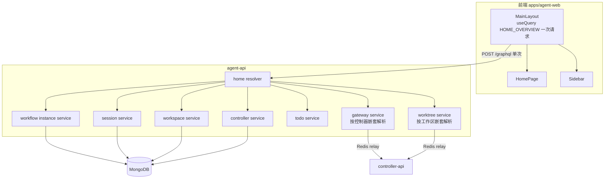
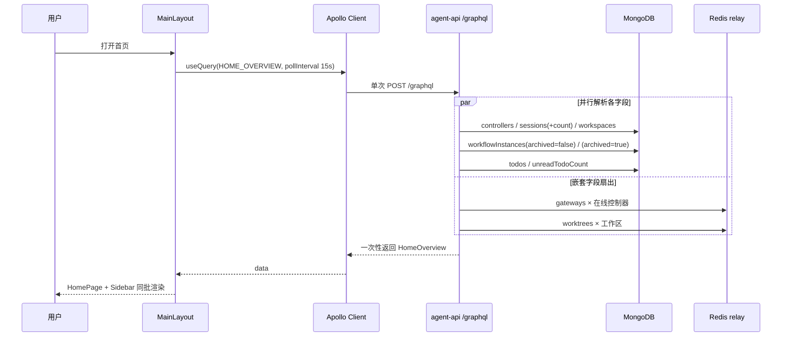

# 首页展示优化 - 技术提案

**功能名称**: 首页展示优化
**关联 PRD**: docs/product/draft/20261013-unified-home-display.md
**技术提案版本**: v1.0
**创建日期**: 2026-10-13
**作者**: Kimi
**feat-branch**: `feat/unified-home-display`

## 1. 概述

### 1.1 背景

PRD 提出两点诉求：工作流不再按工作区分散展示而是集中呈现，并支持按控制器索引工作区/会话/工作流；首页多路 GraphQL 调用整合为一次。本提案覆盖这两点的契约与实现设计。

### 1.2 现状分析

**首页请求现状（N+1 式）**：`apps/agent-web/src/pages/HomePage.tsx:12-17` 自身发 2 个查询（`GetSessions`、`GetControllers`），但桌面端 `pages/MainLayout.tsx:21-29` 同时挂载 `components/Sidebar.tsx`，后者还会发起：

| 查询 | 位置 | 数量 |
|------|------|------|
| `GetSessions` / `GetControllers` / `GetWorkspaces` | `Sidebar.tsx:55-63` | 3 |
| `GetWorkflowInstances`（活跃 + 归档各一次） | `Sidebar.tsx:430-437` | 2 × 工作区数 |
| `WorkspaceWorktrees` | `components/worktree/WorktreeSidebarGroup.tsx` | 1 × 工作区数 |
| `GetGateways` | `components/GatewaySection.tsx:22` | 1 × 在线控制器数 |
| `GetTodoList` / `GetUnreadTodoCount` | `components/TodoListPanel.tsx` | 2 |

即首页请求数 ≈ `3 + 3×工作区数 + 1×在线控制器数 + 2`，且全部 `pollInterval: 15000` 轮询。工作区/控制器越多请求越多。

**工作流按工作区绑定**：`GET_WORKFLOW_INSTANCES`（`graphql/workflow.ts:284`）强制要求 `workspaceId`；后端 `workflowInstances(workspaceId: ID!, archived: Boolean)`（`servers/agent-api/src/graphql/schemas/workflow.ts`）经 `services/workflow/instance.ts:50` `listForWorkspace` 过滤 `{userId, workspaceId, deletedAt: null, archivedAt}`，不存在跨工作区/按控制器的实例列表查询。

**控制器索引能力现状**：

| 诉求 | 现状 |
|------|------|
| 按控制器查工作区 | 已有 `controllerWorkspaces(controllerId: ID!)`，直接复用 |
| 按控制器查会话 | 无。`sessions` 查全部；`Session` 模型已有 `{controllerId, status}` 索引，补一个过滤参数即可 |
| 按控制器查工作流 | 无。`WorkflowInstance` 已存 `controllerId` 但未建索引，查询也不支持 |

**其他约束**：前端 GraphQL 类型全部手写（`graphql/types.ts`、`graphql/workflow.ts`，无 codegen），改契约需同步手写类型；后端 resolver 合并靠 `resolvers/index.ts` 手工枚举，新增 resolver 必须登记。

### 1.3 目标

- `workflowInstances` 支持跨工作区全量列举与按 `controllerId` 过滤。
- `sessions` 支持按 `controllerId` 过滤。
- 新增 `homeOverview` 聚合查询，首页（HomePage + Sidebar）首屏只发一次 GraphQL 请求，轮询每轮也仅一次。
- 前端侧边栏工作流改为集中列表，条目标注所属工作区与控制器。

### 1.4 范围

| 范围 | 内容 |
|------|------|
| 做 | `contracts/` 契约变更与新增；agent-api 三个查询能力（跨工作区工作流、按控制器会话、`homeOverview`）；前端首页/侧边栏改造 |
| 不做 | controller-api 与 agent-controller CLI 变更；工作流详情页查询（`GET_WORKFLOW_INSTANCE`）保持不变；网关/Worktree 的创建删除等变更类操作不变 |

## 2. 技术架构

### 2.1 系统架构图



### 2.2 技术栈

| 层级 | 技术选型 | 说明 |
|------|---------|------|
| 前端 | React 19 + TypeScript + Vite + Apollo Client v4 | 既有栈，无新依赖 |
| 后端 | Node.js 24 + Express v5 + GraphQL-Yoga + Mongoose | 既有栈 |
| 数据库 | MongoDB | 新增复合索引 |
| 测试 | Vitest（后端单测/API 测试）、Vitest + RTL（前端）、Playwright（E2E） | 沿用既有配置 |

### 2.3 模块划分

| 模块 | 职责 | 关键技术点 |
|------|------|-----------|
| `contracts/home.graphql`（新增） | `homeOverview` 聚合查询契约 | 契约先行 |
| `contracts/workflow.graphql` | `workflowInstances` 参数放宽 | `workspaceId` 改可选，新增 `controllerId` |
| `contracts/agent-session.graphql` | `sessions` 增加 `controllerId` 过滤 | 可选参数，向后兼容 |
| agent-api `schemas/home.ts` + `resolvers/home.ts` | 聚合查询，薄 resolver 组合既有 service | 嵌套字段（gateways/worktrees）惰性解析 |
| agent-api `services/workflow/instance.ts` | 新增 `listForUser` / 按 controllerId 过滤 | Mongo 复合索引 |
| agent-api `services/session.ts` | `list` 支持 controllerId | 复用既有 `{controllerId, status}` 索引 |
| 前端 `graphql/home.ts`（新增） | `HOME_OVERVIEW` 查询与手写类型 | 与契约人工对齐 |
| 前端 `pages/MainLayout.tsx` | 聚合查询挂载点，数据下传 HomePage/Sidebar | 单一 `pollInterval: 15000` |
| 前端 `components/Sidebar.tsx` | 工作流集中列表 | 条目展示所属工作区/控制器 |

## 3. API 设计

### 3.1 API 契约

#### 接口 1: `workflowInstances` 放宽过滤（改 `contracts/workflow.graphql`）

```graphql
type Query {
  workflowInstances(
    workspaceId: ID      # 由 ID! 改为可选；不传 = 跨工作区全量
    controllerId: ID     # 新增；按控制器过滤
    archived: Boolean
  ): [WorkflowInstance!]!
}
```

- `workspaceId` 与 `controllerId` 可同时传（取交集），也可都不传（当前用户全部实例）。
- `WorkflowInstance` 类型补充 `workspace` 与 `controller` 两个对象字段（或至少 `workspaceName` / `controllerName`），供集中列表展示归属，避免前端 N 次补齐。

#### 接口 2: `sessions` 按控制器过滤（改 `contracts/agent-session.graphql`）

```graphql
type Query {
  sessions(
    controllerId: ID              # 新增可选
    includeWorkflowSessions: Boolean
  ): [Session!]!
}
```

#### 接口 3: `homeOverview` 聚合查询（新增 `contracts/home.graphql`）

```graphql
type Query {
  homeOverview: HomeOverview!
}

type HomeOverview {
  controllers: [Controller!]!           # 控制器卡片 + 侧边栏顶层分组
  sessions: [Session!]!                 # 最近会话列表（活跃会话，不含 workflow 节点会话）
  sessionTotalCount: Int!               # 会话总数卡片
  workspaces: [ControllerWorkspace!]!   # 侧边栏工作区分组
  workflowInstances: [WorkflowInstance!]!      # 全部活跃工作流实例（跨工作区）
  archivedWorkflowInstances: [WorkflowInstance!]! # 归档实例（侧边栏折叠展示）
  todos: [TodoItem!]!
  unreadTodoCount: Int!
}

extend type Controller {
  gateways: GatewayList!   # 嵌套惰性解析：仅查询方请求时才按控制器逐个获取
}

extend type ControllerWorkspace {
  worktrees: [Worktree!]!  # 同上，复用 workspaceWorktrees 的服务链路
}
```

一次 `homeOverview` 请求即覆盖首页 + 侧边栏全部信息流；`gateways`/`worktrees` 需要经 Redis relay 调用在线控制器，设计为嵌套字段：首页查询语句中包含它们时后端才逐个控制器/工作区扇出，离线控制器对应字段返回空列表并置控制器 `status` 供前端标记。

### 3.2 内部接口

- `services/workflow/instance.ts`：`list(userId, { workspaceId?, controllerId?, archived? })` 取代/包装 `listForWorkspace`，resolver 层做参数归一。
- `services/session.ts`：`list(userId, { controllerId?, includeWorkflowSessions? })`。
- 新增 `services/home.ts`？不新增——`homeOverview` resolver 直接并行 `Promise.all` 调用上述既有 service，保持薄 resolver 原则，无需新 service 层。

## 4. 数据模型

### 4.1 数据库设计

无 schema 字段变更。`WorkflowInstance` 补充复合索引以支撑新查询：

| 集合 | 索引 | 说明 |
|------|------|------|
| `workflowinstances` | `{ userId: 1, archivedAt: 1, createdAt: -1 }` | 跨工作区全量列表（活跃/归档分开查） |
| `workflowinstances` | `{ userId: 1, controllerId: 1, archivedAt: 1, createdAt: -1 }` | 按控制器过滤（`controllerId` 当前未建索引） |

`Session` 复用已有 `{ controllerId: 1, status: 1 }` 与 `{ userId: 1, createdAt: -1 }` 索引，不新增。

### 4.2 缓存设计

- 前端 Apollo `InMemoryCache` 默认归一化即可；`homeOverview` 作为整体查询对象不跨查询复用缓存键，轮询直接覆盖。
- 后端不引入 Redis 缓存层：聚合内容是多个 `userId` 维度的 Mongo 查询并行执行，索引到位后耗时可控；`gateways`/`worktrees` 本来就是实时性数据，不缓存。

## 5. 技术实现方案

### 5.1 核心流程



### 5.2 关键实现点

#### 实现点 1: `workflowInstances` 参数放宽

- **描述**: schema 中 `workspaceId: ID!` 改为 `ID`，新增 `controllerId: ID`；service 层按传入参数动态组装过滤条件，恒有 `{ userId, deletedAt: null }`。
- **技术细节**: `WorkflowInstance` 类型增加 `workspace`/`controller` 字段 resolver（按 `workspaceId`/`controllerId` 查模型取名称），集中列表直接展示归属。注意按 `docs/engineering/backend-rules.md`，类型级 resolver 必须在 `resolvers/index.ts` 登记。
- **风险点**: 旧前端仍按 `workspaceId` 调用，参数放宽向后兼容，无需迁移。

#### 实现点 2: `homeOverview` 聚合 resolver

- **描述**: 新增 `schemas/home.ts` / `resolvers/home.ts`，`homeOverview` 字段 resolver 用 `Promise.all` 并行调用既有 service；`Controller.gateways`、`ControllerWorkspace.worktrees` 为嵌套字段 resolver，仅在查询语句选择时执行。
- **技术细节**: 离线控制器的 `gateways`/`worktrees` 扇出需做空值兜底并依赖控制器 `status` 字段让前端置灰，避免单个控制器超时拖垮整次查询（单路调用自带超时，错误降级为空列表）。聚合查询期间任一分支失败时按 GraphQL 部分数据语义返回（字段置 null + errors），前端各区块独立判空。
- **风险点**: 工作区很多时 `worktrees` 扇出是 1×N 的 Redis relay 调用，单次请求服务端耗时上升；通过并发扇出 + 既有超时兜底控制，后续如有需要再对 worktrees 做开关（首页查询语句不选择该字段，仅侧边栏展开时单独查）。

#### 实现点 3: 前端聚合查询挂载点与组件改造

- **描述**: `HOME_OVERVIEW` 查询提升到 `MainLayout`，以 props/context 下传给 `HomePage` 与 `Sidebar`；各子组件删除自身的信息流查询（`GetSessions`/`GetControllers`/`GetWorkspaces`/`GetWorkflowInstances`/`GetTodoList`/`GetUnreadTodoCount`/`GetGateways`/`WorkspaceWorktrees`）。
- **技术细节**:
  - 加载态按 `frontend-rules.md` 写成 `loading && !data`，避免 15s 轮询卸载整页。
  - `HomePage` 的「会话总数」「最近会话（前 5）」由 `sessionTotalCount` + `sessions` 前端排序截取得到，逻辑与现状一致。
  - `Sidebar` 工作流分组：每个控制器节点下渲染该控制器全部工作流实例（`controllerId` 过滤或直接前端按 `instance.controllerId` 分组），不再按工作区拆 `WorkflowSidebarGroupInline`；条目增加一行所属工作区/控制器辅助信息，沿用既有样式。
  - 手写类型同步：`graphql/types.ts` 增加 `HomeOverview` 等类型，`graphql/workflow.ts` 的 `GetWorkflowInstances` 变量类型放宽。
- **风险点**: 设置页等页面仍使用 `GET_CONTROLLER_WORKSPACES` 等既有查询，不受影响；需全局检索被删除查询的其余引用。

## 6. 技术决策

### 6.1 决策列表

| 决策 | 选项 A | 选项 B | 最终选择 | 原因 |
|------|--------|--------|---------|------|
| 首页一次调用的实现方式 | 新增 `homeOverview` 聚合查询 | Apollo batching 合并多个查询 | A | batching 只是传输层合并，resolver 仍逐查询执行且字段去重依赖 cache 配置；聚合查询符合「聚合信息应尽早沉淀」的后端规则，且查询语句可控（不需要的嵌套字段不解析） |
| 跨工作区工作流查询形态 | 放宽 `workflowInstances` 参数 | 新增 `allWorkflowInstances` 查询 | A | 语义同一，参数可选天然向后兼容，旧调用方零改动 |
| 会话按控制器索引 | `sessions(controllerId)` 过滤参数 | 前端全量拉取后过滤 | A | Session 已有 controllerId 索引，服务端过滤成本极低；与「按 controller 索引」诉求一致 |
| 网关/Worktree 是否纳入聚合 | 作为 `homeOverview` 嵌套字段惰性解析 | 保持独立查询 | A | 只有纳入同一查询才能实现「首页一次请求」；惰性解析保证不需要时不扇出 |

### 6.2 依赖与约束

| 类型 | 内容 | 说明 |
|------|------|------|
| 依赖 | 既有 controller/workspace/session/workflow/todo/gateway service | 聚合 resolver 只组合，不改其业务逻辑 |
| 约束 | 前端 GraphQL 类型手写 | 契约变更必须同步 `graphql/types.ts`、`graphql/workflow.ts` |
| 约束 | resolver 手工合并 | 新增 `home` resolver 与 `WorkflowInstance` 字段 resolver 必须登记进 `resolvers/index.ts` |
| 约束 | 契约先行 | 先改 `contracts/`，再实现，遵循 z-coding 流程 |

## 7. 项目结构

```
contracts/
├── home.graphql                  # 新增：homeOverview 聚合查询
├── workflow.graphql              # 改：workflowInstances 参数放宽
└── agent-session.graphql         # 改：sessions 增加 controllerId

servers/agent-api/src/
├── graphql/
│   ├── schemas/home.ts           # 新增
│   ├── schemas/workflow.ts       # 改：参数签名
│   ├── schemas/session.ts        # 改：sessions 参数
│   ├── resolvers/home.ts         # 新增：聚合 resolver
│   ├── resolvers/workflow.ts     # 改：过滤参数 + 字段 resolver
│   └── resolvers/index.ts        # 改：登记 home 与字段 resolver
├── services/
│   ├── workflow/instance.ts      # 改：list 支持 workspaceId?/controllerId?
│   └── session.ts                # 改：list 支持 controllerId
└── models/workflow-instance.ts   # 改：新增复合索引

apps/agent-web/src/
├── graphql/home.ts               # 新增：HOME_OVERVIEW + 手写类型
├── graphql/types.ts              # 改：HomeOverview 等类型
├── graphql/workflow.ts           # 改：变量类型放宽
├── pages/MainLayout.tsx          # 改：挂载聚合查询并下传
├── pages/HomePage.tsx            # 改：消费下传数据，删除自身查询
└── components/Sidebar.tsx        # 改：工作流集中列表 + 删除按工作区查询
```

## 8. 测试策略

### 8.1 测试覆盖要求

- 单元测试覆盖率维持 >= 80%。
- API 测试覆盖：`workflowInstances`（无参数全量 / 仅 workspaceId / 仅 controllerId / 双参交集 / archived）、`sessions(controllerId)`、`homeOverview`（全字段 + 离线控制器降级 + 部分失败语义）。

### 8.2 测试类型

| 类型 | 工具 | 覆盖范围 |
|------|------|---------|
| 后端单元测试 | Vitest | instance/session service 过滤条件组装；home resolver 组合逻辑 |
| API 测试 | Vitest + 真实 Mongo（tests/api 既有框架） | 上述三个查询的端到端断言，含混合数据（多工作区/多控制器） |
| 前端单元测试 | Vitest + React Testing Library | MainLayout 单次查询下传；Sidebar 集中列表渲染与归属标注；`loading && !data` 轮询不卸载 |
| E2E 测试 | Playwright（tests/e2e 既有框架） | 首页加载仅一次 /graphql 请求（拦截计数）；工作流集中展示与跳转；轮询每轮一次请求 |

TDD 流程：先改契约 → 写 API 测试（红）→ 实现后端（绿）→ 前端改造 + 组件测试 → E2E 验收。

## 9. 部署方案

无部署变更。Mongo 新索引随服务启动由 Mongoose 自动建立（`autoIndex`），无需迁移脚本。前后端可分两次发布：先发后端（新查询对旧前端无影响），再发前端。

## 10. 验收标准

- [ ] 技术方案评审通过
- [ ] Contract 评审通过（`contracts/home.graphql`、`workflow.graphql`、`agent-session.graphql`）
- [ ] 代码实现完成
- [ ] 单元测试覆盖达标
- [ ] API 测试通过
- [ ] E2E 测试通过（首页单次请求断言）
- [ ] PRD 验收标准逐条核对通过

## 11. 相关文档

- 关联 PRD：`docs/product/draft/20261013-unified-home-display.md`
- 关联 Contract：`contracts/home.graphql`（新增）、`contracts/workflow.graphql`、`contracts/agent-session.graphql`
- 开发规范：`docs/engineering/common-rules.md`、`frontend-rules.md`、`backend-rules.md`
