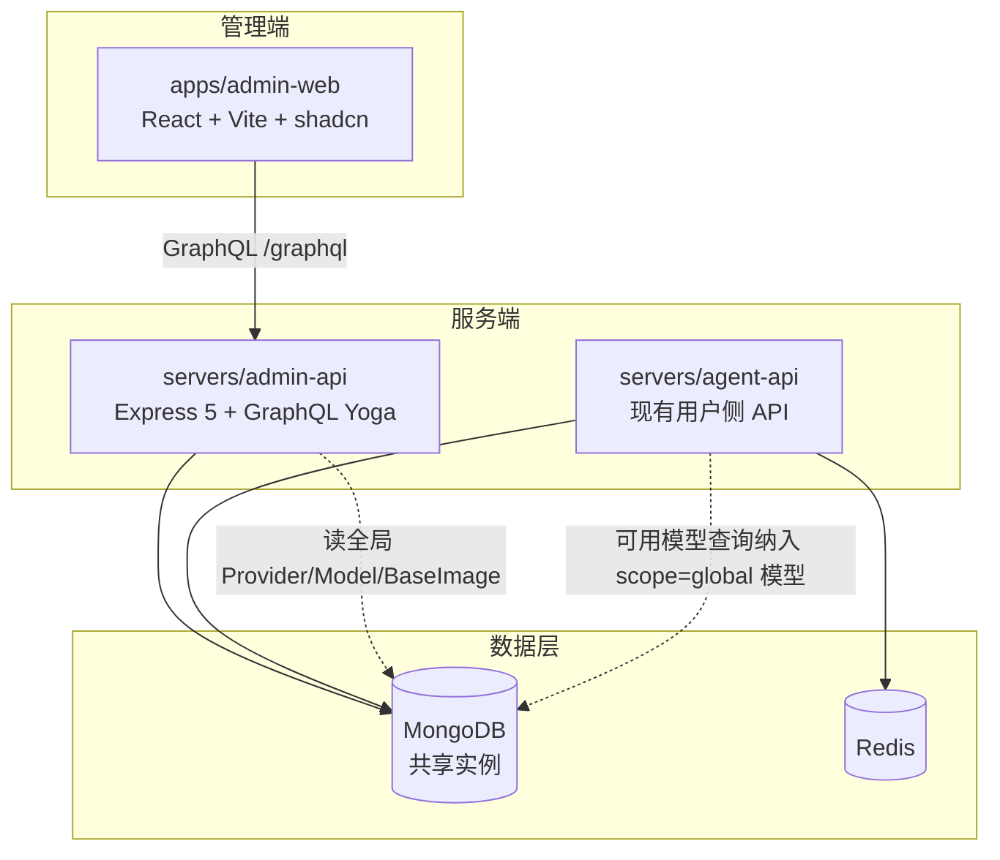
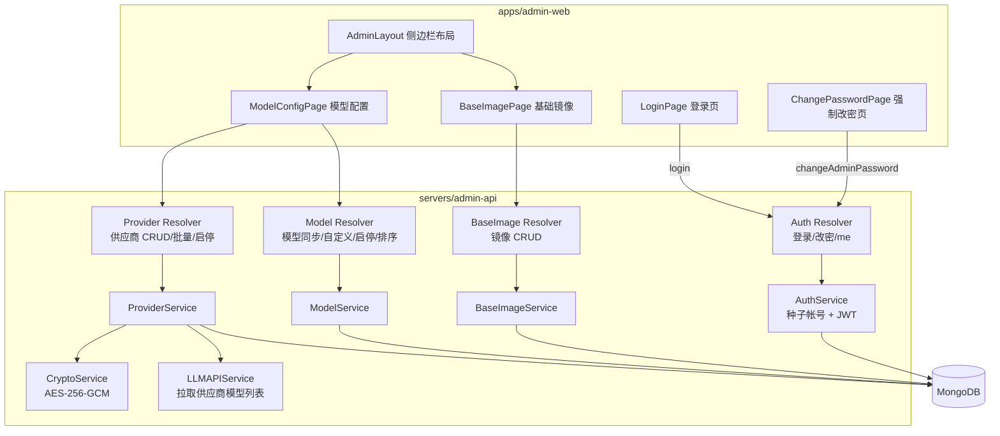
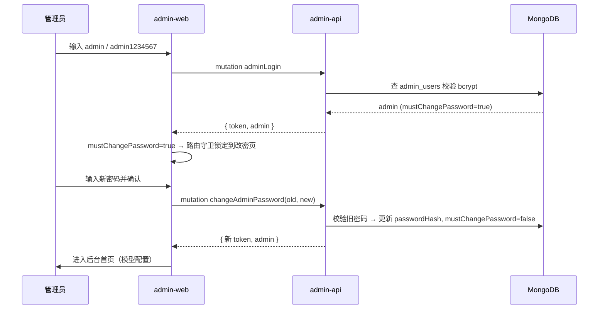
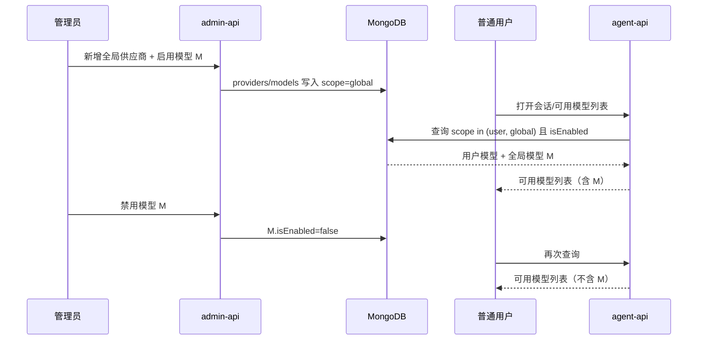

# 云控制器管理后台一期 - 技术提案

**功能名称**: 云控制器管理后台
**关联 PRD**: `docs/product/draft/20261014-admin-console.md`
**技术提案版本**: v1.0
**创建日期**: 2026-10-14
**作者**: Kimi
**feat-branch**: `feat/admin-console`

## 1. 概述

### 1.1 背景

依据 PRD `20261014-admin-console.md`，系统将从「仅支持本地控制器」逐步迭代到云上控制器，本期先搭建管理后台：新增独立的管理后台 API 项目与管理前端项目，提供管理员登录（首次强制改密）、全局大模型供应商与可用模型配置、基础镜像 Dockerfile 管理三项能力。

### 1.2 目标

- 新增后端项目 `servers/admin-api`：Express 5 + GraphQL Yoga + Mongoose，与现有服务共用同一 MongoDB
- 新增前端项目 `apps/admin-web`：React 19 + Vite + Tailwind v4 + shadcn，左侧边栏 + 右内容经典后台布局
- 实现管理员认证：内置 `admin` 帐号种子、JWT 登录、首次登录强制改密，不开放注册
- 实现全局供应商/模型管理：复用现有 Provider/Model 数据结构与交互范式，新增 `scope` 字段区分用户级与全局级配置，全局启用模型对 agent-api 所有用户可见
- 实现基础镜像 Dockerfile CRUD（不含镜像构建）

### 1.3 范围

- 包含：`admin-api` 与 `admin-web` 项目搭建、管理员登录与强制改密、全局供应商/模型 CRUD 与启停排序、基础镜像 CRUD、agent-api 可用模型查询纳入全局模型、Aspire 编排接入、API 测试与 E2E 测试
- 不包含：镜像构建与推送、多管理员/角色权限体系、管理员操作审计日志、移动端适配、云上控制器本体

## 2. 技术架构

### 2.1 系统架构图



admin-api 与 agent-api 共用同一 MongoDB 实例（与 controller-api 的做法一致），全局配置通过共享集合 + `scope` 字段生效；admin-api 不依赖 Redis，admin-web 与 agent-web 完全独立部署、独立域名/端口。

### 2.2 技术栈

| 层级 | 技术选型 | 说明 |
|------|---------|------|
| 前端 | React 19 + TypeScript + Vite 8 | 与 apps/agent-web 对齐 |
| 前端 UI | Tailwind CSS v4 + shadcn (@base-ui/react) + lucide-react + sonner | 与 agent-web 同一套组件体系 |
| 前端路由 | react-router-dom ^7 | 与 agent-web 对齐 |
| 前端 GraphQL | Apollo Client ^4 | 与 agent-web 对齐 |
| 后端 | Express 5 + graphql-yoga 5 + TypeScript 6 + tsx | 与 servers/agent-api 对齐 |
| 后端认证 | jsonwebtoken + bcryptjs | JWT 有效期 7d，独立密钥 `ADMIN_JWT_SECRET` |
| 后端加密 | Node.js `crypto` AES-256-GCM | 供应商凭据加密，复用 agent-api 同款实现 |
| 数据库 | MongoDB 7 + Mongoose 9 | 与现有服务共享实例 |
| 编排 | .NET Aspire AppHost | 注册 admin-api / admin-web |
| 测试 | Vitest（API）+ Playwright（E2E） | 沿用 tests/api 与 tests/e2e 结构 |

### 2.3 模块划分



| 模块 | 职责 | 关键技术点 |
|------|------|-----------|
| admin-api AuthService | 管理员种子初始化、登录校验、签发 JWT、改密 | 启动时确保 admin 帐号存在且 `mustChangePassword=true`；bcrypt SALT_ROUNDS=10 |
| admin-api Provider/Model Service | 全局供应商与模型管理 | 逻辑复刻 agent-api 现有 service，数据写入 `scope: 'global'` |
| admin-api BaseImageService | 基础镜像 CRUD | 名称唯一索引 |
| admin-api LLMAPIService | 调 OpenAI/Anthropic SDK 拉模型列表 | 复用 openai / @anthropic-ai/sdk 官方 SDK |
| admin-web AdminLayout | 侧边栏 + 内容区布局、路由守卫 | 未登录跳登录页；`mustChangePassword` 时强制锁定在改密页 |
| agent-api 模型查询改造 | 可用模型纳入全局模型 | 查询条件由「用户模型」放宽为 `scope in (user, global)` |

## 3. API 设计

### 3.1 API 契约

新增三个契约文件，遵循 Contract-First：

- `contracts/admin-auth.graphql` — 管理员认证
- `contracts/admin-llm.graphql` — 全局供应商与模型
- `contracts/admin-base-image.graphql` — 基础镜像

#### contracts/admin-auth.graphql

```graphql
type AdminUser {
  id: ID!
  username: String!
  mustChangePassword: Boolean!
  createdAt: String!
  updatedAt: String!
}

type AdminAuthPayload {
  token: String!
  admin: AdminUser!
}

type Query {
  adminMe: AdminUser
}

type Mutation {
  # 登录；不存在注册 mutation
  adminLogin(username: String!, password: String!): AdminAuthPayload!
  # 修改密码（需已登录）；成功后 mustChangePassword=false 并签发新 token
  changeAdminPassword(oldPassword: String!, newPassword: String!): AdminAuthPayload!
}
```

#### contracts/admin-llm.graphql

在 `contracts/llm.graphql` 的 Provider/Model 结构基础上，字段语义保持一致，差异是所有操作作用于 `scope = 'global'` 的数据：

```graphql
# type Provider / Model / ProviderType / CredentialType / ProviderInput / CustomModelInput
# 与 contracts/llm.graphql 保持一致；Provider、Model 上新增 scope 字段

enum ConfigScope {
  user
  global
}

type Query {
  adminProviders: [Provider!]!        # 仅 scope=global
  adminModels: [Model!]!              # 仅 scope=global
  adminModelsByProvider(providerId: ID!): [Model!]!
}

type Mutation {
  createGlobalProvider(input: ProviderInput!): Provider!
  updateGlobalProvider(id: ID!, input: ProviderInput!): Provider!
  deleteGlobalProvider(id: ID!): Boolean!
  toggleGlobalProvider(id: ID!): Provider!
  batchEnableGlobalProviders(ids: [ID!]!): ProviderBatchPayload!
  batchDisableGlobalProviders(ids: [ID!]!): ProviderBatchPayload!
  batchDeleteGlobalProviders(ids: [ID!]!): ProviderBatchPayload!
  createGlobalCustomModel(input: CustomModelInput!): Model!
  deleteGlobalCustomModel(id: ID!): Model!
  toggleGlobalModel(id: ID!): Model!
  updateGlobalModelSortOrder(ids: [ID!]!): [Model!]!
}
```

行为规则与现有用户侧一致：保存供应商前先调供应商 API 校验连通性（失败不保存）、凭据 AES-256-GCM 加密存储与脱敏返回（前 3 后 4）、删除供应商级联删除其模型、禁用供应商级联禁用其模型。

#### contracts/admin-base-image.graphql

```graphql
type BaseImage {
  id: ID!
  name: String!
  description: String
  dockerfile: String!
  createdAt: String!
  updatedAt: String!
}

input BaseImageInput {
  name: String!
  description: String
  dockerfile: String!
}

type Query {
  baseImages: [BaseImage!]!
  baseImage(id: ID!): BaseImage
}

type Mutation {
  createBaseImage(input: BaseImageInput!): BaseImage!   # name 唯一，重名报错
  updateBaseImage(id: ID!, input: BaseImageInput!): BaseImage!
  deleteBaseImage(id: ID!): Boolean!
}
```

所有 Query/Mutation 均要求管理员 JWT 鉴权（`Authorization: Bearer <token>`），未认证返回 `UNAUTHENTICATED`。

### 3.2 内部接口

- admin-api 与 agent-api 之间**无运行时调用**，仅通过共享 MongoDB 集合（`providers`、`models`）交互。
- agent-api 侧改造：用户侧「可用模型」相关查询（`models`、`modelsByProvider`、会话可用模型列表）在原有条件基础上并入 `scope: 'global'` 且 `isEnabled: true` 的模型；用户侧写操作仍只允许 `scope: 'user'` 的数据，防止普通用户改动全局配置。

## 4. 数据模型

### 4.1 数据库设计

#### 集合: admin_users（新增）

| 字段 | 类型 | 说明 |
|------|------|------|
| _id | ObjectId | 主键 |
| username | String, unique, required | 管理员帐号名（种子：`admin`） |
| passwordHash | String, required | bcrypt 哈希（SALT_ROUNDS=10） |
| mustChangePassword | Boolean, default: true | 首次登录强制改密标记 |
| createdAt / updatedAt | Date | 时间戳 |

种子逻辑：admin-api 启动时若 `admin_users` 为空，则插入 `admin` / `admin1234567`（bcrypt 哈希）、`mustChangePassword: true`。

#### 集合: providers（改造，新增字段）

| 字段 | 类型 | 说明 |
|------|------|------|
| scope | String, enum: user/global, default: user, index | 新增：配置归属；admin-api 写入 `global`，agent-api 存量数据默认 `user` 无需迁移 |

其余字段不变（name/type/endpoint/encryptedCredential/isEnabled 等，见 `servers/agent-api/src/models/provider.ts`）。

#### 集合: models（改造，新增字段）

| 字段 | 类型 | 说明 |
|------|------|------|
| scope | String, enum: user/global, default: user, index | 新增：随所属 Provider 写入 |

其余字段不变（providerId/name/isCustom/isEnabled/sortOrder）。复合唯一索引 `{providerId, name}` 保持不变（providerId 已隐含 scope）。

#### 集合: base_images（新增）

| 字段 | 类型 | 说明 |
|------|------|------|
| _id | ObjectId | 主键 |
| name | String, unique, required | 镜像名称 |
| description | String | 描述 |
| dockerfile | String, required | Dockerfile 文本内容 |
| createdAt / updatedAt | Date | 时间戳 |

### 4.2 缓存设计

- 数据量小，直接查库，不引入缓存；后续如需优化全局模型查询可加 Redis 缓存。

## 5. 技术实现方案

### 5.1 核心流程

#### 登录与首次强制改密



#### 全局模型对用户生效



### 5.2 关键实现点

#### 实现点 1: admin-api 项目骨架

- **描述**: 新建 `servers/admin-api`，结构与 agent-api 对齐：`src/index.ts`（Express + yoga 挂载 `/graphql` + `/health`）、`config/`、`models/`、`graphql/schemas|resolvers/`、`services/`、`middleware/auth.ts`
- **技术细节**: 鉴权中间件复刻 agent-api `authenticateUser`，改为校验 `ADMIN_JWT_SECRET` 签发的 JWT 并查 `admin_users`，注入 context `currentAdmin`；resolver 层统一要求 `currentAdmin` 非空
- **风险点**: 与 agent-api 共用 MongoDB 但模型定义各自维护，需保证 Provider/Model schema 字段一致（新增 scope 字段两处同步）

#### 实现点 2: 管理员种子与强制改密

- **描述**: 服务启动时确保默认管理员存在；登录返回 `mustChangePassword`，前端据此锁定改密页
- **技术细节**: 种子在 `index.ts` 启动流程中执行（幂等：`admin_users` 非空则跳过）；`changeAdminPassword` 校验旧密码、新密码长度 ≥ 10，成功后签发新 token；前端 `ProtectedRoute` 同时校验「已登录」与「非 mustChangePassword」，后者不满足时重定向到 `/change-password`，改密页不渲染侧边栏
- **风险点**: 默认密码硬编码在种子逻辑中，仅在初始化时生效；文档中要求部署后第一时间改密

#### 实现点 3: 全局供应商/模型（scope 机制）

- **描述**: Provider/Model 增加 `scope` 字段，admin-api 全权管理 `global` 数据，agent-api 读时并入
- **技术细节**: admin-api 的 Provider/Model service 复刻 agent-api 实现（含连通性校验、级联启停/删除、拖拽排序），所有查询强制 `scope: 'global'` 条件；agent-api 侧读查询并入 `scope: 'global'`，写路径补充校验禁止操作非 `user` 数据；Mongoose schema 默认值 `user`，存量数据零迁移
- **风险点**: 两处 schema 需同步演进，后续考虑抽公共包（本期不做）

#### 实现点 4: admin-web 后台布局与页面

- **描述**: 新建 `apps/admin-web`，经典左侧边栏 + 右内容布局
- **技术细节**: 技术栈对齐 agent-web（Vite + React 19 + Tailwind v4 + shadcn + Apollo Client + react-router v7）；路由：`/login`、`/change-password`，受保护布局 `AdminLayout` 下 `/models`（模型配置）、`/base-images`（基础镜像）；侧边栏含模块导航（当前项高亮）与退出登录；模型配置页复刻 agent-web 设置页「供应商设置 / 可用模型」交互（批量操作、拖拽排序用 @dnd-kit）；基础镜像页为列表 + 表单对话框（Dockerfile 使用等宽字体 textarea，删除二次确认）
- **风险点**: 组件从 agent-web 复制后独立演进，避免直接跨项目 import

#### 实现点 5: Aspire 编排接入

- **描述**: `aspire/AgentGear.AppHost/AppHost.cs` 注册 admin-api 与 admin-web
- **技术细节**: admin-api `AddNodeApp` 引用 mongodb、注入 `ADMIN_JWT_SECRET`、`CREDENTIAL_ENCRYPTION_KEY`，dev 端口 10003 / publish 8002；dev 模式 `AddViteApp("admin-web")` 注入 `VITE_ADMIN_API_URL`；admin-web vite dev 代理 `/graphql` → admin-api

## 6. 技术决策

### 6.1 决策列表

| 决策 | 选项 A | 选项 B | 最终选择 | 原因 |
|------|--------|--------|---------|------|
| 后台 API 形态 | 新建独立 admin-api 项目 | 在 agent-api 中增加 admin 域 | 独立项目 | PRD 要求独立管理服务；与普通用户流量隔离，便于后续云上部署 |
| 数据库 | 与现有服务共享 MongoDB | 独立 MongoDB 实例 | 共享实例 | 全局配置需被 agent-api 读取；与 controller-api 做法一致 |
| 全局模型生效方式 | Provider/Model 加 `scope` 字段共享集合 | 新建 globalProviders 独立集合 | `scope` 字段 | 复用现有 schema/索引/级联逻辑，agent-api 改动最小，存量零迁移 |
| 管理员体系 | 独立 admin_users 集合 | 复用 users 加 role 字段 | 独立集合 | 后台与用户体系完全分离，无注册、无角色蔓延；后续多管理员再扩展 |
| 认证密钥 | 独立 `ADMIN_JWT_SECRET` | 复用 `JWT_SECRET` | 独立密钥 | 用户 token 与管理员 token 不可互认，泄露面隔离 |
| 前端组件库 | shadcn + Tailwind（对齐 agent-web） | 引入 Ant Design | shadcn | 与现有前端同栈，降低维护成本，PRD 允许自选 |
| Dockerfile 编辑 | 等宽字体 textarea | 引入 Monaco Editor | textarea | 本期仅 CRUD 纯文本，不引入重型编辑器依赖 |

### 6.2 依赖与约束

| 类型 | 内容 | 说明 |
|------|------|------|
| 依赖 | Express 5 / graphql-yoga / mongoose / jsonwebtoken / bcryptjs | admin-api，版本对齐 agent-api |
| 依赖 | openai / @anthropic-ai/sdk | 供应商模型列表拉取 |
| 依赖 | React 19 / Vite / Tailwind v4 / shadcn / Apollo Client / react-router-dom | admin-web，版本对齐 agent-web |
| 依赖 | @dnd-kit/core + @dnd-kit/sortable | 模型拖拽排序 |
| 约束 | 遵循 `docs/engineering/common-rules.md`、`backend-rules.md`、`frontend-rules.md` | Contract-First + TDD |
| 约束 | 契约先行：`contracts/admin-*.graphql` 先于实现提交 | |
| 约束 | 密码与凭据不得明文存储/展示 | bcrypt + AES-256-GCM + 脱敏 |
| 约束 | 不开放注册接口；不提供任何用户自助入口 | |
| 约束 | 本期不做镜像构建、不做移动端适配 | |

## 7. 项目结构

```
# 新增后端 servers/admin-api
servers/admin-api/
├── package.json                # name: admin-api，对齐 agent-api 依赖版本
├── tsconfig.json
├── src/
│   ├── index.ts                # Express + yoga /graphql + /health + 管理员种子
│   ├── config/index.ts         # PORT(默认4002) / MONGODB_URI / ADMIN_JWT_SECRET / CREDENTIAL_ENCRYPTION_KEY / CORS_ORIGIN
│   ├── models/
│   │   ├── admin-user.ts       # AdminUser（mustChangePassword）
│   │   ├── provider.ts         # Provider（scope 字段，与 agent-api 同步）
│   │   ├── model.ts            # Model（scope 字段）
│   │   └── base-image.ts       # BaseImage
│   ├── graphql/
│   │   ├── schemas/            # auth.ts / provider.ts / model.ts / base-image.ts / index.ts
│   │   └── resolvers/          # 同名对应
│   ├── services/
│   │   ├── auth.ts             # 种子、登录、改密、JWT
│   │   ├── provider.ts         # scope=global 供应商 CRUD + 批量 + 级联
│   │   ├── model.ts            # scope=global 模型管理 + 排序
│   │   ├── base-image.ts       # 镜像 CRUD
│   │   ├── crypto.ts           # AES-256-GCM（复刻 agent-api）
│   │   └── llm-api.ts          # OpenAI/Anthropic 模型列表拉取
│   └── middleware/
│       └── auth.ts             # authenticateAdmin（ADMIN_JWT_SECRET）
└── vitest 单测与源码同目录

# 新增前端 apps/admin-web
apps/admin-web/
├── package.json                # name: admin-web
├── vite.config.ts              # dev 代理 /graphql → admin-api
├── src/
│   ├── main.tsx / App.tsx
│   ├── pages/
│   │   ├── LoginPage.tsx
│   │   ├── ChangePasswordPage.tsx
│   │   ├── ModelConfigPage.tsx     # 供应商设置 + 可用模型（全局）
│   │   └── BaseImagePage.tsx       # 基础镜像 CRUD
│   ├── components/
│   │   ├── AdminLayout.tsx         # 左侧边栏 + Outlet 内容区 + 退出登录
│   │   ├── ProtectedRoute.tsx      # 登录态 + mustChangePassword 守卫
│   │   ├── providers/              # ProviderSection / ProviderFormDialog / BatchActionBar ...
│   │   ├── models/                 # ModelSection / CustomModelDialog（@dnd-kit 排序）
│   │   ├── base-images/            # BaseImageTable / BaseImageFormDialog / DeleteConfirmDialog
│   │   └── ui/                     # shadcn 组件
│   ├── graphql/                # queries.ts / mutations.ts
│   ├── stores/auth.ts            # 管理员登录态（token + mustChangePassword）
│   └── lib/apollo.ts
└── index.html

# 修改
servers/agent-api/
└── src/
    ├── models/provider.ts / model.ts   # 新增 scope 字段（default: user）
    ├── graphql/schemas/provider.ts / model.ts  # type 增加 scope
    └── services/model.ts               # 可用模型查询并入 scope=global；写操作限制 scope=user

contracts/
├── admin-auth.graphql          # 新增
├── admin-llm.graphql           # 新增
└── admin-base-image.graphql    # 新增

aspire/AgentGear.AppHost/
└── AppHost.cs                  # 注册 admin-api（10003/8002）与 admin-web（ViteApp）

tests/
├── api/src/admin-api/          # 新增：auth / provider / model / base-image 套件
└── e2e/src/                    # 新增：admin-auth、admin-model-config、admin-base-image spec
```

## 8. 测试策略

### 8.1 测试覆盖要求

- 单元测试覆盖率 >= 80%（admin-api services、crypto、auth）
- API 测试覆盖：admin-auth（登录/改密/守卫）、admin-llm（供应商与模型全部 mutation/query、scope 隔离）、admin-base-image（CRUD、重名冲突）、agent-api 回归（用户可用模型含全局模型、用户不可写全局数据）

### 8.2 测试类型

| 类型 | 工具 | 覆盖范围 |
|------|------|---------|
| 后端单元测试 | Vitest | auth 种子与改密、crypto 加解密、级联启停逻辑 |
| API 集成测试 | Vitest（tests/api，真实 MongoDB） | admin-api 全部端点 + agent-api scope 回归 |
| E2E 测试 | Playwright（tests/e2e） | 首次登录强制改密流程、供应商/模型配置、基础镜像 CRUD、侧边栏导航与退出 |

## 9. 部署方案

### 9.1 环境规划

| 环境 | 用途 | 部署方式 |
|------|------|---------|
| 本地开发 | 日常开发 | `aspire start` 统一拉起（admin-api: 10003，admin-web: Vite dev） |
| 容器部署 | 类生产验证 | `aspire publish` 生成 docker-compose（admin-api: 8002 + admin-web 静态托管） |

### 9.2 配置管理

| 配置项 | 说明 | 是否必填 |
|--------|------|---------|
| `PORT` | admin-api 端口，默认 4002 | 否 |
| `MONGODB_URI` | 共享 MongoDB 连接串 | 是 |
| `ADMIN_JWT_SECRET` | 管理员 JWT 签名密钥 | 是 |
| `CREDENTIAL_ENCRYPTION_KEY` | 供应商凭据 AES-256 密钥（32 字节 hex） | 是 |
| `CORS_ORIGIN` | admin-web 来源 | 是 |
| `VITE_ADMIN_API_URL` | admin-web 指向的 admin-api 地址 | 是（前端） |

## 10. 验收标准

- [ ] 技术方案评审通过
- [ ] Contract（admin-auth / admin-llm / admin-base-image）评审通过
- [ ] 代码实现完成（admin-api + admin-web + agent-api scope 改造 + Aspire 编排）
- [ ] 单元测试覆盖达标（>= 80%）
- [ ] API 测试通过（含 agent-api 回归）
- [ ] E2E 测试通过（首次改密、模型配置全局生效、基础镜像 CRUD）

## 11. 相关文档

- [关联 PRD](../../product/draft/20261014-admin-console.md)
- [LLM 供应商与模型管理技术提案（交互与实现范式参考）](./20260517-feat-llm-provider-settings.md)
- [通用开发规范](../common-rules.md)
- [后端规范](../backend-rules.md)
- [前端规范](../frontend-rules.md)
