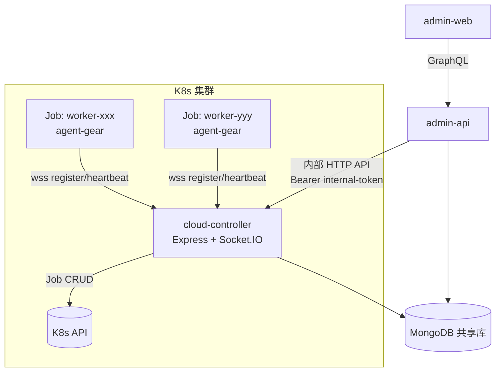
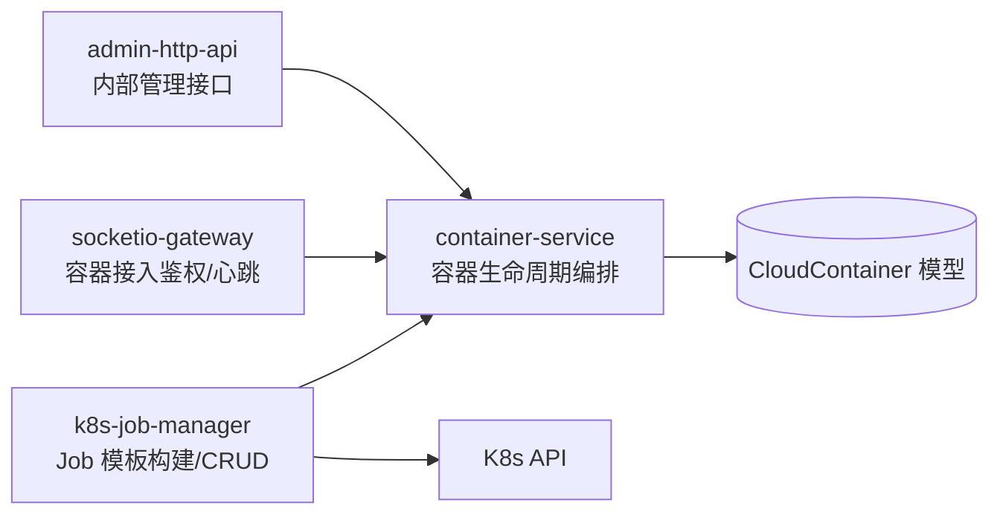
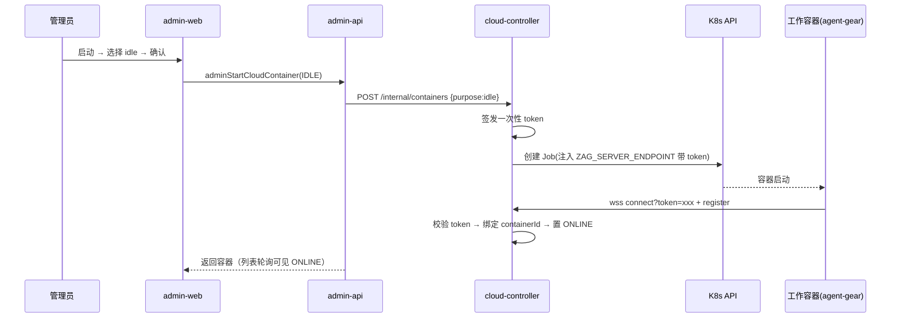
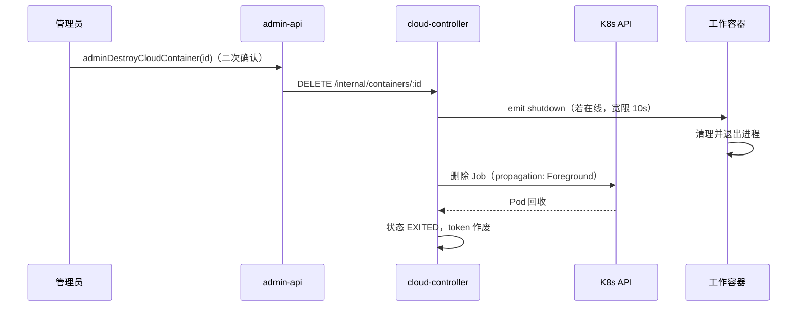

# 云Agent二期：云端工作容器（cloud-controller） - 技术提案

**功能名称**: 云Agent二期 —— K8s 云端工作容器管理
**关联 PRD**: `docs/product/draft/20261014-cloud-agent-phase2.md`
**技术提案版本**: v1.0
**创建日期**: 2026-10-14
**作者**: ZeroAsh
**feat-branch**: `feat/cloud-agent-phase2`

## 1. 概述

### 1.1 背景

云控制器管理后台一期（`feat/admin-console`，PR #203/#204）已交付独立的 admin-api / admin-web。本提案实现其后续需求：在 K8s 集群内部署 cloud-controller 服务，通过 K8s API 在指定命名空间以 Job 形式管理工作容器；工作容器使用标准化镜像，启动后通过环境变量注入的通讯地址（含一次性鉴权 token）以 agent-gear 回连 cloud-controller 并接受控制；管理后台提供容器列表、idle 测试启动与强制销毁。

当前仓库无任何 K8s 相关代码与依赖，cloud-controller 从零建设；容器与 controller 的通讯复用现有 `agent-controller-websocket` 协议（Socket.IO，`register`/`heartbeat`/`shutdown` 等事件）。

### 1.2 目标

- 新增 `servers/cloud-controller/` 服务：K8s Job 生命周期管理 + Socket.IO 容器接入网关 + 供 admin-api 调用的内部管理 API。
- 新增默认工作容器镜像（Dockerfile），预装 Node.js/Git/gh/buildx/sysbox 与 7 个 npm 全局 Agent 包，启动命令即 agent-gear 回连。
- admin-api 新增云端容器 GraphQL 契约与 resolver（代理 cloud-controller），admin-web 新增「云端容器」管理页。
- 建立容器与业务实体（后台任务 / 工作流 / 独立会话 / idle）的关联数据模型。

### 1.3 范围

**做**：
- cloud-controller 服务（K8s Job CRUD、容器接入鉴权、状态同步、销毁通知）
- CloudContainer 数据模型与业务关联字段（本期实际仅写入 idle，其余用途预留）
- 默认工作容器镜像 Dockerfile 与构建说明
- admin-api / admin-web 容器管理（列表、启动 idle、强制销毁）
- 契约文件：`contracts/cloud-controller-websocket.md`、`contracts/admin-cloud-container.graphql`

**不做**：
- 后台任务 / 工作流 / 独立会话的实际调度入口（后续迭代）
- K8s 集群与 sysbox 的节点级部署运维（仅提供 manifest 与 RBAC 说明）
- 多集群 / 多命名空间管理（本期单命名空间）

## 2. 技术架构

### 2.1 系统架构图



### 2.2 技术栈

| 层级 | 技术选型 | 说明 |
|------|---------|------|
| cloud-controller | Node.js + TypeScript + Express 5 + Socket.IO v4 + Mongoose | 与 controller-api 保持一致 |
| K8s 客户端 | `@kubernetes/client-node` | Job 创建/查询/删除/Watch |
| 管理后端 | admin-api（Express 5 + GraphQL Yoga） | 新增 cloud-container 域 resolver |
| 管理前端 | admin-web（React 19 + Vite + shadcn + Apollo） | 新增 CloudContainersPage |
| 工作容器镜像 | Ubuntu LTS + Docker CE + buildx + sysbox-runc（Pod runtimeClass） | 内网 mirror 构建 |
| 数据库 | MongoDB（共享库新增 `cloudcontainers` 集合） | 与现有服务同库 |

### 2.3 模块划分



| 模块 | 职责 | 关键技术点 |
|------|------|-----------|
| `k8s-job-manager` | 生成 Job manifest、创建/查询/删除 Job、Watch 状态回写 | `@kubernetes/client-node` BatchV1Api、label 选择器 |
| `token-service` | 为每个容器签发一次性鉴权 token | 随机 token + bcrypt 哈希存储，复用 ControllerKey 模型（`type: cloud`） |
| `socketio-gateway` | 容器 Socket.IO 接入、鉴权、心跳、shutdown 通知 | 复用 controller-api 的 register/heartbeat/shutdown 协议 |
| `container-service` | 容器生命周期编排：创建→待回连→在线→销毁 | 状态机 + 超时巡检 |
| `admin-http-api` | 供 admin-api 调用的内部 REST（list/start/destroy） | Bearer internal-token 鉴权，仅集群内网可达 |
| `status-sync` | Watch Job 状态，同步到 CloudContainer | Informer/watch 重连与全量对账 |

## 3. API 设计

### 3.1 API 契约

#### 契约 1: `contracts/cloud-controller-websocket.md`（容器 ↔ cloud-controller）

复用 `agent-controller-websocket.md` v1 事件面，差异点：

- 连接地址携带 token：`wss://<cloud-controller-host>/worker?token=<one-time-token>`，token 在握手阶段校验，失败返回 `connect_error`（`INVALID_TOKEN`）。
- `register` 事件 payload 仅需 `{ hostname, version, platform }`，key 校验逻辑由握手 token 替代；服务端从 token 反查 containerId 并绑定 socket。
- `shutdown` 事件：cloud-controller 通知容器退出，agent-gear 收到后清理并退出进程（现有行为已支持）。
- 心跳 30s 一次，连续 3 次未收到判定离线。

#### 契约 2: `contracts/admin-cloud-container.graphql`（admin-web ↔ admin-api）

```graphql
type CloudContainer {
  id: ID!
  name: String!          # K8s Job 名
  status: CloudContainerStatus!  # CREATING/CONNECTING/ONLINE/EXITED/DESTROYING/FAILED
  purpose: CloudContainerPurpose! # IDLE/ADMIN_TASK/WORKFLOW/SESSION
  refId: String          # 关联对象 ID（idle 为 null）
  createdAt: String!
  connectedAt: String
  exitedAt: String
  exitReason: String
}
extend type Query {
  adminCloudContainers: [CloudContainer!]! @admin
}
extend type Mutation {
  adminStartCloudContainer(purpose: CloudContainerPurpose!): CloudContainer! @admin
  adminDestroyCloudContainer(id: ID!): Boolean! @admin
}
```

#### 契约 3: cloud-controller 内部 HTTP API（admin-api ↔ cloud-controller，不对外）

| 接口 | Method/Path | 说明 |
|------|-------------|------|
| 容器列表 | GET `/internal/containers` | 返回全部 CloudContainer（含 K8s 实时状态合并） |
| 启动容器 | POST `/internal/containers` Body `{purpose}` | 签发 token、创建 Job、落库 |
| 强制销毁 | DELETE `/internal/containers/:id` | 发送 shutdown → 删除 Job → 更新状态 |

鉴权：`Authorization: Bearer <INTERNAL_API_TOKEN>`（环境变量配置，admin-api 与 cloud-controller 共享）。

### 3.2 内部接口

- `container-service.start(purpose, refId?)` → 调用 `token-service.issue()` → `k8s-job-manager.createJob(manifest)` → 落库 `CloudContainer(status=CREATING)`。
- `socketio-gateway` 握手鉴权 → `token-service.verify(token)` → 绑定 `containerId`，状态置 `ONLINE`，写 `connectedAt`。
- `container-service.destroy(id)` → 对在线容器 emit `shutdown`（宽限 10s）→ `k8s-job-manager.deleteJob(name)` → 状态置 `EXITED` 并写退出原因。
- `status-sync` Watch 到 Job `Failed/Succeeded` → 更新 `EXITED/FAILED` + `exitReason`。

## 4. 数据模型

### 4.1 数据库设计

#### 集合: `cloudcontainers`

| 字段 | 类型 | 说明 |
|------|------|------|
| `_id` | ObjectId | 主键 |
| `name` | string | K8s Job 名，`zag-worker-<suffix>` 唯一 |
| `namespace` | string | 所属命名空间（配置值） |
| `status` | enum | `creating/connecting/online/exited/destroying/failed` |
| `purpose` | enum | `idle/admin-task/workflow/session` |
| `refId` | string? | 关联对象 ID（任务/工作流实例/会话） |
| `userId` | ObjectId? | 关联用户（前台场景预留） |
| `tokenHash` | string | 一次性 token 的 bcrypt 哈希 |
| `image` | string | 使用的镜像地址 |
| `createdAt/connectedAt/exitedAt` | Date | 生命周期时间戳 |
| `exitReason` | string? | 退出/失败原因 |

#### 复用集合: `controllerkeys`

不回用。容器鉴权 token 直接存于 `cloudcontainers.tokenHash`，避免与本地 controller key 生命周期耦合。

### 4.2 缓存设计

不引入 Redis 缓存。容器在线状态以 socket 连接为准、落库为辅；列表请求实时合并 K8s Job 状态。

## 5. 技术实现方案

### 5.1 核心流程

#### 启动 idle 容器



#### 强制销毁



### 5.2 关键实现点

#### 实现点 1: Job manifest 生成

- **描述**: 按配置生成 Job：镜像地址、namespace、`runtimeClassName: sysbox-runc`、`restartPolicy: Never`、`backoffLimit: 0`、`ttlSecondsAfterFinished: 600`，label `app=zag-worker`、`zag.cloud/container-id=<id>`。
- **环境变量注入**:
  - `ZAG_SERVER_ENDPOINT=wss://<cc-host>/worker?token=<one-time-token>`
  - `ZAG_CONTROLLER_KEY=<one-time-token>`（双通道兜底，agent-gear 现有参数体系直接可用）
- **风险点**: token 出现在 env 中对同 namespace 有 describe 权限者可见——通过 RBAC 收敛 namespace 权限缓解。

#### 实现点 2: 握手 token 鉴权

- **描述**: Socket.IO `namespace=/worker`，middleware 读取 `handshake.query.token`，bcrypt 比对集群内未销毁容器的 `tokenHash`；为控制比对成本，token 格式为 `<containerId>.<secret>`，先按 containerId 定位再比对 secret。
- **风险点**: agent-gear 当前 `connectToServer(endpoint, key)` 需支持带 query 的 endpoint 与 `/worker` namespace——需对 `packages/agent-controller` 做小幅兼容改造（URL 解析与 namespace 支持），保持对 controller-api 旧行为不变。

#### 实现点 3: 默认工作容器镜像

- **描述**: 新增 `deploy/images/worker/Dockerfile`：
  - `FROM ubuntu:24.04`，替换 `/etc/apt/sources.list.d/ubuntu.sources` 为 `https://nexus.internal.fffdan.com/repository/ubuntu-proxy/`
  - 安装 `nodejs`(NodeSource 或 apt)、`git`、`gh`(GitHub CLI)、`docker-ce-cli` + `docker-buildx-plugin`、`containerd`、`sysbox` 相关依赖
  - `npm config set registry https://nexus.internal.fffdan.com/repository/npm-proxy/`
  - `npm install -g agent-gear @agentclientprotocol/claude-agent-acp @agentclientprotocol/codex-acp @opencode/cli @openai/codex @anthropic-ai/claude-code @google/gemini-cli`
  - 内置 `entrypoint.sh`：启动容器内 dockerd（dind），将镜像引用规范化到内网代理（`ubuntu:latest` → `core.harbor.internal.fffdan.com/docker-hub-proxy/ubuntu:latest`，`ghcr.io/{image}` → `core.harbor.internal.fffdan.com/ghcr/{image}`），随后 `exec agent-gear`（参数取环境变量）
  - 收到 `SIGTERM`/`shutdown` 时优雅退出
- **风险点**: sysbox 实际为节点级 runtime（`sysbox-runc`），镜像内仅保证 dockerd 可在 sysbox 环境下运行；集群节点需预装 sysbox，否则 Pod 无法调度——在部署文档中列为前置条件。

#### 实现点 4: admin 端集成

- **描述**: admin-api 新增 `graphql/schemas/cloud-container.ts` + `resolvers/cloud-container.ts`（`assertAdmin` 守卫），resolver 通过 `services/cloud-controller-client.ts`（fetch + internal token）调用 cloud-controller 内部 API；admin-web 新增 `pages/CloudContainersPage.tsx` 与「启动」对话框（任务下拉本期仅 idle）、销毁二次确认对话框，路由挂在 `AdminLayout` 下。
- **风险点**: cloud-controller 不可达时列表降级为展示 Mongo 落库状态并提示「控制面离线」。

## 6. 技术决策

### 6.1 决策列表

| 决策 | 选项 A | 选项 B | 最终选择 | 原因 |
|------|--------|--------|---------|------|
| cloud-controller 形态 | 新独立服务 | 扩展 controller-api | 新独立服务 | controller-api 面向用户本地 controller 的长连接网关，与 K8s 内管控面职责、部署域、权限边界均不同 |
| 容器鉴权 | 复用 ControllerKey | 独立一次性 token | 独立一次性 token | 容器即毁即弃，token 随容器生命周期，避免污染 key 管理与 acquireSession 单在线逻辑 |
| admin-api 取数 | 直连 Mongo + 直连 K8s | 代理 cloud-controller 内部 API | 代理内部 API | 单一事实源在 cloud-controller，避免双写不一致 |
| 工作负载类型 | Job | Deployment/Pod | Job | 需求明确 Job；ttlSecondsAfterFinished 自动回收 |
| 镜像代理 | daemon registry-mirrors | 镜像名前缀规范化 | 前缀规范化（entrypoint 包装） | Harbor 代理项目以前缀路径提供服务，registry-mirrors 无法表达 ghcr 等多源映射 |

### 6.2 依赖与约束

| 类型 | 内容 | 说明 |
|------|------|------|
| 依赖 | `@kubernetes/client-node` | cloud-controller 新增依赖 |
| 依赖 | agent-gear npm 包（本项目发布） | 镜像预装，需兼容带 query/namespace 的 endpoint |
| 依赖 | K8s 集群 + sysbox runtimeClass + 内网 Nexus/Harbor mirror | 部署前置条件 |
| 约束 | cloud-controller 仅需单命名空间 Job CRUD RBAC | ServiceAccount + Role 最小权限 |
| 约束 | 共享 MongoDB 新增 `cloudcontainers` 集合 | 与现有服务同库 |

## 7. 项目结构

```
servers/cloud-controller/
├── Dockerfile
├── package.json
├── src/
│   ├── index.ts                 # Express + Socket.IO 装配
│   ├── config.ts                # namespace/image/internal-token 等
│   ├── models/cloud-container.ts
│   ├── services/
│   │   ├── k8s-job-manager.ts   # Job manifest + CRUD + watch
│   │   ├── token-service.ts
│   │   ├── container-service.ts # 生命周期状态机
│   │   ├── socketio-gateway.ts  # /worker namespace 接入
│   │   └── status-sync.ts
│   └── routes/internal-api.ts   # /internal/containers*
deploy/
├── images/worker/Dockerfile     # 默认工作容器镜像
├── images/worker/entrypoint.sh
└── k8s/cloud-controller.yaml    # Deployment + ServiceAccount + Role 示例
servers/admin-api/src/graphql/{schemas,resolvers}/cloud-container.ts
servers/admin-api/src/services/cloud-controller-client.ts
apps/admin-web/src/pages/CloudContainersPage.tsx
contracts/cloud-controller-websocket.md
contracts/admin-cloud-container.graphql
packages/agent-controller/     # 小幅兼容：endpoint query/namespace
```

## 8. 测试策略

### 8.1 测试覆盖要求

- 单元测试覆盖率: cloud-controller 核心服务 >= 80%（job manifest 生成、token 签发/校验、状态机流转）
- API 测试覆盖的端点: `GET/POST /internal/containers`、`DELETE /internal/containers/:id`、admin GraphQL 三个操作（含非管理员拒绝）

### 8.2 测试类型

| 类型 | 工具 | 覆盖范围 |
|------|------|---------|
| 单元测试 | Vitest | manifest 生成、token、状态机、resolver 守卫 |
| API 测试 | 现有 tests/api 框架 | cloud-controller 内部 API（mock K8s client）+ admin GraphQL |
| 协议测试 | socket.io-client | token 握手拒绝/通过、shutdown 触发退出 |
| E2E | tests/e2e（可选 kind 集群） | 启动 idle → 回连 → 销毁全链路 |

## 9. 部署方案

### 9.1 环境规划

| 环境 | 用途 | 部署方式 |
|------|------|---------|
| 本地开发 | mock K8s client 或 kind 集群 | Aspire 编排加入 cloud-controller（K8s 依赖可开关） |
| 生产 | K8s 集群内 Deployment | `deploy/k8s/cloud-controller.yaml`，Service 集群内可达 + Ingress( wss ) |
| 工作镜像 | 内网 Harbor 托管 | `core.harbor.internal.fffdan.com/.../zag-worker:<tag>` |

### 9.2 配置管理

| 配置项 | 说明 |
|--------|------|
| `K8S_NAMESPACE` | 管理的命名空间 |
| `WORKER_IMAGE` | 默认工作镜像地址 |
| `INTERNAL_API_TOKEN` | admin-api ↔ cloud-controller 共享令牌 |
| `PUBLIC_WS_ENDPOINT` | 注入容器的 cloud-controller 对外 wss 地址 |
| `MONGO_URL` | 共享 MongoDB |

## 10. 验收标准

- [ ] 技术方案评审通过
- [ ] Contract 评审通过（`cloud-controller-websocket.md`、`admin-cloud-container.graphql`）
- [ ] 代码实现完成（cloud-controller / admin-api / admin-web / 镜像 / agent-gear 兼容）
- [ ] 单元测试覆盖达标
- [ ] API 测试通过
- [ ] E2E 测试通过（启动 idle → 在线 → 强制销毁）
- [ ] 默认镜像内网构建成功且 7 个 npm 全局包可用

## 11. 相关文档

- 关联 PRD：`docs/product/draft/20261014-cloud-agent-phase2.md`
- 关联提案：[[20261014-feat-admin-console.md]] — 云控制器管理后台一期
- 关联契约：`contracts/agent-controller-websocket.md`、`contracts/admin-auth.graphql`
- 开发规范：`docs/engineering/common-rules.md`、`docs/engineering/backend-rules.md`、`docs/engineering/frontend-rules.md`
