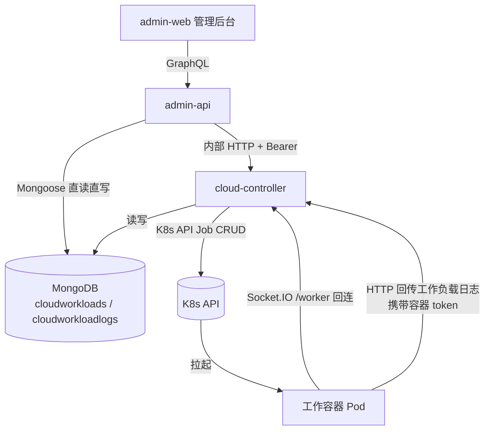
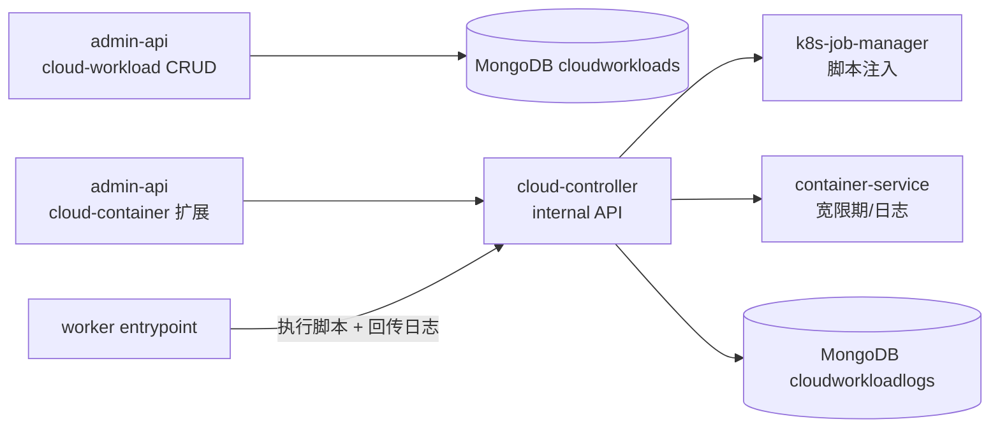
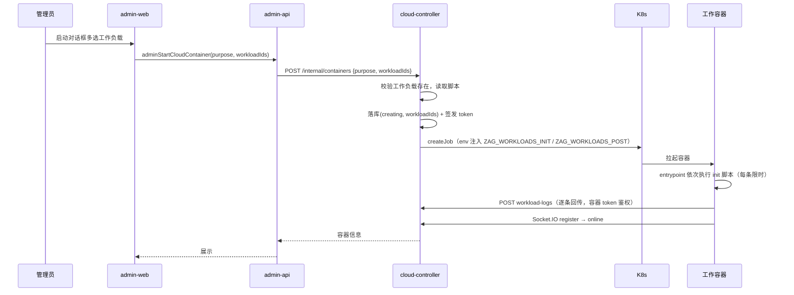
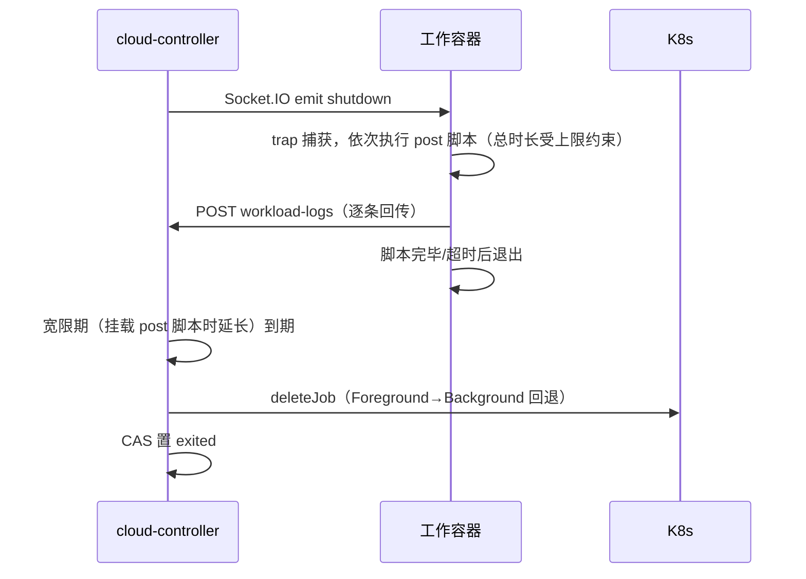

# 云控制器工作负载（Workload）功能 - 技术提案

**功能名称**: 云控制器工作负载管理
**关联 PRD**: docs/product/draft/20261017-cloud-controller-workload.md
**技术提案版本**: v1.0
**创建日期**: 2026-10-17
**作者**: ZeroAsh
**feat-branch**: `feat/cloud-controller-workload`

## 1. 概述

### 1.1 背景

云Agent二期已上线 cloud-controller 与云端工作容器管理链路（Job 拉起、token 回连、强制销毁）。本期在其上增加「工作负载」能力：管理员在后台维护工作负载（名称 + 初始化脚本 + 清理脚本），启动容器时多选挂载，容器拉起/关闭时自动执行对应脚本，执行日志持久化并可在后台查看。

### 1.2 目标

- admin-api 提供工作负载 CRUD GraphQL 接口，admin-web 新增工作负载管理页面。
- 启动容器链路支持携带 `workloadIds`，cloud-controller 将脚本注入工作容器。
- 工作容器 entrypoint 执行初始化/清理脚本并回传执行日志。
- cloud-controller 存储工作负载执行日志，admin-web 可按容器查看。

### 1.3 范围

**做**：
- 工作负载 CRUD（admin-api + admin-web）。
- 启动容器多选工作负载，初始化脚本注入与执行。
- 销毁时清理脚本执行（带超时保护）。
- 工作负载执行日志的存储与后台查看。

**不做**：
- 工作流/会话等任务类型挂载工作负载（后续迭代）。
- 工作负载参数化/变量机制。
- 容器异常退出（OOM 等）下的清理脚本保障。

## 2. 技术架构

### 2.1 系统架构图



### 2.2 技术栈

| 层级 | 技术选型 | 说明 |
|------|---------|------|
| 前端 | React + TypeScript + Vite + Apollo Client | admin-web，复用 base-image CRUD 页面模式 |
| 后端 | Node.js + Express + GraphQL + Mongoose | admin-api（CRUD/查询）、cloud-controller（注入/日志接收） |
| 数据库 | MongoDB | admin-api 与 cloud-controller 共享同一实例（沿用既有降级直读模式） |
| 容器 | K8s Job + 工作容器镜像 entrypoint.sh | 脚本注入执行 |

### 2.3 模块划分



| 模块 | 职责 | 关键技术点 |
|------|------|-----------|
| admin-api cloud-workload | 工作负载 CRUD、容器日志查询 | Mongoose 直读写，复用 base-image resolver 模式 |
| cloud-controller container-service | 启动携带工作负载、销毁宽限期调整 | 读取 cloudworkloads，按 post 脚本调整 shutdownGraceMs |
| cloud-controller k8s-job-manager | Job manifest 注入工作负载脚本 | env 注入 base64 JSON |
| cloud-controller workload-log 接口 | 接收容器回传的执行日志 | 容器 token 鉴权，落库 cloudworkloadlogs |
| worker entrypoint.sh | 执行 init/post 脚本并回传日志 | 超时控制、逐条回传 |
| admin-web | 工作负载页、启动对话框多选、日志查看 | 复用 base-image 页面组件模式 |

## 3. API 设计

### 3.1 API 契约

新增契约文件 `contracts/admin-cloud-workload.graphql`，并扩展 `contracts/admin-cloud-container.graphql`。

#### 工作负载 CRUD（admin-api 本地数据，GraphQL）

```graphql
type CloudWorkload {
  id: ID!
  name: String!
  initScript: String
  postScript: String
  createdAt: String!
  updatedAt: String!
}

input CreateCloudWorkloadInput {
  name: String!
  initScript: String
  postScript: String
}

input UpdateCloudWorkloadInput {
  name: String
  initScript: String
  postScript: String
}

extend type Query {
  adminCloudWorkloads: [CloudWorkload!]!
  adminCloudContainerWorkloadLogs(containerId: ID!): [CloudWorkloadLog!]!
}

extend type Mutation {
  adminCreateCloudWorkload(input: CreateCloudWorkloadInput!): CloudWorkload!
  adminUpdateCloudWorkload(id: ID!, input: UpdateCloudWorkloadInput!): CloudWorkload!
  adminDeleteCloudWorkload(id: ID!): Boolean!
  adminStartCloudContainer(purpose: CloudContainerPurpose!, workloadIds: [ID!]): CloudContainer!
}
```

#### 工作负载执行日志

```graphql
enum CloudWorkloadLogPhase { INIT, POST }
enum CloudWorkloadLogStatus { RUNNING, SUCCESS, FAILED, TIMEOUT }

type CloudWorkloadLog {
  id: ID!
  containerId: ID!
  workloadId: ID!
  workloadName: String!
  phase: CloudWorkloadLogPhase!
  status: CloudWorkloadLogStatus!
  exitCode: Int
  log: String!
  startedAt: String!
  finishedAt: String
}
```

`CloudContainer` 增加字段：

```graphql
extend type CloudContainer {
  workloads: [CloudWorkload!]!
}
```

- 校验规则：`name` 必填且去重；`initScript` 与 `postScript` 至少其一非空；单脚本长度上限 16 KiB。
- 所有接口仅管理员可访问（沿用 `assertAdmin`）。
- `adminCloudContainerWorkloadLogs` 优先经 cloud-controller 内部 API 查询，控制面不可达时降级直读 Mongo（与容器列表降级模式一致）。

#### cloud-controller 内部接口（REST，internal-auth Bearer）

| 接口 | 说明 |
|------|------|
| `POST /internal/containers` | 请求体增加可选 `workloadIds: string[]`；校验存在性，不存在返回 400 |
| `GET /internal/containers/:id/workload-logs` | 返回该容器全部工作负载执行日志（按 startedAt 升序） |
| `POST /internal/containers/:id/workload-logs` | **容器回传通道**：鉴权改用容器一次性 token（`TokenService.verify`），请求体 `{ workloadId, phase, status, exitCode?, log, startedAt, finishedAt? }` |

### 3.2 内部接口

- admin-api → cloud-controller：`CloudControllerClient` 增加 `start(purpose, workloadIds)` 与 `listWorkloadLogs(containerId)`。
- admin-api `CloudContainer.workloads` 字段 resolver：按容器 `workloadIds` 直读 Mongo 的 cloudworkloads 集合。

## 4. 数据模型

### 4.1 数据库设计

#### 集合: cloudworkloads（admin-api 管理，cloud-controller 只读）

| 字段 | 类型 | 说明 |
|------|------|------|
| name | String, required, unique | 工作负载名称 |
| initScript | String, default null | 初始化脚本（拉起容器时执行） |
| postScript | String, default null | 清理脚本（关闭容器时执行） |
| timestamps | createdAt / updatedAt | Mongoose timestamps |

#### 集合: cloudcontainers（扩展现有）

| 字段 | 类型 | 说明 |
|------|------|------|
| workloadIds | [ObjectId], default [] | 启动时挂载的工作负载，按选择顺序保存 |

#### 集合: cloudworkloadlogs（cloud-controller 写入，admin-api 只读）

| 字段 | 类型 | 说明 |
|------|------|------|
| containerId | ObjectId, required, index | 所属容器 |
| workloadId | ObjectId, required | 工作负载 |
| workloadName | String, required | 冗余名称，删除工作负载后日志仍可读 |
| phase | enum(init/post), required | 执行阶段 |
| status | enum(running/success/failed/timeout), required | 执行状态 |
| exitCode | Number, default null | 脚本退出码 |
| log | String, default '' | 输出日志，超长截断保留尾部（上限 256 KiB） |
| startedAt | Date, required | 开始时间 |
| finishedAt | Date, default null | 结束时间 |

### 4.2 缓存设计

无新增缓存。工作负载数据量小（百级），直接查库。

## 5. 技术实现方案

### 5.1 核心流程

#### 启动容器（挂载工作负载）



#### 销毁容器（执行清理脚本）



### 5.2 关键实现点

#### 实现点 1: 脚本注入（env + base64 JSON）

- **描述**: `K8sJobManager.buildManifest()` 扩展入参 `workloads`，将 init/post 脚本分别序列化为 JSON 数组（`[{id, name, script}]`，保持选择顺序），base64 编码后注入两个环境变量 `ZAG_WORKLOADS_INIT` / `ZAG_WORKLOADS_POST`；无工作负载时不注入，保持现状行为。
- **技术细节**: env 值总量受 K8s/etcd 限制，结合单脚本 16 KiB 上限与挂载数量上限（建议 ≤ 10 个，启动接口校验），总量远低于限制。
- **风险点**: 超长脚本被接口层校验拦截；base64 避免特殊字符问题。

#### 实现点 2: worker entrypoint 执行与日志回传

- **描述**: `deploy/images/worker/entrypoint.sh` 增加两个阶段：
  - init 阶段（`exec agent-gear` 之前）：解码 `ZAG_WORKLOADS_INIT`，逐条以 `bash -c` 执行，每条独立超时（默认 300s，可通过 env 覆盖），输出 tee 到临时文件，执行完毕即通过 HTTP POST 回传日志到 cloud-controller；脚本失败仅记录，不阻断后续脚本与容器上线。
  - post 阶段：trap SIGTERM/SIGINT 时解码 `ZAG_WORKLOADS_POST` 逐条执行（共享总预算，默认 90s），逐条回传日志后退出。
- **技术细节**: 回传地址由 `ZAG_SERVER_ENDPOINT` 推导（`wss://host/worker` → `https://host/internal/containers/<id>/workload-logs`，containerId 从 `ZAG_CONTROLLER_KEY` 的 `<containerId>.<secret>` 前缀解析）；鉴权头携带完整 token。回传失败重试 2 次后放弃（不阻断主流程）。
- **风险点**: 回传依赖网络可达 cloud-controller；init 阶段在 register 之前执行，token 在容器终态前有效，可满足。

#### 实现点 3: 销毁宽限期调整

- **描述**: `ContainerService.destroyLocked()` 目前固定 `shutdownGraceMs=10000`。容器挂载含 post 脚本的工作负载时，宽限期调整为 `max(10000, 配置的 postGraceMs)`（默认 120000ms），保证清理脚本有时间执行并回传日志。
- **风险点**: 宽限期拉长会推迟 Job 删除；由 `StatusSyncService` 兜底巡检回收，无泄漏风险。

#### 实现点 4: 日志接收接口鉴权

- **描述**: `POST /internal/containers/:id/workload-logs` 复用 `TokenService.verify()` 校验容器一次性 token（与 Socket.IO 握手同一套），校验通过且容器非终态才接受写入；`log` 字段超限截断保留尾部。
- **风险点**: 与 `/internal/*` 的 Bearer internal-auth 不同，该路由需单独挂载 token 校验中间件，注意路由顺序与鉴权隔离。

## 6. 技术决策

### 6.1 决策列表

| 决策 | 选项 A | 选项 B | 最终选择 | 原因 |
|------|--------|--------|---------|------|
| 工作负载数据归属 | admin-api 本地集合 | cloud-controller 持有 | admin-api 本地集合 | 复用 base-image CRUD 模式；cloud-controller 共享 Mongo 只读即可 |
| 脚本注入方式 | env 注入 base64 JSON | 为每容器创建 ConfigMap | env 注入 | KISS：无额外 K8s 资源与权限；脚本体量小 |
| 日志采集方式 | K8s Pod Logs API 拉取 | 容器内主动 HTTP 回传 | 容器内回传 | 无需扩大 RBAC（当前无 pods/logs 权限）；shutdown 阶段 Pod 被删后仍可收到日志；逐条回传即时可见 |
| 清理脚本执行保障 | 延长 shutdown 宽限期 | init 容器/PreStop hook | 延长宽限期 | 现有 trap + 宽限机制可覆盖，改动最小 |
| init 失败策略 | 阻断容器上线 | 记录后继续 | 记录后继续 | 裸容器仍可使用，日志可定位问题（PRD 约定） |

### 6.2 依赖与约束

| 类型 | 内容 | 说明 |
|------|------|------|
| 依赖 | admin-api 与 cloud-controller 共享 MongoDB | 沿用容器列表降级直读的既有事实 |
| 依赖 | 工作容器镜像重新构建发布 | entrypoint.sh 需支持新阶段 |
| 约束 | cloud-controller RBAC 不变 | 不新增 pods/logs 权限 |
| 约束 | 不改动 Socket.IO 协议 | register/heartbeat/shutdown 事件保持不变 |

## 7. 项目结构

```
contracts/
└── admin-cloud-workload.graphql              # 新增：工作负载与日志契约
servers/admin-api/
└── src/
    ├── models/cloud-workload.ts              # 新增：CloudWorkload 模型
    ├── models/cloud-workload-log.ts          # 新增：日志降级直读模型
    ├── graphql/schemas/cloud-workload.ts     # 新增：typeDefs
    ├── graphql/resolvers/cloud-workload.ts   # 新增：CRUD + 日志查询 resolver
    └── services/cloud-controller-client.ts   # 扩展：workloadIds / listWorkloadLogs
servers/cloud-controller/
└── src/
    ├── models/cloud-workload.ts              # 新增：只读模型（共享集合）
    ├── models/cloud-workload-log.ts          # 新增：日志模型
    ├── repositories/                         # 扩展：workload-log 仓储
    ├── routes/internal-api.ts                # 扩展：workload-logs 路由（token 鉴权）
    ├── services/k8s-job-manager.ts           # 扩展：脚本 env 注入
    └── services/container-service.ts         # 扩展：workloadIds、销毁宽限期调整
apps/admin-web/
└── src/
    ├── pages/CloudWorkloadsPage.tsx          # 新增：工作负载管理页
    ├── pages/CloudContainersPage.tsx         # 扩展：日志查看入口
    ├── components/cloud-workloads/           # 新增：表格/表单对话框/删除确认
    ├── components/cloud-containers/          # 扩展：启动对话框多选、日志抽屉
    └── graphql/                              # 扩展：queries/mutations/types
deploy/images/worker/
└── entrypoint.sh                             # 扩展：init/post 阶段执行与日志回传
```

## 8. 测试策略

### 8.1 测试覆盖要求

- 单元测试覆盖率：新增代码 >= 80%
- API 测试覆盖的端点：工作负载 CRUD 全部 GraphQL 操作、`adminStartCloudContainer(workloadIds)`、`adminCloudContainerWorkloadLogs`

### 8.2 测试类型

| 类型 | 工具 | 覆盖范围 |
|------|------|---------|
| 单元测试 | vitest | 脚本注入 manifest 构建、日志截断、token 鉴权、宽限期计算、resolver 校验 |
| API 测试 | tests/api | 工作负载 CRUD、启动携带工作负载、日志查询（含降级路径） |
| E2E 测试 | tests/e2e | 后台新建工作负载 → 启动容器挂载 → 查看执行日志 |
| 手工验证 | K8s 环境 | init/post 脚本真实执行、超时保护、镜像构建 |

开发遵循 TDD 红-绿-重构循环。

## 9. 部署方案

### 9.1 环境规划

| 环境 | 用途 | 部署方式 |
|------|------|---------|
| 本地开发 | Aspire 编排 | aspire start（cloud-controller 使用 InMemory K8s 或真实集群配置） |
| 内网 K8s | 生产 | deploy/k8s 既有 manifest，cloud-controller 滚动更新；worker 镜像重新构建推送 |

### 9.2 配置管理

| 配置项 | 服务 | 默认值 | 说明 |
|--------|------|--------|------|
| `WORKLOAD_INIT_TIMEOUT_MS` | worker（env 注入） | 300000 | 单条 init 脚本超时 |
| `WORKLOAD_POST_BUDGET_MS` | worker（env 注入） | 90000 | post 脚本总预算 |
| `WORKLOAD_POST_GRACE_MS` | cloud-controller | 120000 | 挂载 post 脚本时的销毁宽限期 |
| `WORKLOAD_LOG_MAX_BYTES` | cloud-controller | 262144 | 单条日志存储上限（截断保留尾部） |

## 10. 验收标准

- [ ] 技术方案评审通过
- [ ] Contract 评审通过
- [ ] 代码实现完成
- [ ] 单元测试覆盖达标
- [ ] API 测试通过
- [ ] E2E 测试通过
- [ ] 工作负载 CRUD 在后台可用，启动容器可多选挂载
- [ ] init/post 脚本真实执行且日志可在后台查看
- [ ] 不挂载工作负载的容器行为与现状一致

## 11. 相关文档

- PRD：`docs/product/draft/20261017-cloud-controller-workload.md`
- 既有提案：`docs/engineering/proposals/20261014-feat-cloud-agent-phase2.md`、`docs/engineering/proposals/20261014-feat-admin-console.md`
- 既有契约：`contracts/admin-cloud-container.graphql`
- 开发规范：`docs/engineering/backend-rules.md`、`docs/engineering/frontend-rules.md`
